# Evolving Infra：解耦算力与 KV，适配 Agent 动态负载

Agent 的多轮请求既会反复复用长前缀，又会因工具调用、子 Agent 和上下文压缩不断改变计算与缓存需求，传统 PD 分离架构因此容易出现节点角色切换昂贵、负载估计失真和 KV 误淘汰。Evolving Infra 的核心思路是：**把节点的 Prefill/Decode 角色与 KV 存储解耦，再用在线模型和 Agent 分支信息同时指导算力分配、请求路由与缓存淘汰**。在 36 张 GB300 GPU 的静态负载实验中，它相对 Dynamo 最高取得 2.73 倍吞吐量，将平均端到端延迟和 P95 TTFT 分别最多降低 4.12 倍和 13.92 倍。更关键的是，一次节点角色切换平均只需 6.2 秒，而 Dynamo 重启式切换平均需要 754 秒。

## 为什么 Agent 推理不能沿用静态 PD 配置

先把两个基础概念说清楚。大模型请求通常分为 **Prefill** 和 **Decode** 两个阶段：前者处理输入并生成 KV Cache，后者逐 Token 生成输出。PD 分离把两类计算放到不同节点上，`xPyD` 表示 $x$ 个 Prefill 节点和 $y$ 个 Decode 节点。

普通聊天请求可以近似看成彼此独立的一次性任务，Agent 则不同。一个 Agent 会连续执行“模型请求—工具调用—上下文更新”，下一轮请求往往带着上一轮的长上下文。因此，系统既要复用历史 KV，又要应对不断变化的输入输出比例。

这种变化发生在三个层面：

- **不同 Agent 之间**：数学 Agent 会生成很长的推理链，更偏 Decode；操作电脑的 Agent 每一步都追加截图，更偏 Prefill。
- **集群负载随时间变化**：编程、数学和电脑操作任务的比例改变，最优 PD 划分也随之改变。
- **单个 Agent 内部**：Fork、子 Agent、Compaction（上下文压缩）以及长时间工具等待，会改变哪些前缀仍有复用价值。

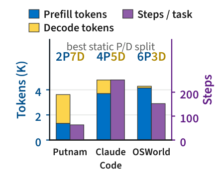

> 图解：Putnam、Claude Code（CC）和 OSWorld 的请求具有不同的 Prefill 与 Decode 工作量，因此最优静态划分从 Putnam 的 2P7D 变化到 OSWorld 的 6P3D。这里的 2P7D 表示 2 个 Prefill 节点、7 个 Decode 节点。

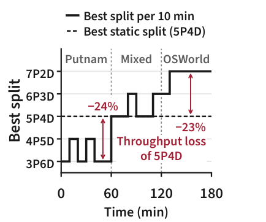

> 图解：随着负载从 Putnam 转向 OSWorld，每 10 分钟窗口的最优划分从 3P6D 移到 7P2D；固定为全程最优的 5P4D，在纯 Putnam 和纯 OSWorld 阶段仍会损失最多 24% 的吞吐量。这说明“先离线测一个最佳比例”无法覆盖动态负载。

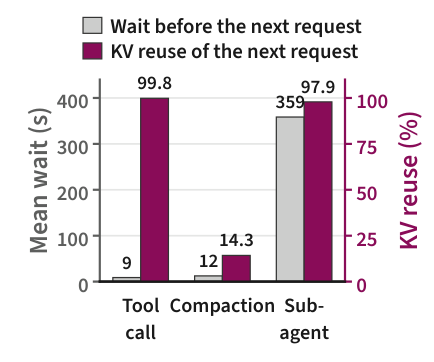

> 图解：CC 中，一次等待 359 秒的子 Agent 调用之后，仍有 98% 的 Prompt 能匹配已有 KV；而一次仅间隔 12 秒的 Compaction 之后，匹配比例反而只有 14%。访问时间近，不等于接下来还会使用。

因此，真正需要预测的不是“哪块缓存最近被碰过”，而是“哪个活跃分支的上下文仍然引用它”；真正需要估计的也不是“队列现在有多长”，而是“考虑 KV 复用后，一个平均请求究竟需要多少 Prefill 和 Decode 工作”。

## 现有系统的三处失效

论文用九节点、共 36 张 GB300 GPU 的测试床复放 Claude Code 轨迹，把问题拆成三个可测量的来源。

### 角色切换：要么停机重启，要么丢掉缓存

Dynamo 通过重启 Worker 改变节点角色，切换期间节点完全退出服务。Arrow 虽能原地切换，但切到 Decode 后，原先存在该节点上的 KV 对后续 Prefill 不再可用。

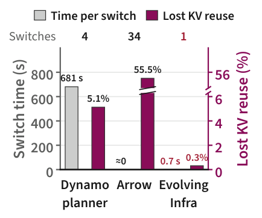

> 图解：该实验对比切换时间与 Lost KV Reuse。Dynamo 平均每次切换耗时 681 秒，Arrow 损失 55.5% 的可复用 KV；Evolving Infra 在运行请求结束后的实际角色切换只需 0.7 秒，KV 复用损失为 0.3%。这里的 Lost KV Reuse 定义为 $1-h/h^*$，其中 $h$ 是实际 KV 命中率，$h^*$ 是无限容量、全节点共享且不发生角色切换时的理想命中率。

### 负载估计：队列深度和完整输入长度都会误导

Dynamo 看 Prefill 队列深度和 Decode 节点的 KV 利用率；长上下文会让 Decode 侧 KV 利用率长期偏高，使系统逐渐把过多节点分给 Decode。Arrow 用完整输入长度预测 Prefill 时间，把已经缓存的前缀也当成新计算，同时容易被多个子 Agent 同时启动造成的短时尖峰触发。

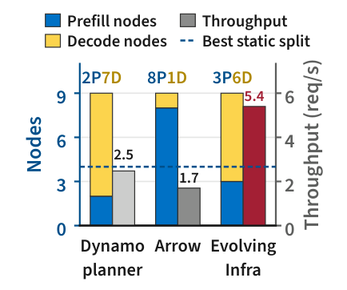

> 图解：在最佳静态划分 4P5D 可达到 4.9 req/s 的实验中，Dynamo 和 Arrow 的吞吐量分别低 49% 和 65%。Arrow 最终漂移到 8P1D 并切换 34 次，Dynamo 则偏向 2P7D；两者方向相反，却都没有逼近真实需求。

### KV 管理：缓存局部性与负载均衡被迫二选一

只按前缀命中路由，会把同一 Agent 及其分支集中到少数节点；只按负载路由，又可能把请求送到没有前缀的节点，重算长上下文。加入共享内存池也不必然解决问题：如果直到 Prefill 开始才把远程 KV 搬进 GPU，搬运时间会直接加进 TTFT。

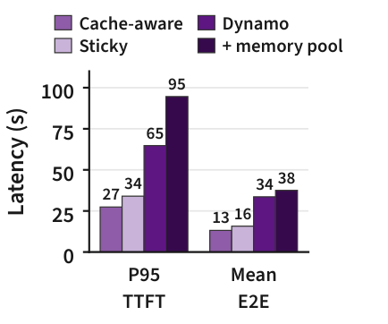

> 图解：在固定 4P5D 下，SGLang 的 Cache-Aware 和 Sticky-Session 策略将 P95 TTFT 推高到约 27 秒和 34 秒；Dynamo KV Router 约为 65 秒，简单加入共享内存池后反而达到 95 秒。根因不是“能否找到 KV”这么简单，而是请求排队、远程搬运和缓存副本必须一起考虑。

这三个症状背后其实是同一个结构问题：**节点角色、计算状态与 KV 位置被绑在一起，而控制面又只看到粗粒度信号。** Evolving Infra 因此先改数据面，再改控制面。

## 数据面：让节点可切换，让 KV 不随角色失效

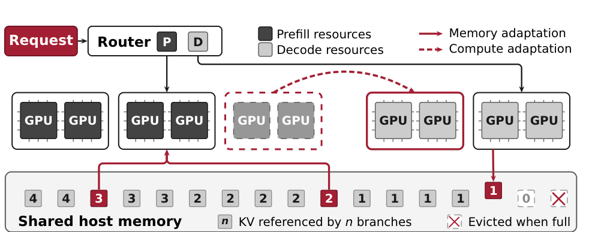

> 图解：Router 将请求分配给可动态切换的 Prefill 与 Decode 资源，节点主机内存组成共享 KV 池。实线表示 KV 与内存适配，虚线表示计算角色调整；每份 KV 记录仍引用它的活跃分支数，引用归零后才能优先淘汰。

### 对称引擎：同一节点原生支持两种阶段

Evolving Infra 在 SGLang 上实现对称引擎，用统一的调度循环支持 Prefill 和 Decode，并提供任意两个节点之间、任意方向的 KV 传输协议。节点在启动时不再被永久指定为某一种角色。

当规划器改变 PD 划分时，路由器只需改变发往该节点的请求类型，不必重启引擎。切换节点的排队请求会先转交给同阶段的其他节点，已经运行的请求则原地完成；全部排空后，节点再承担新角色。

这个设计避免了 Dynamo 的模型重新加载，也避免了 Arrow 切换后 KV 滞留（stranded）而不可用的问题。它还支持两阶段采用不同并行策略：只要显存中保留两种计算路径所需的权重并集，切换时就只改计算路径，不搬权重。

### 共享主机内存池：把搬运藏进排队时间

每个节点仍在 GPU 显存中维护 L1 KV Cache，同时把 KV 写穿到本机主机内存 L2。所有节点的 L2 共同组成逻辑上的共享池：

1. Prefill 节点通过全局目录找到可复用前缀；
2. 若前缀在其他节点，则通过 RDMA 直接从对方 L2 拉到本地 L2；
3. 在请求排队期间，把 KV 恢复到 GPU，并广播给节点内的所有 GPU；
4. Prefill 开始时，所需前缀已经就位，而不是边计算边等待分层加载。

Decode 节点只向共享池写入，不主动从主机内存加载旧 KV，避免整个 Decode Batch 等待内存恢复。Prefill 到 Decode 的新 KV 则走更快的 GPU-to-GPU 路径。

跨 Tensor Parallel Rank 的去重进一步放大了 L2 容量。GLM-5.2 和 Kimi K2.6 使用紧凑 KV 表示，MLA 下各 Rank 会保存相同 KV；每节点只留一份、取用时再广播，可让 L2 容纳约为 L1 四倍的 Token KV。论文估算，约 1 TB 的 GB300 主机内存可保存约 2000 万个 GLM-5.2 Token 的 KV，若四张 GPU 各存一份，则只能保存约 500 万个。

### 全局 KV 目录：记录“谁还会用”，而不只是“在哪里”

目录沿用 Dynamo 的前缀树和 KV 事件机制，记录每个 Block 位于哪些节点、哪些存储层，并额外维护计数 $R_{b,n}$：节点 $n$ 上，有多少个活跃 Agent 分支仍引用 Block $b$。

每个分支有 ID $\beta$ 和版本 $v_\beta$：

- 普通追加只给新 Block 增加计数，已复用 Block 不重复计数；
- Fork 或子 Agent 使用新分支 ID，新分支复用的 Block 增加计数；
- Compaction 改写上下文时递增版本，释放被替换历史的计数；
- 分支结束时释放它的全部计数；
- 同阶段传输 P2P/D2D 把计数从源副本移到目标副本；
- 跨阶段传输 P2D/D2P 保留两端计数，因为后续步骤仍可能分别使用两份 KV。

> 图解：深灰表示系统提示词，两种浅灰区分不同分支的上下文，红色表示新增 KV；$R_{P1}$ 表示 Prefill 节点 P1 上引用该 Block 的活跃分支数。

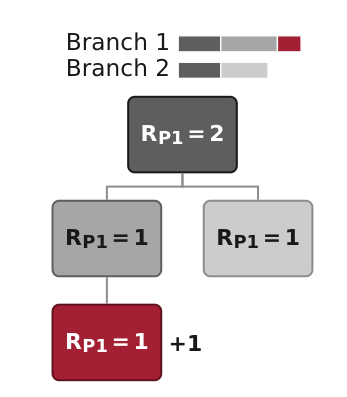

> 图解：连续请求只给新增 Block 增加计数，已经复用的系统提示词和历史上下文保持原计数，避免重复占用引用。

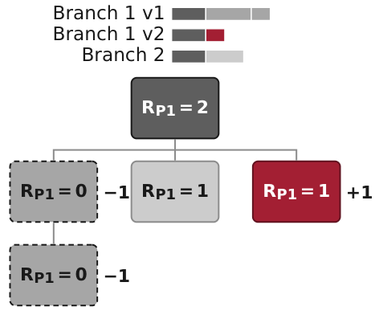

> 图解：Compaction 将分支版本从 v1 改为 v2 后，被替换历史的引用计数减一并归零，新摘要对应的新 Block 则增加计数。

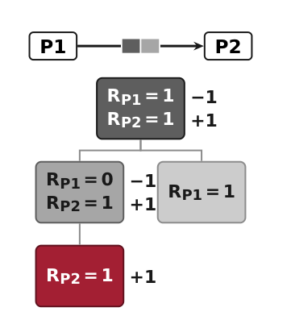

> 图解：P2P 或 D2D 传输把引用计数从源副本移到目标副本，源位置释放后便可安全淘汰重复 KV。

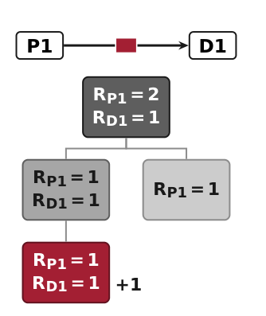

> 图解：P2D 或 D2P 传输保留源端与目标端计数，因为后续请求仍可能分别使用两个阶段的副本。

这样，每个活跃分支在每个阶段最多对一份副本计数。这个设计的聪明之处在于，它没有让 Agent Harness 预测未来复用时间，只要求 Harness 报告分支 ID、分支结束和上下文改写；缓存系统由此获得比 LRU 更可靠的语义信号。

## 控制面之一：在线估计真实计算需求

有了低成本切换和共享 KV 之后，下一个问题是：应该给 Prefill 和 Decode 各分多少节点？Evolving Infra 不用离线遍历所有配置，而是在线拟合每次迭代的耗时模型。

| 符号 | 含义 |
|---|---|
| $t_{\mathrm{uc}}$、$t_{\mathrm{c}}$ | 请求中未缓存与已缓存的 Prefill Token 数 |
| $t_{\mathrm{out}}$、$t_{\mathrm{acc}}$ | 输出 Token 数；每次 Decode 迭代平均接受的 Token 数 |
| $t_{\mathrm{fwd}}$ | 每个运行请求在一次 Decode 迭代中前向计算的 Token 数 |
| $w$ | 请求工作量，$w=(t_{\mathrm{uc}},t_{\mathrm{c}},t_{\mathrm{out}},t_{\mathrm{acc}})$ |
| $N$、$n$ | 节点数与节点索引 |
| $\mathcal{P}$、$\mathcal{D}$ | Prefill 与 Decode 节点集合 |
| $B$ | 一个 Decode 节点上的运行请求数 |

### Prefill：把新 Token、历史前缀和 Attention 分开

对于 Full Causal Attention，一个请求需要计算的 Query-Key 对数量为：

$$
A=t_{\mathrm{uc}}t_{\mathrm{c}}+\frac{t_{\mathrm{uc}}(t_{\mathrm{uc}}+1)}{2}
$$

其中第一项来自新 Token 对已缓存前缀的注意力，第二项来自新 Token 之间的因果注意力。节点 $n$ 的一次 Prefill 迭代耗时建模为：

$$
T^{\mathrm{iter}}_{\mathrm{P},n}=c_{n,0}+c_{n,1}\sum t_{\mathrm{uc}}+c_{n,2}\sum A+c_{n,3}\sum t_{\mathrm{rst}}
$$

求和遍历当前 Batch 中的请求，$t_{\mathrm{rst}}$ 是从主机内存恢复的 Token 数。四个系数分别表示固定启动成本、每个未缓存 Token 的成本、每个 Query-Key 对的成本和每个恢复 Token 的成本。

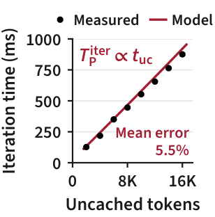

> 图解：横轴是未缓存 Prefill Token 数，纵轴是 GLM-5.2 在四张 GB300 GPU 上的单次迭代 GPU 时间。固定 128K 缓存前缀时，耗时随未缓存 Token 数近似线性增长。

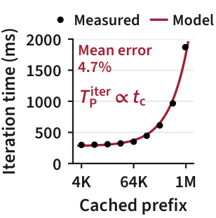

> 图解：横轴为缓存前缀长度并采用对数刻度，纵轴为 Prefill 迭代时间；固定 8K 未缓存 Token 时，缓存前缀通过 Attention 项影响耗时。图中红线为上述模型，散点为实测值。

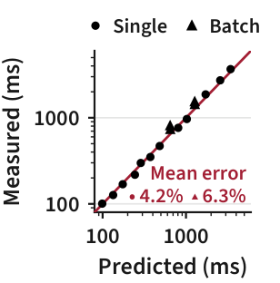

> 图解：横纵轴分别是预测与实测迭代时间。模型只用 20 个单请求设置拟合，在其余设置上的平均误差为单请求 4.2%、2–8 请求 Batch 6.3%。

对单个请求，把固定成本按未缓存 Token 占比分摊，可得到其占用的 Prefill 时间：

$$
T^{\mathrm{req}}_{\mathrm{P},n}(w)=c_{n,0}\frac{t_{\mathrm{uc}}}{\bar{t}_n}+c_{n,1}t_{\mathrm{uc}}+c_{n,2}A+c_{n,3}f_nt_{\mathrm{c}}
$$

其中 $\bar{t}_n$ 是该节点每次 Prefill 迭代的平均新 Token 数，$f_n$ 是缓存 Token 中需要从主机内存恢复的比例。相应节点服务率为 $\mu_{\mathrm{P},n}=1/T^{\mathrm{req}}_{\mathrm{P},n}(w)$。

### Decode：MoE 权重读取比上下文长度更关键

Decode 更受显存带宽限制，每轮都要读取 Dense 权重；MoE 层则只读取被当前 Token 选中的 Routed Expert。假设每个 Token 从 $E$ 个专家中选择 $k$ 个，各 Token 独立且负载均衡，$B$ 个请求、每个请求前向 $t_{\mathrm{fwd}}$ 个 Token 时，被选专家的预期比例为：

$$
\phi(B)=1-\left(1-\frac{k}{E}\right)^{t_{\mathrm{fwd}}B}
$$

于是 Decode 迭代时间为：

$$
T^{\mathrm{iter}}_{\mathrm{D},n}(B)=d_{n,0}+d_{n,1}\phi(B)+d_{n,2}B
$$

$d_{n,0}$ 包含固定成本与 Dense 权重读取，$d_{n,1}$ 是读取全部 Routed Expert 的成本，$d_{n,2}$ 是每个运行请求附带的采样、投机解码等成本。

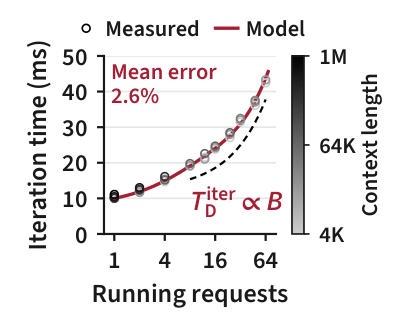

> 图解：横轴是运行请求数，纵轴是 Decode 迭代时间，颜色深浅表示上下文长度。模型使用 16K 上下文的十个点拟合；当有至少 8 个运行请求时，上下文长度只使迭代时间变化约 2–7%，因此主模型省略了上下文项。

一个请求需要约 $t_{\mathrm{out}}/t_{\mathrm{acc}}$ 次迭代才能完成，并与同 Batch 请求共享每轮成本，因此其 Decode 占用时间为：

$$
T^{\mathrm{req}}_{\mathrm{D},n}(w)=T^{\mathrm{iter}}_{\mathrm{D},n}(B)\frac{t_{\mathrm{out}}}{Bt_{\mathrm{acc}}}
$$

节点 Decode 服务率同样取倒数。Warmup 阶段，所有节点先以 Colocated 模式同时服务两种阶段，系统用非负最小二乘在线拟合系数，冻结后再进入 PD 分离；运行中只需重新测量随负载变化的 $\bar{t}_n$ 和 $f_n$。

### 规划器：只在收益持续存在时切换

每个请求都经过 Prefill 和 Decode，所以集群吞吐由较慢的一侧决定：

$$
\Theta(\mathcal{P},\mathcal{D};\bar{w},\bar{q})=\min\left(\sum_{n\in\mathcal{P}}\mu_{\mathrm{P},n},\sum_{n\in\mathcal{D}}\mu_{\mathrm{D},n}\right)
$$

$\bar{w}$ 是规划窗口内的平均请求工作量，$\bar{q}$ 是平均 Decode 请求数。规划器把窗口再分成 $m$ 个 Slice，计算候选划分相对当前划分的每片收益：

$$
g_i=\Theta(\mathcal{P}',\mathcal{D}';\bar{w}_i,\bar{q}_i)-\Theta(\mathcal{P},\mathcal{D};\bar{w}_i,\bar{q}_i)
$$

只有平均收益显著大于波动，即 $\bar{g}>2\sigma_g/\sqrt{m}$，候选才具备切换资格；最终选择平均收益最大的候选。这一步相当于给规划器加了“防抖”：子 Agent 同时启动可能拉长瞬时队列，但只要平均请求构成没有持续改变，就不会引发昂贵切换。

## 控制面之二：按分支语义淘汰，按预测 TTFT 路由

### 淘汰顺序：先清无人引用的副本

节点对主机内存 Block 按以下二元键升序淘汰：

$$
\left(\mathbb{1}[R_b>0],\ T_b\right)
$$

$R_b$ 是活跃分支引用计数，$T_b$ 是最后访问时间。所有零计数 Block 先按 LRU 淘汰，只有零计数 Block 全部清空后，才考虑仍有活跃引用的 Block。

因此，被 Compaction 替换的历史、已经结束子 Agent 的上下文、同阶段传输留下的源副本，会先于“正在等待工具但稍后还要恢复”的 KV 被清除。它不是完全抛弃 LRU，而是把 LRU 放在正确的分组内部。

### 路由：把排队、计算和远程搬运放在同一个成本模型里

对候选 Prefill 节点 $n$，基础预测为：

$$
\hat{T}_n(w)=T^{\mathrm{rem}}_n+\sum_{j\in Q_n}T^{\mathrm{req}}_{\mathrm{P},n}(w_j)+T^{\mathrm{req}}_{\mathrm{P},n}(w)
$$

$T^{\mathrm{rem}}_n$ 是当前运行 Batch 的剩余时间，$Q_n$ 是排队请求集合。完整实现还加入两项：远程 KV 搬运时间 $\tau(x_n)$ 中超过排队等待、无法被隐藏的部分，以及复制新副本的惩罚 $\kappa x_n$：

$$
\hat{T}_n \mathrel{+}= \max\left(0,\tau(x_n)-\hat{W}_n\right)+\kappa x_n
$$

路由器选择预测 TTFT 最短的节点，而不是简单选择本地前缀最长的节点；并列时才偏向本地前缀更长的节点。请求一到达就开始异步取 KV，Prefill 开始时才绑定仍有 KV 空间且请求数最少的 Decode 节点，避免排队请求提前占用 Decode 显存。

实验使用的窗口为 600 秒，包含 10 个 60 秒 Slice；Chunked Prefill 的预算为 8192 Token，每次切换后跳过 120 秒。节点状态若超过 5 秒未更新则不再用于路由。远程取 KV 的拟合函数为 $\tau(x)=0.45\,\mathrm{s}+1\,\mu\mathrm{s}\cdot x$，少于 512 Token 时不发起远程 Fetch。

## 实验：三类 Agent、静态与动态负载

### 测试设置

论文覆盖三种互补负载：

| 工作负载 | Agent 与特征 | 模型 | 并发 Agent 数 |
|---|---|---|---|
| Putnam | mini-SWE-agent 执行 PutnamBench，单分支、长推理，偏 Decode | GLM-5.2 | 224、256、288 |
| CC | 真实 Claude Code 轨迹，含子 Agent、Compaction 和长暂停 | GLM-5.2 | 90、108、126 |
| OSWorld 2.0 | 多模态电脑操作，每步追加截图，偏 Prefill | Kimi K2.6 | 128、144、160 |

模型使用 NVFP4 量化、FP8 KV Cache 和 Multi-Token Prediction 投机解码，在九个四卡 GB300 节点上以 TP4 运行。每次实验先 Warmup 30 分钟，再测量 1 小时；CC 用 Trie Replayer 保留原始暂停、输出长度、工具结果和前缀共享关系。

主要基线是 Dynamo v1.5.1，部分实验加入 SGLang PD 分离下的最佳静态划分。所有基线采用相同的去重主机内存和 Cache-Aware Prefill 路由，减少配置差异带来的干扰。

### 静态负载：吞吐、延迟与 KV 复用同时改善

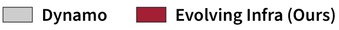

> 图解：后续九张结果图共用此图例，对比 Dynamo 与 Evolving Infra；箭头标出各面板的最大差距。

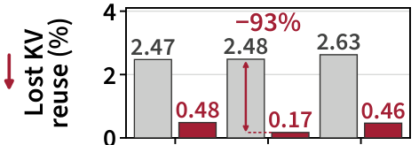

> 图解：纵轴为 Lost KV Reuse，横轴对应不同并发 Agent 数。Evolving Infra 在三个并发级别都保留了更多可复用 KV。

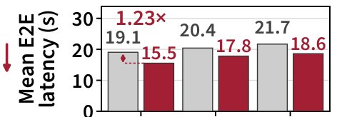

> 图解：纵轴为平均 E2E Latency，数值越低越好。Evolving Infra 相对 Dynamo 的延迟降低为 1.15–1.23 倍，是三类负载中增益最小的一类。

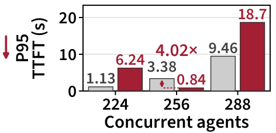

> 图解：纵轴为 P95 TTFT。规划器在 Putnam 上只保留 1–2 个 Prefill 节点以提高整体吞吐，因此在 224 和 288 Agent 时用更高的尾 TTFT 换取更低的平均 E2E 延迟，并非所有指标都单调占优。

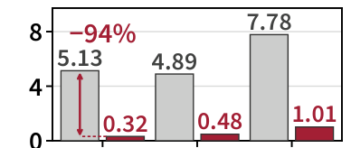

> 图解：CC 的上下文管理最复杂，Dynamo 会因 LRU 淘汰和路由位置丢失复用机会；Evolving Infra 将 Lost KV Reuse 压到约 0.32–1.01%。

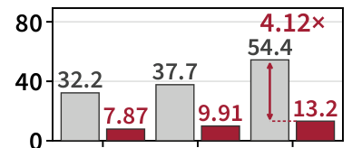

> 图解：Evolving Infra 在 CC 上将平均 E2E 延迟降低 3.80–4.12 倍，是静态负载中最明显的收益。

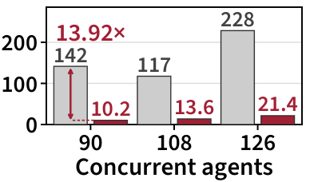

> 图解：预测 TTFT 路由减少了热点 Prefill 节点排队，同时共享 KV 池避免重算前缀，显著降低 CC 的尾 TTFT。

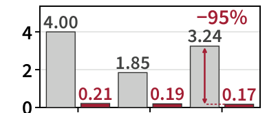

> 图解：OSWorld 每步追加截图，但历史上下文仍可大量复用。Evolving Infra 的 Lost KV Reuse 仅为 0.17–0.21%。

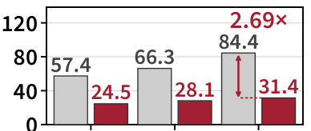

> 图解：Evolving Infra 将 OSWorld 平均 E2E 延迟降低 2.34–2.69 倍；其规划器最终选择 8P1D，把绝大多数节点分给 Prefill。

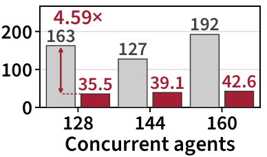

> 图解：在 OSWorld 与 CC 上，Evolving Infra 相对 Dynamo 的 P95 TTFT 降低范围为 3.25–13.92 倍。

汇总九个静态设置，Evolving Infra 达到 Dynamo 的 **1.10–2.73 倍吞吐量**，将 **Lost KV Reuse 降低 81–95%**，平均 E2E 延迟降低 **1.15–4.12 倍**。每次角色切换平均 6.2 秒，包含等待节点已有请求结束的时间；Dynamo 平均为 754 秒，且重启期间节点完全退出服务。

完整吞吐与延迟数据如下。闭环比测中，吞吐提升与 E2E 延迟下降符合 Little 定律：$X=\bar{N}_{\mathrm{branch}}/(\bar{T}_{\mathrm{E2E}}+\bar{T}_{\mathrm{pause}})$，其中暂停来自工具、子 Agent 或用户。

| 负载 | 并发 | Dynamo 吞吐 (req/s) | Dynamo E2E / Pause (s) | Evolving Infra 吞吐 (req/s) | Evolving Infra E2E / Pause (s) |
|---|---:|---:|---:|---:|---:|
| Putnam | 224 | 7.72 | 19.1 / 10.1 | 8.81 | 15.5 / 10.0 |
| Putnam | 256 | 8.37 | 20.4 / 10.1 | 9.20 | 17.8 / 10.0 |
| Putnam | 288 | 9.12 | 21.7 / 10.0 | 10.15 | 18.6 / 9.9 |
| CC | 90 | 2.48 | 32.2 / 15.4 | 5.40 | 7.9 / 12.9 |
| CC | 108 | 2.48 | 37.7 / 17.1 | 5.78 | 9.9 / 13.5 |
| CC | 126 | 2.14 | 54.4 / 18.6 | 5.85 | 13.2 / 14.1 |
| OSWorld | 128 | 1.93 | 57.4 / 1.0 | 4.30 | 24.5 / 1.4 |
| OSWorld | 144 | 1.98 | 66.3 / 1.4 | 4.33 | 28.1 / 1.4 |
| OSWorld | 160 | 1.68 | 84.4 / 1.2 | 4.38 | 31.4 / 1.3 |

角色切换与 KV 数据进一步说明收益并非只来自“切换更快”：

| 负载 | 并发 | Dynamo 切换次数 / 平均秒数 | Dynamo KV 命中 / 复用损失 | Evolving Infra 切换次数 / 平均秒数 | Evolving Infra KV 命中 / 复用损失 |
|---|---:|---:|---:|---:|---:|
| Putnam | 224 | 2 / 798 | 96.59% / 2.47% | 3 / 2.3 | 98.54% / 0.48% |
| Putnam | 256 | 2 / 798 | 96.56% / 2.48% | 2 / 3.5 | 98.85% / 0.17% |
| Putnam | 288 | 3 / 800 | 96.42% / 2.63% | 5 / 3.4 | 98.56% / 0.46% |
| CC | 90 | 4 / 681 | 92.25% / 5.13% | 1 / 0.7 | 97.08% / 0.32% |
| CC | 108 | 4 / 831 | 92.62% / 4.89% | 2 / 1.9 | 96.87% / 0.48% |
| CC | 126 | 4 / 813 | 89.52% / 7.78% | 2 / 10.8 | 96.25% / 1.01% |
| OSWorld | 128 | 5 / 666 | 89.79% / 4.00% | 1 / 19.4 | 93.79% / 0.21% |
| OSWorld | 144 | 4 / 730 | 92.01% / 1.85% | 1 / 18.0 | 93.79% / 0.19% |
| OSWorld | 160 | 4 / 748 | 90.67% / 3.24% | 1 / 17.7 | 93.84% / 0.17% |

在 CC 上，Dynamo 丢失的 KV 复用中，34–46% 来自 LRU 淘汰等待工具、子 Agent 或用户的分支；另有 15–22% 来自请求被路由到其他 Prefill 节点。Evolving Infra 则让最重 Prefill 节点的排队时间降到平均节点的 1.75–1.85 倍，而 Dynamo 为 2.29–2.61 倍。

| CC 并发 | Dynamo 排队时间 (s) | Dynamo 最重/平均 | Evolving Infra 排队时间 (s) | Evolving Infra 最重/平均 |
|---:|---:|---:|---:|---:|
| 90 | 11.4 | 2.29 | 1.5 | 1.79 |
| 108 | 11.0 | 2.38 | 2.2 | 1.75 |
| 126 | 11.2 | 2.61 | 4.3 | 1.85 |

### 动态负载：跟随每 10 分钟的最优划分

动态实验连续三个小时分别服务 288 个 Putnam Agent、144 个 Putnam 加 72 个 OSWorld Agent、144 个 OSWorld Agent，使需求逐步转向 Prefill。

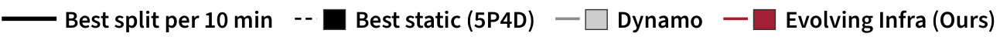

> 图解：后续动态负载图对比 Evolving Infra、Dynamo 和最佳静态 5P4D；Dynamo 的虚线段表示一个节点正在重启、只剩八个节点服务。

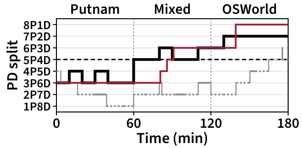

> 图解：横轴为时间，纵轴为 Prefill/Decode 节点划分。Evolving Infra 跟随各 10 分钟窗口的最佳划分，在 OSWorld 阶段稳定在 8P1D；Dynamo 多数时间配置的 Prefill 节点偏少。

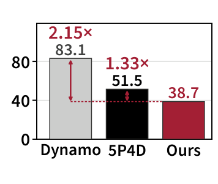

> 图解：纵轴为全程平均 E2E 延迟。Evolving Infra 相对 Dynamo 和最佳静态划分分别降低 2.15 倍和 1.33 倍。

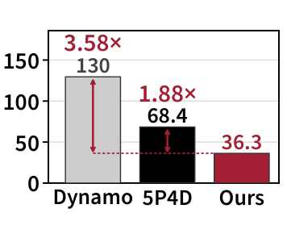

> 图解：纵轴为 P95 TTFT。Evolving Infra 相对 Dynamo 和最佳静态划分分别降低 3.58 倍和 1.88 倍。

全程吞吐分别为 Dynamo 1.94 req/s、静态 5P4D 3.25 req/s、Evolving Infra 4.16 req/s，即后两者相对 Dynamo 的优势并不足以追上在线自适应。

| 阶段 | Dynamo (req/s) | 静态 5P4D (req/s) | Evolving Infra (req/s) |
|---|---:|---:|---:|
| Putnam（288） | 1.57 | 3.02 | **4.05** |
| 混合（144+72） | 2.21 | 3.64 | **3.99** |
| OSWorld（144） | 2.05 | 3.10 | **4.43** |
| 全程 | 1.94 | 3.25 | **4.16** |

### 消融：收益来自哪里，切换又付出多少

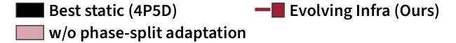

> 图解：该图例用于初始划分和在线自适应两组消融结果，区分不同系统配置。

> 图解：该图例对应 Prefill 与 Decode 迭代时间模型的在线收敛曲线。

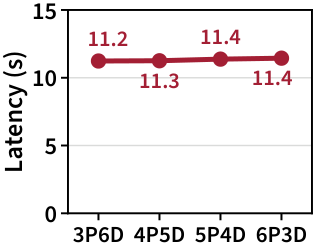

> 图解：在 CC、126 并发 Agent 下，从 3P6D 到 6P3D 的四种初始划分出发，平均 E2E 延迟最大只差 1.8%，最终都收敛到 4P5D。部署时不必精确猜中初始比例。

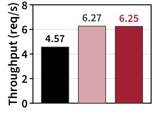

> 图解：固定 4P5D 时，仅启用对称数据面和 KV 感知路由/淘汰，吞吐已达到最佳静态 SGLang 的 1.37 倍；在最佳静态划分上再开启在线调整，只损失 0.3% 吞吐。

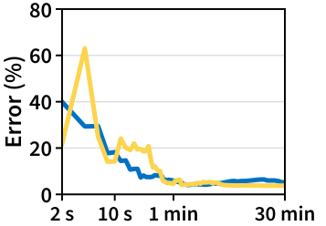

> 图解：横轴为在线学习时间，纵轴为模型平均误差。两类模型在一分钟内收敛到低误差，远短于实验使用的 30 分钟 Warmup。

仅使用异步 KV Fetch、保持 SGLang 路由时，吞吐已达到上游 SGLang 的 1.12 倍，Prefill 节点空闲时间从 23.6% 降至 14.4%。其余收益来自共享池之上的分支计数淘汰与预测 TTFT 路由。

## 附录中的关键证据与推导

### 模型并不只适用于 GB300 上的 GLM-5.2

作者又在四张 H200 GPU 上测试 DeepSeek-V4-Flash。该模型结合 Sliding Window 与压缩 Attention，MoE 每层从 256 个专家中选择 6 个，投机解码每轮前向 6 个 Token，均与 GLM-5.2 不完全相同。

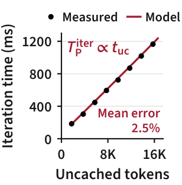

> 图解：固定 128K 缓存前缀时，DeepSeek-V4-Flash 的 Prefill 迭代时间仍随未缓存 Token 数近似线性变化。

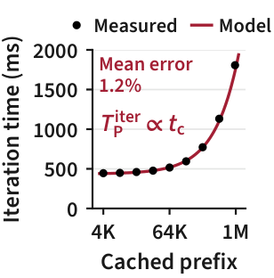

> 图解：固定 8K 未缓存 Token、横轴采用对数刻度时，缓存前缀与耗时的关系仍被同一函数形式捕捉。

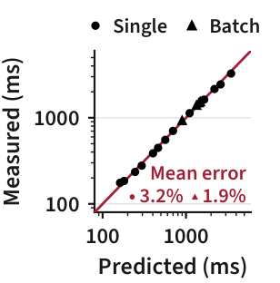

> 图解：拟合范围之外，单请求平均误差为 2.6%，2–8 请求 Batch 为 1.9%；所有 Batch 的最大偏差不超过 4.1%。

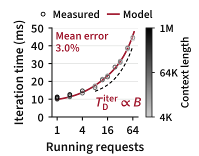

> 图解：Decode 模型在拟合范围之外的平均误差为 3.6%；至少 8 个运行请求时，上下文长度带来的变化最多为 6.9%。

同一个 Prefill 公式之所以能覆盖多种 Attention，是因为两项分别抓住两类成本：

- Sliding Window、Linear Attention 以及压缩操作，对每个未缓存 Token 的成本近似固定，归入 $c_{n,1}\sum t_{\mathrm{uc}}$；
- Full Attention、DSA 的 Indexer，以及 DeepSeek-V4 的 CSA/HCA，需要扫描的历史信息量随 Query-Key 对或其压缩比例增长，归入 $c_{n,2}\sum A$；
- DSA 核心 Attention 只看最多 2048 个高分 Token，CSA 核心只看 512 个 Entry，这部分同样近似随 $t_{\mathrm{uc}}$ 线性增长。

Decode 公式省略上下文项也有硬件与模型层面的依据。MLA 让 GLM-5.2 每个 Token 的 FP8 KV 约为 50 KB，约为完整 Multi-Head Attention 的 1/50；Sparse Attention 又只读取部分完整 KV。增加 100 万上下文 Token，只让 GLM-5.2 在 GB300 上的 Decode 迭代增加约 1 ms，让 DeepSeek-V4-Flash 在 H200 上最多增加约 1.5 ms，而 8–64 请求的一次迭代本身约为 17–45 ms。

### 大规模集群：全局更平稳，局部反而更不均衡

在 36、64、128、256 张 GB300 GPU 上复放 CC，并按每张 GPU 约 10 个 Agent 扩展并发。规模增大后，许多 Agent 的总体需求互相抵消，静态 PD 对全局划分不再那么敏感；但 Cache-Aware 路由会把更多 Agent 集中到少数前缀节点，节点间不均衡加重。

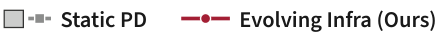

> 图解：后续三图对比固定划分的 SGLang Static PD 与 Evolving Infra。

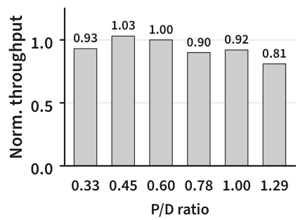

> 图解：在 256 GPU 上，吞吐量以 P/D=0.6（24P40D）为归一化基准；P/D 从 0.33 到 1.29 时，静态 PD 仍保留该配置的 81–103% 吞吐，说明全局最佳比例的影响随规模减弱。

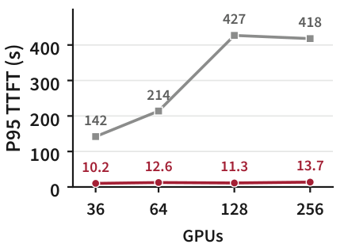

> 图解：从 36 扩展到 256 GPU，Static PD 的 P95 TTFT 约增长三倍，从 142 秒升至 418 秒；Evolving Infra 保持在 10–14 秒。

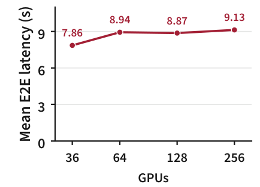

> 图解：同样扩展过程中，Evolving Infra 的平均 E2E 延迟只增加 16%，说明共享池与路由主要解决的是规模扩大后的局部热点。

离线寻找最佳静态划分的成本也会迅速膨胀。$N$ 个节点有 $N-1$ 种划分，每次评估都要在全部 $Ng$ 张 GPU 上复放长度为 $T$ 的轨迹及 Warmup $T_{\mathrm{w}}$。穷举成本为 $O(N^2gT)$，二分搜索为 $O(NgT\log N)$，还要求吞吐随 Prefill 节点数单峰，而实测并不总满足。

以 256 GPU、三小时 CC 轨迹为例，即使用二分搜索也需要 12 次运行、10,752 GPU-hours，是正常复放一次所需 768 GPU-hours 的 14 倍；穷举则需 56,448 GPU-hours。Evolving Infra 在 CPU 上用 $O(Nm)$ 次算术评估候选，不占额外 GPU 时间。

作者进一步用 Frontier 模拟 3072 张 GB300、30,720 个并发 Agent，将集群分为八个 384-GPU 分区，每个分区独立运行路由器、规划器和 KV 目录。

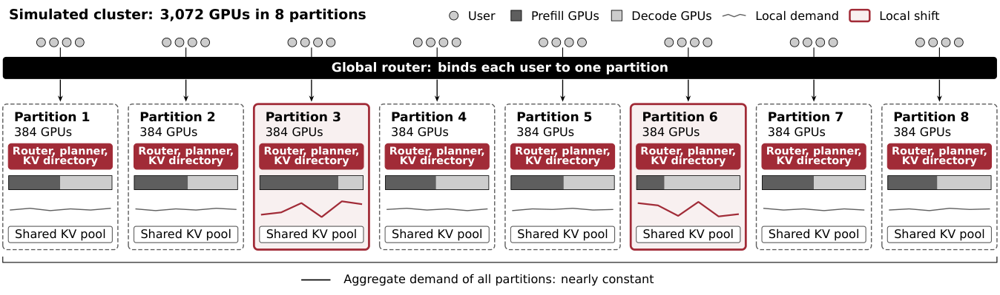

> 图解：全局 Router 将每个用户绑定到一个分区。虽然集群总 PD 比例在 24 小时内只变化 7%，部分分区仍出现局部需求偏移，各分区规划器分别调整划分。

静态划分下，两个分区严重不均衡，排队时间最高达到集群平均的 13.9 倍。失衡期间，分区总工作量变化不足 12.3%，但 PD 需求比例最多移动 42.4%，说明问题主要来自组成变化而非单纯流量突增。分区规划器将吞吐提高 1.42 倍。需要注意，该模拟假设异步 Fetch 能在 Prefill 前完成，因此不为 Fetch 额外计时，结果应理解为在这一假设下的扩展性证据。

### 开放环到达：不是所有到达率都稳定

闭环比测中，系统越慢，新请求也到得越慢；生产环境则不会自动减速。开放环实验按 Poisson 过程以每分钟 0.5–1.5 个 Agent 的固定速率注入 CC 任务，要求 P50/P95 TTFT 不超过 5/15 秒、P50 E2E 不超过 10 秒，同时接纳至少 90% Agent 且请求失败率低于 0.5%。

| 到达率 (Agent/min) | Evolving Infra TTFT P50/P95、E2E P50 (s) | 静态 4P5D TTFT P50/P95、E2E P50 (s) | Dynamo TTFT P50/P95、E2E P50 (s) |
|---:|---:|---:|---:|
| 0.5 | **0.7 / 6.8 / 2.5** | **0.7 / 10.8 / 2.7** | 1.0 / 22.0 / 3.4 |
| 0.75 | 1.3 / 17.8 / 4.4 | 3.8 / 57.0 / 7.3 | 21.0 / 234.5 / 25.7 |
| 1.0 | **1.2 / 12.3 / 4.6** | 6.6 / 139.0 / 11.3 | 11.9 / 122.1 / 17.4 |
| 1.25 | 16.8 / 55.0 / 21.8 | 18.5 / 1142.7 / 21.1 | 16.2 / 186.9 / 21.0 |
| 1.5 | 68.4 / 151.9 / 74.7 | 637.8 / 1377.1 / 639.9 | 19.6 / 251.1 / 24.4 |

加粗行表示满足全部目标。Evolving Infra 可持续 1.0 Agent/min，是静态 4P5D 的两倍；Dynamo 在最低速率下也未达标。不过，Evolving Infra 在 0.75 Agent/min 出现反常失败：第 75 分钟一次错误地切到 2P7D，使 P95 Prefill 排队达到 120–275 秒，直到第 85 分钟才补回 Prefill 节点。这说明统计防抖并不能完全避免规划误切换。

### 异构并行：Prefill TP8、Decode ADP8 也能切换

在六个八卡 B200 节点上运行 BrowseComp Agent，Prefill 使用 TP8，Decode 使用 ADP8。对称引擎为 Attention 保留 ADP 权重布局，Prefill 时按 TP 路径计算，Decode 时按 ADP 路径计算；额外权重约占每 GPU 10 GB，即 B200 显存的 6%。

| 指标 | 最佳静态 | Dynamo | Evolving Infra |
|---|---:|---:|---:|
| 最终划分 | 2P4D | 3P3D | 2P4D |
| 平均 E2E 延迟 (s) | 15.7 | 21.9 | 15.9 |
| 两小时累计引擎切换时间 (s) | 0 | 913 | 27 |

Evolving Infra 的平均延迟只比离线找到的最佳静态划分高 1.3%；Dynamo 则高 38%，累计切换时间是其 34 倍。对于跨多节点的 Wide Expert Parallelism，作者还提出保留两种角色所需专家副本的并集，让节点换组时少搬权重，但这部分主要是设计论证而非上表中的实测。

### 与 Agent-Aware 路由对比：容量足够时，暂停 Agent 没帮助

ThunderAgent 的思路是：KV 容量不足时暂停等待工具的 Agent，淘汰其 KV，稍后恢复。在 GB300 的大容量去重 L2 上，活跃 Agent 峰值 KV 需求只有容量的 86%，低于 95% 触发阈值，因此实验中没有请求被暂停。

| 指标 | Cache-Aware | ThunderAgent | Evolving Infra |
|---|---:|---:|---:|
| 吞吐 (req/s) | 4.66 | 4.43 | **6.27** |
| TTFT 平均/P95 (s) | 15.3 / 60.3 | 17.5 / 59.8 | **4.5 / 14.0** |
| E2E 平均/P95 (s) | 19.7 / 66.7 | 22.0 / 67.1 | **11.2 / 32.6** |
| TPOT 平均 (ms) | 4.6 | 4.4 | 7.9 |
| KV 命中率，实际/理想 | 94.9% / 97.2% | 94.7% / 97.2% | 96.6% / 97.3% |
| Lost KV Reuse | 2.4% | 2.6% | **0.7%** |
| 每请求未缓存 Prompt Token | 7,660 | 8,119 | **5,268** |

在固定 4P5D 下，Evolving Infra 吞吐是 Cache-Aware 的 1.35 倍，平均 TTFT 仅为其 0.29 倍。其 TPOT 更高，与更大的 Decode Batch 同时出现；作者也明确指出，这一对比没有单独分离路由与数据面的贡献。

### 异步 Fetch 的独立价值与真实搬运开销

只替换 KV 数据面、保持相同路由时，结果如下：

| 指标 | 上游 SGLang | Evolving Infra |
|---|---:|---:|
| 吞吐 (req/s) | 4.62 | **5.18** |
| TTFT 平均/P95 (s) | 15.7 / 56.4 | **12.1 / 42.8** |
| E2E 平均/P95 (s) | 20.2 / 64.5 | **16.5 / 50.7** |
| TPOT 平均/P95 (ms) | 4.4 / 8.1 | 4.5 / 8.2 |
| Prefill/Decode GPU 空闲时间 | 23.6% / 9.0% | **14.4% / 7.8%** |
| KV 命中率，实际/理想 | 95.1% / 97.3% | 94.9% / 97.3% |
| 每秒未缓存 Prompt Token（千） | 34.3 | 39.3 |

吞吐提高 12%，同时系统每秒多处理 15% 的未缓存 Prompt Token，说明收益来自减少等待而非提高 KV 命中率。上游 SGLang 使用 NCCL 广播恢复 KV，会与 Prefill 计算争用 GPU；Evolving Infra 则用 Copy Engine 经 NVLink 搬运，并与排队重叠。

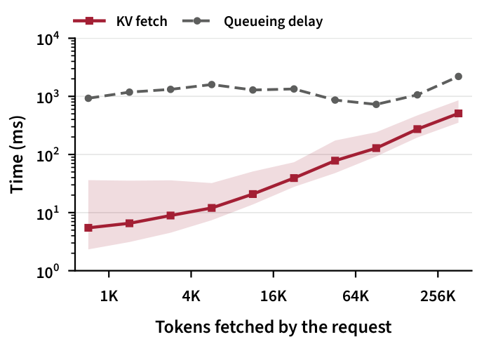

> 图解：横轴为 Fetch Token 数并按二的幂分桶，纵轴为搬运时间；实线是中位数，带状区域为 P10–P90。大 Fetch 的 RDMA 带宽约 52 GB/s，64K–128K Token 的中位时间为 129 ms；92% 的 Fetch 少于 16K Token，中位时间仅 7 ms。各桶的中位排队延迟为 0.7–2.2 秒，至少是同桶 Fetch 中位时间的 3.9 倍，因此大部分搬运能被排队隐藏。

## 与相关系统的关系

Evolving Infra 并不是孤立地重新发明所有组件，而是把已有机制的边界重新组合：

- **vLLM/SGLang**：默认在启动时固定引擎角色，改角色需要重启；SGLang 新的运行时切换仍会排空引擎并释放 Prefix Cache。
- **Arrow/xLLM**：支持原地切换，但 KV 仍受节点本地状态约束，且 TTFT 预测没有正确区分缓存前缀与新 Token。
- **Llumnix**：可在线调整 PD，却用离线采样点插值和粗粒度 Token 数估计成本。在 H200 对比中，其吞吐比最佳静态划分低 12.2%。
- **semi-PD**：在同一引擎内划分 SM 给两阶段，避免跨引擎重启，但控制信号仍受短时 TTFT/TPOT 波动影响。
- **MemServe/PPD**：复用多轮对话 KV，却不同时在线调整 PD 划分。
- **Mooncake/HiCache**：提供分层存储与跨节点共享，但传统路径会多经一次 L3 复制，并把 GPU 恢复留到 Prefill 阶段。
- **ThunderAgent/Continuum**：利用程序结构保留等待中 Agent 的 KV，但通常假设上下文只追加，不处理 Compaction 与跨节点重复副本。
- **KVTether**：同样从 Agent Harness 导出上下文操作并管理 KV 生命周期，但其展示设计不处理在线 PD 划分。

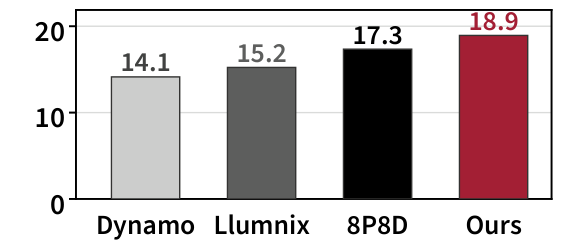

> 图解：DeepSeek-V4-Flash 在 16 个四卡 H200 引擎上服务 CC，并发 384。最佳静态 8P8D 的吞吐高于 Dynamo 和 Llumnix，Evolving Infra 又比它高 9%。

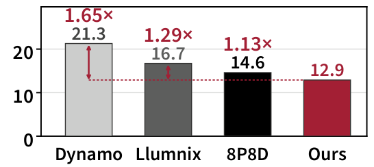

> 图解：纵轴为平均 E2E 延迟，红色数字表示基线相对 Evolving Infra 的延迟倍率。三种系统都从 12P4D 出发，Evolving Infra 最终优于两个在线基线。

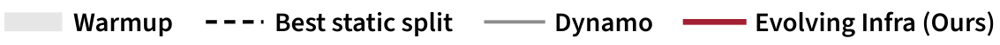

> 图解：后续三图比较 Evolving Infra 与 Dynamo 的节点角色变化；Dynamo 虚线段同样表示重启导致的八节点服务期。

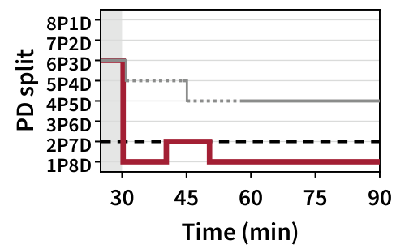

> 图解：在 224 个 Putnam Agent 下，Evolving Infra 在 1P8D 与 2P7D 之间调整；Dynamo 每次只通过重启移动一个节点，切换过程持续 10–15 分钟。

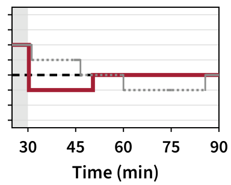

> 图解：在 126 个 CC Agent 下，Evolving Infra 先到 3P6D，随后到 4P5D；Dynamo 的重启使其在相当部分测量时间偏离有效配置。

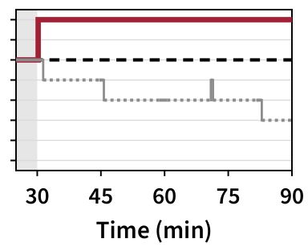

> 图解：在 160 个 OSWorld Agent 下，Evolving Infra 移至 8P1D 并保持稳定。跨全部九个静态设置，Dynamo 偏离对应最佳静态划分的时间占测量期 41–100%。

对称引擎本身也会改变最佳静态划分，因此不能把 Evolving Infra 的选择直接理解为对 SGLang 配置的错误修正。关闭在线调整后，两者各自的最佳配置如下：

| 负载 | 系统 | 最佳划分 | 吞吐 (req/s) | TTFT 平均/P95 (s) | E2E 平均/P95 (s) |
|---|---|---:|---:|---:|---:|
| Putnam（224） | SGLang | 2P7D | 9.00 | 1.0 / 2.5 | 14.6 / 74.0 |
| Putnam（224） | Evolving Infra | 2P7D | **9.20** | **0.6 / 1.2** | **14.0 / 72.6** |
| CC（90） | SGLang | 4P5D | 4.97 | 4.8 / 19.5 | 9.2 / 30.7 |
| CC（90） | Evolving Infra | 3P6D | **5.44** | **3.5 / 9.7** | **7.8 / 22.2** |
| OSWorld（128） | SGLang | 6P3D | 3.12 | 35.3 / 50.8 | 35.8 / 51.3 |
| OSWorld（128） | Evolving Infra | 8P1D | **4.33** | **21.6 / 35.6** | **24.2 / 39.2** |

OSWorld 的差异尤其明显：SGLang 在请求开始 Prefill 前就为 Decode 预留 KV 空间，排队也占用 Decode 显存；Evolving Infra 到 Prefill 开始时再绑定 Decode 节点，因此敢只保留一个 Decode 节点，把其余八个都用于 Prefill。

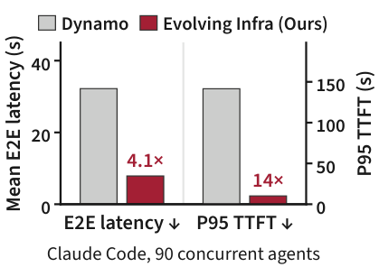

> 图解：该图汇总系统相对基线的加速效果，与静态和动态实验共同说明：收益来自低成本角色切换、更准确的计算划分和分支感知 KV 管理的组合，而不是某一个孤立技巧。

## 总结与展望

- **核心抽象是解耦**：对称引擎让节点原地换角色，共享主机内存池让 KV 在切换前后始终可读，两者共同消除“重启或丢缓存”的二选一。
- **算力规划看平均工作而非瞬时队列**：在线迭代模型区分缓存与未缓存 Token，并用跨 Slice 的显著收益过滤短时 Agent 突发。
- **KV 管理看活跃分支而非最近访问**：引用计数识别 Compaction 历史、结束子 Agent 和重复源副本，预测 TTFT 路由则同时考虑排队、计算与搬运。
- **收益有实测支撑，也有边界**：36 张 GB300 上最高 4.12 倍平均 E2E 延迟降低，256 GPU 上尾延迟保持平稳；但系统依赖 Harness 提供分支语义，开放环实验也暴露过单次误切换，3072 GPU 结果仍来自带理想化 Fetch 假设的模拟。

下一步值得关注的是，如何把分支语义接入更多真实 Agent 框架，并在更开放的到达过程、更异构的硬件与广域存储条件下验证规划稳定性；这篇工作已经证明，Agent 感知不应只是路由插件，而可以成为整个推理系统的组织原则。

> 本文参考自 [Evolving Infra: Agent-Adaptive LLM Serving at Scale](https://arxiv.org/abs/2611.12304)