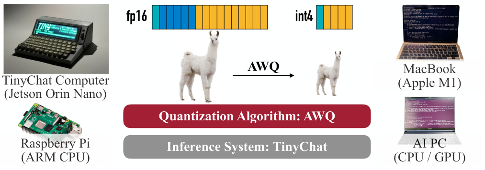
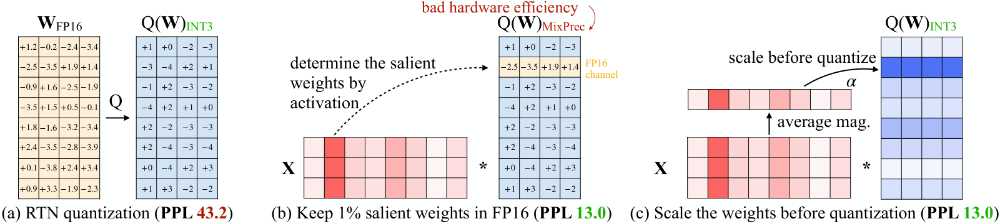
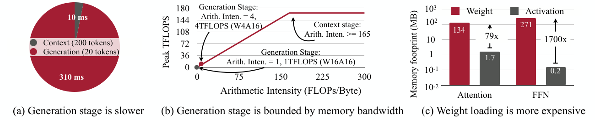
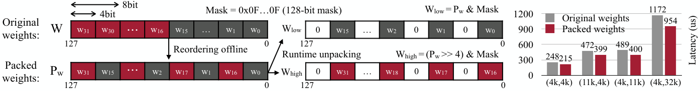
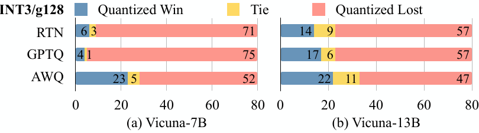
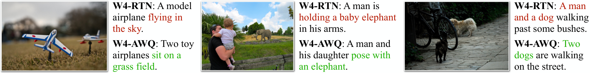
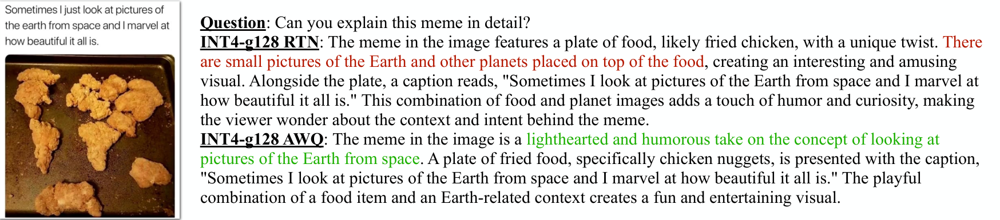
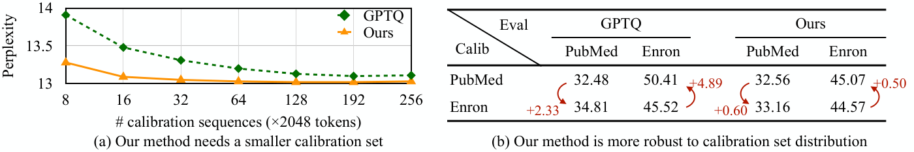
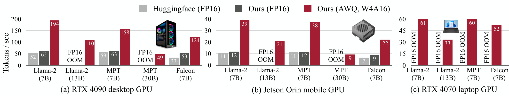
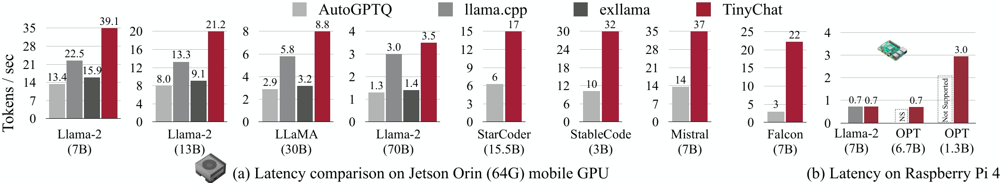

# AWQ：激活感知量化，端侧提速

想在手机、笔记本或 Jetson 上本地运行 LLM，最先撞上的往往不是算力，而是显存与内存带宽。端侧推理关系到离线可用、响应延迟和数据隐私，但低比特量化又容易让模型能力明显滑坡。AWQ（Activation-aware Weight Quantization，激活感知权重量化）的答案很直接：用激活分布识别关键权重通道，再通过等效缩放降低它们的量化误差，同时保持统一的低比特权重格式。配合 TinyChat 推理框架，论文在桌面和移动 GPU 上取得相对 Hugging Face FP16 实现 **3.2–3.3×** 的平均加速，并让 8GB 显存的 RTX 4070 笔记本 GPU 以 **33 Token/s** 运行 Llama-2-13B。

## 一、端侧部署的难题：既要做小，也要跑得快

把 LLM 放到本地，可以避免数据上传云端，降低服务成本，并支持离线助手、聊天机器人和自动驾驶等实时应用。但模型体积首先构成硬门槛：175B 参数的 GPT-3 使用 FP16 存储就需要约 350GB，远超多数设备的内存容量，边缘设备的压力更大。

> 图解：中央表示 AWQ 将 FP16 权重压缩为 INT4，并由 TinyChat 负责推理；四周展示 TinyChat Computer、Raspberry Pi、MacBook 和 AI PC 等部署形态。其中 TinyChat Computer 使用 8GB 内存、15W 功耗的 Jetson Orin Nano，说明这项工作的目标不是只缩小模型文件，而是让模型真正落到资源受限设备上。

量化可以从训练方式和数值格式两个维度理解：

- **QAT（Quantization-Aware Training，量化感知训练）**：训练时模拟量化并通过反向传播更新权重，效果通常较好，但训练成本难以扩展到 LLM。
- **PTQ（Post-Training Quantization，训练后量化）**：模型训练完成后再量化，通常无需完整训练，更适合 LLM；难点是如何在低比特下保住能力。
- **W8A8**：权重和激活都量化为 8bit，存储与计算精度一致，较容易集成到计算 Kernel。
- **W4A16**：只把权重量化为 4bit，激活仍用 16bit。它更适合批量较小、逐 Token 生成的端侧场景，因为此时主要开销是反复读取权重，而不是激活计算。

在 PTQ 方法中，RTN（Round-to-Nearest，就近取整）是最直接的基线；GPTQ 则利用二阶信息逐层重构并补偿误差。后者很强，但重构过程可能过拟合校准集，部分模型还依赖重排序技巧。已有 llama.cpp、exllama、AutoGPTQ 等系统则说明另一个现实：**算法上的低比特，并不自动等于硬件上的低延迟**。

因此，这项工作要连续解决两个问题：先找到精度损失小、对校准数据不敏感的量化算法，再用专门系统把压缩收益兑现为速度。我们先看 AWQ 最关键的发现。

## 二、核心观察：判断权重重要性，要看激活而不是权重

LLM 中的权重并非同等重要。少量 **Salient Weights（显著权重）** 对输出影响更大，若让这部分权重绕过量化，就能显著降低误差。真正反直觉的一点是：虽然做的是权重量化，但寻找显著权重时，权重自身的绝对值或 $L_2$ 范数并不是好指标，**激活幅值才更有效**。

> 图解：(a) 直接进行 RTN 量化，图中示例的 OPT-6.7B PPL 为 43.2；(b) 根据激活分布找出约 1% 的显著权重并保留 FP16，PPL 降至 13.0，但混合精度不利于硬件实现；(c) AWQ 不再保留 FP16 通道，而是在量化前按通道缩放权重，同样把图中示例的 PPL 降至 13.0。颜色较深的激活列对应更值得保护的输入通道，$\alpha$ 控制缩放强度。

### 2.1 1% 的通道，为什么能挽回大部分精度

作者用 OPT 模型做了对照实验：主体权重采用 INT3-g128，即 3bit 分组量化、每组 128 个权重；再分别按照激活幅值、权重分布或随机策略，把 0.1%、1%、3% 的通道保留为 FP16。评价指标是 WikiText 上的 PPL（Perplexity，困惑度），越低越好。

**表 1：不同显著权重选择策略的 WikiText PPL（↓）**

| 模型 | FP16 | RTN | 激活选择 0.1% | 激活选择 1% | 激活选择 3% | 权重选择 0.1% | 权重选择 1% | 权重选择 3% | 随机 0.1% | 随机 1% | 随机 3% |
|---|---:|---:|---:|---:|---:|---:|---:|---:|---:|---:|---:|
| OPT-1.3B | 14.62 | 119.00 | 25.03 | **16.91** | **16.68** | 108.71 | 98.55 | 98.08 | 119.76 | 109.38 | 61.49 |
| OPT-6.7B | 10.86 | 23.54 | **11.58** | **11.39** | **11.36** | 23.41 | 22.37 | 22.45 | 23.54 | 24.23 | 24.22 |
| OPT-13B | 10.13 | 46.04 | **10.51** | **10.43** | **10.42** | 46.07 | 48.96 | 54.49 | 44.87 | 42.00 | 39.71 |

差异非常明显。OPT-1.3B 的 RTN 困惑度为 119.00，按激活选择并保留 1% FP16 通道后降到 16.91；若按权重分布选择，1% 对应值仍高达 98.55。OPT-6.7B 也呈现同样趋势：激活选择得到 11.39，权重选择只有 22.37。

作者的解释是，大幅值激活通常承载重要特征，与这些输入通道相连的权重因而更关键。笔者认为，这个设计聪明的地方在于把“权重是否重要”从静态参数属性，转化成了 **模型实际如何处理数据** 的问题。

### 2.2 混合精度有效，却不是终点

只保留 0.1%–1% 的 FP16 权重，对总位数影响很小，却会带来不友好的混合精度数据布局：Kernel 要区分不同精度，权重访问、解包和计算都更复杂。于是下一个问题变成：能否让所有权重仍使用统一的 INT3/INT4 格式，同时获得接近“关键通道保留 FP16”的效果？AWQ 的等效缩放正是为此设计的。

## 三、AWQ 方法：用等效缩放保护关键通道

AWQ 不训练模型，也不逐层重构权重。它先离线统计校准数据上的平均激活幅值，再对权重和激活做一对方向相反的缩放：显著权重放大，对应激活缩小。理想情况下，$ws$ 与 $x/s$ 相乘仍等于 $wx$，网络功能不变；真正变化的是量化误差的相对大小。

### 3.1 为什么放大显著权重能减小误差

对一组权重 $\mathbf{w}$，论文采用如下的绝对最大值量化形式：

$$
Q(\mathbf{w}) = \Delta \cdot \operatorname{Round}\left(\frac{\mathbf{w}}{\Delta}\right), \qquad
\Delta = \frac{\max(|\mathbf{w}|)}{2^{N-1}}
$$

其中，$N$ 是量化位数，$\Delta$ 是量化步长。对某个显著权重 $w$ 乘以 $s>1$，同时对输入 $x$ 除以 $s$，量化后的计算变为：

$$
Q(ws)\frac{x}{s}
= \Delta' \operatorname{Round}\left(\frac{ws}{\Delta'}\right)\frac{x}{s}
$$

$\Delta'$ 是缩放后的量化步长。论文基于三个观察简化误差分析：Round 操作的误差期望近似不变，平均约为 0.25；放大组内少量显著元素通常不会改变整组最大绝对值，因此多数情况下 $\Delta'\approx\Delta$；$\Delta$ 和 $x$ 使用 FP16，不引入这里的权重量化误差。由此，缩放前后显著权重的误差比约为：

$$
\frac{\mathrm{Err}_{s}}{\mathrm{Err}_{1}}
\approx \frac{\Delta'}{\Delta}\cdot\frac{1}{s}
$$

只要 $\Delta'$ 没有明显变大，$1/s$ 就会压低显著权重的相对误差。直观地说，AWQ 是给关键权重留出更大的“有效量化范围”，再通过反向缩放把计算结果拉回来，而不是给它们单独准备一套 FP16 硬件通路。

**表 2：OPT-6.7B 上缩放 1% 显著通道的影响**

| 指标 | $s=1$ | $s=1.25$ | $s=1.5$ | $s=2$ | $s=4$ |
|---|---:|---:|---:|---:|---:|
| $\Delta'\neq\Delta$ 的比例 | 0% | 2.8% | 4.4% | 8.2% | 21.2% |
| 平均 $\Delta'/\Delta$ | 1 | 1.005 | 1.013 | 1.038 | 1.213 |
| 平均 $(\Delta'/\Delta)\cdot(1/s)$ | 1 | 0.804 | 0.676 | 0.519 | **0.303** |
| WikiText-2 PPL（↓） | 23.54 | 12.87 | 12.48 | **11.92** | 12.36 |

不过，$s$ 并非越大越好。增大到 4 时，显著通道的相对误差指标继续下降，但 PPL 反而从 $s=2$ 时的 11.92 回升到 12.36。原因是更多分组的 $\Delta$ 被拉大，非显著权重的误差随之放大；$s=4$ 时已有 21.2% 的分组步长发生变化。因此，AWQ 必须同时照顾显著与非显著通道。

### 3.2 把逐通道搜索压缩成一个参数

直接为每一层寻找完整缩放向量，目标是最小化量化前后输出的差异：

$$
\mathbf{s}^{*}=\arg\min_{\mathbf{s}}\mathcal{L}(\mathbf{s}), \qquad
\mathcal{L}(\mathbf{s})=\left\|Q\left(\mathbf{W}\operatorname{diag}(\mathbf{s})\right)\operatorname{diag}(\mathbf{s})^{-1}\mathbf{X}-\mathbf{W}\mathbf{X}\right\|
$$

这里，$\mathbf{W}$ 是 FP16 原始权重，$\mathbf{X}$ 是从小型校准集缓存的输入特征，$\mathbf{s}$ 是每个输入通道的缩放系数。$\operatorname{diag}(\mathbf{s})^{-1}\mathbf{X}$ 通常可以融合进前一个算子，不必额外引入一次显式计算。

问题在于 $Q$ 不可微，普通反向传播无法直接优化；近似梯度方法也存在收敛不稳定的问题。AWQ 因而把搜索空间限定为由激活统计决定的简单形式：

$$
\mathbf{s}=\mathbf{s}_{X}^{\alpha}, \qquad
\alpha^{*}=\arg\min_{\alpha\in[0,1]}\mathcal{L}\left(\mathbf{s}_{X}^{\alpha}\right)
$$

$\mathbf{s}_{X}$ 是每个输入通道的平均激活幅值，幂运算逐通道进行；$\alpha=0$ 表示不缩放，$\alpha=1$ 是该搜索空间中最激进的缩放。实际只需在 $[0,1]$ 内对单个 $\alpha$ 做快速网格搜索，并配合权重裁剪来降低量化 MSE（Mean Squared Error，均方误差）。

**表 3：OPT 系列在 INT3-g128 下的 WikiText PPL（↓）**

| 方法 | 1.3B | 2.7B | 6.7B | 13B | 30B |
|---|---:|---:|---:|---:|---:|
| FP16 | 14.62 | 12.47 | 10.86 | 10.13 | 9.56 |
| RTN | 119.47 | 298.00 | 23.54 | 46.04 | 18.80 |
| 1% FP16 混合精度 | 16.91 | 13.69 | **11.39** | **10.43** | 9.85 |
| 固定 $s=2$ | 18.63 | 14.94 | 11.92 | 10.80 | 10.32 |
| AWQ | **16.32** | **13.58** | **11.39** | 10.56 | **9.77** |

AWQ 在所有列上都显著优于 RTN，并整体接近 1% FP16 混合精度；在 1.3B、2.7B 和 30B 上还取得了表中更低的 PPL。与固定 $s=2$ 相比，自动搜索 $\alpha$ 也展现出更稳定的跨模型效果。

这套设计带来三个直接优势：

- **无需反向传播和重构**：优化过程简单，避免 GPTQ 式重构对校准集的过拟合风险。
- **校准需求低**：主要统计每通道平均激活幅值，而不是用大量样本回归权重。
- **硬件格式统一**：所有权重仍量化到 INT3/INT4，反向缩放可融合到相邻算子。

算法解决了“怎么压得准”，但 W4A16 的存储精度与计算精度不同，推理时还要把 INT4 权重转回 FP16 参与矩阵运算。若系统直接照搬 FP16 流程，反量化和 Kernel 启动开销可能吃掉收益，这正是 TinyChat 要处理的部分。

## 四、TinyChat：把 4× 压缩兑现为真实加速

### 4.1 端侧生成为什么主要受内存限制

作者在 RTX 4090 上分析 Llama-2-7B，采用符合端侧交互的 Batch Size 1。结果把问题指向了生成阶段，而不是一次性的 Prompt 处理阶段。

> 图解：(a) 饼图比较 Context 与 Generation 延迟，处理 200 个 Context Token 只需 10ms，而生成 20 个 Token 需要 310ms。(b) Roofline 图的横轴是 Arithmetic Intensity（算术强度，FLOPs/Byte），纵轴是峰值 TFLOPS；FP16 生成阶段算术强度约为 1，处于内存带宽受限区，W4A16 把它提高到约 4，对应图中 4TFLOPS 的理论峰值。(c) 对数纵轴表示 Attention 与 FFN 的权重、激活内存访问量，权重分别为 134MB 和 271MB，激活仅为 1.7MB 和 0.2MB，说明权重读取主导流量。

RTX 4090 的峰值计算能力为 165TFLOPS，显存带宽约为 1TB/s，因此算术强度低于约 165FLOPs/Byte 的工作负载更容易受带宽限制。逐 Token 生成时，同一个权重每步都要读取，而每步计算量有限；把权重从 16bit 压到 4bit，理论上可将权重读取量降为约四分之一，也解释了为什么本文优先选择 Weight-only Quantization。

### 4.2 三项系统优化，避免“省显存不省时”

TinyChat 使用 PyTorch 前端，后端针对 CUDA/PTX、NEON、AVX 等设备指令集实现。GPU 侧重点优化 Attention、Layer Normalization 和 Linear Projection；CPU 侧则把整个计算图下沉到 C++，减少运行时开销。

**第一项是 On-the-fly Dequantization（即时反量化）**。硬件通常不直接提供 INT4 与 FP16 的混合乘法，因此需要先把权重转回 FP16。TinyChat 将反量化融合进矩阵乘法主循环，避免把恢复后的完整权重写回 DRAM；该策略同时用于矩阵—矩阵和矩阵—向量计算。

**第二项是 SIMD-aware Weight Packing（面向 SIMD 的权重打包）**。单个 4bit 权重的反量化需要移位、按位与和缩放等操作，如果逐个处理，指令开销可能接近甚至超过有效计算。TinyChat 按设备 SIMD 位宽预先重排权重，让运行时能够成组解包。

> 图解：左侧把 32 个 4bit 权重按 $w_0,w_{16},w_1,w_{17},\ldots,w_{15},w_{31}$ 的顺序装入 128bit 寄存器，运行时利用 128bit Mask、AND 和 Shift 操作，只需三条 SIMD 指令即可解包全部 32 个权重；相比之下，常规布局需要为每个权重执行三条标量指令。右侧纵轴为延迟（$\mu$s，越低越好），四种矩阵形状下红色 Packed Weights 都低于灰色原始布局；例如 $(4k,32k)$ 从 1172$\mu$s 降至 954$\mu$s。

在 GPU 上，作者采用每 8 个权重按 $w_{\{0,2,4,6,1,3,5,7\}}$ 排列的打包方式。也就是说，数据布局并非一成不变的工程细节，而应与目标设备的指令宽度共同设计。

**第三项是 Kernel Fusion（算子融合）**。LayerNorm 的乘法、除法和平方根被合并到一个 Kernel；Attention 中融合 QKV 投影、即时位置编码计算，并预分配 KV Cache、在 Attention Kernel 内更新缓存。在 RTX 4090 上，一些 FP16 Kernel 的计算时间仅约 0.01ms，与启动开销相当，减少 Kernel 调用本身就能带来直接收益。

到这里，算法和系统两条线已经齐全。接下来需要验证的是：AWQ 的优势是否只存在于 WikiText PPL，TinyChat 的加速又是否只存在于某一种 GPU。

## 五、实验验证：从语言建模到代码、数学与多模态

### 5.1 实验设置与比较口径

论文主要采用分组 Weight-only Quantization，默认 Group Size 为 128，重点评估 INT3 和 INT4。AWQ 的校准样本来自 Pile 预训练语料，以避免偏向某个下游任务；$\alpha$ 在 $[0,1]$ 上使用 20 个网格点搜索。

模型覆盖 LLaMA、Llama-2、OPT、Mistral、Mixtral、指令微调模型 Vicuna，以及 OpenFlamingo、LLaVA、VILA 等视觉语言模型。主要基线为 RTN、GPTQ 和带 Reorder 技巧的 GPTQ-R；语言建模以 WikiText-2 PPL 为主，另加入编程、数学、图像描述和视觉推理评测。

### 5.2 LLaMA、Llama-2 与 Mistral：跨规模、跨架构有效

**表 4：LLaMA 与 Llama-2 的 WikiText-2 PPL（↓）**

| 精度 | 方法 | Llama-2-7B | Llama-2-13B | Llama-2-70B | LLaMA-7B | LLaMA-13B | LLaMA-30B | LLaMA-65B |
|---|---|---:|---:|---:|---:|---:|---:|---:|
| FP16 | — | 5.47 | 4.88 | 3.32 | 5.68 | 5.09 | 4.10 | 3.53 |
| INT3-g128 | RTN | 6.66 | 5.52 | 3.98 | 7.01 | 5.88 | 4.88 | 4.24 |
| INT3-g128 | GPTQ | 6.43 | 5.48 | 3.88 | 8.81 | 5.66 | 4.88 | 4.17 |
| INT3-g128 | GPTQ-R | 6.42 | 5.41 | 3.86 | 6.53 | 5.64 | 4.74 | 4.21 |
| INT3-g128 | AWQ | **6.24** | **5.32** | **3.74** | **6.35** | **5.52** | **4.61** | **3.95** |
| INT4-g128 | RTN | 5.73 | 4.98 | 3.46 | 5.96 | 5.25 | 4.23 | 3.67 |
| INT4-g128 | GPTQ | 5.69 | 4.98 | 3.42 | 6.22 | 5.23 | 4.24 | 3.66 |
| INT4-g128 | GPTQ-R | 5.63 | 4.99 | 3.43 | 5.83 | 5.20 | 4.22 | 3.66 |
| INT4-g128 | AWQ | **5.60** | **4.97** | **3.41** | **5.78** | **5.19** | **4.21** | **3.62** |

AWQ 在 7B–70B 的不同规模、两代 LLaMA 和两种位宽下均优于 RTN、GPTQ 与 GPTQ-R。尤其值得注意的是 GPTQ 在 LLaMA-7B 的 INT3 设置下出现 8.81，启用 Reorder 后恢复到 6.53，而 AWQ 不依赖这一技巧仍达到 6.35。

**表 5：Mistral 与 Mixtral 经 AWQ 量化后的 WikiText-2 PPL（↓）**

| 精度 | Mixtral-8x7B | Mistral-7B |
|---|---:|---:|
| FP16 | 5.94 | 4.14 |
| INT4-g128 | 6.05 | 4.30 |
| INT3-g128 | 6.52 | 4.83 |

Mistral 使用 GQA（Grouped-Query Attention，分组查询注意力），Mixtral 则属于 MoE（Mixture-of-Experts，混合专家）架构。INT4-g128 下两者只比 FP16 分别增加 0.11 和 0.16 PPL，说明 AWQ 并不局限于最早的 LLaMA/OPT 结构。

### 5.3 指令微调模型：不只是 PPL 更接近

Vicuna 实验采用 INT3-g128，并让 GPT-4 比较量化模型与 FP16 模型的回答。作者使用 80 个问题，并交换“量化—FP16”和“FP16—量化”的展示顺序以削弱顺序偏差，共进行 160 次比较。

> 图解：横轴为 80 个问题中的胜、平、负数量，蓝色越多代表量化模型胜过 FP16 的次数越多。Vicuna-7B 上，AWQ 为 23 胜、5 平、52 负，优于 RTN 的 6 胜和 GPTQ 的 4 胜；Vicuna-13B 上，AWQ 为 22 胜、11 平、47 负，也优于 RTN 的 14 胜和 GPTQ 的 17 胜。这里证明的是 AWQ 缩小了与 FP16 的差距，而不是量化模型全面反超 FP16。

### 5.4 编程与数学：复杂生成能力仍能保留

MBPP 包含约 1000 个 Python 编程问题，GSM8K 则考查多步数学推理。两组实验均使用 INT4-g128：前者量化 CodeLlama-7B-Instruct-hf，后者量化 Llama-2 的 7B、13B 和 70B。

**表 6：MBPP 与 GSM8K 上的 INT4-g128 结果**

MBPP 指标为 Pass Rate（%），越高越好：

| 方法 | pass@1 | pass@10 |
|---|---:|---:|
| FP16 | 38.53 | 49.77 |
| RTN | 37.51 | 48.49 |
| GPTQ | 31.97 | 44.75 |
| AWQ | **40.64** | **49.25** |

GSM8K 指标为准确率（%），越高越好：

| 方法 | 7B | 13B | 70B |
|---|---:|---:|---:|
| FP16 | 13.87 | 26.16 | 56.41 |
| RTN | 11.07 | 21.23 | 53.98 |
| GPTQ | 12.13 | 24.26 | 56.03 |
| AWQ | **13.57** | **25.25** | **56.40** |

AWQ 在这些复杂生成任务上整体优于 RTN 和 GPTQ，并接近 FP16。MBPP pass@1 的 40.64 甚至高于 FP16 的 38.53，但单一指标的波动不应被解读为量化必然增强模型；更稳妥的结论是，AWQ 很好保留了原有能力。

### 5.5 多模态模型：校准集之外的能力也能保住

OpenFlamingo-9B 的实验只量化占模型体积主体的语言部分，在 COCO Captioning 的 5000 个样本上测试 0-shot 到 32-shot。指标为 CIDEr，越高越好；最后一列是 32-shot 相对 FP16 的变化。

**表 7：OpenFlamingo-9B 在 COCO Captioning 上的 CIDEr（↑）**

| 精度 | 方法 | 0-shot | 4-shot | 8-shot | 16-shot | 32-shot | $\Delta$（32-shot） |
|---|---|---:|---:|---:|---:|---:|---:|
| FP16 | — | 63.73 | 72.18 | 76.95 | 79.74 | 81.70 | — |
| INT4-g128 | RTN | 60.24 | 68.07 | 72.46 | 74.09 | 77.13 | -4.57 |
| INT4-g128 | GPTQ | 59.72 | 67.68 | 72.53 | 74.98 | 74.98 | -6.72 |
| INT4-g128 | AWQ | **62.57** | **71.02** | **74.75** | **78.23** | **80.53** | **-1.17** |
| INT3-g128 | RTN | 46.07 | 55.13 | 60.46 | 63.21 | 64.79 | -16.91 |
| INT3-g128 | GPTQ | 29.84 | 50.77 | 56.55 | 60.54 | 64.77 | -16.93 |
| INT3-g128 | AWQ | **56.33** | **64.73** | **68.79** | **72.86** | **74.47** | **-7.23** |

在 INT4-g128、32-shot 设置下，AWQ 把相对 FP16 的损失从 RTN 的 4.57 缩小到 1.17，同时带来约 4× 的模型体积压缩。它在不同 Few-shot 设置下都优于两种基线，说明优势并不限于单一口径。

> 图解：三组样例比较 4-shot、INT4-g128 下的 W4-RTN 与 W4-AWQ，绿色表示正确内容，红色表示错误内容。AWQ 能正确描述草地上的玩具飞机、与大象合影的人以及街上的两只狗；RTN 则分别出现“飞在空中”“抱着小象”“一个男人和一只狗”等错误。

VILA 实验进一步覆盖 11 个视觉语言基准，采用 INT4-g128。下表保留论文中的指标名称与数值；其中 MME 是总分形式，其余多数为准确率，均以越高越好为方向。

**表 8：VILA-7B 与 VILA-13B 在 11 个视觉语言基准上的结果**

| 模型 | VQAv2 | GQA | VizWiz | SQA-I | VQA-T | POPE | MME | MMB | SEED | LLaVA-Bench | MM-Vet |
|---|---:|---:|---:|---:|---:|---:|---:|---:|---:|---:|---:|
| VILA-7B | 80.3 | 63.1 | 59.6 | 68.0 | 62.6 | 86.3 | 1489.4 | 69.8 | 61.7 | 75.2 | 35.1 |
| VILA-7B-AWQ | 80.1 | 63.0 | 57.8 | 68.0 | 61.9 | 85.3 | 1486.3 | 68.8 | 61.3 | 75.8 | 35.9 |
| VILA-13B | 80.5 | 63.6 | 63.1 | 70.5 | 64.0 | 86.3 | 1553.6 | 73.8 | 62.8 | 78.3 | 42.6 |
| VILA-13B-AWQ | 80.4 | 63.6 | 63.0 | 71.2 | 63.5 | 87.0 | 1552.9 | 73.6 | 62.2 | 77.6 | 42.0 |

大多数指标的变化很小，个别项目如 VizWiz、SEED 有一定下降，LLaVA-Bench 和 POPE 等也有提升。将其概括为“整体近乎无损”比“每个指标完全无损”更准确。

> 图解：左侧图片把炸鸡块摆成类似世界地图的形状，问题要求解释这一 Meme。INT4-g128 RTN 错误地描述出盘中“地球和其他行星的小图片”，AWQ 则抓住“从太空看地球”的笑点，并正确识别炸鸡块与地图轮廓之间的视觉联想；红色和绿色分别标出错误与合理回答。

### 5.6 INT2 极限量化：AWQ 还能与 GPTQ 叠加

当位宽继续降到 INT2-g64，RTN 基本失效。AWQ 与 GPTQ 处理的是不同环节，因此可以组合：先做激活感知缩放，再利用 GPTQ 的误差补偿。

**表 9：OPT 系列在 INT2-g64 下的 WikiText-2 PPL（↓）**

| 方法 | 1.3B | 2.7B | 6.7B | 13B | 30B |
|---|---:|---:|---:|---:|---:|
| FP16 | 14.62 | 12.47 | 10.86 | 10.13 | 9.56 |
| RTN | 10476 | 193210 | 7622 | 17564 | 8170 |
| GPTQ | 46.67 | 28.15 | 16.65 | 16.74 | 11.75 |
| AWQ+GPTQ | **35.71** | **25.70** | **15.71** | **13.25** | **11.38** |

组合方法在所有模型上都优于单独 GPTQ，说明 AWQ 的激活感知缩放能与 GPTQ 的误差补偿互补。但与 FP16 相比，INT2 仍有明显差距，不能把它描述成已经解决的“无损极限压缩”。

## 六、校准效率与泛化：为什么 AWQ 更不容易过拟合

跨任务结果背后的关键，不只是缩放公式本身，还包括 AWQ 对校准数据的低依赖。GPTQ 用校准样本执行逐层重构，而 AWQ 主要统计平均激活幅值并搜索一个 $\alpha$，因此所需样本更少，对校准分布变化也更不敏感。

> 图解：(a) 横轴为校准序列数，每条含 2048 Token，纵轴为 OPT-6.7B 在 INT3-g128 下的 PPL，越低越好；AWQ 使用 16 条序列即可达到与 GPTQ 使用 192 条序列相当或更好的结果，校准规模相差约一个数量级。(b) 行是校准集、列是评测集；校准与评测分布从一致变为 PubMed/Enron 交叉时，AWQ 的 PPL 只增加 0.50–0.60，GPTQ 则恶化 2.33–4.89。

同分布校准仍然最好，但跨分布时的差距揭示了两种方法的本质区别：只估计通道统计量，虽然目标简单，却更不容易把某个语料子集的特殊模式“刻进”量化权重。对于需要在多语言、多领域和多模态任务中工作的通用模型，这一点比单个基准上的微小领先更重要。

## 七、系统评测：TinyChat 在不同硬件上到底有多快

### 7.1 从桌面 GPU 到 8GB 笔记本 GPU

速度实验使用 Batch Size 1、固定 4 Token Prompt，每次生成 200 个 Token，并取中位延迟。比较对象包括 Hugging Face FP16、TinyChat FP16 和 TinyChat AWQ W4A16，从而区分通用 Kernel 优化与量化 Kernel 各自的贡献。

> 图解：三组柱状图的横轴是模型，纵轴是生成吞吐量（Token/s，越高越好）；浅灰为 Hugging Face FP16，深灰为 TinyChat FP16，红色为 TinyChat AWQ。RTX 4090 上，Llama-2-7B 从 Hugging Face 的 52 Token/s 提升到 FP16 优化后的 62 Token/s，再提升到 W4A16 的 194 Token/s；Jetson Orin 上同模型达到 39 Token/s。8GB RTX 4070 上，多个 FP16 模型 OOM（Out of Memory，显存不足），AWQ 仍可运行，其中 Llama-2-13B 为 33 Token/s。

论文报告，RTX 4090 上的 Llama-2、MPT、Falcon 三个模型家族相对 Hugging Face FP16 获得 2.7–3.9× 加速；例如 Falcon-7B 从 33 Token/s 提升到 124 Token/s。Orin 上最高加速为 3.5×。多类桌面、笔记本和移动 GPU 的平均加速为 3.2–3.3×，与开头的理论 4× 带宽收益已经较为接近。

TinyChat 对 VILA 的加速也说明它并不限于纯文本模型。下表为吞吐量，数值越高越好。

**表 10：VILA 在 A100、RTX 4090 和 Jetson Orin 上的吞吐量（↑）**

| 模型 | 精度 | A100 | 4090 | Orin |
|---|---|---:|---:|---:|
| VILA-7B | FP16 | 81.6 | 58.5 | 11.5 |
| VILA-7B-AWQ | W4A16 | 155.3 | 168.1 | 35.6 |
| VILA-13B | FP16 | 48.5 | OOM | 6.1 |
| VILA-13B-AWQ | W4A16 | 102.1 | 99.0 | 17.5 |

VILA-7B 在 Orin 上从 11.5 提升到 35.6，约为 3.1×；VILA-13B 从 6.1 提升到 17.5，约为 2.9×。在 RTX 4090 上，VILA-13B FP16 无法装入，而 AWQ 版本达到 99.0，体现了“能运行”与“跑得快”的双重收益。

### 7.2 与其他推理系统相比

最后，作者把 TinyChat 与 AutoGPTQ、llama.cpp、exllama 放到相同硬件上比较，并测试 Raspberry Pi 4B 这类更受限的设备。

> 图解：(a) Jetson Orin 64GB 上，各组横轴对应不同 LLM，纵轴为 Token/s；TinyChat 在 4bit Llama 模型上相对已有系统取得 1.2–3.0× 加速，并在 StarCoder、StableCode、Mistral、Falcon 等模型上相对 AutoGPTQ 至少加速 2.6×。(b) Raspberry Pi 4B 上，TinyChat 可运行最高 7B 参数模型；Llama-2-7B 为 0.7 Token/s，OPT-6.7B 也为 0.7 Token/s，OPT-1.3B 达到 3.0 Token/s。部分基线标为 N/S 或 Not Supported，表示不支持相应工作负载。

这组结果的意义不只是某个峰值数字。TinyChat 用原生 PyTorch API 实现模型前向部分，并跨 GPU 架构复用，再针对底层设备优化关键 Kernel，因此在模型覆盖范围和速度之间取得了较好的平衡。

## 八、总结：AWQ 的价值在算法与系统的闭环

- **核心观察**：权重重要性应由激活分布判断，保护约 1% 的显著通道即可挽回大部分低比特量化损失。
- **核心方法**：AWQ 用 $\mathbf{s}=\mathbf{s}_{X}^{\alpha}$ 做等效逐通道缩放，不依赖反向传播或逐层重构，保持统一 INT3/INT4 权重格式。
- **泛化能力**：方法在 LLaMA、OPT、Mistral、Mixtral、Vicuna 及多种 VLM 上验证有效，并表现出更高的校准数据效率和跨分布鲁棒性。
- **系统落地**：TinyChat 通过即时反量化、平台感知权重打包和 Kernel 融合，把约 4× 的权重压缩转化为桌面与移动 GPU 上 3.2–3.3× 的平均加速。
- **适用边界**：INT4/INT3 已接近实用无损，但 INT2 仍有明显精度差距；实际速度也依赖硬件、Kernel 和模型实现，不能只按位数推算。

从后续方向看，进一步降低极低位宽误差、减少逐层搜索成本，并让优化 Kernel 覆盖更多硬件，将决定这类算法—系统协同方案能否走向更普遍的端侧智能。

> 本文参考自 [AWQ: Activation-aware Weight Quantization for On-Device LLM Compression and Acceleration](https://arxiv.org/abs/2306.00978)