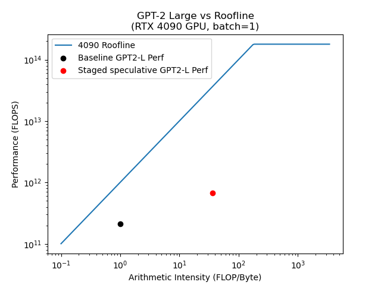
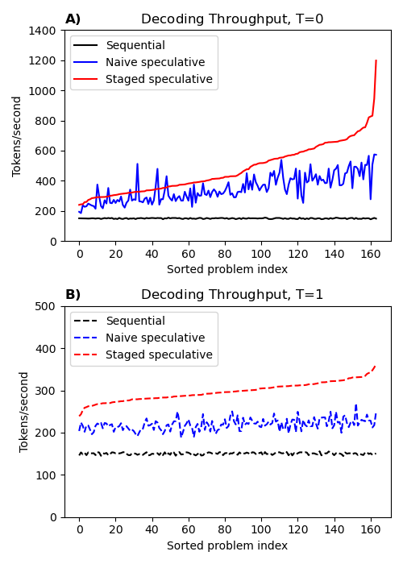
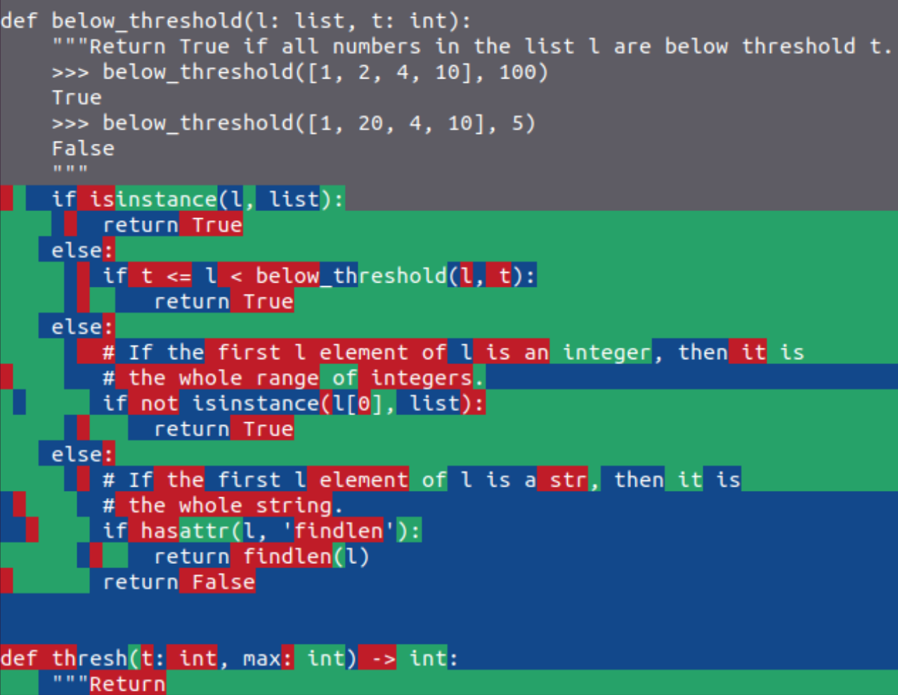

# StagedSpec：树状草稿让解码提速 3.16 倍

在本地设备上运行 LLM，小批量自回归解码常常不是算力不够，而是显存带宽被反复读取模型权重拖住，这直接限制了低延迟、个性化和保护隐私的端侧应用。Staged Speculative Decoding 的核心思路是：让便宜的小模型先猜，再把单条猜测扩展成一棵树，并递归地给“小模型”也配一个更快的草稿模型。基于 762M 参数的 GPT-2-Large，在 RTX 4090 和 HumanEval 上，确定性解码从 150 tokens/s 提升到 475 tokens/s，达到 **3.16 倍加速**；Top-k 采样也获得 **1.98 倍加速**，同时保持原模型的输出质量与采样分布。

## 为什么小批量 LLM 推理这么慢？

### 自回归生成的两个阶段

Decoder-only LLM 的生成通常分为两步：

1. **Prefill（预填充）**：一次性并行处理整个 Prompt，建立 KV Cache，并产生第一个 Token 的 Logits。由于序列可以并行计算，这一阶段通常较快。
2. **Decode（解码）**：从 Logits 中选出一个 Token，再把它送回模型得到下一个 Token，循环直到生成结束。后一个 Token 依赖前一个 Token，因此无法直接整段并行。

问题主要出在第二阶段。小批量解码时，每生成一个 Token，都要把整套模型权重从显存送入计算单元，但实际执行的浮点运算并不多。衡量这种关系的指标是 **Arithmetic Intensity（算术强度）**：

$$
\text{Arithmetic Intensity} = \frac{\text{FLOPs}}{\text{访问内存的字节数}}
$$

算术强度越低，任务越容易被内存带宽而非计算能力限制。对采用 16-bit 精度、Batch Size 为 1 的解码，论文给出的算术强度约为 1。

以 GPT-2-Large 为例，一次推理约需 1.4 GFLOP，但参考 PyTorch 实现在空闲的 RTX 4090 上只有约 150 tokens/s，计算利用率仅 **0.13%**。换句话说，GPU 大部分时间在等数据，而不是在做矩阵乘法。

> 图解：横轴是算术强度（FLOP/Byte），纵轴是实际性能（FLOPS），两者均使用对数刻度。蓝色折线是 RTX 4090 的 Roofline：拐点之前，性能随算术强度上升，说明受内存带宽限制；拐点之后才进入计算受限区域。黑点代表普通 GPT-2-Large 解码，位于算术强度约为 1 的低效区；红点代表 Staged Speculative Decoding，通过一次处理更多候选 Token，把算术强度推到约 30，并显著提高实际计算吞吐。可见，小批量解码要提速，关键不是单纯堆 FLOPs，而是提高每次权重读取所服务的有效计算量。

### Speculative Decoding：用小模型换并行度

可以把 Speculative Decoding（投机解码）理解成“实习生先写草稿，专家一次性审阅”：

- 用小而快的 **Draft Model** 连续预测多个 Token；
- 把这些 Token 组成一个 Batch，交给大的 **Oracle Model** 并行验证；
- 大模型认可的部分一次保留，从第一个不被认可的位置起丢弃后续猜测；
- 随机采样时配合 Rejection Sampling，使最终输出仍遵循原大模型的分布。

它把多次串行的大模型调用，合并成一次批量验证。虽然总计算量可能增加，但重复搬运权重的次数减少，因此特别适合内存带宽受限的小批量场景。

这种方法还有两个重要优点：**不牺牲模型质量**，以及能与量化、FlashAttention 等优化叠加。前者来自严格的验证与采样机制，后者则是因为投机解码优化的是执行方式，而不是改变模型参数或 Attention 内核。

但普通投机解码很快会遇到天花板：Draft Model 要连续猜对一长串 Token，成功率会随着序列变长大致呈指数下降。草稿越长，尾部猜测越可能白费；草稿太短，又无法充分提高并行度。Staged Speculative Decoding 正是围绕这个瓶颈展开。

## 核心方法：先把草稿变成树，再让草稿套娃

论文做了两项相互配套的改进：**Tree-Structured Batches（树状投机批次）** 提高单批候选的覆盖率，**Staged Speculation（分阶段投机）** 降低构造这些候选的成本。

### 树状批次：别把预算全押在一条长序列上

普通方法只提交一条链，例如 $A \rightarrow B \rightarrow C \rightarrow D$。只要中间一个 Token 猜错，后面的候选就全部失效。树状方法则在关键位置保留第二、第三可能的 Token，让同一批次容纳多条可能路径。

可以把计算预算从“很深但脆弱的链条尾部”，重新分配到“更可能被访问的前缀和分支”上。这带来三项收益：

1. **每批预期接受更多 Token**。分支覆盖了多个合理续写，不再要求一条长序列完全猜中，因此大 Batch 和较低 Draft/Oracle 对齐度下的扩展性更好。
2. **更多候选几乎免费进入批次**。Draft Model 只需在树的内部节点运行；叶子节点不需要再继续调用 Draft Model。树越宽，叶子占比越高，同样多次 Draft 调用能组装出更大的 Oracle Batch。
3. **Draft Model 自身也能并行**。同一树层的多个分支可以一起计算。极限情况下，构造一棵树所需的 Draft 批次数主要取决于树深，而不是节点总数。

第三点尤其重要：小模型并不会因为是“小模型”就摆脱内存带宽瓶颈。小批量运行小型 Transformer 时，它同样可能受权重读取限制，因此减少其串行步数很有价值。

笔者认为，这个设计的聪明之处在于，它没有一味追求“猜得更长”，而是追求“猜错时仍有别的分支可用”。前者很快受到联合命中率约束，后者则把有限计算转化为更稳健的候选覆盖。

#### 树状 Attention 如何实现？

树状批次不是把若干独立序列简单拼接，还需要保证每个节点只看到自己在树上的祖先。论文给出的实现要点是：

- 将解码时的 Self-Attention 拆成两部分：对已有 KV Cache 的 Cross-Attention，以及批次内部的 Self-Attention；
- 按节点在树中的深度设置 Positional Embedding，使不同分支保持正确的位置关系；
- 按树的连接关系对批次内 Self-Attention 做 Causal Mask，阻止节点读取兄弟分支或非祖先节点；
- 将本批产生的新 KV Cache 单独保存，待 Token 采样与路径确定后，只把被接受路径对应的切片追加到主 KV Cache。

因此，树状投机不仅是候选生成策略的变化，也要求 Attention Mask、位置编码和 KV Cache 管理一起配合。

### 分阶段投机：Draft Model 也需要自己的 Draft

树状批次解决了“猜错浪费”的问题，但构造更大的候选树仍要反复运行 Draft Model。论文指出，在朴素投机解码中扩大批次后，成本结构甚至会反转：**生成草稿所花的时间可能超过 Oracle 验证**。

传统方法只有一个 Draft Model，其大小是明显的权衡：

- Draft 越大，与 Oracle 对齐越好，候选质量更高，但生成成本也更高；
- Draft 越小，运行更便宜，但猜测质量下降，需要更多验证或产生更多无效候选；
- 论文根据实践指出，Draft 比 Oracle 小约 **15～20 倍** 通常较合适。

Staged Speculation 不再只调这个尺寸，而是把投机解码递归用下去：给 Draft Model 再配一个更快、更便宜的 $\text{Draft}^2$ Model。整体流程变成三级结构：

1. $\text{Draft}^2$ 以极低成本为 Draft 提供候选；
2. Draft 通过投机方式加速生成树状批次；
3. Oracle 对整棵树做最终验证，决定实际输出。

这里的“Staged”不是简单串联三个模型各生成一段，而是 **每一级都在为上一级降低串行解码成本**。最终所有被输出的 Token 仍由 Oracle 检查，因此加速不以放松大模型的质量控制为代价。

## 实验：三级模型在 HumanEval 上验证

### 模型、任务与对照设置

实验使用三个层级的模型，并在一台空闲的 NVIDIA RTX 4090 上完成全部评测：

| 角色 | 模型与训练方式 | 作用 |
|---|---|---|
| Oracle | 762M 参数 GPT-2-Large，在 The Stack 的 Python 子集上微调 | 决定最终输出并验证候选 |
| Draft | 40M 参数 GPT-2，在相同数据上训练 | 构造主要投机候选 |
| $\text{Draft}^2$ | Katz Backoff Trigram（三元 N-gram）模型 | 以极低成本加速 Draft |

其中，N-gram 模型不是直接用代码语料统计得到，而是先让 Draft Model 在采样温度 1.5 下运行两小时，生成 120M Token，再据此构建。

评测任务为 HumanEval 的 **164 个 Prompt**。每种方法分别测试两种解码方式：

- **Deterministic**：确定性解码，即贪心选择；
- **Top-k**：$k=50$、$T=1$ 的随机采样。

对照组包括普通逐 Token 的 Oracle 解码，以及已有工作的标准 Speculative Decoding。这样既能看出总加速，也能分离树状批次与新增投机阶段带来的收益。

### 显存带宽：相对消耗最低降至 0.23

第一组实验直接检查方法是否减少了内存带宽消耗。数值以普通逐 Token 解码为 1.00，越低越好。

| 采样方式 | Baseline 相对带宽 | Speculative 相对带宽 | Staged Spec. 相对带宽 |
|---|---:|---:|---:|
| Deterministic | 1.00 | 0.31 | **0.23** |
| Top-k | 1.00 | 0.48 | **0.35** |

确定性解码下，Staged Spec. 的带宽消耗仅为 Baseline 的 **23%**，即减少约 **77%**；Top-k 下则为 Baseline 的 **35%**。这与 Roofline 分析一致：树状候选和多级草稿把更多 Token 合并到批量验证中，摊薄了模型权重的读取成本。

### 解码吞吐：确定性与随机采样都提速

第二组实验测量顺序解码的实际吞吐，单位为 tokens/s，越高越好。

| 采样方式 | Baseline | Speculative | Staged Spec. | Staged 相对 Baseline | Staged 相对 Speculative |
|---|---:|---:|---:|---:|---:|
| Deterministic | 150 | 350 | **475** | **3.16×** | **1.36×** |
| Top-k（$k=50$、$T=1$） | 150 | 219 | **298** | **1.98×** | **1.36×** |

确定性解码的平均吞吐从 150 提升到 475 tokens/s。相比标准投机解码，Staged Spec. 仍快 1.36 倍，说明收益并非只来自基本的“小模型先猜”。

Top-k 下两种投机方法都会变慢，原因是随机拒绝使草稿批次更容易失效。不过 Staged Spec. 仍保持领先，而且相对标准投机解码的加速比依然是 1.36 倍。

> 图解：横轴是按 Staged Speculative 表现排序后的问题编号，纵轴是解码吞吐（tokens/s）。A 图为贪心解码（$T=0$），黑色 Sequential 基线稳定在约 150 tokens/s，蓝色 Naive Speculative 波动较大，红色 Staged Speculative 整体更高，并从低编号区域的约 200 tokens/s 延伸到高分问题上的约 1200 tokens/s。B 图为 Top-k 随机采样（$T=1$），三种方法的吞吐都更集中，Staged Speculative 仍持续高于另外两条曲线。由于横轴经过排序，这些曲线用于比较各问题上的吞吐分布，不表示原始问题编号的自然趋势。

值得注意的是，这些实验使用的是相对较小的模型。论文认为，大模型通常更受用计算换带宽的策略；而当前实现还有约 **35% 的 Python 基础设施开销**，更高效实现或在更大模型上摊薄固定成本，都可能进一步释放性能。

### Token 来源：容易的内容交给小模型，关键内容交给大模型

平均吞吐只能说明“快了多少”，Token 来源可视化则解释了“为什么能快”。论文展示了一个 $T=1$ 的 HumanEval 补全样例，该 Prompt 上加速约为 **2.5 倍**。

> 图解：绿色背景表示 Token 来自 N-gram $\text{Draft}^2$，蓝色表示来自 40M Draft Model，红色表示来自 762M Oracle；所有 Token 最终都经过 Oracle 验证。可以看到，缩进、空白等模式明显的部分大面积由 N-gram 提供，较常规的代码片段更多由 Draft 提供，而 `if` 后等较关键的 Token 更常落到 Oracle。受有限 Batch Size 影响，这只是整体趋势，并不表示每个容易 Token 都一定由小模型生成。

由此，作者提出一个更有解释力的猜想：生成成本可能与内容的 Entropy（熵，即不确定性）近似相关。纯空白等极低熵内容几乎可以一路由小模型批量产生，速度接近大批量推理；高熵内容则需要在各个阶段更频繁地依赖小批量的大模型解码。

进一步说，LLM 生成的大部分文本，其不确定性可能低于模型自身能力所覆盖的复杂上限；大模型新增的准确性，或许主要集中在少数关键 Token 上。这里是作者基于现象作出的推测，而非实验已经证明的定律。

### 局限：加速比高度依赖内容

论文也明确展示了收益的不稳定性：在真实 Prompt 上，加速最高可达 **10 倍**，但也可能只有约 **2 倍**。差异很大程度上取决于困难内容分布得密集还是稀疏。

例如，缩进层级较深的 Python 代码包含大量可预测空白，N-gram 更容易命中，因而收益更明显；没有缩进的代码就无法充分利用这一层。换言之，三级结构并非让所有 Token 以固定倍率加速，而是在容易片段上“跑得极快”，在困难片段上退回更昂贵的验证路径。

## 后续还能怎么优化？

论文给出了三个方向，分别对应采样算法、模型规模和底层草稿器：

1. **更聪明地组织随机采样候选**。对 $T>0$ 的场景，可先生成 Multinomial CDF（多项分布累积分布函数）的随机采样序列，再据此选择进入批次的 Token。例如随机数为 0.99 时，可能应纳入 Draft 排名第 5～10 的候选，而不只围绕最高概率 Token 建树。
2. **在消费级 GPU 上增加一级投机**。8-bit 量化有望让 20B 模型以小批量方式放入消费级 GPU，并构成 $20B \rightarrow 1B \rightarrow 50M \rightarrow \text{N-gram}$ 的四级结构。模型越大，重复搬运权重的代价越高，投机收益也可能越明显。
3. **寻找比 N-gram 更强的底层 Draft**。如果能在单次运行低于 $10\,\mu\mathrm{s}$ 的条件下获得比 N-gram 更好的预测，就有机会同时改善候选质量和草稿成本。

这些方向都围绕同一个原则：尽可能把可预测工作推向便宜、并行的层级，只把真正困难的决定留给大模型。

## 总结

- 小批量自回归解码的核心瓶颈是低算术强度与显存带宽，而不是 GPU 的峰值 FLOPs 不足。
- 树状投机批次用多个分支替代单一长链，提高每批预期接受的 Token 数，并降低 Draft 的串行构造与候选生成成本。
- Staged Speculation 给 Draft 再配一个 $\text{Draft}^2$，形成 N-gram、小 Transformer、大 Transformer 的三级协作，同时由 Oracle 保留最终质量控制。
- 在 GPT-2-Large、RTX 4090 和 HumanEval 上，确定性解码达到 3.16 倍加速，Top-k 达到 1.98 倍；带宽相对消耗分别降至 0.23 和 0.35。
- 加速幅度随内容熵和代码结构显著变化，当前实现还存在约 35% 的 Python 开销。

这项工作的价值不只是“多用几个小模型”，而是提供了一种按 Token 难度分配计算的思路；未来能否在大模型、高效内核和更强底层草稿器上稳定复现收益，将决定它能走多远。

> 本文参考自 [Accelerating LLM Inference with Staged Speculative Decoding](https://arxiv.org/abs/2308.04623)