# OSD：高接受率提速2.63倍

Speculative Decoding 能用小模型替大模型“打草稿”，但草稿一旦猜错，大模型就要纠正，静态草稿模型也很难跟上不断变化的用户请求。OSD（Online Speculative Decoding，在线投机解码）把验证阶段原本会丢弃的纠错信息变成训练数据，持续在线蒸馏草稿模型。实验中，token 接受率最高提升 **0.65**，四类任务上实测加速 **1.42–2.17 倍**；当接受率超过 0.9 时，最高加速达到 **2.63 倍**。

## 1. 投机解码的瓶颈：草稿模型猜得不够准

自回归解码每生成一个 token，都要串行执行一次大模型。对 batch size 较小的服务来说，瓶颈通常不是算力，而是反复从 GPU HBM 读取模型权重和 KV cache 的内存带宽。

Speculative Decoding 的思路很像“实习生先写草稿，专家集中审稿”：小草稿模型 $q_{\boldsymbol{\theta}}$ 一次提出 $k$ 个 token，大目标模型 $p$ 并行验证这些提议。只要连续接受多个 token，一次目标模型调用就能产出多个结果，权重读取成本也随之被摊薄。

但这里有一个直接矛盾：

- 草稿模型越小，单次提议越便宜，却往往猜得越不准。
- 草稿模型越大，预测可能更准，却会抬高提议成本，削弱加速意义。
- 用户请求会随时间、语言和话题变化，部署后固定不动的草稿模型更容易失配。

已有工作尝试了级联草稿模型、RAG 式草稿、多草稿模型、多候选采样，以及在目标模型上增加辅助预测头。它们大多默认草稿模型部署后保持静态。OSD 关注的是另一个正交维度：**无论草稿模型怎样构造，都让它在服务过程中继续学习。**

### 接受率如何决定加速

设 token 接受率为 $\alpha$，草稿模型与目标模型单次运行时间之比为 $c$，每次提议 $k$ 个 token。每轮目标模型调用的期望产出长度和理论加速比为：

$$
\mathbb{E}(|\tilde{\mathbf{y}}|)=\frac{1-\alpha^{k+1}}{1-\alpha},\qquad
\mathbb{E}(\mathrm{speedup})=\frac{1-\alpha^{k+1}}{(1-\alpha)(kc+1)}
$$

这个公式揭示了两个关键杠杆：提高 $\alpha$，或者降低 $c$。OSD 不把小模型换成大模型，而是集中提升 $\alpha$，因此保留了草稿模型低成本的优势。

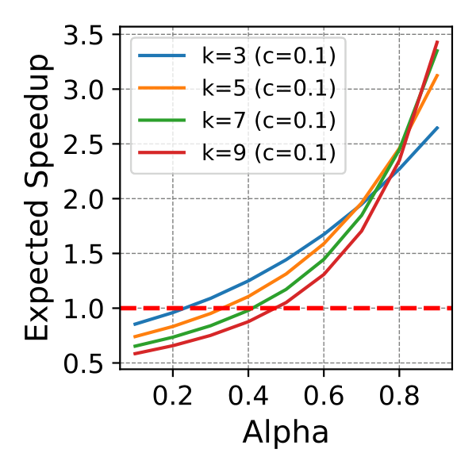

> 图解：该子图比较不同提议长度 $k$ 下，接受率 $\alpha$ 与加速比的关系。加速随接受率呈超线性增长；接受率较低时，投机解码甚至可能因额外的草稿与验证开销而慢于普通解码。

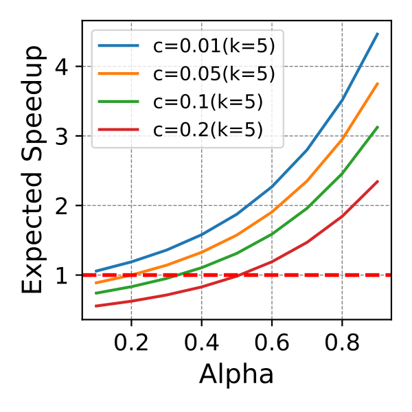

> 图解：该子图比较不同草稿/目标模型耗时比 $c$ 下的加速曲线。$c$ 越小，相同的接受率提升越容易转化为实际收益，因此“小模型继续学习”比单纯增大草稿模型更符合 OSD 的目标。

## 2. OSD：把每次纠错都变成在线蒸馏样本

OSD 的核心观察是：目标模型在验证时，不仅会指出草稿模型哪里猜错，还会给出正确位置上的完整概率分布。过去这些信息用于完成当前解码后就被丢掉；OSD 则把它们缓存起来，定期更新草稿模型。

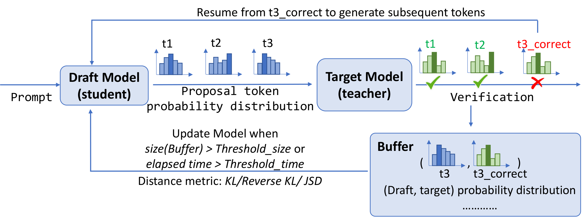

> 图解：对每个 prompt，草稿模型先提出多个 token，目标模型并行验证。发现错误提议时，系统把对应前缀以及草稿、目标模型的分布写入 buffer；buffer 达到更新条件后，通过分布距离计算损失并更新草稿模型。这个闭环不改变目标模型的输出分布，只让后续提议更接近目标模型。

这个设计聪明之处在于，**训练信号是推理过程的副产品**。系统不必额外请目标模型生成一套标注，而是在正常服务时顺手收集“哪里错、应该怎样预测”的监督信息。

### 2.1 为什么用分布蒸馏，而不只学习正确标签

把目标模型看作教师、草稿模型看作学生，对输入批次 $\mathcal{B}$，通用蒸馏目标为：

$$
\ell(\boldsymbol{\theta})=\frac{1}{n_B}\sum_{\mathbf{x}^{(i)}\in\mathcal{B}}\ell(\mathbf{x}^{(i)},\boldsymbol{\theta}),\qquad
\ell(\mathbf{x},\boldsymbol{\theta})=D\left(p(\cdot|\mathbf{x})\,\Vert\,q_{\boldsymbol{\theta}}(\cdot|\mathbf{x})\right)
$$

其中 $D$ 是分布距离。相比只微调目标模型生成的标签，完整分布还包含“次优 token 有多可能”等信息，能提供更细粒度的对齐信号。

论文比较了三种距离：

- **Forward KL**：$D_{\mathrm{KL}}(p\Vert q_{\boldsymbol{\theta}})$。
- **Reverse KL**：$D_{\mathrm{KL}}(q_{\boldsymbol{\theta}}\Vert p)$。
- **JSD**：以 $p_{\boldsymbol{\theta}}^{\beta}=\beta p+(1-\beta)q_{\boldsymbol{\theta}}$ 为混合分布，对前两种 KL 加权。

作者没有把某一种距离宣称为普遍最优。实验中 Forward KL 整体更强，但最佳组合仍取决于任务以及教师、学生模型的相对能力。

### 2.2 采样与梯度估计：用近似换取简单稳定

自回归分布需要沿序列递归展开，深度超过一步后就难以解析计算 KL，只能做 Monte Carlo 近似。如果严格对学生采样过程求导，会得到 policy gradient 风格的估计器，还需要额外手段控制方差、稳定训练。

OSD 采用更直接的近似：不对采样过程本身求导，把采样序列 $\mathbf{y}$ 代入逐位置分布距离：

$$
\ell(\mathbf{x},\boldsymbol{\theta})\approx
\sum_{j=1}^{|\mathbf{y}|+1}
D\left(p(y|\mathbf{x},\mathbf{y}_{<j})\,\Vert\,q_{\boldsymbol{\theta}}(y|\mathbf{x},\mathbf{y}_{<j})\right)
$$

这样，采样方式与距离函数可以独立组合：

- **Teacher sampling**：序列来自目标模型，通常更连贯，但学生可能较难拟合。
- **Student sampling**：序列来自草稿模型，更贴近其自身状态，但可能缺少结构。
- **Mixed sampling**：按 $y_j\sim\beta p+(1-\beta)q_{\boldsymbol{\theta}}$ 混合，平衡前两者。

### 2.3 在线服务算法

完整流程可以概括为六步：

1. 用 warmup 数据集预训练草稿模型，使其初步逼近目标模型。
2. 从在线数据流接收请求，正常执行 Speculative Decoding。
3. 每轮记录错误位置 `error_index` 及目标模型在该位置的 logits。
4. 把请求及错误记录放入 replay buffer $\mathcal{Q}$。
5. 每处理 $I$ 个请求，用缓存数据最小化蒸馏损失并更新草稿模型。
6. 清空本轮 buffer，继续服务；也可按系统负载动态调整 $I$。

论文当前实现不在更新前淘汰样本，更新后即释放 buffer。实际系统可以保留最新或最有信息量的样本，也可以将训练与推理拆成两条流水线，在低负载时更新并定期同步权重。

需要注意，理论延迟分析没有直接计入更新耗时。作者的依据是更新小模型的成本较低、更新具有周期性，并且可以与推理分离执行；这意味着实测收益仍依赖具体部署方式，而不是无条件成立。

### 2.4 按语言和话题定制草稿模型

在线适应解决“分布随时间变化”，模型定制则解决“同一时刻存在多个子分布”。一个草稿模型要同时学会 SQL、数学、代码和多语言对话，任务范围很宽；若按语言或话题路由，每个模型只需适应更窄的分布。

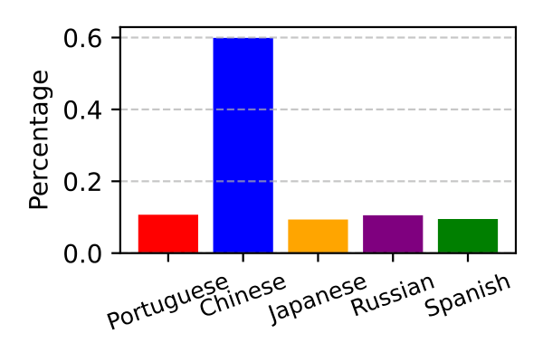

> 图解：左图统计 Arena 数据中非英语请求的语言占比，说明真实服务并不是单一的英语分布，而包含多个可作为定制依据的语言子域。

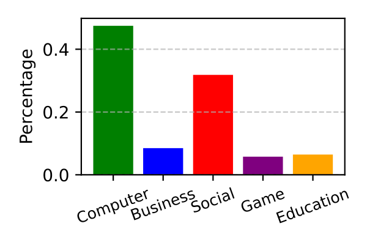

> 图解：右图展示 Arena 请求的话题分布。话题标签可以由一个 67M 的 BERT 分类模型生成，路由发生在 query 级别而非 token 级别，以控制额外开销。

语言路由可以直接读取元数据，话题路由则依赖轻量分类器。多个草稿模型共享同一个目标模型，因此增加的是小模型权重和 KV cache，而不是再部署一份大模型。

## 3. 离线实验：先验证“蒸馏草稿”本身是否有效

实验使用两组目标/草稿模型：

- Vicuna-7B + LLaMA-160M。
- FLAN-T5-XL（3B）+ T5-Small。

任务覆盖 Text-to-SQL（Spider）、数学（Gsm8k）、Python 代码生成（Code-search-Python）和金融问答（Alpaca-finance）。投机解码每次提议 5 个 token，离线蒸馏训练两个 epoch；所有在线实验固定更新间隔 $I=8$。

下表比较原始草稿模型、目标模型生成标签微调（FT），以及 Teacher、Student、Mixed sampling 配合 Forward KL 的 TF、SF、MixF。

| 模型 | 任务 | Original | FT | TF | SF | MixF |
|---|---|---:|---:|---:|---:|---:|
| Vicuna-7B | Spider | 0.28 | 0.74 | **0.76** | 0.62 | 0.70 |
| Vicuna-7B | Gsm8k | 0.58 | 0.74 | **0.75** | 0.67 | 0.73 |
| Vicuna-7B | Code-Python | 0.38 | **0.65** | **0.65** | 0.51 | 0.61 |
| Vicuna-7B | Alpaca-Finance | 0.57 | **0.68** | 0.67 | 0.63 | 0.65 |
| FLAN-T5-XL | Spider | 0.13 | 0.33 | **0.78** | 0.67 | 0.70 |
| FLAN-T5-XL | Gsm8k | 0.29 | 0.50 | **0.62** | 0.51 | 0.55 |
| FLAN-T5-XL | Code-Python | 0.28 | 0.44 | **0.81** | 0.67 | 0.78 |
| FLAN-T5-XL | Alpaca-Finance | 0.39 | 0.56 | **0.63** | 0.59 | 0.60 |

Teacher sampling 在多数设置中取得最高接受率。最直观的变化是 FLAN-T5-XL 的 Spider 任务：$\alpha$ 从 **0.13 提升到 0.78**；Code-Python 则从 0.28 提升到 0.81。这证明收益不只是在线更新带来的，分布蒸馏本身就能显著改善草稿模型。

Reverse KL 和 JSD 在部分设置中接近 Forward KL，但没有形成稳定优势。作者将“任务与模型组合下如何选择距离和采样方式”留作后续问题。

## 4. 在线实验：从少量数据快速追上离线上限

在线评估按数据流顺序处理 prompt，并使用最近 50 个请求的平均接受率，观察草稿模型对当前分布的适应情况。基线先用 10% 数据离线蒸馏，再在服务期间保持参数不变；离线全数据训练结果则作为参考上限。

> 图解：该图例对应下面八幅在线接受率子图，用来区分在线更新、静态基线和离线参考结果。阅读重点是曲线随已处理请求数的变化，而非单个孤立终点。

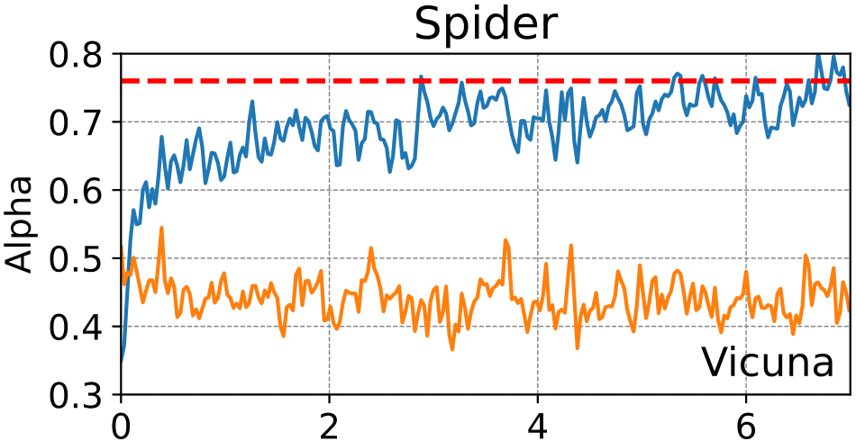

> 图解：横轴是 OSD 已处理的记录数，纵轴是最近 50 条记录的平均 $\alpha$。Vicuna-7B 的 Spider 任务中，在线曲线初期落后，但随着草稿模型接触更多 SQL 请求快速上升，并接近离线参考表现。

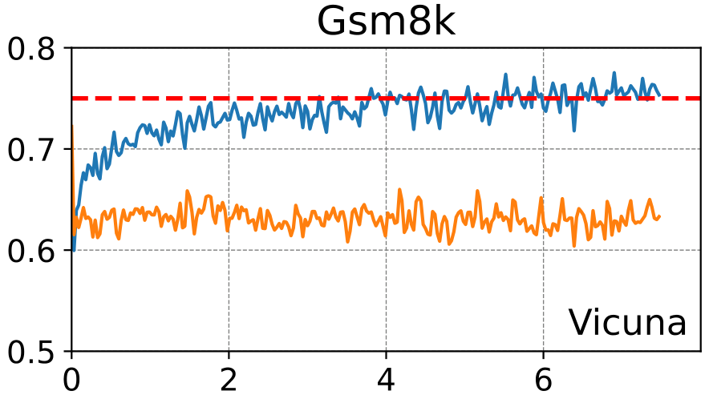

> 图解：Vicuna-7B 的 Gsm8k 子图使用相同的横纵轴定义。在线更新持续提高近期请求上的接受率，说明草稿模型能从流式数学问答中学习当前分布。

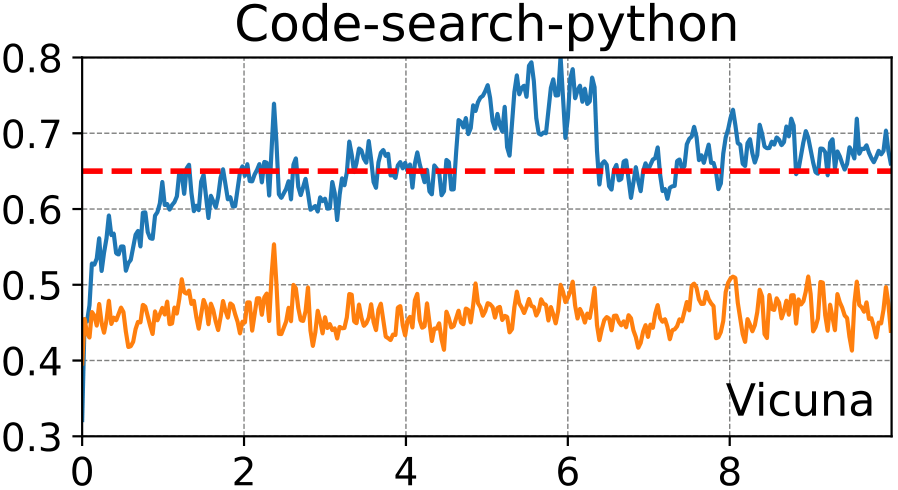

> 图解：Vicuna-7B 的 Code-Python 子图反映代码请求上的适应过程。评价采用滑动平均，因此曲线描述的是模型对近期数据的预测能力，而不是整个测试集上的累计平均值。

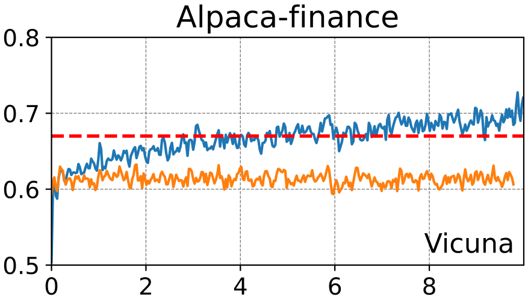

> 图解：Vicuna-7B 的金融问答子图显示，随着在线样本增加，接受率总体改善并接近离线结果。局部高低不能直接等同于全测试集优劣，因为两条结果对应的评估范围不同。

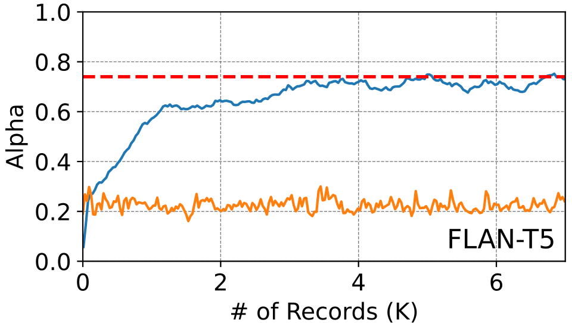

> 图解：FLAN-T5-XL + T5-Small 在 Spider 上的在线曲线同样从较低水平快速改善，表明方法不局限于 Vicuna/LLaMA 这一对模型。

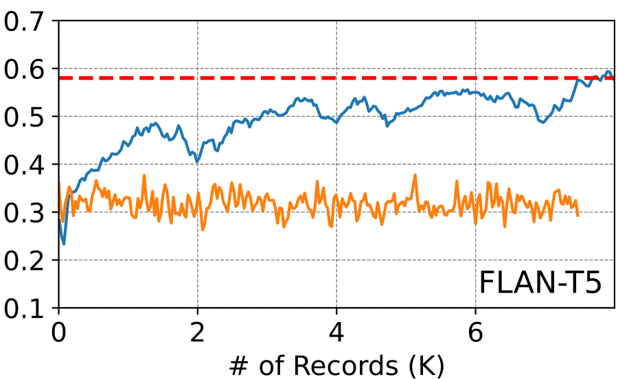

> 图解：FLAN-T5-XL 的 Gsm8k 子图以最近 50 条请求计算接受率。在线结果可接近离线参考，说明有限在线数据也能支撑有效的分布适应。

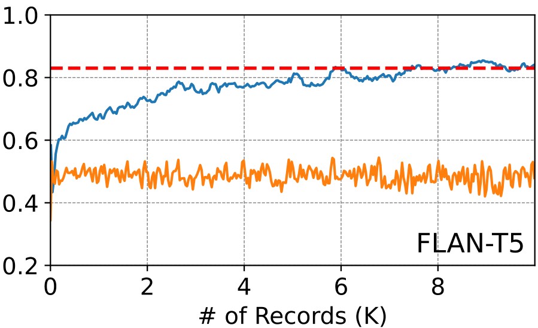

> 图解：FLAN-T5-XL 的 Python 子图展示代码分布下的在线学习过程。与离线全测试集指标相比，在线滑动平均更容易反映模型在较窄数据子集上的优势。

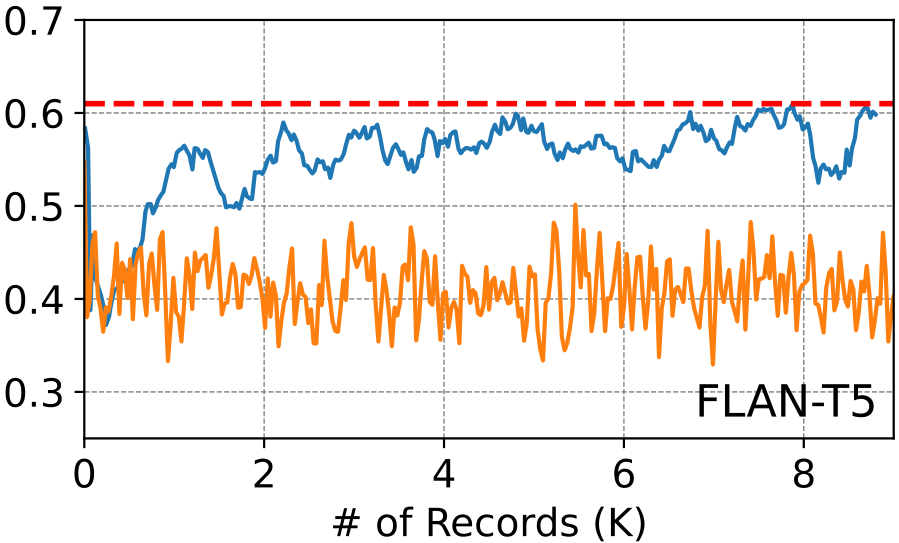

> 图解：FLAN-T5-XL 的金融问答子图完成四种任务、两组模型的对照。整体趋势一致：OSD 起步时可能不如离线蒸馏模型，但会随数据处理量增长而追赶。

部分在线曲线甚至超过离线测试 $\alpha$。这不是矛盾：离线数字来自完整测试集，在线数字只平均最近 50 条请求；当近期子分布更集中时，在线模型完全可能取得更高值。

### 分布突变后会掉下来，但也能快速恢复

作者把四个数据集各取 2K prompt 直接拼接，使第 2K、4K、6K 条附近发生明显分布切换。目标模型固定为 Vicuna-7B，初始草稿模型为 LLaMA-160M。

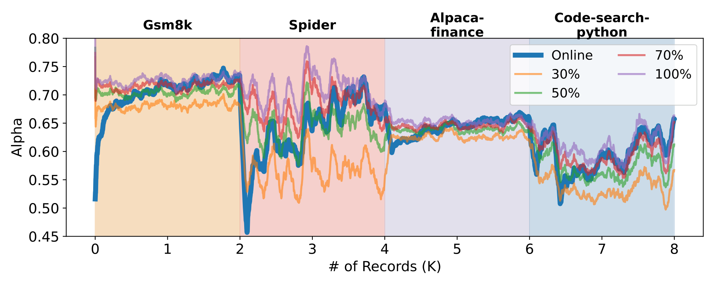

> 图解：横轴为在线记录数，纵轴为近期平均接受率。曲线在约 2K、4K、6K 的分布边界明显下跌，随后随新数据学习而回升。静态蒸馏对照还表明，OSD 起初只相当于或略逊于使用 30% 数据训练的模型，但之后可追上甚至超过使用 70%–100% 数据的静态模型。

这里最有价值的不是“曲线永不下降”，而是 **系统不需要预先知道切换点，也能在下降后主动恢复**。

## 5. 真实工作负载：多个专用小模型更好学

真实请求实验使用 LMSYS-Chat-1M 中随机采样的 10K 条 Vicuna 对话，原始数据覆盖 2023 年 4 月至 8 月、25 个模型和 150 多种语言。

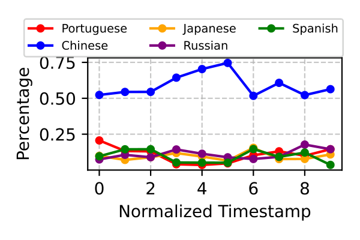

> 图解：时间被划分为十个等长区间，纵向上各语言占比按该区间总请求数归一化。不同语言份额随时间变化，说明真实服务存在持续的时间分布漂移。

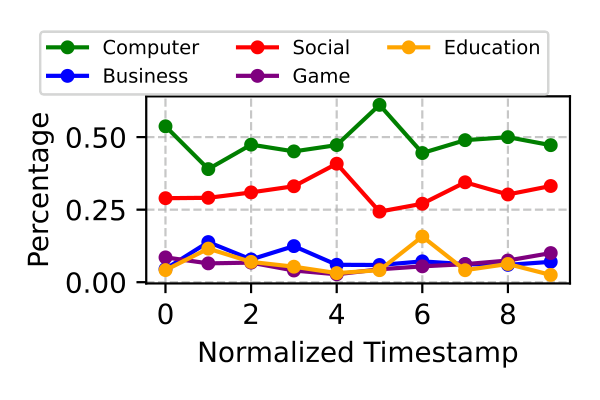

> 图解：右图按相同时间分段展示话题占比变化。它不仅支持按话题定制模型，也说明静态训练分布很难长期代表线上请求。

### 按语言与话题路由

语言实验选择除英语外请求量最高的五种语言，每种语言配置独立的 LLaMA-160M，共享 Vicuna-7B。不到 2K 数据点时，OSD 就将接受率提高约 **0.1–0.2**；其中日语最容易，葡萄牙语最困难。

话题实验使用微调后的 DistilBERT 获取标签，选择前五大话题；超过 5K 对话的话题均匀采样到 5K。各话题接受率均超过 0.6，Social 和 Computer 接近 0.9。

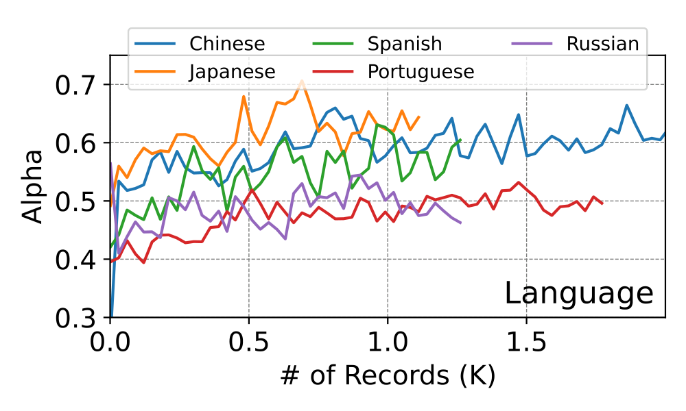

> 图解：该子图展示按语言划分后的在线接受率，数值为最近 100 个请求的滑动平均。不同语言的学习难度不同，但多条曲线都随数据增加而改善。

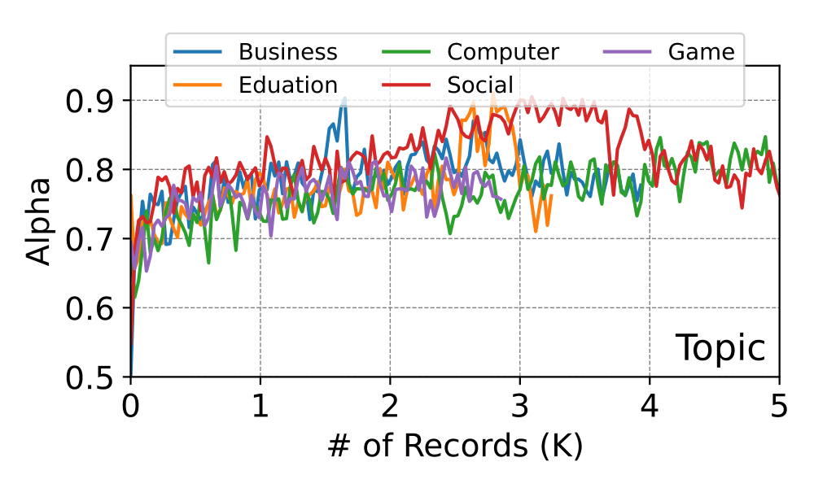

> 图解：该子图展示按话题划分后的接受率。Social、Computer 等话题可达到接近 0.9 的水平，支持“缩小每个草稿模型负责的分布范围”这一设计。

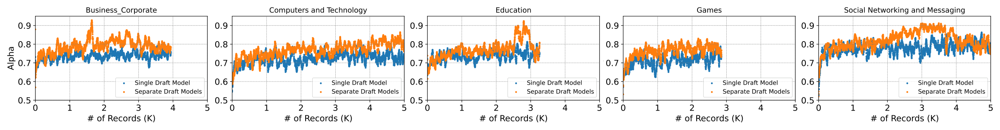

> 图解：图中按话题比较单一通用草稿模型与多个专用草稿模型。所有话题上，多模型方案的接受率都提高约 **0.1–0.2**，直接验证了定制与路由的价值。

代价也很明确：五个 LLaMA-160M 合计 800M 参数，约为 7B 目标模型的 10%。草稿模型相关的权重和 KV cache 开销从单模型时约 2% 增至约 10%。作者尚未确定最佳模型数量、规模和分类策略，因此这是一种接受率与显存之间的可调权衡。

## 6. 延迟实测：接受率才是更强的加速杠杆

延迟实验基于 llama.cpp，在单张 A100-80G、batch size 1 下测试两组模型：LLaMA-160M + Vicuna-7B，以及 TinyLLaMA-1.1B + Vicuna-33B。

| 草稿/目标模型 | 指标 | Original | $\alpha=0.5$ | $\alpha=0.6$ | $\alpha=0.7$ | $\alpha=0.8$ | $\alpha=0.9$ |
|---|---|---:|---:|---:|---:|---:|---:|
| 1.1B / 33B | ms/token | 51.09 | 39.90 | 35.48 | 30.96 | 25.42 | 19.43 |
| 1.1B / 33B | Speedup | 1.00× | 1.28× | 1.44× | 1.65× | 2.01× | **2.63×** |
| 160M / 7B | ms/token | 13.21 | 13.85 | 11.39 | 10.20 | 7.84 | 5.17 |
| 160M / 7B | Speedup | 1.00× | 0.95× | 1.17× | 1.30× | 1.68× | **2.55×** |

同样的 $\alpha$ 下，1.1B/33B 组合加速更高，因为 $c=0.08$，低于 160M/7B 组合的 $c=0.13$。另一个重要警告是：160M/7B 在 $\alpha=0.5$ 时只有 **0.95×**，即投机解码反而更慢。接受率不够高时，草稿成本无法被摊薄。

### 四类任务与真实对话的端到端结果

以下结果使用 Teacher sampling + Forward KL 蒸馏的草稿模型：

| 草稿/目标模型 | 指标 | Spider | Gsm8k | Alpaca-Finance | Code-Python | Chatbot-Arena |
|---|---|---:|---:|---:|---:|---:|
| 1.1B / 33B | ms/token | 23.53 | 27.40 | 26.53 | 30.12 | 33.52 |
| 1.1B / 33B | Speedup | **2.17×** | 1.89× | 1.92× | 1.69× | 1.51× |
| 160M / 7B | ms/token | 8.12 | 8.83 | 10.41 | 11.44 | 11.90 |
| 160M / 7B | Speedup | **1.63×** | 1.60× | 1.47× | 1.42× | 1.36× |

四类专业任务上，两组模型的加速范围为 **1.42–2.17 倍**。Chatbot-Arena 的收益较低，也说明通用、混杂对话比边界明确的领域分布更难学习。

### 理论与实测为何存在差距

下表使用 draft token length $k=8$，同时列出理论值和实测值：

| 模型组合 | 指标 | Original | $\alpha=0.5$ | $\alpha=0.6$ | $\alpha=0.7$ | $\alpha=0.8$ | $\alpha=0.9$ |
|---|---|---:|---:|---:|---:|---:|---:|
| 1.1B / 33B，$c=0.08$ | 实测 ms/token（加速） | 51.09 | 39.90（1.28×） | 35.48（1.44×） | 30.96（1.65×） | 25.42（2.01×） | 19.43（2.63×） |
| 1.1B / 33B，$c=0.08$ | 理论 ms/token（加速） | 51.09 | 39.00（1.31×） | 32.12（1.59×） | 26.07（1.96×） | 20.77（2.46×） | 16.38（3.12×） |
| 160M / 7B，$c=0.13$ | 实测 ms/token（加速） | 13.21 | 13.85（0.95×） | 11.39（1.17×） | 10.20（1.30×） | 7.84（1.68×） | 5.17（2.55×） |
| 160M / 7B，$c=0.13$ | 理论 ms/token（加速） | 13.21 | 13.48（0.98×） | 10.92（1.21×） | 8.41（1.57×） | 6.23（2.12×） | 4.40（3.00×） |

总体趋势吻合，但实测通常低于理论值。原因包括额外采样步骤，以及小模型更容易受到 kernel launch 和 Python 开销影响，使实际 $c$ 高于理想估计。

### 生成长度的影响

以下实验使用 Vicuna-7B-v1.5 + LLaMA-160M，prefix length 为 512，draft token length 为 5：

| Generation length | $\alpha=0.5$ | $\alpha=0.6$ | $\alpha=0.7$ | $\alpha=0.8$ | $\alpha=0.9$ |
|---:|---:|---:|---:|---:|---:|
| 16 | 1.22 | 1.37 | 1.52 | 2.01 | 2.40 |
| 32 | 1.23 | 1.41 | 1.52 | 2.05 | 2.42 |
| 64 | 1.23 | 1.41 | 1.53 | 2.05 | 2.43 |
| 128 | 1.24 | 1.42 | 1.53 | 2.05 | 2.43 |
| 256 | 1.25 | 1.45 | 1.54 | 2.07 | 2.46 |
| 512 | 1.25 | 1.48 | 1.61 | 2.12 | 2.57 |
| 1024 | 1.27 | 1.52 | 1.66 | 2.17 | 2.56 |
| 2048 | 1.29 | 1.55 | 1.73 | 2.24 | 2.70 |

生成越长，目标模型每步解码的内存压力越大，草稿/目标耗时比 $c$ 因而更有利。但纵向比较可见，**提高接受率带来的收益明显大于单纯拉长生成长度**。

### 小模型更新本身有多贵

在 prompt length 64、generation length 128、单张 A100-80G 上，作者测得：

| 模型组合 | 草稿 forward + backward + update | 目标单次 forward | 目标 8 次 forward | 每 8 次迭代的草稿更新 |
|---|---:|---:|---:|---:|
| 160M / 7B | 0.12 s | 3.12 s | 24.96 s | 0.12 s |
| 1.1B / 33B | 0.67 s | 6.89 s | 55.12 s | 0.67 s |

按每 8 次迭代更新一次计算，两组目标模型 forward 总耗时分别是草稿更新的约 **208 倍** 和 **82.3 倍**。这支持“小模型在线更新相对便宜”，但不等于任何高负载系统都能免费更新。

## 7. 草稿模型究竟学到了什么

OSD 的提升并非只停留在总指标上。作者进一步分析高频 token 的 precision 和 recall：

- Precision：token $i$ 被接受的次数 / token $i$ 被提议的次数。
- Recall：token $i$ 被接受的次数 / token $i$ 在最终答案中出现的次数。

Spider 实验中，目标模型生成频率最高的 100 个 token 占全部出现的 **72.2%**，呈幂律分布。蒸馏后，这些高频 token 的两种指标都显著改善。

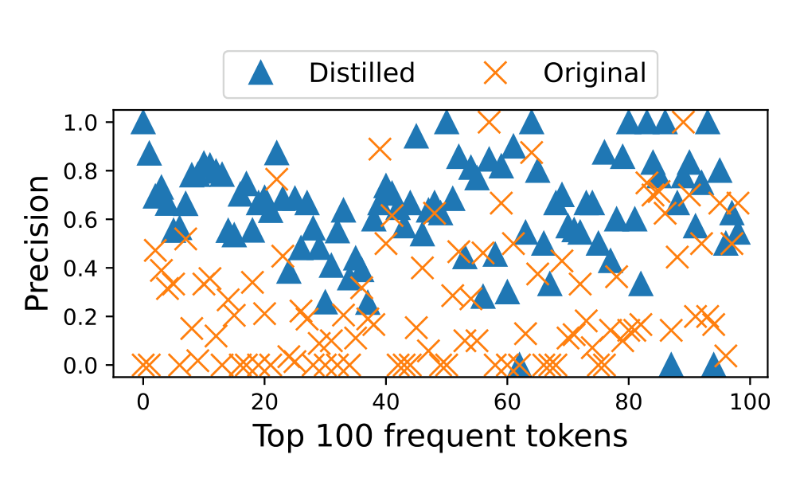

> 图解：横轴按 token 出现频率排序，例如 token 1 最常出现；纵轴为对应 token 的提议 precision。蒸馏后高频 token 更容易被目标模型接受，说明草稿模型学到了当前答案分布中的常用表达。

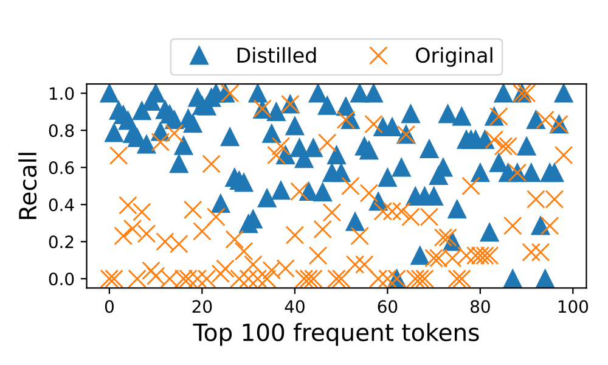

> 图解：横轴同样是频率排名，纵轴为 recall。提升意味着最终答案里出现的高频 token，有更多曾被草稿模型正确提前提出，而不只是提议时变得更“保守”。

下表列出相对提升最大的 15 个 token；LLaMA tokenizer 中代表空格的前缀下划线已忽略。

| 提升类型 | Spider | Gsm8k | Alpaca-Finance | Code-Python |
|---|---|---|---|---|
| Precision | AV, SELECT, first, ⟨EOS⟩, template, SUM, G, COUNT, \n, city, WHERE, ';, (, IST, id | ⟨EOS⟩, >>, +, To, <<, this, =, %, know, are, We, calculate, be, The, have | 1, Here, (, :, provide, depends, However, goals, amount, 3, there, The, \n, personal, will | ''', (, Here, python, ', how, doc, snippet, import, based, {, Python, This, :, you |
| Recall | SELECT, *, FROM, (, IST, *), \n, COUNT, G, first, WHERE, ⟨EOS⟩, IN, ;, MAX, '; | start, >>, <<, +, find, how, we, =, fore, To, so, \, ⟨EOS⟩, then, let | general, 1, several, This, depends, Here, provide, However, goals, over, (, If, amount, it, can | Here, This, snippet, ''', ', how, python, (, takes, Python, you, doc, an, import, def |

Spider 中学到的是 SELECT、WHERE、FROM、COUNT 等 SQL 结构，代码任务中则学到 python、import、def 等词。也就是说，OSD 不是让小模型全面提高语言能力，而是优先掌握 **当前服务分布里最有用、最高频的模式**。

## 8. 与 Medusa 组合：在线更新并不绑定独立草稿模型

Medusa 不使用独立小模型，而是在目标模型最后隐藏状态上增加多个线性预测头，并且每个位置可提出多个候选，形成 tree-style Speculative Decoding。OSD 同样可以在低峰期更新这些预测头。

| 方法 | Spider | Chatbot Arena | 额外参数量 |
|---|---:|---:|---:|
| Medusa-7B | 1.34× | 2.03× | 0.44B |
| Medusa-7B + OSD | **2.01×** | **2.38×** | 0.44B |
| Draft model + OSD | **2.17×** | 1.51× | 0.16B |

Spider 上，OSD 将 Medusa 从 1.34× 提升到 2.01×，但标准独立草稿模型 + OSD 的 2.17× 更高。Arena 上情况相反：Medusa 的额外头原本就在 ShareGPT 上训练，因此基础表现已达 2.03×；加入 OSD 后进一步提升 0.35× 至 2.38×，高于独立草稿方案的 1.51×。

这组结果说明，OSD 是一种可叠加的在线适应机制，而不是某一种草稿结构的替代品；具体选哪种结构，仍要看任务和初始化质量。

## 9. 附录推导：采样正确性、FLOPs 与带宽成本

### 9.1 为什么验证不会改变目标模型分布

对第 $i$ 个提议 $y_i$，抽取 $u\sim U[0,1]$。当满足下式时接受，否则停止接受后续提议：

$$
u\leq\frac{p(y_i|\mathbf{x},\mathbf{y}_{<i})}{q_{\boldsymbol{\theta}}(y_i|\mathbf{x},\mathbf{y}_{<i})}
$$

设接受数为 $a\in\{0,\ldots,k\}$，再额外采样一个 token：

$$
p'(y)=
\begin{cases}
p(y|\mathbf{x},\mathbf{y}_{<a+1}), & a=k,\\[4pt]
\operatorname{norm}\left(\max\left(0,p(y|\mathbf{x},\mathbf{y}_{<a+1})-q_{\boldsymbol{\theta}}(y|\mathbf{x},\mathbf{y}_{<a+1})\right)\right), & a<k.
\end{cases}
$$

$\operatorname{norm}$ 将词表概率重新归一化。已有工作证明，这样得到的序列严格服从目标模型分布；即使所有提议都被拒绝，也仍会生成至少一个新 token。

### 9.2 接受率提高后，相对普通投机解码还能快多少

若 OSD 将接受率从 $\alpha_1$ 提升到 $\alpha_2$，相对于普通 Speculative Decoding 的额外加速为：

$$
\frac{1+\alpha_2+\alpha_2^2+\cdots+\alpha_2^k}
{1+\alpha_1+\alpha_1^2+\cdots+\alpha_1^k}
$$

按离线表中的接受率估算，Vicuna-7B + LLaMA-160M 在四个任务上相对普通投机解码可进一步加速 2.42×、1.43×、1.64×、1.22×；FLAN-T5-XL + T5-Small 则分别为 3.06×、1.76×、2.72×、1.55×。这些是公式推导的期望值，应与前面的实测端到端加速区分开。

### 9.3 FLOPs：更新成本为什么相对较小

设平均生成长度为 $L$，每轮目标模型期望产出 $a$ 个 token，草稿和目标模型每 token 单次 forward 的 FLOPs 分别为 $F_{qfwd}$、$F_{pfwd}$。处理一个请求时：

$$
\operatorname{FLOPs}(\mathrm{draft})=\frac{L}{a}kF_{qfwd},\qquad
\operatorname{FLOPs}(\mathrm{target})=\frac{L}{a}(k+1)F_{pfwd}
$$

再设草稿模型每 token 的更新成本为 $F_{qbwd}$，处理并学习 $I$ 个请求的总成本为：

$$
\frac{LI}{a}\left[kF_{qfwd}+(k+1)F_{pfwd}\right]+ILF_{qbwd}
$$

按“训练每 token 每参数约 6 FLOPs、推理约 2 FLOPs”的近似，可改写为：

$$
\frac{LI}{a}\left[(k+3a)F_{qfwd}+(k+1)F_{pfwd}\right]
$$

目标模型与草稿相关计算的 FLOPs 比为：

$$
\frac{(k+1)F_{pfwd}}{(k+3a)F_{qfwd}}
$$

在每轮提议 5 个 token 的设置下，LLaMA-160M/Vicuna-7B 的比值约为 **18.75**，T5-Small/FLAN-T5-XL 约为 **12.6**。

作者还用 LMSYS-Chat-1M 估算服务集群的空闲算力：125 天约 100 万请求、每请求少于 2K token，以 8 张 A100 服务 30B 模型时，平均需求约 5.5 GFLOPs，而硬件合计能力为 $8\times312$ TFLOPs。不过作者也承认 Arena trace 未必代表高流量生产系统，因此“利用空闲算力”更像一种部署机会，而非普遍保证。

### 9.4 内存带宽：OSD 如何减少大模型加载

设目标、草稿模型大小分别为 $M$、$m$，生成长度为 $L$；普通投机解码与 OSD 的每轮期望产出为 $a_1$、$a_2$，更新间隔为 $I$。三种方案的加载量如下：

| 方法 | 内存加载公式 | 示例加载量 |
|---|---|---:|
| Original | $LM$ | 1792 GB |
| Vanilla Speculative Decoding | $\frac{L}{a_1}M+Lm$ | 1320 GB |
| OSD | $\frac{L}{a_2}M+Lm+m\frac{L}{I}$ | **573 GB** |

示例使用 $L=128$、$a_1=1.4$、$a_2=3.4$、$M=14$ GB、$m=0.32$ GB、$I=8$。OSD 虽增加草稿模型更新加载，但接受率提高后，目标模型验证调用次数大幅减少，因此总加载量反而最低。

### 9.5 持续学习是否遗忘旧分布

作者先只用 Gsm8k 数据更新 2K 请求，再只用 Alpaca-finance 更新后 2K 请求，同时分别统计两类请求的接受率。

> 图解：该图例对应下面的混合分布实验，用于区分按数据来源统计的接受率曲线，帮助观察学习新分布时旧分布是否退化。

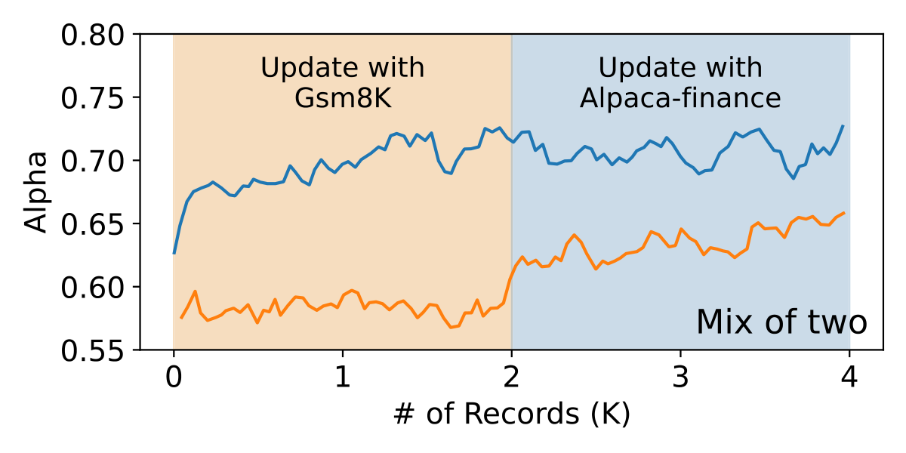

> 图解：前半段 Gsm8k 接受率上升而 Alpaca-finance 基本不变；后半段 Alpaca-finance 开始上升，Gsm8k 则基本保持。该实验没有观察到明显遗忘，但只覆盖两个分布和一次顺序切换，不能据此排除所有长期遗忘。

### 9.6 突变与渐变，哪种更难适应

除直接拼接造成的突变外，作者还构造了渐变：从第 1 到第 4000 条记录，Gsm8k 的采样概率由 100% 线性降至 0%，Spider 则相应上升。接受率按最近 100 条记录平均。

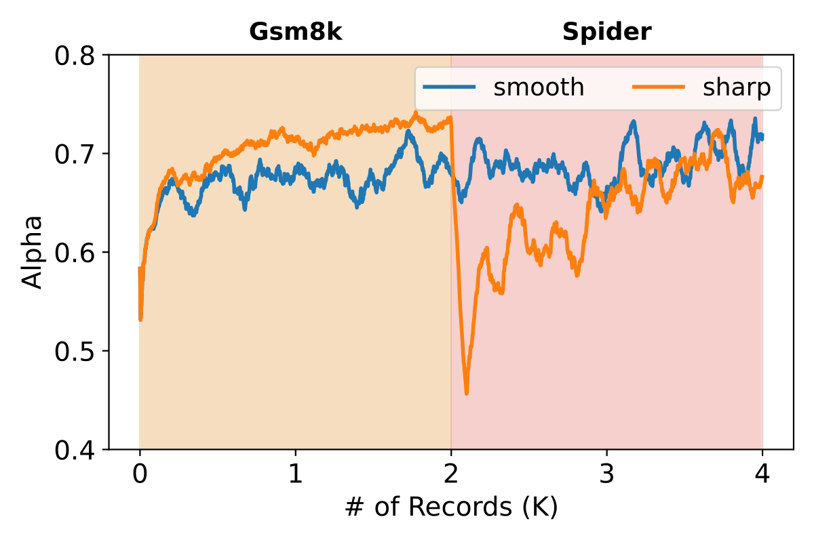

> 图解：突变设置在约第 2000 条附近出现明显接受率下跌，随后快速恢复；渐变设置的下降更不明显。持续在线更新既能修复突然失配，也能更平稳地跟随缓慢变化。

## 10. 总结：让草稿模型在服务中持续进化

- **核心问题**：Speculative Decoding 的收益高度依赖草稿模型接受率，静态小模型难以适应多样且漂移的线上请求。
- **核心方法**：OSD 缓存目标模型验证时产生的纠错分布，用在线知识蒸馏定期更新草稿模型，不改变目标输出分布。
- **核心证据**：离线蒸馏最高将接受率提升 0.65；四类专业任务实测加速 1.42–2.17 倍，高接受率设置最高达 2.63×。
- **系统扩展**：按语言或话题路由到多个专用草稿模型，可再提高约 0.1–0.2 接受率，代价是草稿相关内存由约 2% 增至约 10%。
- **适用边界**：低接受率可能拖慢推理，更新开销也并非天然免费；buffer 保留策略、更新时机、路由方式和模型数量仍需按负载权衡。

未来更值得探索的是如何把更新调度、长期遗忘控制与自适应路由联合起来，让这种方法在高负载、长期运行的生产服务中保持稳定收益。

> 本文参考自 [Online Speculative Decoding](https://arxiv.org/abs/2310.07177)