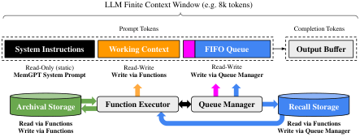
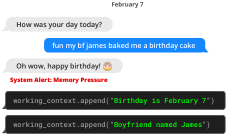
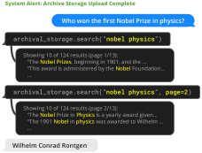
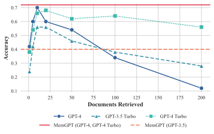
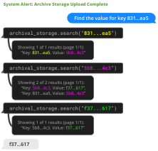
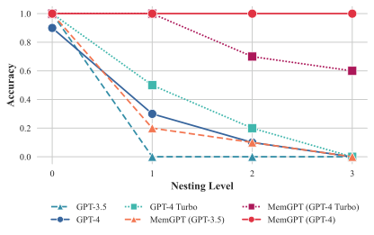

# MemGPT：把上下文变成虚拟内存

长对话聊着聊着就“失忆”、长文档读到后面就顾不上上下文，根源都是 LLM 的固定上下文窗口装不下持续增长的信息，而这直接卡住了个性化助手和多文档分析。MemGPT 不再单纯扩大窗口，而是借鉴操作系统的虚拟内存，让模型通过函数调用在上下文与外部存储之间主动“换页”。在深度记忆检索任务中，GPT-4 Turbo 加入 MemGPT 后，准确率从 35.3% 提升到 93.4%，ROUGE-L Recall 从 0.359 提升到 0.827。更直观的 nested KV 多跳检索里，MemGPT（GPT-4）在图示的 0–3 个嵌套层级上始终保持 100% 准确率，而普通 GPT-4 到 3 层时已降为 0。

## 为什么更大的上下文窗口仍不够

Transformer 的标准 Self-Attention 需要比较序列中的 Token 对，直接拉长输入会带来约 $O(n^2)$ 的计算与显存开销。即使工程上把窗口做大，已有研究也发现模型对信息的利用并不均匀：开头和结尾的内容更容易被召回，中间内容更容易被忽略。

现实需求却不会停在窗口边界内。长期陪伴助手需要记住跨越数周甚至数月的偏好与事件；法律、金融文档可能超过百万 Token，多文档任务还要跨文件组合证据。论文汇总的 2024 年 1 月数据，很直观地展示了当时模型容量与长期交互需求之间的差距。

| 模型 / API | 开放源码或开放权重 | 上下文 Token 数 | 约合消息数 |
| --- | --- | ---: | ---: |
| Llama (1) | 是 | 2k | 20 |
| Llama 2 | 是 | 4k | 60 |
| GPT-3.5 Turbo（初发布） | 否 | 4k | 60 |
| Mistral 7B | 是 | 8k | 140 |
| GPT-4（初发布） | 否 | 8k | 140 |
| GPT-3.5 Turbo | 否 | 16k | 300 |
| GPT-4 | 否 | 32k | 约 600 |
| Claude 2 | 否 | 100k | 约 2000 |
| GPT-4 Turbo | 否 | 128k | 约 2600 |
| Yi-34B-200k | 是 | 200k | 约 4000 |

> 表解：消息数按 1k Token 的预提示、每条消息约 50 Token（约 250 个字符）估算，并非固定轮数。这里保留论文在 2024 年 1 月收集的数据，用来解释研究动机，不代表这些模型当前的上下文规格。

问题的关键因此不只是“能塞入多少 Token”，还包括“如何在有限窗口内持续找到此刻真正需要的信息”。MemGPT 选择把后者变成一个由 LLM 自己参与的内存管理问题。

## 核心思路：为 LLM 加一层“操作系统”

操作系统中的虚拟内存，让程序不必受物理内存容量约束：常用数据留在 RAM，暂时不用的数据换出到磁盘，需要时再换回。MemGPT 把同一思想迁移到 LLM，提出 **虚拟上下文管理（Virtual Context Management）**。

| 操作系统概念 | MemGPT 中的对应物 | 作用 |
| --- | --- | --- |
| 物理内存 / RAM | Main Context，即 Prompt Tokens | 当前推理时模型真正能读取的内容 |
| 磁盘等外部存储 | External Context | 保存窗口之外的长期信息 |
| 虚拟内存 | 扩展上下文的“幻觉” | 让有限窗口支持看似无边界的历史与文档 |
| 数据换入、换出 | 记忆读写与检索函数 | 在主上下文和外部上下文之间移动信息 |
| 中断与事件 | 用户消息、系统告警、定时事件 | 触发模型推理和记忆管理 |
| 连续执行多条指令 | Function Chaining | 在一次用户请求中连续完成多步检索 |

这里必须区分“无限上下文”与“无限窗口”：MemGPT 并没有改变底层 LLM 的固定输入长度，而是把完整信息放在外部存储中，只把当前需要的一小部分调入窗口。模型每次看到的仍然有限，但可访问的信息不再只限于这一次 Prompt。

> 图解：顶部虚线框是有限的 LLM 上下文窗口。输入侧由 System Instructions、Working Context 和 FIFO Queue 组成，输出先进入 Output Buffer；Function Executor 解析模型输出并执行函数，Queue Manager 维护消息队列与 Recall Storage。绿色和蓝色通路分别连接 Archival Storage 与 Recall Storage，实现外部信息的读写和换入。

笔者认为，这个设计最关键的地方不是“外接一个数据库”，而是把 **何时写、写什么、何时查、是否继续查** 也交给模型决策。数据库只是存储介质，自主控制流才让 MemGPT 从一次性检索系统变成了可持续工作的 Agent。

## 主上下文：把有限窗口划成三个区域

MemGPT 将 Prompt Tokens 划分为三个连续区域，各自承担不同职责：

- **System Instructions**：只读的静态系统提示，描述记忆层级、控制流和函数用法，相当于 Agent 的“操作手册”。
- **Working Context**：固定大小、可读写的非结构化文本块，只能通过函数修改；对话场景中用于保存用户事实、偏好和 Agent 人设等关键信息。
- **FIFO Queue**：先进先出的滚动消息队列，保存用户与 Agent 消息、系统告警以及函数调用的输入和输出；队首还放有一条系统消息，递归汇总已被移出的历史。

Working Context 与 FIFO Queue 的分工很像“桌面便签”和“流水账”：前者只保留长期重要的少量事实，后者记录最近发生的一切。这样，模型不必每次都从原始历史中重新提炼人设和偏好，也不会因为队列被清理而立即丢掉关键信息。

## 外部上下文：两种存储各司其职

External Context 指所有不在当前 Prompt 中的信息，它们必须显式换入 Main Context，底层 LLM 才能在推理时读取。论文将外部存储分为两类：

| 存储 | 数据内容 | 写入方式 | 读取方式 |
| --- | --- | --- | --- |
| Recall Storage | 完整历史消息，即消息数据库 | Queue Manager 自动写入 | 模型通过函数检索 |
| Archival Storage | 任意长度的文本对象，如文档、知识或长期事实 | 模型通过函数写入 | 模型通过函数检索 |

这种拆分避免了把“聊过什么”和“世界里有什么”混成同一种数据。前者适合按对话历史追溯，后者适合承载 Wikipedia 文档、Key-Value 数据等外部知识。

有了存储分层，下一个问题是：窗口快满时，谁来搬运数据，怎样避免重要信息随旧消息一起消失？

## Queue Manager：在溢出前完成记忆搬迁

Queue Manager 同时管理 FIFO Queue 和 Recall Storage，一次基本消息循环包括四步：

1. 收到新消息后，将其追加到 FIFO Queue。
2. 拼接 Prompt Tokens，触发 LLM 推理，得到 Completion Tokens。
3. 把输入消息和 LLM 输出都写入 Recall Storage，保留完整历史。
4. 如果模型检索旧消息，把检索结果追加到队尾，使其重新进入当前上下文。

上下文清理不是简单地“到顶就砍”。论文给出的示例策略有两个阈值：

- 当 Prompt 超过窗口的 **70%** 时，Queue Manager 插入 Memory Pressure 告警，提醒模型提前把重要内容写入 Working Context 或 Archival Storage。
- 当 Prompt 达到 **100%** 时，系统执行 flush，例如移出相当于窗口 **50%** 的消息，并用旧递归摘要与被移出消息生成新摘要。

被移出的原始消息只是不再直接出现在 Prompt 中，并没有从 Recall Storage 删除，之后仍可通过函数找回。70%、100% 和 50% 都是论文用于说明策略的示例配置，不是 MemGPT 必须固定使用的超参数。

> 图解：用户在 2 月 7 日提到男友 James 为自己烤了生日蛋糕。收到 Memory Pressure 告警后，MemGPT 连续调用 `working_context.append`，把“生日是 2 月 7 日”和“男友名叫 James”写入 Working Context。被保留的是可长期复用的事实，而不只是最近几句话。

预警机制的价值在于，它把记忆保存安排在真正的队列淘汰之前。若先删除再总结，模型已经没有机会判断哪些细节值得单独留下；先告警再清理，则让“遗忘”变成了一次主动选择。

## 记忆不仅要会存，还要会查、会改

仅把历史存进数据库，并不会自动带来长期一致性。MemGPT 还需要根据新问题检索旧信息，并在事实变化时修正已有记忆。

> 图解：用户说生日时还去了 Six Flags，MemGPT 调用 `recall_storage.search("six flags")`，取回三条不同日期的历史消息，其中包括“James 和我其实是在 Six Flags 第一次见面”。因此，Agent 不只是重复用户刚说的地点，还能进一步追问是否和 James 同去，把新对话与长期记忆连接起来。

检索结果带分页信息，避免一次返回过多历史而再次撑爆窗口。这个细节说明 MemGPT 的“虚拟上下文”不是靠隐藏地拼接全部历史实现，而是靠有边界的小批量换入实现。

> 图解：到 2 月 14 日，用户表示已经和 James 分手。MemGPT 调用 `working_context.replace`，将“Boyfriend named James”替换为“Ex-boyfriend named James”，再给出符合新事实的回应。长期记忆因而不是只追加不改的日志，而是可以随用户状态演化的工作区。

这三个例子连起来，才是完整的记忆生命周期：在压力下 **创建**，在需要时 **检索**，在事实变化后 **修正**。接下来要看的是，模型怎样通过输出函数调用驱动这些动作。

## Function Executor：让模型输出变成可执行操作

每次推理中，LLM 读取拼接后的 Main Context，生成一个输出字符串。MemGPT 不会把任何输出都直接当作操作执行，而是经过以下闭环：

1. Parser 检查输出格式和函数参数是否合法。
2. 校验通过后，Function Executor 执行记忆编辑或检索。
3. 函数结果写回 Main Context；如果执行失败，运行时也把错误反馈给模型。
4. 模型根据结果决定回复用户、修正调用，还是继续下一步操作。

例如，向已满的 Working Context 添加内容可能触发容量错误。错误反馈让模型有机会调整行为，而不是让一次非法调用悄悄失败。检索接口则通过分页控制单次返回量，从机制上保护上下文预算。

支撑这套自主行为的主要不是额外训练，而是 System Instructions 中的两部分信息：记忆层级及用途的详细说明，以及带自然语言描述的 Function Schema。换言之，底层 LLM 仍是通用模型，MemGPT 在外部补齐了“知道有什么工具、何时使用、失败后怎么办”的运行环境。

## 事件与心跳：多步任务不必每一步都等用户

在 MemGPT 中，触发推理的统一抽象是 **事件（Event）**。它既可以是普通用户消息，也可以是：

- 主上下文容量告警等系统消息；
- 用户登录、文档上传完成等交互事件；
- 按固定计划运行的定时事件。

定时事件使 Agent 可以在没有新用户消息时执行任务，系统告警则让记忆管理成为控制流的一部分，而不是隐藏在模型之外的后台清理。

多文档检索通常还需要连续调用多个函数。MemGPT 为此提供 Function Chaining：函数调用带有 `request_heartbeat=true` 时，函数结果进入 Main Context 后立即再次触发 LLM 推理；不带该标志时则视为 **yield**，系统暂停处理，等待下一个外部事件。

“heartbeat”可以理解为模型主动要求系统“别停，继续让我处理”。它让 Agent 能在一次用户请求中完成“搜索第一页 → 翻下一页 → 根据新结果再搜索 → 最终回答”，而不是每页都把控制权交还用户。这正是后文多跳检索能够成立的控制流基础。

## 与长上下文、RAG 和 Agent 的区别

MemGPT 并非凭空替代此前技术，而是把三条研究线索组合成一个围绕长期记忆的系统：

- **长上下文 LLM**：稀疏 Attention、低秩近似、神经记忆和位置编码扩展，都在增大可用窗口。MemGPT 可以直接受益于这些进展，因为更大的窗口意味着更大的 Main Context；它的创新在于窗口之外再加分层记忆，而不是与之竞争。
- **Retrieval-Augmented Generation（RAG）**：传统 RAG 常在一次生成前检索固定数量的文档；FLARE 等工作已让模型主动决定何时检索，亦有研究把检索与 Chain-of-Thought 交错。MemGPT 进一步把检索、记忆写入、上下文编辑和多步函数调用统一到长期运行框架中。
- **LLM Agent**：已有工作研究工具使用、规划、网页浏览和多 Agent 行为，WebGPT 也使用分页限制浏览结果。MemGPT 的重点更聚焦于跨会话保存用户输入、维护一致性，并让记忆管理本身成为 Agent 的自主行为。

所以，MemGPT 的增量不应被概括为“又一个 RAG”。普通 retriever-reader 主要回答“这次给模型看哪些文档”，MemGPT 还要回答“长期运行中，模型如何持续管理自己看得见和看不见的信息”。

## 实验设置：两类任务检验两种长期能力

论文用两组任务验证设计：对话 Agent 检查跨会话记忆，文档分析检查超窗口信息访问与多跳组合。后者还包含一个新提出的 nested KV 数据集，用来测试多次检索之间的信息串联。

实现与模型设置如下：

- GPT-4 Turbo 指 `gpt-4-1106-preview`，上下文窗口为 128,000 Token。
- GPT-4 指 `gpt-4-0613`，窗口为 8,192 Token。
- GPT-3.5 Turbo 指 `gpt-3.5-turbo-1106`，窗口为 16,385 Token。
- MemGPT 分别搭配上述三种模型运行，以区分记忆框架的收益与底层模型能力的影响。

作者公开了扩展后的 Multi-Session Chat（MSC）数据、nested KV 数据，以及 2,000 万篇 Wikipedia 文章的 Embedding 数据集。下面先看最能体现“长期陪伴”的对话实验。

## 对话实验一：从五段旧会话中找回一个细节

MSC 由人工标注者扮演固定人设完成，每组包含 5 个会话，每个会话约有十几条消息。作者新增第 6 个会话，用同一对人设之间的一组问答构造 **深度记忆检索（Deep Memory Retrieval，DMR）** 任务。

DMR 的问题明确指向过去会话，答案范围很窄。例如，它应该问“那次冲浪后我们去哪家店吃午饭”，而不是问“你喜欢冲浪吗”：前者必须读过旧对话，后者只看人设摘要就能回答。附录中的数据生成 Prompt 明确禁止生成仅靠 Persona 就能回答的问题，以免把记忆测试变成摘要复述。

两种系统的输入条件并不相同：

- 固定上下文基线只能看到过去 5 次会话的 **有损摘要**，模拟不断递归总结的长期历史。
- MemGPT 可以通过分页搜索访问 **完整历史**，但必须自己找到并换入相关消息。

评分同时使用 LLM Judge 的准确率和 ROUGE-L Recall。由于生成答案通常比 Gold Answer 更长，论文采用 Recall，降低冗长但包含正确要点的回答被过度惩罚的风险。

| 底层模型与系统 | Accuracy ↑ | ROUGE-L Recall ↑ |
| --- | ---: | ---: |
| GPT-3.5 Turbo | 38.7% | 0.394 |
| GPT-3.5 Turbo + MemGPT | 66.9% | 0.629 |
| GPT-4 | 32.1% | 0.296 |
| GPT-4 + MemGPT | 92.5% | 0.814 |
| GPT-4 Turbo | 35.3% | 0.359 |
| GPT-4 Turbo + MemGPT | **93.4%** | **0.827** |

> 表解：所有“+ MemGPT”行都明显超过对应基线。GPT-4 的准确率提高 60.4 个百分点，GPT-4 Turbo 提高 58.1 个百分点，GPT-3.5 Turbo 也提高 28.2 个百分点。这里比较的是相对同一底层模型的变化，不能把不同模型间的差异全部归因于记忆框架。

这组结果支持了论文的核心判断：对于细节型旧记忆，可检索的完整历史比持续压缩的摘要更可靠。摘要适合保留大意，却容易丢掉以后才被问起的窄答案。

## 对话实验二：开场白能否体现“我记得你”

一致性要求“不说错”，Engagement 则要求 Agent 主动利用旧知识，让回应更个性化。Conversation Opener 任务让模型生成下一会话的开场白，并与两类参考比较：

- **SIM-1 / SIM-3**：生成开场白与 Gold Persona 标签的相似度，用于衡量它是否触及过往积累的一项或多项用户信息。
- **SIM-H**：与人工撰写的下一会话开场白的相似度。

下表中的 GPT-3.5 Turbo、GPT-4 和 GPT-4 Turbo 均为使用相应底层模型的 MemGPT 变体，而不是无记忆基线。

| 方法 | SIM-1 ↑ | SIM-3 | SIM-H |
| --- | ---: | ---: | ---: |
| Human | 0.800 | 0.800 | 1.000 |
| MemGPT（GPT-3.5 Turbo） | 0.830 | 0.812 | **0.817** |
| MemGPT（GPT-4） | **0.868** | **0.843** | 0.773 |
| MemGPT（GPT-4 Turbo） | 0.857 | 0.828 | 0.767 |

> 表解：三种 MemGPT 变体的 SIM-1、SIM-3 都高于 Human 行的 0.800，但 SIM-H 都低于人类自身的 1.000。作者观察到，模型生成的开场白往往更长、覆盖更多 Persona 信息，因此“像不像人写的原句”和“是否利用用户信息”并不是同一维度。

作者还指出，把信息存进 Working Context 是生成有吸引力开场白的关键。对话任务说明记忆既可用于被动回答旧问题，也可用于主动开启新话题；下一组实验则把同样的换页机制放到大规模文档上。

## 文档问答：把一次检索改成可翻页的连续检索

Multi-document QA 使用 NaturalQuestions-Open 的问题和 2018 年末 Wikipedia 数据，并抽取 50 个问题评估。标准 retriever-reader 流程先取回相关文档，再把前 $K$ 篇交给 Reader LLM 作答。

为保证比较公平，基线与 MemGPT 使用相同的检索技术：

- 使用 OpenAI `text-embedding-ada-002` 生成 Embedding，以余弦相似度检索。
- Archival Storage 使用 PostgreSQL，pgvector 提供向量搜索，HNSW（Hierarchical Navigable Small World）索引支持近似的亚秒级查询。
- 固定上下文基线独立运行 Retriever，把 Top-$K$ 文档交给 LLM；超出窗口时通过截断文档塞入同样数量的文档。
- MemGPT 把整个文档集放入 Archival Storage，模型可多次搜索并翻页，因此可访问文档数不再等于单次 Prompt 能容纳的文档数。

文档任务要求回答采用 `ANSWER + DOCUMENT` 格式。LLM Judge 不仅检查答案是否正确，还检查是否给出支持答案的文档文本，以降低模型直接依赖参数知识作答、或仅因字符串不精确匹配而误判的影响。

> 图解：用户询问首届诺贝尔物理学奖得主。第一次 `archival_storage.search("nobel physics")` 返回 124 条结果中的第 1 页，共 10 条；MemGPT 再指定 `page=2` 获取下一页，找到 1901 年奖项的对应文本，最终回答 Wilhelm Conrad Röntgen。这里的关键不是一次检索更准，而是第一次不满意后还能继续查。

> 图解：横轴是检索文档数 $K$，纵轴是 Accuracy。普通 GPT-4 在约 10 篇文档时达到约 0.72，但随文档增加和截断加剧，200 篇时降至约 0.12；GPT-3.5 Turbo 与 GPT-4 Turbo 基线也随 $K$ 增大而下降。MemGPT（GPT-4、GPT-4 Turbo）以约 0.72 的水平线表示，不随 $K$ 变化；MemGPT（GPT-3.5）约为 0.40，显示底层模型函数调用能力会限制系统收益。

固定基线会受到 Retriever 首轮结果的上限约束：如果正确文档从未进入其可见的 Top-$K$，Reader 就没有机会使用它。MemGPT 理论上可通过后续检索与分页继续寻找，因此不要求第一页就命中。

但这并不等于检索问题被彻底解决。作者观察到 Gold Document 经常排在十几名甚至更后，而 MemGPT 有时会在遍历数据库前提前停止翻页。也就是说，系统提供了“可以继续”的能力，底层 Agent 仍要学会“何时不该停”。

## Nested KV：检验真正的多跳信息组合

普通 Key-Value 检索只需由 Key 找 Value；**Nested KV** 允许 Value 本身又是另一个 Key，因而必须沿链继续查询。这类任务把“多跳检索”压缩成一个没有语言歧义的实验：少查一步，答案就错。

实验固定 140 对 128-bit UUID，约 8k Token，对应 GPT-4 基线的上下文容量。正文将嵌套层级从 0 变化到 4，其中 0 表示首个 Value 不再是 Key，4 表示需要 4 次 KV 查询；结果图展示 0–3 级。每个设置抽样 30 种排列，改变初始 Key 和嵌套 Key 的位置。

> 图解：示例链为 `831…ea5 → 5b8…4c3 → f37…617`，即两个嵌套层级。MemGPT 先查初始 Key，再把返回的 Value 当作下一个 Key 查询；第三次搜索 `f37…617` 时只得到它作为 Value 的记录，没有它作为 Key 的新记录，因此确认到达链尾并返回该值。

> 图解：横轴为 Nesting Level，纵轴为 Accuracy。GPT-3.5 在 1 层已降为 0，主要错误是直接返回第一个 Value；GPT-4 和 GPT-4 Turbo 在 3 层也降为 0。MemGPT（GPT-4）在 0–3 层均为 1.0；MemGPT（GPT-4 Turbo）在 2 层约为 0.7、3 层约为 0.6，MemGPT（GPT-3.5）同样会随层级增加而下降。

这个结果也揭示了一个重要边界：**记忆架构不能替代底层模型的工具使用能力**。GPT-4 Turbo 作为普通基线强于 GPT-4，但接入 MemGPT 后反而弱于 MemGPT（GPT-4），原因不是存储容量不足，而是没有稳定执行足够多次的查询。GPT-3.5 的函数调用能力更弱，文档 QA 和 Nested KV 中都明显拖累了 MemGPT。

## 附录中的复现要点：Prompt 如何约束任务与评分

附录没有新增模型结构，主要公开了各类指令。它们决定 Agent 是否持续检索、基线如何使用摘要，以及 LLM Judge 如何判定答案，因此直接影响实验能否复现。

### DMR：区分长期记忆与人设摘要

MemGPT 的对话 Persona 指令要求它沉浸于角色，并根据 Core Memory 和 `conversation_search` 作答。固定上下文基线则接收过去对话的 `CONVERSATION_SUMMARY`，信息不足时只能回答 `NO ANSWER`。

Self-instruct 数据生成指令提供旧聊天和双方 Persona，要求生成“必须真正参与过旧对话才能回答”的问题。附录用冲浪经历举例：问饭后去了哪家店，正确答案 Taco Bell 只能来自聊天记录；问是否喜欢冲浪，却能直接从 Persona 得到答案，因此是不合格问题。

### DMR Judge：允许表达变长，但不能换错事实

Judge 输入包括问题、Gold Answer 和生成答案，只需判断生成内容是否触及同一正确主题。比如 Gold Answer 是“贝壳项链”，更自然地回答“我买了很多东西，包括那条贝壳项链”也算正确；若把项链换成杯子，或称自己不记得，则判错。

Judge 先输出一句话理由，最后只能以 `CORRECT` 或 `WRONG` 结尾。这种规则与 ROUGE-L Recall 的选用目的相同：允许生成回答比短标签更啰嗦，但不要求逐字一致。

### 文档问答：答案必须带证据

MemGPT 的 DOC-QA 指令声明答案一定在 Archival Memory 中，找不到时应继续搜索，并要求以 2018 年为时间背景。回答必须包含 `ANSWER` 和对应的 `DOCUMENT` 文本。

固定基线只能依据提供的文档列表作答；证据不足时回答 `INSUFFICIENT INFORMATION`，不能凭模型内部知识补答。Judge 规定，缺少 `DOCUMENT` 或直接说信息不足都算不正确，只有答案正确且附上对应文档才通过。

### Nested KV：到链尾之前不能停

MemGPT 的指令明确要求：在验证当前 Value 不再是 Key 之前，不得停止 Nested Lookup。固定基线则拿到包含 UUID 对的 JSON，并被告知若 Value 也是 Key，就继续返回该 Key 的 Value。

由此可见，Nested KV 的成功既来自外部存储和 heartbeat，也来自清晰的停止条件。若 Agent 在第一次拿到 Value 后就回答，再强的检索器也无法补齐后续跳数。

## 总结

- MemGPT 把固定上下文窗口视为 RAM，把 Recall Storage 与 Archival Storage 视为外部存储，用函数调用实现信息换入、换出。
- System Instructions、Working Context 和 FIFO Queue 分工保存规则、关键事实与近期历史，Memory Pressure 告警让模型在队列清理前主动保留重要内容。
- `request_heartbeat=true` 将多次函数调用串成连续控制流，使分页搜索、跨文档汇总和多跳 KV 查询能在一次任务内完成。
- 在 DMR 中，GPT-4 Turbo + MemGPT 达到 93.4% 准确率；在图示 0–3 层 Nested KV 中，MemGPT（GPT-4）始终保持 100%，但其他底层模型仍会因提前停止检索而失误。
- MemGPT 提供的是“可访问历史不受单次窗口限制”，不是数学意义上的无限记忆；检索质量、停止策略、函数调用可靠性和多步操作成本仍是实际落地的关键。

这项工作开启的方向，是把数据库、缓存和更精细的记忆策略继续接入 LLM 操作系统，同时解决 Agent 不知道何时该继续查、何时该停止的问题。

> 本文参考自 [MemGPT: Towards LLMs as Operating Systems](https://arxiv.org/abs/2310.08560)