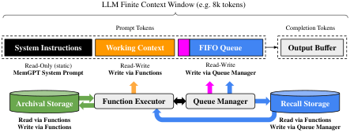

# MemGPT：让大模型自己管理上下文

长对话“失忆”、长文档读不全，根源是固定上下文窗口装不下持续增长的信息，这直接限制了个性化助手与多文档分析。MemGPT 借鉴操作系统的虚拟内存，让 LLM 通过函数调用在上下文与外部存储之间主动“换页”。GPT-4 Turbo 接入后，深度记忆检索准确率从 35.3% 提升至 93.4%，ROUGE-L Recall 从 0.359 提升至 0.827；在图示 0–3 层 Nested KV 检索中，MemGPT（GPT-4）始终保持 100% 准确率，而普通 GPT-4 到 3 层时已降为 0。

## 核心创新：窗口不变，可访问历史扩展

- **虚拟上下文管理**：Main Context 相当于 RAM，只放当前推理所需信息；External Context 相当于磁盘，保存窗口外的历史与文档。需要时再检索换入，而非扩大底层模型的固定输入长度。
- **自主记忆决策**：关键不只是外接数据库，而是让模型决定何时写、写什么、何时查、是否继续查，使一次性检索系统变成可持续运行的 Agent。

> 图解：有限上下文由系统指令、工作区和消息队列组成；函数执行器连接外部存储，实现记忆读写与信息换入。

## 关键方法：分层存储，连续调用

- **主上下文三区**：System Instructions 保存规则；Working Context 保存用户偏好等长期事实；FIFO Queue 保存近期消息，并递归汇总已移出的历史。
- **外部存储两库**：Recall Storage 自动保存完整对话，Archival Storage 保存文档与长期知识，二者都由模型通过函数检索。
- **溢出前主动记忆**：示例策略在 Prompt 超过窗口 70% 时发出 Memory Pressure 告警，让模型先保留重要事实；达到 100% 后再清理队列，原始历史仍可找回。
- **多步控制流**：函数调用设置 `request_heartbeat=true` 后立即再次触发推理，使模型能在一次任务内连续翻页、再检索，直至完成多跳查询。

## 实验结论：收益来自完整历史与持续检索

- **深度记忆检索**：固定上下文基线只能读取旧会话的有损摘要，MemGPT 则能分页搜索完整历史。三种底层模型接入后均有提升，说明窄而具体的旧记忆不宜只靠递归摘要保存。
- **文档问答**：MemGPT 可在首次检索不满意时继续翻页，不必受单轮 Top-K 结果限制；但它仍可能提前停止，检索能力并未因此被彻底解决。
- **Nested KV**：多跳任务要求把每次返回的 Value 继续当作 Key 查询。MemGPT（GPT-4）表现稳定，但 GPT-4 Turbo 与 GPT-3.5 变体会随层级增加而失误，说明记忆架构不能替代底层模型的工具调用能力。

## 总结

- MemGPT 提供的是“可访问历史不受单次窗口限制”，不是无限上下文窗口。
- 核心价值在于统一记忆创建、检索、修正与多步执行，而非单纯增加存储。
- 实际效果仍受检索质量、停止策略和函数调用可靠性制约；让 Agent 知道何时继续查、何时该停，是后续关键方向。

> 本文参考自 [MemGPT: Towards LLMs as Operating Systems](https://arxiv.org/abs/2310.08560)