# Medusa：给 LLM 多长几个"头"，推理速度直接翻 2.8 倍

大模型推理慢的根因不是算力不够，而是自回归解码每生成一个 token 都要把全部模型参数从 HBM 搬进加速器缓存一次，计算单元大量时间都在"等数据"。这篇 ICML 2024 的工作提出 Medusa：不再引入独立的 draft model，而是直接在原模型的最后隐状态上额外挂几个轻量解码头，并行预测后续多个 token，再用树状注意力（tree-based attention）把多条候选续写一次性验证。结果非常硬： **Medusa-1 在完全不损失生成质量的前提下实现超过 2.2 倍加速，Medusa-2 进一步把加速比推到 2.3-2.8 倍** ，而且整套方案对 serving 系统几乎零侵入。

## 背景：LLM 推理到底慢在哪

先建立直觉。自回归解码就像一个人写字，必须写完上一个字才能写下一个。每写一个字，都要把整本"字典"（全部模型参数）从书架（HBM）搬到书桌（片上缓存）上一次。字写得很慢，但搬书的时间一点没少——这就是典型的 **memory-bandwidth-bound** （内存带宽受限）：瓶颈在搬运，不在计算。

主流的解法是 **Speculative Decoding** （投机解码）：用一个小的 draft model 先"猜"出后面几个 token，再让大模型一次性并行验证。思路漂亮，但落地很痛：

- draft model 要够小又要猜得准，往往需要单独预训练。比如 SpecInfer 报告了 275 个 A100 GPU 小时的额外训练开销；
- 单独预训练的 draft model 和原模型之间存在 **分布偏移** （distribution shift），猜出来的续写原模型未必认；
- 在分布式 serving 环境里同时维护、调度两个模型，工程复杂度高。

Medusa 的切入点很直接： **既然猜 token 这件事本质上是在原模型的表示之上做预测，为什么不直接让原模型自己长几个"头"出来猜？** 这就省去了 draft model 的一切麻烦。

## Medusa 的整体框架

Medusa 沿用投机解码的三步框架，但每一步都重新设计：

1. **生成候选** ：由挂在原模型上的 Medusa heads 并行产出后续多个位置的预测；
2. **处理候选** ：用 tree attention 把多条候选续写打包成一棵树，一次前向同时验证；
3. **接受候选** ：可以用标准的拒绝采样（rejection sampling），也可以用本文提出的 typical acceptance 方案，最终取所有候选中 **被接受的最长前缀** 进入下一步。

由于 Medusa heads 就长在原模型之上，第 2 步算出的 logits 还能直接复用给下一个解码步的第 1 步，几乎零浪费。

### Medusa Heads：一层 FFN 就够了

具体来说，给定原模型在位置 $t$ 的最后隐状态 $h_t$，Medusa 在其上追加 $K$ 个解码头。第 $k$ 个头负责预测第 $t+k+1$ 个位置的 token（原模型自己的 language model head 负责第 $t+1$ 个位置）。每个头的结构简单到只有一层带残差连接的前馈网络：

$$
p_t^{(k)} = \mathrm{softmax}\left(W_2^{(k)} \cdot \left(\mathrm{SiLU}(W_1^{(k)} \cdot h_t) + h_t\right)\right)
$$

其中 $W_2^{(k)} \in \mathbb{R}^{d \times V}$，$W_1^{(k)} \in \mathbb{R}^{d \times d}$，$d$ 是隐层维度，$V$ 是词表大小。

初始化上有个巧思：$W_2^{(k)}$ 直接复用原模型 LM head 的权重，$W_1^{(k)}$ 置零。这样 Medusa head 的初始预测和原模型完全对齐，训练从一个"已经会预测"的起点开始，收敛更快。

这个设计的聪明之处在于：heads 和 backbone 共享表示，天然避免了 draft model 的分布偏移；同时因为只新增了几个单层头，参数量极小，serving 时不用改动系统架构，对分布式部署非常友好。

### Tree Attention：一次前向验证一整棵树

有了 $K+1$ 个位置的预测，怎么组合成候选？如果只取每个头的 top-1 拼成一条续写，候选太单一；如果把所有组合都验证一遍，计算量又爆炸。Medusa 用 **树状注意力** 来平衡。

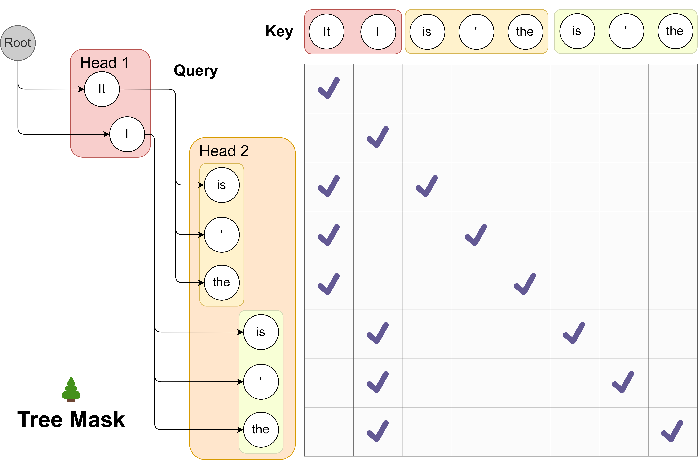

> 图解：图中第一个 Medusa head 取 top-2 预测、第二个 head 取 top-3 预测，两层的笛卡尔积组合出 $2 \times 3 = 6$ 条候选续写，每条对应树的一个分支。左下的 attention mask 保证每个 token 只能看到自己所在分支上的祖先节点（不同分支之间互相不可见），位置编码的索引也按树结构调整。这样一次前向就能并行验证全部 6 条候选，而不需要扩大 batch size。

形式化地说，第 $k$ 个头取 top-$s_k$ 预测（$s_k$ 是超参数），候选集合就是各层 top-$s_k$ 的笛卡尔积，树上第 $k$ 层有 $s_k$ 个分支，新增 token 总数为 $\sum_{k=1}^K \prod_{i=1}^k s_i$。

和 SpecInfer 等工作"自底向上"把 draft model 生成的多条序列合并成树不同，Medusa 是 **自顶向下** 建树——候选天然就是按层组织的，不需要额外的合并步骤，树结构是静态的，实现更简单。

### 训练策略：Medusa-1 与 Medusa-2

搞清楚了怎么猜、怎么验证，下一个问题是怎么训练这些头。作者给出了两档方案，对应不同的资源约束。

#### Medusa-1：冻结 backbone，只训 heads

最省事的玩法：backbone 完全冻结，只用交叉熵训练 Medusa heads。考虑到越靠后的头预测不确定性越大、loss 天然越大，给每个头的 loss 加一个衰减权重 $\lambda_k$：

$$
\mathcal{L}_{\text{Medusa-1}} = \sum_{k=1}^{K} -\lambda_k \log p_t^{(k)}(y_{t+k+1})
$$

实践中 $\lambda_k$ 取常数的 $k$ 次幂（如 $0.8^k$）。由于 backbone 只负责提供隐状态，还可以用 **量化后的 backbone** 进一步省显存——配合 4-bit 量化，在单张消费级 GPU 上就能给大模型训 Medusa。成本有多低？Vicuna-7B 上用单卡 A100 训 60k 条 ShareGPT 样本， **大约 5 个小时** 就能拿到一个无损加速 2 倍多的模型。

#### Medusa-2：联合训练，但要"护住" backbone

冻结 backbone 意味着 heads 的预测精度受限于现有表示。如果想榨出更高的接受率，就得把 backbone 和 heads 一起训——但直接联合训练会损害原模型的生成质量（实验部分会看到这个坑）。Medusa-2 用三个策略解决：

- **组合 loss** ：把 backbone 自身的语言模型 loss 加回来，保住 next-token 预测能力：

$$
\mathcal{L}_{\text{Medusa-2}} = \mathcal{L}_{\text{LM}} + \lambda_0 \mathcal{L}_{\text{Medusa-1}}
$$

- **差分学习率** ：backbone 已经训练充分，heads 从零开始，给 heads 设更大的学习率（实践中为 backbone 的 4 倍），让 heads 快速收敛而不扰动 backbone；
- **Heads warmup** ：训练初期 heads 的 loss 很大，梯度会"带歪" backbone。采用两阶段训练——先按 Medusa-1 只训 heads，再联合训练；或者更平滑地，用正弦 schedule 让 $\lambda_0$ 逐渐升到峰值。两种做法效果相当。

实际训练中 backbone 侧用 LoRA/QLoRA 微调（rank 32、$\alpha$ 16、dropout 0.05），进一步压低显存开销。这套 recipe 还可以直接嵌入 SFT 流程，训出一个"原生支持 Medusa"的模型。

关于头的数量，作者的经验是 **5 个头封顶够用** ，推理时配合优化后的树结构，往往 3-4 个头就够，多余的头直接忽略即可，没有额外开销。

### 扩展一：Typical Acceptance——比拒绝采样更务实的接受准则

解决了训练，还有一个影响效率的环节：接受候选的策略。投机解码标配的拒绝采样能保证输出分布和原模型严格一致，但代价是效率——温度越高，拒绝越频繁。极端情况下，哪怕 draft model 和原模型完全相同，独立采样也可能拒掉本来一样的输出。

作者的观察很务实：真实场景里用户调高温度只是为了"更有创意"，并不是要严格匹配某个分布。那就没必要追求分布一致，只要候选"足够典型"（typical）——即原模型并非极不可能产生它——就可以接受。具体准则是，对候选序列中的每个位置，检查原模型在该位置给候选 token 的概率是否超过阈值：

$$
p_{\text{original}}(x_{n+k} \mid x_1, \dots, x_{n+k-1}) > \min\left(\epsilon,\; \delta \exp\left(-H\left(p_{\text{original}}(\cdot \mid x_1, \dots, x_{n+k-1})\right)\right)\right)
$$

其中 $H(\cdot)$ 是熵，$\epsilon$ 是硬阈值，$\delta$ 是熵相关的软阈值。直觉很朴素：概率相对高的 token 大概率是合理的；而当分布熵很高（模型自己很"纠结"）时，多种续写都说得通，阈值就该放宽。

实现细节上，每个解码步的第一个 token 用贪心解码并无条件接受（保证每步至少产出一个 token），后续 token 用 typical acceptance 检查，最终取所有候选里 **满足条件的最长前缀** 。

这个方案有几个漂亮性质：温度为 0 时退化为贪心解码；温度大于 0 时，贪心路径上的 token 概率最高、总能通过，加速比最大化；温度越高，被接受的序列反而越长——和拒绝采样的表现恰好相反。

### 扩展二：Self-Distillation——没有训练数据怎么办

Medusa-1/2 都假设手头有符合目标模型输出分布的训练数据（比如 SFT 数据集）。但现实常常不是这样：模型作者只发布权重不发布数据，或者模型经过 RLHF 后输出分布早已偏离 SFT 数据。

解法是一条自动化的 **自蒸馏** 流水线：拿一个领域相近的公开种子数据集（聊天模型用 ShareGPT），只取其中的 prompt，让目标模型自己生成回答，凑成训练集。Zephyr-7B 这类模型甚至能"自言自语"——喂第一个 prompt 就能连续生成多轮对话，攒数据非常容易。

但对 Medusa-2 来说，只用这些自生成数据训 backbone 依然会导致质量下降（哪怕不挂 Medusa heads 也一样）。原因是还需要让 backbone 对齐 **原模型的概率分布** 而不是硬标签，即经典的知识蒸馏：

$$
\mathcal{L}_{\text{LM-distill}} = KL\left(p_{\text{original}, t}^{(0)} \,\|\, p_t^{(0)}\right)
$$

问题来了：算原模型的分布需要同时维护两个模型，显存翻倍。作者的解法相当取巧——backbone 用 LoRA 微调， **"原模型"就是关掉 adapter 的同一个模型** ，一份权重两种身份，蒸馏几乎不增加显存。一个小贴士：此时 LoRA 不要配量化，否则 teacher 就成了量化模型，会拉低生成质量。

### 扩展三：优化树结构——把节点预算花在刀刃上

笛卡尔积建树虽然简单，但在节点总数有预算时未必最优：不同 head 的不同 top 预测准确率差异很大，好钢应该用在刀刃上。

做法是用一个校准数据集统计每个 head 的各 top 预测的准确率。记 $a_k^{(i)}$ 为第 $k$ 个 head 的第 $i$ 名预测的准确率，假设各层独立，一条由 $[i_1, i_2, \dots, i_k]$ 组成的候选路径的期望接受长度正比于 $\prod_{j=1}^k a_j^{(i_j)}$。把建树看成逐个加节点的过程，每个新节点对期望接受长度的贡献恰好就是它自身的准确率——于是 **贪心地优先加入当前树上相连、准确率最高的节点** ，直到用完节点预算，就得到了期望接受长度最大化的稀疏树。

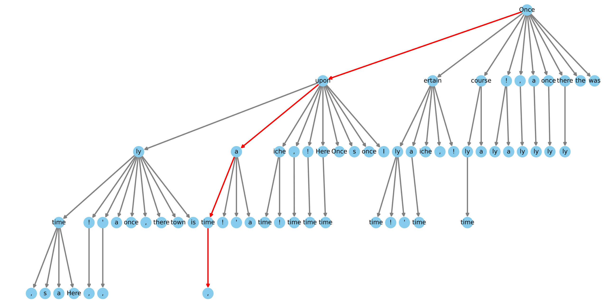

> 图解：Medusa-2 Vicuna-7B 实际使用的一棵稀疏树，共 64 个节点、深度为 4（即 4 个 Medusa heads 参与计算）。树明显"向左倾斜"，说明算法把节点预算优先分配给了各 head 概率更高的分支；红线标出的是正确预测未来 token 的路径。

## 实验：提速多少，质量掉不掉

实验在 MT-Bench（多轮对话 benchmark）上进行，batch size 为 1，对应个人本地部署的典型场景。评测覆盖两类训练条件：有公开 SFT 数据的 Vicuna-7B/13B，以及需要自蒸馏的 Vicuna-33B（私有数据训练）和 Zephyr-7B（经过 RLHF）。

### Vicuna-7B/13B：Medusa-1 对比 Medusa-2

在 ShareGPT 数据上训练 2 个 epoch 后：

- Vicuna-7B：Medusa-1 加速 **2.18 倍** ，Medusa-2 达到 **2.83 倍** ；
- Vicuna-13B：Medusa-1 加速 **2.33 倍** ，Medusa-2 同样约 **2.83 倍** 。

按 MT-Bench 的 8 个类别拆分看，Medusa-2 Vicuna-7B 在 **coding 类任务上加速 3.29 倍** ，在 Extraction（信息抽取）类上最高达到 **3.62 倍** 。代码和抽取类输出模式相对确定，Medusa heads 猜得更准——这也暗示 Medusa 对代码 LLM 这类高频场景有特别的价值。

### 自蒸馏场景：Vicuna-33B 与 Zephyr-7B

两个模型都用 ShareGPT + UltraChat 做种子，收集约 100k 条自生成样本（Vicuna-33B 用温度 0.3 随机采样逐轮喂 prompt），序列长度 2048、batch size 128 直接按 Medusa-2 训练。汇总结果如下（质量分为 GPT-4 打分的 MT-Bench 平均分，括号内为与原模型的差值；$S$ 为端到端加速比）：

| 模型 | Acc. rate | Overhead | Quality | $S_{\text{SpecDecoding}}$ | $S_{\text{Medusa}}$ |
| --- | --- | --- | --- | --- | --- |
| Vicuna-7B | 3.47 | 1.22 | 6.18 (+0.01) | 1.47 | 2.83 |
| Zephyr-7B | 3.14 | 1.18 | 7.25 (-0.07) | - | 2.66 |
| Vicuna-13B | 3.51 | 1.23 | 6.43 (-0.14) | 1.56 | 2.83 |
| Vicuna-33B | 3.01 | 1.27 | 7.18 (+0.05) | 1.60 | 2.35 |

这里先解释三个术语： **Acc. rate** （加速率）是平均每步解码出的 token 数（普通自回归为 1.0）； **Overhead** 是 Medusa 每步延迟与原模型的比值；端到端 **Speedup = Acc. rate / Overhead** 。

几个值得注意的看点：

- Medusa 全面、大幅超越同尺寸下精心调过的 Speculative Decoding（draft model 的最优配置随模型尺寸变化，见下文附录结果），而且 **不需要任何 draft model** ；
- 质量分和原模型基本持平，最大负差只有 -0.14，正负都有，可以认为质量无损；
- Vicuna-33B 的加速率相对低，作者推测是其私有训练数据与自蒸馏数据分布不匹配所致——heads 学到的是自蒸馏数据的分布，和模型"原生"分布有偏移。

另外，作者还在 AlpacaEval 数据集上做了补充验证，Medusa-2 的加速表现与 MT-Bench 一致：

| 模型 | Base speed (tokens/s) | Medusa speed (tokens/s) | Acc. rate | Speedup |
| --- | --- | --- | --- | --- |
| Vicuna-7B | 37.07 | 106.76 | 3.23 | 2.88 |
| Vicuna-13B | 29.01 | 91.54 | 3.28 | 3.16 |
| Vicuna-33B | 17.87 | 40.43 | 2.85 | 2.26 |
| Zephyr-7B | 34.21 | 99.50 | 3.08 | 2.91 |

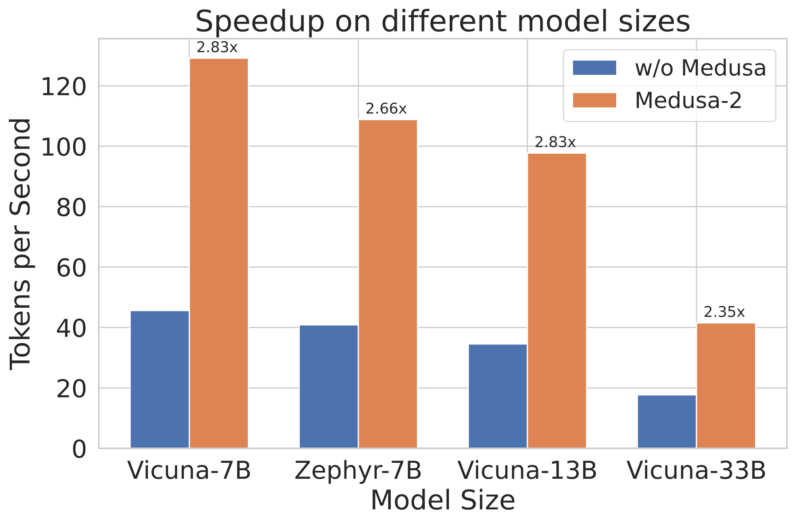

> 图解：更多模型上 Medusa-2 的端到端加速比。所有模型都获得显著提速；其中用自蒸馏训练的 Zephyr-7B、Vicuna-13B/33B 加速比略低，这是"保质量"与"冲速度"之间权衡的结果。

### 消融实验一：树结构怎么配

在 Medusa-2 Vicuna-7B 上对比随机的稠密树配置和优化后的稀疏树： **64 节点的稀疏树，加速率就超过了 256 节点的稠密树** 。加速率随候选 token 数增长呈对数趋势，涨得越来越慢；而候选越多、每步计算开销越大，速度（tokens/s）随节点数增加明显下降。换句话说，当加速率的边际收益小于额外开销时，加节点反而变慢——树不是越大越好，存在最优规模。

### 消融实验二：Typical Acceptance 的阈值

在温度 0.7 下扫描硬阈值 $\epsilon$（从 0.01 到 0.25，步长 0.01，$\alpha = \sqrt{\epsilon}$），结论是清晰的权衡曲线：$\epsilon$ 越大（接受条件越严），质量越高、加速率越低。对需要创造力的任务，随机采样本来就优于贪心采样，而 typical acceptance 在 $\epsilon$ 较大时质量与随机采样相当、同时白拿加速。

### 消融实验三：两阶段微调有没有用

| 设置 | Baseline | Direct Fine-tuning | Medusa-1 | Medusa-2 |
| --- | --- | --- | --- | --- |
| Quality | 6.17 | 5.925 | 6.23 | 6.18 |
| Speedup | N/A | N/A | 2.18 | 2.83 |

Vicuna-7B 上的对比很说明问题： **直接把 heads 和 backbone 一起微调（Direct Fine-tuning），质量从 6.17 掉到 5.925** ——这就是 Medusa-2 那套训练 recipe 存在的意义；Medusa-1 冻结 backbone 质量无损但速度受限；Medusa-2 用两阶段方案既保住质量（6.18）又把加速比推到 2.83 倍。

### 消融实验四：每项技术贡献多少

| 技术 | Speedup |
| --- | --- |
| Medusa-1 heads，不用 tree attention | ~1.5x |
| 加上 tree attention | ~1.9x |
| 使用优化后的树结构 | ~2.2x |
| 用 Medusa-2 训练 heads | ~2.8x |

可以看到每一项设计都有实打实的增量：多头并行打底，树验证贡献约 0.4 倍，树结构优化再贡献 0.3 倍，联合训练最后贡献 0.6 倍。

## 附录深挖：硬件视角看 Medusa 为什么有效

论文附录做了一份相当硬核的分析：用 roofline 模型拆解 Llama 系列模型在 A100-80GB-PCIe、A40、A6000 三类 GPU 上的算子表现，解释 Medusa 加速的硬件机理，并给出性能预测模型。

### 算子复杂度的三个阶段

下表给出主要矩阵乘算子在 prefill、普通 decoding、Medusa 并行 decoding 三个阶段的计算与空间复杂度（$b$：batch size，$s$：序列长度，$h$：隐层维度，$i$：中间层维度，$n$：注意力头数，$d$：head 维度，$q$：Medusa 候选长度）：

| 算子 | 输入形状 | 输出形状 | 计算复杂度 | 空间复杂度 |
| --- | --- | --- | --- | --- |
| **Prefill** | | | | |
| $XW_Q$, $XW_K$, $XW_V$ | $(b, s, h)$ | $(b, s, h)$ | $O(bsh^2)$ | $O(2bsh + h^2)$ |
| $QK^T$ / $PV$ | $(b, n, s, d)$ 等 | $(b, n, s, s)$ 等 | $O(bs^2nd)$ | $O(2bsnd + bs^2n)$ |
| $XW_u$, $XW_g$ / $XW_d$ | $(b, s, h)$ / $(b, s, i)$ | $(b, s, i)$ / $(b, s, h)$ | $O(bshi)$ | $O(bs(h+i) + hi)$ |
| **Decoding** | | | | |
| $XW_Q$, $XW_K$, $XW_V$ | $(b, 1, h)$ | $(b, 1, h)$ | $O(bh^2)$ | $O(2bh + h^2)$ |
| $QK^T$ / $PV$ | $(b, n, 1, d)$ 等 | $(b, n, s, 1)$ 等 | $O(bsnd)$ | $O(bsn + bsnd + bnd)$ |
| $XW_u$, $XW_g$ / $XW_d$ | $(b, 1, h)$ / $(b, 1, i)$ | $(b, 1, i)$ / $(b, 1, h)$ | $O(bhi)$ | $O(b(h+i) + hi)$ |
| **Parallel decoding（Medusa）** | | | | |
| $XW_Q$, $XW_K$, $XW_V$ | $(b, q, h)$ | $(b, q, h)$ | $O(bqh^2)$ | $O(2bqh + h^2)$ |
| $QK^T$ / $PV$ | $(b, n, q, d)$ 等 | $(b, n, s, q)$ 等 | $O(bsqnd)$ | $O(bsqn + b(s+q)nd)$ |
| $XW_u$, $XW_g$ / $XW_d$ | $(b, q, h)$ / $(b, q, i)$ | $(b, q, i)$ / $(b, q, h)$ | $O(bqhi)$ | $O(bq(h+i) + hi)$ |

关键观察：普通 decoding 每步只处理 1 个 token（矩阵乘退化为矩阵-向量乘），而 Medusa 把每步处理的 token 数从 1 提到 $q$， **直接抬高了算术强度** （Operational Intensity，每字节数据对应的 FLOP 数）。

### Roofline 实测：decoding 阶段的算子都"饿着"

作者在 Llama-7B/13B/33B 上、对 batch size（1 到 64，2 的幂）和序列长度（128 到 8192，2 的幂）共 49 种组合逐一 benchmark 了三类矩阵乘算子，画出 FLOP/s 对 Operational Intensity 的 roofline 图。横轴是算术强度，纵轴是实际算力，斜率上限是 HBM 带宽，横线天花板是峰值算力。

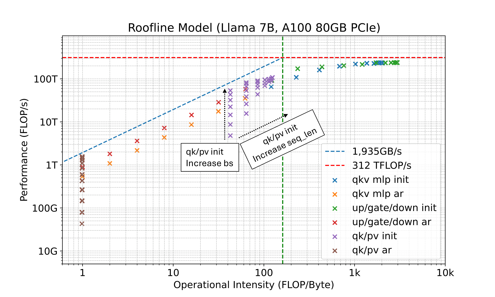

> 图解：Llama-7B 各算子在 A100-80GB-PCIe 上的 roofline 分布。虚线分别是 HBM 带宽上限（1,935 GB/s）和峰值算力（312 TFLOP/s）。`qkv mlp` 是 Q/K/V 投影线性层，`up/gate/down` 是 MLP 线性层，`qk/pv` 是注意力矩阵乘；`init` 表示 prefill 阶段，`ar` 表示自回归 decoding 阶段。

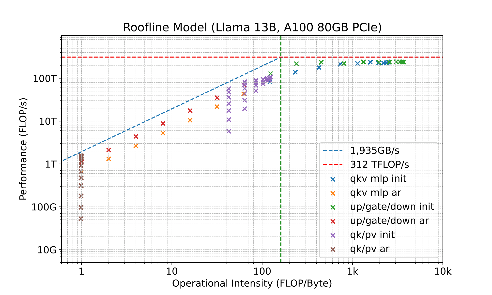

> 图解：Llama-13B 在 A100 上的 roofline，规律与 7B 一致：prefill 阶段线性层基本贴着算力天花板（compute-bound），decoding 阶段所有算子都沿带宽斜线分布（memory-bandwidth-bound）。

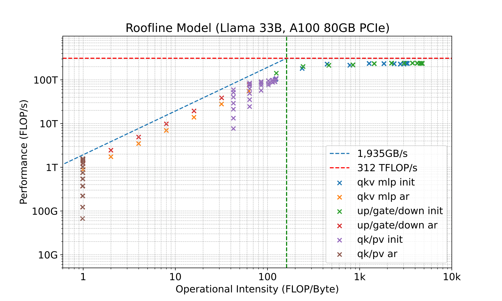

> 图解：Llama-33B 在 A100 上的 roofline。模型越大，decoding 阶段搬运参数的开销越大，memory-bound 特征越明显——这正是 Medusa 这类方法收益最大的区间。

从这组图能读出几个结论：

- prefill 阶段：加大 batch size 只提升注意力矩阵乘的 FLOP/s，不改变算术强度（垂直移动）；加大序列长度则两者同时改变（沿斜线移动）；线性层整体是 compute-bound 的；
- decoding 阶段：注意力矩阵乘被带宽死死卡住，batch size 和序列长度怎么变，算术强度几乎不动；线性层的数据点也落在与带宽同斜率的直线上，同样是 memory-bound，只有靠加大 batch size 才能沿斜线向右上方"爬"，换取更好的并行度。

下面是在 A40 和 A6000 上的对应结果，趋势完全一致，说明结论与具体卡型无关。

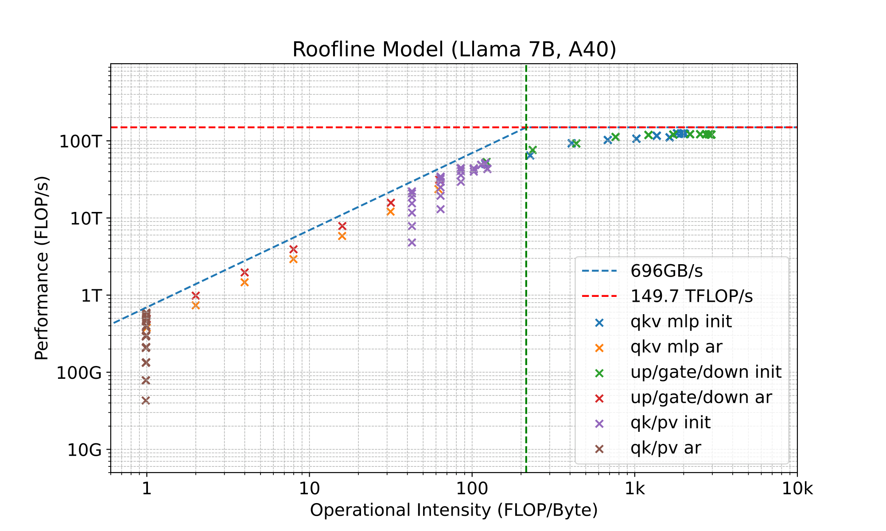

> 图解：Llama-7B 在 A40 上的 roofline。A40 带宽更低，decoding 阶段的算子更早触及带宽墙。

> 图解：Llama-13B 在 A40 上的 roofline，decoding 算子依旧聚集在带宽斜线附近。

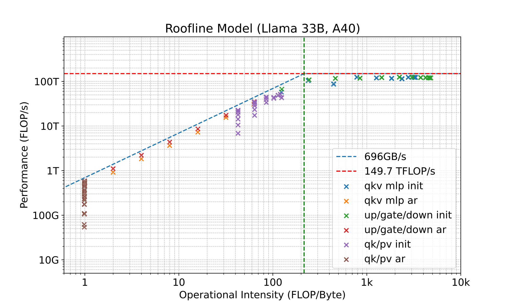

> 图解：Llama-33B 在 A40 上的 roofline，大模型配低带宽卡，memory-bound 程度最深。

> 图解：Llama-7B 在 A6000 上的 roofline，整体形态与 A100/A40 一致。

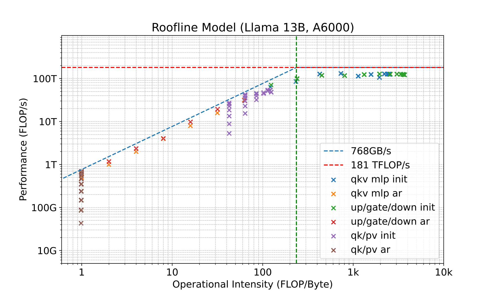

> 图解：Llama-13B 在 A6000 上的 roofline。

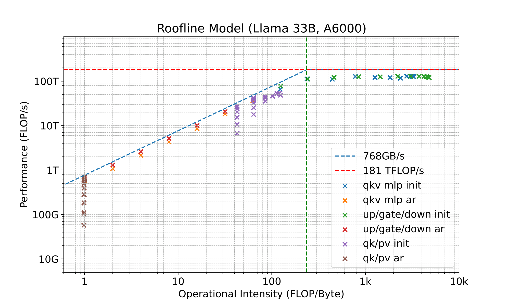

> 图解：Llama-33B 在 A6000 上的 roofline。三张卡、三个尺寸的结论统一：decoding 就是带宽游戏，谁能提高每步的算术强度谁就赢。

### Medusa 如何把算子从"带宽受限"推向"算力受限"

接下来作者固定 Llama-33B + A100，专门测量 Medusa 候选 token 数对算子的影响。

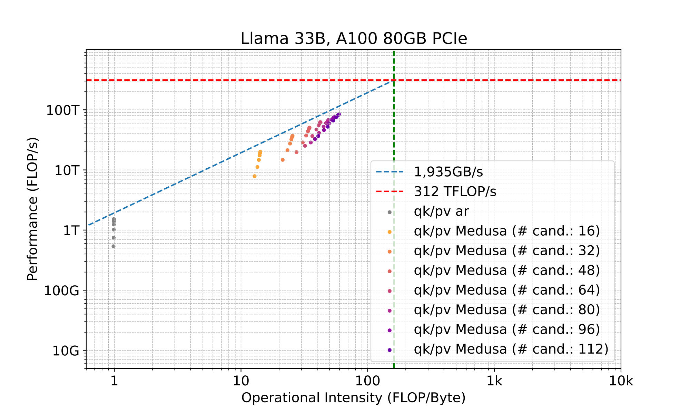

> 图解：batch size 固定为 16 时，注意力矩阵乘的 FLOP/s 与算术强度随候选 token 数的变化。灰点是普通 decoding，彩色点随着候选增多持续向右上方移动——FLOP/s 和算术强度同步抬升。在序列长度 1024、64 个候选 token 的设定下，相比普通 decoding， **FLOP/s 提升 44 倍、算术强度提升 41 倍** 。

对应的完整数据（每格为"TFLOP/s / 算术强度"，batch size 16）：

| Seq. Length | 1 | 16 | 32 | 48 | 64 | 80 | 96 | 112 |
| --- | --- | --- | --- | --- | --- | --- | --- | --- |
| 128 | 0.54 / 0.98 | 7.87 / 12.8 | 14.73 / 21.33 | 19.78 / 27.43 | 25.25 / 32.0 | 28.63 / 35.56 | 32.58 / 38.4 | 36.57 / 40.73 |
| 256 | 0.75 / 0.99 | 11.2 / 13.47 | 21.29 / 23.27 | 28.69 / 30.72 | 36.59 / 36.57 | 41.2 / 41.29 | 45.99 / 45.18 | 52.33 / 48.43 |
| 512 | 1.02 / 0.99 | 14.69 / 13.84 | 27.47 / 24.38 | 37.35 / 32.68 | 47.09 / 39.38 | 52.24 / 44.91 | 59.55 / 49.55 | 66.35 / 53.49 |
| 1024 | 1.24 / 0.99 | 17.42 / 14.03 | 32.15 / 24.98 | 43.89 / 33.76 | 54.8 / 40.96 | 60.19 / 46.97 | 68.28 / 52.07 | 75.45 / 56.44 |
| 2048 | 1.39 / 0.99 | 19.03 / 14.12 | 35.05 / 25.28 | 48.03 / 34.32 | 59.66 / 41.8 | 63.91 / 48.08 | 72.83 / 53.43 | 80.05 / 58.04 |
| 4096 | 1.48 / 0.99 | 19.8 / 14.17 | 36.59 / 25.44 | 50.4 / 34.61 | 62.29 / 42.23 | 65.84 / 48.65 | 74.86 / 54.13 | 82.06 / 58.87 |
| 8192 | 1.53 / 0.99 | 20.08 / 14.2 | 36.89 / 25.52 | 50.44 / 34.76 | 62.11 / 42.45 | 67.5 / 48.94 | 76.97 / 54.49 | 84.5 / 59.3 |

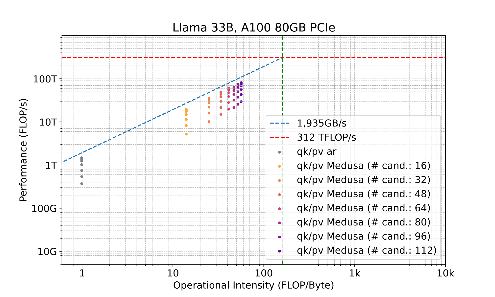

> 图解：序列长度固定为 1024 时，注意力矩阵乘随 batch size 和候选 token 数的变化。注意此时加大 batch size 并不能继续提升算术强度——算术强度几乎完全由候选 token 数决定。

对应数据（每格为"TFLOP/s / 算术强度"，序列长度 1024）：

| Batch Size | 1 | 16 | 32 | 48 | 64 | 80 | 96 | 112 |
| --- | --- | --- | --- | --- | --- | --- | --- | --- |
| 1 | 0.37 / 0.99 | 5.22 / 14.03 | 10.15 / 24.98 | 15.02 / 33.76 | 19.79 / 40.96 | 21.52 / 46.97 | 25.65 / 52.07 | 29.4 / 56.44 |
| 2 | 0.54 / 0.99 | 8.25 / 14.03 | 16.0 / 24.98 | 21.62 / 33.76 | 28.24 / 40.96 | 31.84 / 46.97 | 37.49 / 52.07 | 43.04 / 56.44 |
| 4 | 0.75 / 0.99 | 11.41 / 14.03 | 21.97 / 24.98 | 30.02 / 33.76 | 38.71 / 40.96 | 43.41 / 46.97 | 50.06 / 52.07 | 56.77 / 56.44 |
| 8 | 1.02 / 0.99 | 14.78 / 14.03 | 27.78 / 24.98 | 38.09 / 33.76 | 47.99 / 40.96 | 53.32 / 46.97 | 61.0 / 52.07 | 68.11 / 56.44 |
| 16 | 1.24 / 0.99 | 17.42 / 14.03 | 32.15 / 24.98 | 43.89 / 33.76 | 54.8 / 40.96 | 60.19 / 46.97 | 68.28 / 52.07 | 75.45 / 56.44 |
| 32 | 1.39 / 0.99 | 18.89 / 14.03 | 34.67 / 24.98 | 47.57 / 33.76 | 58.89 / 40.96 | 63.61 / 46.97 | 72.17 / 52.07 | 79.21 / 56.44 |
| 64 | 1.48 / 0.99 | 19.58 / 14.03 | 35.87 / 24.98 | 49.45 / 33.76 | 61.13 / 40.96 | 64.84 / 46.97 | 73.73 / 52.07 | 81.02 / 56.44 |

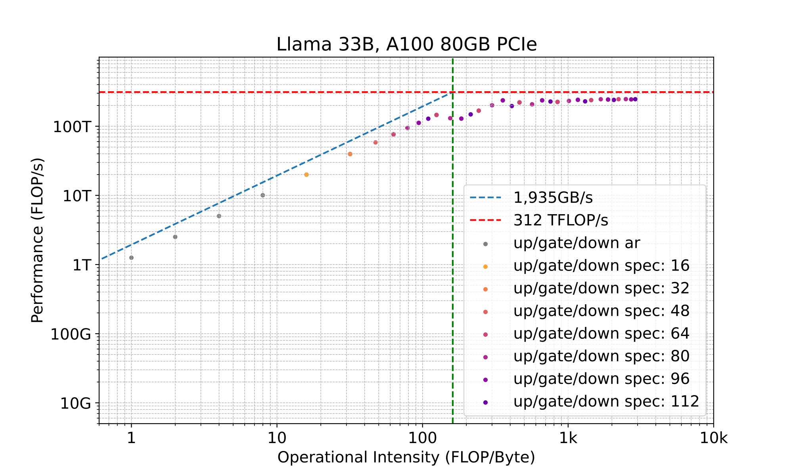

> 图解：up/gate/down 线性层的 FLOP/s 与算术强度。decoding 阶段线性层只处理新 token、与序列长度无关，因此只扫 batch size。随着候选 token 数增加，数据点明显 **从带宽受限区越过拐点进入算力受限区** ——Medusa 把线性层的性能瓶颈从"搬数据"切换成了"做计算"，这正是我们想要的状态。

对应数据（每格为"TFLOP/s / 算术强度"）：

| Batch Size | 1 | 16 | 32 | 48 | 64 | 80 | 96 | 112 |
| --- | --- | --- | --- | --- | --- | --- | --- | --- |
| 1 | 1.26 / 1.0 | 19.95 / 15.95 | 39.69 / 31.79 | 58.4 / 47.53 | 76.57 / 63.17 | 94.4 / 78.7 | 111.91 / 94.14 | 128.64 / 109.47 |
| 2 | 2.51 / 2.0 | 39.66 / 31.79 | 76.53 / 63.17 | 112.05 / 94.14 | 145.73 / 124.71 | 130.67 / 154.89 | 129.1 / 184.69 | 148.56 / 214.12 |
| 4 | 5.03 / 4.0 | 76.44 / 63.17 | 145.8 / 124.71 | 128.85 / 184.69 | 167.85 / 243.17 | 201.19 / 300.21 | 236.93 / 355.85 | 195.91 / 410.14 |
| 8 | 10.06 / 7.99 | 145.72 / 124.71 | 168.26 / 243.17 | 236.83 / 355.85 | 221.11 / 463.14 | 207.79 / 565.44 | 236.95 / 663.07 | 227.8 / 756.36 |
| 16 | 19.96 / 15.95 | 168.35 / 243.17 | 221.41 / 463.14 | 237.5 / 663.07 | 224.71 / 845.59 | 232.49 / 1012.87 | 241.12 / 1166.74 | 229.25 / 1308.76 |
| 32 | 39.69 / 31.79 | 221.74 / 463.14 | 224.88 / 845.59 | 241.33 / 1166.74 | 239.02 / 1440.25 | 245.83 / 1675.97 | 243.55 / 1881.24 | 240.33 / 2061.59 |
| 64 | 76.57 / 63.17 | 225.19 / 845.59 | 239.2 / 1440.25 | 243.26 / 1881.24 | 246.16 / 2221.31 | 246.91 / 2491.55 | 244.52 / 2711.46 | 246.14 / 2893.91 |

注意线性层表格中 FLOP/s 在高位趋于饱和（约 246 TFLOP/s）——已经顶到算力天花板，此时再加候选 token 只增开销不增吞吐。

### 性能预测模型：最优候选数存在且可算

最后，作者用一个极简的解析模型预测 Medusa 的加速效果。消融实验表明加速率随候选数近似对数增长，拟合为 $\texttt{acc\_rate} = 0.477 \log(\texttt{num\_candidate})$。模拟 Llama-7B 一个简化 block（依次经过 Q/K/V 投影、注意力、MLP）在 batch size 1、序列长度 1024 下的延迟（验证和接受的后处理开销很小，忽略不计），得到：

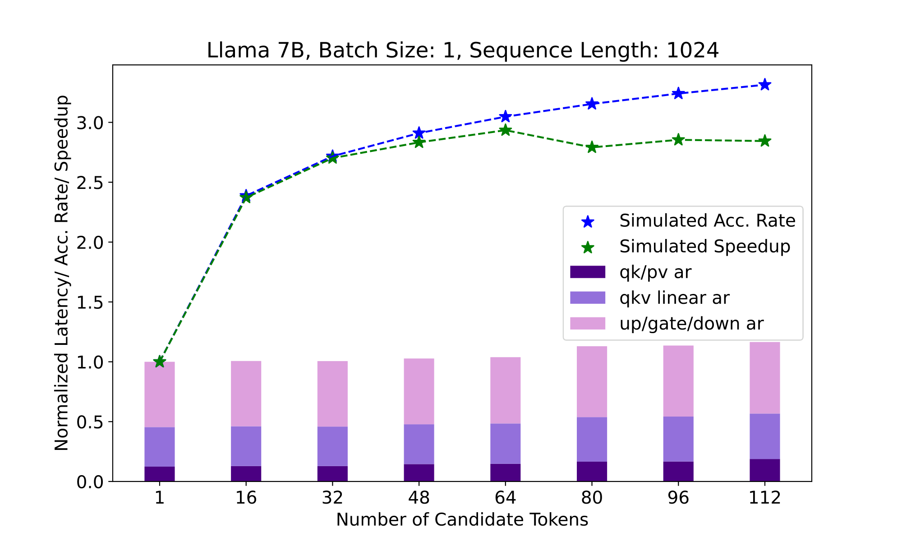

> 图解：模拟的加速率、端到端 speedup 和归一化延迟随候选 token 数的变化。起初两者同步上升，但候选数超过约 64 后 speedup 开始回落——加速率的对数增长追不上每步开销的线性增长， **收益递减拐点是真实存在的** ，与实测的树结构消融结果吻合。

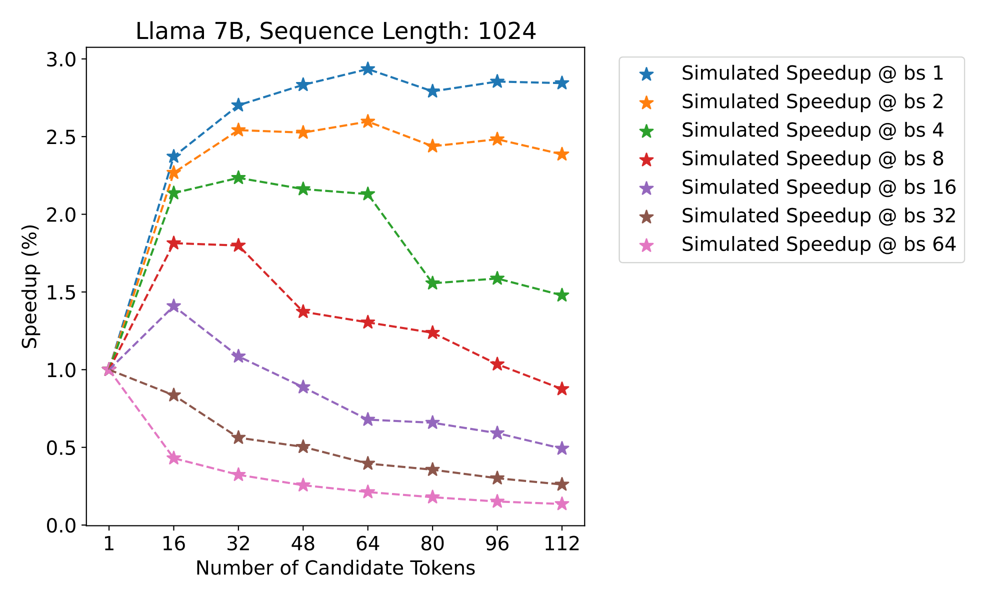

> 图解：序列长度 1024 下不同 batch size 的模拟 speedup。batch size 超过 32 后 speedup 下降甚至变负——因为此时线性层已被 batch 本身推成 compute-bound，Medusa 再加候选 token 就是雪上加霜。

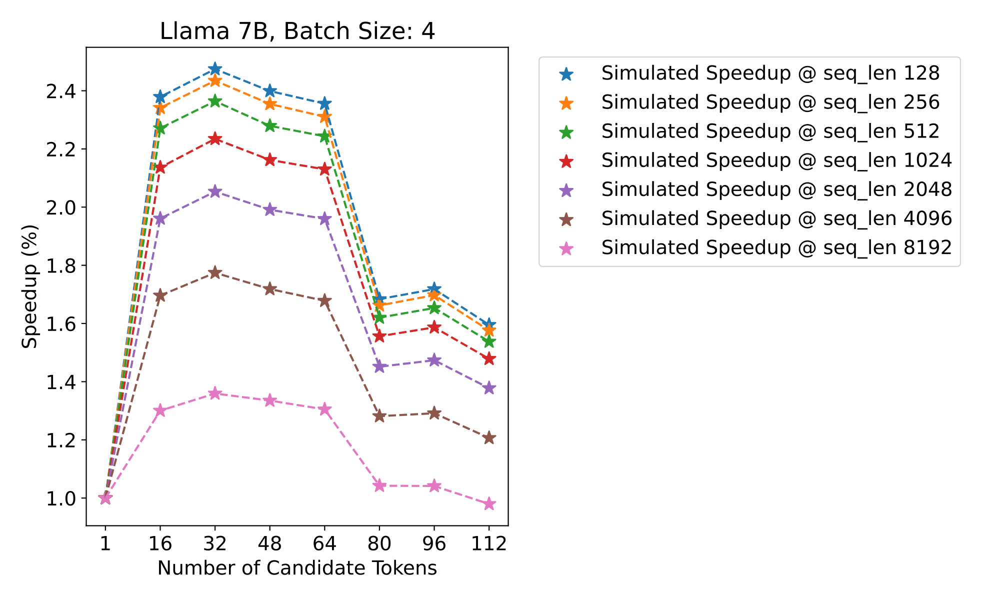

> 图解：batch size 4 下不同序列长度的模拟 speedup。最优候选数对序列长度不敏感，但序列越长整体 speedup 越低——开销主要来自注意力矩阵乘（线性层与序列长度无关），这也指明了长序列场景下优化注意力机制的必要性。

这份模拟给出的工程建议很实在：候选 token 数要调到甜点区（约 64 上下）；大 batch 场景 Medusa 收益会缩水甚至反噬；长序列场景的瓶颈在注意力。

### 附录：Speculative Decoding 基线的调参结果

作为主实验的对比基线，作者用开源 draft model（Llama-68M/160M、Tiny-Llama，以及从 Tiny-Llama 按 Vicuna 风格微调出的 Tiny-Vicuna）加 `torch.compile()` 在 Vicuna 系列上跑了 Speculative Decoding，$\gamma$ 为 draft token 数。结论是最优配置随模型尺寸变化：Vicuna-7B 用 Llama-68M + $\gamma=4$，Vicuna-13B 用 Llama-68M + $\gamma=3$，Vicuna-33B 用 Tiny-Vicuna（Vicuna-1B）+ $\gamma=3$。

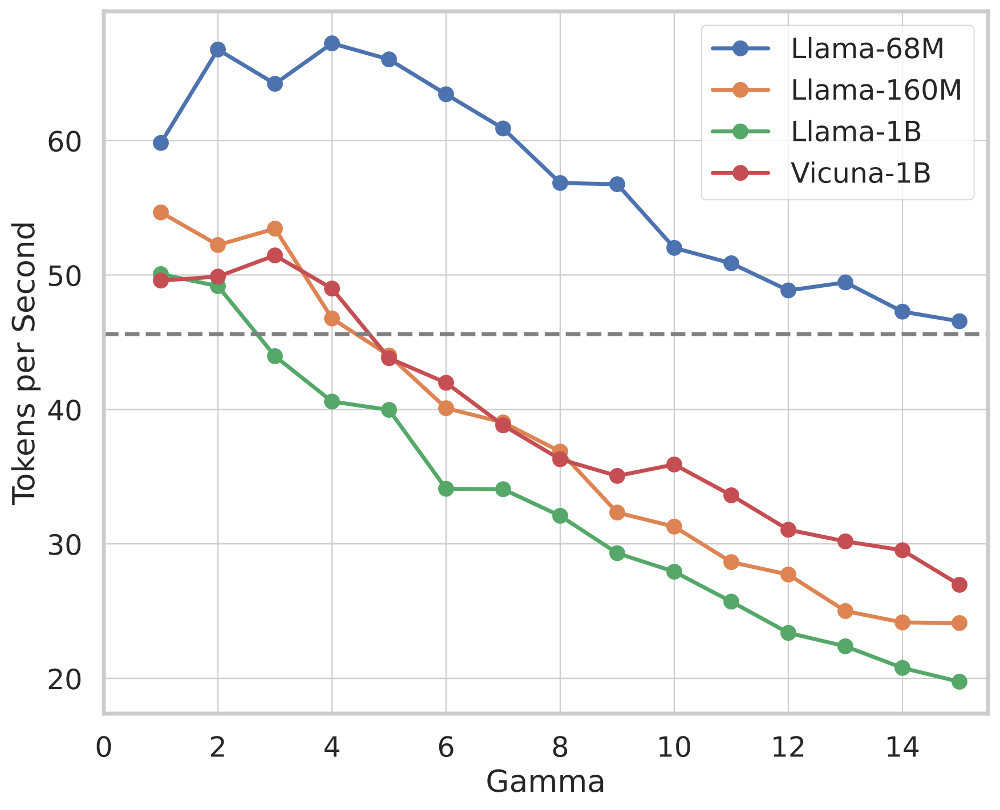

> 图解：Vicuna-7B 上各 draft model 与 $\gamma$ 配置下的推理速度，灰色虚线为基线速度。Llama-68M 配 $\gamma=4$ 表现最好。

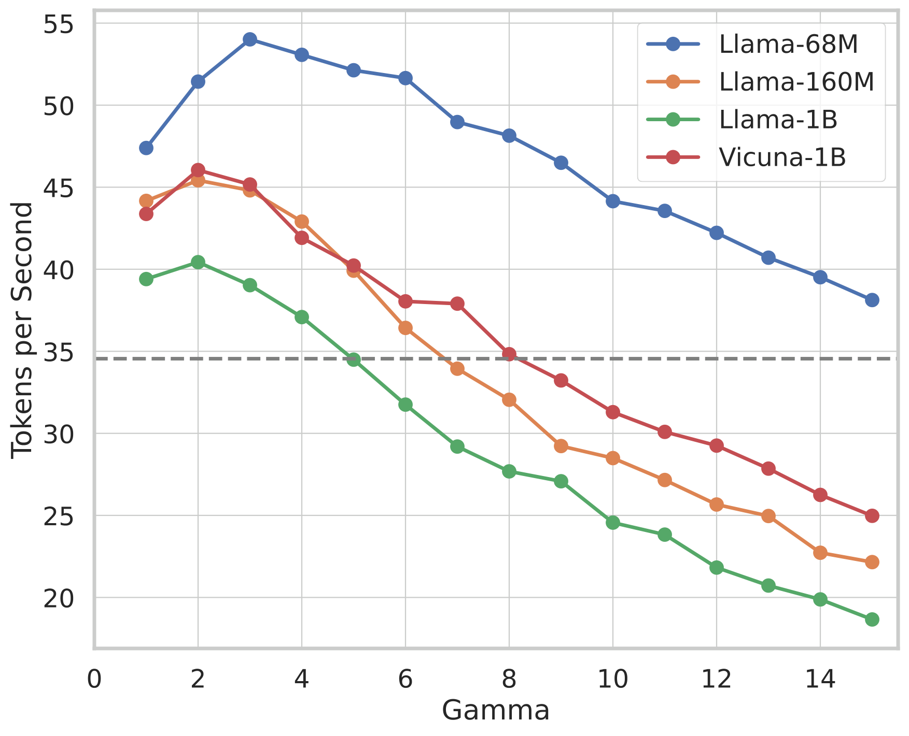

> 图解：Vicuna-13B 上的同类对比，最优为 Llama-68M 配 $\gamma=3$。

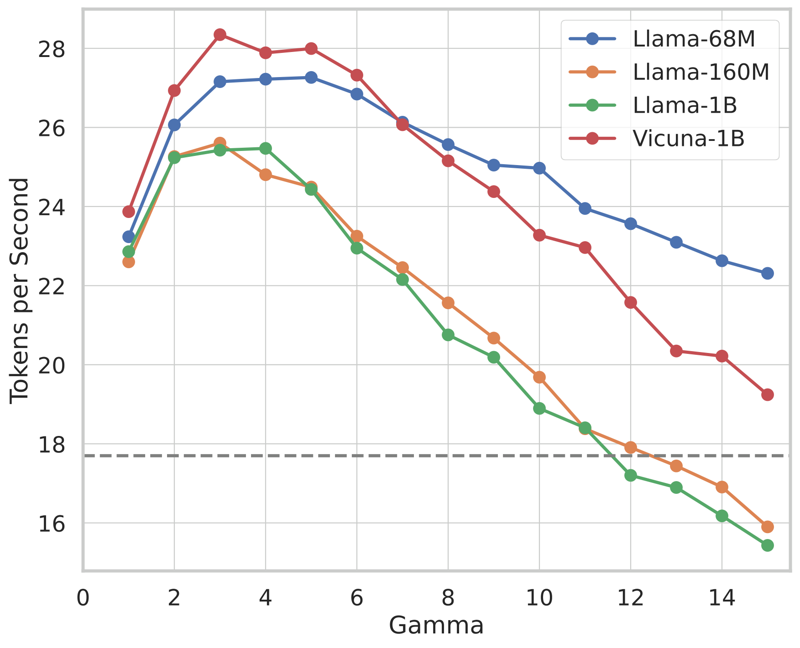

> 图解：Vicuna-33B 上的同类对比，最优换成了 Tiny-Vicuna 配 $\gamma=3$——draft model 的选择本身就要随目标模型重新调，这正是 Medusa 想消灭的负担。

## 总结

- **问题定位准** ：LLM 推理慢在 memory-bandwidth-bound，每步只产 1 个 token，算力被搬运参数的开销浪费掉；
- **方案足够简** ：不要 draft model，在原模型最后隐状态上挂几个单层 Medusa heads 并行预测多个 token，天然无分布偏移、serving 零侵入；
- **工程细节扎实** ：tree attention 一次验证整棵树、贪心跳优的稀疏树构造、typical acceptance 摆脱拒绝采样的高温低效、LoRA"开关即教师"的自蒸馏，每一项消融都贡献了可见的加速增量；
- **结果硬** ：Medusa-1 无损提速超 2.2 倍，Medusa-2 提速 2.3-2.8 倍，coding 类任务上最高 3.6 倍级别，且全面优于同尺寸下调优过的 Speculative Decoding；
- **分析有深度** ：附录用 roofline 模型证明 Medusa 能把 decoding 算子从带宽受限区推向算力受限区，并给出可计算的最优候选数与 batch size 边界。

Medusa 论文聚焦 batch size 1 的个人部署场景，但其思想已被 TensorRT、HuggingFace TGI 等主流推理库跟进支持并推广到更大 batch。可以预见，"让模型自己多长几个头"会成为 LLM 推理优化的标配组件之一。

> 本文参考自 [Medusa: Simple LLM Inference Acceleration Framework with Multiple Decoding Heads](https://arxiv.org/abs/2401.10774)