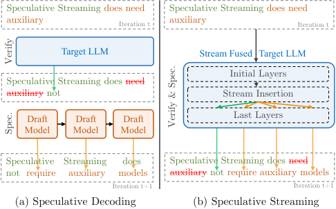
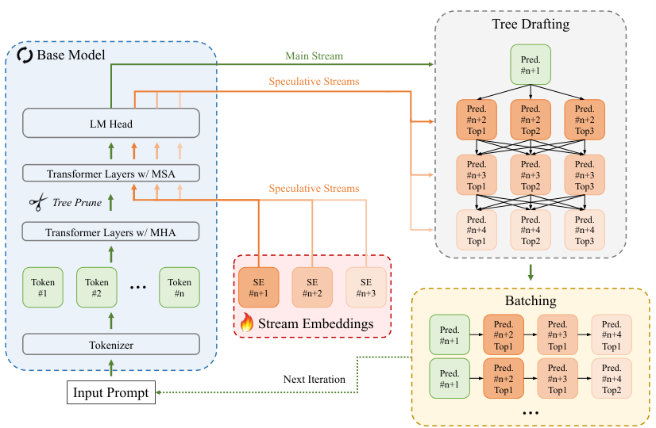
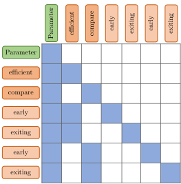
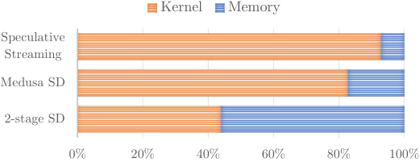
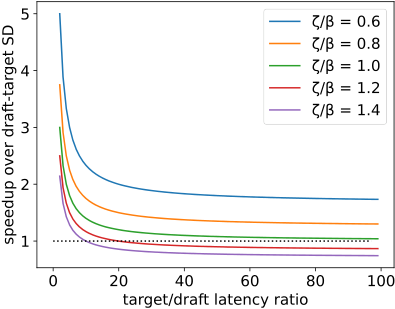
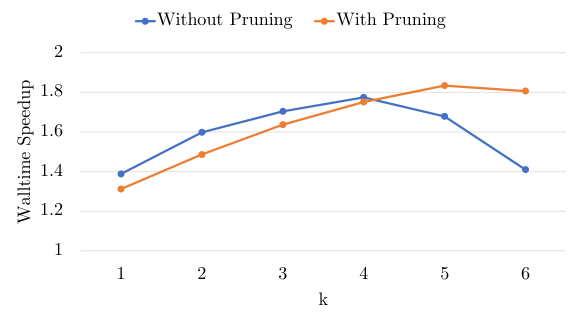
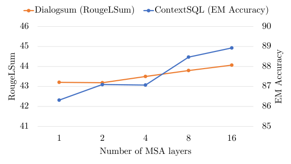
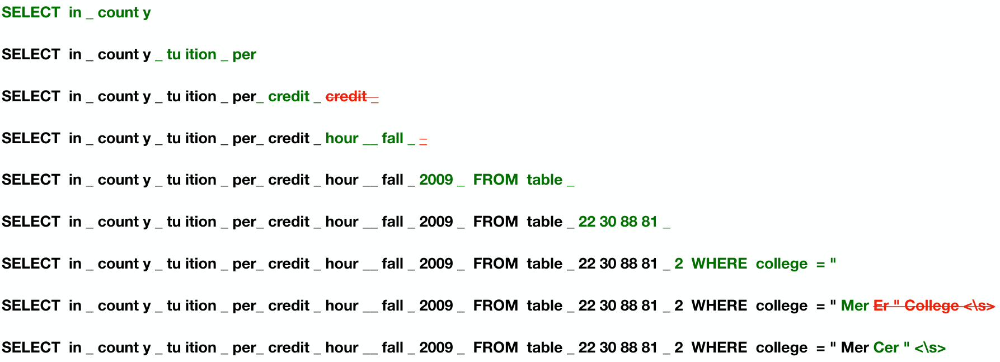

# Speculative Streaming：不要草稿模型的投机解码

大模型自回归解码逐 token 串行生成、严重受制于内存带宽，推理延迟一直是端侧部署的头号痛点。主流加速方案 Speculative Decoding 虽然有效，却要额外训练并常驻一个"草稿模型"，系统复杂度成倍上升。Apple 这篇 ICML 2024 的工作提出了 **Speculative Streaming（投机流）**：把"猜测未来 token"的能力直接融合进目标模型本身，用多流注意力（Multi-Stream Attention, MSA）在一次前向传播中同时完成验证与投机。结果相当硬：在摘要、结构化查询、语义表意等任务上实现 **1.8–3.1 倍加速**，生成质量不降反升，且额外参数量比 Medusa 少约 **10000 倍**。

## 大模型推理为什么慢

Transformer 推理的本质瓶颈不是算力，而是 **显存带宽**。每生成一个 token，都要把全部模型参数和 KV Cache 从显存搬进计算单元，这种 memory-bound 模式让 GPU 的算力大量闲置——就像一辆跑车堵在单行道上，发动机再强也只能怠速排队。

投机解码（Speculative Decoding, SD）借用了 CPU 投机执行的思想：先让一个小的"草稿模型"（draft model）快速猜出多个候选 token，再让大的"目标模型"（target model）一次前向并行验证。验证通过多少就前进多少步，理论上能加速 2–3 倍。

> 图解：(a) 传统双模型投机解码：草稿模型需要自回归地跑 $\gamma$ 步来生成草稿，再由目标模型串行验证；(b) Speculative Streaming：投机与验证在同一个"流融合"模型内并发完成，系统大幅简化。

## 现有方案的两难困境

传统 SD 路线的问题在于 **它需要一个独立、且与目标模型高度对齐的草稿模型**：

- 草稿模型和目标模型的训练过程是割裂的，下游任务上往往需要分别微调两个模型才能保证接受率；
- 两个模型同时驻留内存，对手机等端侧设备是沉重负担；
- 随着下游任务增多，每个任务都要维护一套草稿模型，推理系统的复杂度急剧膨胀。

那么能不能只用单模型？Medusa 做过尝试：在主干模型上加多个输出头，各自独立预测未来的 token。这条路确实省掉了草稿模型，但每个头的参数量是 $hidden\_size \times vocab\_size$（约 $h^2 + hv$ 量级），并且头数随投机窗口 $\gamma$ 线性增长——对内存敏感的端侧设备来说，等于刚逃出一个坑又跳进另一个坑。

笔者认为，这两类方案的共同症结在于：**它们都把"投机"当成模型之外的附加件**。Speculative Streaming 的思路反其道而行——把投机能力变成模型内生的一部分。

## Speculative Streaming：把投机融进模型本身

整体架构可以用一句话概括：**把模型顶部 $N_s$ 层的标准多头注意力（MHA）替换为多流注意力（MSA），主流的隐状态复制出 $\gamma$ 条"投机流"，每条流负责预测未来第 $j$ 个 token**。

> 图解：模型底部 $N - N_s$ 层只有主流（main stream）通过；在第 $N - N_s$ 层，主流隐状态加上流标识嵌入（SE）初始化出 $\gamma$ 条投机流；顶部 $N_s$ 层用 MSA 同时计算主流与投机流。上一轮生成的树状草稿在本轮前向中被批量验证，验证的同时新草稿也由投机流同步生成——投机与验证真正并行。

下面分四个部分拆解这个设计。

### 多流注意力：一个模型里的 $\gamma+1$ 条"流水线"

主流的注意力就是标准 MHA：

$$
M_{t}^{k+1} = \mathrm{MHA}(M_{t}^k, M_{\leq t}^k, M_{\leq t}^k)
$$

其中 $M_t^k$ 表示主流在第 $k$ 层、时刻 $t$ 的隐状态。而第 $j$ 条投机流在计算注意力时，既能看到主流的历史，也能看到自己及更靠前的投机流：

$$
S_{tj}^{k+1} = \mathrm{MHA}(S_{tj}^k, M_{\leq t}^k \oplus S_{t(\leq j)}^k, M_{\leq t}^k \oplus S_{t(\leq j)}^k)
$$

最终主流最后一层的隐状态 $M_t^N$ 负责预测下一个 token $y_t$，第 $j$ 条投机流的 $S_{tj}^N$ 预测 $y_{t+j}$。类比来说，主流是"主线剧情"，投机流是 $\gamma$ 条"预告片"，各自剧透未来第 1 到第 $\gamma$ 集的内容。

这个设计有两个非常务实的细节：

- **不为投机流额外缓存 KV**。投机流被训练为直接从主流的 key/value 上下文中学习特征，推理时不引入任何额外的 KV Cache 开销，内存占用与单模型一致。
- **从中间层而非嵌入层初始化投机流**。第 $j$ 条流在第 $N - N_s$ 层初始化为：

$$
S_{tj}^{N-N_s} = f_{\eta}(M_{t}^{N-N_s}) + P_j^{N-N_s}
$$

其中 $P_j$ 是流标识嵌入（stream identifier embedding），为每条流注入"相对位置"的身份信息；$f_{\eta}$ 是一个低秩线性变换。这样做一石二鸟：主流只需完整通过 $N - N_s$ 层，投机流只走最后 $N_s$ 层，投机带来的 FLOPs 开销直接砍掉 $(N-N_s)/N$ 的比例（降低设备峰值功耗）；同时中高层隐状态本身富含高层语义特征，更利于预测未来 n-gram。有趣的是，实验发现 $f_{\eta}$ 用恒等变换（identity）效果就够用，进一步省掉了这部分参数。

### 并行投机与验证：一次前向干两件事

传统 SD 中，草稿模型要等目标模型发完"校正令牌"才能生成下一份草稿，目标模型也要等草稿生成完毕——两者串行等待。Speculative Streaming 把这个流程折叠进单次前向：**每一步前向同时验证上一轮的草稿、并生成下一轮的新草稿**。

具体来说，第 $s$ 步若有 $\delta$ 个草稿 token 被接受，就用主流 $M_\delta$ 的 logits 采样校正 token，用投机流 $S_{\delta(1...\gamma)}$ 的 logits 生成第 $s+1$ 步的草稿。

验证用的草稿也不是一条线性序列，而是一棵 **树**：从每条投机流的 logits 中采样 top-$k$ 个 token，第 $n$ 条流采样的 token 作为第 $n+1$ 条流采样 token 的父节点。树中每条路径都是一个候选序列，验证时接受最长匹配路径，单步能前进更多 token。树状草稿靠一个加性注意力掩码在单次前向中批量处理：节点只能 attend 到它的祖先，其余位置掩为 $-\infty$。对固定的 $\gamma$ 和 $k$，这个掩码是常量，非常利于工程实现。

> 图解：树草稿的注意力掩码让每个子 token 只能看到从根（主流发出的校正 token）到自己的路径。例如 `early` 能看到 `parameter → efficient → early` 这条路径上的所有祖先；同一个 token 被复制到多条路径（如 `parameter → compare → early`），使多个候选路径可以批量验证，候选越多接受率越高。

### 并行树剪枝：给指数爆炸的草稿树"瘦身"

树草稿有个致命隐患：每条流采 $k$ 个 token，$\gamma$ 条流构成的树包含 $1 + \sum_{g=1}^{\gamma} k^g$ 个节点，随 $k$ 指数膨胀；再叠加每个节点都要带上 $\gamma$ 条投机流，实际 batch size 达到 $(1+\gamma)(1 + \sum_{g=1}^{\gamma} k^g)$。batch 一大，推理就从 memory-bound 变成 compute-bound，延迟优势荡然无存。

作者的解法是 **并行树剪枝层**：在进入 MSA 层之前，基于父子 token 之间的转移概率，把低概率的子树整棵剪掉。转移概率不借助任何代理模型，而是用 early-exit 技巧获得——把中间层主流隐状态 $M^l$ 过一个秩仅 8 的低秩线性变换 $o_\theta$，再接上原有的语言模型头得到早期 logits $\tilde{z} = H(o_\theta(M^l))$，用 $\tilde{z}_{pc}$ 近似父 token $p$ 到子 token $c$ 的转移概率。

笔者认为这个设计的聪明之处在于 **复用**：剪枝用的"裁判"就是模型自己的中间层和原有的输出头，新增的只有一个秩 8 的小矩阵，参数量几乎可以忽略。剪枝层的位置可以自由权衡——插得早延迟低但可能误剪好 token，插得晚保留更全但前向更慢，论文实验中经验性地插在投机流插入点之前。

### 训练目标：从"下一个 token"到"未来 n-gram"

训练目标把下一 token 预测和 $\gamma$ 个未来 token 预测联合优化：

$$
L_{ss} = -\alpha_0 \sum_{t=1}^{T}\log p_{\theta}(y_t \mid y_{<t}, x) - \sum_{j=1}^{\gamma} \alpha_j \sum_{t=1}^{T-j}\log p_{\theta}(y_{t+j} \mid y_{<t}, x)
$$

其中 $\alpha_0 = 1$、$\alpha_j = 0.1$。n-gram 预测目标强迫模型学会"规划未来"，避免过拟合局部相关性。整套训练在下游任务上用 LoRA 适配器微调 5 个 epoch 即可完成，端到端训练天然保证了"投机"与"验证"的对齐——这正是双模型方案最头疼、而单模型方案白捡的红利。

## 实验：加速、质量、参数量三头兼顾

作者在三个面向端侧助手的任务上评测：结构化查询（SqlContext，指标为 Exact Match 准确率）、对话摘要（DialogSum）、语义表意（E2E-NLG），后两者用 Rouge1/RougeLSum。模型覆盖 OPT-1.3B/6.7B、Phi-1.3B、OpenLlama-7B。推理在单张 A100-80G 上以 batch size 1、float16、贪心采样进行。

### 对比 Medusa：更快且省一万倍参数

下表是核心结果（CR Ratio 指与加速器无关的目标模型调用减少比，可视为加速比的理论上限）：

| 数据集 | 模型 | 方法 | 加速比 ↑ | CR Ratio ↑ | 指标 ↑ | 额外参数 ↓ |
|---|---|---|---|---|---|---|
| SqlContext | OPT-1.3b | Baseline | 1.00 | 1.00 | 84.98 | – |
| | | Medusa | 2.07 | 2.79 | 84.98 | 4.28E8 |
| | | **SS (ours)** | **2.39** | **3.57** | **87.40** | **4.096E4** |
| | PHI-1.3b | Baseline | 1.00 | 1.00 | 88.71 | – |
| | | Medusa | 2.58 | 3.25 | 88.71 | 4.36E8 |
| | | **SS (ours)** | **2.62** | **3.53** | **89.90** | **4.096E4** |
| | OpenLlama-7b | Baseline | 1.00 | 1.00 | 89.88 | – |
| | | Medusa | **3.20** | 4.10 | 90.11 | 5.91E8 |
| | | **SS (ours)** | 3.14 | **4.13** | **91.70** | **8.19E4** |
| DialogSum | OPT-1.3b | Baseline | 1.00 | 1.00 | 43.40/35.56 | – |
| | | Medusa | 1.56 | 1.91 | 43.40/35.50 | 4.28E8 |
| | | **SS (ours)** | **1.94** | **2.62** | **44.07/35.99** | **4.096E4** |
| | PHI-1.3b | Baseline | 1.00 | 1.00 | 43.57/35.60 | – |
| | | Medusa | **1.89** | 2.28 | 43.57/35.60 | 4.36E8 |
| | | **SS (ours)** | 1.83 | **2.34** | 43.36/35.31 | **4.096E4** |
| | OpenLlama-7b | Baseline | 1.00 | 1.00 | 44.20/36.50 | – |
| | | Medusa | 1.76 | 2.25 | 44.20/36.50 | 5.91E8 |
| | | **SS (ours)** | **1.87** | **2.51** | 43.92/35.70 | **8.19E4** |
| E2E-NLG | OPT-1.3b | Baseline | 1.00 | 1.00 | 69.48/50.17 | – |
| | | Medusa | 2.13 | 2.95 | 69.48/50.17 | 4.28E8 |
| | | **SS (ours)** | **2.45** | **3.72** | 69.32/**50.51** | **4.096E4** |
| | PHI-1.3b | Baseline | 1.00 | 1.00 | 67.90/48.50 | – |
| | | Medusa | 2.78 | 3.35 | 67.90/48.50 | 4.36E8 |
| | | **SS (ours)** | **2.84** | **3.69** | 67.40/**48.52** | **4.096E4** |
| | OpenLlama-7b | Baseline | 1.00 | 1.00 | 69.50/50.30 | – |
| | | Medusa | 2.70 | 3.22 | 69.50/50.30 | 5.91E8 |
| | | **SS (ours)** | **2.96** | **3.55** | 68.66/49.56 | **8.19E4** |

三个要点值得注意：

1. **速度**：9 个"模型 × 任务"组合中，Speculative Streaming 的加速比和 CR Ratio 绝大多数优于 Medusa；即便个别组合加速比略低（如 OpenLlama-7b 上的 SqlContext），CR Ratio 仍然更高。
2. **参数量**：Medusa 需要 4 亿以上的额外参数，而 Speculative Streaming 只需约 4 万——差距约 **4 个数量级**。原因是 Medusa 的头数随 $\gamma$ 线性增长，而本文的投机适配器与 LoRA 共享参数，真正新增的只有 $\gamma$ 个流标识嵌入，开销仅 $\gamma h$。
3. **质量**：生成指标与 LoRA 微调的基线持平甚至更优（如 SqlContext 上 OPT-1.3b 从 84.98 提升到 87.40），说明 n-gram 预测目标还起到了正则化效果。

为什么投机流比 Medusa 头猜得更准？关键差异在 **依赖建模**：Medusa 的每个头从同一隐状态独立预测未来 token，token 之间的依赖没有被显式捕捉；而投机流之间通过注意力互相可见，又都能 attend 主流，天然建模了草稿 token 之间的依赖关系，所以接受率更高。

### 对比双模型 SD：省掉自回归草稿的隐性成本

有人可能质疑：双模型方案的目标模型调用次数更少，凭什么更慢？答案藏在草稿生成的串行开销里：

| 数据集 | 目标模型 | 方法 | 目标调用 | 草稿调用 | 单样本延迟 (ms) ↓ | 指标 ↑ |
|---|---|---|---|---|---|---|
| SqlContext | OPT-1.3b | Two-model SD | 6.59 | 22.35 | 269.24 | 84.98 |
| | | **SS (ours)** | 7.79 | 0 | **133.48** | **87.40** |
| | OPT-6.7b | Two-model SD | 6.60 | 22.41 | 301.10 | 89.13 |
| | | **SS (ours)** | 6.88 | 0 | **157.04** | **89.34** |
| DialogSum | OPT-1.3b | Two-model SD | 11.65 | 42.59 | 493.59 | 43.40/35.60 |
| | | **SS (ours)** | 13.41 | 0 | **248.26** | **44.07/35.99** |
| | OPT-6.7b | Two-model SD | 12.15 | 35.76 | 555.99 | 44.40/36.60 |
| | | **SS (ours)** | 14.39 | 0 | **442.83** | 44.30/36.30 |
| E2E-NLG | OPT-1.3b | Two-model SD | 8.86 | 31.47 | 345.72 | 69.48/50.17 |
| | | **SS (ours)** | 9.80 | 0 | **164.23** | 69.32/50.51 |
| | OPT-6.7b | Two-model SD | 8.90 | 31.58 | 412.02 | 69.34/49.88 |
| | | **SS (ours)** | 10.26 | 0 | **243.62** | 69.07/49.69 |

双模型方案（OPT-125m 作草稿）虽然目标调用略少，但每步验证前都要自回归地跑 $\gamma$ 次草稿模型——22 到 42 次草稿调用的延迟远超省下的那几次目标调用。Speculative Streaming 的草稿开销几乎为零，延迟普遍降低 **40–50%**。

> 图解：OPT-1.3B 解码时的 kernel 与显存利用率时间线。自回归解码是 memory-bound 的，kernel 利用率低；Speculative Streaming 通过并行生成树状草稿提高了算术强度（arithmetic intensity），kernel 利用率显著上升；Medusa 次之；双模型 SD 因草稿阶段的低利用率拖累了整体。

### 理论分析：什么时候单模型方案更划算

作者给了一个简洁的成本模型。设草稿模型前向成本为 $C_{draft}$，目标模型为 $C_{target}$，Speculative Streaming 前向成本为 $C_{ss}$；双模型方案每步前进 $\zeta$ 个 token，本文方案前进 $\beta$ 个。令两种方案"单 token 前进成本"相等：

$$
\frac{\gamma \cdot C_{draft} + C_{target}}{\zeta} = \frac{C_{ss}}{\beta}
$$

代入 $\gamma = 4$、$C_{target}/C_{draft} = 10$、$C_{ss} \approx C_{target}$，可得 $\zeta = 1.4\beta$——也就是说，**双模型方案每步要多前进 40% 的 token，才能打平 Speculative Streaming 的延迟**。

> 图解：横轴为目标/草稿模型的延迟比，纵轴为两者每步前进 token 数之比 $\zeta/\beta$，曲线为 Speculative Streaming 的理论加速比。只有当草稿模型又小（延迟比高）又准（$\zeta/\beta > 1$）时，双模型方案才占优——而在下游微调场景中，找到这样的草稿模型需要大量工程投入，往往得不偿失。

### 消融实验

**草稿树规模 $\gamma$ 与 $k$**。固定 $\gamma = 3$，增大每条流的采样数 $k$，候选变多、单步前进更远，加速比先升；但 $k$ 过大时 batch 指数膨胀，模型转入 compute-bound，加速比回落。加入树剪枝后，高 $k$ 区间的延迟被有效压住，加速比曲线整体上移。

> 图解：横轴为每流采样数 $k$，纵轴为 wall-time 加速比。无剪枝时加速比随 $k$ 先升后降（compute-bound 拐点）；剪枝后的曲线在高 $k$ 区域保持增长，验证了剪枝层"只砍噪声路径、不伤接受率"的作用。

**MSA 层数 $N_s$**。层数越多，下游指标越好（趋势跨任务一致），但 FLOPs 和训练时间也增加。实践上取顶部 2–8 层是较好的甜点：结构化查询任务用 $N_s/N = 1/6$，摘要与表意任务用 $1/2$。

> 图解：横轴为 MSA 层数，纵轴分别为 DialogSum 的 RougeLSum 和 SqlContext 的 EM 准确率。两条曲线均随层数单调上升，说明更深的投机流参与能持续提升草稿质量。

**补充消融（附录）** 还考察了两个变体：一是用 value projection 旋转（$V^k_{tn} = V^k_t e^{i\epsilon n}$）替代流标识嵌入，零参数开销但指标略逊于专用嵌入；二是 top-k 采样（$T=1$）下的加速表现，$k$ 增大时随机拒绝会拉低两种方法的加速比，但 Speculative Streaming 全程保持领先。

### 定性示例

> 图解：SQL 生成任务上 $\gamma=4, k=1$ 的逐步解码过程。每行黑色为已接受的 token，绿色为下一步被接受的投机 token，红色为被拒绝的。可以看到投机流即便以非自回归方式生成草稿，也能有效捕捉 token 间依赖，接受率相当可观。

## 总结

- **单模型统一投机与验证**：无需独立草稿模型，一次前向同时完成验证与新草稿生成；
- **多流注意力是核心机制**：$\gamma$ 条投机流从中间层初始化、共享主流 KV，草稿 token 间的依赖被显式建模，接受率高于 Medusa；
- **树草稿 + 并行剪枝**：top-$k$ 树状候选提升单步前进距离，early-exit 剪枝压制指数膨胀的 batch；
- **实测 1.8–3.1 倍加速、质量无损，额外参数比 Medusa 少约 10000 倍**，端侧部署友好；
- **理论分析给出选型边界**：只有草稿模型"又小又准"时双模型方案才更优，而这在下游微调场景中很难满足。

局限与展望：该方法需要在下游任务上微调（无法即插即用于任意模型），且加速比受任务投机难度影响（摘要类任务约 1.9 倍，低于结构化任务的 2.4–3.1 倍）。未来方向包括与量化、高效推理内核组合进一步压低延迟，以及把"投机流"思想推广到更大规模模型和更长的投机窗口。

> 本文参考自 [Speculative Streaming: Fast LLM Inference without Auxiliary Models](https://arxiv.org/abs/2402.11131)