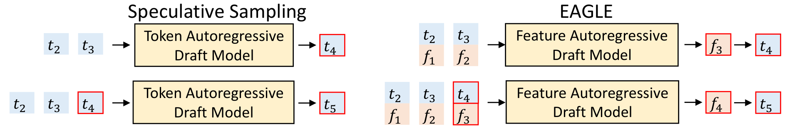
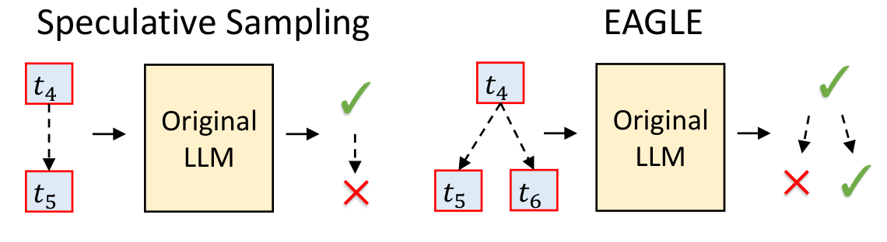
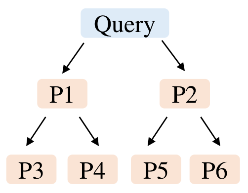
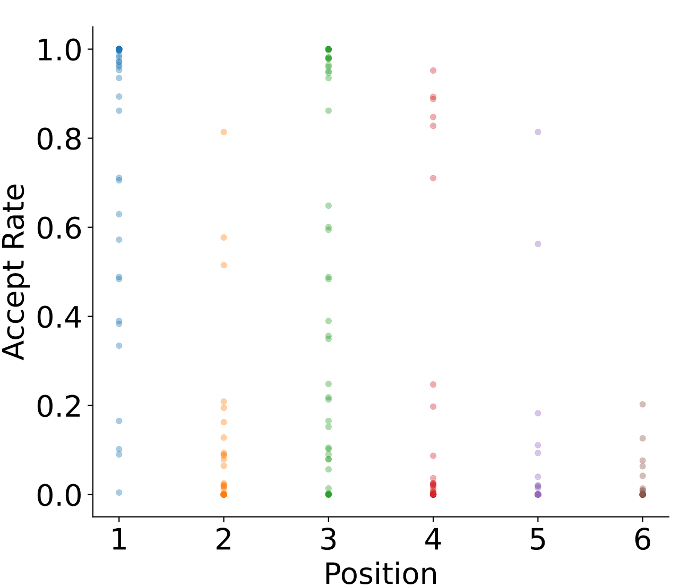
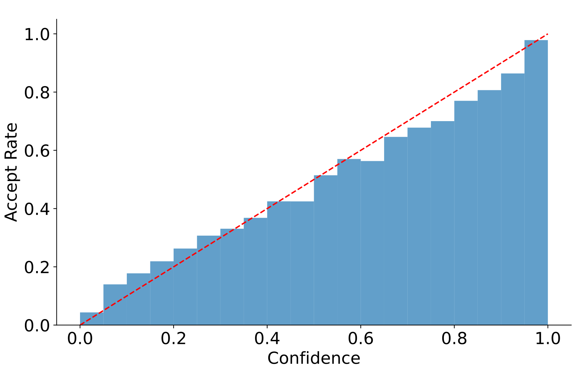
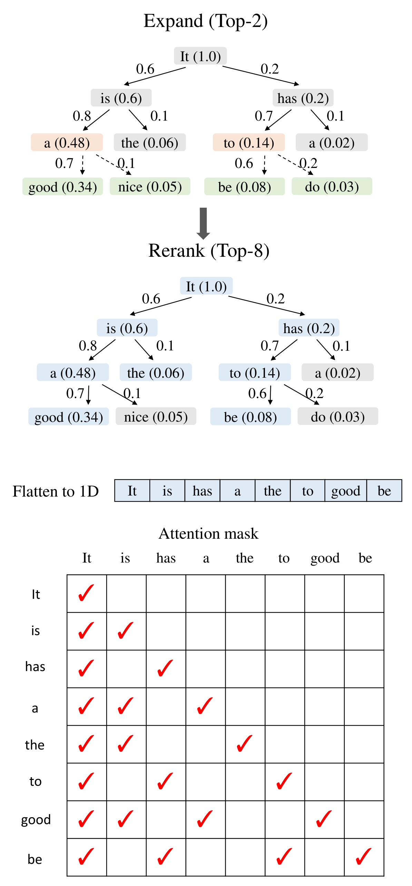
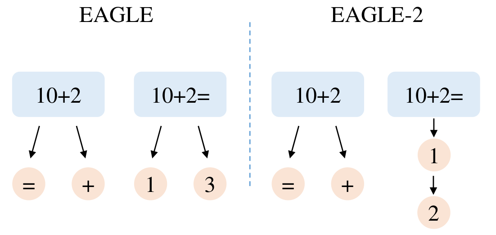
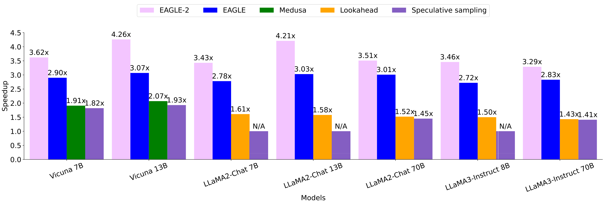
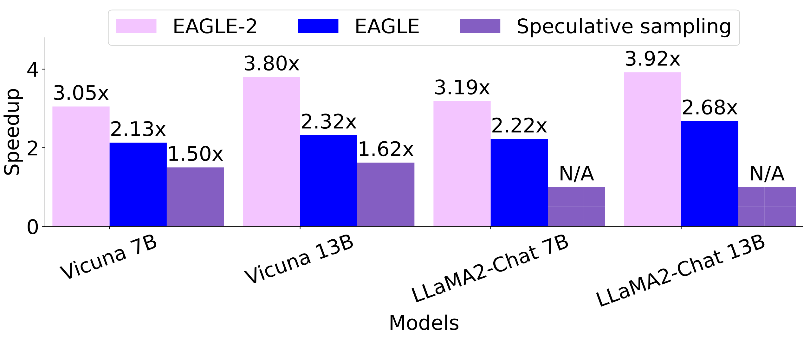

# EAGLE-2：动态草稿树让大模型推理再提速 40%

大语言模型每生成一个 Token 都要完整跑一遍前向传播，推理成本居高不下，投机采样（Speculative Sampling）是目前最有效的无损加速方案之一。这篇 ICML 2024 的工作发现一个被普遍忽视的真相：草稿 Token 的接受率不仅取决于它在草稿树中的位置，还强烈依赖于当前上下文。基于这个观察，作者在 EAGLE 之上提出 EAGLE-2——用草稿模型自身的置信度动态调整草稿树的形状，不再使用一成不变的静态树。结果相当硬核：在 3 个模型系列、6 类任务上实现 **3.05x-4.26x** 的加速比，比 EAGLE-1 快 **20%-40%**，且严格保证输出分布与原模型一致。

## 背景：投机采样与 EAGLE

要理解 EAGLE-2 的改进点，先得回顾它所站立的两个基石。

### 投机采样：先起草，再验收

投机采样的核心思想是"先起草，再验收"：用一个小的草稿模型快速生成一串候选 Token，再让原始大模型**并行**验证这些候选，一次前向传播就能产出多个 Token。

形式化地说，给定前缀 $T_{1:j}$，草稿模型自回归地生成草稿 $\hat{T}_{j+1:j+k}$ 并记录每个 Token 的概率 $\hat{p}$；验证阶段原始 LLM 算出每个草稿 Token 的概率 $p$，然后从前往后依次判定：Token $\hat{t}_{j+i}$ 以 $\min(1, p_{j+i}(\hat{t}_{j+i})/\hat{p}_{j+i}(\hat{t}_{j+i}))$ 的概率被接受；一旦被拒，就从分布 $\text{norm}(\max(0, p_{j+i}-\hat{p}_{j+i}))$ 中采样一个 Token 替换它，并丢弃草稿中剩余的所有 Token。已有理论证明，这套流程的输出分布与原始自回归解码**完全一致**——这就是"无损"的含义。

### EAGLE：在特征层面做自回归

EAGLE 在标准投机采样上做了两处关键改进：

- **起草阶段**：不再直接预测 Token 序列，而是在更结构化的特征（LLM 倒数第二层、LM Head 之前的 feature）层面做自回归，再借用原模型的 LM Head 得到草稿 Token。为了消除采样带来的特征不确定性，EAGLE 还把"提前一个时间步"的 Token 序列一并输入草稿模型。
- **验证阶段**：标准投机采样的草稿是链式结构，一个 Token 被拒就要丢弃后面所有 Token；EAGLE 改用树状草稿，一个分支被拒还可以尝试其他分支。

下图对比了标准投机采样与 EAGLE 的起草和验证流程：

> 图解：起草阶段。标准投机采样直接用草稿模型在 Token 层面自回归；EAGLE 则在特征层面自回归——$t_i$ 表示第 $i$ 个 Token 的 embedding，$f_i$ 表示 LLM 倒数第二层输出的特征向量，草稿模型把 $f_i$ 与下一个时间步的 $t_{i+1}$ 一起作为输入，再经原模型的 LM Head 得到草稿 Token 分布。

> 图解：验证阶段。链式草稿（标准投机采样）一旦某个 Token 被拒，后续全部作废；树状草稿（EAGLE）允许切换到其他候选分支继续验证，同一个 Token 位置可以保留多个备选，显著提升单次验证的接受长度。

### EAGLE-1 的局限：静态草稿树

Sequoia 显式假设草稿 Token 的接受率只取决于它在树中的位置；EAGLE 和 Medusa 虽然没有明说，但它们在**所有上下文里都使用同一棵固定形状的草稿树**（起草第 $i$ 步固定扩展 $k$ 个候选），本质上也隐含了同样的假设。

然而这个假设与投机采样的直觉相矛盾——"有些 Token 很简单，小模型就能猜对"。如果草稿 Token 的接受率随上下文波动，那么静态树注定不是最优的。EAGLE-2 正是要打破这个假设。

## 两个关键观察：为什么草稿树应该动起来

方法的有效性建立在两个实证观察之上，这是全文最有说服力的部分。

### 观察一：接受率不仅看位置，还看上下文

作者在 Vicuna 7B + Alpaca 数据集上统计了草稿树不同位置 Token 的接受率：

> 图解：左图是静态草稿树的结构，P1-P6 标记了 6 个代表性位置；右图横轴是这 6 个位置，纵轴是接受率，每个点代表一条 query。整体趋势上，左上方位置（P1）接受率最高、右下方位置（P6）最低——这正是静态树"左上多节点、右下少节点"的合理性来源。但关键细节是：**同一位置上的接受率方差非常大**，说明接受率强烈依赖具体上下文。比如"10+2="后面几乎可以确定是"1"，而"10+2"后面却很难猜，静态树无法区分这两种情形。

### 观察二：草稿模型是"校准良好"的

要动态调整草稿树，就需要低成本估计每个草稿 Token 的接受率——但真实接受率需要跑原模型才知道，这与投机采样"减少原模型调用"的目标直接冲突。幸运的是，作者发现 EAGLE 的草稿模型**置信度（输出概率）与接受率高度正相关**：

> 图解：横轴是草稿模型置信度的区间，纵轴是该区间内 Token 的平均接受率，红色虚线是 (0,0) 到 (1,1) 的对角参考线。可以看到散点几乎贴在对角线上：置信度低于 0.05 的 Token 接受率约 0.04，高于 0.95 的 Token 接受率约 0.98。这意味着草稿模型的置信度可以**零额外开销**地充当接受率的近似估计，GLIDE、CAPE 等方法的草稿模型也有类似现象。

这两个观察的设计很聪明：观察一说明"该动"，观察二说明"能动"，合起来就把动态草稿树的可行性闭环了。

## EAGLE-2：上下文感知的动态草稿树

基于上述观察，EAGLE-2 在 EAGLE 基础上只改两件事：**怎么扩展草稿树**（Expansion）和**怎么重排草稿 Token**（Reranking）。草稿模型的训练、推理以及验证阶段都原封不动。

### 扩展阶段：只挑最有希望的分支往下长

得益于树注意力（Tree Attention），草稿模型可以一次前向同时扩展当前层的所有 Token。但树节点数随深度指数增长，全部扩展会让草稿模型变慢，必须有所取舍。

取舍的依据是什么？一个 Token 最终被接受，要求它从根到自身的整条路径上的祖先全部被接受。因此作者定义节点的**全局价值** $V_i$ 为路径上各节点接受率的连乘，并用置信度近似：

$$
V_i=\prod_{t_j \in \text{Path}(\text{root}, t_i)} p_j \approx \prod_{t_j \in \text{Path}(\text{root}, t_i)} c_j
$$

其中 $\text{Path}(\text{root}, t_i)$ 是根到节点 $t_i$ 的路径，$p_j$ 是节点 $t_j$ 的真实接受率，$c_j$ 是草稿模型给出的置信度。扩展阶段从当前层选出 value 最高的 top-$k$ 个节点送入草稿模型，只让这些节点长出新的一层。

这个设计比"只看单个 Token 置信度"更合理：置信度是局部量，一个置信度很高但父亲很容易被拒的节点，实际能贡献的接受长度并不高；连乘的 value 恰好刻画了"活到被接受那一刻"的概率。

### 重排阶段：全局重新洗牌，保持树的连通

扩展阶段的目的是把树加深，但接受率都在 0 到 1 之间，连乘之后越深的节点 value 越低——一些没被扩展的浅层节点，value 可能比深层新节点还高。所以扩展阶段选中的节点不能直接当作最终草稿，需要把**所有**草稿 Token 拿出来按 value 重新排序，选 top-$m$ 个进入验证。

由于子节点的 value 必然不超过父节点，同值时优先选浅层节点，这样选出的 top-$m$ 节点天然构成一棵连通的树。之后把选中节点展平成一维序列作为验证输入，并按树结构调整 attention mask——不同于普通自回归的下三角 mask，树结构中不同分支的 Token 互相不可见，每个 Token 只能看到自己的祖先，从而保证与原始解码的分布一致性。

完整的流程如下图所示：

> 图解：EAGLE 与 EAGLE-2 的完整对比流程。边上的数字是草稿模型的置信度，方块括号内是节点的 value。上半部分是扩展阶段（Drafting）：每层从当前层选 value 最高的 top-2 节点（橙色块）输入草稿模型，生成的新 Token（绿色块）挂回树上；下半部分是重排阶段（Reranking）：从全部节点中选 value 最高的 top-8 个（蓝色块），展平成一维序列，并按树结构构造 attention mask，使每个 Token 只能看到自己的祖先节点。

再来看一个直观例子，体会静态树与动态树的差别：

> 图解：EAGLE 始终使用固定形状的草稿树。当 query 是"10+2="时，下一个 Token 几乎必然是"1"，但静态树仍会塞进两个候选，另一个候选"3"被接受的概率极低，纯属浪费验证算力；EAGLE-2 则根据上下文调整树的形状——面对难预测的"10+2"就扩展两个候选，面对简单的"10+2="就只保留"1"一个候选。算力花在了刀刃上。

## 实验验证

### 设置

- **模型**：Vicuna 7B/13B、LLaMA2-Chat 7B/13B/70B、LLaMA3-Instruct 8B/70B。
- **任务与数据集**：多轮对话（MT-bench）、代码生成（HumanEval）、数学推理（GSM8K）、指令遵循（Alpaca）、摘要（CNN/Daily Mail）、问答（Natural Questions）。遵循社区常用的 zero-shot/few-shot 设定，同一原模型在所有任务上共用同一份草稿模型权重。
- **对比方法**：标准投机采样（SpS）、PLD、Medusa、Lookahead、Hydra、EAGLE——全部是**不修改原模型、不放宽接受条件**的无损加速方法（Medusa 在非贪心设定下会放宽接受条件，因此只做部分对比）。
- **指标**：加速比（相对原始自回归解码）与平均接受长度 $\tau$（每个起草-验证周期接受的 Token 数，硬件无关）。不报告接受率，因为 EAGLE-2 没有改动草稿模型，接受率与 EAGLE 相同。

### 主结果：全面领先

下表是各方法在 6 个数据集上的加速比与平均接受长度（V = Vicuna，L2 = LLaMA2-Chat）：

**Temperature = 0：**

| 模型 | 方法 | MT-bench | HumanEval | GSM8K | Alpaca | CNN/DM | Natural Ques. | 平均 Speedup | 平均 $\tau$ |
| --- | --- | --- | --- | --- | --- | --- | --- | --- | --- |
| V 13B | SpS | 1.93x / 2.27 | 2.23x / 2.57 | 1.77x / 2.01 | 1.76x / 2.03 | 1.93x / 2.33 | 1.66x / 1.88 | 1.88x | 2.18 |
| V 13B | PLD | 1.58x / 1.63 | 1.85x / 1.93 | 1.68x / 1.73 | 1.16x / 1.19 | 2.42x / 2.50 | 1.14x / 1.17 | 1.64x | 1.69 |
| V 13B | Medusa | 2.07x / 2.59 | 2.50x / 2.78 | 2.23x / 2.64 | 2.08x / 2.45 | 1.71x / 2.09 | 1.81x / 2.10 | 2.07x | 2.44 |
| V 13B | Lookahead | 1.65x / 1.69 | 1.71x / 1.75 | 1.81x / 1.90 | 1.46x / 1.51 | 1.46x / 1.50 | 1.36x / 1.39 | 1.58x | 1.62 |
| V 13B | Hydra | 2.88x / 3.65 | 3.28x / 3.87 | 2.93x / 3.66 | 2.86x / 3.53 | 2.05x / 2.81 | 2.11x / 2.88 | 2.69x | 3.40 |
| V 13B | EAGLE | 3.07x / 3.98 | 3.58x / 4.39 | 3.08x / 3.97 | 3.03x / 3.95 | 2.49x / 3.52 | 2.42x / 3.11 | 2.95x | 3.82 |
| V 13B | **EAGLE-2** | **4.26x / 4.83** | **4.96x / 5.41** | **4.22x / 4.79** | **4.25x / 4.89** | **3.40x / 4.21** | **3.13x / 3.74** | **4.04x** | **4.65** |
| L2 13B | PLD | 1.42x / 1.46 | 1.63x / 1.70 | 1.41x / 1.44 | 1.16x / 1.20 | 1.42x / 1.45 | 1.12x / 1.15 | 1.36x | 1.40 |
| L2 13B | Lookahead | 1.58x / 1.64 | 1.80x / 1.85 | 1.65x / 1.69 | 1.47x / 1.50 | 1.46x / 1.53 | 1.42x / 1.45 | 1.56x | 1.61 |
| L2 13B | EAGLE | 3.03x / 3.90 | 3.76x / 4.52 | 3.20x / 4.03 | 3.01x / 3.83 | 2.70x / 3.59 | 2.83x / 3.47 | 3.09x | 3.89 |
| L2 13B | **EAGLE-2** | **4.21x / 4.75** | **5.00x / 5.52** | **4.31x / 4.90** | **4.13x / 4.61** | **3.45x / 4.24** | **3.51x / 4.04** | **4.10x** | **4.68** |
| V 7B | SpS | 1.82x / 2.36 | 1.99x / 2.61 | 1.71x / 2.26 | 1.65x / 2.21 | 1.81x / 2.44 | 1.60x / 2.16 | 1.76x | 2.34 |
| V 7B | PLD | 1.61x / 1.68 | 1.82x / 1.87 | 1.82x / 1.99 | 1.21x / 1.31 | 2.53x / 2.72 | 1.23x / 1.44 | 1.70x | 1.84 |
| V 7B | Medusa | 1.91x / 2.52 | 2.02x / 2.67 | 1.89x / 2.59 | 1.79x / 2.48 | 1.42x / 2.02 | 1.51x / 2.09 | 1.76x | 2.40 |
| V 7B | Lookahead | 1.63x / 1.69 | 1.72x / 1.77 | 1.84x / 1.99 | 1.38x / 1.57 | 1.44x / 1.53 | 1.45x / 1.60 | 1.58x | 1.69 |
| V 7B | Hydra | 2.69x / 3.60 | 2.98x / 3.79 | 2.73x / 3.66 | 2.66x / 3.58 | 2.01x / 2.70 | 2.25x / 2.86 | 2.55x | 3.37 |
| V 7B | EAGLE | 2.90x / 3.94 | 3.33x / 4.29 | 3.01x / 4.00 | 2.79x / 3.89 | 2.33x / 3.42 | 2.31x / 3.21 | 2.78x | 3.79 |
| V 7B | **EAGLE-2** | **3.62x / 4.98** | **3.95x / 5.33** | **3.63x / 4.97** | **3.46x / 4.86** | **2.94x / 4.12** | **2.76x / 3.82** | **3.39x** | **4.68** |
| L2 7B | PLD | 1.38x / 1.43 | 1.52x / 1.59 | 1.32x / 1.37 | 1.15x / 1.19 | 1.48x / 1.52 | 1.15x / 1.20 | 1.33x | 1.38 |
| L2 7B | Lookahead | 1.61x / 1.66 | 1.72x / 1.77 | 1.58x / 1.65 | 1.49x / 1.52 | 1.49x / 1.54 | 1.48x / 1.53 | 1.56x | 1.61 |
| L2 7B | EAGLE | 2.78x / 3.62 | 3.17x / 4.24 | 2.91x / 3.82 | 2.78x / 3.71 | 2.43x / 3.41 | 2.61x / 3.44 | 2.78x | 3.71 |
| L2 7B | **EAGLE-2** | **3.43x / 4.70** | **4.03x / 5.39** | **3.52x / 4.77** | **3.45x / 4.66** | **3.01x / 4.12** | **3.15x / 4.19** | **3.43x** | **4.64** |

**Temperature = 1：**

| 模型 | 方法 | MT-bench | HumanEval | GSM8K | Alpaca | CNN/DM | Natural Ques. | 平均 Speedup | 平均 $\tau$ |
| --- | --- | --- | --- | --- | --- | --- | --- | --- | --- |
| V 13B | SpS | 1.62x / 1.84 | 1.72x / 1.97 | 1.46x / 1.73 | 1.52x / 1.78 | 1.66x / 1.89 | 1.43x / 1.70 | 1.55x | 1.82 |
| V 13B | EAGLE | 2.32x / 3.20 | 2.65x / 3.63 | 2.57x / 3.60 | 2.45x / 3.57 | 2.23x / 3.26 | 2.14x / 3.06 | 2.39x | 3.39 |
| V 13B | **EAGLE-2** | **3.80x / 4.40** | **4.22x / 4.89** | **3.77x / 4.41** | **3.78x / 4.37** | **3.25x / 3.97** | **3.07x / 3.54** | **3.65x** | **4.26** |
| L2 13B | EAGLE | 2.68x / 3.45 | 2.89x / 3.78 | 2.82x / 3.67 | 2.66x / 3.55 | 2.41x / 3.39 | 2.37x / 3.31 | 2.64x | 3.53 |
| L2 13B | **EAGLE-2** | **3.92x / 4.51** | **4.58x / 5.29** | **4.21x / 4.80** | **3.85x / 4.48** | **3.31x / 4.08** | **3.43x / 3.89** | **3.88x** | **4.51** |
| V 7B | SpS | 1.50x / 1.87 | 1.55x / 1.95 | 1.53x / 1.82 | 1.56x / 1.85 | 1.63x / 1.91 | 1.33x / 1.72 | 1.52x | 1.85 |
| V 7B | EAGLE | 2.13x / 3.17 | 2.39x / 3.43 | 2.34x / 3.29 | 2.21x / 3.30 | 2.08x / 3.12 | 1.95x / 2.86 | 2.18x | 3.20 |
| V 7B | **EAGLE-2** | **3.05x / 4.28** | **3.33x / 4.65** | **3.07x / 4.49** | **3.08x / 4.43** | **2.63x / 3.76** | **2.48x / 3.56** | **2.94x** | **4.20** |
| L2 7B | EAGLE | 2.22x / 3.30 | 2.61x / 3.79 | 2.40x / 3.52 | 2.29x / 3.33 | 2.19x / 3.15 | 2.22x / 3.12 | 2.32x | 3.37 |
| L2 7B | **EAGLE-2** | **3.19x / 4.41** | **3.67x / 5.06** | **3.35x / 4.62** | **3.20x / 4.48** | **2.73x / 3.85** | **2.81x / 4.01** | **3.15x** | **4.41** |

（表中每格为"加速比 / 平均接受长度 $\tau$"。）

在更大模型上的结果（MT-bench，temperature=0）：

| 模型 | 方法 | 加速比 | $\tau$ |
| --- | --- | --- | --- |
| LLaMA2-Chat 70B | PLD | 1.31x | 1.39 |
| LLaMA2-Chat 70B | Lookahead | 1.52x | 1.64 |
| LLaMA2-Chat 70B | EAGLE | 3.01x | 3.81 |
| LLaMA2-Chat 70B | **EAGLE-2** | **3.51x** | **4.48** |
| LLaMA3-Instruct 70B | EAGLE | 2.83x | 3.62 |
| LLaMA3-Instruct 70B | **EAGLE-2** | **3.29x** | **4.16** |
| LLaMA3-Instruct 8B | EAGLE | 2.72x | 3.65 |
| LLaMA3-Instruct 8B | **EAGLE-2** | **3.46x** | **4.53** |

几个值得注意的点：

- **EAGLE-2 在所有数据集、所有模型上都是第一名**，每个起草-验证周期平均生成约 4-5.5 个 Token，大约是标准投机采样和 Medusa 的两倍。
- 大多数方法在代码生成（HumanEval）上加速最高——代码中有大量固定模板，草稿容易命中，EAGLE-2 在该任务上加速可达约 5x。
- PLD 在 Vicuna 上做摘要（CNN/DM）时加速比亮眼（2.42x/2.53x），因为它是基于检索生成草稿，而摘要任务上下文重叠度高。PLD 和 Lookahead 没有神经草稿模型，起草开销极低，所以加速比非常接近其平均接受长度。
- Medusa、Hydra、EAGLE、EAGLE-2 在问答和摘要任务上的 $\tau$ 明显低于其他任务，标准投机采样却没有这个衰减。作者归因于训练数据差异：标准投机采样的 Vicuna-68M 草稿模型用了预训练 + SFT 两份数据，而其余方法只用了 SFT 数据——世界知识（如"2015 年橄榄球世界杯在哪举办"）主要来自预训练。即便如此，EAGLE-2 在这两个任务上仍优于标准投机采样。

MT-bench 上的直观对比如下图所示：

> 图解：temperature=0（贪心解码）下各方法在 MT-bench 上的加速比，横轴为模型，纵轴为加速比。标准投机采样在 LLaMA2-Chat 7B/13B 和 LLaMA3-Instruct 8B 上缺少合适的草稿模型，标为 N/A；LLaMA2-Chat 70B 和 LLaMA3-Instruct 70B 分别以 7B 和 8B 模型作为草稿模型。EAGLE-2 在每一档都显著领先。

> 图解：temperature=1（采样解码）下的加速比对比。Medusa 等方法在非贪心设定下会放宽接受条件、不再保证无损，因此不参与对比。EAGLE-2 比 Medusa 快约 2 倍、比 Lookahead 快约 2.3 倍，同时严格保证输出分布不变。

### 消融实验：value 和重排都有用

作者在 Vicuna 7B（temperature=0）上消融了两个设计：用 value（置信度沿路径连乘）还是直接用单点置信度做排序，以及是否做全局重排。

| 方法 | MT-bench Speedup | MT-bench $\tau$ | GSM8K Speedup | GSM8K $\tau$ |
| --- | --- | --- | --- | --- |
| w/o both | 2.81x | 3.92 | 2.85x | 3.93 |
| w/o value | 3.21x | 4.39 | 2.93x | 3.96 |
| w/o reranking | 3.48x | 4.86 | 3.50x | 4.85 |
| **EAGLE-2** | **3.62x** | **4.98** | **3.63x** | **4.97** |

两个组件都带来稳定提升：value 连乘比单点置信度更好地刻画了"真正被接受"的概率；全局重排则挽救了那些没被扩展、但 value 高于深层节点的浅层节点。两者叠加才是完整的 EAGLE-2。

### 实现细节（附录）

- 基线 Vanilla 使用 HuggingFace Transformers + PyTorch，预分配 KV cache；标准投机采样用 Transformers 的 assisted generation；PLD、Lookahead、Medusa、Hydra 均使用官方默认配置和官方权重。
- EAGLE 的 Vicuna 和 LLaMA2-Chat 草稿模型使用官方权重，LLaMA3-Instruct 的草稿模型用 ShareGPT 数据集训练（与 Medusa、Hydra 一致）。
- EAGLE-2 的超参：对 7B/8B、13B、70B 原模型，草稿 Token 总数分别为 60、50、48，草稿树深度为 6，扩展阶段每次选 10 个节点。

## 总结与展望

- **核心洞察**：草稿 Token 的接受率是上下文相关的，静态草稿树存在固有缺陷；而 EAGLE 草稿模型的置信度校准良好，可零成本近似接受率。
- **方法**：EAGLE-2 只做两处改动——按 value（置信度连乘）选择性扩展草稿树，再全局重排选 top-$m$ 节点进入验证，配合树状 attention mask 保证无损。
- **效果**：3 个模型系列、6 类任务上加速比 3.05x-4.26x，比 EAGLE-1 快 20%-40%，且无需任何额外训练、不触碰原模型权重。
- **可靠性**：不微调原 LLM、不放宽接受条件，输出分布与原模型严格一致，可证明无损。

展望：实验中发现草稿模型在世界知识类任务上的短板来自训练数据（只用 SFT 数据），扩大草稿模型的训练数据可能是下一步收益明确的方向；而"用置信度动态调度草稿资源"这一思路，也为其他投机采样框架提供了可迁移的设计范式。

> 本文参考自 [EAGLE-2: Faster Inference of Language Models with Dynamic Draft Trees](https://arxiv.org/abs/2406.16858)