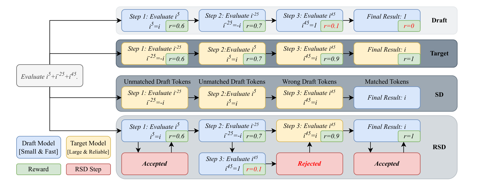
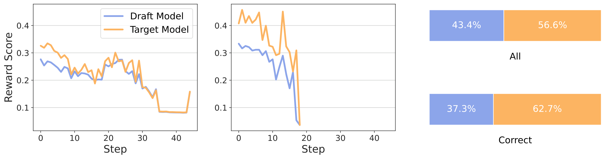
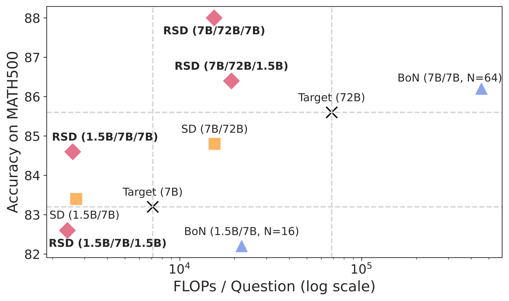
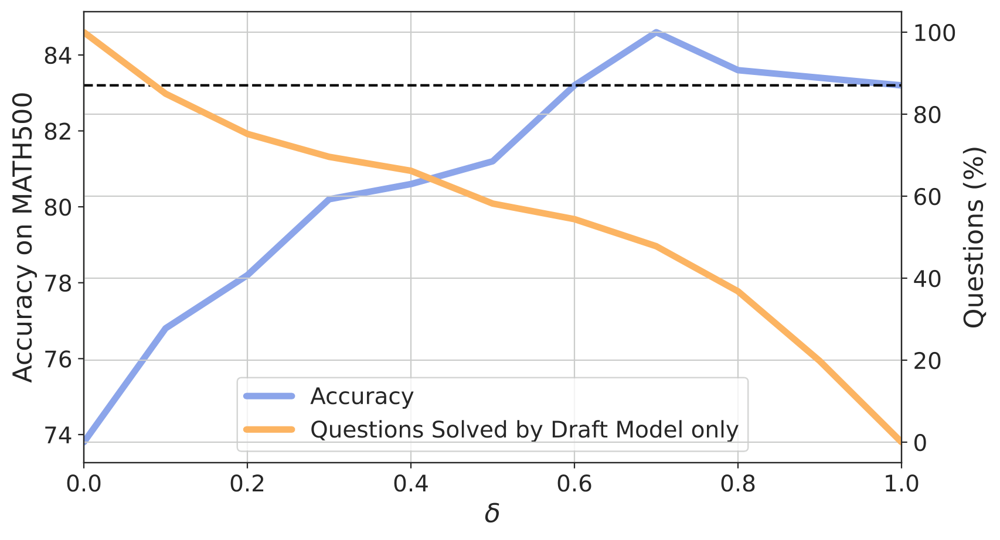
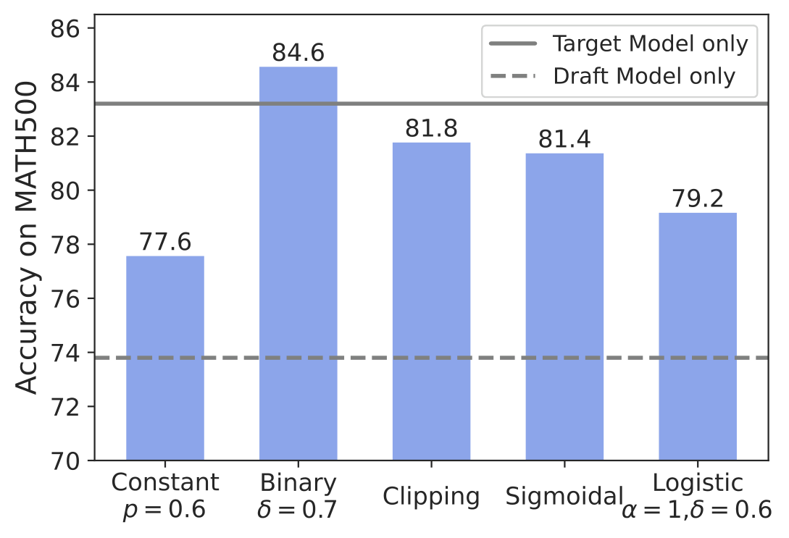
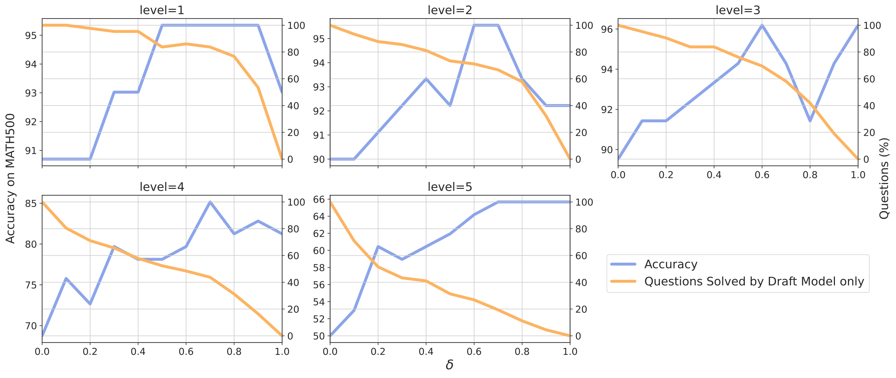
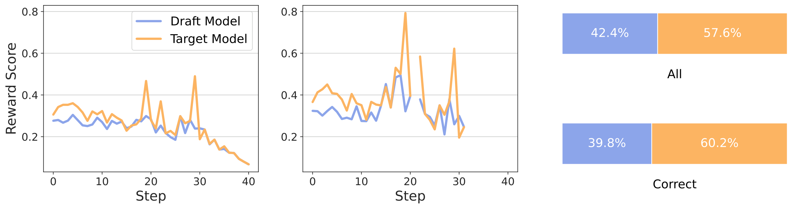

# RSD：按步骤奖励分配算力，推理FLOPs最高降至1/4.4

大模型在数学、科学和代码任务中往往要生成很长的推理链，逐步调用目标模型的成本因此迅速累积。RSD（Reward-Guided Speculative Decoding，奖励引导的投机解码）要解决的问题是：如何用小模型承担大部分生成，又不被传统投机解码的严格分布一致性要求绑住。它的核心思路是让过程奖励模型给每个候选推理步骤打分，高分步骤直接保留，低分步骤才交给大模型重做。在 MATH500 上，RSD（7B/72B/7B）取得 88.0 的准确率，高于 72B 目标模型的 85.6，同时使用的 FLOPs 接近后者的 $1/4.4$。

## 为什么传统投机解码不适合长链推理

投机解码（Speculative Decoding，SD）通常由小型 draft model 先生成候选 token，再由大型 target model 并行验证。只要最终分布严格等于目标模型分布，就能在理论上实现“无损加速”。

问题在于，**分布一致不等于推理步骤没有价值**。一个小模型生成的步骤可能完全正确，只因为它在大模型下的概率不够高，就被拒绝采样丢弃。推理链越长，这种分歧和重复计算越容易累积。

RSD 因此主动放弃严格无偏性，引入可控偏差：不再问“这个步骤是否精确符合大模型分布”，而是先问“这个步骤的过程奖励是否足够高”。只要质量可靠，就保留小模型的部分解答；只有低质量步骤才触发大模型修正。

> 图解：小模型先快速产生候选结果，过程奖励 $r$ 决定哪些步骤可以直接接受、哪些需要大模型 refine。传统 SD 会因 token 不完全匹配而丢弃候选；RSD 则保留高奖励但不完全匹配的内容。图中越深的背景代表越高的计算成本，直观展示了 RSD 如何减少无效的大模型调用。

这个变化还有一个重要收益：RSD 可以按题目难度自动分配算力。简单题可能完全由小模型解决，难题才频繁调用大模型，而不是像 SD 那样让每道题都经过两个模型。

## RSD：把两个模型混合成受奖励控制的分布

### 从逐步生成到动态混合

设输入为 $x$，完整回答由 $n$ 个推理步骤组成，即 $y_{1:n}=[y_1,\ldots,y_n]$。第 $i$ 步的上下文为：

$$
z_i=[x,y_{1:i-1}]
$$

小模型 $m$ 和大模型 $M$ 分别定义条件分布 $\mathbf{P}_m(y_i\mid z_i)$ 与 $\mathbf{P}_M(y_i\mid z_i)$。过程奖励函数 $r(y_i\mid z_i)$ 衡量当前步骤的质量，分数越高，说明它越可能把推理引向正确答案。

理论分析采用一个基本假设：在相同上下文下，大模型的期望奖励不低于小模型：

$$
\mathbf{E}_{y_i\sim\mathbf{P}_M}[r(y_i\mid z_i)]
\geq
\mathbf{E}_{y_i\sim\mathbf{P}_m}[r(y_i\mid z_i)]
$$

RSD 的关键不是固定选择某个模型，而是构造动态混合分布：

$$
\mathbf{P}_{\mathrm{RSD}}(y_i\mid z_i)
=
\omega(r(y_i\mid z_i))\mathbf{P}_m(y_i\mid z_i)
+
\nu\mathbf{P}_M(y_i\mid z_i)
$$

其中，$\omega(r)\in[0,1]$ 是随奖励非递减的权重，$\nu$ 是归一化常数：

$$
\nu=1-\mathbf{E}_{y_i\sim\mathbf{P}_m}[\omega(r(y_i\mid z_i))]
$$

当候选步骤奖励很高时，$\omega(r)$ 接近 1，小模型项占主导；当奖励很低时，$\omega(r)$ 接近 0，混合分布转向大模型。由于 $\nu\mathbf{P}_M$ 始终提供后备项，被拒绝的候选可以直接由目标模型补位。

这个设计的聪明之处在于：**奖励不再只用于从一堆完整答案中挑选最优者，而是直接参与解码器的计算路由。**它把“哪个答案好”变成了“这一步是否值得调用大模型”。

### 实际算法只有五次判断

RSD 在每个推理步骤上执行以下流程：

1. **生成候选步骤**：小模型根据 $x$ 和已有步骤生成 $\hat y_i$。
2. **计算过程奖励**：PRM（Process Reward Model，过程奖励模型）评估候选步骤，得到 $r_i$。
3. **执行接受准则**：若 $\mathcal{A}_\omega(r_i)$ 为真，接受 $\hat y_i$；否则由大模型重新生成该步骤。
4. **形成混合采样**：被接受的步骤来自 $\mathbf{P}_m$，其余来自 $\mathbf{P}_M$。
5. **继续或终止**：遇到 EOS token，或达到最大长度 $N$ 时停止。

接受准则由 $\omega(r)$ 决定。若 $\omega(r)$ 等于 0 或 1，结果就是确定的拒绝或接受；否则采样 $u\sim\mathcal{U}(0,1)$，并按下式决定：

$$
\mathcal{A}_\omega(r)=\mathbf{1}(\omega(r)\geq u)
$$

因此，连续权重对应随机接受，二值权重则退化为确定性阈值规则。

### 权重函数怎么选

论文比较了五种权重函数。它们都在调整小模型与大模型的使用比例，但对奖励噪声和预算控制的响应不同。

| 权重函数 | 定义 |
|---|---|
| 常数 | $\omega(r)=p$，其中 $p\in(0,1)$ |
| 二值阈值 | $\omega(r)=\mathbf{1}(r\geq\delta)$ |
| 截断 | $\omega(r)=\min(1,\max(0,r))$ |
| Sigmoidal 变换 | $\omega(r)=\max(0,r/(1+r))$ |
| Logistic 函数 | $\omega(r)=1/(1+e^{-\alpha(r-\delta)})$ |

直觉上，二值函数最适合严格采样预算：只把接受概率分配给高奖励步骤。连续函数则可能更温和地处理有噪声的奖励，但预算控制不如阈值直接。

> 图解：三组比较分别展示所有题目的奖励、答对题目的奖励，以及两个模型的奖励胜率。配置为 Qwen2.5-Math-1.5B-Instruct 草稿模型、Qwen2.5-Math-7B-Instruct 目标模型和 Skywork-o1-Open-PRM-7B。中间一组说明，在 RSD 内答对的题目上，目标模型通常获得更高的过程奖励，支持“大模型期望奖励更高”的假设。

### 为什么阈值策略在预算约束下最优

设大模型被调用的预算满足 $\nu\leq\gamma$，其中 $\gamma\in(0,1)$。论文证明，最大化期望奖励的最优权重是二值阶跃函数：

$$
\omega_r(y\mid z)=
\begin{cases}
1, & r(y\mid z)\geq\delta_\gamma(z),\\
0, & r(y\mid z)<\delta_\gamma(z).
\end{cases}
$$

$\delta_\gamma(z)$ 是满足预算约束的最大可行阈值。实际实现中，可以直接把 $\delta$ 当作 Hyperparameter：调高阈值会拒绝更多小模型步骤，让大模型介入更多；调低阈值则更省算力。

在 $\omega(r)$ 非递减且大模型期望奖励不低于小模型的条件下，还能得到：

$$
\mathbf{E}_{\mathbf{P}_{\mathrm{RSD}}}[r(y\mid z)]
\geq
\mathbf{E}_{\mathbf{P}_m}[r(y\mid z)]
$$

也就是说，RSD 的期望奖励至少有不下于小模型的理论保证；若阈值只保留小模型的高奖励区域，它甚至可能超过大模型。

### 不依赖 PRM 的扩展形式

奖励权重并非唯一选择。论文还给出基于似然比的权重：

$$
w(y\mid z)=
\min\left(1,\alpha\frac{\mathbf{P}_M(y\mid z)}{\mathbf{P}_m(y\mid z)}\right)
$$

若某步骤在大模型下的概率远低于小模型，这个比值就很小，说明候选可能可疑。标准 SD 可看作这类设计的一种特例，而 RSD 还可以混合过程奖励与似然比：

$$
w(y\mid z)=
\min\left(1,\beta r(y\mid z)\frac{\mathbf{P}_M(y\mid z)}{\mathbf{P}_m(y\mid z)}\right)
$$

这为奖励模型噪声较大、大小模型分布差异明显的场景留下了扩展空间。

## 实验：准确率没有因省算力而必然下降

### 实验设置

论文使用 Qwen2.5-Math-Instruct、Qwen2.5-Instruct 和 Llama-3.1-Instruct 系列作为目标与草稿模型，默认 PRM 为 Skywork-o1-Open-PRM，奖励范围为 $[0,1]$。评测覆盖 GSM8K、MATH500、MMLU STEM、OlympiadBench、GaoKao-2023-En、GPQA Diamond 和 Minerva Math。

基线分为三类：

- **单目标模型**：完全使用大模型，成本较高。
- **Test-time scaling**：对草稿模型做 Majority Voting、Best-of-$N$、Beam Search 或 Process Best-of-$N$。
- **标准 SD**：草稿模型与目标模型联合解码，speculative tokens 数设为 7。

实验运行在 NVIDIA A100 GPU 上，后端为 vLLM。采样搜索方法使用 temperature 0.7、top_p 0.8，其余方法使用 temperature 0、top_p 1。以连续两个换行符划分推理步骤，默认采用二值阈值函数，$\delta=0.7$。下文 RSD（1.5B/7B/7B）依次表示 1.5B 草稿模型、7B 目标模型和 7B PRM。

### 六类推理 benchmark 的主结果

以下数值均为准确率；Avg. 括号内是相对对应单目标模型的变化，$\delta^*$ 表示按任务优化的阈值。

**Qwen2.5-Math-Instruct：7B 目标模型**

| 方法 | Target | Draft | PRM | 设置 | MATH500 | GSM8K | GaoKao 2023 En | OlympiadBench | GPQA Diamond | MMLU STEM | Avg. |
|---|---:|---:|---:|---|---:|---:|---:|---:|---:|---:|---:|
| Single Model | 7B | - | - | - | 83.2 | 95.7 | 66.8 | 41.2 | 32.8 | 71.8 | 65.3 |
| Majority Voting | - | 1.5B | - | maj@16 | 79.0 | 88.9 | 69.9 | 45.5 | 27.3 | 65.9 | 62.3 (-3.0) |
| Best-of-$N$ | - | 1.5B | 7B | $N=16$ | 82.2 | 93.3 | 69.4 | 44.9 | 27.3 | 71.4 | 64.8 (-0.5) |
| SD | 7B | 1.5B | - | - | 83.4 | 95.6 | 67.3 | 40.6 | 28.8 | 72.0 | 64.6 (-0.7) |
| RSD | 7B | 1.5B | 1.5B | $\delta=0.7$ | 82.6 | 94.5 | 68.8 | 39.6 | 38.4 | 71.4 | 65.9 (+0.6) |
| RSD | 7B | 1.5B | 7B | $\delta=0.7$ | 84.6 | 95.5 | 68.3 | 42.1 | 33.8 | 72.3 | 66.1 (+0.8) |
| RSD | 7B | 1.5B | 1.5B | $\delta^*$ | 82.6 | 95.5 | 68.8 | 40.6 | 38.4 | 71.7 | 66.3 (+1.0) |
| RSD | 7B | 1.5B | 7B | $\delta^*$ | 84.6 | 95.8 | 68.3 | 43.6 | 34.3 | 72.6 | 66.5 (+1.2) |

**Qwen2.5-Math-Instruct：72B 目标模型**

| 方法 | Target | Draft | PRM | 设置 | MATH500 | GSM8K | GaoKao 2023 En | OlympiadBench | GPQA Diamond | MMLU STEM | Avg. |
|---|---:|---:|---:|---|---:|---:|---:|---:|---:|---:|---:|
| Single Model | 72B | - | - | - | 85.6 | 95.8 | 73.0 | 48.4 | 42.4 | 85.8 | 71.8 |
| Majority Voting | - | 1.5B | - | maj@64 | 80.2 | 89.8 | 71.2 | 45.9 | 30.8 | 66.1 | 64.0 (-7.8) |
| Best-of-$N$ | - | 1.5B | 7B | $N=64$ | 82.4 | 94.5 | 68.6 | 44.3 | 27.8 | 72.4 | 65.0 (-6.8) |
| Majority Voting | - | 7B | - | maj@64 | 88.0 | 96.5 | 73.8 | 47.6 | 35.9 | 77.2 | 69.8 (-2.0) |
| Best-of-$N$ | - | 7B | 7B | $N=64$ | 86.2 | 97.2 | 71.4 | 44.4 | 36.4 | 75.4 | 68.5 (-3.3) |
| SD | 72B | 7B | - | - | 84.8 | 95.8 | 71.7 | 47.6 | 41.4 | 85.3 | 71.1 (-0.7) |
| RSD | 72B | 7B | 1.5B | $\delta=0.7$ | 86.4 | 96.4 | 73.0 | 49.8 | 42.9 | 84.7 | 72.2 (+0.4) |
| RSD | 72B | 7B | 7B | $\delta=0.7$ | 88.0 | 96.7 | 74.0 | 49.9 | 42.9 | 84.4 | 72.7 (+0.9) |
| RSD | 72B | 7B | 1.5B | $\delta^*$ | 86.6 | 97.0 | 73.2 | 49.8 | 43.9 | 85.2 | 72.6 (+0.8) |
| RSD | 72B | 7B | 7B | $\delta^*$ | 88.0 | 96.9 | 74.0 | 49.9 | 42.9 | 85.6 | 72.9 (+1.1) |

**Qwen2.5-Instruct 通用模型**

| 方法 | Target | Draft | PRM | 设置 | MATH500 | GSM8K | GaoKao 2023 En | OlympiadBench | GPQA Diamond | MMLU STEM | Avg. |
|---|---:|---:|---:|---|---:|---:|---:|---:|---:|---:|---:|
| Single Model | 7B | - | - | - | 77.4 | 92.0 | 64.9 | 38.8 | 28.8 | 57.4 | 59.9 |
| Majority Voting | - | 1.5B | - | maj@16 | 66.4 | 82.1 | 56.9 | 28.7 | 27.3 | 67.2 | 54.8 (-5.1) |
| Best-of-$N$ | - | 1.5B | 7B | $N=16$ | 73.4 | 89.7 | 60.5 | 32.7 | 23.7 | 69.4 | 58.2 (-1.7) |
| SD | 7B | 1.5B | - | - | 77.8 | 91.8 | 63.1 | 39.1 | 26.3 | 56.2 | 59.1 (-0.8) |
| RSD | 7B | 1.5B | 1.5B | $\delta=0.7$ | 73.6 | 90.8 | 64.2 | 39.0 | 31.3 | 71.6 | 61.8 (+1.9) |
| RSD | 7B | 1.5B | 7B | $\delta=0.7$ | 75.0 | 93.3 | 66.2 | 39.9 | 20.2 | 61.8 | 59.4 (-0.5) |
| RSD | 7B | 1.5B | 1.5B | $\delta^*$ | 74.8 | 92.3 | 65.2 | 40.0 | 31.3 | 71.7 | 62.6 (+2.7) |
| RSD | 7B | 1.5B | 7B | $\delta^*$ | 75.8 | 93.3 | 66.2 | 40.9 | 29.8 | 66.3 | 62.1 (+2.2) |

**Llama-3.1-Instruct 通用模型**

| 方法 | Target | Draft | PRM | 设置 | MATH500 | GSM8K | GaoKao 2023 En | OlympiadBench | GPQA Diamond | MMLU STEM | Avg. |
|---|---:|---:|---:|---|---:|---:|---:|---:|---:|---:|---:|
| Single Model | 8B | - | - | - | 49.4 | 83.9 | 41.3 | 14.5 | 20.2 | 39.1 | 41.4 |
| Majority Voting | - | 1B | - | maj@16 | 38.0 | 60.2 | 32.2 | 9.5 | 19.7 | 24.9 | 30.8 (-10.6) |
| Best-of-$N$ | - | 1B | 7B | $N=16$ | 52.6 | 74.8 | 45.7 | 14.4 | 14.1 | 31.0 | 38.8 (-2.6) |
| SD | 8B | 1B | - | - | 47.0 | 83.4 | 42.1 | 16.6 | 19.2 | 38.5 | 41.1 (-0.3) |
| RSD | 8B | 1B | 1.5B | $\delta=0.7$ | 50.0 | 83.9 | 41.8 | 15.7 | 20.2 | 37.2 | 41.5 (+0.1) |
| RSD | 8B | 1B | 7B | $\delta=0.7$ | 50.4 | 85.4 | 41.8 | 18.1 | 19.7 | 36.2 | 41.9 (+0.5) |
| RSD | 8B | 1B | 1.5B | $\delta^*$ | 50.0 | 84.1 | 43.4 | 18.1 | 20.2 | 38.8 | 42.4 (+1.0) |
| RSD | 8B | 1B | 7B | $\delta^*$ | 50.6 | 85.5 | 42.6 | 18.1 | 19.7 | 38.7 | 42.5 (+1.1) |

结果支持三个判断。首先，大量采样小模型并不等于大模型能力，Majority Voting 和 Best-of-$N$ 的平均成绩通常仍低于单目标模型。其次，优化阈值后，RSD 在所有模型配置上都超过对应单目标模型的平均准确率；固定 $\delta=0.7$ 时，也在 8 组设置中的 7 组取得提升。最后，更大的 PRM 往往更有帮助，但并非所有任务都如此，例如通用 Qwen2.5 配置中的 GPQA 就出现明显波动。

### 与逐步搜索方法比较

Beam Search 和 Process Best-of-$N$ 都使用 1.5B 基础模型与 1.5B PRM；RSD 使用 1.5B 草稿模型、7B 目标模型和 1.5B PRM。

| 方法 | 设置 | MATH500 | GSM8K | Minerva Math |
|---|---|---:|---:|---:|
| Single Model (1.5B) | - | 73.8 | 85.0 | 29.0 |
| Process Best-of-$N$ | $N=8$ | 75.8 | 87.8 | 32.7 |
| Process Best-of-$N$ | $N=16$ | 76.0 | 87.9 | 31.2 |
| Beam Search | beam size = 4 | 78.2 | 88.9 | 33.5 |
| Beam Search | beam size = 8 | 78.2 | 88.4 | 32.4 |
| RSD (1.5B/7B/1.5B) | $\delta=0.7$ | **82.6** | **94.5** | **34.6** |

RSD 在三项任务上都超过这些搜索方法。论文的解释是：困难步骤的候选空间会组合式膨胀，小模型即使搜索更多候选，也未必能找到正确路径；RSD 则直接把困难步骤交给能力更强的模型生成。

### 计算量与准确率同时占优

Transformer 的计算量按每个推理 token 约 $2N$ FLOPs 估算，其中 $N$ 为参数量，PRM 成本也计入统计。

> 图解：图中比较不同方法在 MATH500 上的计算量与准确率，越靠左上代表“更低 FLOPs、更高准确率”。RSD（1.5B/7B/7B）比 SD（1.5B/7B）和目标模型分别高 1.2、1.4 个准确率点，同时 FLOPs 更低；RSD（7B/72B/7B）达到 88.0，相对 72B 目标模型的 85.6 提升 2.4 点，计算量接近缩减 4.4 倍。与 Best-of-64（7B/7B）相比，它也高 1.8 点且成本更低。

需要注意，**4.4 倍是特定 MATH500 配置下相对 72B 单目标模型的峰值结果，不是所有任务的统一加速比**。

## 消融实验：阈值控制的是算力分配，不只是接受率

### 阈值 $\delta$ 的影响

> 图解：该图使用 RSD（1.5B/7B/7B），同时观察阈值 $\delta$、准确率，以及完全由草稿模型解决的题目比例。随着 $\delta$ 增大，接受条件更严格，大模型参与更多；准确率在 $\delta=0.7$ 达到峰值后略降。$\delta>0.6$ 后，准确率持续高于 $\delta=1.0$ 的纯目标模型；即使 $\delta=0.7$，仍有 48% 的题目完全不需要目标模型。

这说明 RSD 并非“大模型调用越多越好”。小模型的高奖励步骤本身可能非常有价值，全部替换为大模型反而丢掉了混合分布带来的收益。

### 不同权重函数的比较

> 图解：各权重函数在相近推理成本下比较。所有使用大模型的方案都超过单独草稿模型；不使用奖励的常数权重表现最弱，说明 PRM 反馈确实关键；二值阈值函数表现最好，并超过单目标模型，因此成为论文的默认方案。

### 模型合并能否减少部署组件

RSD 需要草稿模型、目标模型和 PRM，部署组件较多。论文尝试用 MergeKit 做线性合并，仅合并共享 Transformer 层，保留 PRM 的标量 projection layer 和策略模型的 `lm_head`。测试的插值权重为 $[0.6,0.4]$ 与 $[0.5,0.5]$，前者略好。下表星号表示对应的两个模型被合并。

| 方法 | Target | Draft | PRM | 设置 | 平均准确率 |
|---|---:|---:|---:|---|---:|
| Single Model | 7B | - | - | - | 65.3 |
| SD | 7B | 1.5B | - | - | 64.6 (-0.7) |
| RSD | 7B | 1.5B | 1.5B | $\delta=0.7$ | 65.9 (+0.6) |
| RSD | 7B | 1.5B | 7B | $\delta=0.7$ | 66.1 (+0.8) |
| RSD | 7B | 1.5B* | 1.5B* | $\delta=0.7$ | 65.0 (-0.3) |
| RSD | 7B* | 1.5B | 7B* | $\delta=0.7$ | **66.7 (+1.4)** |

合并目标模型与 PRM 后，平均准确率反而提升至 66.7；合并草稿模型与 PRM 则略有下降。结果说明减少模型数量不一定牺牲性能，但论文只测试了最简单的线性合并和少量权重。

## 讨论：PRM 成本、通用任务与 SD 并不冲突

### PRM 开销与替换鲁棒性

MATH500 中平均每题有 18 个推理步骤，PRM 因而每题调用约 18 次。论文将其类比为额外生成约 18 个 token，并指出即便使用 1.5B PRM，RSD 的平均准确率也能超过单目标模型。因此，在作者的估算中，PRM 带来的额外成本相对有限。

| 方法 | PRM | 设置 | MATH500 | GSM8K | GaoKao 2023 En | OlympiadBench | GPQA Diamond | MMLU STEM | Avg. |
|---|---|---|---:|---:|---:|---:|---:|---:|---:|
| Single Target Model | - | - | 83.2 | 95.7 | 66.8 | 41.2 | 32.8 | 71.8 | 65.3 |
| SD | - | - | 83.4 | 95.6 | 67.3 | 40.6 | 28.8 | 72.0 | 64.6 (-0.7) |
| RSD | Skywork-o1-Open-PRM-1.5B | $\delta=0.7$ | 82.6 | 94.5 | 68.8 | 39.6 | 38.4 | 71.4 | 65.9 (+0.6) |
| RSD | Skywork-o1-Open-PRM-7B | $\delta=0.7$ | 84.6 | 95.5 | 68.3 | 42.1 | 33.8 | 72.3 | 66.1 (+0.8) |
| RSD | Qwen2.5-Math-PRM-7B | $\delta=0.7$ | 83.2 | 95.5 | 67.3 | 41.3 | 35.3 | 72.5 | 65.9 (+0.6) |
| RSD | Qwen2.5-Math-PRM-72B | $\delta=0.7$ | 84.0 | 95.7 | 68.1 | 42.0 | 33.3 | 75.6 | **66.5 (+1.2)** |

以上配置固定为 Qwen2.5-Math 1.5B 草稿模型和 7B 目标模型。不同 PRM 下，RSD 的平均成绩都超过 SD 和单目标模型，说明方法并不只依赖某一个奖励模型；更大的 PRM 整体更有优势。

### 通用开放式生成：有效，但没有超过目标模型

通用领域缺少成熟的 PRM，因此论文改用 ORM（Outcome Reward Model，结果奖励模型）Skywork-Reward-Llama-3.1-8B-v0.2，在 AlpacaEval 的 805 个 prompt 上测试。草稿模型为 Llama-3.2-1B-Instruct，目标模型为 Llama-3.1-8B-Instruct，奖励阈值经验性设为 $\delta=0$，没有充分调参。

| 方法 | Win Rate (%) |
|---|---:|
| Draft Model only (Llama-3.2-1B-Instruct) | 7.09 |
| Target Model only (Llama-3.1-8B-Instruct) | 24.47 |
| RSD | 18.85 |

RSD 明显高于草稿模型，但低于目标模型，不能据此声称通用任务全面占优。好的一面是，65% 的生成 token 完全由草稿模型产出；这也意味着，若有通用 PRM 并针对 $\delta$ 调优，仍有改进空间。

### 与既有工作的关系

传统 SD 包括树状候选、自投机解码和并行解码等路线，重点是提高候选接受率并保持目标分布。RSD 的差异是把过程奖励用于**逐步推理路由**。奖励模型方面，ORM 只评价最终答案，PRM 则提供逐步稠密信号；Best-of-$N$ 和树搜索主要用奖励挑选候选，RSD 则用奖励决定是否值得调用大模型。

两者并非互斥：RSD 拒绝一个步骤后，可以用 SD 的“草稿生成 + 目标验证”来重新生成该步骤，从而继续压缩修正成本。另一个方向是针对草稿模型微调专用 PRM，让它更准确识别小模型已经做对的步骤，提高接受率。

## 附录要点：三个命题如何成立

### 混合分布的归一化

RSD 的样本只有两条来源：小模型样本被接受，或小模型样本被拒绝后从大模型采样。根据全概率公式：

$$
\mathbf{P}_{\mathrm{RSD}}(y\mid z)
=
\underbrace{\omega_r(y\mid z)\mathbf{P}_m(y\mid z)}_{\text{接受草稿样本}}
+
\underbrace{\nu\mathbf{P}_M(y\mid z)}_{\text{拒绝后由目标模型生成}}
$$

对 $y$ 积分，第一项的总质量为 $\mathbf{E}_{\mathbf{P}_m}[\omega_r]$，第二项为 $\nu$。令二者之和等于 1，就得到 $\nu=1-\mathbf{E}_{\mathbf{P}_m}[\omega_r]$。

### 期望奖励不低于草稿模型

记 $r=r(y\mid z)$。由混合分布定义：

$$
\mathbf{E}_{\mathbf{P}_{\mathrm{RSD}}}[r]
=
\mathbf{E}_{\mathbf{P}_m}[\omega(r)r]
+
(1-\mathbf{E}_{\mathbf{P}_m}[\omega(r)])\mathbf{E}_{\mathbf{P}_M}[r]
$$

利用恒等式：

$$
\mathbf{E}_{\mathbf{P}_m}[\omega(r)r]
=
\operatorname{Cov}_{\mathbf{P}_m}(\omega(r),r)
+
\mathbf{E}_{\mathbf{P}_m}[\omega(r)]\mathbf{E}_{\mathbf{P}_m}[r]
$$

可将 RSD 与草稿模型的期望奖励差写为：

$$
\operatorname{Cov}_{\mathbf{P}_m}(\omega(r),r)
+
(1-\mathbf{E}_{\mathbf{P}_m}[\omega(r)])
\left(\mathbf{E}_{\mathbf{P}_M}[r]-\mathbf{E}_{\mathbf{P}_m}[r]\right)
$$

$\omega(r)$ 非递减意味着协方差项非负；大模型期望奖励更高且 $\nu\geq0$，所以第二项也非负。因此，RSD 的期望奖励不低于草稿模型。

### 最优阈值规则的来源

在预算 $\nu\leq\gamma$ 下优化权重，可对 $\omega_r(y\mid z)$ 构造 Lagrangian。令 $R=\mathbf{E}_{\mathbf{P}_M}[r]$，关于权重的导数具有如下形式：

$$
\frac{\partial\mathcal{L}}{\partial\omega_r(y\mid z)}
=
\mathbf{P}_m(y\mid z)\left[r(y\mid z)-(\lambda+R)\right]
$$

其中 $\lambda\geq0$ 是预算约束的乘子。由于目标关于每个位置的权重是线性的，最优解只可能落在边界：当 $r\geq\lambda+R$ 时取 1，否则取 0。KKT 条件进一步要求预算可行、乘子非负，并满足互补松弛；阈值则由目标模型调用预算确定。这就是二值阶跃函数最优的原因。

## 更多实验：阈值、难度与模型合并细节

### 草稿模型更强时，RSD 不必向大模型看齐

| 方法 | Target | Draft | PRM | 设置 | CN Middle School 24 | College Math |
|---|---:|---:|---:|---|---:|---:|
| Single Model | - | 1.5B | - | - | 75.2 | 48.0 |
| Single Model | 7B | - | - | - | 72.3 | 46.8 |
| SD | 7B | 1.5B | - | - | 73.3 | 46.9 |
| RSD | 7B | 1.5B | 7B | $\delta=0.7$ | **78.2** | **48.2** |

这里 1.5B 草稿模型本来就强于 7B 目标模型。SD 为保持目标分布，准确率被拉回目标模型附近；RSD 能依据奖励保留草稿模型的好步骤，因此同时超过两个单模型。这是“允许可控偏差”最直观的价值。

### 不同阈值下的完整结果

总体来看，$\delta=0.7$ 是跨模型、跨任务的可靠默认值，但不同任务的最优点并不一致。

| Target / Draft / PRM | $\delta$ | MATH500 | GSM8K | GaoKao 2023 En | OlympiadBench | GPQA Diamond | MMLU STEM | Avg. |
|---|---:|---:|---:|---:|---:|---:|---:|---:|
| Qwen2.5-Math 7B / 1.5B / 1.5B | 0.6 | 80.4 | 93.3 | 67.8 | 40.6 | 32.3 | 69.1 | 63.9 |
| Qwen2.5-Math 7B / 1.5B / 1.5B | 0.7 | 82.6 | 94.5 | 68.8 | 39.6 | 38.4 | 71.4 | 65.9 |
| Qwen2.5-Math 7B / 1.5B / 1.5B | 0.8 | 82.6 | 95.3 | 68.1 | 39.4 | 37.4 | 71.7 | 65.8 |
| Qwen2.5-Math 7B / 1.5B / 1.5B | 0.9 | 81.2 | 95.5 | 68.3 | 39.4 | 32.3 | 71.6 | 64.7 |
| Qwen2.5-Math 7B / 1.5B / 7B | 0.6 | 83.6 | 95.4 | 68.3 | 43.6 | 30.3 | 71.6 | 65.5 |
| Qwen2.5-Math 7B / 1.5B / 7B | 0.7 | 84.6 | 95.5 | 68.3 | 42.1 | 33.8 | 72.3 | 66.1 |
| Qwen2.5-Math 7B / 1.5B / 7B | 0.8 | 83.6 | 95.8 | 67.8 | 40.9 | 34.3 | 72.6 | 65.8 |
| Qwen2.5-Math 7B / 1.5B / 7B | 0.9 | 83.4 | 95.7 | 68.1 | 40.1 | 32.8 | 72.5 | 65.4 |
| Qwen2.5-Math 72B / 1.5B / 1.5B | 0.6 | 83.0 | 93.5 | 71.9 | 48.4 | 36.9 | 78.1 | 68.6 |
| Qwen2.5-Math 72B / 1.5B / 1.5B | 0.7 | 83.6 | 94.7 | 72.7 | 47.7 | 40.4 | 82.5 | 70.3 |
| Qwen2.5-Math 72B / 1.5B / 1.5B | 0.8 | 86.6 | 95.6 | 71.4 | 48.0 | 40.9 | 85.1 | 71.3 |
| Qwen2.5-Math 72B / 1.5B / 1.5B | 0.9 | 85.4 | 95.6 | 72.2 | 47.7 | 44.4 | 85.5 | 71.8 |
| Qwen2.5-Math 72B / 1.5B / 7B | 0.6 | 85.8 | 96.0 | 72.5 | 49.0 | 41.9 | 82.5 | 71.3 |
| Qwen2.5-Math 72B / 1.5B / 7B | 0.7 | 86.8 | 96.3 | 72.7 | 49.0 | 41.9 | 84.6 | 71.9 |
| Qwen2.5-Math 72B / 1.5B / 7B | 0.8 | 87.4 | 96.3 | 73.0 | 48.3 | 40.9 | 85.4 | 71.9 |
| Qwen2.5-Math 72B / 1.5B / 7B | 0.9 | 86.2 | 96.0 | 72.7 | 48.9 | 41.4 | 85.6 | 71.8 |
| Qwen2.5-Math 72B / 7B / 1.5B | 0.6 | 85.0 | 97.0 | 72.2 | 48.4 | 43.9 | 82.2 | 71.5 |
| Qwen2.5-Math 72B / 7B / 1.5B | 0.7 | 86.4 | 96.4 | 73.0 | 49.8 | 42.9 | 84.7 | 72.2 |
| Qwen2.5-Math 72B / 7B / 1.5B | 0.8 | 86.6 | 96.6 | 73.2 | 48.7 | 43.9 | 85.2 | 72.4 |
| Qwen2.5-Math 72B / 7B / 1.5B | 0.9 | 86.4 | 95.7 | 71.4 | 48.1 | 41.4 | 85.1 | 71.4 |
| Qwen2.5-Math 72B / 7B / 7B | 0.6 | 88.0 | 96.6 | 72.5 | 49.6 | 40.4 | 82.5 | 71.6 |
| Qwen2.5-Math 72B / 7B / 7B | 0.7 | 88.0 | 96.7 | 74.0 | 49.9 | 42.9 | 84.4 | 72.7 |
| Qwen2.5-Math 72B / 7B / 7B | 0.8 | 87.4 | 96.9 | 73.5 | 48.3 | 41.9 | 85.6 | 72.3 |
| Qwen2.5-Math 72B / 7B / 7B | 0.9 | 86.0 | 96.2 | 73.5 | 48.3 | 42.4 | 85.4 | 72.0 |
| Qwen2.5-Instruct 7B / 1.5B / 1.5B | 0.6 | 72.8 | 89.7 | 63.6 | 38.5 | 22.2 | 71.7 | 59.8 |
| Qwen2.5-Instruct 7B / 1.5B / 1.5B | 0.7 | 73.6 | 90.8 | 64.2 | 39.0 | 31.3 | 71.6 | 61.8 |
| Qwen2.5-Instruct 7B / 1.5B / 1.5B | 0.8 | 74.8 | 91.6 | 64.4 | 38.8 | 23.7 | 67.1 | 60.1 |
| Qwen2.5-Instruct 7B / 1.5B / 1.5B | 0.9 | 74.6 | 92.3 | 65.2 | 40.0 | 28.3 | 59.3 | 60.0 |
| Qwen2.5-Instruct 7B / 1.5B / 7B | 0.6 | 75.4 | 92.6 | 64.9 | 37.3 | 29.8 | 66.3 | 61.1 |
| Qwen2.5-Instruct 7B / 1.5B / 7B | 0.7 | 75.0 | 93.3 | 66.2 | 39.9 | 20.2 | 61.8 | 59.4 |
| Qwen2.5-Instruct 7B / 1.5B / 7B | 0.8 | 74.2 | 92.4 | 62.9 | 40.6 | 21.7 | 58.2 | 58.3 |
| Qwen2.5-Instruct 7B / 1.5B / 7B | 0.9 | 75.8 | 92.1 | 65.2 | 40.9 | 26.8 | 56.1 | 59.5 |
| Llama-3.1-Instruct 8B / 1B / 1.5B | 0.6 | 49.0 | 82.6 | 40.8 | 18.1 | 19.2 | 34.5 | 40.7 |
| Llama-3.1-Instruct 8B / 1B / 1.5B | 0.7 | 50.0 | 83.9 | 41.8 | 15.7 | 20.2 | 37.2 | 41.5 |
| Llama-3.1-Instruct 8B / 1B / 1.5B | 0.8 | 48.6 | 84.1 | 41.8 | 16.3 | 18.7 | 38.8 | 41.4 |
| Llama-3.1-Instruct 8B / 1B / 1.5B | 0.9 | 50.0 | 84.0 | 43.4 | 15.3 | 17.7 | 38.6 | 41.5 |
| Llama-3.1-Instruct 8B / 1B / 7B | 0.6 | 50.4 | 85.5 | 42.6 | 16.9 | 18.2 | 34.9 | 41.4 |
| Llama-3.1-Instruct 8B / 1B / 7B | 0.7 | 50.4 | 85.4 | 41.8 | 18.1 | 19.7 | 36.2 | 41.9 |
| Llama-3.1-Instruct 8B / 1B / 7B | 0.8 | 50.6 | 84.2 | 41.3 | 16.4 | 18.2 | 37.9 | 41.4 |
| Llama-3.1-Instruct 8B / 1B / 7B | 0.9 | 50.0 | 83.5 | 42.3 | 16.1 | 18.2 | 38.7 | 41.5 |

### 题目越难，大模型介入越多

> 图解：该图使用 RSD（1.5B/7B/7B），按 MATH500 的人工难度等级比较准确率与草稿模型独立解题比例；等级越高，题目越难。$\delta=0$ 表示只用草稿模型，$\delta=1$ 表示只用目标模型。目标模型参与后，各难度准确率都提高，相对纯草稿模型最高分别提升 4.7、5.6、6.7、16.4、15.7 点。$\delta=0.7$ 时，草稿模型独立解决的比例从 Level 1 的 84% 依次降至 67%、58%、44% 和 Level 5 的 19%。

这组结果把 RSD 的优势说得很清楚：它不是平均地削减每道题的计算，而是让简单题少用大模型、难题多用大模型。

### 模型合并的逐任务结果

| 方法 | Target | Draft | PRM | 设置 | MATH500 | GSM8K | GaoKao 2023 En | OlympiadBench | GPQA Diamond | MMLU STEM | Avg. |
|---|---:|---:|---:|---|---:|---:|---:|---:|---:|---:|---:|
| Single Model | 7B | - | - | - | 83.2 | 95.7 | 66.8 | 41.2 | 32.8 | 71.8 | 65.3 |
| SD | 7B | 1.5B | - | - | 83.4 | 95.6 | 67.3 | 40.6 | 28.8 | 72.0 | 64.6 (-0.7) |
| RSD | 7B | 1.5B | 1.5B | $\delta=0.7$ | 82.6 | 94.5 | 68.8 | 39.6 | 38.4 | 71.4 | 65.9 (+0.6) |
| RSD | 7B | 1.5B | 7B | $\delta=0.7$ | 84.6 | 95.5 | 68.3 | 42.1 | 33.8 | 72.3 | 66.1 (+0.8) |
| RSD | 7B | 1.5B* | 1.5B* | $\delta=0.7$ | 83.4 | 95.1 | 67.3 | 39.3 | 33.3 | 71.6 | 65.0 (-0.3) |
| RSD | 7B* | 1.5B | 7B* | $\delta=0.7$ | 84.0 | 95.6 | 69.4 | 43.0 | 35.4 | 72.6 | **66.7 (+1.4)** |

逐任务数据确认，目标模型与 PRM 的合并方案不仅平均成绩最高，还在 GaoKao、OlympiadBench 和 MMLU STEM 上优于未合并版本。不过，这仍是有限设置下的经验结果，不能推广为所有模型合并都会提升性能。

> 图解：与前面的 7B 目标模型实验相同，三组内容依次为所有题目的奖励比较、答对题目的奖励比较和奖励胜率，只是目标模型换成 Qwen2.5-Math-72B-Instruct，PRM 为 Skywork-o1-Open-PRM-7B。该图用于检查模型规模扩大到 72B 后，目标模型的过程奖励优势是否仍然存在。

## 总结

- RSD 用过程奖励替代严格的分布匹配：高奖励草稿步骤直接接受，低奖励步骤才由目标模型重做。
- 动态混合分布兼顾小模型成本与大模型质量；在非递减权重和目标模型期望奖励更高的条件下，期望奖励不低于草稿模型。
- 预算约束下的最优权重是二值阈值函数，$\delta$ 因此成为准确率与大模型调用量之间的直接控制旋钮。
- 在六类推理任务上，优化阈值的 RSD 均超过对应单目标模型的平均准确率；MATH500 的 72B 配置中实现 88.0 对 85.6，同时 FLOPs 接近减少 4.4 倍。
- 方法仍依赖可靠的步骤划分、奖励模型和阈值选择；通用领域 ORM 实验也尚未超过单目标模型。

未来最值得推进的是更准确的专用 PRM、RSD 与 SD 的联合修正，以及面向不同任务自动调节阈值，让奖励信号进一步转化为稳定的实际部署收益。

> 本文参考自 [Reward-Guided Speculative Decoding for Efficient LLM Reasoning](https://arxiv.org/abs/2501.19324)