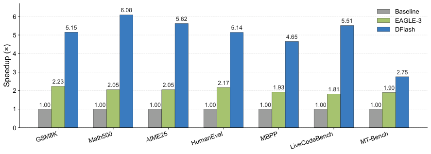
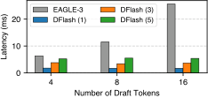
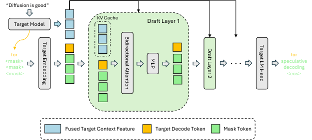
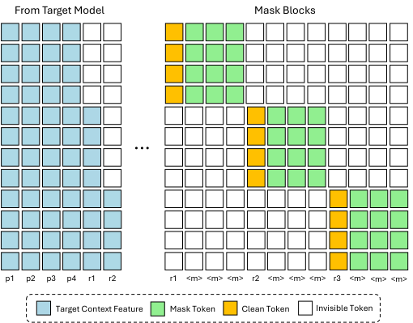
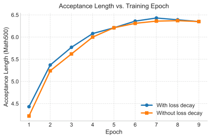

# DFlash：最高加速6.1倍

大语言模型逐 token 解码的串行瓶颈，让长文本生成与推理模型的解码尤其缓慢，而传统 Speculative Decoding 的草稿模型本身仍在串行生成。DFlash 要解决的就是：如何同时降低草稿延迟、提高草稿接受率，又不改变目标模型的输出质量。它的核心思路是用轻量级 Block Diffusion 一次并行预测整个 token 块，再把目标模型的多层隐藏特征注入草稿模型的每一层。实验中，DFlash 在 Qwen3-8B 上最高实现 **6.1× 无损加速**，多数基准中的加速倍率接近 EAGLE-3 的 **2.5 倍**。

> 图解：图中比较了 Qwen3-8B 在 Transformers 后端上采用自回归解码、EAGLE-3 与 DFlash 时的加速表现。DFlash 在不同任务上持续超过 EAGLE-3，整体加速倍率约为后者的 2.5 倍；这里的倍数均相对原始自回归解码，而不是延迟下降的百分比。

## 为什么现有草稿模型又快又不准？

自回归大模型必须等前一个 token 生成后，才能计算下一个 token。这个过程不仅串行，而且常受显存带宽限制，难以充分利用 GPU。长 Chain-of-Thought（CoT）进一步拉长了生成序列，使解码延迟成为推理成本的重要来源。

Speculative Decoding（投机解码）把过程拆成两步：小模型先猜一串 token，大模型再并行验证。验证机制保证最终结果仍由目标模型决定，因此可以实现无损加速。问题在于，草稿阶段并没有天然摆脱串行：

- Medusa 给基础模型增加多个预测头，并用 Tree Attention 并行验证。
- EAGLE-1 利用目标模型的特征层上下文预测未来隐藏状态。
- EAGLE-2 引入自适应草稿树，EAGLE-3 改进训练目标以扩大加速收益。
- 这些方法提高了接受率，但草稿仍主要按自回归方式逐步展开。

Diffusion Language Model（dLLM，扩散语言模型）看起来是天然替代方案：它能并行预测多个被遮蔽的位置。LLaDA 已把 dLLM 扩展到数十亿参数，Block Diffusion、Fast-dLLM v2 和 SDAR 又通过逐块去噪，缓解了固定长度生成与 KV cache 难以复用的问题。

但直接让扩散模型负责最终生成仍不理想：质量通常落后于优秀的自回归模型，多步去噪也会吃掉并行带来的速度收益。DFlash 因此换一个定位——**不让扩散模型替代目标模型，只让它负责快速打草稿，最终质量交给投机验证兜底。**

### 小扩散模型为什么不能“凭空猜”？

已有 Diffusion-based Speculative Decoding 也面临成本与质量的拉扯。DiffuSpec、SpecDiff-2 使用约 7B 参数的大型 dLLM，接受长度较长，却带来很高的显存与草稿延迟；PARD 等小模型方案成本较低，但缺少目标模型的丰富上下文，接受长度和加速上限受限。

DFlash 作者先训练了一个不使用目标特征的 5 层 Block Diffusion 草稿模型。结果说明，小模型仅凭自身能力预测未来 token，收益确实有限。

| 温度 | GSM8K：加速 / $\tau$ | Math500：加速 / $\tau$ | AIME24：加速 / $\tau$ | AIME25：加速 / $\tau$ |
|---|---:|---:|---:|---:|
| 0 | 2.83× / 3.38 | 3.73× / 4.61 | 3.43× / 4.12 | 3.35× / 4.07 |
| 1 | 2.76× / 3.29 | 3.31× / 4.12 | 2.66× / 3.23 | 2.65× / 3.24 |

这里的 $\tau$ 是每轮平均接受的 token 数，包含目标模型额外产生的 bonus token。可以看到，即使没有目标特征，并行草稿也有一定收益；但要突破这一水平，必须让小模型获得更强的上下文指导。

## 加速收益由什么决定？

设目标模型为 $\mathcal{M}_t$，草稿模型为 $\mathcal{M}_d$，每轮生成 $\gamma$ 个草稿 token。草稿耗时为 $T_{\text{draft}}$，目标模型并行验证耗时为 $T_{\text{verify}}$，平均每轮接受 $\tau$ 个 token，则单 token 延迟为：

$$
L = \frac{T_{\text{draft}} + T_{\text{verify}}}{\tau}
$$

若目标模型原本的单 token 延迟为 $L_{\text{target}}$，整体加速比就是：

$$
\eta = \frac{L_{\text{target}}}{L}
$$

这个公式把优化方向写得很清楚：一方面提高 $\tau$，让每轮接受更多 token；另一方面降低 $T_{\text{draft}}$，避免“猜得更多，却猜得更慢”。

### 自回归草稿：成本随长度线性增长

自回归草稿模型生成 $\gamma$ 个 token，需要 $\gamma$ 次串行前向计算：

$$
T_{\text{draft}} = \gamma \cdot t_{\text{step}}
$$

为了控制延迟，EAGLE-3 等方法只能使用很浅的草稿网络。模型容量受限后，即使增大 $\gamma$，接受长度 $\tau$ 也会较快饱和，草稿成本却继续增加。

### 扩散草稿：一次前向生成一个块

Block Diffusion 在一次前向中并行预测块内全部位置：

$$
T_{\text{draft}} = t_{\text{parallel}}
$$

对规模相当的模型，现代 GPU 执行一次并行计算通常比执行多轮串行计算高效得多，即 $t_{\text{parallel}} \ll \gamma \cdot t_{\text{step}}$。在适中块长下，草稿耗时对 $\gamma$ 不再那么敏感，设计者便有余裕增加网络深度来换取更准的草稿。

> 图解：图中比较 1、3、5 层 DFlash 与 1 层 EAGLE-3 的草稿成本。关键对比是：生成 16 个 token 的 5 层 DFlash，草稿延迟仍低于生成 8 个 token 的 EAGLE-3，同时还能获得更长的平均接受长度。这体现了“并行生成 + 更深草稿网络”的优势，而不只是单纯减少模型层数。

解决了“为什么扩散适合做草稿”之后，下一个问题是：怎样让轻量草稿模型真正理解目标模型接下来想说什么？

## DFlash：把目标模型的上下文注入每一层

DFlash 的核心不是单独使用扩散模型，而是把它变成一个紧贴目标模型的轻量 Diffusion Adapter。其推理设计由三部分组成：提取目标特征、通过 KV 注入持续条件化、并行生成草稿块。

> 图解：目标模型先完成标准 prefill 并生成首个 token，同时抽出多层隐藏表示。这些表示经过融合后，被注入草稿模型每一层的 Key-Value cache；草稿模型据此进行条件化的块级并行预测。目标特征不是一次性输入，而是在整个草稿深度中持续可用。

### 从浅层到深层提取目标特征

给定 prompt，目标模型先执行一次标准 prefill。DFlash 从第 2 层到倒数第 3 层之间均匀选取 5 层，拼接它们的隐藏状态，再用轻量投影融合成紧凑的 target context feature。

相比 token 级 logits，这些隐藏表示包含更丰富的长程依赖、任务语义，以及关于未来 token 的隐式信息。草稿模型因此不必“从零推理”，而是站在目标模型已经形成的内部表示之上预测下一块内容。

### KV 注入：避免目标信息随深度被稀释

EAGLE-3 等方法也会使用目标隐藏特征，但通常只把它与 token embedding 融合后送入草稿模型输入端。网络越深，早期输入的条件信息越可能被逐层稀释，增加层数带来的接受率收益也随之减弱。

DFlash 改为把融合后的目标特征直接投影成 **每一层额外的 Key 和 Value**，并写入草稿模型的 KV cache，供后续草稿迭代复用。这样，每层 Attention 都能直接读取目标上下文。

具体地，先从选中的目标层得到融合特征：

$$
\mathbf{H}_{t} = \mathrm{RMSNorm}\left(W_c[\mathbf{H}^{(l_1)};\ldots;\mathbf{H}^{(l_5)}]\right)
$$

在草稿模型第 $i$ 层，草稿 token 产生 Query；目标特征与草稿 token 一起产生 Key 和 Value：

$$
\mathbf{Q}_i = W_i^Q \mathbf{H}_d
$$

$$
\mathbf{K}_i = [W_i^K \mathbf{H}_t;\,W_i^K \mathbf{H}_d]_{\mathrm{seq}}
$$

$$
\mathbf{V}_i = [W_i^V \mathbf{H}_t;\,W_i^V \mathbf{H}_d]_{\mathrm{seq}}
$$

目标特征只作为额外 KV 条目参与 Attention，不经过草稿模型的 Query 投影、输出投影、自注意力状态更新和 FFN。这个设计的聪明之处在于：**它增强的是每层可读的条件信息，而不是强迫目标特征完整穿过整个草稿网络。**

额外开销也很有限。唯一新增的参数组件是共享投影 $W_c \in \mathbb{R}^{D \times 5D}$。以 Qwen3.5-35B-A3B、$D=2048$、BF16 权重为例，新增参数约占 42 MB，相对约 70 GB 的目标模型很小。Batch size 为 1、序列长为 2048 时，投影输入与输出约占 40 MB 和 8 MB；块长 16 的解码阶段，临时激活低于 400 KB。

### 一次前向并行预测下一块

条件信息准备好后，DFlash 用 Block Diffusion 预测下一个 token 块。块内所有 mask 位置在一次前向中并行解码，不再逐 token 展开。随后目标模型并行验证整个草稿块，并接受与自身输出一致的前缀。

因此，DFlash 同时优化了公式中的两个变量：KV 注入提升草稿质量与 $\tau$，块级扩散降低 $T_{\text{draft}}$。

## 训练如何对齐真实投机解码？

DFlash 的训练目标，是让块级扩散预测对齐一个冻结的自回归目标模型。它没有直接照搬标准 Block Diffusion，而是围绕投机解码的实际条件修改了样本构造、Attention、Loss 与参数共享方式。

> 图解：蓝色表示目标模型提供的上下文特征；输入包含干净的 prompt token $p$ 与 response token $r$。每个块随机选取一个干净的 response token 作为锚点（黄色），其余待预测位置用 mask token $m$ 标记（绿色）。白色区域表示不可见的 Attention 位置，用来阻止不同块之间泄漏信息，并保持训练与推理时的因果条件一致。

### 随机锚点构造训练块

标准 Block Diffusion 通常把 response 均匀切块，再随机遮蔽块内位置。DFlash 则随机抽取 response 中的 **anchor token**，以它作为块首，遮蔽后续位置，训练模型并行预测接下来的 $\text{block\_size}-1$ 个 token。

这与推理完全对应：每轮草稿都以目标模型刚刚确认的一个干净 token 为条件，也就是上一轮验证产生的 bonus token。随机锚点还相当于数据增强，让模型在每个 epoch 见到更多位置与目标特征组合。

训练时，多个块被拼接到同一序列中，通过稀疏 Attention mask 一次性完成前向和反向计算。块内 token 可以双向注意，并读取对应的目标 KV 特征；不同块之间不能相互注意。实现上使用 Flex Attention 提高这种稀疏模式的执行效率。

### 长上下文训练成本保持有界

DFlash 固定每条序列的 masked block 数量，并在每个 epoch 重新随机采样锚点。这样既能覆盖不同上下文位置，又不会让训练成本随着长序列中的块数不断增长。相比依赖昂贵训练时测试的长上下文草稿训练，这一策略更适合扩展。

### 越早的位置，Loss 权重越大

投机解码里，块内位置的重要性并不相同：如果第 1 个草稿 token 就错了，后面的预测即使正确也无法被连续接受。因此，DFlash 对块内交叉熵 Loss 使用指数衰减权重：

$$
w_k = \exp\left(-\frac{k-1}{\gamma}\right)
$$

其中 $k$ 是块内位置，$\gamma$ 控制衰减速度。越靠前的位置权重越大，训练会更优先保证草稿前缀正确，从而提高接受长度并加快收敛。

> 图解：图中对比训练 epoch 增加时的接受长度变化。采用位置衰减 Loss 后，接受长度更快上升，最终收敛结果也优于块内均匀加权，说明优先学习早期位置确实符合投机验证的接受机制。

### 共享并冻结 Embedding 与 LM Head

草稿模型与目标模型共享 token embedding 和语言模型输出头，并在训练中保持冻结，只更新草稿 Transformer 层。这既减少可训练参数，也把草稿模型约束在目标模型的表示空间中，使其更像一个轻量适配器，而非独立训练的新语言模型。

### 复现所需的训练配置

草稿模型使用 AdamW 训练 6 个 epoch，学习率为 $6\times10^{-4}$，梯度裁剪阈值为 1.0，采用 cosine schedule，warmup ratio 为 0.04。最大序列长为 3072，Qwen3-Coder 为 4096；每条序列随机采样 512 个锚点。

Loss 衰减系数随块长调整：块长 16、10、8 分别使用 $\gamma=7,5,4$。训练数据约 80 万条，来自 NVIDIA Nemotron Post-Training Dataset V2 与 CodeAlpaca，并用目标模型重新生成 response，以增强目标对齐。

目标特征可以在线实时计算，也可以离线预计算并缓存。在线方式省去特征存储，离线方式则减少草稿模型优化时的重复计算。

## 主实验：接受更长，也确实更快

实验覆盖 LLaMA-3.1-8B-Instruct、Qwen3-4B、Qwen3-8B 与 Qwen3-Coder-30B-A3B-Instruct，任务分为数学、代码和聊天三类。除特别说明外，实验使用 NVIDIA H200；指标包括平均接受长度 $\tau$ 和相对自回归基线的端到端加速比。

DFlash 通常使用 5 层草稿网络，Qwen3-Coder 使用 8 层；块长通常为 16，LLaMA-3.1 为 10。对比对象包括原始自回归解码和 EAGLE-3。其他 dLLM 投机解码方法因缺少开源实现，未纳入直接对比。

### Qwen3 非推理模式

以下结果关闭 Qwen3 thinking mode，最多生成 2048 个 token。EAGLE-3 分别使用树大小 16 和 60：前者与 DFlash 块长 16 对齐草稿预算，后者用更高验证成本换取更长接受长度。EAGLE-3 的 draft steps 和 top-$k$ 分别为 7 和 10。每格为“加速比 / $\tau$”。

**Temperature = 0：**

| 模型 | 方法 | GSM8K | MATH-500 | AIME25 | HumanEval | MBPP | LCB | MT-Bench | 平均 |
|---|---|---:|---:|---:|---:|---:|---:|---:|---:|
| Qwen3-4B | EAGLE-3 (16) | 1.99× / 3.30 | 1.83× / 3.08 | 1.79× / 3.05 | 1.84× / 3.05 | 1.78× / 2.95 | 1.73× / 2.91 | 1.74× / 3.02 | 1.81× / 3.05 |
| Qwen3-4B | EAGLE-3 (60) | 2.27× / 3.77 | 2.10× / 3.52 | 2.13× / 3.51 | 2.12× / 3.47 | 2.02× / 3.38 | 1.90× / 3.22 | 2.04× / 3.49 | 2.08× / 3.48 |
| Qwen3-4B | **DFlash (16)** | **5.15× / 6.53** | **6.09× / 7.84** | **5.68× / 7.27** | **5.21× / 6.64** | **4.78× / 6.09** | **5.41× / 7.09** | **2.85× / 4.35** | **4.91× / 6.54** |
| Qwen3-8B | EAGLE-3 (16) | 1.94× / 3.23 | 1.81× / 3.02 | 1.79× / 3.00 | 1.89× / 3.17 | 1.69× / 2.82 | 1.57× / 2.65 | 1.63× / 2.83 | 1.76× / 2.96 |
| Qwen3-8B | EAGLE-3 (60) | 2.23× / 3.71 | 2.05× / 3.49 | 2.05× / 3.44 | 2.17× / 3.65 | 1.93× / 3.25 | 1.81× / 3.03 | 1.90× / 3.26 | 2.02× / 3.40 |
| Qwen3-8B | **DFlash (16)** | **5.15× / 6.54** | **6.08× / 7.87** | **5.62× / 7.08** | **5.14× / 6.50** | **4.65× / 5.95** | **5.51× / 7.27** | **2.75× / 4.24** | **4.86× / 6.49** |

**Temperature = 1：**

| 模型 | 方法 | GSM8K | MATH-500 | AIME25 | HumanEval | MBPP | LCB | MT-Bench | 平均 |
|---|---|---:|---:|---:|---:|---:|---:|---:|---:|
| Qwen3-4B | EAGLE-3 (16) | 1.89× / 3.22 | 1.75× / 2.99 | 1.64× / 2.79 | 1.74× / 3.01 | 1.69× / 2.89 | 1.63× / 2.77 | 1.70× / 2.95 | 1.72× / 2.95 |
| Qwen3-4B | EAGLE-3 (60) | 2.12× / 3.68 | 1.97× / 3.44 | 1.83× / 3.20 | 1.94× / 3.39 | 1.92× / 3.33 | 1.82× / 3.14 | 1.91× / 3.36 | 1.93× / 3.36 |
| Qwen3-4B | **DFlash (16)** | **4.71× / 6.00** | **5.09× / 6.67** | **3.73× / 4.92** | **4.74× / 6.04** | **4.42× / 5.66** | **4.90× / 6.50** | **2.67× / 4.07** | **4.24× / 5.69** |
| Qwen3-8B | EAGLE-3 (16) | 1.87× / 3.12 | 1.73× / 2.91 | 1.63× / 2.74 | 1.75× / 3.05 | 1.64× / 2.74 | 1.56× / 2.57 | 1.58× / 2.70 | 1.68× / 2.83 |
| Qwen3-8B | EAGLE-3 (60) | 2.07× / 3.59 | 1.94× / 3.38 | 1.84× / 3.18 | 2.05× / 3.54 | 1.85× / 3.16 | 1.72× / 2.92 | 1.70× / 3.05 | 1.88× / 3.26 |
| Qwen3-8B | **DFlash (16)** | **4.67× / 5.98** | **4.84× / 6.40** | **3.57× / 4.73** | **4.32× / 5.52** | **4.04× / 5.21** | **4.93× / 6.69** | **2.47× / 3.80** | **4.03× / 5.48** |

贪婪解码下，DFlash 的平均加速约为 4.9×，相对 EAGLE-3 (16) 的加速倍率提升约 2.4×；非贪婪采样下仍保持约 4.1× 平均加速，相对 EAGLE-3 的提升约 2.2×。即使对比树大小 60 的 EAGLE-3，DFlash 仍有更高接受长度，同时避免更大的验证开销。

### 推理模式同样受益

开启 thinking mode 后，草稿模型使用包含推理过程的目标模型输出进行训练。结果如下：

| 模型 | 温度 | GPQA：加速 / $\tau$ | MATH-500：加速 / $\tau$ | AIME25：加速 / $\tau$ |
|---|---:|---:|---:|---:|
| Qwen3-4B | 0 | 4.23× / 5.23 | 4.59× / 5.74 | 4.39× / 5.54 |
| Qwen3-4B | 1 | 3.67× / 4.55 | 3.93× / 4.89 | 3.64× / 4.68 |
| Qwen3-8B | 0 | 4.17× / 5.17 | 4.64× / 5.82 | 4.51× / 5.74 |
| Qwen3-8B | 1 | 3.75× / 4.65 | 4.03× / 5.06 | 3.70× / 4.69 |

温度 0 和 1 下，三项任务的加速分别大致保持在 4.5× 和 3.9× 附近。对于输出更长的推理模型，这种解码加速能直接缩短用户等待时间。

单测成绩之外，真正决定方案价值的是它能否进入实际推理框架，并在并发服务中保留收益。

## SGLang 与 vLLM：并发下仍有吞吐收益

### SGLang 多并发测试

以下实验使用单张 B200、FlashAttention-4 后端，并启用 Spec-v2 scheduling overlap。每格为吞吐量 tok/s；DFlash 行括号内为相对自回归基线的加速比。

| 模型 | 任务 | 方法 | 并发1 | 并发4 | 并发8 | 并发16 | 并发32 | 平均 $\tau$ |
|---|---|---|---:|---:|---:|---:|---:|---:|
| Qwen3-4B | Math500 | Baseline | 316 | 1145 | 2201 | 4100 | 7136 | — |
| Qwen3-4B | Math500 | DFlash | 1531（4.8×） | 4943（4.3×） | 9066（4.1×） | 14477（3.5×） | 20417（2.9×） | 8.01 |
| Qwen3-4B | HumanEval | Baseline | 312 | 1162 | 2217 | 4184 | 7143 | — |
| Qwen3-4B | HumanEval | DFlash | 1247（4.0×） | 4147（3.6×） | 6997（3.2×） | 11234（2.7×） | 15703（2.2×） | 6.63 |
| Qwen3-8B | Math500 | Baseline | 230 | 861 | 1666 | 3133 | 5694 | — |
| Qwen3-8B | Math500 | DFlash | 1175（5.1×） | 3884（4.5×） | 7485（4.5×） | 12268（3.9×） | 16076（2.8×） | 8.01 |
| Qwen3-8B | HumanEval | Baseline | 229 | 868 | 1649 | 3253 | 5462 | — |
| Qwen3-8B | HumanEval | DFlash | 955（4.2×） | 3092（3.6×） | 6010（3.6×） | 9919（3.0×） | 13116（2.4×） | 6.50 |
| Qwen3-Coder-30B-A3B | HumanEval | Baseline | 229 | 686 | 1068 | 1681 | 2713 | — |
| Qwen3-Coder-30B-A3B | HumanEval | DFlash | 802（3.5×） | 2078（3.0×） | 3442（3.2×） | 5429（3.2×） | 8314（3.1×） | 8.09 |
| Qwen3-Coder-30B-A3B | LCB | Baseline | 220 | 681 | 1112 | 1733 | 2823 | — |
| Qwen3-Coder-30B-A3B | LCB | DFlash | 569（2.6×） | 1621（2.4×） | 2554（2.3×） | 4160（2.4×） | 6401（2.3×） | 6.42 |
| Qwen3-Coder-30B-A3B | MBPP | Baseline | 228 | 682 | 1057 | 1697 | 2735 | — |
| Qwen3-Coder-30B-A3B | MBPP | DFlash | 720（3.2×） | 2052（3.0×） | 3360（3.2×） | 5522（3.3×） | 8538（3.1×） | 7.23 |

最高收益出现在 Qwen3-8B Math500、并发 1 时，达到 5.1×。随着并发提高，系统更偏 compute-bound，加速比通常下降，但所有列出配置仍有吞吐增益。这一点很重要：论文展示的不是只在单请求、离线脚本里成立的数字。

### LLaMA-3.1 与同数据 EAGLE-3 对比

在 LLaMA-3.1-8B-Instruct 上，DFlash 与 EAGLE-3 使用完全相同的 UltraChat、ShareGPT 训练数据，并采用 EAGLE-3 官方 checkpoint。测试使用 SGLang Spec-v1、FlashInfer 后端和单张 B200；DFlash 块长为 10，EAGLE-3 使用 7 个 draft steps、top-$k=10$。Baseline 行是绝对吞吐 TPS，其余为加速比。

| 任务 | 方法 | 并发1 | 并发4 | 并发8 | 并发16 | 并发32 | 平均 $\tau$ |
|---|---|---:|---:|---:|---:|---:|---:|
| GSM8K | Baseline（TPS） | 249 | 923 | 1739 | 3245 | 5349 | — |
| GSM8K | EAGLE-3 (10) | 1.6× | 1.5× | 1.4× | 1.2× | 1.0× | 3.49 |
| GSM8K | EAGLE-3 (60) | 1.9× | 1.6× | 1.3× | 0.9× | 0.6× | 4.55 |
| GSM8K | **DFlash (10)** | **2.4×** | **2.2×** | **2.1×** | **1.8×** | **1.6×** | **4.32** |
| HumanEval | Baseline（TPS） | 245 | 922 | 1778 | 3336 | 5854 | — |
| HumanEval | EAGLE-3 (10) | 2.0× | 1.9× | 1.8× | 1.5× | 1.2× | 3.62 |
| HumanEval | EAGLE-3 (60) | 2.0× | 1.7× | 1.3× | 0.9× | 0.6× | 4.65 |
| HumanEval | **DFlash (10)** | **2.8×** | **2.6×** | **2.5×** | **2.1×** | **1.8×** | **4.91** |
| Alpaca | Baseline（TPS） | 245 | 906 | 1745 | 3237 | 5434 | — |
| Alpaca | EAGLE-3 (10) | 1.5× | 1.4× | 1.4× | 1.1× | 0.9× | 3.11 |
| Alpaca | EAGLE-3 (60) | 1.8× | 1.5× | 1.2× | 0.8× | 0.5× | 4.07 |
| Alpaca | **DFlash (10)** | **2.2×** | **2.0×** | **1.8×** | **1.5×** | **1.4×** | **3.73** |

EAGLE-3 增大草稿树并不总能提高端到端收益：高并发下验证成本可能令速度低于基线。DFlash 在相同训练数据、数学、代码和聊天任务上均保持优势，说明收益并非只来自数据差异。

### 更多模型与原生 MTP 对比

下表为单张 B200、SGLang、并发 8 的结果，每格为“接受长度 / 加速比”。MTP 是模型原生的 Multi-Token Prediction 方法。

| 模型 | 方法 | Math500 | HumanEval | MT-Bench |
|---|---|---:|---:|---:|
| Qwen3.5-4B | MTP | 6.5 / 1.5× | 6.3 / 1.6× | 5.3 / 1.3× |
| Qwen3.5-4B | DFlash | 7.1 / 3.0× | 7.3 / 2.9× | 5.6 / 2.3× |
| Qwen3.5-9B | MTP | 6.7 / 1.7× | 6.6 / 1.7× | 5.3 / 1.3× |
| Qwen3.5-9B | DFlash | 7.3 / 3.5× | 7.9 / 3.4× | 5.5 / 2.5× |
| Qwen3.5-35B-A3B | MTP | 6.9 / 1.7× | 7.1 / 1.6× | 5.2 / 1.2× |
| Qwen3.5-35B-A3B | DFlash | 7.2 / 2.4× | 7.9 / 2.3× | 5.4 / 1.7× |
| Qwen3.5-27B | DFlash | 7.7 / 3.8× | 9.1 / 3.9× | 5.5 / 2.5× |
| Qwen3-Coder-Next | DFlash | 6.0 / 1.9× | 7.2 / 1.9× | 3.9 / 1.2× |
| GPT-OSS-20B | DFlash | 5.1 / 2.2× | 4.3 / 2.2× | 4.2 / 2.0× |
| GPT-OSS-120B | DFlash | 5.4 / 1.6× | 4.4 / 1.7× | 3.7 / 1.3× |

在可同时比较 MTP 的模型上，DFlash 的接受长度与加速比都更高；在更大的 Qwen3.5、Qwen3-Coder 和 GPT-OSS 上也能工作，但收益会随模型和任务变化，不能把最高 6.1× 当作所有部署的统一结果。

### vLLM 结果

Qwen3.5-9B 在 vLLM 上的表现如下。每格为 DFlash 吞吐量 tok/s，括号内为相对自回归解码的加速比。

| 并发 | Math500 | HumanEval | MT-Bench |
|---:|---:|---:|---:|
| 1 | 849（4.0×） | 969（4.6×） | 627（3.0×） |
| 8 | 5096（3.2×） | 5434（3.4×） | 3536（2.2×） |
| 16 | 7669（2.5×） | 8131（2.7×） | 5297（1.7×） |
| 32 | 9836（1.9×） | 10258（2.1×） | 6787（1.3×） |

DFlash 在低、中并发下收益突出，高并发下仍保持正收益。这再次说明块长与验证成本需要随服务负载共同考虑。

## 长上下文：4K 训练后也能轻量适配

Qwen3.5-27B 的基础 DFlash 草稿模型在 4K 上下文上训练。作者只使用 LongAlign-10K 的 1.6K 样本微调 3 个 epoch，再在 LongBench 上测试。

| 上下文长度 | hotpotqa Base | hotpotqa Long | qasper Base | qasper Long | gov_report Base | gov_report Long |
|---:|---:|---:|---:|---:|---:|---:|
| 1K | 4.91 | 4.99 | 5.27 | 5.38 | 4.53 | 4.53 |
| 2K | 4.97 | 5.06 | 5.50 | 5.67 | 4.35 | 4.38 |
| 4K | 4.91 | 5.41 | 5.17 | 5.80 | 3.93 | 4.25 |
| 8K | 4.46 | 5.76 | 4.17 | 5.62 | 3.32 | 4.04 |
| 16K | 3.61 | 6.05 | 3.57 | 6.00 | 2.67 | 3.81 |
| 32K | — | — | — | — | 2.09 | 3.56 |

基础模型超过 4K 后接受长度明显下降，微调模型则能维持甚至提高接受长度。例如 hotpotqa 在 16K 下由 3.61 提升到 6.05，gov_report 在 32K 下由 2.09 提升到 3.56。这说明目标特征在长上下文中仍有代表性，草稿模型只需轻量适配即可学习更长范围的模式。

## 消融实验：每项设计到底贡献了什么？

除特别说明外，消融模型使用完整数据混合中随机抽取的 10 万条样本，在单张 H200、贪婪解码下训练与评估。

### 草稿层数：接受率与延迟的最优点不同

所有模型块长均为 16，并提取 5 层目标隐藏特征。

| 设置 | Math500 加速 | Math500 $\tau$ | HumanEval 加速 | HumanEval $\tau$ | MT-Bench 加速 | MT-Bench $\tau$ |
|---|---:|---:|---:|---:|---:|---:|
| 3 层 | 4.69× | 5.64 | 3.90× | 4.61 | 2.38× | 3.18 |
| 5 层 | 4.71× | 5.99 | 3.96× | 4.94 | 2.35× | 3.37 |
| 8 层 | 4.64× | 6.33 | 3.96× | 5.29 | 2.23× | 3.50 |

从 3 层增加到 8 层，三项任务的 $\tau$ 都上升，证明 KV 注入让更深网络能有效利用目标信息。但 8 层草稿延迟也更高，因此 5 层的综合加速更好。**最高接受长度不等于最高端到端速度**，部署时仍需在两者间选点。

### 目标特征层数：信息更丰富，但缓存更多

以下模型均使用 3 层草稿网络、块长 16。3-H 和 5-H 分别表示提取 3 层和 5 层目标隐藏特征。

| 设置 | Math500 加速 | Math500 $\tau$ | HumanEval 加速 | HumanEval $\tau$ | MT-Bench 加速 | MT-Bench $\tau$ |
|---|---:|---:|---:|---:|---:|---:|
| 3-H | 4.49× | 5.38 | 3.80× | 4.47 | 2.32× | 3.07 |
| 5-H | 4.69× | 5.64 | 3.90× | 4.61 | 2.38× | 3.18 |

5-H 在所有任务上均优于 3-H，说明更多跨层特征带来了更丰富的语义与未来 token 信息。不过离线训练需要缓存这些隐藏状态，存储成本会随提取层数线性增长。

### 训练与推理块长：大块的泛化具有单向性

以下模型均为 8 层草稿网络，使用 5 层目标隐藏特征。Train BS 与 Test BS 分别表示训练和推理块长。

| Train BS | Test BS | Math500 加速 | Math500 $\tau$ | HumanEval 加速 | HumanEval $\tau$ | MT-Bench 加速 | MT-Bench $\tau$ |
|---:|---:|---:|---:|---:|---:|---:|---:|
| 16 | 16 | 4.64× | 6.33 | 3.96× | 5.29 | 2.23× | 3.50 |
| 16 | 8 | 3.87× | 5.09 | 3.39× | 4.44 | 2.12× | 3.18 |
| 8 | 16 | 3.78× | 5.02 | 3.24× | 4.28 | 2.09× | 3.09 |
| 8 | 8 | 3.97× | 5.21 | 3.53× | 4.61 | 2.22× | 3.29 |

块长匹配时，16→16 在数学与代码任务上的接受长度明显高于 8→8。Math500 的接受分布还显示，块长 8 模型有 35.7% 的情况整个块被接受，意味着 8 个位置经常不够用；块长 16 的接受分布更分散，平均接受长度更高。

跨块长时，16→8 的表现接近原生 8→8，而 8→16 不能有效放大接受长度。也就是说，**大块训练模型可以缩到小块推理，反过来却不行**。这为动态块长调度留下空间：高并发、计算受限时缩短块长，可以降低验证成本。

### KV 注入与输入融合：每层读取更有效

该实验使用 Qwen3-4B、5 层草稿模型、块长 8，并同时比较自回归与 Block Diffusion 草稿。每格为“$\tau$ / 加速比”。

| 草稿类型 | 变体 | 条件注入方式 | GSM8K | HumanEval | MT-Bench |
|---|---|---|---:|---:|---:|
| 自回归 | EAGLE-3-5L | Input | 4.2 / 2.1× | 4.3 / 2.2× | 3.1 / 1.4× |
| 自回归 | DFlash-AR | KV | **4.8** / 2.4× | **4.6** / 2.3× | **3.4** / 1.5× |
| Block Diffusion | DFlash | Input | 3.5 / 2.9× | 3.5 / 2.9× | 2.6 / 2.0× |
| Block Diffusion | DFlash | KV | **4.2 / 3.3×** | **4.0 / 3.2×** | **3.0 / 2.2×** |

无论采用哪种草稿方式，KV 注入都比只在输入端融合带来更长接受长度。Block Diffusion 的接受长度可与同深度 EAGLE-3 接近，但凭借并行生成获得更高速度。这张表也把 DFlash 的两个收益来源拆开了：KV 注入负责“猜得准”，扩散并行负责“猜得快”。

### 随机块采样：同时提高接受长度和速度

两种模型均为 3 层，提取 5 层目标特征，块长 16，并使用相同的 10 万条数据。Standard 表示标准均匀分块，Sample 表示随机锚点采样。

| 设置 | Math500 加速 | Math500 $\tau$ | HumanEval 加速 | HumanEval $\tau$ | MT-Bench 加速 | MT-Bench $\tau$ |
|---|---:|---:|---:|---:|---:|---:|
| Standard | 4.13× | 4.94 | 3.29× | 3.86 | 2.13× | 2.80 |
| **Sample** | **4.69×** | **5.64** | **3.90×** | **4.61** | **2.38×** | **3.18** |

随机锚点让训练条件更贴近推理，也提高了数据覆盖度。三项任务的接受长度和加速比都得到改善，且没有增加草稿模型层数。

## 总结：扩散模型更适合当“专业草稿手”

- DFlash 把 Block Diffusion 限定在投机解码的草稿阶段，用一次前向并行生成 token 块，避免自回归草稿的串行开销。
- 目标模型多层隐藏特征通过 KV cache 注入草稿模型每一层，使小模型不必从零推理，并接受长度能随草稿深度有效增长。
- 随机锚点、块间隔离 Attention、早期位置 Loss 加权和共享 Embedding/LM Head，让训练更贴近真实验证流程。
- 在 Qwen3-8B 上最高达到 6.1× 无损加速，主实验平均约 4–5×；SGLang、vLLM、多并发和多种模型上的结果验证了实际部署价值。
- 收益并非固定常数：任务、温度、模型、草稿深度、块长和并发都会改变结果，高并发下尤其需要控制验证成本。

未来最值得跟进的是自适应块长调度，以及用更少长上下文数据完成更广模型与框架的适配；这项工作也提示，扩散语言模型未必非要独立竞争最终生成质量，作为专业化并行草稿器可能更能发挥优势。

> 本文参考自 [DFlash: Block Diffusion for Flash Speculative Decoding](https://arxiv.org/abs/2602.06036)