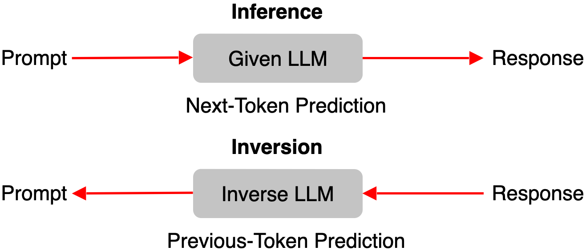
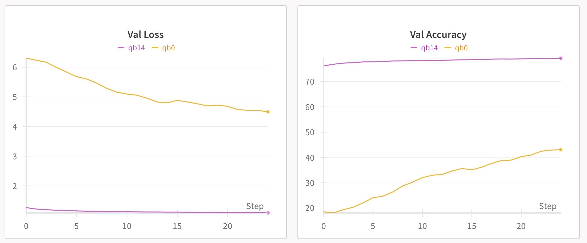
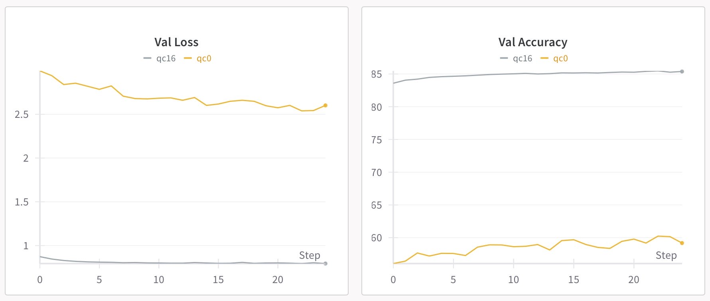
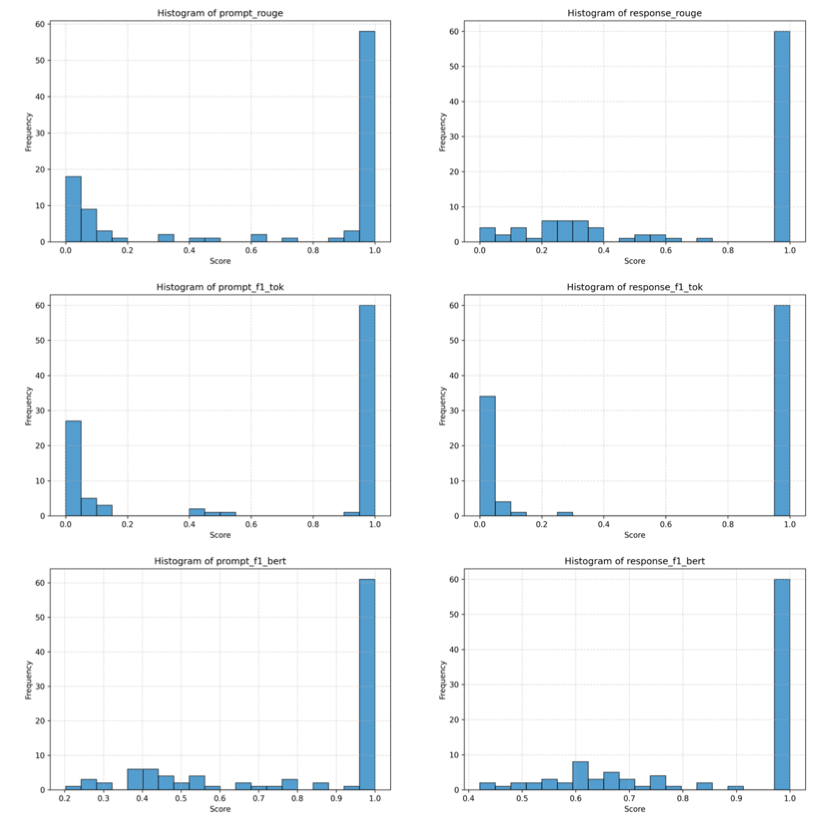
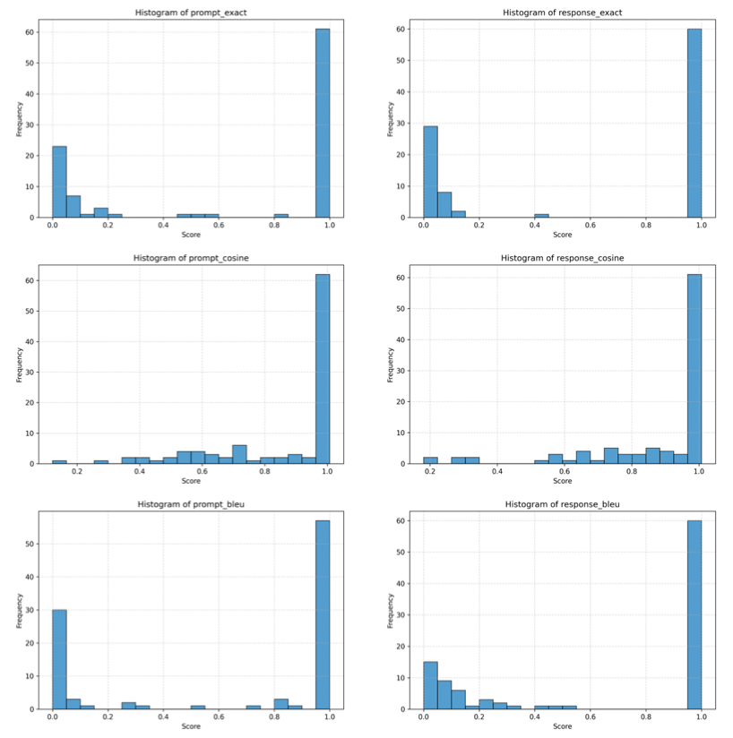

# PTP：反向预测前一 Token，近乎还原提示词

只看到一个 LLM 的回答，能否在黑盒条件下反推出用户最初的提示词？这不仅关系到模型行为分析，也关系到隐藏提示词泄露与不良响应溯源。PTP 的核心思路很直接：把目标模型生成的文本按 Token 倒序，从头训练一个“反向语言模型”，让它根据未来上下文预测前一个 Token。在 Qwen3-0.6B Chat 的 ShareGPT 100 条测试样本上，PTP 的提示词 Exact Match 达到 **64.77**，重构响应的 Exact Match 达到 **61.79**；相比之下，最强 O2P 配置对应数值仅为 25.44 和 24.17。

## 问题不是“猜原话”，而是寻找等价输入

LLM 通常通过 Next-Token Prediction（NTP，下一 Token 预测）从左向右生成文本。给定提示词 $x$，目标模型 $f$ 产生响应 $y$；反演则只观察 $y$，寻找提示词 $\hat{x}$，使得：

$$
f(\hat{x}) \approx y
$$

这里有一个关键区别：**恢复原始提示词**与**恢复模型行为**并不完全等价。不同提示词可能触发相似回答，因此从响应到提示词并非简单的一对一映射。只追求语义相近，可能得到一个“看起来像问题”的句子，却无法恢复原提示词的 Token 细节；只追求逐字一致，又会忽略其他同样能触发目标响应的有效提示词。

PTP 把目标定义为寻找响应 $y$ 在模型 $f$ 下的原像集合：

$$
\mathcal{X}_y =
\left\{
x \in \mathcal{V}^*
\;\middle|\;
\mathcal{S}\!\left(P_f(\cdot \mid x), y\right)
\leq \varepsilon
\right\}
$$

其中，$\mathcal{V}^*$ 表示有限词表上的所有有限长度 Token 序列，$\mathcal{S}$ 是 Token 重叠或语义相似度等任务相关度量，$\varepsilon$ 是等价容差。也就是说，重构提示词既可以尽量接近原输入，也可以是与原输入不同、但能引发相似模型行为的替代输入。

> 图解：上方正向过程按照 NTP，从左向右预测下一 Token；下方逆向过程将序列反转，按照 PTP 根据右侧的未来上下文预测前一 Token。两者使用同一种自回归建模机制，只是生成方向相反，由此建立从响应回到提示词的生成式联系。

### 与已有反演方法差在哪里

早期网络反演主要用于恢复能产生目标输出的输入模式，也延伸到了模型反演攻击、生成式反演和基于 SAT 的确定性求解。落到 LLM 上，已有路线分别利用 Embedding、Logits、隐藏状态或纯文本输出：

- **L2T（Logit-to-Text）**：根据完整下一 Token 分布恢复提示词，但需要大量 Logits 查询和外部训练数据。
- **PILS**：聚合生成步骤中的 Logprob 序列，仍依赖预测分布。
- **SipIt**：利用 Transformer 隐藏表示的注入性恢复原输入，需要内部激活。
- **RPE**：把黑盒反演看作搜索问题，通过强 LLM 反复优化候选提示词。
- **O2P（Output-to-Prompt）**：只用文本输出，但依赖预训练 Sequence-to-Sequence 模型及辅助数据，同一提示词通常需要约 64 个输出。

| 维度 | L2T | O2P | PTP |
|---|---|---|---|
| 所需访问权限 | 完整 Logits | 文本输出 | 文本输出 |
| 训练数据 | Instructions-2M（233 万条） | Instructions-2M（3 万条提示词） | 无外部数据／自行合成 |
| 每个提示词所需响应数 | 词表大小 × 目标精度所需比特数 | 约 64 个 | 仅 1 个 |
| 可重构提示词数量 | 1 个 | 1 个 | 多个 |
| 迁移性 | 跨 LLaMA-2 尺寸较差 | 在 GPT-3.5/4、Mistral、Gemma 上中等 Zero-Shot | 对 GPT-4o 进行 Zero-Shot 迁移 |

PTP 的差异化不在于换一个更大的 Backbone，而在于**不用现成模型里的语言先验充当反演能力**。它从目标 LLM 自身采样训练材料，从零学习逆向映射；推理时只需一个响应，还能通过随机采样得到多个功能相近的提示词。

## 方法：把正向生成过程完整倒过来

整个流程可以概括为五步：词表级探测、Token 反转、逆向预训练、轻量微调、反向解码。接下来逐步看每一步为什么必要。

### 1. 用单 Token 探测目标模型

黑盒条件下拿不到权重、梯度和内部表示，作者因此把目标 LLM 当作一个只能通过文本查询的函数。对词表 $\mathcal{V}$ 中每个 Token $v$，都把它作为序列开头，让目标模型继续随机生成固定长度 $L$ 的文本：

$$
y^{(v)} = (v, y^{(v)}_2, \dots, y^{(v)}_L)
$$

后续 Token 按目标模型的条件分布采样：

$$
y^{(v)}_t \sim P_f(\cdot \mid y^{(v)}_{<t}),
\quad t = 2, \dots, L
$$

所有序列组成合成语料 $\mathcal{D}_{\text{probe}}=\{y^{(v)}\mid v\in\mathcal{V}\}$。生成时使用 temperature、top-$k$ 和 top-$p$，并在训练过程中实时重新采样；同一个种子 Token 在不同 Epoch 会得到不同后续文本。

这一设计的聪明之处在于，它不要求单 Token 序列像真实提示词。探测的目的不是复制自然问题分布，而是尽可能覆盖目标模型在整个词表上的 Token 转移规律。如果使用更复杂的种子组合，反而会引入关于提示词顺序和结构的外部假设。

### 2. 先 Tokenize，再反转序列

假设正向模型生成了：

$$
y^{(i)} = (y^{(i)}_1, \dots, y^{(i)}_L)
$$

将其按 Token 反转：

$$
\tilde{y}^{(i)} = \operatorname{Reverse}(y^{(i)})
= (y^{(i)}_L, y^{(i)}_{L-1}, \dots, y^{(i)}_1)
$$

反转之后，标准从左向右自回归训练就自然变成了“根据未来上下文预测过去”。必须强调，**反转发生在 Tokenize 之后，而不是直接倒排字符或单词**。同一文本若先倒排再 Tokenize，可能得到另一套 Token，破坏原序列的 Token 清单。

论文给出的直观例子是：

- 合成文本：`Additionally, what are the health benefits of consuming chocolate, and how does it affect the body?`
- 为便于展示而按词倒排：`? body the affect it does how and, chocolate consuming of benefits health the are what, Additionally`

实际训练使用的是 Token 级反转，而非示例中的词级倒排。

### 3. 从零训练逆向语言模型

逆向模型 $f_{\text{inv}}$ 在反转序列上仍使用标准自回归 Negative Log-Likelihood：

$$
\mathcal{L}_{\text{NLL}}(\theta_{\text{inv}})
= - \sum_{t=2}^{L} \log P_{f_{\text{inv}}}
(\tilde{y}_t \mid \tilde{y}_{1:t-1}; \theta_{\text{inv}})
$$

正向模型学习 $P(y_t\mid y_{<t})$，逆向模型则学习 $P(y_{t-1}\mid y_{\geq t})$。由于合成序列长度 $L$ 小于模型最大上下文窗口 $C$，训练可以在每个位置使用完整序列，提供密集的 Token 级监督。

这也意味着 PTP 无需发明特殊训练器：普通 Decoder-only 架构和标准 NTP 训练代码就能使用，真正改变的是**数据方向及其来源**。

### 4. 用少量真实提示词校准表达格式

合成预训练学会了逆向结构，但生成结果未必符合自然提示词的格式。作者因此从下游数据集中选取少量提示词 $x$，让冻结的目标模型生成响应 $y$，拼接后整体反转：

$$
\tilde{s} = \operatorname{Reverse}(x, y)
= (y_T, \dots, y_1, x_n, \dots, x_1)
$$

随后继续使用相同 NLL 目标微调。这里外部数据只提供提示词，所有响应仍由目标 LLM 生成，不引入外部答案。预训练使用 Adam，学习率为 $10^{-3}$；微调学习率为 $5\times10^{-4}$。

### 5. 从响应反向解码，再交给正向模型闭环验证

推理时，先把观察到的响应 Token 序列反转为 $\tilde{y}$，再自回归生成反向提示词：

$$
\tilde{x}_t \sim P_{f_{\text{inv}}}
(\cdot \mid \tilde{y}, \tilde{x}_{<t})
$$

可使用 Greedy Decoding 追求稳定恢复，也可调节 temperature、top-$k$、top-$p$ 采样多个候选。最后再次反转得到 $\hat{x}=\operatorname{Reverse}(\tilde{x})$，并将它重新输入目标模型，检查生成响应是否与原响应一致或语义相近。

因此，PTP 不只是做“响应到文本”的一次映射，而是形成完整闭环：**响应 → 提示词 → 再生成响应**。后一步能直接检验重构提示词是否保留目标模型的行为。

## 实验怎样设置，指标又分别说明什么

实验覆盖 Qwen3-0.6B 的 Base 与 Chat 版本、LLaMA-2 7B Chat，并用 GPT-4o 检查跨模型迁移。虽然部分模型是开源的，实验仍严格限制为文本输入输出查询，不读取权重、Logits 或内部表示。

合成序列长度比较了 64、128 和 256 Token，主结果采用 256。采样参数为 top-$k=5$、top-$p=0.95$、temperature $=0.9$。逆向模型采用 Qwen3-0.6B，从零初始化；一个 Epoch 指遍历词表中所有 Token 对应的序列。ShareGPT 实验选取 500 条约 25–30 Token 的提示词，其中 400 条用于微调，100 条用于测试。

六类指标分别捕捉不同层面：

- **Exact Match（EM）**：重构结果是否与参考答案在 Token 级完全一致，最严格。
- **Token F1**：根据 Token 重叠计算 Precision、Recall 和 F1，比 EM 更宽松。
- **BLEU**：侧重 $n$-gram Precision，对措辞和词序敏感。
- **ROUGE-L**：依据最长公共子序列，捕捉部分重叠与流畅性。
- **Cosine Similarity（CS）**：比较句子 Embedding，允许改写和同义表达。
- **BERT F1**：对齐上下文化 Embedding，衡量更细致的语义一致性。

后文表格均沿用论文的数值口径，$\pm$ 后为论文报告的波动值。

## 结果一：Chat 模型反而更容易被反演

| 目标模型 | Exact | BLEU | ROUGE-L | CS | BERT F1 | Token F1 |
|---|---:|---:|---:|---:|---:|---:|
| Qwen-Base | 35.14 ± 4.4 | 40.58 ± 4.1 | 52.73 ± 3.6 | 74.39 ± 2.2 | 70.49 ± 2.3 | 33.11 ± 4.3 |
| Qwen-Chat | **64.77 ± 4.54** | **63.08 ± 4.60** | **66.96 ± 4.33** | **86.13 ± 2.11** | **80.66 ± 2.7** | **63.64 ± 4.61** |

Qwen Chat 在全部六项指标上都显著高于 Base，尤其是 EM 从 35.14 提升到 64.77，Token F1 从 33.11 提升到 63.64。至少在本文设置中，指令微调和 Alignment 没有让提示词更难恢复，反而使响应保留了更可逆的结构。

## 结果二：语义可以跨模型，精确 Token 恢复仍受词表约束

作者固定使用 Qwen 逆向模型，分别反演 Qwen3-0.6B Chat 与 LLaMA-2 7B Chat 的响应，以隔离架构和 Tokenizer 不一致的影响。

| 目标模型 | Exact | BLEU | ROUGE-L | CS | BERT F1 | Token F1 |
|---|---:|---:|---:|---:|---:|---:|
| Qwen | **64.77 ± 4.54** | **63.08 ± 4.60** | **66.96 ± 4.33** | **86.13 ± 2.11** | **80.66 ± 2.7** | **63.64 ± 4.61** |
| Llama | 17 ± 2.4 | 17 ± 2.7 | 33 ± 2.8 | 84 ± 1.0 | 60 ± 2.0 | 12 ± 1.9 |

换成 LLaMA 后，EM 和 Token F1 大幅下降，但 CS 仍有 84。这说明跨架构时，模型常能恢复语义方向，却难以精确复现原来的 Token 序列。

更严格的迁移测试是：用 Qwen3-0.6B Chat 上训练的逆向模型，直接处理 GPT-4o 的响应，再将重构提示词交还 GPT-4o 生成新响应。

| 重构对象 | Exact | BLEU | ROUGE-L | CS | BERT F1 | Token F1 |
|---|---:|---:|---:|---:|---:|---:|
| Prompt | 11.36 ± 2.79 | 6.56 ± 1.36 | 15.65 ± 1.89 | **63.01 ± 1.71** | **82.26 ± 0.06** | 10.20 ± 2.77 |
| Response | 1.71 ± 0.43 | 5.02 ± 0.8 | 18.56 ± 1.1 | **81.57 ± 1.2** | **84.53 ± 0.38** | 0.65 ± 0.4 |

精确指标明显受损，但响应级 CS 和 BERT F1 分别达到 81.57 和 84.53。换言之，跨模型迁移的主要价值是**找到能引发相似行为的替代提示词**，而不是保证恢复原提示词。

跨数据集结果也呈现同样趋势。逆向模型在 Instructions-2M 的 3 万条样本上微调，再直接测试 ShareGPT：

| 重构对象 | Exact | BLEU | ROUGE-L | CS | BERT F1 | Token F1 |
|---|---:|---:|---:|---:|---:|---:|
| Prompt | 11.03 ± 2.19 | 25.80 ± 2.59 | 51.84 ± 2.76 | 73.11 ± 2.05 | 91.34 ± 0.57 | 9.13 ± 1.99 |
| Response | 4.44 ± 0.84 | 13.25 ± 1.42 | 23.82 ± 1.45 | 82.61 ± 1.78 | 85.14 ± 0.44 | 3.44 ± 0.81 |

Token 级恢复较弱，语义指标却保持较高，说明逆向模型学习到了一部分可跨数据分布迁移的响应—提示词语义映射。

## 结果三：与 O2P、RPE 的正面对比

为保证比较口径一致，所有方法都反演 Qwen3-0.6B Chat，并使用同一组 ShareGPT 100 条测试样本。基线配置如下：

1. **PTP**：从零进行合成预训练，再用 400 条 ShareGPT 提示词微调，只做单次重构。
2. **O2P-1**：T5 先用 Instructions-2M 3 万条样本训练，再用 400 条 ShareGPT 样本微调。
3. **O2P-2**：预训练 T5 只在 Instructions-2M 3 万条样本上微调。
4. **O2P-3**：预训练 T5 只使用 400 条 ShareGPT 样本。
5. **RPEGA**：RPE 最强的迭代进化优化版本，在同一测试集上评估。

### 提示词重构

| 方法 | Exact | BLEU | ROUGE-L | CS | BERT F1 | Token F1 |
|---|---:|---:|---:|---:|---:|---:|
| PTP | **64.77 ± 4.54** | **63.08 ± 4.60** | 66.96 ± 4.33 | 86.13 ± 2.11 | 80.66 ± 2.70 | **63.64 ± 4.61** |
| O2P-1 | 25.44 ± 3.00 | 40.59 ± 2.61 | **69.92 ± 1.81** | **89.36 ± 0.76** | **84.09 ± 1.00** | 21.00 ± 2.72 |
| O2P-2 | 19.66 ± 2.49 | 34.28 ± 2.33 | 64.25 ± 1.87 | 87.70 ± 0.74 | 80.83 ± 1.01 | 15.48 ± 2.27 |
| O2P-3 | 19.86 ± 2.57 | 33.45 ± 2.56 | 64.90 ± 2.02 | 86.97 ± 0.84 | 80.91 ± 1.10 | 16.05 ± 2.35 |
| RPEGA | 0.64 ± 1.74 | 2.35 ± 1.87 | 11.90 ± 4.32 | 65.29 ± 8.57 | 50.97 ± 4.07 | 0.26 ± 0.73 |

PTP 的优势集中在严格 Token 指标：EM、BLEU、Token F1 都明显高于 O2P。O2P-1 则在 ROUGE-L、CS 和 BERT F1 上更高，因此不能把结果概括成“PTP 全面领先”；更准确的结论是，**PTP 更擅长精确恢复，O2P 更容易得到语义合理的改写**。

O2P-3 到 O2P-1 的提升还显示了外部数据与预训练先验对 O2P 的帮助。RPEGA 虽经过迭代搜索，但在精确提示词恢复上仍很弱，说明仅提示一个强 LLM 做优化，并不能替代显式逆向模型。

### 响应闭环重构

| 方法 | Exact | BLEU | ROUGE-L | CS | BERT F1 | Token F1 |
|---|---:|---:|---:|---:|---:|---:|
| PTP | **61.79 ± 4.60** | **64.87 ± 4.30** | **71.43 ± 3.60** | 88.08 ± 1.90 | **85.48 ± 1.90** | **61.07 ± 4.70** |
| O2P-1 | 24.17 ± 2.96 | 33.57 ± 2.73 | 64.20 ± 2.00 | 86.16 ± 1.02 | 80.19 ± 1.24 | 19.28 ± 2.74 |
| O2P-2 | 17.70 ± 2.38 | 27.85 ± 2.45 | 57.19 ± 2.11 | 83.77 ± 1.22 | 76.49 ± 1.27 | 13.09 ± 2.05 |
| O2P-3 | 17.15 ± 2.43 | 24.83 ± 2.69 | 46.97 ± 3.01 | 70.57 ± 2.69 | 67.66 ± 2.08 | 12.86 ± 2.15 |
| RPEGA | 3.34 ± 8.44 | 14.39 ± 9.01 | 34.39 ± 11.08 | **88.81 ± 9.40** | 73.68 ± 5.55 | 1.52 ± 4.43 |

把重构提示词重新输入目标模型后，PTP 在除 CS 外的五项指标上取得最高值，响应 EM 达到 61.79。RPEGA 的 CS 略高，但波动也更大，Token 级指标依旧很低。闭环结果支持 PTP 的核心主张：它恢复的不只是提示词语义，还保留了触发原模型行为所需的细粒度信息。

## 为什么有效：合成预训练与训练目标缺一不可

### Backbone 消融排除了“只是架构更合适”

主实验中 PTP 使用 Decoder-only Qwen，而 O2P 使用 Encoder-Decoder T5。为排除 Backbone 混淆，作者把 O2P 换成同一 Qwen，也尝试让 PTP 使用预训练 T5。

| 方法 | Exact | BLEU | ROUGE-L | CS | Token F1 | BERT F1 |
|---|---:|---:|---:|---:|---:|---:|
| O2P-1（Qwen） | 12.39 ± 20.38 | 5.99 ± 3.65 | 21.46 ± 5.47 | 76.29 ± 13.62 | 9.31 ± 16.86 | 58.09 ± 5.56 |
| O2P-2（Qwen） | 4.06 ± 8.12 | 4.53 ± 3.30 | 20.19 ± 5.45 | 71.34 ± 10.25 | 2.48 ± 5.73 | 57.16 ± 7.01 |
| O2P-3（Qwen） | 16.10 ± 22.27 | 5.47 ± 3.51 | 20.84 ± 5.10 | 80.33 ± 9.77 | 12.24 ± 19.03 | 59.47 ± 5.52 |
| PTP（T5） | 2.82 ± 7.73 | 2.69 ± 8.54 | 12.58 ± 11.60 | 47.69 ± 12.94 | 1.58 ± 6.04 | 47.05 ± 8.86 |
| PTP（Qwen） | **64.77 ± 4.54** | **63.08 ± 4.60** | **66.96 ± 4.33** | **86.13 ± 2.11** | **63.64 ± 4.61** | **80.66 ± 2.70** |

> 上表为提示词重构。即使 O2P 使用相同 Qwen Backbone，Token 指标仍远低于 PTP；PTP 换成 T5 后也严重退化。

| 方法 | Exact | BLEU | ROUGE-L | CS | Token F1 | BERT F1 |
|---|---:|---:|---:|---:|---:|---:|
| O2P-1（Qwen） | 1.26 ± 1.67 | 3.00 ± 7.27 | 15.68 ± 12.54 | 67.67 ± 18.52 | 0.32 ± 0.47 | 49.52 ± 10.94 |
| O2P-2（Qwen） | 1.33 ± 1.28 | 4.67 ± 8.11 | 20.11 ± 11.62 | 71.06 ± 19.15 | 0.33 ± 0.37 | 52.79 ± 10.56 |
| O2P-3（Qwen） | 1.21 ± 1.23 | 2.98 ± 4.76 | 19.30 ± 10.47 | 73.58 ± 11.59 | 0.39 ± 0.52 | 52.81 ± 8.54 |
| PTP（T5） | 1.90 ± 1.24 | 1.90 ± 4.49 | 15.86 ± 9.03 | 59.27 ± 21.26 | 0.69 ± 1.80 | 51.36 ± 9.59 |
| PTP（Qwen） | **61.79 ± 4.60** | **64.87 ± 4.30** | **71.43 ± 3.60** | **88.08 ± 1.90** | **61.07 ± 4.70** | **85.48 ± 1.90** |

> 上表为响应重构，趋势与提示词重构一致。结果说明 PTP 的收益并非来自模型容量或 Backbone 本身，而来自反向训练目标与合成预训练的组合。

T5 退化也符合其预训练方向先验：让已习惯从左向右生成的模型突然生成反转序列，会与原有 Decoder 先验冲突。相对而言，从零训练的 Qwen 可以直接适应 PTP 所定义的反向自回归过程。

### 只有 400 条真实提示词，学不出可靠逆映射

作者比较了“合成预训练后再微调”和“只用同样 400 条 ShareGPT 提示词训练”两种方案。

> 图解：黄色表示不使用合成预训练、只用 ShareGPT 训练；紫色表示先进行合成预训练再微调。只用少量真实提示词时验证 Loss 高、准确率低，合成预训练则带来稳定收敛和明显更高的验证准确率。

> 图解：黄色表示仅 ShareGPT 训练，灰色表示合成预训练后微调。Chat 模型上呈现与 Base 一致的规律：核心逆向能力在合成预训练阶段形成，后续微调主要带来增量式格式与语义校准。

因此，论文所说的“data-free”只针对**合成预训练阶段**，完整系统仍使用 400 条真实提示词做轻量微调。这不是矛盾，但需要明确边界：外部提示词不是逆向能力的主要来源，却仍是最终流程的一部分。

训练观察还显示，256 Token 的长序列优于更短序列，实时重采样优于预先生成固定语料。前者提供更完整的反向条件结构，后者通过随机解码减少模型对固定续写的记忆。框架理论上可扩展到目标模型 4096 Token 的最大上下文长度。

## 分布与案例：提示词可以不同，响应仍然相似

平均分只能说明整体表现，直方图进一步揭示了“功能等价”这一现象。

> 图解：图中并列展示提示词级和响应级的 ROUGE-L、Token F1、BERT F1 分布。提示词得分呈明显双峰：一部分接近完全恢复，另一部分落在低分区域；响应得分则更集中地靠近高值，说明非原始提示词也常能生成相似响应。

> 图解：每项指标左侧为提示词重构分布，右侧为响应重构分布。提示词级分布更分散，响应级分布更集中，尤其在 CS 和 BERT F1 等语义指标上更明显，体现多个提示词映射到相似响应的“多对一”特性。

定性案例更直观。原始提示词是：

> How to reach out to competitors to find their pricing strategies?

逆向模型多次采样后，第 3 个候选完全恢复了这句话，其他候选则转而询问竞争对手定价的强弱项、市场调研需要了解的信息，或企业可采用的定价调研策略。这些表达并不都与原句一致，但保留了定价策略与竞争分析的意图。

在 ShareGPT 未见样本上，Qwen Base 从一段期权到期效应的回答中恢复出“解释到期效应的根本原因及如何利用它交易”的提示词；原提示词还额外要求用代码制定简单策略。Qwen Chat 则几乎恢复了关于为 Semilac 品牌在 Pinterest 创建广告活动的原始问题，只在末尾增加了一句如何提升活动效果。

闭环案例也暴露了边界：面对“与竞争对手协调定价是否合适”的提示词，重构结果变成了一段包含供应商、新创企业和市场适配性的复合问题。虽然生成响应仍围绕定价、运营与市场竞争展开，但具体措辞和意图已经发生偏移。所谓功能等价是统计意义上的，不代表每个案例都语义无损。

跨 GPT-4o 的案例同样如此：原问题询问如何接触竞争对手以了解定价，重构问题转为定价趋势和提升市场份额。两者共享商业定价语境，却不再要求相同回答。这与定量结果一致——迁移更偏向语义与行为保持，而非精确还原。

## 实用性、假设与局限

### 查询成本并非可以忽略

Qwen3-0.6B 的词表约为 15 万个 Token。若每个 Token 生成一条长度为 256 的序列，一个预训练 Epoch 需要目标模型生成：

$$
|\mathcal{V}|\times L
\approx 150{,}000\times256
\approx 38\text{M Tokens}
$$

论文报告单张 A100 生成一个 Epoch 约需 1 小时。序列短且彼此独立，便于跨 GPU 并行和批处理，但实时生成意味着查询预算会随 Epoch 线性增长。对真正的商业闭源 API，这笔成本与调用限制仍需单独评估。

### “黑盒”需要区分两种重构目标

- **Token 级精确恢复**需要访问目标 Tokenizer，保证正向与逆向 Tokenization 一致。
- **语义恢复**不必使用目标 Tokenizer，可让逆向模型独立使用自己的 Tokenizer 和词表。

因此，严格精确实验更准确地说带有 Tokenizer 可访问的半黑盒假设；仅使用文本输出并不意味着精确恢复也完全摆脱词表依赖。

### 当前边界

- 跨架构、跨 Tokenizer 时，EM 和 Token F1 会显著下降，不能把同模型结果外推到所有 LLM。
- 完整流程仍需要少量真实提示词微调，并非端到端完全无外部数据。
- 全词表探测有可观的生成预算，更大词表和更长上下文会进一步增加成本。
- PTP 当前只做单次重构；加入迭代优化可能提高质量，但会改变计算成本，不能与现有结果直接混为一谈。
- 多候选提示词适合分析响应等价类，也可能扩大隐藏系统提示词与敏感输入的暴露面，需要相应防护。

## 总结

- **核心机制**：将目标 LLM 生成的序列按 Token 反转，用标准自回归训练实现 Previous-Token Prediction，从零学习逆向生成模型。
- **数据策略**：通过全词表单 Token 探测和实时随机采样构造合成语料，再用 400 条真实提示词做轻量格式与语义校准。
- **最强结果**：在 Qwen3-0.6B Chat 的 ShareGPT 测试上，提示词与响应 EM 分别达到 64.77 和 61.79，Token 级指标显著优于 O2P 与 RPE。
- **功能反演**：随机采样可产生多个候选提示词；即使原提示词未被逐字恢复，闭环响应仍常保持较高语义相似度。
- **适用边界**：跨模型和跨数据集主要保留语义迁移，精确恢复仍依赖 Tokenizer、词表和架构匹配，并需要可观的合成查询预算。

未来更值得推进的是降低全词表探测成本、延长反向上下文，并在不改变成本口径的前提下加入闭环迭代，让精确恢复与跨模型语义迁移同时受益。

> 本文参考自 [PTP: Previous-Token Prediction based LLM Inversion for Near-Exact Prompt Reconstruction](https://arxiv.org/abs/2607.29378)