# ATAS：给视频生成 Agent 装上“世界状态”记忆，随时回到任何地点、重放任何事件

长视频生成正在从“一次生成几秒”走向“Agent 按剧本分镜拍摄”，但现有 Agent 大多只靠最近几帧、文本摘要或参考图来维持连贯性——一旦剧情要求“回到之前那个房间”或者“换个机位重放刚才的事件”，画面就会穿帮。这篇来自浙江大学 ZIP Lab、Monash、UC Berkeley 和 Adelaide 大学的技术报告提出了 **ATAS（Any Time, Any Space）**，一个以“持久世界状态”为中心的 Agentic 视频生成框架：它把剧本编译成带显式场景坐标、相机和时间索引的镜头请求，并用“场景记忆 + 事件记忆”双记忆系统为后续镜头提供可查询的证据。最硬的结果有两个：在 4 个视频生成 backbone 上，ATAS 拿下了 **所有跨镜头一致性指标的第一** 和每个 backbone 块的 **最高总分**（Wan 3.0 上平均分 0.734 vs 最强 baseline 0.648）；在空间回访任务上 PSNR 达到 15.968，超过所有多镜头 Agent 和 3D 引导方法。

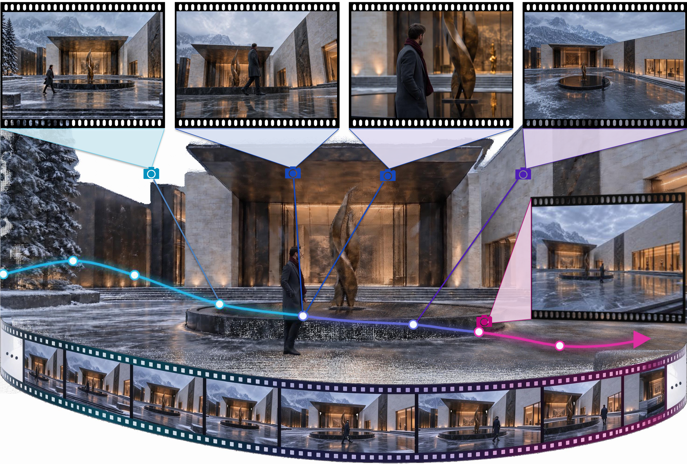

> 图解：ATAS 的核心思想——把一部多镜头影片看作一个空间和时间信息都可以复用的序列。共享的场景几何（Shared scene geometry）锚定了“回到同一地点”时的一致性视角；按时间索引的事件证据（Time-indexed event evidence）则支持从新相机“重放”发生过的事件。生成的镜头构成观众看到的影片（film），而沉淀下来的场景与事件信息反过来指导后续的生成请求。

## 一、问题：长视频 Agent 缺的从来不是“生成质量”，而是“世界记忆”

先厘清什么是 Agentic 视频生成：输入一段剧本（screenplay），由 Agent 负责分镜规划、参考素材选择和视频合成，产出一串镜头序列。故事会跨地点、跨时间、跨视角展开，连贯性取决于 **能否保留前面镜头建立的空间和时间关系**。

举个典型例子：故事先在客厅拍了一段，切到厨房，后来又回到客厅，或者要求“从对面机位重放刚才客厅里发生的事件”。回访镜头必须保住客厅的布局；重放镜头则要在新机位下复现同一个事件的动作和时间进程。

现有系统的连续性手段——最近帧、文本摘要、检索参考图——对 **局部连续镜头** 有效，但它们既没把历史观测组织进一个共享的时空坐标系，也无法应答“回到早前场景 / 重放早前事件”这种 **非局部请求**。

于是一个自然的想法是维护一个持久世界状态（persistent world state），但这带来两个挑战：

- **可寻址性**：历史观测必须在空间和时间两个维度上都能被精确检索到；
- **可靠性**：状态不能盲目吸收生成内容——生成视频的视觉、几何、时间错误一旦写进记忆，就会污染后续所有镜头。

ATAS 的解题思路正是围绕这两点展开：**解析请求 → 检索证据 → 生成 → 验证后才写入状态** 的闭环。

## 二、方法：世界状态为中心的生成闭环

### 2.1 核心概念与整体流程

先建立术语体系。**源观测** $o^{\mathrm{src}}$ 是开启一个场景的输入帧或片段，对它做配准（registration）就建立了该场景的坐标系。**场景记忆** $\mathcal{S}_t$ 存该坐标系下被接受的静态几何；**事件记忆** $\mathcal{E}_t$ 存被接受的动态观测及其场景、事件、时间信息。**世界状态** 就是这一对记忆在第 $t$ 步的快照：

$$
\mathcal{W}_t=(\mathcal{S}_t,\mathcal{E}_t)
$$

输入不是逐条写好的视频 prompt，而是一段高层剧本 $u$。每一步的流转是：

$$
(u,\mathcal{W}_t) \xrightarrow{\mathrm{Compile}} q_t
\xrightarrow{\mathrm{Query}} C_t
\xrightarrow{G} V_t
\xrightarrow{\mathrm{Reconstruct/Register/Validate}}
(V_t,\mathcal{W}_{t+1})
$$

编译器产出有界镜头请求 $q_t$，记忆查询产出条件上下文 $C_t$，生成器产出片段 $V_t$；随后片段被转成候选观测，要么被接纳进下一状态，要么只作为影片保留而不更新状态。

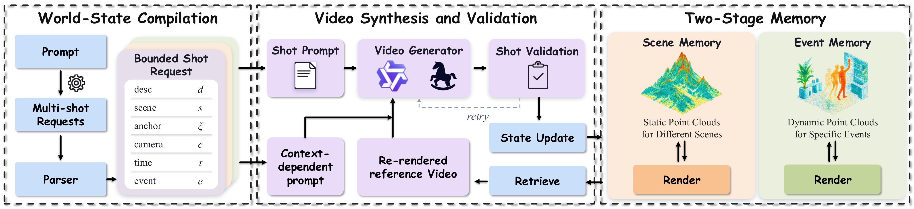

> 图解：ATAS 完整工作流。高层剧本被解析为多镜头请求和有界镜头请求，每个请求携带描述、场景、空间锚点、相机、时间区间和可选事件字段。场景记忆为请求的场景提供静态点云参考，事件记忆为请求的事件提供动态参考，二者与镜头 prompt 一起条件化视频生成器。镜头验证（Shot validation）决定是重试候选，还是把通过的观测送进状态更新。值得注意的是：**生成的镜头是否进入最终影片，与它的观测是否写入持久状态，是两个独立的决定**。

博主点评：这个“入片”和“入记忆”分离的设计是整个框架最聪明的地方。它承认了一个事实——一个镜头可以“够好看、能交付”，但几何上不够可靠、不配成为后续生成的证据。把质量标准一分为二，避免了“将错就错”的误差累积。

### 2.2 世界状态编译：把剧本拆成“拍得动”的镜头

短视频生成模型有预算限制（一次只能生成几秒），所以编译器在生成前递归地按场景切换、时空关系、事件引用和相机要求拆分剧本，直到每个请求都装得进生成预算。一个可渲染请求写作：

$$
q_{t,k}=(d_{t,k},s_{t,k},\xi_{t,k},c_{t,k},\tau_{t,k},e_{t,k})
$$

其中 $d_{t,k}$ 是局部镜头描述，$s_{t,k}$ 标识场景，$\xi_{t,k}$ 是请求在场景坐标系中的空间锚点，$c_{t,k}$ 是目标相机，$\tau_{t,k}$ 是请求的时间区间，$e_{t,k}$ 是可选的事件标识符。对一个剧本段落，编译器产出请求调度：

$$
\mathcal{Q}_t=\operatorname{Compile}(u,\mathcal{W}_t)
=\{q_{t,1},\ldots,q_{t,K_t}\}
$$

请求按序处理，被验证的 $\mathcal{W}_{t+1}$ 会条件化下一个请求；被拒绝的观测留在影片里，但不构成状态证据。

### 2.3 双记忆系统：静态归场景，动态归事件

**场景记忆（Scene memory）**。源观测配准后建立场景坐标系并初始化 $\mathcal{S}_0$，后续被接受的观测剔除动态区域后，作为静态点云证据配准合并进去。当请求要“回到”某个空间时，系统在请求的空间锚点和相机下重新渲染这些坐标：

$$
C_t^{\mathrm{scene}}=\operatorname{Render}(\mathcal{S}_t,c_t)
$$

**事件记忆（Event memory）** 则把动态证据与静态几何分开存放，是一组记录：

$$
\mathcal{E}_t=\{\epsilon_i\}_{i=1}^{N_t},
\qquad
\epsilon_i=(s_i,e_i,b_i,\tau_i,\mathcal{D}_i)
$$

每条记录含场景标识 $s_i$、事件标识 $e_i$、源观测 $b_i$、源时间区间 $\tau_i$，以及配准过的帧级 RGB-D、mask 和动态点云证据 $\mathcal{D}_i$。请求若引用了事件 $e_t$ 和时间区间 $\tau_t$，就直接检索：

$$
C_t^{\mathrm{event}}=
\begin{cases}
\operatorname{Retrieve}(\mathcal{E}_t,s_t,e_t,\tau_t),& e_t\neq\varnothing,\\
\varnothing,&\text{otherwise.}
\end{cases}
$$

为什么要分开存？因为两类证据的持久性要求完全不同：静态几何配准一次就能在任意新相机下渲染；而动态证据必须绑定事件和时间区间——若混成一锅“未区分的历史”，一个视觉上相似的帧可能在错误的事件里被误检索出来。

### 2.4 生成与状态更新：三道闸门

镜头描述 $q_t$ 构成 shot prompt，场景与事件参考构成 context-dependent prompt：

$$
C_t=(C_t^{\mathrm{scene}},C_t^{\mathrm{event}}),
\qquad V_t=G(q_t,C_t)
$$

生成后的片段进入镜头验证，产生两个独立决定。影片审查（film review）通过则 $f_t=1$，片段可交付；通过后重建与配准产生候选观测：

$$
\widetilde{\mathcal{O}}_t=\operatorname{Reconstruct}(V_t),
\qquad
\mathcal{O}_t=\operatorname{Register}(\widetilde{\mathcal{O}}_t,\mathcal{S}_t)
$$

配准成功则 $r_t=1$。若影片审查失败，系统重试或拒绝候选；若配准失败，片段仍可作为影片交付，但不能更新状态。最后的状态更新检查要求来源（provenance）、场景范围、父状态版本均有效，通过则 $a_t=1$，提议的新状态为：

$$
\widehat{\mathcal{W}}_{t+1}=\operatorname{Update}(\mathcal{W}_t,\mathcal{O}_t)
$$

实际转移规则：

$$
\mathcal{W}_{t+1}=\begin{cases}
\widehat{\mathcal{W}}_{t+1},& f_t=r_t=a_t=1,\\
\mathcal{W}_t,&\text{otherwise.}
\end{cases}
$$

这套规则下，同一工作流支持两种“持久性查询”：**空间回访**（编译器给出旧场景标识和回访相机，渲染 $\mathcal{S}_t$ 并与目标图比较）和 **历史事件重捕**（请求携带旧事件标识和时间区间，从 $\mathcal{E}_t$ 检索记录，在新相机下重放事件）。

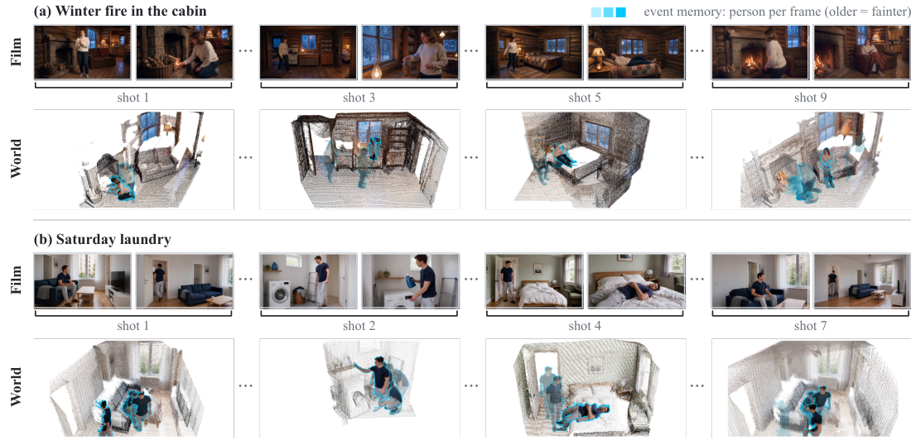

> 图解：两个故事序列的世界状态 rollout。左侧是影片帧，右侧是配准后的世界视图，展示被接受的观测如何在中间隔着其他镜头的情况下，持续扩展场景与事件状态——比如角色回到早前去过的地点时，回访画面仍保留当时的布局与物体状态。

## 三、实验：跨镜头一致性全面领先

### 3.1 实验设置

- **标准基准**：VBench（美学、主体/背景一致性、时序闪烁、运动平滑、动态程度）、ST-Bench（美学、全局/单镜头 prompt 遵循、跨镜头一致性 C-All 与 C-Top10）、ViStory-Self（故事内身份/外观/时序一致性）和 ViStory-Cross（跨镜头身份/外观/场景一致性）。每个 backbone 块内所有方法共享生成器、prompt 包、时长预算和聚合协议。
- **空间回访**：在共同可见 mask 下用 PSNR$_{\mathrm C}$、SSIM$_{\mathrm C}$、LPIPS$_{\mathrm C}$ 对比生成的回访图与目标图，对手包括多镜头 Agent 和 3D 引导视角合成方法（FlexWorld、ViewCrafter）。
- **事件重捕**：source-grounded VLM 裁判，输入源事件采样帧、事件描述与区间、请求相机和生成片段，从事件身份、动作状态、时序顺序、角色物体一致性、视角实现五个维度打分；不使用同步的目标视频。

### 3.2 主结果：四个 backbone 通吃

| Backbone | 方法 | VBench | ST-Bench | ViStory-Self | ViStory-Cross | 平均 |
|---|---|---|---|---|---|---|
| MiniMax-H3 | ReCA（最强 baseline） | 0.844 | 0.628 | 0.658 | 0.508 | 0.659 |
| MiniMax-H3 | **ATAS** | **0.860** | **0.691** | **0.710** | **0.547** | **0.702** |
| Wan 2.7 | ReCA | **0.854** | 0.568 | 0.598 | 0.428 | 0.612 |
| Wan 2.7 | **ATAS** | 0.846 | **0.625** | **0.666** | **0.486** | **0.656** |
| HappyHorse 1.0 | ReCA | 0.841 | 0.621 | 0.668 | 0.496 | 0.656 |
| HappyHorse 1.0 | **ATAS** | **0.862** | **0.668** | **0.706** | **0.540** | **0.694** |
| Wan 3.0 | ReCA | 0.848 | 0.602 | 0.661 | 0.481 | 0.648 |
| Wan 3.0 | **ATAS** | **0.877** | **0.719** | **0.756** | **0.584** | **0.734** |

> 注：对比方法还包括 I2V Extension、VGoT、Mora、MovieAgent，均弱于表中列出的 ReCA，故只保留最强 baseline 一行。每个 backbone 块内共享生成器与评测协议。

几个值得注意的观察：

- ATAS 在 MiniMax-H3、Wan 3.0、HappyHorse 上领先 **所有** 聚合指标；Wan 2.7 上 VBench 略逊 ReCA（0.846 vs 0.854），但 ST-Bench 和两项 ViStory 一致性全部反超。
- 提升集中在 **跨镜头一致性**（ST-Bench 的 C 系指标、ViStory-Cross）而非局部画质，说明收益来自持久多镜头状态，而非换了个更好的渲染器。这一点后面附录的 VBench 维度拆解会进一步佐证。

### 3.3 空间回访与事件重捕

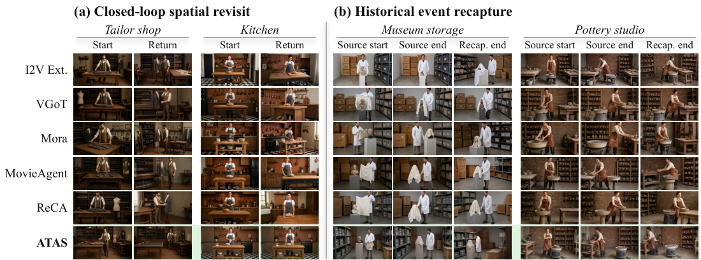

> 图解：上排是空间回访示例——给出目标图像做空间对比；下排是历史事件重捕——基于源事件证据、在请求相机下重放。可以看到 ATAS 的回访视角与事件重放在构图和实体状态上都更贴近参考。

**空间回访**（对目标图，共同可见 mask 下）：

| 方法 | PSNR$_{\mathrm C}$ $\uparrow$ | SSIM$_{\mathrm C}$ $\uparrow$ | LPIPS$_{\mathrm C}$ $\downarrow$ |
|---|---|---|---|
| MovieAgent（最强 Agent baseline） | 14.543 | 0.352 | 0.296 |
| ViewCrafter（最强 3D 引导） | 15.255 | 0.375 | 0.293 |
| **ATAS** | **15.968** | **0.385** | **0.284** |

**事件重捕**（VLM 裁判，五维评分）：

| 方法 | 事件身份 | 动作状态 | 时序顺序 | 角色物体 | 视角实现 |
|---|---|---|---|---|---|
| ReCA | 0.733 | **0.700** | 0.617 | **0.917** | 0.500 |
| **ATAS** | **0.750** | 0.688 | **0.688** | **0.917** | **0.650** |

ATAS 在事件身份、时序顺序、视角实现三项领先，角色物体与 ReCA 打平，仅动作状态略低（0.688 vs 0.700）。论文坦言：剩余难点是 **精确复现动作状态**，而不是检索事件或视角本身——这个瓶颈定位很诚实。

### 3.4 消融：每个组件都在干活

**组件消融**（Wan 3.0，组件逐层累加）：

| 配置 | ViStory 平均 $\uparrow$ | C-Top10 $\uparrow$ | LPIPS$_{\mathrm C}$ $\downarrow$ | 事件重捕分 $\uparrow$ |
|---|---|---|---|---|
| 仅镜头渲染 | 0.478 | 0.528 | 0.341 | 0.441 |
| + 场景与事件解析 | 0.612 | 0.568 | 0.334 | 0.508 |
| + 递归编译 | 0.638 | 0.684 | 0.288 | 0.711 |
| + 观测验证 | 0.651 | 0.702 | 0.286 | 0.726 |
| **+ 状态更新检查（完整 ATAS）** | **0.670** | **0.719** | **0.284** | **0.739** |

**记忆消融**（Wan 3.0，变化存储的证据类型）：

| 配置 | C-Top10 $\uparrow$ | LPIPS$_{\mathrm C}$ $\downarrow$ | 事件重捕分 $\uparrow$ |
|---|---|---|---|
| 无记忆 | 0.536 | 0.341 | 0.452 |
| 帧历史 | 0.598 | 0.319 | 0.548 |
| 静态场景 | 0.617 | 0.289 | 0.583 |
| 可更新场景 | 0.658 | 0.286 | 0.585 |
| 场景 + 事件 | 0.703 | 0.285 | 0.728 |
| **完整状态** | **0.719** | **0.284** | **0.739** |

两张表合起来讲的故事很清楚：**双记忆建立收益，递归编译放大收益**（事件分从 0.508 跳到 0.711 是组件表里最大的一跳）；而场景记忆和事件记忆改善的是 **不同形式** 的连续性——加静态场景主要降 LPIPS$_{\mathrm C}$（-0.030），加事件记忆主要拉事件分（0.585 → 0.728）。这也反向验证了“静态归场景、动态归事件”分工的必要性。

### 3.5 效率：重试更少，但总算力更贵

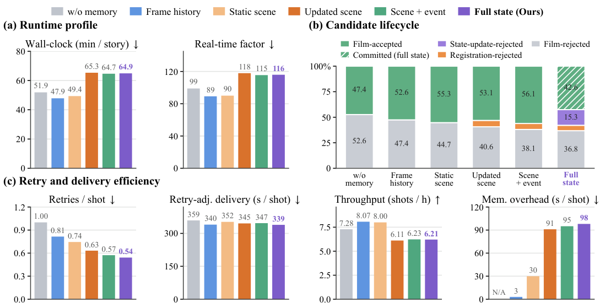

> 图解：六个记忆设置下的效率对比。(a) 每故事运行时间；(b) 候选生命周期（各状态占比）；(c) 重试与交付指标。

持久记忆带来的是“少返工”而非“少算力”：

- 每镜头重试次数从 1.00 降到 **0.54**，重试修正后的交付时间从 359s 降到 **339s**；
- 代价：每故事运行时间从 51.9 分钟升到 **64.9 分钟**，记忆开销约 98s/镜头，吞吐从 7.28 降到 6.21 镜头/小时；
- 影片审查拒绝率随记忆积累单调下降：无记忆时 52.6%，完整状态时 **36.8%**。

博主点评：这个 trade-off 很务实——在真实制作管线里，“重试率减半”往往比“单镜头快几秒”值钱得多，因为重试消耗的是生成 API 的整次调用。

### 3.6 人类评测：六项全胜

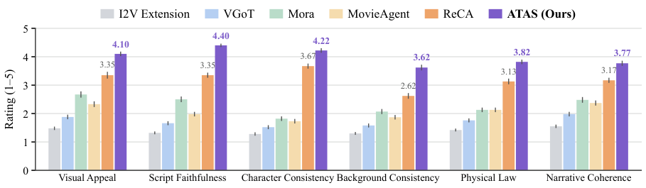

> 图解：六个方法在六项标准（视觉吸引力、剧本忠实度、角色一致性、背景一致性、物理规律、叙事连贯）上的平均评分与标准误。评分者观看匿名化的完整视频，按 1-5 分打分。

ATAS 在全部六项标准上拿到最高平均分：剧本忠实度 4.40、角色一致性 4.22、视觉吸引力 4.10，而背景一致性（3.62）和叙事连贯（3.77）相对偏低——**观众最容易感知的是镜头内容忠实和角色延续，而全场景一致性与整片叙事连贯仍是未完全解决的问题**。

## 四、附录深挖：评测协议、记忆机制与敏感性分析

由于是详细解读，这部分把附录里的关键信息也展开——它们对复现和理解 ATAS 的实际边界非常重要。

### 4.1 评测协议的细节：为什么说分数可信

**事件重捕评分器** 的设计值得一提：一个固定的 VLM 裁判 + 一个版本化的评分细则（rubric），对所有方法一视同仁。裁判拿到的是源事件采样帧、事件描述与区间、目标相机请求、可选的记忆渲染图和生成片段采样帧——**不给同步目标视频**，记忆渲染被视为“请求视角的条件”而非 ground truth。二值判断映射为 0/1，1-5 分的评级 $r$ 映射为 $(r-1)/4$；先在每个事件请求内对五轴求均值，再跨请求平均，避免长片段权重过大。五个轴刻意解耦：一个片段可以角色对但事件阶段错，也可以动作对但视角没实现——所以聚合分必须配合分轴值一起读。

**Backbone 本地画质拆解**（VBench 维度，均为 ATAS 列）：

| 维度 | Wan 2.7 | Wan 3.0 | MiniMax-H3 | HappyHorse |
|---|---|---|---|---|
| 美学质量 | 0.6387 | 0.6731 | **0.6945** | 0.6792 |
| 主体一致性 | 0.9481 | **0.9643** | 0.9576 | 0.9418 |
| 背景一致性 | 0.9554 | **0.9717** | 0.9680 | 0.9522 |
| 时序闪烁 | **0.9932** | 0.9863 | 0.9847 | 0.9884 |
| 运动平滑 | **0.9888** | 0.9766 | 0.9714 | 0.9795 |
| 动态程度 | 0.5488 | **0.6882** | 0.5842 | 0.6314 |

各 backbone 的本地强项本来就不同（Wan 3.0 强在一致性与动态程度，Wan 2.7 强在抗闪烁与平滑，MiniMax-H3 美学最高），说明主结果的优势 **无法归因于某个“全面更好”的渲染器**。

ST-Bench 与 ViStory 的分项也印证了同一模式：ATAS 最强的列是跨镜头一致性（尤其 C-Top10，Wan 3.0 达 0.7187，参考列仅 0.6015）；ViStory-Cross 中场景一致性是三个维度里最难的（各 backbone 均为最低分），因为它要求保住整个共享环境而不只是主体。

### 4.2 编译器追踪与记忆构建

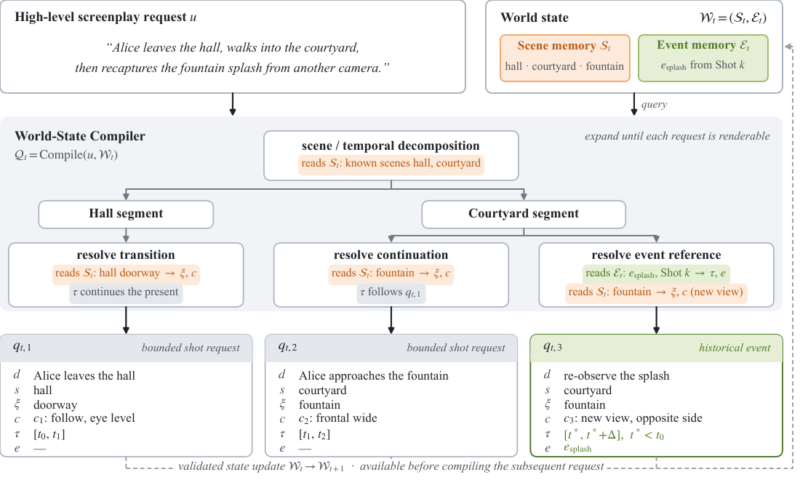

> 图解：递归剧本编译的一次完整 trace。高层请求被逐步解析为有界镜头请求，每个请求携带局部描述 + 场景、相机、时间、可选事件字段；编译器在内部请求展开期间不渲染视频，而是发出一个有界请求后 **等待其验证观测回来**，再决定后续请求能用哪些状态。换地点的请求建立新场景关系，回访旧地点的请求复用已有场景坐标。

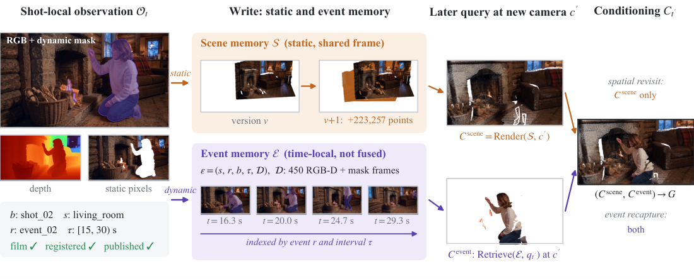

> 图解：场景与事件记忆的构建与查询。跟随一条被接受的镜头级观测：静态证据（剔除动态区域后）写入场景记忆，动态证据按事件索引进事件记忆；之后的相机请求同时查询两条路径获得条件参考。注意信息流方向——**重建与配准发生在生成之后**（产生候选观测），**渲染与事件检索发生在下一次生成之前**（产生条件参考）。

**记忆增长与查询成本**（rollout 检查点实测）：

| 检查点 | 场景规模（$\times 10^{6}$） | 事件记录 | 存储（GB） | 查询+更新时间（s） | 已处理镜头 |
|---|---|---|---|---|---|
| 初始状态 | 33.54 | 1.0 | 0.95 | 93.0 | 1.2 |
| 接受一次更新后 | 40.92 | 2.1 | 1.38 | 97.8 | 2.8 |
| rollout 结束 | 49.60 | 4.8 | 2.44 | 103.5 | 6.9 |

状态不是免费的（存储从 0.95 GB 涨到 2.44 GB），但 **成本增长慢于证据积累速度**：场景规模涨 48%，查询更新时间只涨 11%。

### 4.3 敏感性分析：记忆该怎么管？

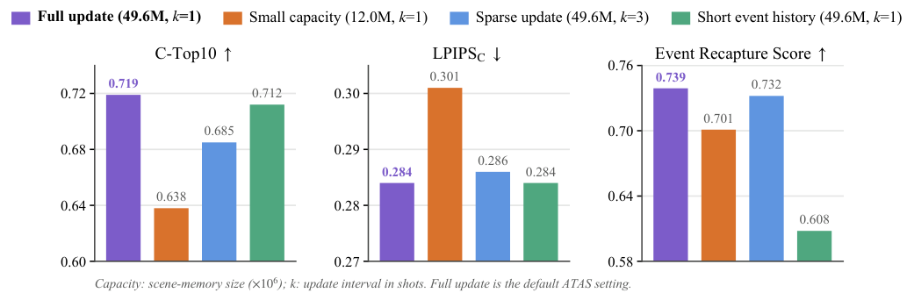

> 图解：记忆容量与更新频率敏感性。固定 prompt 包、相机请求、生成器、候选预算和重试策略，只动记忆配置。

| 配置 | 容量（$\times 10^{6}$） | 更新间隔 | C-Top10 | LPIPS$_{\mathrm C}$ | 事件分 |
|---|---|---|---|---|---|
| 完整更新 | 49.60 | 1 | **0.719** | **0.284** | **0.739** |
| 稀疏更新 | 49.60 | 3 | 0.685 | 0.286 | 0.732 |
| 小容量 | 12.00 | 1 | 0.638 | 0.301 | 0.701 |
| 短事件历史 | 49.60 | 1 | 0.712 | 0.284 | 0.608 |

结论很有针对性：**砍容量主要伤空间一致性，砍事件历史主要伤事件分**——又一次印证双记忆分工。而且更新频率与容量是两个独立旋钮：更频繁的更新补不了一个太小的场景库，大场景库也替代不了缺失的事件历史。

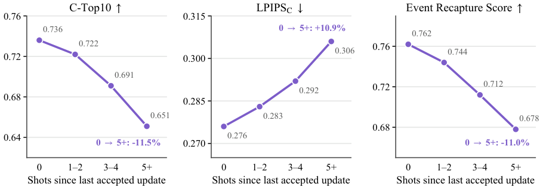

> 图解：记忆新鲜度测试——距上一次接受更新隔了越多镜头，质量如何衰减。

| 距上次更新的镜头数 | C-Top10 | LPIPS$_{\mathrm C}$ | 事件重捕分 |
|---|---|---|---|
| 0 | 0.736 | 0.276 | 0.762 |
| 1-2 | 0.722 | 0.283 | 0.744 |
| 3-4 | 0.691 | 0.292 | 0.712 |
| 5+ | 0.651 | 0.306 | 0.678 |

三项指标都 **渐进式劣化** 而非断崖式：陈旧状态是“慢慢失效”，不存在一个固定的有效期。

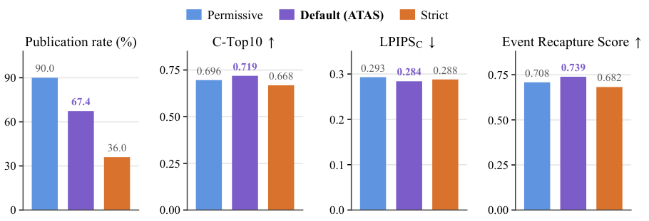

> 图解：状态更新检查的宽严权衡——准入越宽状态覆盖越高，但下游质量未必好。

| 更新设置 | 更新准入率 | C-Top10 | LPIPS$_{\mathrm C}$ | 事件分 |
|---|---|---|---|---|
| 宽松 | 90.0% | 0.696 | 0.293 | 0.708 |
| **默认** | 67.4% | **0.719** | **0.284** | **0.739** |
| 严格 | 36.0% | 0.668 | 0.288 | 0.682 |

宽进（90% 准入）会放进不可靠证据，严进（36%）又让后续请求无证据可用——**默认 67.4% 的准入率两头占优**。论文也诚实说明这不代表该阈值普适最优，而是证明“受控准入机制”本身有价值。

### 4.4 人类评测的更多细节

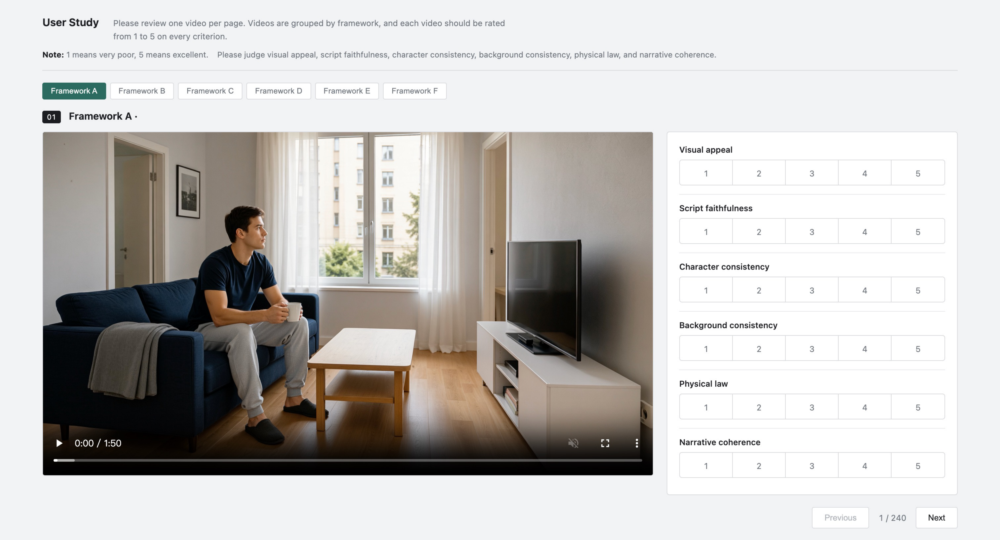

> 图解：人类评测界面。每页展示一个匿名长视频及其故事标题与梗概，评分者看完整片后按 1（很差）到 5（极好）对六项标准打分，方法身份隐藏，六项全部打完才能进入下一个视频。注意评分以整片为单位而非逐镜头，所以一致性指标反映的是完整影片。

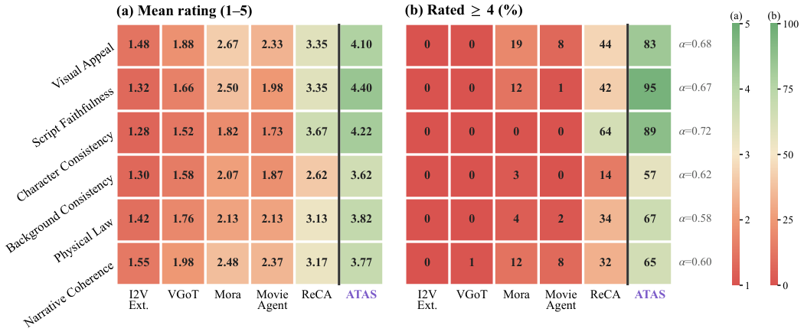

> 图解：人类评分的分布热力图——各方法在各标准上的平均分与“≥4 分占比”，侧栏是评分者间一致性。ATAS 六项平均分 3.62-4.40，≥4 分占比 57%-95%；最强 baseline ReCA 仅 2.62-3.67 和 14%-64%。评分者间一致性系数 0.58-0.72，说明结论不依赖某个评分不稳的单项。

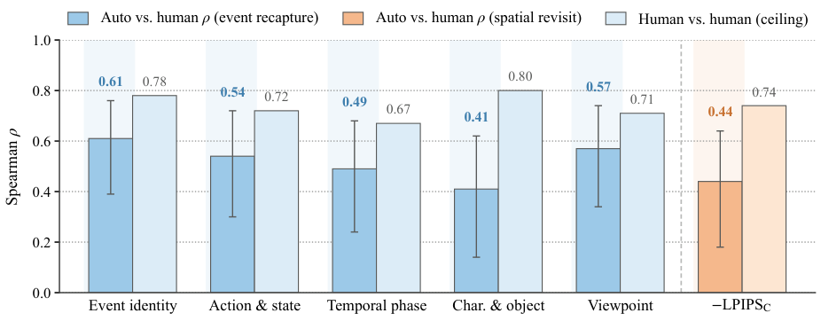

> 图解：自动指标与人类评分的 Spearman 相关性。事件身份、动作状态、时序阶段、角色物体、视角五个轴分别为 0.61、0.54、0.49、0.41、0.57；取负的空间距离 $-\mathrm{LPIPS}_{\mathrm C}$ 为 0.44（取负让方向与“人类评分更高”对齐）。人类-人类一致性上限为 0.67-0.80——自动指标是 **结构化诊断工具**，不能完全替代人类判断。

### 4.5 定性对比与长程画廊

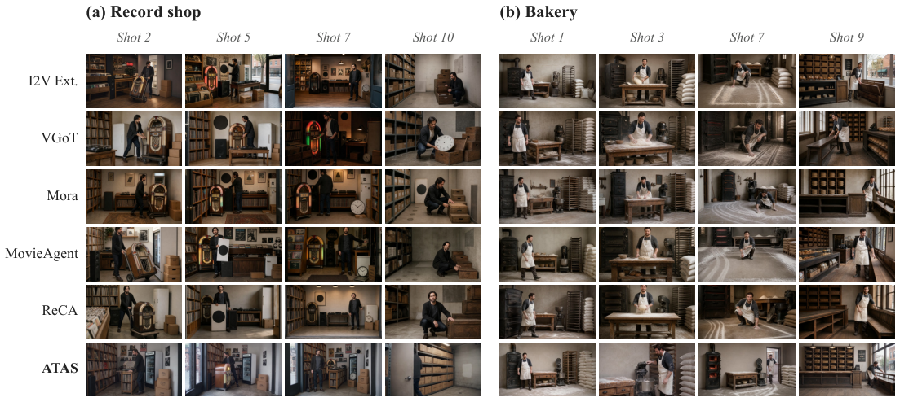

> 图解：基线定性审计。唱片店与面包房两个故事中，对齐帧对比各方法在镜头延续、场景布局、物体状态、角色一致性上的表现。一个片段可以局部看着合理，但布局或实体状态已悄悄漂移——单一全局相似度分数抓不住这种问题。

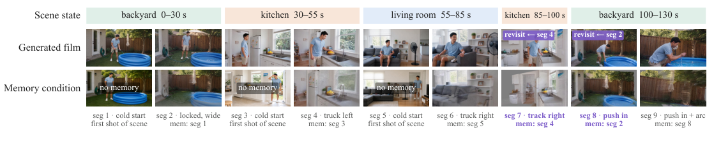

> 图解：一次代表性 rollout 时间线。跟随生成影片与记忆条件经历场景切换、一次空间回访和一次事件重捕请求，标注了场景状态何时创建、后续请求何时查询它、返回的观测何时写回。

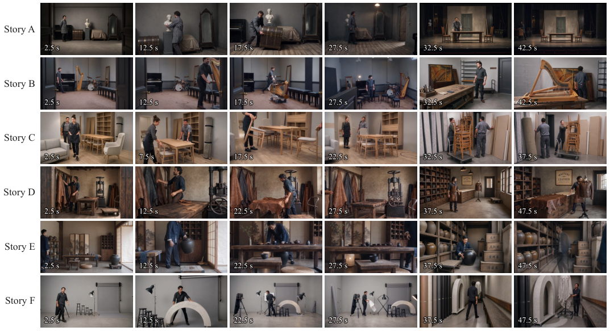

> 图解：六个故事的带时间戳帧网格，覆盖不同场景、人物、物体和运镜模式，展示定性评测的覆盖广度。

附录还给了三部完整长片（每部都走访三个地点后回访其中两个），用来检验“隔了若干镜头后，回访视角还留不留得住先前建立的布局、物体和变化”。帧均直接取自生成长片（时间戳为分:秒）。

**故事一：Saturday Laundry in the Flat（1:50）**。男主周末洗衣服，路线是客厅 → 洗衣房 → 卧室 → 回客厅 → 回洗衣房。故事留下两块状态：咖啡桌上放下的马克杯，和一台已装载启动的洗衣机。

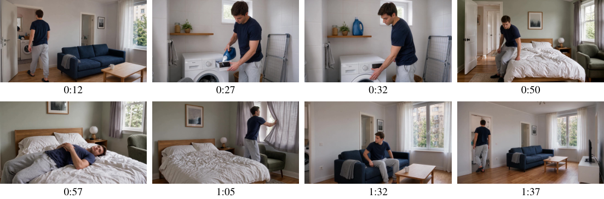

> 图解：全片概览——离开客厅去洗衣房、加洗衣液关洗衣机、在卧室坐下又躺下、拉开窗帘，最后从沙发起身走回洗衣房。

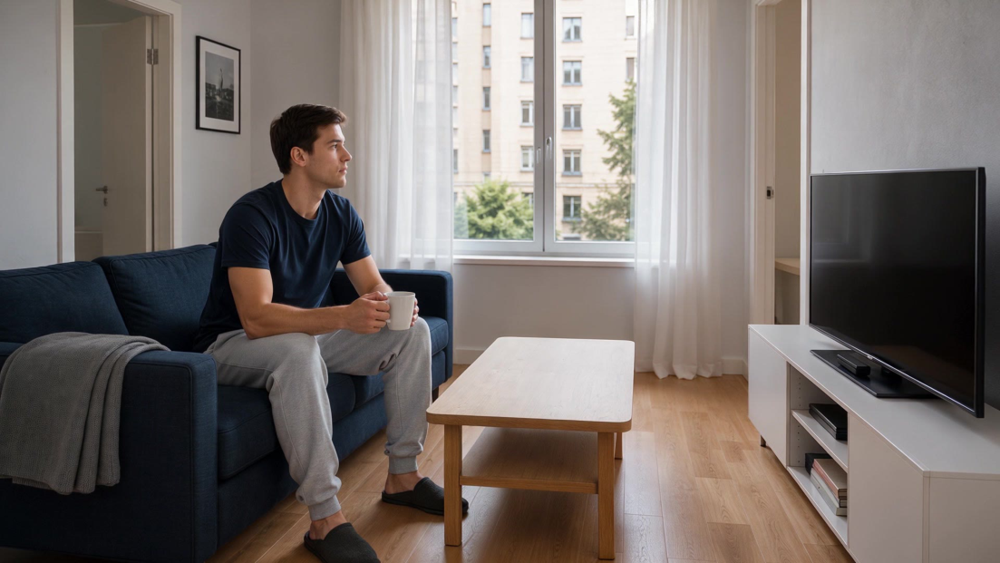

> 图解：Visit 1，客厅（0:02）——深蓝沙发、灰色毯子、木质茶几与电视柜的首次观测，房间连同马克杯位置一起被重建进世界状态。

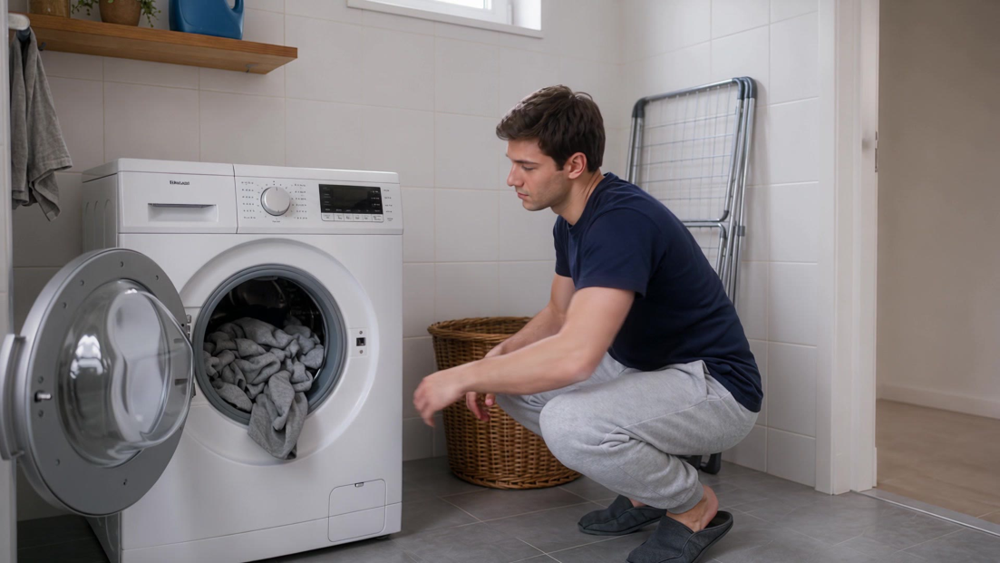

> 图解：Visit 2，洗衣房（0:22）——把衣服装进滚筒洗衣机。置物架、毛巾、折叠晾衣架在此建立；离开时洗衣机在转、篮子空了。

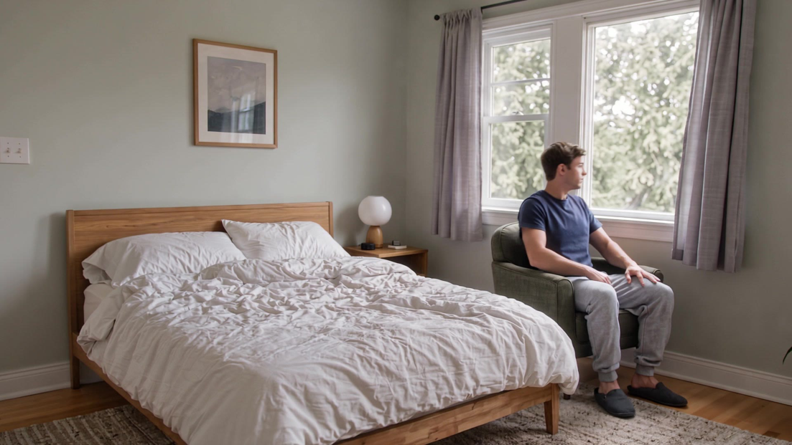

> 图解：Visit 3，卧室（1:07）——拉开窗帘后坐进扶手椅。卧室全片只出现一次，作用是给世界状态加一个房间，并把两次回访与留下状态的房间隔开。

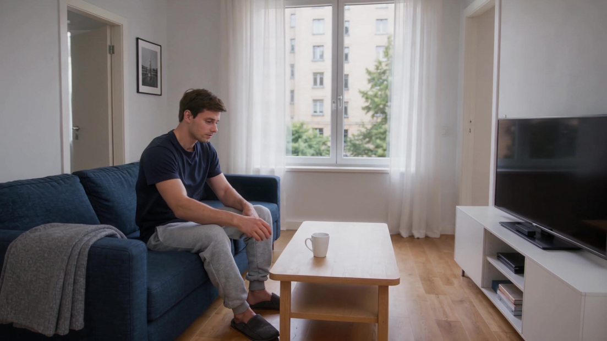

> 图解：Visit 4，回访客厅（1:25）——约一分钟后回到沙发，存储的客厅状态条件化本镜头：沙发、毯子、茶几、电视柜原样重现，**马克杯还在桌上**。

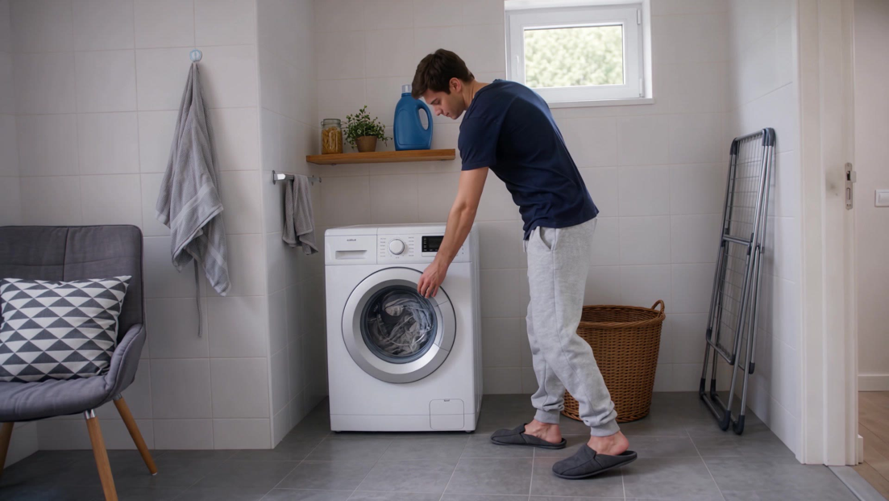

> 图解：Visit 5，回访洗衣房（1:45）——打开一分多钟前亲手启动的洗衣机，置物架、毛巾、篮子、晾衣架位置不变，机门仍关着、衣服在里面。

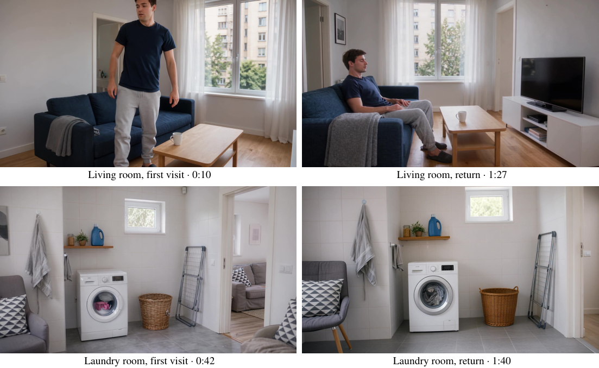

> 图解：回访对比。上：开头放下的马克杯一分多钟后仍在茶几上，沙发与毯子一致；下：洗衣房的架子、毛巾、篮子、晾衣架保持原位，洗衣机仍关着。

**故事二：Winter Fire in the Cabin（2:10）**。女主在寒冷木屋生火，路线是客厅 → 厨房 → 卧室 → 经厨房 → 回客厅。两次回访检验的都是 **她自己制造的状态**：厨房窗霜上画的一颗心，和壁炉里点着的火。

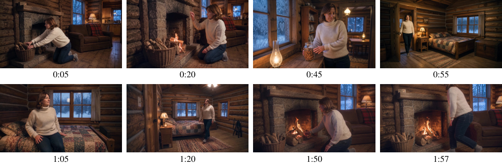

> 图解：全片概览——用木柴篮生火并看着火苗起来，在结霜的厨房窗边（画过一颗心）驻足，去卧室休息，最后回来照看已烧旺的火。

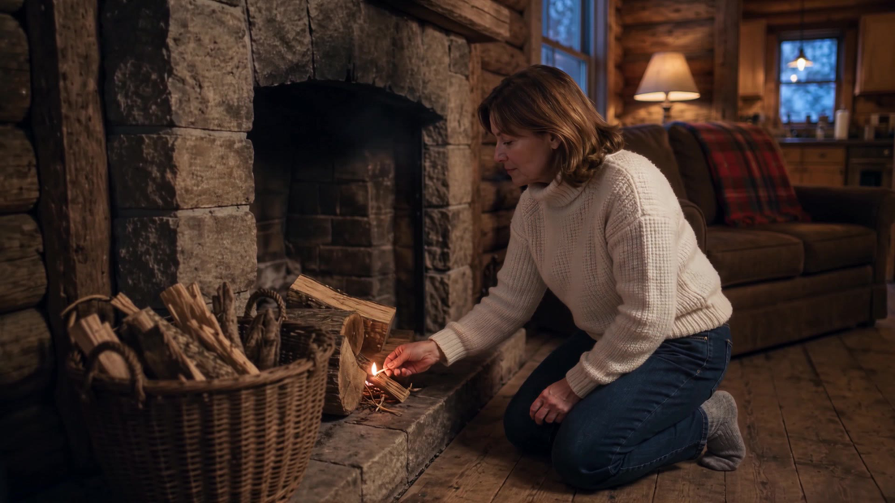

> 图解：Visit 1，客厅（0:12）——在石砌壁炉前跪地架柴点火。离开时，开场还冰冷的壁炉里已有一小堆火。

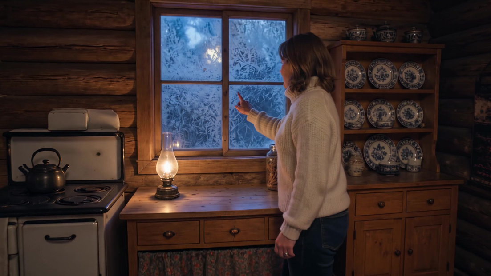

> 图解：Visit 2，厨房（0:35）——用手指在窗霜上画一颗心。这颗心是一个小而具体的标记，厨房必须在回访时仍带着它。

> 图解：Visit 3，卧室（1:10）——在床头灯下躺上拼布被褥的床。卧室只出现一次，把厨房与它的回访隔开半分钟。

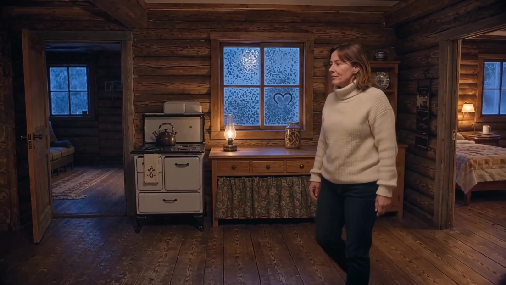

> 图解：Visit 4，回访厨房（1:30）——灶台、油灯、碗碟柜、门洞位置不变，**霜上的心还在右下角窗格里**。

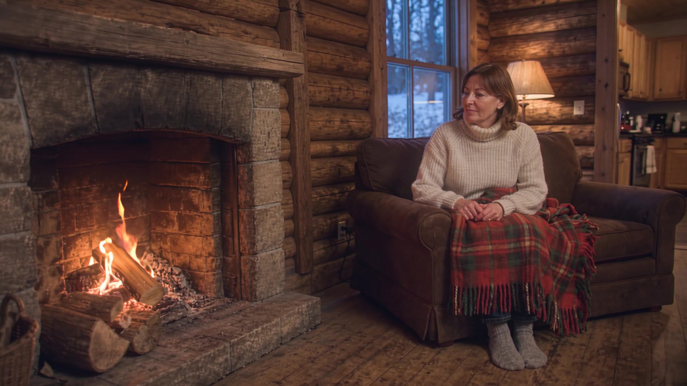

> 图解：Visit 5，回访客厅（2:05）——约 70 秒后回到客厅，壁炉、柴篮、台灯、红格毯沙发与首次到访一致，而她点的火 **已经烧满壁炉**。

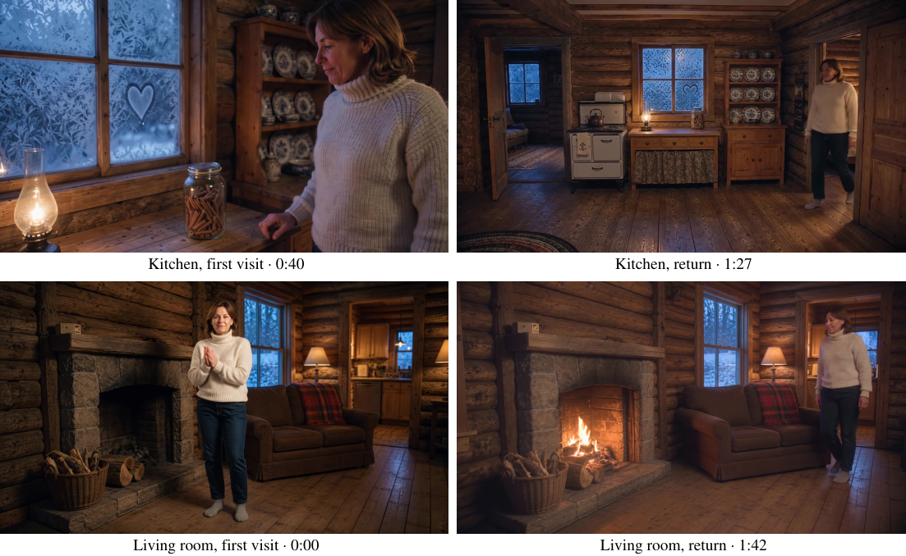

> 图解：回访对比。上：霜画的心仍在同一扇厨房窗的右下格；下：客厅保持石壁炉、柴篮、台灯与红格毯沙发，开场冰冷的壁炉现在装着她点的火。

**故事三：Running a Bath on a Winter Evening（2:10）**。女主工作累了放洗澡水，路线是卧室 → 浴室 → 客厅 → 回卧室 → 回浴室。两次回访分别检验一个静态物体（床上合上的笔记本）和一个 **离场期间仍在进行的动态过程**（水龙头持续放水）。

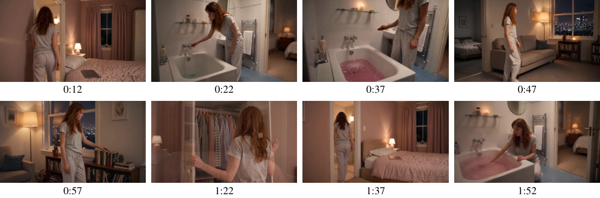

> 图解：全片概览——把笔记本留在床上、打开水龙头、浴缸注入粉色水时点上蜡烛、去客厅翻书架、回卧室开衣柜、最后试已放满的洗澡水。

> 图解：Visit 1，卧室（0:07）——粉色窗帘、白色衣柜、床头台灯的暖光卧室里，她合上笔记本留在床上。

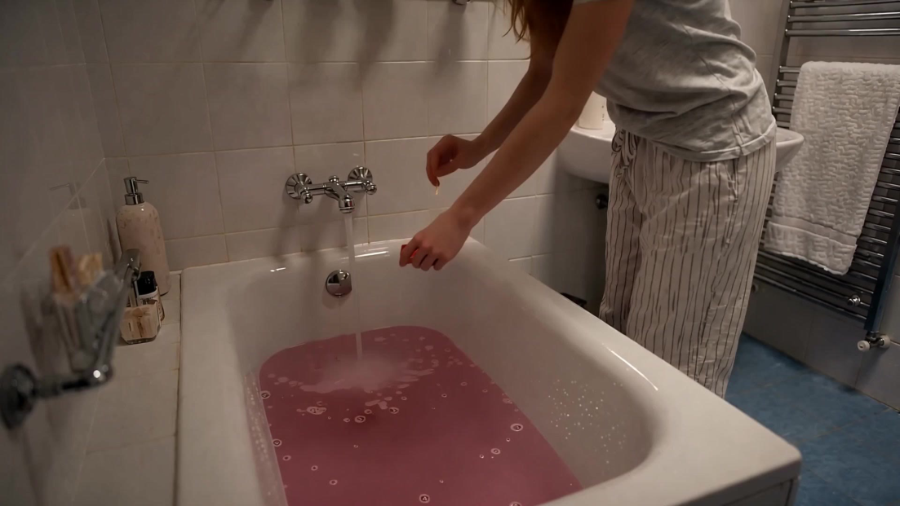

> 图解：Visit 2，浴室（0:30）——开龙头、倒浴盐让水变粉、在圆镜下的玻璃搁板上点蜡烛。离开时龙头未关、浴缸只放了一半。

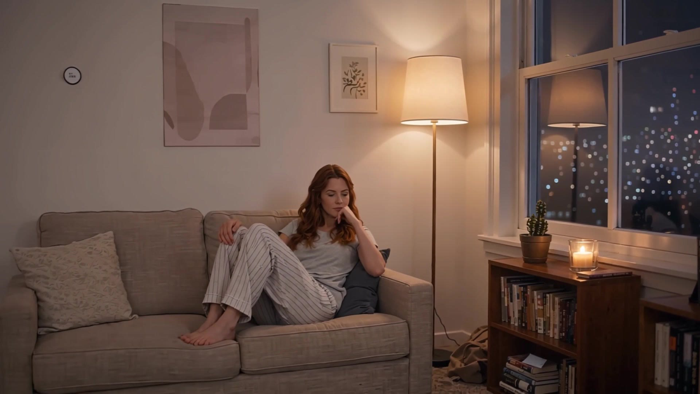

> 图解：Visit 3，客厅（1:07）——放水期间在客厅看城市夜景、翻书架、在沙发上休息。客厅只出现一次，把两次回访隔开。

> 图解：Visit 4，回访卧室（1:30）——与开场同一视角，床、床头灯、衣柜、粉色窗帘全部一致，**合上的笔记本还躺在床上**。

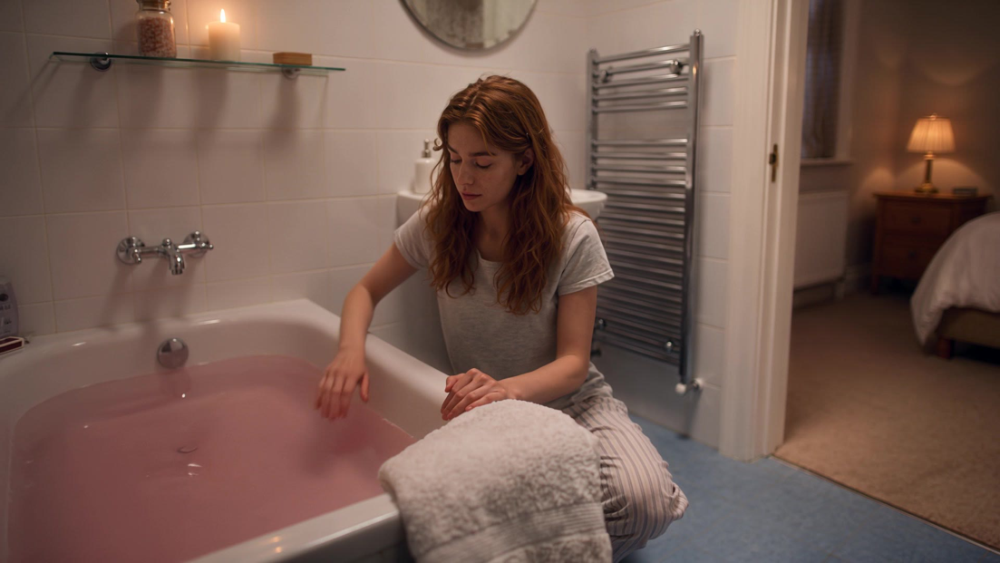

> 图解：Visit 5，回访浴室（2:05）——瓷砖、玻璃搁板、镜子、毛巾架与首次进入一致；**离开时半满的浴缸已放满粉色水，点的蜡烛还在烧**。

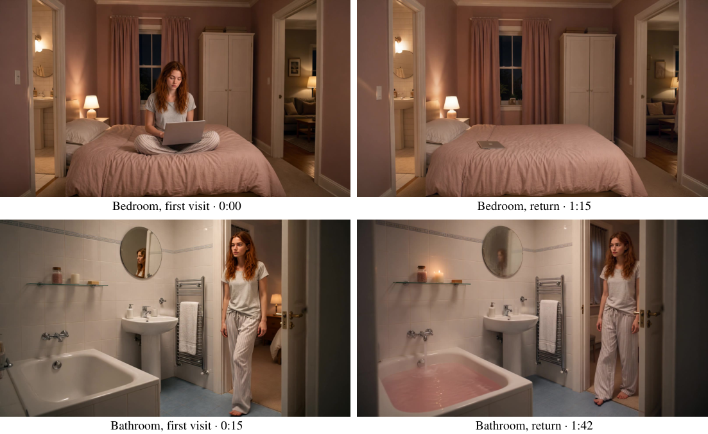

> 图解：回访对比。上：同视角下卧室与首次到访一致，笔记本仍在床上；下：浴室陈设不变，空浴缸已注满粉水、蜡烛仍在燃烧。

这三个故事的设计很讲究：马克杯和笔记本测 **静态物体留存**，烧旺的火和放满的水测 **离场期间的动态演化**——后者尤其难，因为它要求系统理解“过程在继续”，而非简单冻结状态。

## 五、总结

- **问题定位准**：长视频 Agent 的痛点不是单镜头画质，而是历史观测无法在时空两个维度上被寻址和复用；
- **核心机制**：世界状态 $\mathcal{W}_t=(\mathcal{S}_t,\mathcal{E}_t)$——静态几何进场景记忆（共享坐标系、可重渲染），动态证据进事件记忆（绑定事件与时间区间）；
- **最聪明的设计**：影片交付与状态准入解耦（$f_t$、$r_t$、$a_t$ 三道闸门），不可靠的生成内容能上映、但不能污染记忆；
- **实验结论硬**：4 个 backbone 上跨镜头一致性全胜、空间回访 PSNR 15.968 超所有 Agent 与 3D 引导方法、人类评测六项全第一，且消融证明双记忆与递归编译各司其职；
- **代价明确**：重试减半（1.00 → 0.54/镜头）但每故事耗时增加约 25%（51.9 → 64.9 分钟），记忆是“用钱换稳定性”。

**展望**：论文把 ATAS 定位为交互式影视制作、剧集内容创作和预可视化（previsualization）的基础设施；人类评测中偏低的背景一致性与叙事连贯分、以及事件重捕中尚未攻克的“动作状态精确复现”，指明了下一步的方向——更长的叙事与用户主导的修改（user-directed revisions）将是这类框架走向实用的关键一跃。

> 本文参考自 [Any Time, Any Space: A World-State-Centric Framework for Agentic Video Generation](https://arxiv.org/abs/2610.20571)