# GPT-6 Astra：通用大模型也能"摸"懂触觉，接触式操作成功率达 93.8%

机器人做精密插装、抓握易碎品这类"接触密集型"任务时，触觉一直被认为是专用策略（specialist policy）的专属领地——不专门训练一个触觉模型，似乎就玩不转。这篇来自清华大学和阿里高德的工作给出了一个相当颠覆的答案：**把 GelSight 类传感器产生的触觉 RGB 图像直接当作普通图片，喂给通用多模态模型 GPT-6 Astra**，仅靠 few-shot 上下文学习就能完成闭环控制。结果非常硬：在 UniVTAC 和 OpenViTac 两个触觉操作基准上，视觉+触觉输入的 Astra 平均成功率分别达到 **93.8%** 和 **81.8%**，比对比中最强的专用基线分别高出 **22.9 和 13.1 个百分点**；更夸张的是，即便完全不给触觉、只用视觉，Astra 也能拿到 76.3% 和 80.6%，依然领先所有专用基线。这是我们所知首个证明通用大模型可以直接理解并使用触觉观测的工作。

## 为什么这件事重要：专用触觉策略的护城河还成立吗

先交代一下背景。GPT-as-Policy、RoboProbe、RoboDawn、RoboICL 等一系列工作已经证明，GPT-6 Astra 可以把视觉观测和指令直接翻译成机器人动作，不需要单独训练策略。于是问题从"通用模型能不能控制机器人"变成了"还有哪些能力是专用策略独有的"。

接触密集型操作（contact-rich manipulation）就是最热门的候选答案。精密插入、稳定抓取、材质判别，都依赖局部几何、滑移、材料属性这些信息——普通场景图像往往看不到这些，自由空间里好使的动作一接触物体就可能失败，抓得太用力还会捏碎易碎品。正是这些需求催生了 FTP-1、OpenVTLA、SimpleTouch 等专门的触觉预训练和视觉-触觉融合方法。

而视觉式触觉传感器（如 GelSight）让这个问题变得格外有意思：它把接触几何和形变编码成图像。换句话说，**"摸"到的信息走的还是"看"的通道**。既然触觉信息天然就是 RGB 图像，通用视觉模型有没有可能直接读懂它？这篇文章回答的就是这个问题。

## 方法：把触觉图像当普通图片喂进去

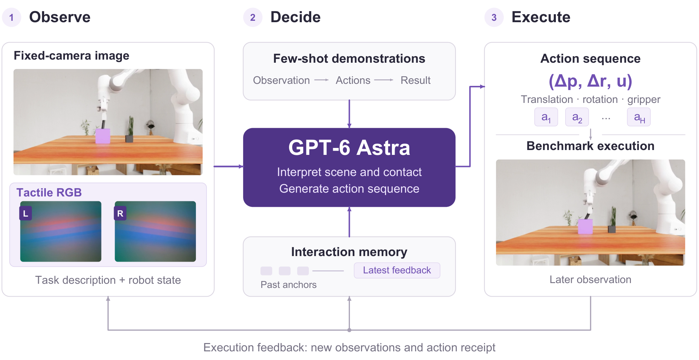

> 图解：方法整体流程。触觉 RGB 图像与场景观测一起，通过 Astra 既有的视觉输入接口进入模型；演示样本与在线交互记忆把接触证据和动作、结果关联起来；Astra 输出末端执行器与夹爪指令，基准环境执行后返回观测和回执，供下一轮决策。图中展示的固定相机画面和触觉图像是 Insert Hole 任务 seed 1000028 的真实输入。纯视觉设置则在整个上下文中去掉触觉图像。

方法本身出奇地简单——这正是它的价值所在。整个框架分为观测、记忆、动作生成三个部分，沿用 RoboICL 的演示条件化执行和交互记忆机制。

### 场景与接触观测

在第 $t$ 轮决策时，模型收到任务指令 $g$、机器人状态 $x_t$、场景图像 $I_t$，在视觉-触觉设置下还有左右两根手指的接触图像 $T_t$。场景图像描述物体的全局位姿和目标几何，触觉图像描述局部形变与接触状态。机器人状态提供末端执行器位姿和本体感知信息，让模型能把观测到的接触与待执行的运动联系起来。

关键设计是：**演示和在线观测使用同一个图像接口**，模型可以直接对比"演示里的接触长什么样"和"现在的接触长什么样"。

### 演示与交互记忆

演示上下文 $\mathcal{D}$ 由成功轨迹中选取的片段（block）组成。每个片段包含初始观测与机器人状态、记录的动作序列、执行回执、以及结果观测与状态。这些片段在评估前选定，整个 episode 中始终可用，相当于给模型看了一本"图文对照的操作手册"。

在线记忆 $\mathcal{M}_t$ 采用同样结构：分布式锚点保留早期任务阶段，最新交互暴露最近一次执行结果，并用显式的间隔标记标明省略区间。这样模型能把当前观测与之前的尝试、演示过的流程联系起来。

### 动作生成与反馈

Astra 从组装好的上下文中生成一串有序的末端执行器与夹爪指令：

$$
A_t \sim \pi(\,\cdot \mid g, \mathcal{D}, \mathcal{M}_t, x_t, I_t, T_t), \qquad a = (\Delta p, \Delta r, u)
$$

其中 $\Delta p$ 和 $\Delta r$ 是平移与旋转增量，$u$ 是夹爪目标开合度。纯视觉设置中 $T_t$ 缺失。

笔者认为这里最值得注意的一点是**执行反馈和任务进展被明确区分**：一条"插入"指令执行完成，不代表物体真的进了孔——它可能还卡在孔沿上。新的观测让 Astra 有机会修正下一步动作。这种"指令完成 ≠ 任务完成"的意识贯穿全文，也是接触式操作里最核心的难点。

## 实验设置：19 个任务、每种输入设置 210 个采样场景

- **基准**：UniVTAC 的 8 个任务（抓取、放置、分类、精密插入）+ OpenViTac 的 11 个任务（属性判别、接触敏感装配）。OpenViTac 作者报告其仿真与真机表现的 Pearson 相关系数达 $r = 0.967$，仿真对比有参考价值。
- **采样**：10% 分层采样（种子 42），保持类别与布局比例。每种输入设置包含 80 个 UniVTAC 场景种子和 130 个 OpenViTac 场景种子（每任务 10 个，Insert Block v2 三种形状各 10 个）。
- **模型与演示**：GPT-6 Astra，推理强度设为 `xhigh`。UniVTAC 用官方发布的训练录制，OpenViTac 用官方脚本专家采集成功演示。
- **输入条件**：纯视觉（V）与视觉+触觉（V+T）使用完全相同的演示轨迹、片段起点、动作和采样评估场景，唯一区别是触觉图像。相机严格按基准官方配置：UniVTAC 六任务只有固定相机（Lift Can、Insert Tube 另有腕部相机），OpenViTac 全部任务固定+腕部双相机。
- **成功标准**：除 Grasp Chip 外均沿用官方标准。Grasp Chip 原标准对执行细节要求过苛，作者简化为"芯片完好地被抓取、转移并在目标区域获得稳定物理支撑"。

附录中给出的逐任务上下文配置如下，展示了每个任务的演示条数（Shots）、每条演示选取的片段数（Segments）、片段长度 $H$ 和相机配置：

| 任务 | Shots | Segments | $H$ | 上下文动作总数 | 相机 |
|---|---|---|---|---|---|
| **UniVTAC** | | | | | |
| Lift Bottle | 1 | 12 | 10 | 120 | 固定 |
| Pull-out Key | 1 | 12 | 5 | 60 | 固定 |
| Lift Can | 1 | 12 | 5 | 60 | 固定 + 腕部 |
| Put Bottle | 1 | 12 | 10 | 120 | 固定 |
| Insert Hole | 1 | 12 | 5 | 60 | 固定 |
| Insert HDMI | 1 | 12 | 5 | 60 | 固定 |
| Insert Tube | 1 | 12 | 5 | 60 | 固定 + 腕部 |
| Grasp Classify | 2 | 5 | 4 | 40 | 固定 |
| **OpenViTac** | | | | | |
| Weight Classify | 2 | 5 | 5 | 50 | 固定 + 腕部 |
| Hardness Classify | 2 | 5 | 5 | 50 | 固定 + 腕部 |
| Roughness Classify | 2 | 5 | 5 | 50 | 固定 + 腕部 |
| Roughness-Guided Regrasp | 2 | 5 | 5 | 50 | 固定 + 腕部 |
| Empty-Can Selection | 2 | 5 | 10 | 100 | 固定 + 腕部 |
| Grasp Chip | 1 | 12 | 10 | 120 | 固定 + 腕部 |
| Gear Assembly | 1 | 12 | 10 | 120 | 固定 + 腕部 |
| Pull Drawer | 1 | 12 | 5 | 60 | 固定 + 腕部 |
| Insert USB | 1 | 12 | 5 | 60 | 固定 + 腕部 |
| Insert Block v1 | 1 | 12 | 10 | 120 | 固定 + 腕部 |
| Insert Block v2 | 3 | 5 | 10 | 150 | 固定 + 腕部 |

演示片段的选取调用 RoboICL 的确定性选择器：时间目标让不重叠的片段均匀分布在轨迹上，覆盖首尾窗口，并排除无效动作窗口。例如 Weight Classify 的两条演示使用起点 $\{0, 33, 66, 99, 132\}$ 和 $\{0, 35, 69, 104, 139\}$，$H = 5$。执行层面，演示与生成指令都按 60 Hz 控制节奏运行，每条指令对应两个 120 Hz 仿真子步。

## 结果一：全面超越专用策略

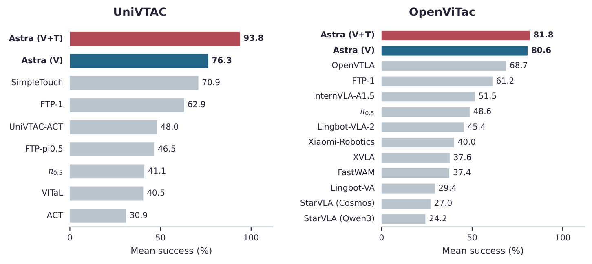

> 图解：两个基准上的任务平均成功率（%）。蓝色为 Astra 纯视觉，红色为视觉+触觉，灰色为已发表的专用基线。各基准内模型按其报告均值排序。可以看到无论是否使用触觉，Astra 都压过所有专用策略一头。

先看 UniVTAC 的逐任务结果（%，基线数值来自 UniVTAC 与 SimpleTouch 原文，Avg. 为任务等权平均，加粗为每列最优）：

| 模型 | Lift Bottle | Pull-out Key | Lift Can | Put Bottle | Insert Hole | Insert HDMI | Insert Tube | Grasp Classify | **Avg.** |
|---|---|---|---|---|---|---|---|---|---|
| ACT | 42 | 28 | 20 | 28 | 19 | 15 | 45 | 50 | 30.9 |
| VITaL | 72 | 47 | 8 | 32 | 25 | 6 | 34 | **100** | 40.5 |
| $\pi_{0.5}$ | 92 | 36 | 59 | 31 | 26 | 3 | 34 | 48 | 41.1 |
| FTP-$\pi_{0.5}$ | 77 | 30 | 26 | 19 | 47 | 4 | 72 | 97 | 46.5 |
| UniVTAC-ACT | 71 | 46 | 29 | 31 | 24 | 28 | 56 | 99 | 48.0 |
| FTP-1 | 97 | 48 | 65 | 47 | 64 | 3 | 79 | **100** | 62.9 |
| SimpleTouch | **100** | 62 | 68 | 50 | 85 | 3 | **100** | 99 | 70.9 |
| Astra (V) | **100** | 30 | 80 | **90** | 60 | 50 | **100** | **100** | 76.3 |
| Astra (V+T) | **100** | **90** | **100** | **90** | **100** | **80** | 90 | **100** | **93.8** |

再看 OpenViTac（%，基线数值来自 OpenViTac 原文；Insert Block v2 为三种形状共 30 个场景的聚合分）：

| 模型 | Weight Class. | Hardness Class. | Roughness Class. | Roughness Regrasp | Empty-Can Selection | Grasp Chip | Gear Assembly | Pull Drawer | Insert USB | Insert Block v1 | Insert Block v2 | **Avg.** |
|---|---|---|---|---|---|---|---|---|---|---|---|---|
| StarVLA (Qwen3) | 44 | 38 | 42 | 35 | 32 | 10 | 26 | 35 | 4 | 0 | 0 | 24.2 |
| StarVLA (Cosmos) | 51 | 67 | 94 | 9 | 13 | 1 | 33 | 22 | 3 | 1 | 3.3 | 27.0 |
| Lingbot-VA | 50 | 44 | 39 | 40 | 44 | 22 | 59 | 15 | 2 | 2 | 6 | 29.4 |
| FastWAM | 49 | 84 | 67 | 7 | 9 | 50 | 51 | 88 | 6 | 0 | 0 | 37.4 |
| XVLA | 28 | 30 | 56 | 47 | 45 | 42 | 84 | 76 | 2 | 3 | 0.7 | 37.6 |
| Xiaomi-Robotics | 52 | 46 | 54 | 62 | 38 | 24 | 73 | 84 | 5 | 2 | 0 | 40.0 |
| Lingbot-VLA-2 | 52 | 58 | 58 | 53 | 52 | 41 | 78 | 92 | 8 | 5 | 2.7 | 45.4 |
| $\pi_{0.5}$ | 53 | 60 | 64 | 52 | 48 | 39 | 87 | 99 | 14 | 9 | 9.3 | 48.6 |
| InternVLA-A1.5 | 53 | 76 | 65 | 77 | 47 | 53 | 79 | 98 | 3 | 6 | 9.3 | 51.5 |
| FTP-1 | 61 | **100** | **100** | 78 | 50 | 60 | 83 | 94 | 27 | 12 | 8.3 | 61.2 |
| OpenVTLA | **89** | 99 | **100** | 90 | **73** | 69 | **91** | 99 | 27 | 11 | 8 | 68.7 |
| Astra (V) | 50 | 70 | **100** | **100** | 70 | **100** | 80 | **100** | **100** | 40 | **76.7** | 80.6 |
| Astra (V+T) | 40 | 90 | **100** | **100** | 50 | **100** | 80 | **100** | **100** | **70** | 70 | **81.8** |

几个要点：

- Astra (V+T) 领先最强基线 SimpleTouch（UniVTAC）22.9 个百分点、OpenVTLA（OpenViTac）13.1 个百分点；对 FTP-1 的领先更是达到 30.9 和 20.6 个百分点。
- 提升横跨多个操作类别：UniVTAC 上提升最大的是受限拔取（Pull-out Key）和插孔（Insert Hole）；OpenViTac 上 Hardness Classify 和 Insert Block v1 明显改善。
- 多个分类、转移、插入任务在采样 episode 中达到 100%。Weight Classify 仍然是难点。

## 结果二：触觉确实被"理解"了，而不只是多了一张图

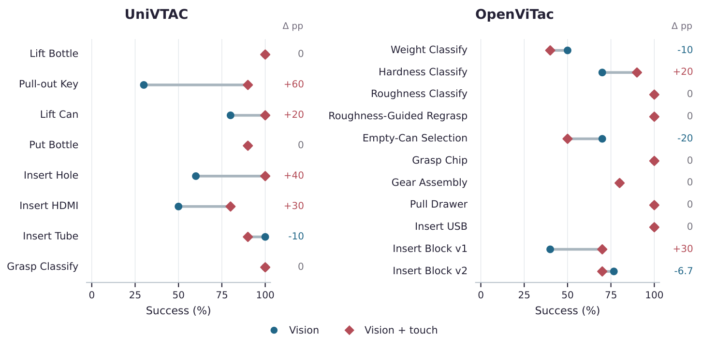

> 图解：逐任务的模态对比。圆点为纯视觉（V），菱形为视觉+触觉（V+T），右侧数字为 V+T 减 V 的百分点差值。19 个任务中 6 个提升、9 个持平、4 个下降——触觉不是对所有任务都加分的"万能调料"。

数字提升是一回事，模型是不是真的"读懂"了触觉是另一回事。作者用 8 条成功轨迹的行为分析回答了这个问题，按接触状态推断、主动探测、精细调整、失败恢复四类组织。

### 接触状态推断

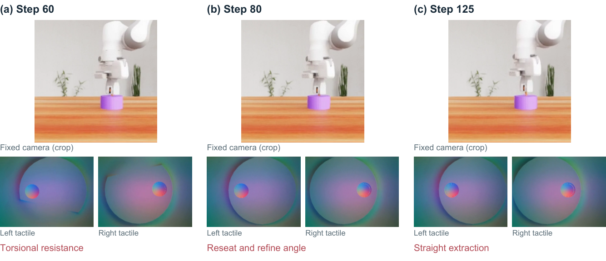

> 图解：Pull-out Key（seed 1000017，V+T，成功）。第 60 步的动作笔记识别出扭转形变并提出卸载扭矩；持续的轴向阻力促使模型在第 80 步重新就位并做更细的角度调整；最后一帧显示钥匙被成功拔出。整个过程在"试探拔取"与"卸载+重新对准"之间交替。

这个案例的精髓在于交替策略：持续受阻后，下一步动作从"继续拉"变成"卸载约束 + 角度微调"。沿同一方向加更大位移解决不了对齐不良或扭转卡死的问题——模型显然明白这一点。

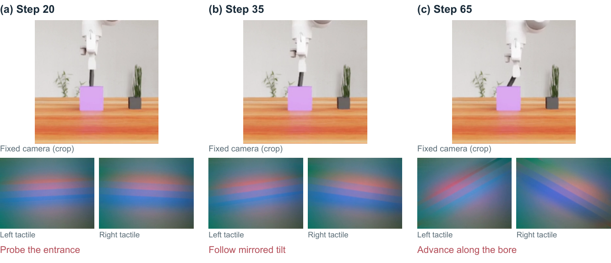

> 图解：Insert Hole（seed 1000028，V+T，成功）。Astra 结合触觉条带相反的倾斜方向和可见的轴杆偏转，推断出一个与参考轨迹不同的孔向；它在保持入口接触的同时转动轴杆，然后沿推断出的孔道推进。这是对接触几何的适应，而非对演示动作的死板复现。

### 主动探测

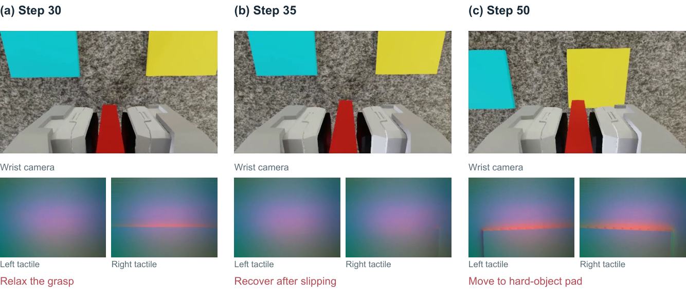

> 图解：Hardness Classify（seed 10006，V+T，成功）。Astra 在举起物体后略微放松夹爪，检测到滑移后立即恢复接触；随后的动作笔记把"边界锐利的受压边缘"与硬物演示关联起来。探测改变了接触状态，而随后的修正保住了物体——探测本身就是一次控制干预。

这个设计很聪明：与其盯着一张不变的触觉图像猜，不如主动制造一次可控的接触变化来获取更有判别力的观测。

### 精细调整

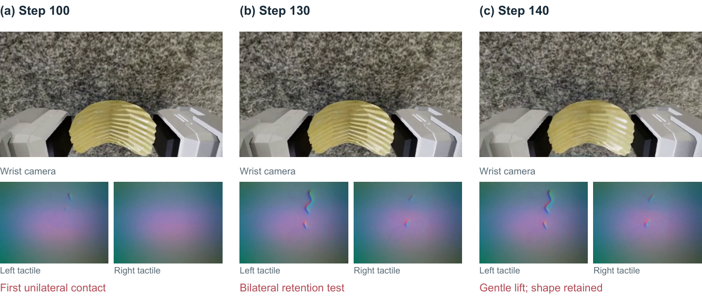

> 图解：Grasp Chip（seed 10099，V+T，成功）。单侧接触触发更小的闭合增量，并在第 110 步下达 0.5 mm 的横向修正；双侧接触建立后，Astra 不再继续收紧，而是用一次轻柔的抬升测试保持力。整个序列把"建立接触"与"增大握力"严格分开——对易碎物体，继续捏紧并不是提升保持力的唯一手段。

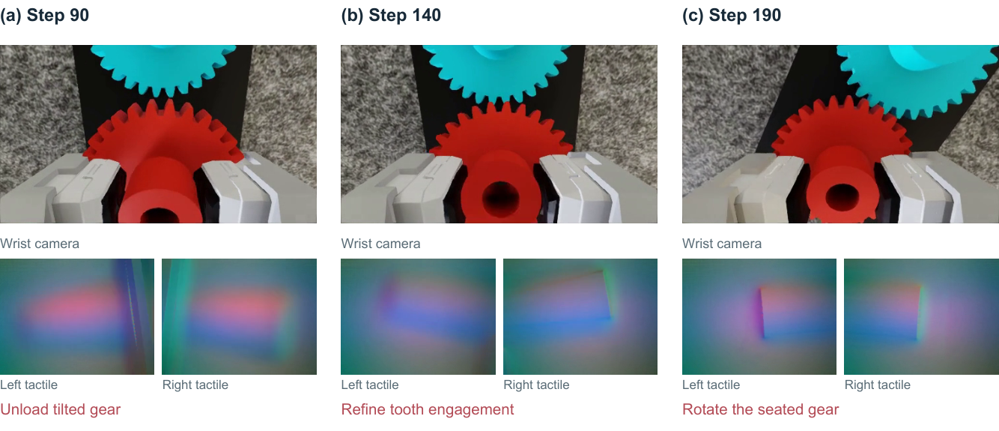

> 图解：Gear Assembly（seed 10034，V+T，成功）。红齿轮倾斜时，Astra 先卸载接触并调整中心；后续一次偏航调整处理可能的齿间干涉，然后落座并旋转。随着观测到的约束变化，修正策略从"对中心"切换为"对齿"——这比一句泛泛的"靠近目标"具体得多。

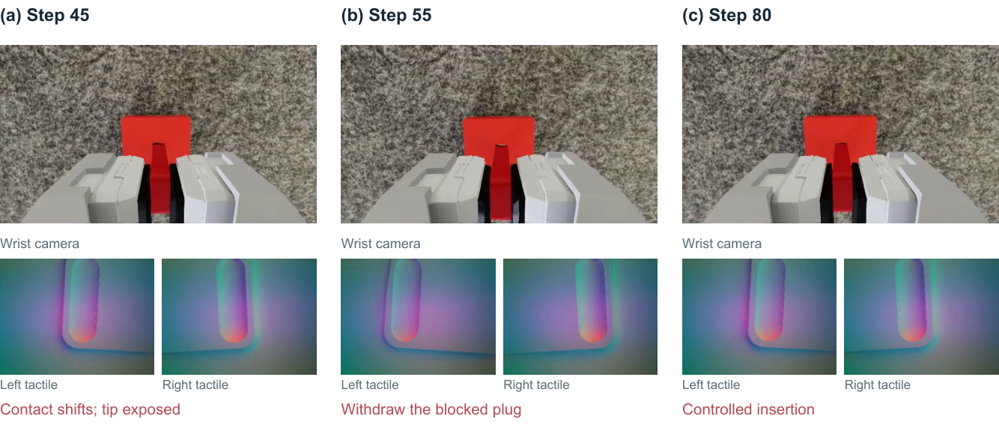

> 图解：Insert USB（seed 10066，V+T，成功）。连接器始终暴露在外，而触觉接触在变化，动作笔记识别出"手指在被卡住的插头上滑移"。Astra 后撤、重新对中、下达亚毫米级修正后，插入才真正推进。手的移动不被当作插头已入座的充分证据——这是接触式操作里非常关键的"进展核查"能力。

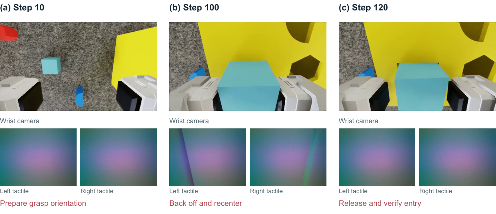

> 图解：Insert Block v1（seed 10036，立方体，V+T，成功）。Astra 抓取前先调整手部姿态，搬运立方体后，对疑似孔沿接触做出小幅后撤并下达 2 mm 对中修正；最后一帧为释放-验证阶段。远处的抓取准备与近接触的毫米级调整被串联在同一个 episode 里。

### 失败恢复

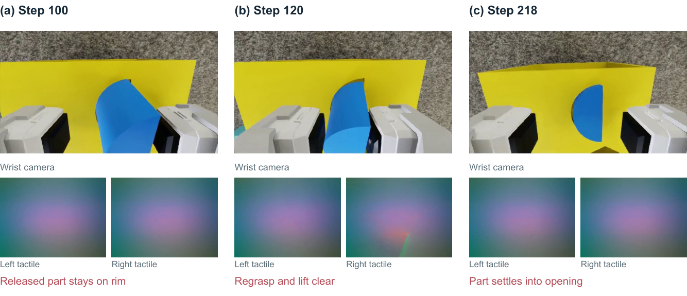

> 图解：Insert Block v2（seed 10019，半圆柱，V+T，成功）。释放后零件仍停在开口上，Astra 重新抓取、抬起并继续尝试对准，直到零件落入开口。释放指令执行完毕 ≠ 任务完成——模型发现结果与意图不符后，主动把任务当作"未完成"并重启抓取-对准流程。

## 结果三：视觉可以部分补偿缺失的触觉

一个耐人寻味的数字是：触觉输入在 UniVTAC 上带来 17.5 个百分点的提升，在 OpenViTac 上却只有 1.2 个点。作者给出的解释与相机配置有关：UniVTAC 八个任务中六个只有固定相机，视觉线索受限；OpenViTac 全任务双相机，视觉观测本来就丰富。对一个能捕捉细微视觉结构的模型来说，触觉的边际价值自然被压缩了。

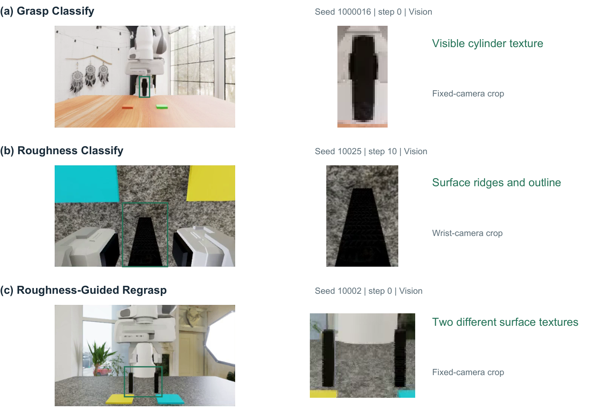

> 图解：三个纯视觉 100% 成功任务中的可见线索。左为录制的相机画面，中为绿框区域放大，右为可见线索本体。Grasp Classify 的圆柱表面有纹理、Roughness Classify 暴露了表面棱脊与轮廓结构、Roughness-Guided Regrasp 的两个表面即使在固定相机视角下也可区分。放大图保留原始录制像素。

更颠覆认知的是 Weight Classify 的三个配对案例：纯视觉策略放松夹爪、利用**可见的滑移**判断出了正确重量类别，反而成功；而带触觉的运行把微弱的剪切或类似轻物演示的接触模式误读为"轻"，把重物分错了类。这提醒我们：视觉补偿不仅真实存在，有时甚至比"读错的触觉"更可靠。

## 结果四：视觉式触觉传感器的规模化潜力

把前面的结果串起来，可以看到视觉式触觉传感的一个重要性质：它通过通用多模模型已经能处理的接口来表达接触。GelSight 类传感器把局部形变转成图像，模型就能把这些图像与物体外观、机器人状态、先前动作、演示结果关联起来——**一张接触图像，只有当模型把它和"手指做了什么、物体发生了什么"联系起来时才变得可行动**。

这与 VITaL、Sparsh、AnyTouch、T3 等可复用触觉表征的工作互补，也指出了一个自然的下一步：**联合视觉-触觉预训练**。把对齐的场景图像、触觉图像、动作与结果放进通用多模态预训练，让这种对应关系成为模型能力的一部分，而不是部署时临时提供的提示。对传感器研发而言，这也意味着应该优先保留可解释的接触结构、支持跨传感器/跨抓握/跨运动条件的对比。

## 结果五：基准正在饱和

加触觉后，Astra 在 19 个任务中的 13 个上达到至少 90% 成功率，其中 9 个满分。UniVTAC 均值 93.8%，OpenViTac 多个分类与转移任务也到 100%。这些天花板限制了基准区分更强策略的能力，也把注意力从"平均完成率"推向接触决策质量、恢复能力与泛化。

视觉补偿还给基准设计提了新要求：一个触觉任务应该隔离出所选视觉接口**尚未暴露**的信息。当前套件中纹理、轮廓或运动可能与所需的物理判断相关，而足够强的视觉模型连人眼都容易忽略的线索都能抓住。更有区分度的评估应该包括：外观相同但质量、摩擦、刚度或内部约束不同的物体；更紧的插入公差；更长的接触序列；抓握受扰或啮合失败后的恢复。

## 尚存的局限：触觉也不是万能药

触觉输入并非稳定提升：Weight Classify、Empty-Can Selection、Insert Tube、Insert Block v2 四个任务在采样结果中反而下降。轨迹分析暴露出三类反复出现的局限。

**局限一：对切向运动与受力的敏感度有限。**

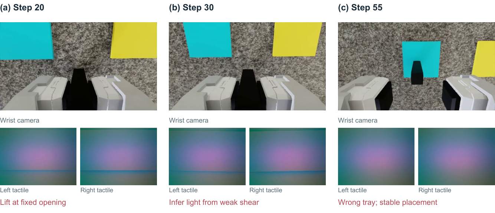

> 图解：Weight Classify（seed 10038，V+T，失败）。Astra 把抬升过程中的微小触觉变化解读为"轻物"证据，把重块放上了错误的蓝色托盘。触觉图像模式同时取决于抓握位置、开口度和运动方式——微弱的剪切响应并不是一份无歧义的重量测量。模型在歧义未消除的情况下就提交到了"轻物"解释。

**局限二：识别出错位不等于能执行有效修正。**

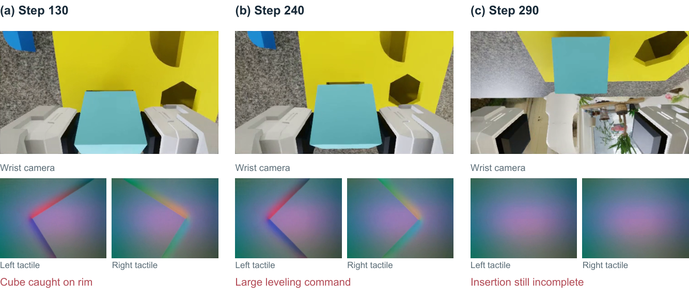

> 图解：Insert Block v1（seed 10016，V+T，失败）。反复的孔沿接触促使模型重新抓取并尝试调平；从第 240 步起，累计下达的俯仰增量约 $51.6^\circ$ 并配合补偿性平移，但直到动作预算耗尽插入仍未完成。大的累计旋转指令并不代表物体在接触下真的转了那么多——"诊断出需要调平"和"让运动真正产生所需位形"是两回事。

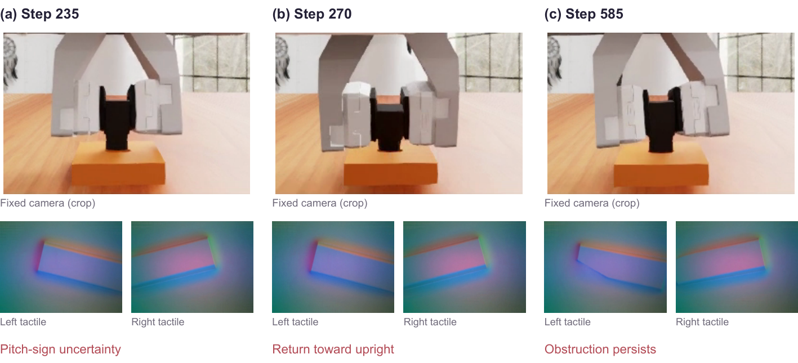

> 图解：Insert HDMI（seed 1000062，V+T，失败）。固定相机裁剪与成对触觉图像展示同一失败 episode 的三个阶段：第 235 步笔记记录俯仰方向符号不确定并试探相反方向，第 270 步回到竖直解释，第 585 步再次识别出阻碍而非落座。600 个动作、120 次模型决策后仍未成功——新的接触模式不断触发新假设，却无法隔离上一次失败的原因。这清晰地区分了三个层次：检测到动作失败、识别其物理原因、产出有效修正。

**局限三：主动探测可能不收敛。**

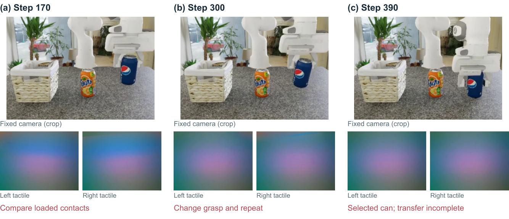

> 图解：Empty-Can Selection（seed 10034，V+T，失败）。Astra 对比负载响应、因接触不稳更换抓法、再重复对比；第 370 步才选出正确的蓝色罐子，第 390 步开始最终抓举，但 400 步的动作预算在转移前耗尽。信息采集必须与停止规则和剩余操作量协调——判断对了类别却没时间完成任务，同样是失败。

这些失败共同暴露了"局部看似合理的动作"与"可靠完成任务"之间的鸿沟：模型需要把接触线索与底层物理约束关联、把诊断转化为有效修正动作、并及时停止探测以完成后续操作。

## 推理成本与延迟：闭环部署的现实账单

两个评估阶段合计消耗 **3.36 亿 token**，记录的服务商成本为 **7505.05 元人民币**。V+T 阶段比 V 多用约 59% 的 token、多花 42% 的费用；两种设置下缓存输入都占输入 token 的 80% 以上，反映了闭环控制中重复供给的上下文。

| 输入 | 输入 token | 缓存输入 | 输出 token | 总 token | 费用 (CNY) |
|---|---|---|---|---|---|
| V | 127,250,755 | 104,837,109 | 2,283,555 | 129,534,310 | 3,102.25 |
| V+T | 203,911,092 | 170,693,217 | 2,521,218 | 206,432,310 | 4,402.80 |
| 合计 | 331,161,847 | 275,530,326 | 4,804,773 | 335,966,620 | 7,505.05 |

延迟方面，完整响应的中位数为 15.4 秒（V）和 14.0 秒（V+T），P90 分别为 46.3 秒和 44.0 秒，分布右偏，超过 120 秒的响应分别占 0.76% 和 0.47%。

| 输入 | 请求数 | 均值 | 中位数 | P90 | P95 | P99 |
|---|---|---|---|---|---|---|
| V | 3,927 | 22.8 | 15.4 | 46.3 | 59.1 | 110.7 |
| V+T | 4,890 | 21.1 | 14.0 | 44.0 | 56.8 | 96.6 |

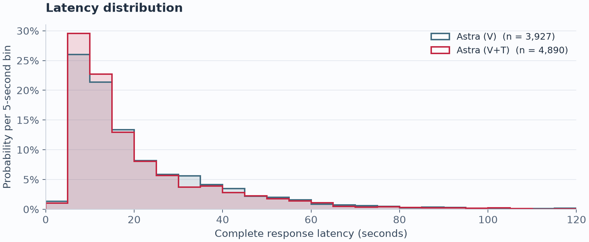

> 图解：API 响应延迟分布直方图，5 秒一个分桶，按各设置有效响应总数归一化（V 为 3,927 条，V+T 为 4,890 条）。横轴画到 120 秒为止，被省略的长尾仍计入归一化。失败请求和无输出 token 的响应不计入统计。

闭环运行中，长尾延迟会直接拖慢后续决策——每次依赖观测的修正都必须等下一次模型响应。虽然每次响应能产出多条控制动作，但响应延迟仍是端到端部署的关键瓶颈。

## 本研究的局限

作者也坦率列出了研究自身的边界：

- 全部实验在仿真中完成，真机上面对传感器噪声与漂移、标定误差、真实接触动力学和执行延迟时的鲁棒性尚待验证。
- 成本限制使多数任务每种输入设置只有 10 个 episode（而非完整 100 个），单个结果就改变任务成功率 10 个百分点；需要更大样本、多种子和重复执行来量化波动。
- 只覆盖两个基准，且使用任务特定的成功演示；对陌生物体、新任务、不同触觉传感器与机器人构型、更长多阶段操作的泛化需要系统性评估。

## 附录亮点：同场景配对对比

附录提供了六个"加触觉后提升"任务的同种子配对结局——同一评估场景、同一随机种子，V 失败而 V+T 成功，把任务级对比落到了具体轨迹上。

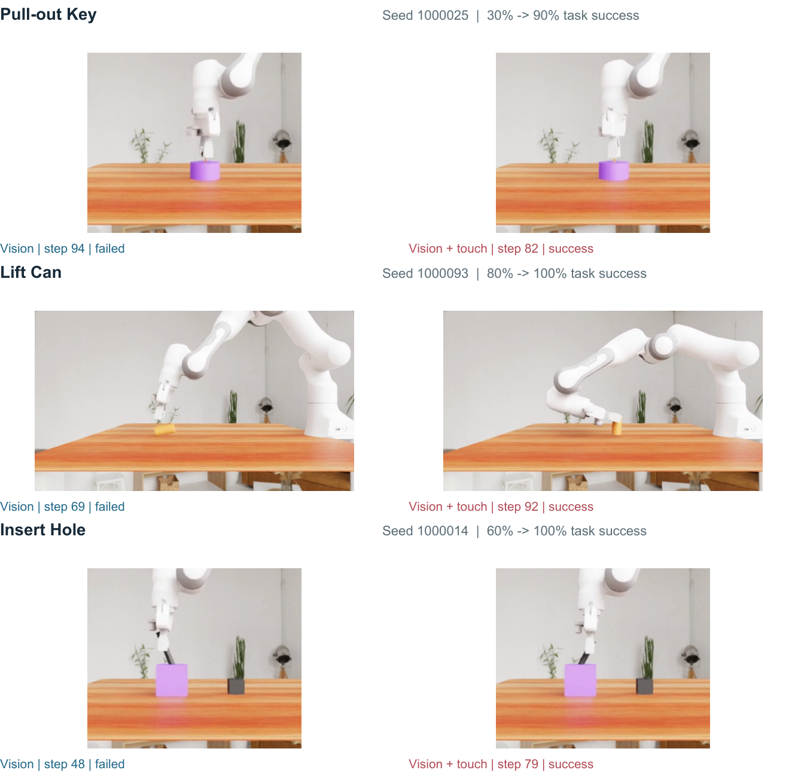

> 图解：Pull-out Key（seed 1000025）、Lift Can（1000093）、Insert Hole（1000014）三组配对的末帧。纯视觉 episode 失败，对应 V+T episode 成功。具体机制：Pull-out Key 中纯视觉运行在固定深度反复转动，而触觉运行因边缘形变增长而卸载扭矩，接触恢复圆形后开始拔出；Lift Can 中触觉运行抬升前先确认双侧保持；Insert Hole 中反向倾斜的触觉条带引导负 X 向转动，在盲孔方向上先行选择再推进。

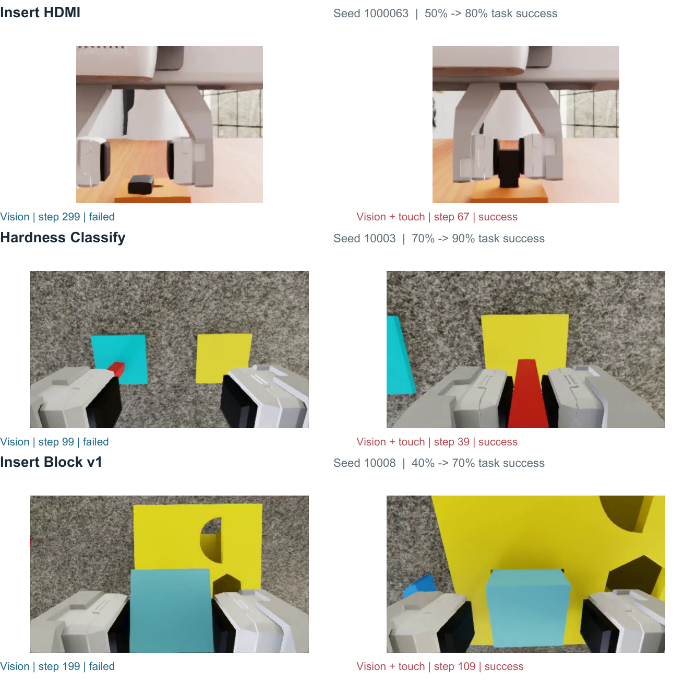

> 图解：Insert HDMI（seed 1000063）、Hardness Classify（10003）、Insert Block v1（10008）三组配对。Insert HDMI 中触觉运行把"接触在变而插头不动"解读为孔沿接触，触发卸载与前后修正；Hardness Classify 中纯视觉运行把硬块误判为软物放上蓝色托盘，触觉运行则通过探测抓握把边界锐利的压痕与硬类别关联并送往黄色托盘；Insert Block v1 中触觉运行在浅降与渐进释放前保持持握并检查对准，从搬运到释放全程维持对齐。

## 结语

- **通用模型直接读懂触觉**：GPT-6 Astra 首次被证明可以直接解释视觉式触觉图像并用于接触式操作决策，无需任何触觉策略训练。
- **成绩碾压专用基线**：V+T 设置下 UniVTAC 93.8%、OpenViTac 81.8%，分别超出最强专用基线 22.9 和 13.1 个百分点；纯视觉也已领先。
- **行为层面证据扎实**：接触状态推断、主动探测、精细调整、失败恢复四类行为表明模型确实在利用接触线索，而非碰运气。
- **视觉补偿与基准饱和并存**：精细视觉能部分替代触觉（甚至偶尔更可靠），19 个任务中 13 个已达 90% 以上，现有基准开始失去区分度。
- **短板明确**：切向受力解读、接触诊断到修正的转化、探测收敛时机，是下一步提升可靠性的具体靶点。

展望来看，这项工作开启的方向很清晰：联合视觉-触觉预训练把接触理解并入基础模型的规模化进程，而更具区分度的基准（视觉不可分辨的物理属性、更紧公差、真机验证）将检验这份能力是否扎实。专用触觉策略的护城河，可能比很多人想象中浅得多。

> 本文参考自 [GPT-6 Astra Is a Native Visuo-Tactile Policy for Contact-Rich Manipulation](http://arxiv.org/abs/2610.26846v1)