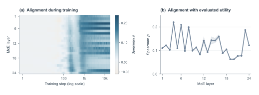
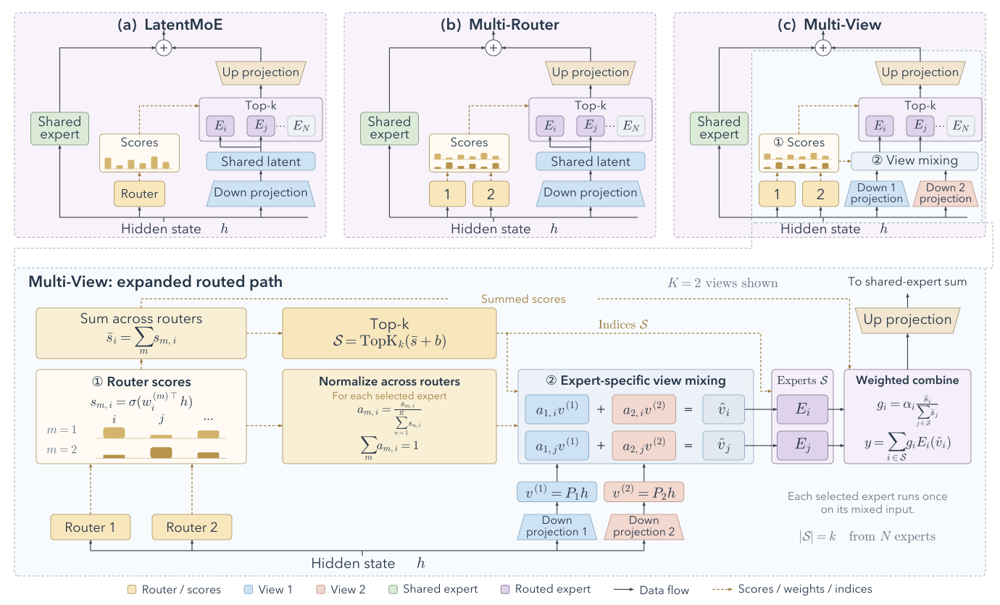
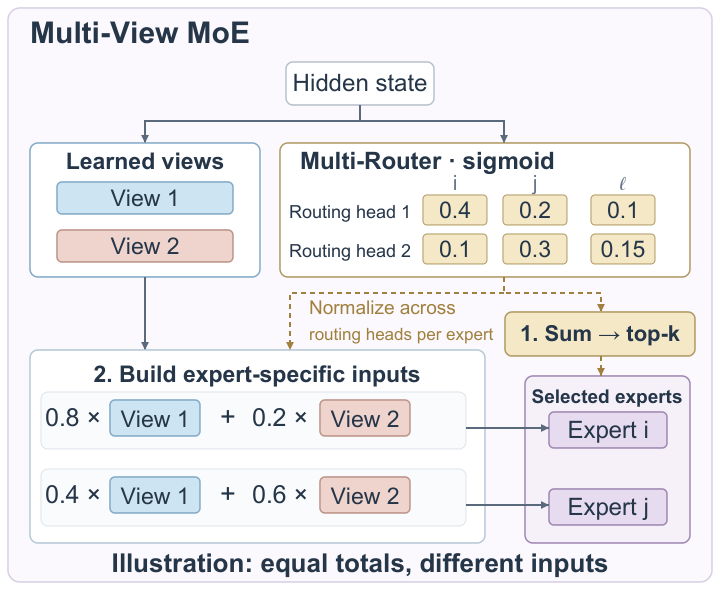
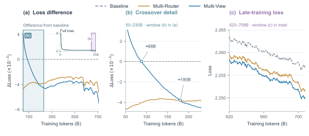
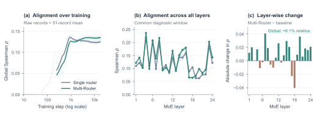
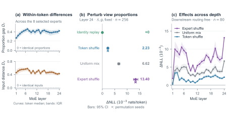
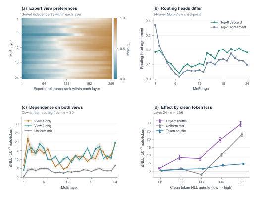
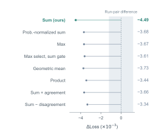

# Multi-View MoE：路由偏好重塑专家计算

稀疏 MoE 只靠一个 Router 决定“哪些专家处理 Token”，却让所有入选专家接收同一份输入，路由偏差和表示单一会同时限制模型能力。这个问题很关键：MoE 的容量扩展依赖条件计算，但选错专家不仅损失当前 Token 的信息，未选中的专家还拿不到对应的任务梯度。Multi-View MoE 的思路是让多个 Router 先共同投票选专家，再把它们对各专家的相对偏好转成不同 Latent View 的混合比例，直接塑造专家输入。在 24 层、10B 总参数且每 Token 激活约 1B 参数的模型上训练 708B Token 后，九项任务平均分从 33.07 提升到 34.25，增加 1.18 个百分点；与此同时，每个入选专家仍只计算一次，Expert FLOPs 和 All-to-All 通信量保持不变。

## 问题起点：一个 Router 的排名，并不等于专家的真实贡献

先看 LatentMoE 基线。隐藏状态 $h\in\mathbb{R}^{D}$ 经降维投影 $P\in\mathbb{R}^{d\times D}$ 得到共享输入 $z=Ph$，Router 从 $N$ 个专家中选出集合 $\mathcal{S}$，再用输出门控 $g_i$ 聚合结果：

$$
y=\sum_{i\in\mathcal{S}}g_iE_i(z),\qquad |\mathcal{S}|=k
$$

这里有两个相互独立、却常被混在一起的问题：

- **选谁**：单 Router 的分数排名，是否与专家实际输出所反映的效用排名一致？
- **怎么处理**：即使选中了 $k$ 个不同专家，它们拿到的仍然是同一个 $z$，路由分数只影响输出权重，并不改变专家看到的内容。

作者让全部 256 个专家都处理采样 Token，以归一化输出 $L^2$ 范数作为专家效用的代理指标，再比较它与 Router 分数的 Spearman 秩相关。结果显示，两者的一致性总体较弱，中层和深层尤其明显。这里的“效用”是诊断代理，而不是穷举所有专家组合得到的真实最优路由，但它足以暴露单一路由视角的局限。

> 图解：图（a）横轴是采用对数刻度的训练步，纵轴是 Router 分数与归一化专家输出范数之间的 Spearman 相关系数，对数轴放大了训练早期的变化。图（b）横轴为层号，纵轴为 201 次匹配日志测量的层内均值，阴影表示 $\pm1$ 个标准差。可以看到，不同深度的相关性存在明显差异，中深层的单路由对齐尤其弱。

已有工作分别尝试过 Router $z$-loss、Expert-Choice Routing、无辅助损失负载均衡、稳定路由和多 Router 打分，但大多仍让专家共享输入。另一条路线改变专家表示：LatentMoE 在低维 Latent Space 中计算，MH-MoE 切分 Token，MoLAE 分解专家权重，AoE 则先部分评估专家内部激活再路由。Multi-View MoE 的差异在于，它不增加专家池、不按 View 复制专家，也不分别跑多次专家，而是把路由偏好同时用于“选择”和“输入构造”。

明确了缺口之后，下一步就是设计一种既能保留多路由差异、又不重复专家计算的接口。

## 核心方法：先共同选专家，再为每个专家调配输入

### Multi-Router：在 Sigmoid 之后汇总多个判断

Multi-Router 使用 $R$ 个独立初始化的路由头。每个路由头都从完整隐藏状态 $h$ 给全部专家打分，各自经过 Sigmoid 后再求和，最后只执行一次 Top-$k$：

$$
\bar{s}_i=\sum_{r=1}^{R}\sigma\!\left(w_i^{(r)\top}h\right),\qquad
\mathcal{S}=\operatorname{TopK}_k(\bar{s}+b)
$$

其中 $b$ 是原骨干网络的专家负载均衡偏置，**只参与选择**。输出门控使用未加偏置的分数和，在已选专家之间归一化：

$$
g_i=\alpha_i\frac{\bar{s}_i}{\sum_{j\in\mathcal{S}}\bar{s}_j},\qquad i\in\mathcal{S}
$$

$\alpha_i$ 是骨干原有的专家输出缩放系数。求和放在 Sigmoid 之后是必要条件：如果先加 Logit，就有

$$
\sum_r w_i^{(r)\top}h=\left(\sum_r w_i^{(r)}\right)^\top h
$$

多个线性路由头会退化成一个权重为 $\sum_r w_i^{(r)}$ 的线性打分器，所谓“多视角”也随之消失。先经过各自的非线性再求和，既允许一个 Router 的强烈偏好把专家推入前列，也允许多个 Router 的共同支持累积起来。

### Multi-View：把相对路由偏好变成 View 混合比例

完整方法将 $R$ 个路由头与 $K$ 个 Latent View 一一配对，因此 $R=K$。第 $m$ 个 View 由独立投影得到：

$$
v^{(m)}=P_mh\in\mathbb{R}^{d}
$$

对每个已选专家 $i$，不是跨专家归一化，而是把**该专家在不同 Router 下的原始 Sigmoid 分数**跨 Router 归一化：

$$
a_{m,i}=\frac{s_{m,i}}{\sum_{n=1}^{R}s_{n,i}},\qquad
\sum_{m=1}^{K}a_{m,i}=1
$$

再用这些系数构造专家专属输入，并完成一次专家前向计算：

$$
\hat{v}_i=\sum_m a_{m,i}v^{(m)},\qquad
y=\sum_{i\in\mathcal{S}}g_iE_i\!\left(\hat{v}_i\right)
$$

这也等价于为每个 Token–Expert 对生成一个动态有效投影 $P_{\mathrm{eff},i}(h)=\sum_m a_{m,i}(h)P_m$。实现时只混合投影后的向量，并不真的为每个配对构造矩阵。

> 图解：顶部（a）是 LatentMoE，单 Router 与单一共享 Latent 输入；（b）是 Multi-Router，多个 Sigmoid 路由头的分数求和后做 Top-$k$，专家输入仍共享；（c）是 Multi-View，增加独立降维投影，并按专家混合 View。底部展开（c）的路由专家路径：原始分数跨 Router 归一化为 $a_{m,i}$，混合在专家计算之前完成，每个入选专家只运行一次。偏置 $b$ 只用于选择，输出门控 $g_i$ 仍按选中专家集合归一化。

为什么总分相同还不够？看下面这个双 View 示例就清楚了。

> 图解：专家 $i$ 的两个分数为 $(0.4,0.1)$，专家 $j$ 为 $(0.2,0.3)$，总分都为 $0.5$，但跨 Router 归一化后的 View 比例分别为 $(0.8,0.2)$ 和 $(0.4,0.6)$。因此，求和决定它们能否被选中和输出多重，比例则决定它们各自看到怎样的混合输入。两个路由头与两个 View 读取同一个隐藏状态，示例中负载均衡偏置设为零。

笔者认为，这个设计最聪明的地方是**没有另起一个混合网络**。路由头本来就要为每个专家产生分数，Multi-View 只是保留求和前被抹掉的相对偏好，再把它解释为投影基的系数，新增参数和计算都集中在轻量的投影与路由接口上。

### 一次前向计算的完整流程

1. 计算 $K$ 个 Latent View：$v^{(m)}=P_mh$。
2. 每个路由头给全部 $N$ 个专家打分，得到 $s_{m,i}$，求和并加偏置后执行一次全局 Top-$k$。
3. 对每个入选专家，跨路由头归一化其原始分数，得到 $a_{m,i}$。
4. 在源设备上混合出 $\hat v_i$，计算输出门控 $g_i$，再把一个 $d$ 维向量派发给对应专家。
5. 专家各运行一次，按 $g_i$ 聚合输出，后续升维投影和共享专家路径保持原样。

这里不是“按 View 分别运行再混合输出”。对非线性专家 $E_i$，一般有：

$$
E_i\!\left(\sum_m a_{m,i}v^{(m)}\right)
\neq
\sum_m a_{m,i}E_i(v^{(m)})
$$

左侧只需一次专家计算，右侧则需要 $K$ 次，这正是两者的成本差异。

### 初始化、退化关系与可组合性

为避免训练一开始就引入剧烈扰动，View 1 保留骨干投影 $P$，其余 View 采用渐进扰动：

$$
v^{(m)}=Ph+\gamma(t)\Delta P_mh
$$

$\gamma(t)$ 在训练早期从 0 增至 1。初始时所有 View 相同，随后在没有显式多样性损失的情况下，通过不同 Token 和专家传来的梯度自然分化。

如果始终令 $P_m=P$，由于 $\sum_m a_{m,i}=1$，就有 $\hat v_i=Ph=z$，完整模型退化为 Multi-Router。反过来，如果同一 Token 的所有专家共享 $a_{m,i}=a_m(h)$，它们仍会收到相同输入；若 $a_m$ 再固定为常数，整个混合甚至能吸收进一个固定投影。因此，公式里的专家下标 $i$ 不是细节，而是实现“同 Token、不同专家、不同输入”的关键。

从已有 LatentMoE Checkpoint 热启动时，也可保留 View 1 的投影和路由头，其余投影加小扰动、额外路由头置零。新增路由头会给所有专家加相同常数，因此原始排序和加偏置后的选择不变，但归一化输出门控通常会变化，不能说整个前向完全等价。

该方法只修改 MoE 的降维投影、Router 和派发前排列步骤。Attention、KV Cache、词表、Embedding、专家块、升维投影与专家并行布局均不变；在架构设计上可与 MLA、Hyper-Connections、MTP、细粒度专家、共享专家和无辅助损失均衡组合。

## 实验设置：10B-A1B 骨干，所有主结果统一到 708B Token

主实验比较 LatentMoE、双路由头 Multi-Router 和双 View Multi-View。三者共享训练数据、Token 预算、骨干和优化设置，每次只改一个实验因素。模型配置如下。

| 组件 | 配置 |
|---|---|
| 总参数 / 激活参数 | 约 10B / 约 1B |
| 层数 / 隐藏维度 $D$ | 24 / 1024 |
| Normalization / Embedding | RMSNorm / 不共享输入输出权重 |
| Attention | MLA，16 个头，带输出门控 |
| Query / KV Latent Rank | 512 / 512 |
| 每头 QK 维度（无 RoPE + RoPE） | 192 + 64 |
| 每头 Value 维度 | 256 |
| QK-Norm / RoPE Base | 是 / $10^4$ |
| MoE 层 | 全部 24 层，无前置 Dense FFN |
| Latent 维度 $d$ | 512 |
| Routed Expert / 每 Token 激活数 | 256 / 8 |
| Routed Expert FFN | SwiGLU，中间维度 1024 |
| Shared Expert | 1 个，始终激活，中间维度 1024 |
| 负载均衡 | Expert Bias，更新率 $10^{-4}$，辅助损失系数为 0 |
| MTP | 1 个模块，Dense FFN 中间维度 5120，Loss 权重 0.3 |

序列长度为 4096，全局 Batch 为 1920 条序列，每步约 7.9M Token。矩阵参数使用 Muon（Momentum 0.95，5 次 Newton–Schulz 迭代），Embedding、输出头、偏置和 Router 权重使用 AdamW，$\beta=(0.9,0.95)$、$\epsilon=10^{-15}$。峰值学习率为 $6\times10^{-4}$，Warmup 1000 步后采用 Warmup–Stable–Decay 调度；Weight Decay 为 0.1，梯度裁剪为 1.0，训练采用 BF16 与 FP8 E4M3 矩阵乘法、8 路专家并行，随机种子为 42。

下游评测使用第 90K 步、约 708B Token 的 Checkpoint。CMMLU、MMLU、MMLU-Redux、MMLU-Pro 和 BBH 使用 5-shot，GPQA 使用 10-shot，均不输出思维链；HotpotQA、SimpleQA 和 PreciseWikiQA 使用 10-shot 与思维链，并由 DeepSeek-V4-Flash 作为 LLM Judge 评分。组均值和九任务总均值均为不加权平均。

由于消融中的 Loss 差异只有 $10^{-3}$ 量级，作者还设置了可比性参照：一对近乎相同的训练在平滑后最大相差 $1.2\times10^{-3}$，平均绝对差为 $7\times10^{-4}$。小于这一量级的差异不宜被解释为稳定收益。

## 主结果：平均提升 1.18 点，但并非所有任务都受益

| 方法 | CMMLU | MMLU | Redux | Pro | Exams Avg. | HotpotQA | SimpleQA | PreciseWiki | Knowledge Avg. | GPQA | BBH | Overall |
|---|---:|---:|---:|---:|---:|---:|---:|---:|---:|---:|---:|---:|
| Baseline（LatentMoE） | 53.71 | 57.48 | 59.03 | 27.28 | 49.38 | 22.00 | 3.35 | 8.64 | 11.33 | 30.00 | 36.10 | 33.07 |
| Multi-Router（$R=2$） | 53.77 | 57.50 | 58.90 | **27.71** | 49.47 | 22.13 | **3.85** | **9.16** | **11.71** | 32.86 | **37.31** | 33.69 |
| Multi-View（$K=2$） | **55.20** | **58.67** | **60.93** | 27.12 | **50.48** | **22.54** | 3.41 | 9.02 | 11.66 | **35.60** | 35.76 | **34.25** |
| MV − Baseline | +1.49 | +1.19 | +1.90 | −0.16 | +1.10 | +0.54 | +0.06 | +0.38 | +0.33 | +5.60 | −0.34 | +1.18 |

Multi-Router 单独带来 0.62 个百分点，完整 Multi-View 在此基础上再增加 0.56 个百分点。相较 Multi-Router，Multi-View 在 GPQA 和 MMLU-Redux 上分别提高 2.74 和 2.03 点；但 MMLU-Pro 与 BBH 低于基线，知识组均值也略低于 Multi-Router。因此，更准确的结论是**平均分改善明显、任务间收益并不均匀**。

训练后期也呈现一致趋势。最后 1000 个未平滑步骤的平均 Loss 分别为 2.25621、2.25047 和 2.24883：Multi-Router 比基线低 $5.74\times10^{-3}$，Multi-View 的降幅扩大到 $7.38\times10^{-3}$。

> 图解：图（a）展示 Multi-Router、Multi-View 相对基线的 Loss 差，内嵌小图给出完整 Loss 轨迹；（b）放大（a）中 50B–230B Token 区间；（c）放大 620B–708B Token 的绝对 Loss。横轴均为训练 Token 数，纵轴分别为 Loss 差或绝对 Loss。所有曲线采用相同的因果 EMA，Span 为 2000 步、$\alpha=2/2001$；正文最终 Loss 则取最后 1000 个未平滑步骤的均值。

平均指标说明了“有效”，还不能说明“为何有效”。作者接下来分别检查路由排名和专家输入，避免只凭下游分数推测机制。

## 机制验证一：多路由确实更贴近专家输出效用

对采样 Token 集合 $T$，作者先让全部专家处理 Latent 输入 $z_t$，并消除不同专家平均输出尺度的影响：

$$
q_{t,i}=\lVert E_i(z_t)\rVert_2,\qquad
\mu_i=\frac{1}{|T|}\sum_{t\in T}q_{t,i},\qquad
u_{t,i}=\frac{q_{t,i}}{\mu_i}
$$

随后在每个 Token 的全部 $N$ 个专家上计算秩相关：

$$
\rho_t=\operatorname{Corr}\!\left(\operatorname{rank}(s_t),\operatorname{rank}(u_t)\right)
$$

基线的 $s_t$ 是单路由头分数，Multi-Router 则使用各路由头分数之和，二者都不含负载均衡偏置。Token 级结果先在 Microbatch 内平均，再跨并行 Rank 和 Microbatch 得到层均值，最后对 24 层取全局均值。分层统计使用两种模型都有的最后 201 条匹配日志。

| 方法 | 全局 Spearman $\rho$ |
|---|---:|
| Single Router | 0.1245 |
| Multi-Router | **0.1346** |

> 图解：图（a）横轴为训练过程，纵轴为全局 Spearman 相关，浅色线是原始测量，实线是 51 条记录的滑动均值；（b）横轴为层号，纵轴是 201 次测量的层均值，阴影为一个标准差；（c）展示 24 层的相关变化。Multi-Router 的全局相关相对提高 8.1%，在 17/24 层取得收益，并非层层提升。

提升最大的相对变化出现在第 20 层，相关系数从 0.0625 增至 0.0986，相对提高 57.7%；最大绝对提升在第 7 层，从 0.0982 增至 0.1388。需要再次强调，输出范数只是专家效用代理，实验支持的是“与这一代理更对齐”，不能直接等同于找到了真实最优专家组合。

## 机制验证二：专家输入不同，而且这种对应关系会被模型利用

### 两个 View 和八份专家输入确实发生了分化

在 708B Token 的双 View Checkpoint 上，两个路由头的 Top-8 Jaccard 指数跨层平均只有 0.145，Top-1 一致率平均为 11.2%，说明它们学到了不同偏好，而不是简单复制。

对每个 Token 的 8 个入选专家，作者比较全部 28 个专家配对。$D_r$ 衡量 View 1 比例的平均绝对差，$D_v$ 衡量归一化后的专家输入距离：

$$
D_r(t)=\frac{2}{k(k-1)}\sum_{\substack{i<j\\i,j\in\mathcal{S}_t}}|r_{1,i}(t)-r_{1,j}(t)|
$$

$$
D_v(t)=\frac{\frac{2}{k(k-1)}\sum_{\substack{i<j\\i,j\in\mathcal{S}_t}}\lVert\hat v_i(t)-\hat v_j(t)\rVert_2}{\frac{1}{k}\sum_{i\in\mathcal{S}_t}\lVert\hat v_i(t)\rVert_2}
$$

若所有入选专家的比例或输入相同，对应指标就是 0。实际跨层中位数分别为 $D_r=0.27$–$0.46$、$D_v=0.42$–$0.58$。两个 View 本身的平均余弦相似度跨层为 0.059–0.530，View 间距范数除以两 View 平均范数后为 0.969–1.380，说明投影也已分化。

> 图解：（a）上半部分纵轴为同一 Token 的入选专家之间 View 1 比例差 $D_r$，下半部分为归一化输入距离 $D_v$，横轴均为层号；曲线是 Token 中位数，带区为 25%–75% 分位数。（b）是最后一层在 256 条序列上的干预结果，纵轴 $\Delta$NLL 为干预 Loss 减原始 Loss，须线为 95% 序列 Bootstrap 置信区间，叉号为不同排列种子的均值；干预时选中专家与输出门控保持数值精度不变。（c）横轴为被单独干预的层，展示 80 条序列扫描中的总效应，带区为逐层点估计的 95% 置信区间，后续层路由会重新计算。

### 固定专家与门控，只打乱 View 比例

主干预评估使用 256 条留出序列，每条 4096 个输入 Token，共 1,048,320 个下一 Token 预测；干净 Checkpoint 的 NLL 为 2.17617 nats/token，评估不更新参数。对替换比例 $r'_{1,i}$，派发通道重建为 $(g_ir'_{1,i},g_i(1-r'_{1,i}))$，两者之和仍是原门控 $g_i$。

| 最后一层干预 | $\Delta$NLL（$10^{-3}$ nats/token） | 95% CI |
|---|---:|---:|
| Identity Replay | 0.0003 | [−0.001, 0.002] |
| Token Permutation | 2.23 | [2.05, 2.41] |
| Uniform Mixture | 6.62 | [6.20, 7.09] |
| Expert Permutation | 13.40 | [12.56, 14.35] |
| View 1 Only | 18.81 | [17.58, 20.12] |
| View 2 Only | 20.42 | [19.32, 21.56] |

Expert Permutation 在同一 Token 的 8 个专家间打乱比例，NLL 增加 0.01340，且 256 条序列的平均 NLL 全部上升；Token Permutation 在同一专家的不同 Token 间打乱比例，NLL 增加 0.00223。均匀混合和只保留单一 View 也都造成损害。三组主要干预中，View 1 比例的平均绝对改变量分别为 0.408、0.117 和 0.331，因此不能把效果大小简单理解为同一扰动强度下的排序，但所有结果共同表明，模型确实利用了“Token—专家—混合比例”的对应关系，而非只把 View 当作冗余分支。

逐层扫描进一步显示，Expert Permutation 与 Uniform Mixing 在全部 24 层都提高 NLL，点估计的 95% 置信区间均高于 0；两种单 View 干预也在每个扫描层造成损害。

> 图解：（a）横轴为每层独立排序后的专家名次，纵轴为各专家被选中时的平均 View 1 比例 $r_{1,i}$，展示专家偏好的分布；（b）横轴为层号，展示两个路由头在 256 条序列上的 Top-$k$ 一致性；（c）横轴为层号，纵轴为单 View 干预带来的 $\Delta$NLL，使用 80 条序列并重新计算后续路由，带区为逐点 95% 置信区间；（d）横轴是按干净 Token NLL 等分的五组预测，纵轴为最后一层干预效应，误差线为 95% 区间，每组含 209,664 个预测。

补充统计中，Token 内因素解释了 View 比例方差的 84.8%–88.7%，专家 ID 分组解释 28.0%–73.4%；两路由头 Top-8 Jaccard 跨层范围为 0.039–0.211，Top-1 一致率为 1.5%–37.2%。按干净 NLL 分组后，Expert Permutation 在最高 Loss 组的影响最大，$\Delta$NLL 为 0.02936，最低组仅 0.00170；Uniform Mixing 在中间组出现 −0.00206 的局部负效应，说明“均匀混合在所有 Token 上必然更差”也不成立，最强干预效应主要集中在高 Loss 预测上。

作者还做了执行路径核验：16 条序列上的不同干预收到相同专家 ID，输出门控相对误差至多 $1.2\times10^{-7}$，实际 View 比例与目标值误差至多 $6.0\times10^{-8}$。最后一层 Identity Replay 的平均 NLL 变化仅 $2.95\times10^{-7}$，95% 区间跨 0。浅层微小舍入差异可能改变后续 Top-$k$，所以逐层扫描估计的是包含下游响应的总效应，而不是严格的单层局部效应。

## 消融实验：方向稳定，但算子之间的细微差异不宜过度解读

### 路由头数量、融合位置与融合算子

下表 Loss 差均相对单路由基线，并在共同消融 Checkpoint 附近 $\pm1\%$ Token 窗口内平均，负值表示更好。

| 变体 | $\Delta$Loss vs. Baseline |
|---|---:|
| Single Router（Baseline，Loss 2.3825） | 0.0000 |
| Multi-Router（$R=2$，Sigmoid-Sum） | −0.0045 |
| Multi-Router（$R=3$） | −0.0051 |
| Logit-Sum（$R=2$） | 退化为单 Router |
| Probability-Normalized Sum（$R=2$） | −0.0037 |
| Max $\max(s_1,s_2)$ | −0.0037 |
| Max 选择、Sum 门控 | −0.0036 |
| Geometric Mean $\sqrt{s_1s_2}$ | −0.0037 |
| Product $s_1s_2$ | −0.0034 |
| Sum $+\lambda s_1s_2$（一致性奖励） | −0.0037 |
| Sum $-\lambda|s_1-s_2|$（分歧惩罚） | −0.0033 |
| 观测到的 Run-Pair 差异 | $\pm0.0012$ |

三个路由头比两个多降低 0.0006，小于 Run-Pair 的 0.0012 差异，因此默认采用两个是更克制的选择。所有测试的 Sigmoid 后融合算子都比基线好，Loss 降幅为 0.0033–0.0045，但算子间差距也落在 Run-Pair 差异内，不能据此宣称 Sum 显著优于其他算子。

> 图解：横轴列出 $R=2$ 时的融合变体，纵轴为相对基线的训练 Loss 变化，负值表示改善；阴影范围给出观测到的 Run-Pair 差异。所有被评测变体均优于单路由基线，但多数算子间距小于这一经验噪声参照。

Sum 的设计优势主要不是这张表里的数值领先，而是性质简单：Product 或 Geometric Mean 会让任意一个接近 0 的分数强烈压制专家，Sum 则同时容纳“单头强支持”和“多头共同支持”；它还能把输出门控自然分解为各路由头的加性贡献，并直接复用原始分数构造 View 比例。

### 学习型混合权重与梯度耦合

| 变体（$K=2$） | $\Delta$Loss vs. Baseline |
|---|---:|
| Multi-Router（$R=2$） | −0.0045 |
| Decoupled Gate，初始化 0.5 | −0.0048 |
| Decoupled Gate，非对称初始化 | −0.0050 |
| Two Independent Gates | −0.0044 |
| Coupled Views（梯度流向 View） | −0.0024 |
| Detached Views（切断权重到 View 的梯度） | +0.0090 |
| 观测到的 Run-Pair 差异 | $\pm0.0012$ |

三种额外学习每专家混合参数的方案也降低了 Loss，说明“专家专属输入调制”本身有价值；主方法改用 Router 分数产生权重，省去了独立混合网络。另一个 View-Fed Scoring 配置中，切断混合权重到 View 的梯度后，Loss 差从 −0.0024 变为 +0.0090，恶化 0.0114。固定参数时前向权重不变，因此这项对照隔离出的是梯度通路的作用，不过它属于特定 View-Fed 消融配置，不应直接当作主方法全部收益的来源。

## 成本与实现：不是零开销，但保住了专家计算和通信预算

设 MoE 层数为 $L$，隐藏维度为 $D$，Latent 维度为 $d$，专家总数为 $N$，每 Token 激活 $k$ 个。主配置 $R=K$ 时，每层增加 $K-1$ 个 $d\times D$ 投影和 $R-1$ 个 $D\times N$ 路由头：

$$
\Delta\theta_{\mathrm{layer}}=(K-1)D(d+N),\qquad
\Delta\theta_{\mathrm{model}}=L\Delta\theta_{\mathrm{layer}}
$$

代入 $L=24$、$K=2$、$D=1024$、$d=512$、$N=256$，Multi-View 每层增加 786,432 个参数，全模型增加 18,874,368 个，约占 10B 骨干的 0.19%。Multi-Router 只增加路由头，每层 262,144 个、全模型 6,291,456 个，约占 0.06%；Multi-View 相对 Multi-Router 新增的投影约占 0.13%。

额外前向计算主要来自投影、打分和混合。按一次 MAC 等于两次 FLOPs 计算，每 Token、每层近似增加：

$$
\Delta F_{\mathrm{forward}}\simeq 2(K-1)D(d+N)+kd(2K-1),\qquad K\ge2
$$

专家块本身的 FLOPs 不变。更关键的是通信实现：源设备先为每个 Token–Expert 配对混合出一个 $d$ 维向量，再按专家目的地派发。每 Token 仍发送 $k$ 个 $d$ 维向量；若把 $K$ 个 View 全部发到专家端再混合，All-to-All 通信量才会扩大 $K$ 倍。

| 变体 | Expert FLOPs（相对骨干） | Throughput（tokens/s/card） |
|---|---:|---:|
| Multi-Router（$R=2$） | $1.00\times$ | 17,375 |
| Geometric Mean | $1.00\times$ | 17,424 |
| Product | $1.00\times$ | 17,564 |
| Coupled Views | $1.00\times$ | 16,449 |
| Detached Views | $1.00\times$ | 16,908 |

这些 Throughput 来自同一集群上的特定消融配置，其中 Coupled/Detached 使用 View-Fed Scoring，不能直接视为最终 Score-Derived Multi-View 的完整吞吐对比。可以确定的是：方法并非没有投影和路由开销，其“成本保持”特指激活专家数、专家块 FLOPs 与 All-to-All 通信量。

负载均衡也只在聚合后的专家选择上执行一次，不为每个 View 添加配额或辅助损失。全局负载并没有因 View 分化而恶化：Multi-View 的聚合负载变异系数（CV）为 0.854，基线为 0.862；聚合有效专家数为 188.7，基线为 187.6（总数 256）。两个单 View 的有效专家数分别为 149.0 和 150.2，约为专家池的 58%，聚合后则约为 74%。这说明每个 View 可以更集中于自己的专家子集，同时合并后的专家使用仍然较广。

## 总结：Router 不只决定“选谁”，也能决定“怎么算”

- **问题定位**：单 Router 分数与归一化专家输出效用的秩相关偏弱，传统 MoE 又让所有入选专家共享同一输入。
- **方法核心**：Multi-Router 在 Sigmoid 后汇总独立路由头并统一 Top-$k$；Multi-View 再把每个专家的相对路由分数变成 Latent View 混合系数。
- **主要收益**：10B-A1B、708B Token 实验中，九任务均值提高 1.18 个百分点至 34.25，最终训练 Loss 比基线低 0.00738。
- **机制证据**：全局分数—效用代理相关相对提高 8.1%；固定专家与门控后打乱 View 对应关系会提高 NLL，说明模型真正利用了专家输入差异。
- **成本边界**：参数增加约 0.19%，额外投影和打分仍有开销，但激活专家数、Expert FLOPs 和 All-to-All 通信量保持不变。

目前证据仍局限于单一 24 层 10B-A1B 骨干、共享训练种子、708B Token Checkpoint 和九项任务，输出范数也只是专家效用代理；下一步需要在更多规模、种子与训练阶段上验证收益，并检验多 View 设计能否稳定迁移到其他 MoE 架构。

> 本文参考自 [Multi-View MoE: Letting Every Router Shape Expert Computation](http://arxiv.org/abs/2610.40577v1)