# LSA：10M 上下文单层提速 72.4 倍

当上下文扩展到 1000 万 Token，拖慢稀疏注意力的往往不是注意力计算本身，而是为每个 Query 扫描全部 Key 的 Indexer。这个瓶颈直接卡住长周期科研、代码 Agent 等应用的响应速度。Latent Sparse Attention（LSA）把 Key 聚类到学习得到的潜空间，让 Query 搜索簇中心而非逐个扫描，并同时提供蒸馏版 D-LSA 和原生训练版 N-LSA。在 10M Token 下，D-LSA 让 Qwen-3.8-27B 的单个注意力层 Prefill 和 Decode 分别提速 **72.4×** 和 **42.5×**；在 GLM-5.3-Flash 上相对原生稀疏注意力也分别达到 **22.7×** 和 **4.6×**，其中 Flat 版本的准确率整体接近各自基线。

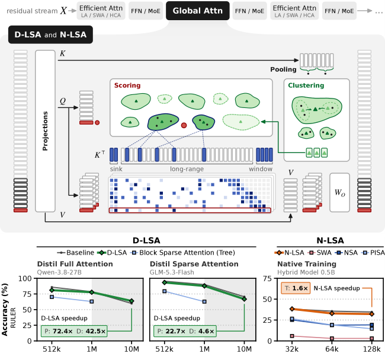

> 图解：上方是一个全局注意力层被替换为 LSA 后的流程：Key 经过池化和语义聚类，Query 对桶中心打分，只读取被选中的长程 Key，并额外保留 Sink 与局部 Window。下方对比两条路线：D-LSA 可蒸馏到已有的 Full Attention 或 Sparse Attention 模型中；N-LSA 则从头参与训练。图中 P、D、T 分别指 Prefill、Decode 和 Training，最醒目的收益出现在超长上下文，而不是短上下文。

## 一、稀疏注意力为什么还会慢？

Full Attention 中，每个 Query 都关注此前的全部 Key。上下文长度为 $T$ 时，Prefill 的计算量为 $\mathcal{O}(T^2)$，每解码一个 Token 的计算量为 $\mathcal{O}(T)$。

Sparse Attention 增加一个 Indexer：先选出约 $k$ 个重要 Key，再做注意力。若 $k$ 固定，注意力本身的 Prefill 和 Decode 分别降为 $\mathcal{O}(Tk)$ 与 $\mathcal{O}(k)$。问题在于，传统 Indexer 仍要扫描全部历史 Key 或全部 Block，因此索引阶段依然是 $\mathcal{O}(T^2)$ 和 $\mathcal{O}(T)$，只是常数更小。

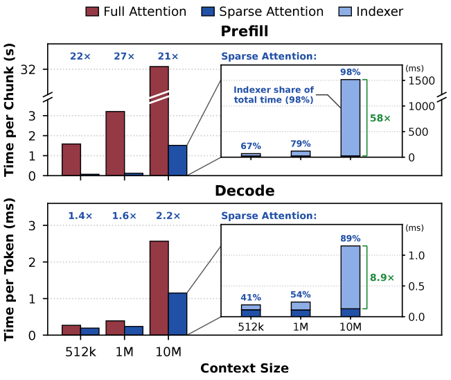

> 图解：实验使用 GLM-5.3-Flash 的一个全局注意力层和单张 H200。上图为包含 32,768 个 Query 的最后一个 Prefill Chunk，纵轴为每 Chunk 秒数；下图为单请求 Decode，纵轴为每 Token 毫秒数，横轴均为上下文长度。10M Token 时，Indexer 占稀疏注意力 Prefill 时间的 **98%**、Decode 时间的 **89%**。如果索引完全免费，理论上还能在现有稀疏注意力之上再加速 58× 和 8.9×，说明“找 Key”已经取代“算注意力”成为主瓶颈。

### 稀疏化本身可行，难的是低成本地找对 Key

论文先用 Top-$k$ Oracle Attention 做了一个理想化实验：直接知道每个 Query 真正最该关注的 Key，再观察只保留这些 Key 会损失多少准确率。

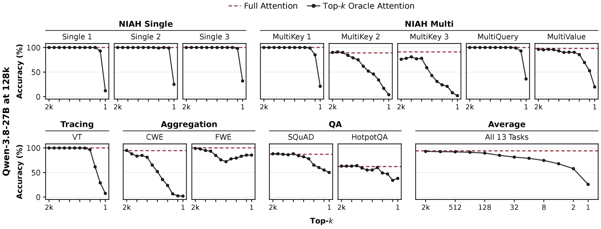

> 图解：横轴是每个 Query 保留的长程 Key 数 $k$，纵轴是 Qwen-3.8-27B 在 128k Token、RULER 各子任务上的准确率；红色虚线为 Full Attention。$k=512$ 时，每个 Query 仅关注约 **0.8%** 的 Key，13 项任务平均仍保留 Full Attention 的 **98%** 准确率。单针检索甚至到 $k=16$ 都很稳，而 MultiKey 2、MultiKey 3 和 CWE 更早下降，说明难点集中在多事实检索与聚合，而非所有任务都同样脆弱。

这也给出了 LSA 的准确问题定义：**不是简单地少看 Key，而是在不扫描全部 Key 的前提下，尽量找对那小部分 Key。**

### 从位置分块到语义聚类

已有 Indexer 可以按“打分的单位”分成三类：

- **Token Sparse Attention**：轻量 Indexer 逐个给 Key 打分，例如 DSA。
- **Block Sparse Attention**：按位置把相邻 Key 合成 Block，再给 Block 打分，例如 QSA、NSA、MoBA。
- **Semantic Sparse Attention**：按内容相似度聚类，每个簇用中心向量表示，例如 ClusterKV、RetroInfer，以及本文 LSA。

搜索结构又有 Flat、Fixed 和 Tree 三种。Flat 扫描所有组，单 Query 成本为 $\mathcal{O}(T)$；Fixed 使用固定的浅层结构，但总体仍随 $T$ 线性增长；Tree 只展开保留下来的分支，理想情况下单 Query 只需 $\mathcal{O}(\log T)$ 次打分。

| 方法 | 训练方式 | Prefill / Decode 加速 | 组织与搜索 | 最大准确率 / 性能评测上下文 |
|---|---|---|---|---|
| DSA | 蒸馏 | 支持 / 支持 | Token；Flat | 128k / 128k |
| MiniMax SA | 蒸馏 | 支持 / 支持 | Token；Flat | 128k / 1M |
| CSA | 蒸馏 | 支持 / 支持 | 连续 Key 压缩；Flat | 1M / 1M |
| QSA | 蒸馏 | 支持 / 支持 | 连续 Key 压缩；Flat | 1M / 1M |
| GLM-5.3-Flash SA | 蒸馏 | 支持 / 支持 | 连续 Key 压缩；Flat | 1M / 1M |
| NSA | 原生训练 | 支持 / 支持 | 连续 Key 压缩；Flat | 64k / 64k |
| HSA-UltraLong | 原生训练 | 支持 / 支持 | 连续 Key 压缩；Flat | 16M / 256k |
| MoBA | 原生训练 | 支持 / 支持 | 连续 Key 压缩；Flat | 1M / 10M |
| SeerAttention | 蒸馏 | 支持 / 支持 | 连续 Key 压缩；Flat | 128k / 128k |
| LongCat LSA | 部分免训练、蒸馏 | 支持 / 支持 | 连续 Key 压缩；Fixed | 1M / 1M |
| HISA | 免训练 | 支持 / 支持 | 连续 Key 压缩；Fixed | 128k / 128k |
| HiP | 免训练 | 支持 / 支持 | 连续 Key 压缩；Tree | 128k / 512k |
| PISA | 原生训练 | 支持 / 支持 | 连续 Key 压缩；Tree | 16k / 256k |
| ClusterKV | 免训练 | 不支持 / 支持 | 语义聚类；Flat | 32k / 32k |
| RetroInfer | 免训练 | 不支持 / 支持 | 语义聚类；Flat | 1M / 1M |
| Squeezed Attention | 免训练 | 部分支持 / 支持 | 语义聚类；Fixed | 32k / 512k |
| Multipole Attention | 免训练 | 不支持 / 支持 | 语义聚类；Fixed | 128k / 128k |
| LycheeCluster | 免训练 | 不支持 / 支持 | 序列压缩 + 语义聚类；Fixed | 128k / 72k |
| IceCache | 免训练 | 不支持 / 支持 | 语义聚类；Tree | 250k / 300k |
| **LSA** | **免训练、蒸馏、原生训练** | **支持 / 支持** | **序列压缩 + 语义聚类；Flat / Tree** | **10M / 10M** |

这张对比表也点出了 LSA 的差异：过去的语义方法多集中于推理期，且很少验证 1M 以上的准确率；LSA 则同时覆盖蒸馏与原生训练、Prefill 与 Decode，并在 10M Token 上评估。

## 二、LSA：先建语义目录，再按目录取 Key

LSA 的直觉很像图书馆检索：不再逐页翻完所有藏书，而是先按主题建立目录，Query 只查最相关的几个主题，再取回其中的具体条目。严格来说，主题就是 Key 在索引潜空间中的簇，目录项是簇中心，取回条目则是把选中的桶展开为原始 KV Cache 位置。

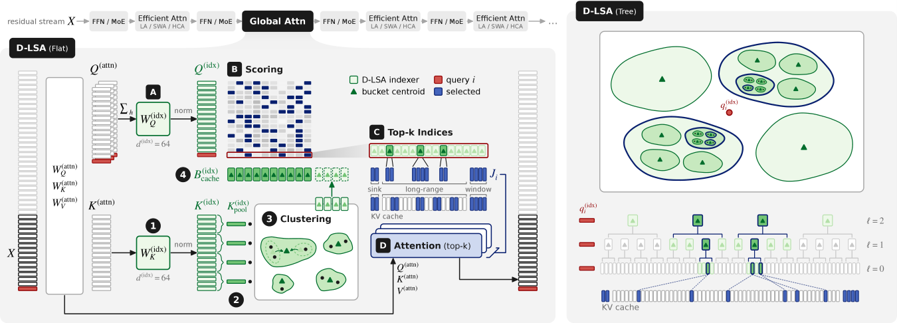

> 图解：左侧 Flat 流程中，Key 依次经过投影与 L2 归一化、4:1 池化、Ward 层次聚类，形成包含中心向量和位置表的 Bucket Cache；Query 汇总各注意力头后投影到同一空间，给所有桶中心打分，取 Top-$p$ 桶并展开为 Top-$k$ 长程 Key，最后加上 Sink 与 Window 做稀疏注意力。右侧 Tree 把桶继续组织成多层节点，Query 用 Beam Search 逐层下行。绿色三角形是中心向量，红色是当前 Query，蓝色是最终选中的 KV Cache 位置。

### Key 侧：归一化、池化、聚类、缓存

**第一步是统一度量。**每个索引 Key $k_j^{(\mathrm{idx})}$ 都做 L2 归一化，Query 也采用同样处理。这样，点积只比较方向，不受向量长度影响。

**第二步是 4:1 池化。**每 $n_{\mathrm{pool}}=4$ 个相邻索引 Key 求和，得到一个 Pool Key。聚类对象因而从 $T$ 个降为 $T/4$ 个。这一步延续 CSA、QSA 等工作的序列压缩思路，但 LSA 后续还会按语义聚类，而不是停留在位置 Block。

**第三步是 Ward 自底向上聚类。**每收集齐一个含 $n_{\mathrm{cluster}}=512$ 个 Key 的 Cluster Block，就把其中的 Pool Key 各自视为初始桶，再迭代合并。每个桶保存 Key 的向量和 $k_b^{\mathrm{sum}}$，其单位长度中心为：

$$
c_b = \frac{k_b^{\mathrm{sum}}}{\lVert k_b^{\mathrm{sum}}\rVert}
$$

附录给出的合并代价可写为：

$$
\Delta(b,b') = \lVert k_b^{\mathrm{sum}}\rVert + \lVert k_{b'}^{\mathrm{sum}}\rVert - \lVert k_b^{\mathrm{sum}}+k_{b'}^{\mathrm{sum}}\rVert
$$

每轮为每个桶寻找代价最小、且合并后不超过最大桶容量的伙伴，并行合并互为最优的桶对，直到剩下 $m$ 个桶。主实验设置平均每个桶约 $\bar n_b=8$ 个原始 Key，最多 $n_b^{\max}=16$ 个。

**第四步是写 Bucket Cache。**缓存同时保存每个桶的中心和成员 Key 的位置表。前者供 Query 打分，后者负责把“选中桶”翻译成“读取哪些 KV Cache 槽位”。一个 Cluster Block 建好后，其桶不再变化，因此 Decode 时不必每步重排全部历史。

笔者认为这里最关键的不是 Ward 算法本身，而是**让语义索引变成可增量维护的推理数据结构**：每 512 个 Token 局部建一次索引，之后反复复用，避免每个 Decode Step 都重新聚类。

### Query 侧：Flat 搜索如何生成注意力列表

归一化后的索引 Query $q_i^{(\mathrm{idx})}$ 与所有已完成聚类的桶中心做点积：

$$
s_{i,b}=q_i^{(\mathrm{idx})}\cdot c_b
$$

随后选择 Top-$p$ 个桶，按桶得分从高到低展开成员，直到获得 $k$ 个长程 Key。因为每个桶至少包含 $n_{\mathrm{pool}}$ 个 Key，只要 $p n_{\mathrm{pool}}\ge k$，展开就能补足预算。

最终 Query $i$ 关注的索引集合 $J_i$ 由三部分组成：

- $k$ 个语义检索得到的长程 Key；
- $n_{\mathrm{sink}}=4$ 个起始 Sink Key；
- 最近 $n_w=512$ 个 Key 组成的 Window。

因此 $|J_i|\le n_{\mathrm{sink}}+k+n_w$。Window 恰好覆盖尚未完成聚类的当前 Cluster Block，也避免近期 Token 因索引尚未建立而漏选。同一个 $J_i$ 被所有 Query Head 共享，原注意力只在这份列表上计算。

### Tree 搜索：把索引扫描降到次二次复杂度

Flat 仍需让每个 Query 扫描所有桶中心，虽然桶数约为 Key 数的 $1/8$，复杂度仍随上下文线性增长。Tree 则把桶递归组织成多层节点：第 0 层是原始桶，更高层的节点包含多个下层桶，其中心覆盖所有后代 Key。

查询时使用 Beam Search：从不超过 $n_{\mathrm{start}}$ 个节点的起始层开始，每层只保留得分最高的 $p_\ell$ 个候选，再展开其子节点，并补入尚未合并的 Open Bucket。主实验中 $p_\ell=2048$，每个高层节点包含 4 个下层桶。

在每层 Beam 宽度固定的条件下，单 Query 只给 $\mathcal{O}(\log T)$ 个中心打分，Indexer 的整体 Prefill 因而从 $\mathcal{O}(T^2)$ 降为 $\mathcal{O}(T\log T)$；配合固定注意力预算 $k$，整体也保持次二次增长。

不过，**渐进复杂度更低不等于任何场景都更快**。Tree 每层串行执行，单请求 Decode 时 Launch 与同步开销明显；论文因此让主实验中的 D-LSA Tree 在 Decode 时仍使用 Flat，只把 Tree 用于 Prefill。这个保留判断很重要：它避免用漂亮的复杂度公式掩盖真实系统开销。

## 三、D-LSA：冻结大模型，只蒸馏一个小索引

D-LSA 面向已有模型。原注意力的 Query、Key、Value 投影保持不动，只额外学习索引空间的 Key/Query 投影：

$$
k_j^{(\mathrm{idx})}=k_j^{(\mathrm{attn})}W_K^{(\mathrm{idx})}
$$

$$
q_i^{(\mathrm{idx})}=\sum_h q_{i,h}^{(\mathrm{attn})}W_Q^{(\mathrm{idx})}
$$

索引维度仅 $d^{(\mathrm{idx})}=64$。Query 各头先求和，使一个索引 Query 服务所有注意力头，也自然得到统一的 $J_i$。在 Qwen-3.8-27B 上，RoPE 只作用于四分之一维度，索引投影仅读取无 RoPE 的部分，避免把位置旋转直接带入语义聚类。

### 蒸馏目标：让索引分布逼近原注意力

训练时冻结底座，只学习每层的 $W_Q^{(\mathrm{idx})}$、$W_K^{(\mathrm{idx})}$ 和温度 $\tau$。对 Query $i$，令 $\mathcal R_i$ 表示 Sink 与 Window 之外、可供选择的全部历史 Key。教师分布 $A_i$ 是原模型各注意力头 Softmax 的平均，学生分布 $\hat A_i$ 来自索引 Query/Key 的点积：

$$
A_{i,j}=\frac{1}{n_h}\sum_h\operatorname{softmax}_{j\in\mathcal R_i}\left(\frac{q_{i,h}^{(\mathrm{attn})}\cdot k_j^{(\mathrm{attn})}}{\sqrt{d_h}}\right)
$$

$$
\hat A_{i,j}=\operatorname{softmax}_{j\in\mathcal R_i}\left(\frac{q_i^{(\mathrm{idx})}\cdot k_j^{(\mathrm{idx})}}{\tau}\right)
$$

优化目标是前向 KL 散度：

$$
\mathcal L_i=\mathrm{KL}(A_i\,\|\,\hat A_i)
$$

温度 $\tau$ 只用于该 Loss，让学生的 Softmax 能匹配原注意力较尖锐的分布。蒸馏阶段直接对全部 Key 打分，不做聚类；聚类只用于推理时的低成本检索。

实际训练还做了两项控制成本的处理：教师侧每个 Query 只保留注意力权重最高的 2,048 个 Key 并重新归一化，学生侧仍覆盖全部 $\mathcal R_i$；蒸馏后不再对全模型做 Sparse Training。也就是说，论文报告的 D-LSA 结果来自**只训练小 Indexer**，而非继续微调整个底座。

### 不训练也能用：Training-Free 变体

两个可学习投影还能替换为原层 Key 的前 $d^{(\mathrm{idx})}$ 个主方向，把 Query 和 Key 投到同一主成分空间，得到 D-LSA Training-Free。它在 Qwen 上接近训练版，但在 GLM 上落后较多，说明已有稀疏模型的表示未必天然适合这种无训练索引。

## 四、N-LSA：不蒸馏教师，只靠 Next-Token Loss

D-LSA 解决了旧模型接入问题，N-LSA 则回答另一个问题：如果模型一开始就使用 LSA，是否还需要教师模型和额外蒸馏目标？

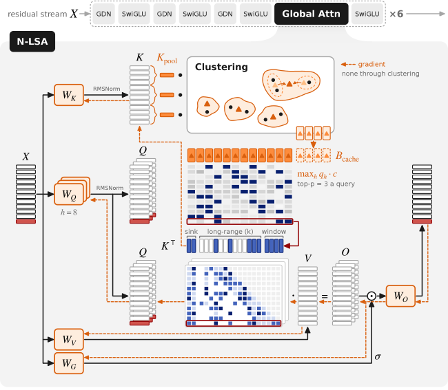

> 图解：N-LSA 直接对注意力自身的 Key 做 RMSNorm、池化和聚类，不再添加独立索引投影。8 个 Query Head 对同一个桶中心分别打分，并取各头最大相似度来完成 Top-$p$ 选择。橙色虚线表示梯度路径：聚类与选择不回传梯度，NTP Loss 只通过最终参与注意力的 Key、Sink 和 Window 更新模型。

桶得分定义为：

$$
s_{i,b}=\max_h \hat q_{i,h}\cdot c_b
$$

其中 $\hat q_{i,h}$ 是归一化后的第 $h$ 个 Query Head。使用 $\max$ 而非 D-LSA 的头求和，意味着只要任何一个头认为桶重要，该桶就有机会被保留，适合多个头关注不同信息的场景。

N-LSA 使用单一 KV Head，每个 Token 的一个 Key 服务全部 Query Head；选择操作停止梯度，注意力投影仅通过被选 Key 接收 NTP Loss。因此它**不增加模型参数，不需要教师，不需要索引投影，也不需要辅助 Loss**。注意力层不使用位置编码；若未来接入 RoPE，也可以像 D-LSA 一样只聚类无 RoPE 的部分。

## 五、实验怎么设计：不仅测“找针”，还测跨论文追线索

### 模型、对照方法与关键参数

D-LSA 在两类模型上验证：

- **Qwen-3.8-27B**：基线为 Full Attention，另加入受 QSA 启发的 Block Sparse Attention 作为稀疏对照；10M 测试通过 YaRN 扩展上下文，主实验扩展因子为 40。
- **GLM-5.3-Flash**：基线本身就是 Block Sparse Attention；模型没有显式位置编码，不需要额外扩展位置长度。
- **搜索对照**：同时比较 Block Flat、Block Tree、D-LSA Flat、D-LSA Tree 与 Training-Free。所有可训练 Indexer 使用相同蒸馏方式，保证公平。
- **Decode 约定**：主实验一次只服务一个请求，因此 D-LSA Tree 的 Decode 仍走 Flat；Tree 的多请求优势在后文单独分析。

| 参数 | Qwen Block Flat | Qwen Block Tree | Qwen D-LSA Flat | Qwen D-LSA Tree | GLM Block Flat | GLM Block Tree | GLM D-LSA Flat | GLM D-LSA Tree |
|---|---:|---:|---:|---:|---:|---:|---:|---:|
| 选择单位 | Block | Block | Bucket | Bucket | Block | Block | Bucket | Bucket |
| 搜索 | Flat | Tree | Flat | Tree | Flat | Tree | Flat | Tree |
| 长程 Key 数 $k$ | 2,048 | 4,608 | 4,096 | 4,096 | 2,048 | 4,608 | 2,048 / 4,096 | 4,096 |
| 桶或块数 $p$ | 512 | 576 | 1,024 | 1,024 | 512 | 576 | 512 / 1,024 | 1,024 |
| Sink、Window | — | 8、16 | 4、512 | 4、512 | — | 8、16 | 4、512 | 4、512 |
| 索引维度 $d^{(\mathrm{idx})}$ | 128 | 256 | 64 | 64 | 128 | 512 | 64 | 64 |
| 池化大小 $n_{\mathrm{pool}}$ | 4 | 8 | 4 | 4 | 4 | 8 | 4 | 4 |
| Cluster Block $n_{\mathrm{cluster}}$ | — | — | 512 | 512 | — | — | 512 | 512 |
| 平均 / 最大桶容量 | — | — | 8 / 16 | 8 / 16 | — | — | 8 / 16 | 8 / 16 |
| 每节点下级桶数 $n_{b,\ell}$ | — | 2 | — | 4 | — | 2 | — | 4 |
| 节点块大小 $n_{\mathrm{cluster},\ell}$ | — | — | — | 4,096 | — | — | — | 4,096 |
| 每层 Beam $p_\ell$ | — | 576 | — | 2,048 | — | 576 | — | 2,048 |

表中 GLM 的 D-LSA Flat 在 1M 之前使用 $k=2048,p=512$，之后切换为 $k=4096,p=1024$。作者发现，更大的长程预算对 1M 以上准确率更重要，而其开销相对被替代的全量索引扫描很小；逐层或逐请求动态调节预算则留作后续工作。

### LongDocs：352M Token 的蒸馏数据

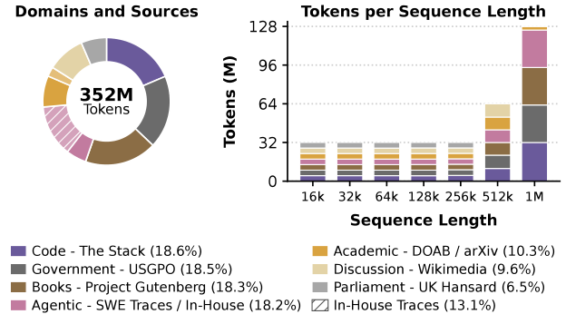

> 图解：左图是 352M Token 蒸馏混合数据的来源占比，包括代码 18.6%、政府文本 18.5%、书籍 18.3%、Agent 轨迹 18.2%、学术文档 10.3%、Wikimedia 讨论 9.6% 和英国议会文本 6.5%；斜线部分是占总量 13.1% 的自建 Agent 长会话。右图按序列长度统计 Token：16k 至 256k 各约 32M，512k 加倍，1M 再加倍，因此 1M 序列约占总量三分之一。

数据来自 Project Gutenberg、DOAB、arXiv、USGPO、UK Hansard、Wikimedia、The Stack、Open-SWE-Traces 和自建 Agent 轨迹。每条序列只截取一个文档，不跨文档拼接，并留出 2% 文档做验证。蒸馏共训练 48k Step，每步从一篇文档采样 128 个 Query，学习率为 $3\times10^{-4}$；总训练量仅为 DSA Dense Warm-up 所用 2.1B Token 的一小部分。

N-LSA 的 Decay 阶段也使用 LongDocs，但读取完整集合而非上述蒸馏混合，并去掉长上下文 Agent 会话，共 18.9B Token、134,740 篇文档。

### PaperTrail：把事实链藏进真实论文库

RULER 擅长合成检索，却不足以覆盖真实科研 Agent 的“查文献—跨文引用—识别修订”过程。PaperTrail 因此在真实 arXiv 论文集合中植入人工事实链，覆盖系外行星、长上下文机器学习和量子纠错三个领域。

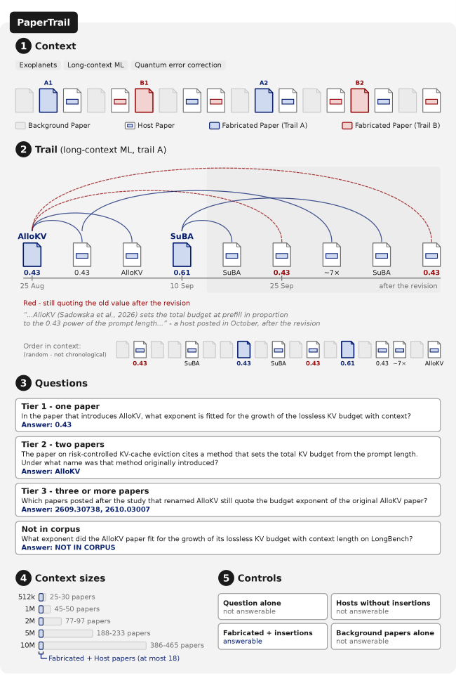

> 图解：每个样本包含真实背景论文、被插入引用段落的 Host Paper，以及两篇人工构造论文。事实链先提出一个结果，之后修订数值并改名，后续论文有的引用新结果、有的仍引用旧结果。Tier 1 只查一篇，Tier 2 连接两篇，Tier 3 追踪三篇以上；另有答案不在语料中的问题。上下文从 512k 扩到 10M 时保留原有关键论文，只增加背景论文，并通过四类控制验证答案无法从问题或无关材料中猜出。

三个领域合计 1,246 篇论文，每个样本有 30 道计分题和 6 道不可回答题。数值答案默认允许 2% 相对误差，引用论文集合按 F1 计分。10M 上下文包含约 386 至 465 篇论文，事实链散布其中，且上下文顺序不是时间顺序，模型必须真正建立跨文档连接。

其余评测还包括 MMLU-Pro、GPQA-Diamond、AIME25、MATH500、LongBench v2 和 RULER 的 13 项任务。由于超长上下文全量评测成本过高，论文使用了明确说明的子集，例如 MMLU-Pro 为分层采样的 2,000 题，RULER 在 1M 及以下每任务 100 个 Prompt，超过 1M 后为 20 个。

## 六、准确率：Flat 能守住 10M，Tree 并非总是更好

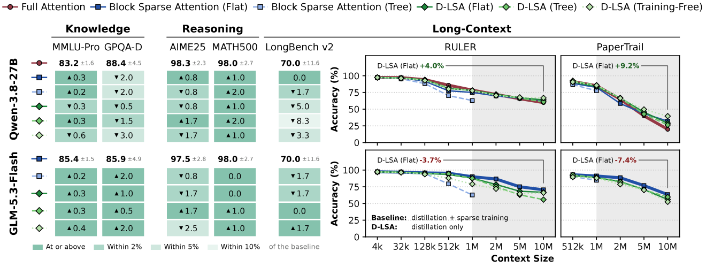

> 图解：左侧表格报告知识、推理与 LongBench v2 上相对各模型基线的分数差，颜色表示处于基线的不同容差范围；右侧纵轴为准确率，横轴为上下文长度，分别展示 RULER 和 PaperTrail。上排为 Qwen-3.8-27B，下排为 GLM-5.3-Flash。D-LSA Flat 的曲线总体贴近基线，但 Tree 在 GLM 超长区间下降更明显，Training-Free 则在两个模型上的表现并不一致。

### 知识与推理：差异落在统计波动内

在 MMLU-Pro、GPQA-Diamond、AIME25、MATH500 和 LongBench v2 上，D-LSA 各设计都处于相应基线的 95% 置信区间内。以 Qwen 为例，Full Attention 的五项基线分数依次为 83.2、88.4、98.3、98.0、70.0；D-LSA Flat 的差异为 -0.3、-0.5、-0.8、+1.0、-5.0，而 LongBench v2 本身的 95% 置信区间达到 ±11.6。

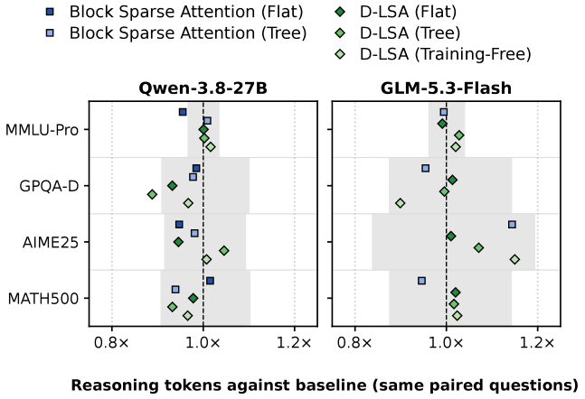

> 图解：横轴是相同问题上、各方法推理 Token 数相对基线的几何平均比值，虚线 1.0× 表示长度不变，灰色带反映各 Benchmark 的统计波动。除 Qwen 上 D-LSA Tree 在 GPQA-Diamond 的推理长度缩短 11% 外，其余点均落在带内，说明 D-LSA 没有系统性改变模型的推理长度。

### RULER：平均分背后仍有困难任务

Qwen 上，D-LSA Flat 在 1M 以内与 Full Attention 的差距保持在 5 分以内；到 10M，RULER 得分为 **63.9 对 59.9**，PaperTrail 为 **29.1 对 19.8**，均高于 Full Attention。自 128k 起，它也持续高于采用相同蒸馏流程的 Block Sparse Flat。

GLM 上，D-LSA Flat 在 1M 以内与原生稀疏基线相差不超过 3 分，2M 至 5M 最多落后 8 分，10M 的 RULER 差距回到 4 分以内。这个对照其实更有利于基线：GLM 的稀疏注意力曾与模型共同训练，而 D-LSA 只从已有稀疏注意力中蒸馏，未微调底座。

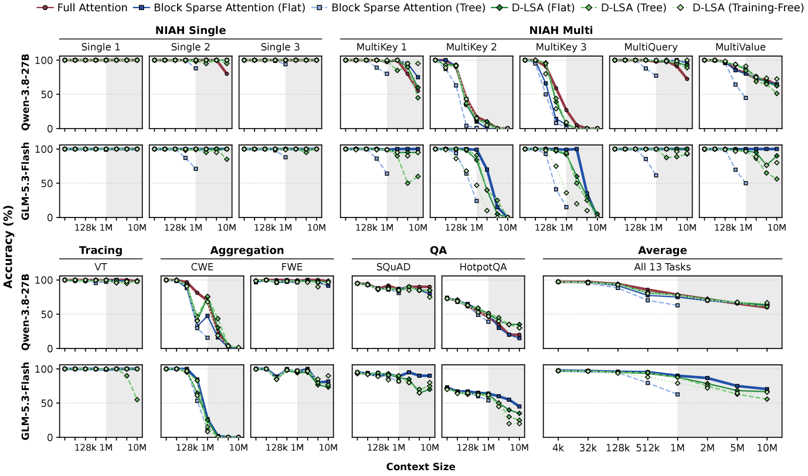

> 图解：各子图纵轴为准确率、横轴为上下文长度，灰色区域突出超长区间。Single-Needle 任务到 5M 大多仍保持在 95 分以上，但 MultiKey 2、MultiKey 3 和 CWE 到 10M 时对所有方法都降至至多 5 分，包括基线，因此它们共同限制了平均分。Qwen 上 D-LSA Flat 在 10M 的优势主要来自 MultiQuery 和 HotpotQA：分别为 92 和 35，而 Full Attention 为 72 和 20。

这意味着“10M 仍接近基线”不等于“10M 已解决长上下文理解”。LSA 保持的是相对原模型的能力，而原模型自身在多 Key 检索与聚合任务上也会明显退化。

### PaperTrail：跨文档链越复杂，下降越早

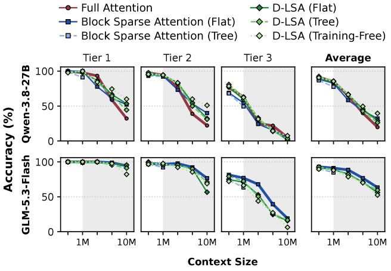

> 图解：横轴为上下文长度，纵轴为准确率；三列 Tier 分别对应单篇、两篇、三篇以上论文的问题，最右为平均。任务越难，准确率越早下降。10M 时所有方法的 Tier 3 都不超过 19.0，但 GLM 上 Tier 1 仍普遍高于 90，说明“找到一个事实”和“串起一条事实链”之间存在明显能力鸿沟。

Qwen 上，D-LSA Flat 在 10M 的 Tier 1、Tier 2 分别达到 53.3 和 32.2，Full Attention 为 32.2 和 22.2。GLM 上，D-LSA 从 2M 起主要在 Tier 3 落后，Flat 在 10M 的 Tier 2 也降至 56.7，而基线为 76.7。

不可回答问题提供了另一项 sanity check：512k 时，各 D-LSA 设计识别“语料中没有答案”的得分与模型基线相差不超过 3.7 分。控制实验也显示，仅凭问题、去掉插入段落的 Host Paper 或背景论文几乎无法作答，只有人工论文与插入内容包含答案。

### 为什么 Tree 和 Block Tree 会掉得更快？

D-LSA Tree 在 Qwen 上大体跟随 Flat，但在 GLM 超过 1M 后损失准确率：10M 的 RULER 为 **55.8 对 66.8**。主要差距来自 MultiKey 1、MultiValue 和 VT，三者在 10M 分别为 60、56、55，而基线均为 100。

Block Sparse Tree 更早掉队，从 512k 起就明显落后，因此论文没有继续评估其 1M 以上结果。原因可以从块大小实验看出：

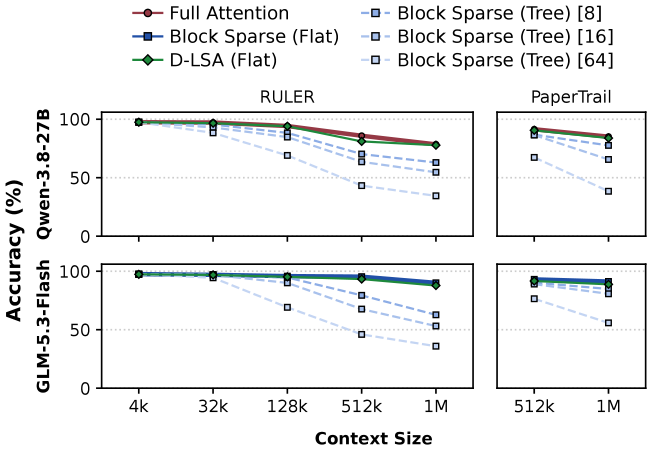

> 图解：三种 Block Tree 都选择相同的 4,608 个 Key，只改变每个摘要 Block 包含的 Key 数。横轴为上下文长度，纵轴为 RULER 或 PaperTrail 准确率。Block 越大，下降越早、幅度越大；即使最小的 8-Key Block，在长上下文也落后于 D-LSA Flat。

位置 Block 用一个摘要分数代表连续 Key，单个关键 Key 很容易被邻居“平均掉”。语义桶虽然也有摘要误差，但会把内容相近的 Key 放在一起，降低无关内容互相遮蔽的概率。笔者认为，这正是 LSA 相对普通 Block Tree 更有价值的部分：**Tree 只减少搜索次数，语义组织则同时改善“摘要能否代表成员”这一准确率前提。**

## 七、性能：收益随长度增长，短上下文反而可能变慢

### 单层性能：10M 时拉开数量级差距

单层计时覆盖完整注意力模块，包括投影、Indexer 和 Attention。Prefill 测量给定上下文前最后一个含 32,768 个 Query 的 Chunk；Decode 测量单请求一步，并启用 CUDA Graph，聚类成本按 512 个 Decode Step 摊销。

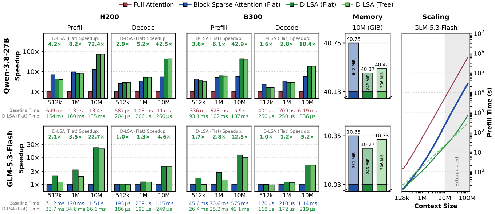

> 图解：左四组柱状的纵轴为相对基线的加速比，横轴为上下文长度，分别覆盖 H200/B300 和 Prefill/Decode；下方同时给出基线与 D-LSA Flat 的绝对时间。Memory 图比较 10M 时每层总内存及索引增量；Scaling 图用对数坐标展示 GLM 的 Prefill 随长度增长趋势，10M 以后的阴影区属于外推，并非实测。

H200 上的核心结果如下：

- Qwen 相对 Full Attention：D-LSA Flat 在 512k、1M、10M 的 Prefill 分别加速 **4.2×、8.2×、72.4×**，Decode 为 **2.9×、5.2×、42.5×**。
- GLM 相对 Block Sparse Flat：Prefill 分别加速 **2.1×、3.5×、22.7×**，Decode 为 **1.0×、1.3×、4.6×**。
- B300 在 10M 上也有收益：Qwen 的 Prefill/Decode 为 **42.9×/18.4×**，GLM 为 **12.5×/5.2×**。
- Tree 的 Prefill 呈次二次增长，外推到 100M 时预计比 GLM 原生稀疏注意力快 90× 以上；这属于模型外推，不能与 10M 实测混为一谈。

索引内存也更小。10M 时，D-LSA Flat 每层 Bucket Cache 为 **246 MiB**，GLM 基线索引为 **331 MiB**，QSA 为 **642 MiB**。D-LSA 每约 8 个 Key 才保存一个 64 维 bf16 中心，另存成员 ID；基线则每 4 个 Key 保存一个更高维索引 Key。

### 端到端：只有全局注意力层变快，整模型收益会更小

生产评测在 SGLang 中测量单请求 TTFT（Time To First Token，首 Token 时间）和 TPOT（Time Per Output Token，每输出 Token 时间），输出 256 个 Token，取三次请求的中位数。

下表每组第一行是基线绝对时间，其余行是相对该基线的加速比；小于 1× 表示更慢。

| GPU | 模型与并行方式 | 方法 | TTFT 512k | TTFT 1M | TTFT 10M | TPOT 512k | TPOT 1M | TPOT 10M |
|---|---|---|---:|---:|---:|---:|---:|---:|
| H200 | Qwen，TP8 + DCP8 | Full Attention | 21.7 s | 65.3 s | 4,582.2 s | 7.8 ms | 9.1 ms | 32.1 ms |
| H200 | Qwen，TP8 + DCP8 | Block Flat | 1.61× | 2.30× | 8.02× | 0.89× | 0.91× | 0.89× |
| H200 | Qwen，TP8 + DCP8 | D-LSA Flat | 1.03× | 1.51× | **9.21×** | 0.87× | 1.00× | **2.87×** |
| H200 | Qwen，TP8 + DCP8 | D-LSA Tree | 0.96× | 1.41× | **8.83×** | 0.87× | 1.00× | **2.87×** |
| H200 | GLM，CP8 + DCP8 | Block Flat | 8.5 s | 18.1 s | 451.5 s | 7.6 ms | 8.2 ms | 17.9 ms |
| H200 | GLM，CP8 + DCP8 | D-LSA Flat | 1.03× | 1.09× | **2.24×** | 1.01× | 1.06× | **2.10×** |
| H200 | GLM，CP8 + DCP8 | D-LSA Tree | 0.93× | 0.98× | **2.14×** | 0.97× | 1.03× | **2.10×** |
| H200 | GLM，TP8 | Block Flat | 17.9 s | 45.1 s | 1,300.9 s | 5.8 ms | 6.3 ms | 18.9 ms |
| H200 | GLM，TP8 | D-LSA Flat | 1.22× | 1.51× | **5.83×** | 0.99× | 1.06× | **1.91×** |
| H200 | GLM，TP8 | D-LSA Tree | 0.98× | 1.21× | **5.62×** | 0.95× | 1.03× | **1.89×** |
| B300 | Qwen，TP8 | Full Attention | 10.6 s | 31.6 s | 2,172.2 s | 4.9 ms | 6.0 ms | 27.3 ms |
| B300 | Qwen，TP8 | Block Flat | 0.79× | 0.82× | 0.84× | 0.82× | 0.90× | 1.33× |
| B300 | Qwen，TP8 | D-LSA Flat | 0.68× | 0.96× | **5.73×** | 0.63× | 0.73× | **1.46×** |
| B300 | Qwen，TP8 | D-LSA Tree | 0.63× | 0.91× | **5.40×** | 0.63× | 0.73× | **1.46×** |
| B300 | GLM，CP8 + DCP8 | Block Flat | 6.5 s | 13.5 s | 273.1 s | 6.9 ms | 7.4 ms | 17.3 ms |
| B300 | GLM，CP8 + DCP8 | D-LSA Flat | 0.96× | 0.99× | **1.56×** | 0.97× | 1.03× | **2.21×** |
| B300 | GLM，CP8 + DCP8 | D-LSA Tree | 0.78× | 0.81× | **1.48×** | 0.96× | 1.03× | **2.22×** |
| B300 | GLM，TP8 | Block Flat | 11.1 s | 27.2 s | 1,186.4 s | 5.2 ms | 5.7 ms | 15.6 ms |
| B300 | GLM，TP8 | D-LSA Flat | 1.15× | 1.39× | **4.76×** | 0.96× | 1.03× | **2.56×** |
| B300 | GLM，TP8 | D-LSA Tree | 0.91× | 1.09× | **4.28×** | 0.95× | 1.03× | **2.56×** |

表中 H200 的 GLM TP8 在 10M 时使用两个节点和 PP2，其余配置均为单节点；B300 则可在单节点容纳该配置。整体看，D-LSA 最适合超长上下文：在较短上下文，建桶和选择的固定成本可能抵消收益；到 10M，索引扫描被大幅削减，收益才成为主导。

## 八、N-LSA 实验：128k 原生训练追平 Full Attention Loss

N-LSA 使用约 0.5B 参数的 Hybrid 模型，共 24 层，每 4 层中仅 1 层是注意力，其余为 Gated DeltaNet。每个注意力层含 8 个 Query Head、1 个 128 维 KV Head，不使用位置编码。

训练先用 FineWeb-Edu 的 100B Token，在 4k 上下文完成 Warmup 和 Stable 阶段；再用 12B LongDocs Token，在 128k 上下文完成 Decay。对照包括 Full Attention、Sliding Window Attention（SWA）、NSA 和 PISA，所有稀疏方法每个 Query 都关注约 2,560 个 Key。N-LSA 使用 Flat 搜索，选择 2,048 个长程 Key、512 个 Window 和 4 个 Sink。

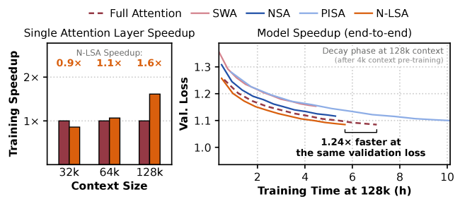

> 图解：左图纵轴是单注意力层前向加反向相对 Full Attention 的训练加速比，32k 时为 0.9×，64k 为 1.1×，128k 达到 1.6×。右图横轴是 128k Decay 阶段训练小时数，纵轴为验证 Loss；N-LSA 与 Full Attention 的曲线基本重合，整模型在达到相同验证 Loss 时快 1.24×。

最终验证 Loss 中，N-LSA 与 Full Attention 都是 **1.085**，PISA、NSA、SWA 分别为 1.100、1.117、1.154。下游准确率如下，所有数值均为百分比：

| 方法 | ARC-e | ARC-c | HellaSwag | SWDE | FDA | RULER 4k | 8k | 16k | 32k | 64k | 128k |
|---|---:|---:|---:|---:|---:|---:|---:|---:|---:|---:|---:|
| Full Attention | 50.0 | 30.0 | 45.6 | 67.8 | 79.3 | 53.9 | 46.0 | 42.5 | 38.1 | 35.6 | 34.7 |
| SWA | 53.9 | 31.4 | 45.2 | 64.6 | 69.6 | 26.7 | 15.6 | 10.1 | 5.9 | 3.0 | 3.0 |
| NSA | 53.8 | 30.1 | 45.8 | 62.2 | 72.2 | 39.4 | 34.6 | 31.6 | 25.2 | 18.9 | 19.2 |
| PISA | 52.2 | 28.7 | 45.5 | 63.7 | 78.6 | 56.2 | 48.4 | 40.4 | 26.6 | 19.1 | 14.6 |
| N-LSA | **54.6** | **30.8** | 45.5 | **66.4** | **79.2** | **52.2** | **42.5** | **41.5** | **38.4** | **32.9** | **32.2** |

常识推理上各模型接近；Recall 上 N-LSA 紧跟 Full Attention，并领先其他稀疏方法。RULER 在 128k 时，N-LSA 为 32.2，Full Attention 为 34.7，差距 2.5 分；NSA、PISA 分别降至 19.2、14.6，SWA 因上下文超出窗口而只有 3.0。

代价也不能省略：128k 时 N-LSA 单层峰值内存为 **6.8 GiB**，高于 Full Attention 的 **5.8 GiB**。主要原因是为反向传播保存每个 Query 选中的长程 Key 索引，这部分随上下文线性增长。因此 N-LSA 展示的是长上下文训练速度与准确率潜力，并非所有资源指标都占优。

## 九、工程落地：真正的加速来自 Kernel 与并行设计

算法只给出稀疏索引还不够。若把完整 Query–Centroid 分数矩阵写入显存，或每步频繁启动小 Kernel，理论收益很容易被系统开销吃掉。作者为聚类、打分选择和桶展开编写 CuTe DSL Kernel，面向 H200 与 B300；同时提供不绑定具体 GPU 的 Triton 版本，注意力本身尽量复用 FA3、FA4、TRT-LLM、FlashInfer 等现有实现。

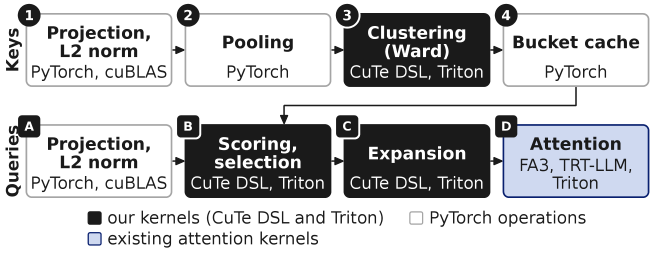

> 图解：投影、归一化、池化和缓存表使用 PyTorch/cuBLAS；Ward 聚类、打分选择、展开由作者用 CuTe DSL 与 Triton 实现；最终 Attention 复用现有 Kernel。也就是说，工程重点是新增 Indexer，而不是重写整个模型的注意力栈。

### 阈值筛选：不把巨型分数矩阵写入 HBM

Flat Prefill 中，一个 Chunk 的索引 Query 组成矩阵 $Q_{\mathcal C}^{(\mathrm{idx})}$，桶中心组成 $C$，完整分数为：

$$
S=Q_{\mathcal C}^{(\mathrm{idx})}C^\top
$$

在 10M Token、32,768 个 Query 的设置下，计算 $S$ 约需 5.5 Tflop，理论上在 H200 上至少约 5.6 ms；但若把 fp32 的 $S$ 全部写出，将达到 **160 GiB**，仅写入就至少约 36 ms。到 9M Token，$S$ 本身甚至已超过 H200 的 141 GB HBM 容量。

解决办法是先估计每个 Query 的阈值 $\theta_i$，扫描时只列出得分达到阈值的候选桶，而不保存其余分数：

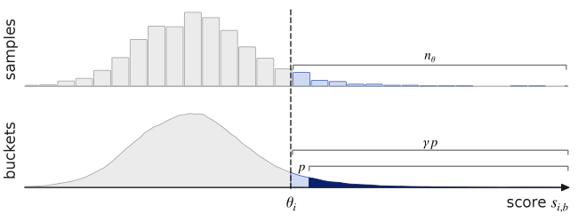

> 图解：上方从整行桶分数中抽样，并把阈值放在样本第 $n_\theta$ 高分附近；下方对应完整分布，希望约有 $\gamma p$ 个桶过线，既覆盖真正的 Top-$p$，又让候选列表保持短小。阈值误差只影响候选数量和运行成本，不会直接改变“从候选中取最优”的规则；候选不足或溢出时会回退到整行处理。

设整行有 $N_i$ 个桶，采样 $n_s$ 个，目标候选数为 $\gamma p$，则采样中应取的名次约为：

$$
n_\theta=\frac{\gamma p n_s}{N_i}
$$

Prefill 固定 $n_\theta=64$、$\gamma=1.5$，约抽样 4% 的桶。扫描阶段用 $\theta_i-\delta$ 作为列表阈值，其中 $\delta=10^{-4}$ 用于容忍 Tensor Core 扫描与后续 fp32 重打分因累加顺序不同产生的微小差异。候选列表容量为 $3p$，异常 Query 才回退全量重算。

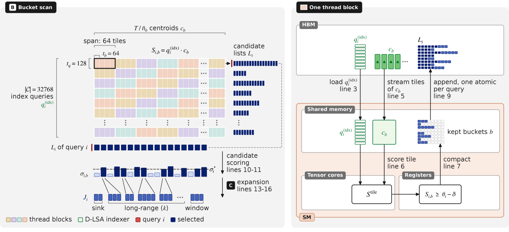

> 图解：左侧把 32,768 个 Query 按每块 128 行切分，把桶中心按每 Tile 64 列切分，不同颜色表示不同 Thread Block；每个分数算出后立即与阈值比较，只把保留桶追加到候选列表。右侧展示单块内部：Query 和中心 Tile 进入 Shared Memory，Tensor Core 计算分数 Tile，寄存器中完成比较和压缩，最后每个 Query 用一次 Atomic 写入 HBM，从而绕过完整 $S$ 矩阵。

在 10M 实测形状下，CuTe DSL 的 Flat Prefill 四步合计 **17.41 ms**，Triton 为 **39.48 ms**，加速 2.27×；其中 Bucket Scan 为 11.39 ms 对 24.82 ms。Decode 则主要受 HBM 带宽限制，扫描以约 3.58 TB/s 读取中心，达到 H200 带宽的 75%。

Decode 只有一行 Query 分数，算术强度约为 1 flop/B，因此不必使用 Tensor Core，也不能像 Prefill 那样多次读取中心。其实现一遍读取并打分，同时写出分数与候选列表；CUDA Graph 按上下文长度分桶，避免短请求也启动为 10M 设计的线程规模。聚类每 512 个 Decode Token 才执行一次，并在 Graph 外完成。

Tree Decode 的优势随批量增大：单请求时 Flat 到约 5M 都更快；4 个请求时 Tree 从约 1M 起更快；16 个请求时从约 256k 起更快，并在 10M 达到 **5.6×** 的选择加速。这解释了为什么论文没有简单地让 Tree 取代 Flat。

### 多 GPU：复制小索引，切分大 KV Cache

LSA 已集成到 SGLang，支持 Tensor Parallelism（TP）、Expert Parallelism、Pipeline Parallelism，以及 Prefill/Decode 的 Context Parallelism（CP）。核心策略是：**KV Cache 按模型原有方式切分，Bucket Cache 在每个 Rank 复制**。这用较小的内存冗余换取一致索引与较少通信。

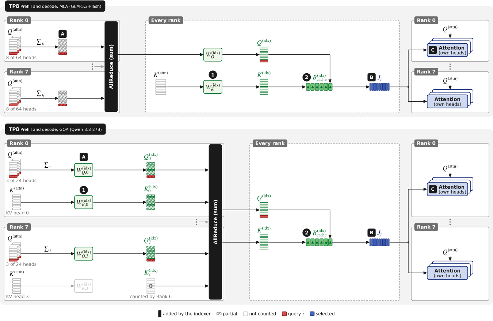

> 图解：TP 按注意力头分工。GLM 的 MLA 中，各 Rank 先在 Latent 上汇总 Query Head，再 AllReduce；Qwen 的 GQA 则对局部索引 Query/Key 投影求和。之后每个 Rank 都拥有相同索引 Query、相同 Bucket Cache 和相同选择列表 $J_i$，再只用自己负责的注意力头计算，无需为每个头传输不同索引。

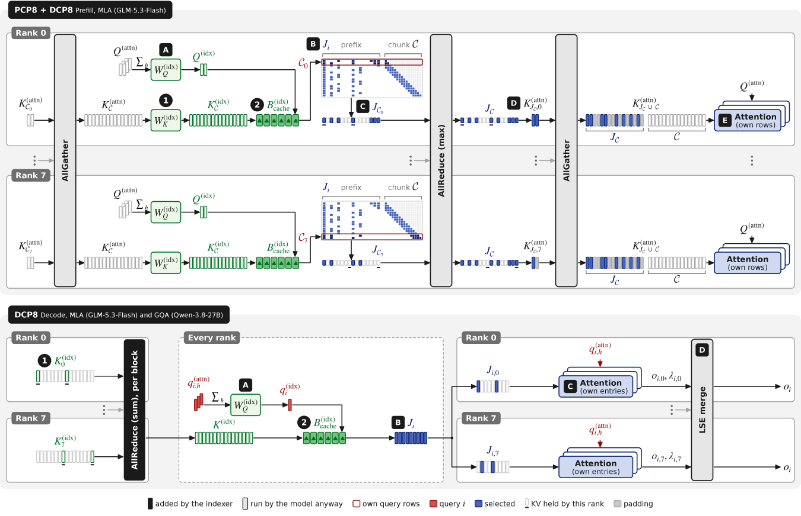

> 图解：Prefill 中，PCP 切分 Query 行，DCP 切分历史 KV。各 Rank 只选择自己所负责 Query 的列表，再用 1 Byte/Prefix Row 的 Mask 求并集，仅 AllGather 真正被选中的 KV 行。Decode 中，每完成一个 Cluster Block 就 AllReduce 其索引 Key，各 Rank 建出相同桶；注意力只处理本 Rank 持有的 Key，最后按 Log-Sum-Exp 合并部分输出。

GLM 的 10M Prefill 中，一个后段 Chunk 的 32,768 个 Query 所选择的 Key 并集只覆盖约 **30%** 的 Prefix，因为相邻 Query 的选择高度重合。若不做 Mask 而收集整个 Prefix，每层需要传输约 10 GiB；Mask 本身只需每行 1 Byte。

在 10M、DCP8 的 GLM 上，每层每 Rank 的 KV Cache 份额为 1.25 GiB，完整 Bucket Cache 额外占 246 MiB，约增加 19%；Qwen 上因原 KV Cache 更大，额外比例约 5%。这套设计的边界也很清楚：LSA 降低的是**找 Key 的计算与通信**，不是**存 Key 的总量**，完整 KV Cache 仍随 $T$ 线性增长。

N-LSA 的训练 Kernel 还多了反向传播。由于选择停止梯度，聚类与中心打分无需反向；真正的难点是，一个 Key 可能被序列中任意位置的多个 Query 选中。若按 Query 遍历，会对同一 Key 梯度做大量 Atomic Add。作者因此先反转选择关系，构造 $I_j=\{i:j\in J_i\}$，再按 Key 分组累计：

$$
\frac{\partial\mathcal L}{\partial k_j}=\sum_{i\in I_j}\frac{\partial\mathcal L}{\partial z_{i,j}}\frac{q_i}{\sqrt{d_h}}
$$

$$
\frac{\partial\mathcal L}{\partial v_j}=\sum_{i\in I_j}\alpha_{i,j}\frac{\partial\mathcal L}{\partial o_i}
$$

这样，一个 Thread Block 可把一组 Key/Value 的梯度保存在寄存器中，再统一写回。Query 梯度仍按各自的 $J_i$ 收集。反转选择需要保存前向的 2,048 个长程索引/Query，128k 时约占 1 GiB，正好解释了 N-LSA 的主要额外内存来源。

## 十、结论：超长上下文的新瓶颈，应该用新索引来解

- **问题定位准确**：10M Token 时，传统稀疏注意力的 Indexer 占 Prefill 时间 98%，继续优化 Attention Kernel 已触及收益上限。
- **核心方法清晰**：LSA 在学习得到的潜空间中做语义聚类，Flat 用桶中心替代逐 Key 扫描，Tree 进一步把索引 Prefill 降至 $\mathcal{O}(T\log T)$。
- **两条落地路线互补**：D-LSA 冻结底座、只蒸馏小索引；N-LSA 不增参数、不靠教师，直接由 NTP Loss 训练。
- **超长上下文收益显著**：10M 时单层 Prefill 相对 Qwen Full Attention 和 GLM Sparse Attention 分别加速 72.4×、22.7×，端到端 TTFT 分别改善 9.2×、2.2×，Flat 准确率总体接近基线。
- **边界同样明确**：LSA 不压缩完整 KV Cache；Tree 在 GLM 超长区间有准确率损失；N-LSA 目前仅在约 0.5B 模型、128k 上下文和 Flat 搜索上验证，且峰值内存更高。

未来最值得观察的是 Sparse Training 能否补上 Tree 的准确率缺口，以及 N-LSA 能否扩展到更大模型、更长上下文和树搜索；若与 KV Cache 压缩、跨层索引复用和多 Token 预测结合，LSA 还可能继续向 10M 以上的实用长上下文推进。

> 本文参考自 [Latent Sparse Attention: Towards Subquadratic Ultra-Long Context Attention](http://arxiv.org/abs/2610.42147v1)