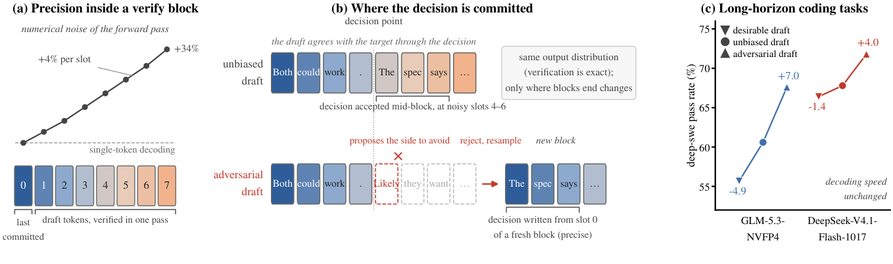
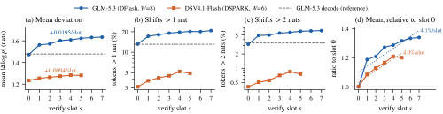
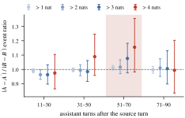
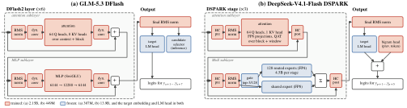
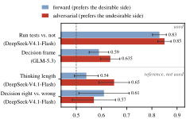
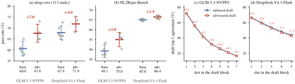
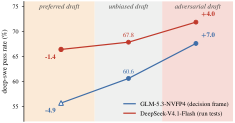
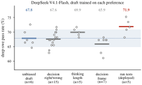

# Adversarial Speculation：主动拒绝提升长程推理

长程编程 Agent 的推理常常不是因为某一步完全不会，而是早期关键决策在数百轮交互后逐渐“走样”。这篇论文指出，常被当作纯加速器的 Speculative Decoding（投机解码），其实会通过 Token 在验证块中的位置改变 KV Cache 的数值精度，进而影响长程任务成功率。作者提出 Adversarial Speculative Reasoning：让草稿模型在关键决策处故意提出目标模型应拒绝的方案，迫使目标模型从噪声最低的块首重新采样并写入上下文。DeepSWE 上，GLM-5.3-NVFP4 的任务成功率由 60.6% 提升至 67.6%（+7.0 个百分点，95% CI 为 2.6～11.4），DeepSeek-V4.1-Flash 由 67.8% 提升至 71.8%（+4.0 个百分点，但该置信区间跨 0）。

> 图解：左图展示验证块内数值噪声随位置上升，每个 slot 约增加 4%，末位累计高出 34%。中图对比两种草稿：普通草稿让关键决策在块中后部被接受；对抗草稿在决策点提出应避免的表述，目标模型拒绝并重新采样，使新决策从新块的 slot 0 写入。右图是 DeepSWE 成功率变化，蓝色为 GLM-5.3-NVFP4，红色为 DeepSeek-V4.1-Flash；三角形对抗草稿分别带来 +7.0 和 +4.0 个百分点，倒三角形的正向偏好草稿反而下降。图中将速度概括为“不变”，更精细的测量显示最高约有 2% 的解码速度代价，详见实验部分。

## 一、投机解码不只决定速度，也决定上下文精度

先把 Speculative Decoding 想象成“学徒起草、专家审校”：小草稿模型一次提出多个 Token，大目标模型用一次前向计算给整块打分，再通过拒绝采样接受一个前缀。若某个草稿 Token 被拒绝，目标模型会从残差分布中采样替代 Token。

传统结论是：只要验证规则正确，最终输出仍严格服从目标模型分布。因此，草稿模型越好，通常就意味着目标模型接受的 Token 越多、解码越快。

这篇论文没有否定这个分布层面的保证，而是补上另一个维度：**分布相同，不代表实际部署中的数值精度相同**。低精度权重、量化 KV Cache、稀疏 Attention 和非确定性计算内核，都会让相同输入在不同计算布局下产生略有差异的 Logits。验证块越长，这种差异还越明显。

对普通短文本而言，微小扰动可能无关紧要；但 Agent 会把生成的 Token 持续写入 KV Cache，后续几十到几百轮都要读取它。一个关于“依据规范还是凭猜测做决定”“先运行测试还是直接修改”的关键判断，可能影响整条轨迹。

### 与已有工作的差异

已有研究大致沿五条路线展开，而本文的落点并不相同：

- **提高接受率**：Medusa、EAGLE/EAGLE-3、DFlash、DistillSpec 等让草稿更接近目标模型，核心指标仍是解码速度；本文反而要求草稿在特定位置与目标模型分歧。
- **放松精确验证**：Judge Decoding 等方法允许接受目标模型本会拒绝的高质量 Token，以保真度换速度；本文完整保留精确验证，不改变目标输出分布。
- **消除数值非确定性**：已有工作研究批处理相关内核、量化 KV Cache 和稀疏 Attention 带来的运行差异，通常希望减少噪声；本文测量块内噪声的结构，并主动利用它。
- **抑制长程误差累积**：SWE-bench 等 benchmark 暴露了多步错误叠加，Self-conditioning 研究还发现模型会被自己此前的错误继续带偏；本文关注关键决策最初如何被编码进上下文。
- **优化关键 Token**：已有方法用 Token 级 DPO 或只更新高熵 Token 来训练目标模型；本文只训练草稿模型，而且采用反向偏好，让目标模型亲自写下关键决策。

由此，论文的核心问题变成：**能否把“被拒绝”从一种加速失败，变成控制上下文精度的开关？**回答这个问题之前，先要证明块内噪声确实存在，并且会留下长程影响。

## 二、实测：验证块越靠后，数值噪声越大

作者用两类互补实验建立证据链。第一类固定前缀，隔离单次前向计算在不同 slot 上的噪声；第二类追踪同一段上下文在后续长轨迹中的影响。

### 2.1 模型、部署方式与误差指标

实验使用 SGLang，在 4 张 NVIDIA B200 上运行两个开放权重推理模型。配置如下：

| 目标模型 | 部署配置 | 草稿模型 | 验证块结构 |
| --- | --- | --- | --- |
| GLM-5.3-NVFP4 | NVFP4 权重、FP8 KV Cache、DeepSeek Sparse Attention | DFlash2 | 8 个位置：1 个已提交 Token + 7 个草稿 Token |
| DeepSeek-V4.1-Flash | 论文未补充完整量化配置 | DSPARK | 6 个位置：1 个已提交 Token + 5 个草稿 Token |

验证块的位置记为 slot $s=0,\dots,W-1$。slot 0 保存上一个已提交 Token，slot $s\ge 1$ 保存草稿 Token；slot $s$ 计算出的下一 Token 分布，用于验证 slot $s+1$，或在拒绝时进行残差采样。

误差定义为两次本应一致的前向计算之间的对数概率差：

$$
|\Delta \log p|=|\log p_1(v)-\log p_2(v)|
$$

作者取参考分布中概率最高的 4 个 Token，再加上轨迹实际输出的 Token。这里的单位是 nats，即自然对数单位：1 nat 对应约 $e\approx2.7$ 倍的概率变化，2 nats 对应约 $e^2\approx7.4$ 倍。

尾部大偏差尤其重要。Agent 使用 temperature 1、top-$p$ 为 0.95 或 1.0 采样时，实际输出 Token 的 Log-probability 若移动 1～2 nats，有 12% 的情况会改变它是否进入采样核；移动 2～3 nats 时为 47%，超过 3 nats 时超过 84%。

### 2.2 滑窗验证：只改变 slot，不改变输入

直接比较“验证请求”和“独立解码请求”，会混入重新 Prefill 前缀产生的噪声。为避免这一点，作者先通过贪心单 Token 解码生成参考轨迹，再把同一位置 $q$ 分别放到验证块的不同 slot $s$ 中。

具体做法是：固定内存中的前缀 KV Cache，把后续 $W$ 个轨迹 Token 填入验证块，对完全相同的前向计算重复 $R=4$ 次。这样，重复之间的差异只来自单次前向计算本身的数值非确定性，而不是输入或前缀重建。

实验覆盖 DeepSWE prompt 中 6k～24k Token 的上下文，测量 GLM-5.3 的 1,631 个位置和 DeepSeek-V4.1-Flash 的 1,294 个位置。

### 2.3 结果：每向后一个 slot，噪声约增加 4%

> 图解：横轴均为验证块中的 slot。(a) 纵轴是平均 $|\Delta\log p|$，虚线为 GLM-5.3 单 Token 解码参考值；(b)、(c) 分别是偏移超过 1、2 nats 的 Token 比例，纵轴采用对数刻度；(d) 是各位置平均噪声相对 slot 0 的比值。蓝线 GLM-5.3 与橙线 DeepSeek-V4.1-Flash 都近似以每个 slot 4% 的相对速度增噪，尽管前者绝对噪声约为后者两倍。

GLM-5.3 的 slot 0 与单 Token 解码几乎一样噪声：平均偏差分别为 0.473 和 0.478 nats。此后噪声逐位增加，斜率为每 slot $+0.0195$ nats，95% bootstrap CI 为 $[+0.0174,+0.0214]$；末位比首位高 34%。

大偏差增长得更快：

- 偏移超过 2 nats 的比例，从 slot 0 的 3.2% 增至 slot 7 的 6.2%。
- 偏移超过 3 nats 的比例，从 1.1% 增至 2.1%，接近翻倍。

DeepSeek-V4.1-Flash 的绝对噪声约为 GLM-5.3 的一半，尾部也更薄，但相对增长规律一致：斜率为每 slot $+0.0094$ nats，95% CI 为 $[+0.0078,+0.0110]$。偏移超过 1 nat 的比例从 3.1% 增至 4.5%，超过 2 nats 的比例从 0.41% 增至 0.68%。

为什么会出现这种单调增长？slot $s$ 会读取同一次前向计算中生成的 slot $0,\dots,s-1$ 的 KV 项。每次重复计算都会重新舍入这些中间项，后面的 slot 因而继承此前各位置累积的变化。slot 0 只读取已有缓存，所以它的噪声与单 Token 解码一致。

**笔者认为，这个实验的关键贡献不是再次证明“量化有误差”，而是找到了误差的可控结构：它与块内位置系统相关，而不是完全随机的坏运气。**

### 2.4 长程追踪：差异在约 30 轮后出现在极端尾部

单次前向有噪声，还不等于长程任务一定受影响。第二组实验因此固定 Token 序列，只改变这些 Token 写入 KV Cache 的方式：

1. 在每条 GLM-5.3 DeepSWE 轨迹中，选取推理最长的 assistant turn 作为“源轮次”。其长度中位数为 9k Token，之前已有中位数 45k Token 的前缀。
2. 路径 A 通过 DFlash 块验证写入源轮次，所有 Token 被强制接受；路径 B 通过单 Token 解码写入。两条路径的 Token 完全相同。
3. 复用缓存，对后续真实轨迹做 Teacher Forcing，最多继续评分 128k Token，后续 assistant turn 的中位数为 95 轮。工具输出保留在上下文中，但不参与评分。
4. 每条路径独立构建两次，比较 $|A-A'|$ 与 $|B-B'|$，避免直接比较 $|A-B|$ 时把两条路径的方差混在一起。

实验覆盖 96 个任务，每次构建评分 638 万个 assistant Token。

> 图解：横轴是源轮次之后经过的 assistant 轮数，每 20 轮分组；纵轴是验证写入路径与单 Token 解码写入路径的“大偏差事件数之比”，1 表示两者相同。不同颜色对应偏移超过 1、2、3、4 nats 的阈值，误差棒为轨迹级 95% bootstrap CI。超过 4 nats 的红色事件比在 11～30 轮为 0.98，31～50 轮升至 1.09，51～70 轮达到 1.16；71～90 轮回到 0.99，作者归因于固定 Teacher Forcing Token 对偏差的纠正。

独立构建在 30 轮之后给出 1.20 的事件比（95% CI 为 $[1.03,1.40]$）；图中构建在相同 Token 上给出 1.07（$[0.91,1.24]$）。两组比较方向一致，但幅度波动不小，因此作者将结论谨慎概括为：**约 30 轮后，极端偏差增加约 10%～20%**。

这种额外偏差只出现在极端尾部。对不超过 2 nats 的偏差，两条路径在 11～90 轮 pooled 比较中无法区分。换句话说，验证写入并非让所有上下文都持续变差，而是让少数大幅偏移在很长时间后更容易出现。

### 2.5 从现象到设计：让关键决策回到 slot 0

大多数常规 Token 对小扰动不敏感，真正危险的是少数“决定后续怎么走”的 Token。普通投机解码却不关心它们的位置：关键决策落在精确的块首还是噪声较高的块尾，只取决于此前碰巧接受了多少草稿 Token。

但草稿模型恰好能控制这个位置。只要它在决策点提出目标模型会拒绝的内容，目标模型就会残差采样一个替代 Token，随后开启新验证块，把这个决策及其后续推理重新放回低噪声路径。

到这里，论文完成了从“发现问题”到“找到控制变量”的跳跃。下一步不是修改目标模型，而是训练草稿模型在正确的地方主动被拒绝。

## 三、方法：把草稿模型训练成上下文精度分配器

作者将方法称为 Adversarial Speculative Reasoning，核心不是让草稿更聪明，而是让它在关键位置提出“不理想的一侧”。目标模型负责拒绝、重采样和写入，草稿模型负责决定验证块在哪里结束。

### 3.1 拒绝采样提供了一个控制通道

设目标模型在前缀 $x$ 下的下一 Token 分布为 $p(\cdot\mid x)$，草稿分布为 $q(\cdot\mid x)$。草稿 Token $v\sim q$ 的接受概率为：

$$
\min\left(1,\frac{p(v)}{q(v)}\right)
$$

拒绝后，替代 Token 来自残差分布：

$$
r(v)\propto\max\left(0,p(v)-q(v)\right)
$$

对任意 $q$，最终提交 Token 仍严格服从 $p$。草稿模型不能改变“目标模型会采样什么”，却能改变验证块在当前位置结束的概率：

$$
\Pr[\mathrm{reject}]
=1-\sum_v\min\left(p(v),q(v)\right)
=\mathrm{TV}(p,q)
$$

其中 $\mathrm{TV}(p,q)$ 是两个分布的 Total Variation Distance（总变差距离）。草稿把概率质量放到目标模型不太认可的位置，拒绝率就会上升。

拒绝发生后，替代 Token 成为最后一个已提交 Token，下一次验证把它放在 slot 0。于是，关键决策的 KV 项以及后续 Token 都从一个新块的低噪声起点计算。

这个设计的聪明之处在于：**它没有绕过验证规则去“引导”目标模型，而是只重排哪些 Token 经接受路径写入、哪些 Token 经残差采样写入。**常规文本仍维持高接受率，关键决策才主动制造分歧。

### 3.2 如何找到决策点，又应该偏好什么

作者用“committing sentence（承诺句）”定位决策点：它是在推理中确认观察、陈述下一步并正式作出决定的句子。Judge 对每段推理打标签，并逐字返回最多 35 个词的承诺句。Judge 就是目标模型本身，不依赖更强的外部模型。

两个模型采用不同的偏好，因为它们的失败模式不同：

| 模型 | 优选侧 | 对抗侧 | 选择依据 |
| --- | --- | --- | --- |
| GLM-5.3 | Principle：依据任务规范或接口语义；Evidence：引用仓库观察或既有测试 | Likely：猜隐藏测试更可能怎样；Risk：保守选择；Simpler：选改动更少方案 | Principle/Evidence 决策约 70% 正确，Likely/Risk 约 36% 正确 |
| DeepSeek-V4.1-Flash | 在作出计划或回应异常前，构造并运行测试或脚本 | 不验证，只读写文件，或在推理中质疑、忽略该情况 | 失败更集中于未经验证就签字确认或相信不可靠观察 |

DeepSeek 的推理更简短，约三分之二的 Likely 表述没有上述决策框架的明显词汇标记，所以仅调整“如何措辞”并不够，必须直接调整“是否运行测试”这一行为。

验证时机包括三类：准备提交计划之前；工具返回失败或意外输出之后；推理刚提出代码可能无法处理、或任务描述未明确的新场景时。

### 3.3 为什么必须反向训练 DPO

如果用普通正向偏好训练，草稿会更常提出 Principle、Evidence 或“运行测试”这些优选侧，目标模型也更容易直接接受它们。结果是：好决策反而在验证块的中后部写入，承受更高噪声。

本文因此将 DPO（Direct Preference Optimization，直接偏好优化）反向使用：

- 对 GLM-5.3，草稿的 chosen 侧是 Likely、Risk 或 Simpler。
- 对 DeepSeek-V4.1-Flash，chosen 侧是不运行测试。
- 当目标模型最终选择优选 Token 时，它更可能是在拒绝后通过残差采样产生，并成为新块的 slot 0。
- 非优选 Token 更常被草稿直接提出并接受，因而更可能落在块内噪声较高的后续位置。

这里需要特别强调：**对抗草稿并没有让目标模型更频繁地产出正确答案。**精确验证保证目标输出分布不变。作者假设的是，高偏好决策若最初以更高精度写入 KV Cache，在长程轨迹中会更持久、更容易被后续推理保留；低偏好决策则相对不那么稳定。

### 3.4 Fork Pairs：让训练只学习决策之后的变化

如果直接配对两条独立轨迹，它们在决策点之前也会存在大量差异，训练信号容易被无关内容淹没。作者改用 Fork Pairs（分叉对）：两条 continuation 在决策点前共享每一个 Token，只从同一点走向不同侧。

构造流程如下：

1. 从真实轨迹截取承诺句开始之前的推理，严格按实际服务的 Chat Template 渲染。
2. 用目标模型以 temperature 1、top-$p=0.95$ 重采样 $n$ 条 continuation。
3. Judge 为每条 continuation 标注新的承诺句和行为类别。
4. 从同一个 fork 中选出一条优选 continuation 和一条对抗 continuation，组成训练对。共享前缀在目标函数中抵消，梯度只来自分叉之后。

对于决策框架偏好，只保留同时产生优选与对抗框架的 fork，避免把“推理对不对”混成“措辞属于哪类”。作者还限制每个 fork、样本和任务的配对数量，并按完整任务划分训练集与留出集，防止近似重复 fork 泄漏。

| 数据项 | GLM-5.3 决策框架 | DeepSeek-V4.1-Flash 运行测试 |
| --- | ---: | ---: |
| 原始任务与 fork | 29 个任务，1,668 个 fork | 2,203 个 fork |
| 每个 fork 的采样 | $n=16$ | $n=12$，每条最多 1,536 Token |
| 样本数（按原文报告） | 28,356 | 26,418 |
| 可用偏好对 | 28 个任务中的 2,843 对 | 92 个任务中的 6,391 对 |
| 留出数据 | 6 个任务，619 对 | 10% 任务，719 对 |
| 实际训练对数 | 未单列 | 5,100 对 |

### 3.5 窗口化 DPO：只优化决策附近，不扰动整段文本

目标函数只计算决策窗口 $W(y)$ 内的 Token。对 GLM 的决策框架偏好，窗口从承诺句前 32 个 Token 开始，到承诺句结束为止的权重 $w_t=1$；之后保留 128 Token 的尾部，权重从 1 线性衰减到 0，总长度约 200 Token。

运行测试偏好没有唯一承诺句，因此直接取 continuation 的前 512 Token，权重均为 1。

训练奖励是当前草稿 $q_\theta$ 相对冻结原始草稿 $q_{\mathrm{ref}}$ 的加权平均 Log-ratio：

$$
r_\theta(y)=
\frac{\sum_{t\in W(y)}w_t\left[\log q_\theta(y_t\mid c)-\log q_{\mathrm{ref}}(y_t\mid c)\right]}
{\sum_{t\in W(y)}w_t}
$$

DPO Loss 为：

$$
\mathcal{L}
=-\log\sigma\left(\beta\left[r_\theta(y_w)-r_\theta(y_l)\right]\right)
+\alpha\,\mathrm{NLL}_\theta(y_w)
$$

其中 $c$ 是共享上下文，$y_w$ 是 chosen continuation，$y_l$ 是 rejected continuation，$\beta=10$。在对抗训练中，chosen 恰好是不理想侧。可选的 $\alpha\mathrm{NLL}$ 项用于锚定 chosen 侧的 Likelihood，防止偏好优化过度破坏原草稿分布。

### 3.6 只训练 0.06%～0.28% 的系统参数

草稿模型读取目标模型的 Hidden States。作者先从托管目标模型的推理实例中一次性提取每个样本的特征，再离线训练草稿，避免在训练时反复运行约 750B 参数的目标模型。

> 图解：红色为训练模块，蓝色为冻结模块。(a) GLM-5.3 DFlash 从投影后的目标特征并行预测 7 个 Token，训练 6 层 Transformer 与最终 Norm，共 2.15B 参数；特征投影、Candidate Selector、目标 Embedding 和 LM Head 冻结。(b) DeepSeek DSPARK 经过 3 个 MoE Stage 预测 5 个 Token，训练 Attention 子层、Norm、Hyper-connection 混合和 Bigram Head，共 449M 参数；Experts、Router、输入投影及目标 Embedding/LM Head 冻结。

**GLM-5.3-NVFP4 的 DFlash2** 读取目标模型第 5、19、33、47、61、75 层的 Hidden States，投影后送入草稿；Transformer 层和 Norm 使用 bf16 训练。

**DeepSeek-V4.1-Flash 的 DSPARK** 约有 14.3B 参数，其中 13.6B 位于 FP4 Routed Experts。原始实现只有推理内核，作者将其移植为可微 PyTorch 运算：每个 Expert 与参考内核的差异控制在 $10^{-7}$ 内，每个 Stage 输出差异为 3%～5%。

FP8 权重采用 QAT（Quantization-Aware Training，量化感知训练）：前向按部署格式伪量化，使用 $32\times32$ 块和 2 的幂次缩放；梯度直通传播；导出时再量化到相同格式，确保部署函数与训练评估一致。参考 Log-probability 则由原始草稿预先计算。

| 参数项 | GLM-5.3 系统 | DeepSeek-V4.1-Flash 系统 |
| --- | ---: | ---: |
| 目标模型参数 | 753B | 749B，不含草稿 |
| 草稿总参数 | 2.46B | 14.2B，用于原文占比计算 |
| 实际训练参数 | 2.15B | 449M |
| 占草稿比例 | 87% | 3.2% |
| 占目标加草稿系统比例 | 0.28% | 0.06% |

也就是说，目标模型完全不动，这些训练参数也不直接决定目标模型的输出 Token；它们只通过改变提议和拒绝位置，重新分配上下文精度。

## 四、实验：偏好可学、成功率提高，但收益并非处处显著

实验依次验证三个问题：草稿能否学会指定偏好；这种偏好能否改善长程编程；主动拒绝是否会明显拖慢解码。所有服务都保留精确验证，目标权重、采样参数、Serving Stack 和 Agent Harness 在对照中保持一致。

### 4.1 草稿能学会行为与措辞，但学不会判断语义对错

评价指标是 Held-out Preference Accuracy：在训练未见过任务的偏好对中，当前草稿对 chosen 侧给出更高窗口奖励的比例。未训练草稿按构造为 0.5。

> 图解：横轴为留出偏好准确率，虚线 0.5 表示随机水平，误差棒为 95% 二项置信区间。蓝色 Forward 草稿偏好理想侧，红色 Adversarial 草稿偏好非理想侧。上方两项是实际部署偏好：运行测试达到 0.83/0.85，决策框架达到 0.59/0.635；下方参考项显示，思考长度为 0.54/0.65，而“决策正确还是错误”仅为 0.61/0.57，且最佳值仍处于随机水平置信区间内。

GLM 的对抗决策框架准确率为 0.635，不同随机种子的波动为 $\pm0.015$；DeepSeek 的对抗运行测试偏好最佳配置达到 0.85。两个方向都能学，说明小草稿可以识别“怎么表述一个决定”以及“接下来是否测试”。

但“决定对不对”需要更强的语义推理。作者尝试 36 个正向和 12 个对抗配置，最佳值分别为 0.61 和 0.57，中位数却只有 0.52 和 0.46。这个负结果反而支持方法设计：草稿不必知道正确答案，只要提出目标模型会拒绝的那一类行为。

实际部署配置也有区别：

- GLM DFlash：$\beta=10$，Learning Rate 为 $5\times10^{-6}$，使用 128 Token 衰减窗口，学习非优选决策框架。
- DeepSeek DSPARK：对 Attention 参数做 QAT，Learning Rate 为 $2\times10^{-5}$，$\alpha=0.2$，窗口为 512 Token；部署第 2 个 Epoch 的模型，其留出准确率为 0.70，而非上图最佳配置的 0.85。

### 4.2 长程编程：三个正文主结果为正，其中两个达到统计显著

**DeepSWE** 提供仓库和任务描述，Agent 在 mini-swe-agent Harness 中使用 Shell，最后由隐藏测试评分；指标是 113 个任务中全部隐藏测试通过的比例。**NL2Repo-Bench** 则只给需求文档和空目录，要求从零构建多模块 Python 库；104 个生成仓库使用上游项目的 pytest 评分，指标为平均测试通过率。

两个 benchmark 都会运行数百轮，上下文超过 200k Token。开发工作区禁止联网，以避免 Reward Hacking。每种配置独立运行 5 次，唯一变化是普通预训练草稿或对抗草稿。

| Benchmark | 目标模型 | 普通草稿 | 对抗草稿 | 变化 | 统计信息 |
| --- | --- | ---: | ---: | ---: | --- |
| DeepSWE | GLM-5.3-NVFP4 | 60.6% | 67.6% | +7.0 个百分点 | 95% CI：$[2.6,11.4]$ |
| DeepSWE | DeepSeek-V4.1-Flash | 67.8% | 71.8% | +4.0 个百分点 | 95% CI：$[-1.3,7.3]$，跨 0 |
| NL2Repo-Bench | GLM-5.3-NVFP4 | 49.1% | 55.0% | +5.8 个百分点 | 正文未报告置信区间 |
| NL2Repo-Bench | DeepSeek-V4.1-Flash | 65.0% | 66.4% | +1.4 个百分点 | 95% CI：$[0.4,2.4]$，$p=0.011$ |

> 图解：(a)、(b) 纵轴为 Pass Rate，每个点是一轮独立端到端实验，粗横线为 5 次均值，误差棒为均值 95% CI；两幅图的纵轴都跨 25 个百分点，便于比较波动。(c)、(d) 横轴为草稿块内 slot，纵轴是草稿 Top-1 提议与目标实际输出 Token 的一致率，红字为对抗草稿相对普通草稿的变化。GLM 的接受曲线几乎重合，DeepSeek 各位置下降 0.4～1.2 个百分点。

这些提升不能解释为“草稿变成了更强的模型”：目标输出分布没有变化，草稿也无法可靠判断决策对错。更符合证据的解释是，拒绝位置改变了关键推理写入 KV Cache 的精度。GLM 的推理更长、更多样，对应收益也更大。

不过，结果需要按统计边界阅读。DeepSeek 在 DeepSWE 的 +4.0 点均值提升，其 95% CI 包含 0；真正达到显著性的两个正文结果分别来自不同模型、不同 benchmark，而不是所有组合都一致显著。

### 4.3 方向消融：正向偏好反而降低成功率

如果收益来自拒绝落点，那么把同一批偏好对反向训练，应当产生相反效果：草稿在关键决策处更赞同优选侧，使这些决策在块内较靠后的位置被接受。

> 图解：横轴依次是 Preferred Draft、Unbiased Draft 和 Adversarial Draft，纵轴为 DeepSWE Pass Rate。蓝色 GLM 使用决策框架偏好，三者为 55.7%、60.6%、67.6%；红色 DeepSeek 使用运行测试偏好，三者为 66.4%、67.8%、约 71.8%。相对普通草稿，正向草稿分别下降 4.9 和 1.4 个百分点，对抗草稿则上升 7.0 和约 4.0 个百分点。

正向草稿并非“没学会”：DeepSeek 正向草稿的留出准确率为 0.80，高于实际部署对抗草稿的 0.70，但任务表现仍下降。由此，差距不能简单归因于偏好学习质量，而与偏好方向及其决定的编码位置一致。

原文主结果将 DeepSeek 对抗增益写为 +4.0 点，消融段落按对应实验均值写为 +4.1 点；这里分别保留原始报告口径，不把它解释为额外的性能差异。

### 4.4 无关偏好对照：不是“随便训练一下草稿”都有效

另一个可能是，任何经过训练的草稿都会改变数值路径，从而碰巧提高成绩。作者汇总 DeepSeek 在 DeepSWE 上的 27 次完整运行，覆盖三种未部署偏好：决策对错 15 次、思考长度 5 次、决策框架 7 次。

> 图解：横轴为不同草稿偏好及运行次数，纵轴为 DeepSWE Pass Rate；白点是单次运行，横线是均值，浅蓝带是普通草稿均值的 95% CI。决策对错、思考长度和决策框架三组都落在普通草稿附近，只有最右侧实际部署的“对抗运行测试”草稿明显高于其他组。

三类无关偏好合并后的通过率为 67.5%，普通草稿为 67.8%，Welch 检验 $p=0.83$；任何单独一组与普通草稿的差异也都不显著，$p\ge0.16$。实际部署的运行测试草稿比这些无关草稿的 pooled 均值高 4.3 个百分点，$p=0.018$。

其中，决策框架草稿本身已经学会偏好，留出准确率达到 0.64～0.69，却仍没有带来收益。这说明偏好必须对准该模型真正的失败原因：对 DeepSeek 而言，问题更多在“不测试就提交”，而不是承诺句的措辞。

### 4.5 效率代价：接受长度基本不变，最高约 2%

对抗草稿故意降低关键位置的接受率，但不能让常规文本也频繁拒绝。作者在相同 Held-out Continuation 上 Teacher-force 目标 Hidden States，让普通草稿与对抗草稿看到完全相同的 Token，再逐 slot 比较 Top-1 一致率。

GLM 的 7 个草稿位置变化依次为 $+0.1$、$+0.1$、$-0.3$、$-0.4$、$+0.2$、$+0.1$、$-0.1$ 个百分点；DeepSeek 的 5 个位置变化为 $-0.4$、$-0.6$、$-1.0$、$-1.2$、$-1.2$ 个百分点。两条接受曲线的整体形状基本保留。

在 Greedy-chain 近似下，也就是块一直接受到首个 Argmax 不一致的位置：

- GLM 每块期望接受的草稿 Token 数，训练前后均为 2.28。
- DeepSeek 从 2.50 降至 2.46，差 0.04，约为 1.8%。

因此，更准确的结论不是“完全零成本”，而是：**GLM 在该近似下没有可测的接受长度损失，DeepSeek 用约 1.8% 的期望接受长度差异换取长程成功率提升，整体代价最高约 2%。**

## 五、这项工作的价值与边界

这篇论文最重要的观念变化，是把草稿模型从“尽可能模仿目标模型的加速器”，重新定义为“决定目标模型在何处高精度写入上下文的调度器”。它分离了两个过去容易混为一谈的概念：

- **分布精确性**：拒绝采样保证最终 Token 服从目标模型分布。
- **计算精度一致性**：实际 Serving 中，不同验证位置写入的 KV 状态并不具有相同噪声。

但现有证据也划出了明确边界。实验集中在两个约 750B 的开放权重模型、特定低精度 Serving 配置和长程编程任务上，尚不能直接推广到所有模型、硬件、量化方式或 Agent 类型。块内 4% 的相对增噪在两个系统上很一致，长程极端偏差的置信区间却较宽，幅度仍需更多独立实验确认。

偏好设计也不是即插即用。GLM 受益于决策框架，DeepSeek 受益于运行测试；同一种已学会的决策框架偏好放到 DeepSeek 上并无收益。这意味着实际应用需要先审计失败轨迹，找到模型真正失守的行为，而不是固定复制一组“好推理”标签。

最后，方法只重分配精度，不增强目标模型本身的语义判断，也不改变其输出分布。若某个任务的主要瓶颈是目标模型根本不会做，而不是长程上下文中关键决策难以保持，这种机制未必能解决。

## 六、总结

- **噪声有结构**：验证块 slot 0 与单 Token 解码精度相当，之后每个位置的数值噪声约增加 4%，极端偏差增长更快。
- **影响会延续**：相同 Token 经验证路径写入后，约 30 轮以上才表现出约 10%～20% 的极端偏差增量，且主要集中在超过 4 nats 的尾部。
- **拒绝可被利用**：反向 DPO 让草稿在关键决策处提出非优选侧，目标模型拒绝并残差采样，把决策重新放到新块的低噪声起点。
- **收益有实证也有边界**：DeepSWE 上 GLM 提升 7.0 点、DeepSeek 均值提升 4.0 点；方向消融和无关偏好对照支持机制解释，但并非所有结果都达到统计显著。
- **系统改动很小**：只训练目标加草稿系统 0.06%～0.28% 的参数，目标模型与精确验证规则不变，解码代价最高约 2%。

未来值得探索的是，能否自动发现跨模型、跨任务可迁移的关键决策偏好，并在更多 Serving 精度与 Agent 场景中验证“上下文精度分配”是否是一条普遍有效的推理优化路径。

> 本文参考自 [Adversarial Speculative Reasoning Improves Long Horizon Agents](http://arxiv.org/abs/2611.05345v1)