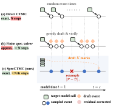

# SpecCTMC：评估减少4.38倍

这篇工作解决的是 Masked Diffusion Language Model 精确随机采样的串行瓶颈：每揭开一个 token，通常都要重新运行一次完整模型。精确采样虽然避免了时间离散化和并行因子分解误差，却让长文本生成的延迟居高不下。SpecCTMC 的核心思路是复用已有预测来草稿多个未来事件，再批量验证、逐步接受，并在首次拒绝时从残差分布精确纠正。它在 LLaDA 和 Dream 的五项基准上减少 **1.73–4.38 倍**串行目标模型评估，在 NVIDIA B200 上取得最高 **2.88 倍**实际加速；在多模态 LLaDA-V 上，评估次数进一步减少 **5.93–6.69 倍**。

## 为什么“并行生成”会改变分布？

Masked Diffusion Language Model（MDLM）从一段布满 mask 的序列开始，逐步选择位置并填入 token。它不必严格从左到右生成，因此天然适合并行；但“能同时预测”不等于“能同时提交”。

假设两个位置的 token 应当高度相关。顺序生成时，第二个位置会看到第一个位置已经确定的值；并行生成时，两者只能基于同一个旧状态独立采样。即使每个位置的边缘概率都正确，联合分布也可能出错。这就是并行解码中的 **factorization error**。

论文用 $r$ 对二元变量给出了一个可计算的例子。每对变量的目标分布为：

$$
Q_a(00)=Q_a(11)=\frac{a}{2},\qquad Q_a(01)=Q_a(10)=\frac{1-a}{2}
$$

若两个位置被分进同一个并行步骤的概率总量为 $S=\sum_s w_s^2$，独立并行提交会把每对变量同时取值的概率从 $a$ 衰减为：

$$
a_T=(1-S)a+\frac{S}{2}=a-\left(a-\frac12\right)S
$$

所有 $r$ 对都一致的概率也随之从 $a^r$ 变成 $a_T^r$。当 $a=1$ 时，为了让整体一致率至少达到 $1-\delta$，并行解码不能无限合并步骤；在 $\delta=0.05$ 的例子中，平均仍需至少约 $0.897n$ 次目标模型评估。

另一条路线是精确模拟连续时间马尔可夫链（Continuous-Time Markov Chain，CTMC）。它每次只发生一个真实事件，不人为冻结一段时间内的变化，因此没有上述并行近似；代价则是每个事件都依赖前一个事件，形成一长串模型调用。

> 图解：(a) DirectCTMC 精确模拟随机事件，但每揭开一个 token 都要顺序调用目标模型；(b) 既有投机 dLLM 解码器通常只对有限步 Greedy 解码提供受限的无损保证；(c) SpecCTMC 同时保留随机事件时钟与“位置—token”联合事件的分布。图中 $N/K$ 是全部草稿一次通过时的理想情形，一般情况下每轮最多提交 $K$ 个事件。

SpecCTMC 要解决的，正是“保留 DirectCTMC 的完整随机过程，同时减少必须依次完成的模型调用”。

## 把扩散生成写成一台随机事件时钟

先看 DirectCTMC 如何定义。设当前序列为 $x$，其中仍是 mask 的位置集合为 $A(x)$，数量为 $m(x)$。一次事件写作 $z=(d,v)$：在 masked 位置 $d$ 填入非 mask token $v$，其余位置保持不变。

对 LLaDA、Dream 和 LLaDA-V 使用的吸收 mask 过程，状态 $x$ 在模型时间 $t$ 转移到 $(d,v)$ 的速率为：

$$
q_t(x,(d,v))=\frac{1}{t}p_\theta(v\mid x,d)
$$

因为每个位置的 token 概率都已归一化，总离开速率只取决于剩余 mask 数：

$$
\lambda_t(x)=\sum_{d\in A(x)}\sum_{v\neq\mathrm{mask}}q_t(x,(d,v))=\frac{m(x)}{t}
$$

已经发生一次事件后，位置和 token 的联合条件分布是：

$$
P_{t,x}(d,v)=\frac{1}{m(x)}p_\theta(v\mid x,d)
$$

也就是说，先在所有 masked 位置中均匀选位置，再按模型在该位置给出的概率选 token。

下一事件时间不需要放在固定时间网格上。取 $E\sim\mathrm{Exponential}(1)$，精确时钟为：

$$
T_{\mathrm{next}}=t\exp\left(-\frac{E}{m(x)}\right)
$$

每次事件恰好减少一个 mask，因此后续速率只随事件计数变化，与此前究竟揭开了哪个位置、填了哪个 token 无关。当时间低于截断阈值 $\varepsilon$ 时，模拟停止，再用共同的确定性规则填满剩余位置。

**这个“速率与事件身份无关”的性质，是整篇方法能够成立的关键。**它意味着未来事件时间可以提前抽好；即使某个草稿事件后来被纠正，时钟仍然有效。

## SpecCTMC：先批量算未来，再逐个精确验收

SpecCTMC 不需要训练，也不需要额外的小草稿模型。它把旧目标模型的预测当作“便宜的草稿”，把当前目标模型在草稿状态上的预测当作“权威答案”。草稿质量只影响接受率和速度，不影响最终目标分布。

一轮投机包含四步。

1. **提前保留事件时钟。**根据当前 mask 数采样未来时间，speculative 的对象只有位置—token 事件，而不是时间。
2. **串行构造草稿轨迹。**从当前状态出发，均匀选择 masked 位置，并复用此前目标模型的 token 概率采样草稿事件；每个草稿事件产生下一个 tentative state。
3. **批量评估目标分布。**把每次草稿更新之前的状态 $\widehat X_0,\ldots,\widehat X_{L-1}$ 放进一次或多次 batched target call，得到对应的 $P_i$。
4. **按原顺序验证。**接受就提交并继续；首次拒绝则从残差分布抽一个纠正事件，提交它，丢弃后面的全部草稿后缀，再开启新一轮。

对草稿事件 $\widehat Z_i=z$，接受概率为：

$$
a_i(z)=\min\left\{1,\frac{P_i(z)}{D_i(z)}\right\}
$$

其中 $D_i$ 是草稿分布，$P_i$ 是目标分布。抽独立的 $U_i\sim\mathrm{Unif}(0,1)$，当 $U_i\leq a_i(\widehat Z_i)$ 时接受。对随机草稿取平均，总接受率为：

$$
\alpha_i=\sum_z\min\{P_i(z),D_i(z)\}
$$

首次拒绝时，从正残差中纠正：

$$
R_i(z)=\frac{[P_i(z)-D_i(z)]_+}{1-\alpha_i}
$$

这里 $[a]_+=\max(a,0)$。残差必须覆盖 **完整的“位置—token”联合空间**，不能只纠正 token 而保留草稿位置，否则无法恢复 DirectCTMC 的联合事件核。

这个设计的聪明之处在于：并行只发生在“计算候选状态的目标概率”这一步，真正提交事件仍保持顺序条件依赖。因此，它没有用并行因子分解替代原过程，而是把并行计算变成精确顺序采样的一种执行方式。

## 为什么接受加纠正恰好等于原分布？

精确性证明可以拆成两个彼此独立的问题：时钟有没有变，以及事件分布有没有变。

### 事件时钟不受纠正影响

初始有 $m_0$ 个 mask，令 $T_0=1$。第 $j$ 个事件前还剩 $m_0-j+1$ 个 mask，因此可提前采样：

$$
T_j=T_{j-1}\exp\left(-\frac{E_j}{m_0-j+1}\right),\qquad E_j\sim\mathrm{Exponential}(1)
$$

对于 $0<u<t$，条件生存概率为：

$$
\Pr(T_j\leq u\mid T_{j-1}=t)=\exp\left\{-\int_u^t\frac{m_0-j+1}{s}\,ds\right\}
$$

这正是 DirectCTMC 的时钟。无论草稿被接受还是换成另一个有效事件，都只会减少一个 mask，所以未来时钟核不变。

需要区分一个细节：这不表示事件时间与 token 分布完全独立。目标事件核 $P_{T_j,X_{j-1}}$ 仍可依赖实际时间 $T_j$；结论只是 **时钟随机源可以独立预采样，且纠正事件不会破坏其条件分布**。

### 每次验证都是 maximal coupling

固定当前已知信息，草稿 $\widehat Z\sim D$，目标是 $P$。接受部分给任意结果 $z$ 贡献：

$$
D(z)\min\left\{1,\frac{P(z)}{D(z)}\right\}=\min\{D(z),P(z)\}
$$

拒绝部分的总质量为：

$$
\beta=1-\sum_z\min\{P(z),D(z)\}=\frac12\sum_z|P(z)-D(z)|=\mathrm{TV}(P,D)
$$

而残差分支给 $z$ 贡献 $\beta R(z)=[P(z)-D(z)]_+$。两部分相加：

$$
\min\{D(z),P(z)\}+[P(z)-D(z)]_+=P(z)
$$

因此，每一步提交的事件都严格服从目标核。把它沿整条轨迹递推，在共同初始状态和共同时钟条件下：

$$
\Pr_{\mathrm{Spec}}(Z_{1:N}=z_{1:N}\mid X_0,\mathcal C)=\prod_{j=1}^{N}P_{T_j,x_{j-1}}(z_j)
$$

再对初始状态和时钟积分，就得到完整路径分布相等：事件数量、事件时间、位置、token 和中间状态的联合 Law 全部一致。截断后若使用同一个确定性完成规则，最终输出分布也相同。

这也意味着，对任意 $K$，两种方法独立重复采样的 Pass@$K$ 在分布意义上相同；实验中的有限样本分数不必逐题完全一致。

### 精确性依赖哪些条件？

论文把假设明确拆成八组，避免把“投机采样通常无损”当成无条件结论：

- 两种方法共享初始状态分布、截断阈值和有限事件条件。
- 共用合法的事件时钟，时钟随机源独立于草稿、验证和纠正随机源。
- 每个正离开速率状态下的目标事件核都已归一化。
- 草稿核只依赖当前事件之前的因果信息；拒绝后使用完整联合残差的新随机样本。
- 严格按草稿顺序验证，首次拒绝即提交纠正并丢弃后缀。
- 每个 batched target row 都等于其自身时间和输入状态对应的目标核，padding 不影响结果。
- 每轮深度在抽草稿与验证随机数之前确定。
- 两种方法使用相同状态更新、截断和确定性完成规则。

实现中还将目标、草稿、验证和残差抽样放入独立随机流，并检查 batched row 与单独评估的一致性。有限精度模型是否在每个可能输入上都满足完全相同的 row kernel，仍是实现层面需要验证的条件，而不是定理事先替模型保证的事实。

### 一般 masking schedule 与 state-dependent rate

对更一般的可微、严格递增 masking 概率 $\rho(t)$，速率变为：

$$
q_t(x,(d,v))=\frac{\rho'(t)}{\rho(t)}p_\theta(v\mid x,d,t),\qquad \lambda_t(x)=m(x)\frac{\rho'(t)}{\rho(t)}
$$

相应事件时间通过累积强度反演得到：

$$
T_{\mathrm{next}}=\rho^{-1}\left(\rho(t)\exp\left\{-\frac{E}{m(x)}\right\}\right)
$$

本文评测模型使用 $\rho(t)=t$，于是退化为前面的 $1/t$ 形式。如果未来离开速率会被纠正后的事件身份改变，就不能直接沿用吸收 mask 的预采样论证；此时可通过 uniformization 引入独立的候选 Poisson 时钟与虚拟 self-transition，再应用同类验证框架。

## 并行轮数能否有理论保证？

精确性本身不要求草稿分布接近目标；但要证明加速上限，就需要限制一次 unmask 对其他位置预测的影响。论文定义 **uniform total unmasking influence**：一次合法 unmask 后，所有仍 masked 位置的 token 分布变化之总变差不超过 $\Gamma$：

$$
\sum_{d\in A(x')}\mathrm{TV}\left(p_d(\cdot\mid x'),p_d(\cdot\mid x)\right)\leq\Gamma
$$

复用缓存目标张量并均匀选择位置时，第 $i$ 个已到达草稿事件的分布差异满足：

$$
\mathrm{TV}(P_i,D_i)\leq\frac{i\Gamma}{m-i+1}
$$

若轮初缓存正好对应当前状态，分子可改进为 $(i-1)\Gamma$。直觉上，草稿越长，缓存越“陈旧”，但 mask 位置越多，单个事件对均匀联合位置—token 分布的影响会被稀释。

令 $\bar\Gamma=\max\{1,\Gamma\}$，理论分析采用的自适应深度为：

$$
K(m)=\max\left\{1,\min\left\{b_{\max},\left\lfloor\frac14\sqrt{\frac{m}{\bar\Gamma}}\right\rfloor\right\}\right\}
$$

由此可推出每轮拒绝率至多 $3/32$，每轮期望进度至少为草稿长度的 $7/8$。对完成全部 $N_0$ 个自然事件的版本，逻辑目标行数 $W$ 和顺序目标批次数 $H$ 满足：

$$
\mathbb E[W]\leq\frac87N_0
$$

$$
\mathbb E[H]\leq\frac87\left(\frac{N_0}{b_{\max}}+16\sqrt{N_0\bar\Gamma}\right)
$$

这些界限允许各次接受决定相互依赖，也允许轮长依赖历史。不过它们约束的是逻辑工作量和顺序批次数，**不是 wall-clock 保证**；初始化、截断后的确定性完成和物理 padding 也需另行计入。

## 与既有加速方法到底差在哪里？

相关工作可以按“误差出现在哪里”来理解：固定步求解器近似时间动态，并行 masked decoder 近似联合更新，已有投机解码器往往保留某个有限步或确定性参考；SpecCTMC 保留的是未修改 denoiser 所诱导的自然事件 CTMC。

| 方法 | 无需训练 | 精确事件时间 | 保持自然事件 CTMC Law | 无独立草稿器 | 轨迹内并行 | 无新增因子分解误差 |
|---|---:|---:|---:|---:|---:|---:|
| Fixed-step ancestral / $\tau$-leaping | 是 | 否 | 否 | 是 | 是 | 否 |
| Sequential FHS（DirectCTMC） | 是 | 是 | 是 | 是 | 否 | 是 |
| Parallel FHS | 是 | 是 | 否 | 是 | 是 | 否 |
| Fast-dLLM | 是 | 否 | 否 | 是 | 是 | 否 |
| Fast-dLLM++ | 是 | 否 | 否 | 是 | 是 | 否 |
| EB-Sampler | 是 | 否 | 否 | 是 | 是 | 否 |
| PUNT | 是 | 否 | 否 | 是 | 是 | 否 |
| Spiffy，实用 LLaDA/Dream 变体 | 是 | 否 | 否 | 是 | 是 | 否 |
| Self Speculative Decoding | 是 | 否 | 否 | 是 | 是 | 是 |
| Parallel Speculative Decoding | 是 | 否 | 否 | 是 | 是 | 否 |
| Trajectory-Level，实用变体 | 是 | 否 | 否 | 是 | 是 | 否 |
| Self-Speculative Masked Diffusions | 否 | 否 | 否 | 是 | 是 | 是 |
| **SpecCTMC** | **是** | **是** | **是** | **是** | **是** | **是** |

这里“无新增因子分解误差”是相对于各自声明的顺序参考而言，并不表示这些方法都保留 DirectCTMC。SpecCTMC 也不要求不同 masking context 下的单位置预测必须来自一个全局兼容的联合分布；它只要求当前状态对应的转移行归一化，并忠实模拟由这些状态依赖核定义的序列过程。

## 实验：先看串行调用，再看真实时间

文本实验使用 LLaDA-8B-Instruct 和 Dream-v0-Instruct-7B，覆盖 GSM8K、MATH、MBPP、HumanEval 和 IFEval，生成长度为 $32,64,128,256,512$，采样温度为 1。每个条件从深度 $2$ 到 $8$ 中，依据五个固定问题上的预热计时选择最快深度。主要计时在独占 NVIDIA B200 上完成，包含草稿、目标评估、验证、残差纠正、主机—设备同步和截断完成，不包含模型加载与 warmup。

评价同时报告两种倍率：

- **NFE reduction**：DirectCTMC 平均串行目标模型评估数除以 SpecCTMC 对应数值。
- **Wall-clock speedup**：DirectCTMC 总生成时间除以 SpecCTMC 总生成时间；只有配对 95% 区间完全高于或低于 1，才判为 faster 或 slower。

下表每格依次为“实际加速 / NFE 降幅”，括号内为投机深度；“≈”表示实际加速处于 parity。准确率行是跨长度平均的 DirectCTMC $\rightarrow$ SpecCTMC。

### LLaDA-8B-Instruct

| 任务 | $L=32$ | $L=64$ | $L=128$ | $L=256$ | $L=512$ | 平均 |
|---|---|---|---|---|---|---|
| GSM8K | ≈1.00 / 1.75 (2) | ≈1.01 / 1.83 (2) | 1.06 / 2.70 (3) | 1.08 / 2.81 (3) | 1.09 / 3.81 (4) | 1.05 / 2.58 |
| MATH | 1.15 / 1.75 (2) | 1.18 / 1.85 (2) | 1.18 / 2.71 (3) | 1.10 / 2.81 (3) | 1.07 / 2.89 (3) | 1.14 / 2.40 |
| MBPP | ≈1.10 / 2.39 (3) | 1.05 / 1.85 (2) | 1.12 / 1.90 (2) | 1.10 / 1.93 (2) | 1.07 / 1.96 (2) | 1.09 / 2.01 |
| HumanEval | 2.19 / 3.02 (5) | 2.48 / 3.88 (6) | 2.37 / 3.94 (5) | 1.92 / 2.80 (3) | 1.38 / 2.87 (3) | 2.07 / 3.30 |
| IFEval | 2.65 / 3.42 (7) | 2.77 / 3.56 (5) | **2.88** / 4.02 (5) | 2.22 / **4.38** (5) | 1.62 / 2.91 (3) | 2.43 / 3.66 |
| 平均准确率（%） | GSM8K 27.1→28.3 | MATH 13.2→12.6 | MBPP 5.4→6.5 | HumanEval 5.2→6.0 | IFEval 29.0→28.8 | 16.0→16.5 |

LLaDA 没有条件被判为 slower，所有配对准确率差异的 95% 区间都包含 0。最高实际加速出现在 IFEval、128 tokens，最大文本 NFE 降幅出现在 IFEval、256 tokens。

### Dream-v0-Instruct-7B

| 任务 | $L=32$ | $L=64$ | $L=128$ | $L=256$ | $L=512$ | 平均 |
|---|---|---|---|---|---|---|
| GSM8K | ≈0.91 / 1.73 (2) | ≈0.96 / 1.83 (2) | ≈0.99 / 1.89 (2) | ≈0.99 / 1.95 (2) | ≈1.00 / 2.94 (3) | 0.97 / 2.07 |
| MATH | ≈0.99 / 1.74 (2) | ≈1.02 / 1.84 (2) | 1.05 / 2.71 (3) | ≈1.00 / 2.82 (3) | ≈1.00 / 3.82 (4) | 1.01 / 2.59 |
| MBPP | ≈0.96 / 1.75 (2) | ≈1.03 / 1.83 (2) | 1.02 / 2.74 (3) | 1.03 / 3.72 (4) | ≈1.02 / 3.88 (4) | 1.01 / 2.79 |
| HumanEval | 1.94 / 2.67 (4) | 1.97 / 3.46 (5) | 2.00 / 2.69 (3) | 1.61 / 4.32 (5) | 1.23 / 3.82 (4) | 1.75 / 3.39 |
| IFEval | 1.80 / 2.87 (5) | 2.62 / 3.72 (6) | 2.46 / 3.97 (5) | 1.96 / 3.63 (4) | 1.33 / 2.91 (3) | 2.03 / 3.42 |
| 平均准确率（%） | GSM8K 20.5→20.6 | MATH 6.6→6.9 | MBPP 8.8→9.3 | HumanEval 7.8→7.4 | IFEval 30.3→28.6 | 14.8→14.6 |

Dream 的收益明显依赖任务：HumanEval 和 IFEval 加速较多，GSM8K 则大多接近持平。它提醒我们，分布无损不等于任何负载上都更快。

### 多模态 LLaDA-V

| 数据集 | 生成长度 | 深度 | DirectCTMC NFE | SpecCTMC NFE | NFE 降幅 | 接受率 |
|---|---:|---:|---:|---:|---:|---:|
| MathVerse | 256 | 8 | 256.00 | 43.17 | 5.93× | 0.698 |
| MathVerse | 512 | 8 | 512.00 | 78.04 | 6.56× | 0.784 |
| MathVista | 256 | 8 | 256.00 | 42.41 | 6.04× | 0.718 |
| MathVista | 512 | 8 | 512.00 | 76.48 | 6.69× | 0.806 |

这部分固定图像条件、采样文本事件，共验证 4,096 次生成。由于所需 hosted evaluator 不可用，论文不报告 MathVerse 和 MathVista 的任务分数，只报告 NFE 与接受率。

> 图解：横轴是相对 DirectCTMC 的串行 NFE 降幅，纵轴是准确率保持率，100% 虚线表示 DirectCTMC 参考。实验为 LLaDA-8B-Instruct、GSM8K、256 generated tokens。SpecCTMC 在减少 **2.88 倍**NFE 的同时保持期望准确率；$\tau$-leaping 和 trapezoidal 虽能进一步减少调用，却会明显牺牲准确率。

## NFE 降低，为什么不一定等比例省时？

设两种方法的串行评估数分别为 $N_D,N_S$，总时间分别为 $T_D,T_S$，则：

$$
\frac{T_D}{T_S}=\frac{N_D}{N_S}\cdot\frac{T_D/N_D}{T_S/N_S}
$$

第一项是串行深度收益，第二项是每次评估平均成本的变化。SpecCTMC 的一次 batched call 并没有让候选状态的矩阵计算消失：三个完整状态的隐藏张量为 $[3,n,h]$，线性层仍把它当作 $3n$ 个 token vector 处理。只有单状态调用尚未吃满 GPU 时，合批才特别划算。

> 图解：(a)(b) 横轴为 prompt 加生成长度，纵轴为一次三候选调用相对一次单候选调用的成本；虚线 3 表示三次独立调用，点线 1 表示一次单候选调用。短序列在 B200 上合批收益明显，但长度增加后，三状态调用成本接近三次独立调用，L40S 更早进入这一区间。(c) 横轴为投机深度，纵轴为 Dream 相对 DirectCTMC 的完整生成加速，颜色区分 HumanEval 与 GSM8K，实线/虚线区分 B200/L40S，阴影为配对 95% 区间；L40S 的 GSM8K 深度 8 因显存不足没有计时值。

几个数字尤其能说明问题：

- 序列长度 400 时，B200 上三状态调用相当于 LLaDA 的 1.33 次、Dream 的 1.38 次单状态调用；长度 3,100 时升至 2.88 和 3.01。
- 长度 911 时，L40S 上三状态 LLaDA 调用耗时 0.2608 秒，三次单状态调用反而只需 0.2547 秒；B200 上对应为 0.0559 和 0.0640 秒。
- 在 2,048-token 限制案例中，深度 4 将串行评估减少 3.9726 倍、接受率达到 0.9950，但一次深度 4 调用相当于 4.0246 次单状态调用，最终时间比为 0.9871，即没有更快。
- 只在生成位置计算 vocabulary projection，可保持完整轨迹，同时取得 1.062–1.136 倍总时间改善，并减少 6,742–13,530 MiB 已分配显存。

缓存也作用于第二项。Self Speculative Decoding 控制实验中，禁用缓存时串行调用减少 2.67 倍却慢 1.76 倍；启用近似缓存后，调用减少 2.29 倍且快 1.40 倍。可见“减少依赖轮数”和“降低每轮成本”是两个互补方向。

## 与近似 CTMC 求解器相比，质量代价如何？

$\tau$-leaping 在一个区间内冻结起始速率。对宽度 $h_n$ 的区间，它用下式替代真实积分强度：

$$
\Lambda_{n,i,v}=\int_{I_n}q_t(i,v\mid X_t)\,dt\approx h_nq_{t_n}(i,v\mid X_{t_n})
$$

随后按 Poisson 分布采样每个位置和 token 的事件数。其问题是：一个位置在区间中提前 unmask 后，其他位置的真实速率已经变化，而求解器仍使用旧值。

二阶 $\theta$-trapezoidal 方法增加 midpoint 评估。本文使用 $\theta=1/2$，predictor 先按半步速率采样，corrector 使用：

$$
q_n^{\mathrm{corr}}=\left[q_n^*-\frac12q_n^{\mathrm{aligned}}\right]_+
$$

因此每个配置步需要两次速率评估。理论离散误差在步长上分别为一阶和二阶：

$$
\mathcal E_{\mathrm{disc}}^{\mathrm{tau}}=O(\kappa T),\qquad \mathcal E_{\mathrm{disc}}^{\mathrm{trap}}=O(\kappa^2T)
$$

但这只是 $\kappa\to0$ 时的收敛结论，不保证粗步长下每次都有更高任务准确率。

> 图解：四列分别对应每题 $K=1,2,4,8$ 个独立答案；上排为平均准确率，下排为 Pass@$K$，两者都除以同 $K$ 下 DirectCTMC 的分数，因此可能高于 100%。横轴是累计串行评估降幅，左下角标出 DirectCTMC 的绝对分数。$\tau$-leaping 从左到右使用 256、192、64、16 步，trapezoidal 使用 64、8 步；16 步 $\tau$-leaping 与 8 步 trapezoidal 都为每答案 17 次评估。

粗调度虽然便宜，却显著降低单次答案准确率；增加尝试数能找回一部分覆盖，但不是免费恢复。到 $K=8$ 时，最粗的 $\tau$-leaping 与 trapezoidal 都只有约 55% Pass@8，而平均答案准确率约 14%。

SpecCTMC 在各 $K$ 下约减少 2.8 倍串行评估，不引入求解器近似。$K=8$ 时，它与 256-step $\tau$-leaping 都取得 71.88% Pass@8，累计评估中位数分别为 724 和 2,056；在这个同覆盖对比中，SpecCTMC 少用约 **2.84 倍**评估。

## 多次随机采样：加速的不只是一个答案

Deterministic Greedy denoising 很适合只生成一个答案，但重复运行同一 prompt 只会得到同一结果，Pass@$K$ 不会随 $K$ 增长。随机 CTMC 则能通过不同事件顺序和 token 选择探索其他解法，因此更适合“允许多次尝试”的推理与代码场景。

> 图解：实验使用 LLaDA-8B-Instruct、five-shot GSM8K 和 256 generated tokens。(a) 横轴为每题独立答案数 $K$，纵轴为 Pass@$K$；不同蓝线是 token temperature，黑色虚线为匹配条件下最强 deterministic 配置 Fast-dLLM factor 1.0 的 81.25%。(b) 横轴改为累计串行目标模型评估数，比较 $T=1.0$ 的 DirectCTMC 与 SpecCTMC。$K=32$ 时两者覆盖都为 85.94%，评估中位数从 8,140 降至 2,901，即减少 **2.81 倍**。

在 $T=0.5$ 时，Pass@16 已达到 89.06%，超过最强匹配 deterministic 结果；图示四种温度到 $K=32$ 都超过该参考。这里的结论是“更多随机尝试扩大至少解对一次的覆盖率”，并不等价于存在一个能从候选中自动选出正确答案的 selector。

匹配条件下的 deterministic 结果如下：

| 方法 | 选择规则 | 准确率 | 平均 NFE | 时间中位数 |
|---|---|---:|---:|---:|
| Greedy denoising | 最高置信位置 + 最高概率 token | 79.69% | 256.00 | 34.78 s |
| Fast-dLLM threshold 0.9 | 置信度阈值 $>0.9$ | 78.13% | 80.11 | 10.52 s |
| Fast-dLLM factor 1.0 | confidence-profile factor rule | **81.25%** | 63.06 | 8.13 s |

其他 Greedy 派生投机实现使用各自的参考配置，因此不能把这些绝对延迟跨实现混排：

| 方法/配置 | 自身 Greedy 准确率 | 方法准确率 | 平均 NFE | Greedy 时间/方法时间 |
|---|---:|---:|---:|---:|
| Parallel Speculative Decoding，confidence 0.9 | 79.69% | 76.56% | 60.39 | 1.684 |
| Trajectory-Level，single-block exact | 73.44% | 73.44% | 160.17 | 1.544 |
| Trajectory-Level，practical cross-block | 73.44% | 76.56% | 203.44 | 1.016 |
| Self Cascaded Speculative Decoding，无 cache | 82.81% | 79.69% | 81.59 | 0.599 |
| Self Cascaded Speculative Decoding，近似 cache | 73.44% | 78.13% | 100.98 | 1.268 |
| Spiffy，independent-state | 79.69% | 78.13% | 127.19 | 0.261 |
| Spiffy，practical tree | 79.69% | 75.00% | 128.66 | 0.333 |

### 随机性来自 token，还是 unmask 顺序？

论文进一步把两个决策拆开：选择哪个位置，以及在该位置选哪个 token。

| 位置选择 | Token 选择 | GSM8K 准确率 |
|---|---|---:|
| 均匀随机 | 采样 | 26.56% |
| 最高置信度 | 采样 | 62.50% |
| 均匀随机 | 最高概率 | 26.56% |
| 最高置信度 | 最高概率 | 79.69% |

只把 token 改成 argmax，在随机位置顺序下没有提升；只把位置改成最高置信度，则从 26.56% 升至 62.50%。两者结合达到 79.69%。这说明此实验中，**unmask 顺序解释了随机 CTMC 与 Greedy denoising 之间的大部分差距**，同时也正是随机顺序让多次尝试能够探索不同轨迹。

## 能否与缓存和其他 checkpoint 组合？

SpecCTMC 与缓存优化的是不同成本项：前者减少依赖轮数，后者减少每轮计算。只要验证目标被明确声明为“缓存后的顺序过程”，SpecCTMC 就保持该过程；但缓存本身相对完整重算仍可能是近似的。

### Prompt cache

实验使用 LLaDA、five-shot GSM8K、256 tokens、深度 3。cache 只存固定 prompt 的 KV，生成位置始终重算，并每 8、16 或 32 个已提交 unmask 事件刷新 prompt 表示。

| 刷新间隔 | Cached sequential 准确率 | Cached SpecCTMC 准确率 | Cache 相对 uncached 的变化，pp [95% CI] | Spec 相对 cached seq. 的变化，pp [95% CI] |
|---:|---:|---:|---:|---:|
| 8 | 25.0% | 35.9% | -7.8 [-18.8, 1.6] | 10.9 [-1.6, 23.4] |
| 16 | 26.6% | 28.1% | -6.3 [-15.6, 3.1] | 1.6 [-10.9, 14.1] |
| 32 | 17.2% | 20.3% | -15.6 [-26.6, -4.7] | 3.1 [-6.3, 12.5] |

三个间隔下，Cached SpecCTMC 与对应 cached sequential 的准确率差异区间都包含 0；但刷新间隔 32 时，cache 本身已显著改变质量。这恰好展示“保持缓存参考过程”和“保持完整 uncached 过程”不是同一件事。

| 刷新间隔 | Seq. target calls | Spec target calls | Refresh calls | Spec 总调用 | 调用降幅 | 时间加速 [95% CI] |
|---:|---:|---:|---:|---:|---:|---:|
| 8 | 253.9 | 100.6 | 32.9 | 133.5 | 2.530× | 1.697 [1.692, 1.700] |
| 16 | 253.9 | 98.4 | 17.0 | 115.3 | 2.586× | 1.940 [1.936, 1.949] |
| 32 | 253.9 | 92.7 | 9.0 | 101.6 | 2.751× | 2.211 [2.201, 2.217] |

把 cache refresh 也计为一次串行评估后，三个配置总调用分别为 133.5、115.3 和 101.6。与 256-token 自回归解码约 256 个依赖步骤相比，顺序深度减少 1.92、2.22 和 2.52 倍；不过一次双向目标调用与一次自回归调用的计算量不同，不能直接当作同等工作量下的端到端倍数。

### Fast-dLLM-v2 checkpoint 迁移

同一 checkpoint 的旧预测用于草稿，当前状态概率用于精确验证。GSM8K、32 generated tokens、深度 4 的结果为：

| 指标 | 逐事件参考 | SpecCTMC |
|---|---:|---:|
| 串行目标调用 | 32.00 | 10.25 |
| 串行调用降幅 | 1.00 | 3.122× |
| 已评估目标状态 | 32.00 | 38.50 |
| 额外草稿调用 | 0.00 | 1.50 |
| 总 checkpoint 调用 | 32.00 | 11.75 |
| 每轮接受事件 | 不适用 | 2.631 |
| 草稿接受率 | 不适用 | 70.19% |
| 残差纠正 | 0.00 | 5.75 |
| 总生成时间中位数 | 55.632 s | 55.696 s |

串行 checkpoint 调用显著减少，实际时间却几乎相同，再次说明合批成本不可忽略。该实验验证了机制迁移，但没有测试 Fast-dLLM-v2 原生 cache 更新和 confidence-based 多 token 提交规则。

## 结论与边界

- **核心机制**：预采样合法事件时钟，复用旧目标预测草稿联合位置—token 事件，再批量计算目标行、顺序验证并在首次拒绝时做完整残差纠正。
- **核心保证**：在明确条件下，SpecCTMC 与 DirectCTMC 的事件数、事件时间、位置、token、状态及最终输出具有相同联合分布；草稿质量只影响效率，不影响目标 Law。
- **核心收益**：文本任务串行 NFE 减少 1.73–4.38 倍，B200 实际最高加速 2.88 倍；多模态 LLaDA-V 的 NFE 降幅达到 5.93–6.69 倍。
- **核心边界**：NFE 不是延迟，长序列、深批次、显存和硬件都会侵蚀收益；cache 组合保持的是声明后的 cached target process，而非自动消除 cache 近似。
- **核心价值**：它让多次随机采样的覆盖率优势更容易以较低串行成本获得，同时避免用近似求解器的质量损失换取速度。

未来值得比较 uniformization 的虚拟事件成本与 SpecCTMC 的额外目标行成本，并围绕缓存、候选深度和输出投影共同优化真实硬件上的每次调用成本。该方法不修改模型权重、训练数据或安全行为，部署方仍需负责模型选择、访问控制、输出评估与监控。

> 本文参考自 [SpecCTMC: Exact Speculative Simulation of Diffusion Language Model Continuous-Time Markov Chains](https://arxiv.org/abs/2611.08362v1)