# BitDecoding-FP4：原生 FP4 解码，吞吐达 3 倍

长上下文解码中，KV cache 同时吃掉显存容量和带宽，但现有方案往往顾此失彼：原生 NVFP4 速度快却明显掉点，重视精度的向量化量化又因查表和重建拖慢解码。BitDecoding-FP4 的思路是让量化算法与 GPU kernel 一起设计：分别修正 Query、Attention Probability 和 Key 的误差，再用转置 Softmax、堆叠 Query MMA 与设备端元数据管理消除系统瓶颈。在 Qwen3-4B 和 Qwen3-30B-A3B 上，NVFP4 版本的平均准确率与 BF16 KV 相差不到 0.5 个百分点；在 B300 的 64K–128K 上下文服务中，峰值每 GPU 吞吐达到 BF16 KV 的 **2.4–3.0 倍**。

## 为什么 FP4 KV cache 好看却不好用？

自回归解码每生成一个 token，都要重新读取历史 Key 和 Value。上下文越长、并发请求越多，KV cache 就越大；它不仅挤占本可用于更多请求的显存，还让解码持续受限于显存带宽。

把 KV cache 从 BF16 压到 4 bit，理论上能同时缓解这两个问题。Microscaling FP4 进一步把张量切成小 blocks，每块除了低精度元素，还保存一个共享 scale，用细粒度缩放降低舍入误差。

对于块 $x_b$，标准量化过程可以写成：

$$
s_b = \frac{\max_i |x_{b,i}|}{6}, \qquad
\hat{x}_b = \mathrm{round}_{\mathrm{E2M1}}(x_b / s_b)
$$

E2M1 元素只能取以下离散值：

$$
\mathcal{G}_{\mathrm{E2M1}} =
\{0, \pm 0.5, \pm 1, \pm 1.5, \pm 2, \pm 3, \pm 4, \pm 6\}
$$

反量化时，将共享 scale 乘回每个元素。论文比较了两种格式：

- **NVFP4**：每 16 个元素共享一个 8-bit E4M3 scale。
- **MXFP4**：每 32 个元素共享一个 2 的幂形式的 E8M0 scale。
- 两者的数据元素都使用 E2M1；它在零附近更密集，比均匀分布的 INT4 网格更适合钟形张量分布。

真正的分水岭在于 **是否原生执行**。许多低比特系统虽然用 FP4 存储 KV，却在每次 Attention 矩阵乘之前，先在 CUDA Core 上把数据反量化成 BF16 或 FP8。这样节省了容量，却没有让 FP4 Tensor Core 直接参与计算。

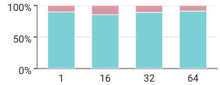
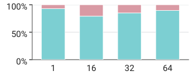

> 图解：两幅子图分别对应 Qwen3-4B 和 Qwen3-30B-A3B，展示 FlashInfer-XQA 使用 NVFP4 KV cache 时的反量化开销。在 128K 上下文下，仅这一步就占 decode kernel 时间的 7%–21%，说明“低比特存储”并不自然等于“低比特计算”。

NVIDIA Blackwell 的第五代 Tensor Core 可以直接消费 E2M1 元素及其 block scales，原生执行 NVFP4、MXFP4 矩阵乘，吞吐可达 FP8 的 2–3 倍。对 Attention 来说，这意味着 $QK^\top$ 与 $PV$ 两次矩阵乘都可以走 FP4 Tensor Core。

但原生执行要求 $Q、K、P、V$ 四类操作数全部进入 4-bit microscaling 格式，误差来源也因此比“只量化 KV”更多。与此同时，矩阵乘加快后，Softmax 和在线概率量化反而会成为新瓶颈。这就是 BitDecoding-FP4 要同时解决的算法与系统问题。

## 总体设计：三处误差修正，三项 kernel 配合

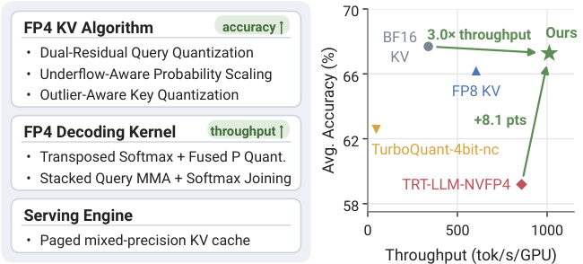

> 图解：左侧是 BitDecoding-FP4 的整体流程，右侧以 Qwen3-4B 对比准确率与服务吞吐。它的核心不是单点量化技巧，而是把误差控制、FP4 矩阵乘和 paged KV cache 服务链路放进同一个设计。

整套方法可以拆成两部分：

1. **算法侧保精度**
  - Dual-Residual Query Quantization：用两个 FP4 Query 项表示主项与残差。
  - Underflow-Aware Probability Scaling：避免长上下文中的小概率因 E4M3 scale 下溢而整块归零。
  - Outlier-Aware Key Quantization：结合静态平滑、Hadamard 旋转和 block scale 搜索，压制 Key 异常通道。
2. **系统侧保速度**
  - Transposed Softmax：把归约从 Query 行转到 Key 维度，并融合 $P$ 的 FP4 量化。
  - Stacked Query MMA：把第二个 Query 项塞进第一个 MMA 的零填充区域，避免重复计算。
  - Mixed-Precision Serving Integration：让 FP4 pages、BF16 sink tokens 和最近 tokens 在一次 decode launch 中协同工作。

下面先看算法为什么必须分别处理 $Q、P、K$，再看这些修正怎样避免拖慢 kernel。

## Query：第一次量化之后，再量化一次残差

原生 FP4 Attention 同时量化 Query 和 Key。令 $\tilde{x}=Q(x)$ 表示量化—反量化结果，$\delta_x=\tilde{x}-x$ 表示误差，那么单个 logit 的误差可分解为：

$$
\tilde{q}^{\top}\tilde{k}_i-q^{\top}k_i
=
\underbrace{\tilde{q}^{\top}\delta_{k_i}}_{\text{Key error}}
+
\underbrace{\delta_q^{\top}k_i}_{\text{Query error}}
$$

Softmax 会把较小的 logit 扰动转化为 Attention 分布变化。论文发现，Query 量化并不是可以忽略的二阶效应：使用 NVFP4 Key 时，普通 NVFP4 Query 贡献了总 logit 误差的 60%，甚至高于 Key 本身。

Dual-Residual Query Quantization 的做法很直观：第一次量化后，把没表达好的残差再量化一次。

$$
q \approx
\underbrace{s^{(1)}\odot\hat{q}^{(1)}}_{q^{(1)}=Q(q)}
+
\underbrace{s^{(2)}\odot\hat{q}^{(2)}}_{q^{(2)}=Q(q-q^{(1)})}
$$

两个项各有独立的 block scales。第二项不再拟合完整 Query，只拟合 $q-q^{(1)}$，因此最终剩下的只是残差自身的舍入误差。

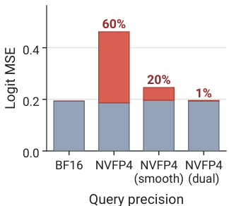
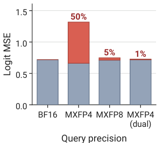

> 图解：两幅子图分别使用 NVFP4 和 MXFP4 Key，将均方 logit 误差拆成 Key 与 Query 两部分。双残差 Query 把 Query 误差占比降至约 1%；作为对比，smoothing Q 在 GQA 均值和早期 token 均值两种设置下仍分别留下 20% 和 42%。在 MXFP4 Key 下，原生 MXFP8 Query 仍留下 5%，双残差方案同样降至 1%。

这个设计的聪明之处在于，它没有把第二项送到 CUDA Core 做高精度修正，而是让两项都留在 Tensor Core 路径上。后文的 Stacked Query MMA 正是为了不让这次“多量化一次”演变成“多付一次完整矩阵乘”。

## Probability：长上下文里，小概率不能被整块清零

在线 Softmax 使用 $p_i=2^{S_i-m}$，其中 $m$ 是运行中的最大 logit。长上下文中，大量 blocks 远离当前最大值，块内最大概率也远小于 1。若继续使用 $s_b=\max(p_b)/6$，scale 很容易跌破 E4M3 的表示范围。

论文在长推理轨迹上观察到，接近 90% 的 blocks 满足 $\max(p_b)<6\cdot2^{-10}$，最终得到 $s_b=0$。结果是这些 token 的整块概率都变成零，尤其损害长上下文检索。

BitDecoding-FP4 使用两层修正：

- 将常数 $c=8$ 直接折进指数项：$c p_i=2^{S_i-m+\log_2 c}$。它不增加逐元素 FP32 乘法，并会在 Softmax 归一化中抵消。
- 对小概率块，把缩放目标从 E2M1 最大值 6 改成 2，使 scale 再提高 3 倍，远离 E4M3 的零值和次正规区域。

完整规则为：

$$
s_b=\frac{c\max(p_b)}{\kappa_b},
\qquad
\kappa_b=
\begin{cases}
2, & \max(p_b)\leq\tau/c,\\
6, & \text{otherwise}.
\end{cases}
$$

阈值 $\tau$ 通过离线校准确定：当标准 $\max/6$ 在次正规 E4M3 区域的舍入误差低于 $\max/2$ 时，就切回前者。

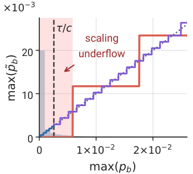
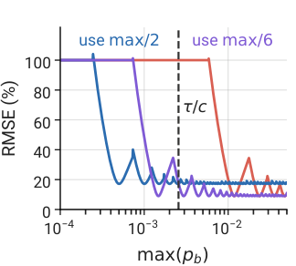

> 图解：左图沿经验概率块分布展示 E4M3 scale 下溢，右图比较不同 $\max(p_b)$ 下的相对块量化误差。常数缩放与自适应 $\kappa_b$ 共同把下溢边界推进到 $\max(p_b)<2^{-12}$，比标准规则低 24 倍，同时在次正规范围内保持较低的相对误差。

## Key：先搬走异常值，再选择更合适的 scale

Key 的难点是异常值集中在一批固定通道，并跨 tokens 持续出现。传统方法可以沿序列维度做 channel-wise 分组，把异常通道隔离到独立 scale 中；但原生 FP4 Tensor Core 计算的是单个 token 内的点积，要求沿通道方向进行 token-wise 分组。

在 token-wise block 中，一个异常通道就会抬高整块 scale，其余正常通道则被压进过粗的量化网格。BitDecoding-FP4 分三步处理。

**第一步是静态 Key 平滑。** 离线校准每个 head 的 Key 均值 $\mu_k$，写入 cache 前减去它。Softmax 对统一 logit 偏移不敏感，因此这项修正不需要在 Attention 中额外补偿。

**第二步是 Hadamard 旋转。** 平滑只能去掉静态通道偏差，动态 token 尖峰仍在。对 Query 和 Key 同时施加归一化 Walsh–Hadamard 矩阵：

$$
q'=Hq,\qquad k'_i=H(k_i-\mu_k)
$$

旋转把残余尖峰分散到所有坐标，同时保持 $q'^\top k'_i$ 的内积不变。

**第三步是 block scale 搜索。** 对变换后的每个块，从两个候选 scales 中选择重建误差最小者：

$$
s_b=\arg\min_{s\in\mathcal{S}_b}
\left\|s\,\mathrm{round}_{\mathrm{E2M1}}(x_b/s)-x_b\right\|_2^2
$$

NVFP4 在 scale maximum 6 和 4 对应的 E4M3 scales 中搜索；MXFP4 则比较标准 OCP scale 与相邻的下一个 2 次幂。这样不是单纯避免截断，而是在最大元素的 clipping error 与块内其他元素的 rounding error 之间做选择。

至此，三类主要误差都有了对应修正。但这些操作若直接堆进传统 FlashAttention kernel，第二次 Query MMA、逐行 Softmax 和动态 $P$ 量化会很快吞掉收益，所以系统设计与算法必须同步展开。

## Kernel：把 Softmax 转过来，把第二个 Query 塞进去

### Transposed Softmax：让空闲线程处理真实 Key

传统 FlashAttention 风格的 kernel 计算 $S=QK^\top\in\mathbb{R}^{G\times B_k}$，线程沿 Query-head 行分配。解码时，每个 KV head 对应的 Query head 数 $G$ 通常远小于 MMA tile 高度 $M$，大量线程落在 padding 行上。

少数活跃线程还要串行扫描整行 $B_k$ 个 keys：先找最大值，再计算 $\exp_2$ 与行和，最后再次扫描以寻找 block maximum 并量化 $P$。当 FP4 降低每个 token 的字节数、提高算术强度后，这条串行链反而成了性能上限。

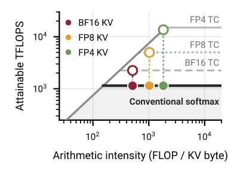
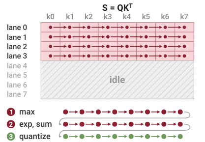
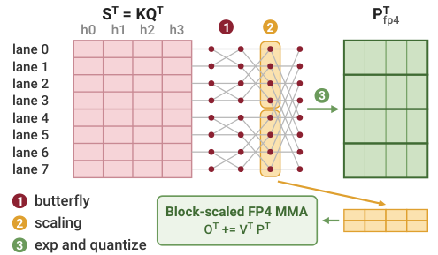

> 图解：roofline 部分说明传统 Softmax 会限制不同 KV 精度下的 Tensor Core 收益；中间图中，大量按 head 行分配的线程处于空闲；右图改为按 Key 分配后，线程都处理有效数据，归约通过 butterfly shuffle 并行完成，FP4 block scales 也可直接复用归约中间结果。

论文交换矩阵乘操作数，计算转置分数和概率：

$$
S^\top=\tilde{K}\tilde{Q}^\top,\qquad
P^\top=\mathrm{softmax}(S^\top),\qquad
O^\top=\tilde{V}^\top\tilde{P}^\top
$$

选择 $B_k=M$ 后，keys 填满 MMA tile 的全部 $M$ 行，不再受 $G$ 大小影响。对 Key 维度的归约由 warp 级 butterfly shuffle 完成，再做一次跨 warp 的 shared memory 归约；每个线程的串行工作从 $B_k$ 步缩短为少量 butterfly 步。

$P$ 量化也被融合进去。NVFP4 的 16-Key block 和 MXFP4 的 32-Key block 都覆盖连续 keys，因此行最大值归约已经顺手产生各 block 的最大 logit。由 $\exp_2$ 的单调性：

$$
\max(p_b)=2^{S_b^{\max}-m}
$$

无需再扫描一次 $P$。下溢感知规则只需一次阈值判断，$c$ 则已折进指数参数；最后，每个线程在寄存器中完成缩放与 E2M1 舍入。

### Stacked Query MMA：复用本来就会计算的 padding

双残差 Query 需要计算：

$$
S^\top=\tilde{K}\tilde{Q}^{(1)\top}
+\tilde{K}\tilde{Q}^{(2)\top}
$$

两项的 block scales 差异很大，不能直接合并成一个 FP4 操作数。朴素实现会对每个 Key tile 发出两次 MMA；而当 $G$ 小于 MMA 最小列宽时，第二次计算还会大量重复 padding 上的无效工作。

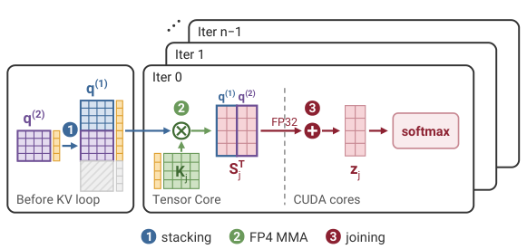

> 图解：流程分三步。KV loop 前，将 $q^{(2)}$ 及其 scales 放进 $q^{(1)}$ tile 的零填充行；每个 KV block 只发一个覆盖两项的 FP4 MMA；Softmax 阶段再在 FP32 中合并 $S_j^\top$ 的两半。

具体来说，加载 warp 把 $G$ 行有效残差 Query 复制到第一个 tile 的第 $G$ 至 $2G-1$ 行，随后同步 shared memory 并通知 MMA warp。由于 Query 在整个 KV loop 中固定，这一步只需执行一次。

每次 MMA 得到相邻排列的两组分数。Softmax 线程将第 $G+h$ 列加到第 $h$ 列，而且合并发生在 masking 和行最大值计算之前，因此在线 Softmax 的运行最大值、重缩放和归一化逻辑都无需改变。

## vLLM 集成：FP4 pages 与 BF16 新 token 同管线运行

算法和 kernel 已经打通，最后一个问题是怎样接入真实服务引擎。vLLM 的 PagedAttention 按需分配固定大小 cache blocks，并通过每个请求的 block table 建立映射；如果元数据管理需要频繁回到 host，kernel 收益仍会被同步开销抵消。

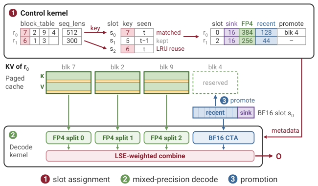

> 图解：$r_i$ 表示 batch row，$s_i$ 表示 BF16 slot。控制 kernel 先为每行分配 slot 并划分序列；decode kernel 同时读取 FP4 pages 与 BF16 slot；当最近 tokens 凑满一页后，再将其量化并提升为 FP4 block。

实现采用混合精度布局：

- 最近但尚未填满 128-token page 的 tokens 保持 BF16，并与 FP4 pages 进入同一 Tensor Core 管线。
- 序列最前面的 16 个 tokens 永久保留为 BF16 Attention Sink。
- 长上下文的 FP4 pages 按 Flash-Decoding 方式拆到多个 CTA；sink 与最近 tokens 由额外 CTA 处理，避免挂在某个 split 上形成拖尾，最后通过 log-sum-exp 加权合并输出。
- 每个 FP4 page 及其 block scales 存在一个 cache block 中；BF16 sink 和最近 tokens 放在每个运行请求一个 slot 的独立缓冲区。

设备端轻量控制 kernel 用首个 cache block 识别请求，并维护 slot 所有者与最近使用 step。新请求可复用最久未使用且本轮无人认领的 slot；decode kernel 根据序列长度区分 FP4、recent 和 sink tokens；recent page 填满后，在最后一层写入该 token 之后完成量化与提升。

这些元数据始终留在设备端，不需要 host synchronization，并保持 CUDA Graph 兼容性。

## 实验：精度、kernel 与端到端服务三层验证

实验覆盖 Qwen3-4B-Thinking-2507、Qwen3-30B-A3B-Thinking-2507、GLM-4.7-FP8 和 Hy4-preview，包含 Dense 与 MoE，以及 GQA 和 MLA Attention。

评测任务包括：

- 长上下文：LongBench Pro、MRCR、RULER-NIAH。
- 长推理：AIME 2024/2025、LiveCodeBench v6、GPQA-Diamond。
- RL post-training：遵循 DAPO，以不同 KV cache 方法生成 rollout，在 DAPO、MATH-500 和 AIME 2024 问题上评估 mean@4。

硬件为 NVIDIA B300（SM103，288GB）和 RTX PRO 5000（SM120，72GB）。准确率与系统实验使用一张 B300，其中 128K serving 使用 TP=2；kernel benchmark 覆盖两种 GPU。

系统基于 CuTe-DSL 和 FlashAttention-4 实现，并作为自定义 PagedAttention backend 接入 vLLM。代码开源于 [OpenBitSys/BitDecoding-FP4](https://github.com/OpenBitSys/BitDecoding-FP4)。

### 主结果：NVFP4 平均差距小于 0.5 个百分点

下表中，LB-Pro 表示 LongBench Pro；TPOT 是 256K 上下文下每个请求生成每个 token 的耗时，单位为 ms；Speedup 均相对 BF16 KV。

| Model | Method | LB-Pro | MRCR | RULER | AIME24 | AIME25 | LCB v6 | GPQA | Avg. | TPOT | Speedup |
|---|---|---:|---:|---:|---:|---:|---:|---:|---:|---:|---:|
| Qwen3-4B-Thinking-2507 | BF16 KV | 53.27 | 38.82 | 96.28 | 83.44 | 81.15 | 53.86 | 66.98 | 67.69 | 7.74 | 1.00× |
| Qwen3-4B-Thinking-2507 | FP8 KV | 52.60 | 37.67 | 94.42 | 82.29 | 78.75 | 50.86 | 66.86 | 66.21 | 5.43 | 1.43× |
| Qwen3-4B-Thinking-2507 | TurboQuant-4bit-nc | 49.78 | 32.91 | 93.15 | 77.40 | 72.29 | 47.43 | 64.96 | 62.56 | 94.46 | 0.08× |
| Qwen3-4B-Thinking-2507 | SAW-INT4 | 49.92 | 31.57 | 91.19 | 79.69 | 75.63 | 52.86 | 64.02 | 63.55 | — | — |
| Qwen3-4B-Thinking-2507 | TRT-LLM-NVFP4 | 44.89 | 28.84 | 80.04 | 76.56 | 72.29 | 48.71 | 63.01 | 59.19 | 4.63 | 1.67× |
| Qwen3-4B-Thinking-2507 | BitDecoding-MXFP4 | 52.96 | 35.61 | 94.46 | 81.56 | 80.42 | 55.14 | 66.73 | 66.70 | 4.34 | 1.78× |
| Qwen3-4B-Thinking-2507 | **BitDecoding-NVFP4** | 52.34 | 36.68 | 95.68 | 82.50 | 80.62 | 56.14 | 66.92 | **67.27** | **4.28** | **1.81×** |
| Qwen3-30B-A3B | BF16 KV | 60.83 | 43.41 | 98.39 | 90.62 | 83.54 | 64.00 | 71.28 | 73.15 | 6.66 | 1.00× |
| Qwen3-30B-A3B | FP8 KV | 58.45 | 40.60 | 98.03 | 91.56 | 82.81 | 60.86 | 70.58 | 71.84 | 5.15 | 1.29× |
| Qwen3-30B-A3B | TurboQuant-4bit-nc | 59.56 | 42.22 | 98.02 | 88.65 | 83.85 | 56.57 | 70.64 | 71.36 | 126.55 | 0.05× |
| Qwen3-30B-A3B | SAW-INT4 | 57.27 | 36.31 | 97.58 | 88.85 | 83.75 | 57.71 | 70.39 | 70.27 | — | — |
| Qwen3-30B-A3B | TRT-LLM-NVFP4 | 50.72 | 28.41 | 89.42 | 88.54 | 81.77 | 61.00 | 70.90 | 67.25 | 4.60 | 1.45× |
| Qwen3-30B-A3B | BitDecoding-MXFP4 | 58.53 | 42.71 | 98.33 | 91.04 | 84.58 | 62.29 | 70.71 | 72.60 | 4.59 | 1.45× |
| Qwen3-30B-A3B | **BitDecoding-NVFP4** | 58.86 | 42.22 | 98.58 | 90.83 | 85.31 | 62.57 | 70.83 | **72.74** | **4.34** | **1.53×** |

SAW-INT4 使用 SGLang，其余方法使用 vLLM，因此论文没有列出它的延迟。

可以看到，BitDecoding-NVFP4 在两个模型上的平均准确率分别为 67.27 和 72.74，相对 BF16 KV 只差 0.42 和 0.41 个百分点；MXFP4 的差距分别为 0.99 和 0.55。两个 4-bit 版本的平均准确率还都超过了 FP8 KV。

原生 TRT-LLM-NVFP4 虽然快，但在 Qwen3-4B 上平均损失 8.5 个百分点，RULER 和 MRCR 的检索能力下降尤其明显。TurboQuant-4bit-nc 则暴露了另一个极端：向量量化开销使其 256K TPOT 超过 94 ms，速度只有 BF16 KV 的 0.08×。

### 大模型与 MLA：最高 3.5× KV 容量压缩

| Model / Setting | Method | LB-Pro | MRCR | AIME25 | KV (GiB) |
|---|---|---:|---:|---:|---:|
| GLM-4.7，355B，GQA，200K | BF16 KV | 67.40 | 61.85 | 93.23 | 71.88 |
| GLM-4.7，355B，GQA，200K | FP8 KV | 65.87 | 61.27 | 92.40 | 35.94 |
| GLM-4.7，355B，GQA，200K | TRT-LLM-NVFP4 | 62.28 | 56.29 | 91.88 | 20.21 |
| GLM-4.7，355B，GQA，200K | **BitDecoding-NVFP4** | **66.74** | **60.83** | **93.75** | **20.27** |
| Hy4-preview，770B，MLA，1M | BF16 KV | 60.29 | 67.96 | 98.65 | 90.46 |
| Hy4-preview，770B，MLA，1M | FP8 KV | 59.71 | 67.83 | 98.96 | 52.68 |
| Hy4-preview，770B，MLA，1M | **BitDecoding-NVFP4** | **60.32** | **67.84** | **98.75** | **34.41** |

在 355B 的 GLM-4.7 上，BitDecoding-NVFP4 与 BF16 KV 的平均差距小于 0.4 个百分点，200K KV cache 从 71.88 GiB 降到 20.27 GiB，容量压缩比为 3.5×。TRT-LLM-NVFP4 则在检索任务上损失超过 5 个百分点。

在 770B、使用 MLA 的 Hy4-preview 上，三项任务与 BF16 KV 的差距均不超过 0.12 个百分点；1M-token KV cache 从 90.46 GiB 降到 34.41 GiB，相对 BF16 和 FP8 的容量压缩比分别为 2.6× 和 1.5×。

这里没有报告延迟加速，因为 Hy4-preview 的稀疏 MLA 每步固定只激活 2,048 个 tokens，Attention 计算占比很小；低比特 KV 的主要价值是突破 1M 上下文的容量瓶颈。

### RL rollout：量化曲线能否长期跟上 BF16？

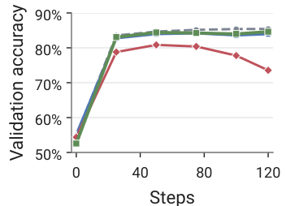
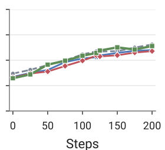

> 图解：两幅子图分别展示 Qwen3-4B 和 Qwen3-30B-A3B 在量化 rollout KV cache 下的 DAPO-Math RL 验证准确率。标准 TRT-LLM-NVFP4 在长推理轨迹上严重损害训练，而 BitDecoding-NVFP4 在两个模型的整个训练过程中都紧贴 BF16 KV。

单次 benchmark 接近 BF16，并不意味着多步 RL rollout 也稳定。这个实验补充说明，三类误差修正没有只在固定评测集上奏效，而是能支撑持续生成与训练。

### Kernel 加速：两种 GPU 上最高 4.01×

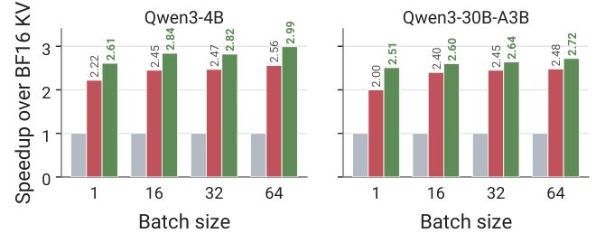
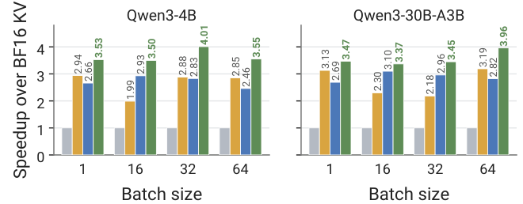

> 图解：实验固定 128K 上下文，横轴覆盖 batch size 1–64，纵轴为相对 BF16 KV 的 decode Attention kernel 加速比。BitDecoding 表示此前基于反量化的集成方案；BitDecoding-NVFP4 在两种 GPU 的所有测试 batch sizes 上都优于对比基线。

在 B300 上，BitDecoding-NVFP4 对 Qwen3-4B 和 Qwen3-30B-A3B 的最高加速分别为 2.99× 和 2.72×，并在所有 batch sizes 上超过 TRT-LLM-NVFP4。

在 RTX PRO 5000 上，最高加速分别达到 4.01× 和 3.96×。两次 GEMM 都原生运行于 FP4 Tensor Core，使其超过 FlashInfer-XQA-NVFP4 和依赖反量化的旧版 BitDecoding。

### 端到端服务：不只 kernel 快，还能容纳更多并发

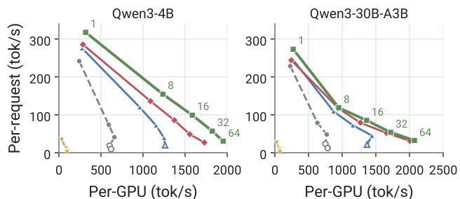
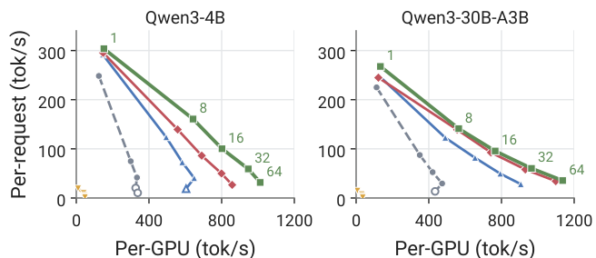

> 图解：两组实验都覆盖 Qwen3-4B 与 Qwen3-30B-A3B，以及 1、8、16、32、64 个并发请求，曲线越靠右上越好。当并发量超过 KV cache 容量时，多出的请求会排队或被抢占。BitDecoding-NVFP4 在 64K 和 128K 工作负载上都取得了更好的延迟—吞吐折中。

BF16 和 FP8 KV 随并发增长很快耗尽容量并触发 preemption；BitDecoding-NVFP4 能同时容纳全部 64 个请求，峰值每 GPU 吞吐达到 BF16 KV 的 2.4–3.0 倍，并匹配或超过 TRT-LLM-NVFP4。

在更长的 256K 上下文下，主表中的 TPOT 也体现了收益：Qwen3-4B 从 7.74 ms 降至 4.28 ms，加速 1.81×；Qwen3-30B-A3B 从 6.66 ms 降至 4.34 ms，加速 1.53×。这两个数字同时优于 FP8 KV 和 TRT-LLM-NVFP4。

## 消融：每项技术究竟解决了什么？

### 准确率来源

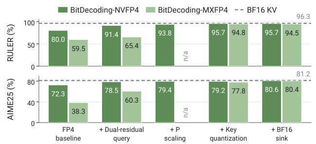

> 图解：图中在 Qwen3-4B 上逐步拆解量化技术。MXFP4 的 E8M0 scales 不会下溢，因此省略 $P$ scaling；它的收益主要来自双残差 Query 与异常感知 Key 量化。NVFP4 中，双残差 Query 挽回大部分差距，下溢感知 $P$ scaling 主要恢复 RULER 检索，异常感知 Key 量化再补齐剩余误差。

### Kernel 延迟来源

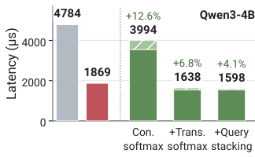
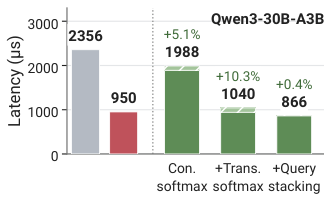

> 图解：实验在 B300、batch 64、128K 上下文下拆解 decode kernel 延迟。传统按行 Softmax 中，Softmax 与 $P$ 量化成为瓶颈，使 Qwen3-30B-A3B 比 TRT-LLM-NVFP4 慢 2.1×；转置 Softmax 将纯 kernel 延迟近乎减半，加速 1.91×；随后 Stacked Query MMA 消除独立残差 Query MMA 暴露出的 10.3% 开销。

最终，完整精度修正 recipe 的额外开销被控制在 4% 以内，同时整体仍快于 TRT-LLM-NVFP4。这也验证了算法—系统协同的必要性：如果只做前半部分，精度收益很可能无法转化为服务收益。

### 元数据管理开销

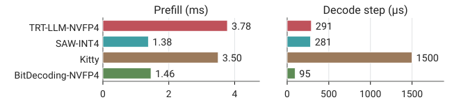

> 图解：实验使用 Qwen3-4B、batch 1、4K 上下文，对比 prefill 与 decode 中的量化及元数据开销。Kitty 和 BitDecoding-NVFP4 都管理 BF16 sink tokens，但两者的控制成本差异明显。

Kitty 为 BF16 sink tokens 在每个 decode step 增加 1.5 ms；BitDecoding-FP4 的设备端控制 kernel 将 decode 开销压到 95 μs，比 Kitty 低 15.8×，也比 TRT-LLM-NVFP4 和 SAW-INT4 低 3×。

其 prefill 开销为 1.46 ms，与 SAW-INT4 相当，比 TRT-LLM-NVFP4 低 2.6×。

## 复现细节：怎样快速判断量化是否真的接近 BF16？

端到端生成存在一个评估难题：一旦量化模型采样出不同 token，后续轨迹就会偏离 BF16，分数差异中会混入大量采样噪声。论文因此用 Teacher-Forced KL 作为快速、低噪声的开发指标。

### 固定轨迹上的 KL

首先让 BF16 KV 生成参考轨迹 $y=(y_1,\ldots,y_L)$，记录每步的下一 token 分布 $p_t$。随后让 FP4 配置沿同一条轨迹解码：每步从量化 KV cache 得到 $\tilde{p}_t$，但通过 logits processor 强制输出参考 token $y_t$，而不是重新采样。

每步计算：

$$
D_t=\sum_{v\in\mathcal{V}_t}p_t(v)
\log\frac{p_t(v)}{\tilde{p}_t(v)}
$$

$\mathcal{V}_t$ 取 BF16 概率最高的 128 个 tokens，平均覆盖 99.996% 的概率质量。各配置看到完全相同的前缀，因此可以逐轨迹配对比较，并用 paired $t$ 统计量抵消题目难度差异。

| Configuration | KL（$10^{-3}$ nats）↓ | Top-1 mismatch（%）↓ | MRCR ↑ |
|---|---:|---:|---:|
| BF16 KV | 0.29 | 0.32 | 38.82 |
| BitDecoding-NVFP4 | 3.83 | 1.00 | 36.68 |
| BitDecoding-MXFP4 | 10.27 | 1.56 | 35.61 |
| TRT-LLM-NVFP4 | 39.62 | 3.59 | 28.84 |

KL、Top-1 mismatch 与 MRCR 对四种配置给出了相同排序。BitDecoding-NVFP4 将 TRT-LLM-NVFP4 的 KL 降低 10×，并补回其相对 BF16 的 10.0 个 MRCR 百分点差距中的 7.8 个。

### Key 平滑只需八条种子提示

每个 checkpoint 和上下文窗口只需校准一次 $\mu_k$。八条种子提示是日常主题的一句话请求，模型对每条贪心续写 256 tokens，总计只生成约 2K tokens。

随后把这些提示与续写拼接、平铺成填满整个窗口的一条输入，做一次 prefill，累计每层、每个 KV head 的 post-RoPE Key 均值。使用模型自己的文本，可以让分布更贴近实际生成；平铺则覆盖所有 RoPE 位置。

| Calibration | Tokens | Time（s） | MRCR KL | AIME24 KL |
|---|---:|---:|---:|---:|
| No smoothing | — | — | 11.79（+215%） | 8.11（+76%） |
| 8 seeds（论文方案） | 133K | 13 | 3.74 | 4.62 |
| 8 other seeds | 131K | 12 | 3.73（−0.3%） | 4.70（+1.7%） |
| 10 retrieval | 1.3M | 43 | 4.52（+21%） | 5.27（+14%） |
| 40 mixed | 5.2M | 173 | 4.35（+16%） | 4.88（+5.5%） |

KL 单位为 $10^{-3}$，时间是在一张 B300 上生成校准文本并测量 $\mu_k$ 的耗时。更多校准文本并没有更好：1.3M 和 5.2M tokens 的方案反而提高了 KL；换八条种子提示则基本不变，说明 13 秒的轻量校准已经足够。

### 概率阈值可以和 Key 均值一起校准

生产阈值设为 $\tau=21/1024$，位于 E4M3 值 $20/1024$ 与 $22/1024$ 之间，对应 code 10。论文在 Qwen3-4B-Thinking-2507 上使用五类、每类 50 个样本，上下文覆盖 8K–128K。

| Calibration source | Code | $N=1$ | $N=8$ | $N=16$ | $N=32$ |
|---|---:|---:|---:|---:|---:|
| UUID key retrieval | 10 | 100 | 100 | 100 | 100 |
| Marker retrieval | 10 | 100 | 100 | 100 | 100 |
| Code and math filler | 10 | 100 | 100 | 100 | 100 |
| Key smoothing（论文方案） | 10 | 100 | 100 | 100 | 100 |
| Reasoning traces | 10 | 97.9 | 84.8 | 70.2 | 100 |
| All five sources | 10 | 99.7 | 97.1 | 97.5 | 100 |

后四列表示 1,000 个大小为 $N$ 的随机子集中，选中 code 10 的比例。除推理轨迹需要 32 条才能保证所有子集一致外，其他来源即使单样本也能稳定选中同一阈值。

因此，$\mu_k$ 与 $\tau$ 可以在同一份校准文本上完成：prefill keys 用于求均值，继续解码的 queries 用于选择阈值。减去 $\mu_k$ 只会给一个 Query 的所有 logits 加上相同偏移，不改变 Softmax 概率，所以两项校准互不干扰。

## 与 SageAttention3 的差异：精度相近或更好，执行路径更短

### Query：双残差优于 smoothing Q

Smoothing Q 减去均值 $\bar{q}$ 后量化剩余部分，再用反量化 Key 以高精度补回 $\bar{q}^{\top}\tilde{k}_i$。双残差方案则直接量化第一次舍入留下的误差。

| Query format | Total MSE（$10^{-2}$）↓ | Query term ↓ | Share |
|---|---:|---:|---:|
| BF16 | 19.32 | 0.00 | — |
| NVFP4 | 46.17 | 27.50 | 60% |
| NVFP4 + smoothing Q（token mean） | 33.03 | 13.95 | 42% |
| NVFP4 + smoothing Q（GQA mean） | 24.57 | 4.89 | 20% |
| NVFP4 + dual residual | **19.55** | **0.23** | **1.2%** |

除了误差更低，双残差还避免了对每个 Key 做 CUDA Core 高精度修正，或保存预计算投影的额外内存。第二项被堆进 Query MMA 的 padding，通常只是将列宽从 $G$ 扩到 $2G$。

### Probability：精度接近 two-level scaling，但无需逐 tile 重缩放

SageAttention3 先用每个 Query 行、Key tile 的 FP32 scale 将最大值映射到 $448\times6$，再用 E4M3 block scales 做标准 $\max/6$ 量化。

| $P$ scaling | KL ↓ | Top-1 一致率（%）↑ | MRCR | RULER | LB-Pro |
|---|---:|---:|---:|---:|---:|
| BF16 KV | — | — | 36.08 | 90.25 | 55.79 |
| Standard $\max/6$ | 9.31 | 98.50 | 35.53 | 82.00 | 54.99 |
| Two-level | 6.06 | 98.75 | 35.51 | 88.00 | 55.12 |
| Underflow-Aware（论文方案） | 6.47 | 98.73 | 35.51 | 88.75 | 55.02 |

两种改进方法的 KL、Top-1 一致率和下游准确率接近，且都明显优于标准规则。差别在系统成本：论文方案的 $c=8$ 折进指数，无额外指令和输出修正；two-level scaling 每个 tile 都要更新 FP32 scale、做精确最大值归约并重缩放输出。

在论文的 decode 实现中，后者还会导致严重 register spilling：在 8K–128K、batch 1–16 下，kernel 比论文方案慢 3.0–26.7×，单个 serving decode step 慢 5.0×，即 89.7 ms 对 17.8 ms。

## 更多附录推导与消融

### MXFP4 为什么搜索相邻两个指数？

MXFP4 每 32 个元素共享 $s_b=2^e$。标准 OCP 指数为：

$$
e_{\mathrm{ocp}}=\left\lfloor\log_2(\max|x_b|)\right\rfloor-2
$$

它把块内最大值映射到 $[4,8)$。当最大值超过 $6\cdot2^{e_{\mathrm{ocp}}}$ 时就会发生 clipping；改用 $e_{\mathrm{ocp}}+1$ 可将最大值映射到 $[2,4)$，避免截断，但其余元素的量化步长翻倍。

因此候选集合只需包含：

$$
\mathcal{S}_b=\left\{2^{e_{\mathrm{ocp}}},2^{e_{\mathrm{ocp}}+1}\right\}
$$

逐块选择平方重建误差更小者，平手时选标准 OCP 指数。由于向上取整得到的合适指数必定落在这两个候选中，该搜索的 block MSE 不会高于任一固定规则。

### Key 三项技术缺一不可

下表采用 leave-one-out 消融，每行从完整 recipe 中移除一项；数值仍为相对 BF16 KV 的 Teacher-Forced KL，单位 $10^{-3}$。

| Configuration | MRCR | AIME24 |
|---|---:|---:|
| NVFP4 full recipe | 3.83 | 4.70 |
| − key smoothing | 11.79（+208%） | 8.11（+72%） |
| − Hadamard rotation | 6.68（+74%） | 6.84（+45%） |
| − block-scale search | 4.70（+23%） | 5.58（+19%） |
| MXFP4 full recipe | 10.27 | 11.75 |
| − key smoothing | 50.73（+394%） | 37.76（+221%） |
| − Hadamard rotation | 30.23（+194%） | 35.93（+206%） |
| − block-scale search | 12.97（+26%） | 17.19（+46%） |
| BF16 KV（rerun） | 0.29 | 0.45 |

Key smoothing 的贡献最大：移除后，NVFP4 的 MRCR KL 约增至三倍，MXFP4 接近五倍。去掉旋转会显著增加两种格式的误差；去掉 scale 搜索也带来 19%–46% 的 KL 增幅。

所有十二项退化都具有统计显著性：400 个 MRCR conversations 上 paired $t$ 至少为 10.2，30 个 AIME 问题均值上至少为 14.6，而且每个 AIME 问题在每次移除后都变差。

### MLA 并不是把 GQA 原样搬过去

MLA 缓存共享 latent $C\in\mathbb{R}^{N\times d_c}$ 和解耦位置向量 $R\in\mathbb{R}^{N\times d_r}$，每个 head 的 Key、Value 由投影得到：

$$
K=CW_K^\top,\qquad V=CW_V^\top
$$

解码时将 $W_K$ 吸收进 content query：$q_c=W_K^\top q$，于是 content score 可直接对 $C$ 计算；$W_V$ 只需在聚合 latent 输出后应用一次。

BitDecoding-FP4 对占容量大头的 $C$ 做异常感知量化，对旋转后的 $Hq_c$ 做双残差量化；较小的位置 Query $r$ 与位置 cache $R$ 保持 BF16。

关键差异在第二次矩阵乘。GQA 中 $K、V$ 分别沿自己的 reduction axis 量化，而 MLA 的同一个 $C$ 同时用于 $q_c^\top C^\top$ 和 $PC$。现有 microscaling groups 沿通道维度排列，若要让 context reduction 也走 FP4 Tensor Core，就必须在运行时沿 token 维度重新量化 $C$。

因此 MLA 实现选择即时反量化当前 latent block，并以 FP16 累积加权 latent，不再使用前面的 $P$ 量化。输出前还要逆转 Hadamard 旋转、恢复 latent 均值，再应用 $W_V$；实际实现中，$H$ 可离线折进 $W_K$ 和 $W_V$。

这也说明“两个 GEMM 都原生 FP4”主要描述本文的 GQA 路径，不能无条件套到 MLA。

## 放在相关工作中看，它真正补上了哪块空白？

Microscaling FP4 已被用于权重、激活、量化感知训练和 FP4 训练。SageAttention3、Attn-QAT、MXAttention 等工作也探索了 FP4 Attention，但主要面向 prefill、非因果或训练工作负载，而不是从低精度 paged KV cache 持续解码。

低比特 KV 算法如 SpinQuant、OScaR、TurboQuant 能压缩 cache，却可能在困难长上下文和推理任务上掉点，或引入向量码本查找与重建成本。QServe、SAW-INT4、Kitty 和旧版 BitDecoding 更关注系统加速，其中不少路径仍依赖反量化。

BitDecoding-FP4 的差异在于同时满足三项要求：paged low-bit cache 能被服务引擎直接管理，两次 GQA Attention GEMM 能原生跑在 FP4 Tensor Core 上，量化误差又通过 $Q、P、K$ 三处设计受到控制。

当前结果也有明确边界：kernel 面向 NVIDIA Blackwell，实验硬件为 B300 和 RTX PRO 5000；MLA 的 context reduction 仍需反量化；Hy4-preview 的结果主要证明容量收益，而不是延迟收益。

## 总结

- BitDecoding-FP4 将 FP4 KV cache 从“压缩存储”推进到 GQA 解码中的“原生 FP4 计算”，避免 Attention 前的反量化。
- 双残差 Query 将 Query logit 误差占比从 60% 降至约 1%；下溢感知 $P$ scaling 防止长上下文概率整块归零；异常感知 Key 量化控制 token-wise blocks 中的通道尖峰。
- 转置 Softmax、融合 $P$ 量化与 Stacked Query MMA 将完整精度 recipe 的 kernel 开销控制在 4% 以内，设备端控制 kernel 则把 decode 元数据开销降至 95 μs。
- NVFP4 在 Qwen3 两个模型上的平均准确率与 BF16 KV 相差不足 0.5 个百分点，并能泛化到最高 770B 的 GQA/MLA 模型及 RL rollout。
- 原生 FP4 kernel 最高加速 4.01×，B300 端到端峰值每 GPU 吞吐达到 BF16 KV 的 2.4–3.0×，同时带来最高 3.5× 的 KV 容量压缩。

下一步值得关注的是，这套面向 Blackwell 的算法—系统协同能否扩展到更多硬件与 Attention 变体，尤其是消除 MLA 第二次矩阵乘中的反量化。

> 本文参考自 [BitDecoding-FP4: Native FP4 KV Cache Decoding via Algorithm–System Co-Design](http://arxiv.org/abs/2611.09825v1)