# Evolving Infra：让 Agent 推理随负载与上下文自适应

Agent 的多步执行让推理系统同时面对两类变化：不同任务对 Prefill 和 Decode 的需求不同，上下文压缩、分叉与子 Agent 又不断改变 KV Cache 的复用价值。Evolving Infra 的核心思路，是把节点的计算角色与 KV 存储解耦，再用在线模型规划 PD 配比、按活跃分支管理缓存。在 36 张 GB300 GPU 的稳态实验中，它相对 NVIDIA Dynamo 将平均端到端请求延迟降至原来的 $1/1.15$ 到 $1/4.12$，P95 TTFT 最高降至原来的 $1/13.92$。节点切换计算阶段平均只需 6.2 秒，而 Dynamo 重启引擎平均需要 754 秒。

## Agent 推理为什么难用固定配置服务

一次 LLM 推理通常分为两个阶段：

- **Prefill**：处理输入上下文，计算 KV Cache，并产生第一个输出 Token，主要消耗计算能力。
- **Decode**：逐 Token 生成后续输出，更依赖显存带宽。
- **PD Disaggregation**：把两类工作放到不同节点上。下文用 $x$P$y$D 表示 $x$ 个 Prefill 节点和 $y$ 个 Decode 节点。

普通聊天请求可以近似看作彼此独立，Agent 却不同。一个 Agent 会反复执行“模型请求—工具调用—更新上下文”，后续请求往往带有很长的共享前缀。数学 Agent 可能生成很长的推理链，因此偏 Decode；操作电脑的 Agent 每一步都加入截图，因此偏 Prefill。

更麻烦的是，Agent Harness 会执行三种上下文操作：**Fork** 让新分支复用当前上下文，**Sub-agent** 创建独立上下文，**Compaction** 用摘要替换历史。刚访问过的 KV 可能在压缩后再无用处，等待工具几分钟后，旧 KV 却可能再次被完整复用。

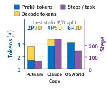

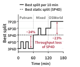

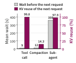

> 图解：左图比较 Putnam、Claude Code（CC）与 OSWorld 的请求工作量，它们的最佳静态配比从 2P7D 到 6P3D 不等。中图展示负载从 Putnam 转向 OSWorld 时，每个 10 分钟窗口的最佳配比会从 3P6D 移到 7P2D；固定 5P4D 在部分阶段损失最高 24% 吞吐量。右图说明“最近访问”不等于“仍会复用”：一次 359 秒的子 Agent 调用后，98% 的 Prompt 仍匹配旧 KV；一次 12 秒的 Compaction 后，这一比例却只有 14%。

因此，Agent Serving 需要同时回答两个问题：当前该给 Prefill 和 Decode 各多少节点？哪些 KV 仍被活跃分支需要？固定 PD 配比和 LRU 缓存都无法稳定回答它们。

## 现有系统的三笔低效账

论文先在 9 个四卡 GB300 节点上复放 Claude Code 轨迹，用 GLM-5.2、90 个并发 Agent 和 30 分钟预热后的 1 小时测量，量化现有方案的问题。

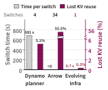

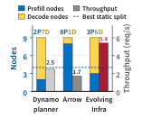

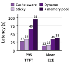

> 图解：左图比较切换时间与 KV 复用损失，Dynamo 每次重启平均耗时 681 秒，Arrow 虽能原地切换，却损失 55.5% 的可用 KV 复用。中图比较最终 PD 配比和吞吐量，Dynamo 与 Arrow 的吞吐量分别比最佳静态配比低 49% 和 65%。右图在固定最佳配比 4P5D 下比较路由策略；单纯增加共享内存池反而让 P95 TTFT 升至 95 秒，因为 KV 直到 Prefill 开始才装入 GPU。

这三笔账分别对应三个设计缺口。

**第一，计算角色与 KV 生命周期绑在一起。** Dynamo 通过重启 Worker 改角色，切换期间节点完全退出服务；Arrow 不重启，但节点转为 Decode 后，原有 KV 对 Prefill 不可达。

**第二，规划器看到的是瞬时信号，不是实际工作。** Arrow 按完整输入长度估计 Prefill，把已缓存前缀也算成新计算，还会被子 Agent 同时启动造成的短时突发误导，最终切换到 8P1D。Dynamo 看队列深度和 KV 利用率，长上下文使 Decode 节点的 KV 利用率持续偏高，又把配比推向 2P7D。

**第三，缓存局部性与负载均衡被迫二选一。** 粘住拥有前缀的节点会造成热点；把请求移到别处又可能重算前缀。共享池虽能搬 KV，同步加载却增加 TTFT，传输留下的重复副本还会挤掉真正有用的缓存。

论文用 **Lost KV Reuse** 衡量缓存损失。若实际 KV 命中率为 $h$，无限容量、全节点共享且不发生阶段切换时的理想命中率为 $h^*$，则：

$$
L_{\mathrm{lost}} = 1 - \frac{h}{h^*}
$$

接下来可以看到，Evolving Infra 并不是分别给这三个问题打补丁，而是先重构数据面，再让控制面使用更准确的 Agent 信号。

## 总体架构：计算可切换，KV 不跟着角色走

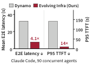

> 图解：架构中的每个节点都运行同时支持 Prefill 与 Decode 的对称引擎，节点主机内存组成共享 KV 池。Router 决定请求去向，在线 Planner 调整 PD 配比，KV Directory 则记录每份 KV 的位置及活跃分支引用数。红色路径对应计算与内存适配：前者切换节点角色，后者异步拉取 KV、清理不再被引用的副本。收益图汇总了相对 Dynamo 的延迟改善。

这个设计的关键在于：**节点是什么角色，不再决定它能访问哪些 KV。** 于是，计算规划与缓存管理可以独立优化，切换节点也不必重启或丢弃缓存。

## 数据面：对称引擎、共享 KV 池与分支目录

### 对称引擎：改路由，不重启

Evolving Infra 扩展 SGLang，用同一套调度循环支持两个阶段，并提供可在任意节点间双向传输 KV 的协议。底层复用 Mooncake 的 RDMA 传输，节点切换角色后协议仍然有效。

Planner 要调整配比时，Router 只需改变发往该节点的请求类型。切换节点的排队请求先转给同阶段的其他节点，正在运行的请求继续在原节点完成，随后节点进入新角色。整个过程不重载模型，也不清空 KV。

这与“启动时就决定自己是 P 还是 D”的传统引擎有本质区别。这一设计的价值也正在这里：自适应调度首先是一个数据面问题，仅靠更聪明的 Planner 无法消除重启成本。

### 共享主机内存池：把传输藏进排队时间

每个节点都把 KV 写入 GPU 内存（L1）和主机内存（L2），所有节点的 L2 组成共享池。Prefill 节点通过目录找到前缀后，直接经 RDMA 读取对等节点的 L2，不必像 Mooncake Store 路径那样经过独立 L3，再留下额外副本。

获取远端 KV 的完整流程是：

1. 请求到达目标 Prefill 节点后，立即从远端 L2 拉取 KV 到本地 L2。
2. 在请求排队期间，把 KV 恢复到 GPU，并广播到节点内所有 GPU。
3. Prefill 开始时直接使用就绪的 KV，不再逐层等待加载。

Decode 节点只向共享池写入，不从主机内存取 KV，因为一次加载会阻塞整个 Decode Batch。它从 Prefill 节点接收 GPU 到 GPU 的高速传输，新生成的 KV 则留在自己的 L2，供分支下一步使用。

### KV Directory：记录“谁还需要”，而不只是“最近谁用过”

目录沿用 Dynamo KV Indexer 的前缀树，通过引擎事件维护每个 KV Block 在各节点 L1、L2 中的位置，并额外记录：在节点 $n$ 上，有多少个活跃分支引用 Block $b$，记为 $R_{b,n}$。

Harness 为每个请求提供分支 ID，并在分支结束时通知系统。Router 还为每个分支维护版本号：普通追加不改变版本，Compaction 重写上下文则增加版本。

> 图解：$R_{P1}$、$R_{P2}$ 和 $R_{D1}$ 分别表示不同 Prefill、Decode 节点上的引用计数，$+1$ 与 $-1$ 标出当前操作的变化。连续请求只给新增 Block 计数；Compaction 把被替换历史的计数释放为零；P2P 或 D2D 传输把计数从源副本移到目标副本；P2D 或 D2P 则保留两端计数，因为后续步骤仍可能使用两个阶段的副本。

分支结束时，它持有的全部计数被释放。节点从 Decode 转为 Prefill 时重置计数以释放内存，从 Prefill 转为 Decode 时保留计数和 KV。由此，每个活跃分支在每个阶段至多持有一份有效计数。

### 为什么主机内存装得下

GLM-5.2 和 Kimi K2.6 使用 MLA 等紧凑 KV 表示。FP8 精度下，每个 Token 的 KV 在 Kimi K2.6 中约为 35 KB，在 GLM-5.2 中约为 50 KB；若使用完整 Multi-Head Attention，分别需要约 36 倍和 50 倍空间。

MLA 的 KV 不会随 Tensor Parallelism 切分，因此传统实现可能在每张 GPU 对应的主机池中重复保存。Evolving Infra 在每个节点只存一份，取回 L1 时广播给所有 GPU。GB300 节点约有 1 TB 主机内存，去重后可容纳约 2000 万个 GLM-5.2 Token 的 KV；四卡各存一份则只有约 500 万个。实验中，L2 通常能保存 L1 的 4 倍 KV。

## 控制面：在线估计工作，再决定配比、路由与淘汰

数据面解决了“能不能低成本调整”，控制面接着解决“应该调整成什么”。论文使用的核心符号如下。

| 符号 | 含义 |
|---|---|
| $t_{\mathrm{uc}}$、$t_{\mathrm{c}}$ | 请求的未缓存与已缓存 Prefill Token 数 |
| $t_{\mathrm{out}}$、$t_{\mathrm{acc}}$ | 输出 Token 数；每次 Decode 迭代平均接受的 Token 数 |
| $t_{\mathrm{fwd}}$ | 每个运行请求在一次 Decode 迭代中输入的 Token 数 |
| $w$ | 请求工作量，$(t_{\mathrm{uc}},t_{\mathrm{c}},t_{\mathrm{out}},t_{\mathrm{acc}})$ |
| $N$、$n$ | 节点数与节点索引 |
| $\mathcal{P}$、$\mathcal{D}$ | Prefill 与 Decode 节点集合 |
| $B$ | 一个 Decode 节点上的运行请求数 |

### Prefill 模型：缓存前缀不是零成本，也不是全新输入

对 Full Causal Attention，一个请求的 Query–Key Pair 数为：

$$
A = t_{\mathrm{uc}}t_{\mathrm{c}} + \frac{t_{\mathrm{uc}}(t_{\mathrm{uc}}+1)}{2}
$$

第一项来自未缓存 Token 对缓存前缀的注意力，第二项来自未缓存 Token 之间的因果注意力。节点 $n$ 的一次 Prefill 迭代时间建模为：

$$
T^{\mathrm{iter}}_{\mathrm{P},n} = c_{n,0} + c_{n,1}\sum t_{\mathrm{uc}} + c_{n,2}\sum A + c_{n,3}\sum t_{\mathrm{rst}}
$$

求和遍历当前 Batch 中的请求，$t_{\mathrm{rst}}$ 是从主机内存恢复的 Token 数。四个系数分别表示固定开销、每个未缓存 Token、每个 Query–Key Pair 和每个恢复 Token 的成本。

把固定成本按未缓存 Token 比例分给请求后，单个请求的 Prefill 占用时间为：

$$
T^{\mathrm{req}}_{\mathrm{P},n}(w) = c_{n,0}\frac{t_{\mathrm{uc}}}{\bar{t}_n} + c_{n,1}t_{\mathrm{uc}} + c_{n,2}A + c_{n,3}f_n t_{\mathrm{c}}
$$

其中，$\bar{t}_n$ 是节点每次 Prefill 迭代的平均新 Token 数，$f_n$ 是需要从主机内存恢复的缓存 Token 比例。

这个模型也适用于其他 Attention：Sliding Window 和 Linear Attention 的主要成本随 $t_{\mathrm{uc}}$ 增长；DSA 的 Indexer 仍要扫描历史，成本随 $A$ 增长，而核心 Attention 只读取最多 2048 个选中 Token，成本随 $t_{\mathrm{uc}}$ 增长。DeepSeek-V4 的 CSA、HCA 也可拆成与 $A$ 和 $t_{\mathrm{uc}}$ 相关的两部分。

### Decode 模型：关键是实际读取了多少专家权重

Decode 主要受显存带宽限制。Dense 权重每次迭代都要读取，MoE Routed Expert 则只有被 Token 选中时才读取。若每个 Token 从 $E$ 个专家中选择 $k$ 个，专家负载均衡且各 Token 独立选择，则某专家完全未被选中的概率为 $(1-k/E)^{t_{\mathrm{fwd}}B}$。被读取专家的期望比例为：

$$
\phi(B) = 1 - \left(1-\frac{k}{E}\right)^{t_{\mathrm{fwd}}B}
$$

于是，Decode 迭代时间为：

$$
T^{\mathrm{iter}}_{\mathrm{D},n}(B) = d_{n,0} + d_{n,1}\phi(B) + d_{n,2}B
$$

$d_{n,0}$ 包括固定成本和 Dense 权重读取，$d_{n,1}$ 对应全部 Routed Expert 的读取成本，$d_{n,2}$ 表示每个运行请求增加的采样、投机解码草稿等开销。

模型没有显式加入总上下文长度。原因是 MLA 让单 Token KV 很小，Sparse Attention 又只读取部分 KV。实验中，增加 100 万个上下文 Token，只会让 GLM-5.2 在 GB300 上的一次 Decode 迭代增加约 1 ms；而 8 到 64 个请求的一次迭代本身需要 17 到 45 ms。

单个请求对 Decode 节点的占用时间为：

$$
T^{\mathrm{req}}_{\mathrm{D},n}(w) = T^{\mathrm{iter}}_{\mathrm{D},n}(B)\frac{t_{\mathrm{out}}}{Bt_{\mathrm{acc}}}
$$

两个阶段的节点服务率均为请求占用时间的倒数，即 $\mu_{\mathrm{P},n}=1/T^{\mathrm{req}}_{\mathrm{P},n}(w)$，$\mu_{\mathrm{D},n}=1/T^{\mathrm{req}}_{\mathrm{D},n}(w)$。

### 在线拟合与模型精度

预热期间，所有节点先以 Colocated 模式同时服务两个阶段。系统记录固定窗口内完成的 Prefill、Decode 工作，用非负最小二乘法拟合各节点系数，随后冻结系数并进入 PD 分离模式。运行中只需重新测量随负载变化的 $\bar{t}_n$ 和 $f_n$。

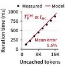

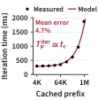

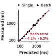

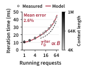

> 图解：散点是 GLM-5.2 在四张 GB300 GPU 上的单次迭代实测时间，红线是模型预测。前两图分别显示：固定 128K 缓存前缀时，时间近似随未缓存 Token 线性增长；固定 8K 未缓存 Token 时，时间随缓存前缀增长，该图横轴为对数尺度。第三图比较预测与实测，拟合范围外的平均误差为单请求 4.2%、2 至 8 请求 Batch 6.3%。第四图显示 Decode 模型能跟踪运行请求数变化；至少 8 个请求时，上下文长度只造成 2% 至 7% 的时间变化。

### Planner：只有持续收益才值得切换

请求必须依次经过两个阶段，因此集群吞吐由较慢的一侧决定：

$$
\Theta(\mathcal{P},\mathcal{D};\bar{w},\bar{q}) = \min\left(\sum_{n\in\mathcal{P}}\mu_{\mathrm{P},n},\sum_{n\in\mathcal{D}}\mu_{\mathrm{D},n}\right)
$$

$\bar{w}$ 是规划窗口内的平均请求工作，$\bar{q}$ 是平均 Decode 请求数。Decode Batch 设为 $B=\bar{q}/|\mathcal{D}|$。与队列深度不同，$\bar{w}$ 描述负载本身，子 Agent 的短时突发通常不会明显改变它。

每个规划窗口再分成 $m$ 个切片。候选配比在第 $i$ 个切片上的收益为：

$$
g_i = \Theta(\mathcal{P}',\mathcal{D}';\bar{w}_i,\bar{q}_i) - \Theta(\mathcal{P},\mathcal{D};\bar{w}_i,\bar{q}_i)
$$

只有平均收益大于两倍标准误，即 $\bar{g}>2\sigma_g/\sqrt{m}$，候选才有资格触发切换；合格候选中选择 $\bar{g}$ 最大者。这一道统计门槛避免为了短暂突发支付阶段切换成本。

### Router 与 Eviction：最短预测 TTFT，加上零引用优先淘汰

对于请求 $w$ 和候选 Prefill 节点 $n$，Router 预测：

$$
\hat{T}_n(w) = T^{\mathrm{rem}}_n + \sum_{j\in Q_n}T^{\mathrm{req}}_{\mathrm{P},n}(w_j) + T^{\mathrm{req}}_{\mathrm{P},n}(w)
$$

$T^{\mathrm{rem}}_n$ 是当前 Batch 剩余时间，$Q_n$ 是排队请求。完整实现还会计入超出排队时间的 KV 拉取成本，以及产生重复副本的代价，再把请求送到预测 TTFT 最短的节点。

淘汰策略按二元键 $(\mathbf{1}[R_b>0],T_b)$ 升序选择 Block：先删引用数为零的 Block，并在组内使用 LRU；只有零引用 Block 全部删完，才考虑仍被活跃分支引用的 KV。这样，Compaction 替换的历史、已结束子 Agent 的上下文和同阶段传输留下的源副本，会先于等待工具的分支缓存被淘汰。

## 实验：三类 Agent、动态组成与消融验证

### 实验设置

主实验使用 9 个四卡 GB300 节点，共 36 张 GPU，模型采用 NVFP4 量化、FP8 KV Cache、TP4 和 Multi-Token Prediction 投机解码。Putnam 与 CC 使用 GLM-5.2，OSWorld 和动态组成实验使用 Kimi K2.6。

- **Putnam**：mini-SWE-agent 执行数学任务，单分支、无上下文管理，偏 Decode；并发为 224、256、288。
- **CC**：真实 Claude Code 轨迹，包含子 Agent、Compaction 和长暂停；并发为 90、108、126。Trie Replayer 保留请求暂停、输出长度、工具时长与前缀共享。
- **OSWorld 2.0**：多模态、多 Agent，每步加入截图，偏 Prefill；并发为 128、144、160。

稳态实验预热 30 分钟，再测量 1 小时。Evolving Infra 的规划窗口为 600 秒，分为 10 个切片。主要基线是 Dynamo v1.5.1，部分实验加入 SGLang 上离线测得的最佳静态 PD 配比。所有基线使用相同的去重主机内存与 HiCache LRU。

### 稳态负载：吞吐、延迟和 KV 复用同时改善

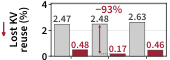

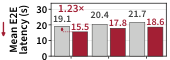

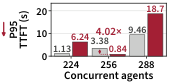

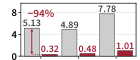

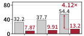

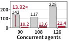

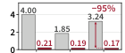

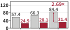

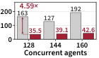

> 图解：三列分别对应 Putnam、CC、OSWorld，每列按三个并发档位比较；三行依次是 Lost KV Reuse、平均 E2E 延迟和 P95 TTFT，越低越好。箭头标出最大差距，复用损失旁的数字是相对减少量，延迟旁的数字是基线与 Evolving Infra 的比值。Evolving Infra 在所有设置中都减少了 KV 复用损失和平均 E2E 延迟，但 Putnam 的 224、288 并发下，它为吞吐保留较少 Prefill 节点，P95 TTFT 反而高于 Dynamo。

总体结果为：吞吐量达到 Dynamo 的 **1.10–2.73 倍**，Lost KV Reuse 减少 **81%–95%**，平均 E2E 延迟降至 Dynamo 的 **$1/1.15$–$1/4.12$**，P95 TTFT 最高降至 **$1/13.92$**。按负载看，平均 E2E 延迟比值分别为 CC 3.80–4.12 倍、OSWorld 2.34–2.69 倍、Putnam 1.15–1.23 倍。

下表给出闭环稳态实验的完整吞吐与延迟数据。$\bar{T}_{\mathrm{pause}}$ 是工具、子 Agent 或用户造成的请求间暂停。

| 负载 | 并发 Agent | Dynamo 吞吐 (req/s) | Dynamo E2E (s) | Dynamo 暂停 (s) | Evolving Infra 吞吐 (req/s) | Evolving Infra E2E (s) | Evolving Infra 暂停 (s) |
|---|---:|---:|---:|---:|---:|---:|---:|
| Putnam | 224 | 7.72 | 19.1 | 10.1 | 8.81 | 15.5 | 10.0 |
| Putnam | 256 | 8.37 | 20.4 | 10.1 | 9.20 | 17.8 | 10.0 |
| Putnam | 288 | 9.12 | 21.7 | 10.0 | 10.15 | 18.6 | 9.9 |
| CC | 90 | 2.48 | 32.2 | 15.4 | 5.40 | 7.9 | 12.9 |
| CC | 108 | 2.48 | 37.7 | 17.1 | 5.78 | 9.9 | 13.5 |
| CC | 126 | 2.14 | 54.4 | 18.6 | 5.85 | 13.2 | 14.1 |
| OSWorld | 128 | 1.93 | 57.4 | 1.0 | 4.30 | 24.5 | 1.4 |
| OSWorld | 144 | 1.98 | 66.3 | 1.4 | 4.33 | 28.1 | 1.4 |
| OSWorld | 160 | 1.68 | 84.4 | 1.2 | 4.38 | 31.4 | 1.3 |

闭环下，吞吐与延迟的关系可由 Little's Law 解释：

$$
X = \frac{\bar{N}_{\mathrm{branch}}}{\bar{T}_{\mathrm{E2E}}+\bar{T}_{\mathrm{pause}}}
$$

两种系统的在途请求与暂停分支总量相近，因此更短的 E2E 延迟会直接转化为更高吞吐，而不是仅来自“更快系统收到更多请求”的统计错觉。

### 切换与缓存：6.2 秒对 754 秒

| 负载 | 并发 | Dynamo 切换次数 | Dynamo 平均切换 (s) | Dynamo KV 命中率 (%) | Dynamo 复用损失 (%) | Evolving Infra 切换次数 | Evolving Infra 平均切换 (s) | Evolving Infra KV 命中率 (%) | Evolving Infra 复用损失 (%) |
|---|---:|---:|---:|---:|---:|---:|---:|---:|---:|
| Putnam | 224 | 2 | 798 | 96.59 | 2.47 | 3 | 2.3 | 98.54 | 0.48 |
| Putnam | 256 | 2 | 798 | 96.56 | 2.48 | 2 | 3.5 | 98.85 | 0.17 |
| Putnam | 288 | 3 | 800 | 96.42 | 2.63 | 5 | 3.4 | 98.56 | 0.46 |
| CC | 90 | 4 | 681 | 92.25 | 5.13 | 1 | 0.7 | 97.08 | 0.32 |
| CC | 108 | 4 | 831 | 92.62 | 4.89 | 2 | 1.9 | 96.87 | 0.48 |
| CC | 126 | 4 | 813 | 89.52 | 7.78 | 2 | 10.8 | 96.25 | 1.01 |
| OSWorld | 128 | 5 | 666 | 89.79 | 4.00 | 1 | 19.4 | 93.79 | 0.21 |
| OSWorld | 144 | 4 | 730 | 92.01 | 1.85 | 1 | 18.0 | 93.79 | 0.19 |
| OSWorld | 160 | 4 | 748 | 90.67 | 3.24 | 1 | 17.7 | 93.84 | 0.17 |

九个设置的平均值是 6.2 秒对 754 秒，差距超过 100 倍。Evolving Infra 的计时包含等待运行请求结束，但这些请求在切换期间仍被正常服务；Dynamo 的节点在整个重启期间退出服务。

Dynamo 在 CC 上损失的 KV 复用中，34%–46% 来自 LRU 淘汰等待工具、子 Agent 或用户的分支，15%–22% 来自把后续请求路由到不同 Prefill 节点。其无缓存 Prefill Token 比例最高达到 Evolving Infra 的 2.99 倍。

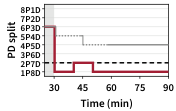

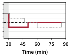

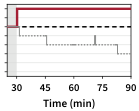

> 图解：三幅图分别展示 Putnam 224、CC 126 和 OSWorld 160 并发下，PD 配比随时间的变化。Dynamo 的虚线段表示一个节点正在重启、只剩八个节点服务。Evolving Infra 将 OSWorld 调整到 8P1D，将 CC 从 3P6D 调整到 4P5D，并在 Putnam 的 1P8D 与 2P7D 之间切换。Dynamo 每次重启需 10–15 分钟，重启覆盖了 44%–91% 的测量时间。

路由也改善了 Prefill 负载均衡。下表的“最忙/平均”是每分钟最忙 Prefill 节点排队时间与各节点平均值之比，再对测量期取平均。

| CC 并发 Agent | Dynamo 排队时间 (s) | Dynamo 最忙/平均 | Evolving Infra 排队时间 (s) | Evolving Infra 最忙/平均 |
|---|---:|---:|---:|---:|
| 90 | 11.4 | 2.29 | 1.5 | 1.79 |
| 108 | 11.0 | 2.38 | 2.2 | 1.75 |
| 126 | 11.2 | 2.61 | 4.3 | 1.85 |

Evolving Infra 将 CC 的 Prefill 排队时间缩短到 Dynamo 的 $1/2.6$–$1/7.6$，说明“按预测 TTFT 路由并异步取 KV”比单纯追随缓存位置更能控制尾延迟。

### 负载组成变化：跟着需求移动，而不是追着队列抖动

动态实验连续三小时分别服务 288 个 Putnam Agent、144 个 Putnam 加 72 个 OSWorld Agent、144 个 OSWorld Agent，使需求逐步转向 Prefill。

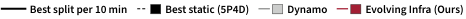

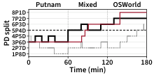

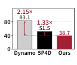

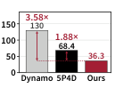

> 图解：左图横轴为时间，比较 Evolving Infra、Dynamo、最佳静态配比和各 10 分钟窗口的最佳配比；Dynamo 虚线仍表示节点重启。右两图分别比较全程平均 E2E 延迟与 P95 TTFT，柱上红色数字是基线相对 Evolving Infra 的延迟比。Evolving Infra 跟随 Putnam 向 OSWorld 的转变，在 OSWorld 阶段稳定到 8P1D；Dynamo 大部分时间配置的 Prefill 节点偏少。

| 阶段 | Dynamo 吞吐 (req/s) | 静态 5P4D (req/s) | Evolving Infra (req/s) |
|---|---:|---:|---:|
| Putnam（288） | 1.57 | 3.02 | **4.05** |
| 混合（144+72） | 2.21 | 3.64 | **3.99** |
| OSWorld（144） | 2.05 | 3.10 | **4.43** |
| 全程 | 1.94 | 3.25 | **4.16** |

全程平均 E2E 延迟分别降至 Dynamo 和最佳静态配比的 $1/2.15$、$1/1.33$，P95 TTFT 分别降至 $1/3.58$、$1/1.88$；吞吐量则分别为两者的 2.14 倍和 1.28 倍。

### 消融：初值不敏感，在线适配几乎不占吞吐

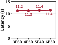

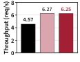

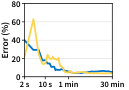

> 图解：实验均为 CC、126 个并发 Agent。左图横轴是初始 PD 配比，纵轴是平均 E2E 延迟；从 3P6D 到 6P3D 四种初值最终都收敛到 4P5D，延迟差异最多 1.8%。中图比较固定配比与开启在线适配的吞吐量，在最佳静态配比 4P5D 上开启适配只损失 0.3% 吞吐。右图横轴为学习时间、纵轴为模型平均误差，迭代时间模型在一分钟内收敛到低误差。

仅使用对称数据面、KV 复用感知路由与淘汰，在相同 4P5D 下就能获得最佳静态 SGLang 配比 1.37 倍的吞吐。仅加入异步 KV 获取、保持 SGLang 路由时，吞吐也有上游 SGLang 的 1.12 倍。这说明收益并非只来自 PD Planner。

## 扩展实验：规模、异构并行与缓存机制

### 对称引擎本身也会改变最佳静态配比

SGLang 在请求的 Prefill 开始前就为 Decode 预留 KV 空间，请求排队时预留仍被占用。Evolving Infra 到 Prefill 开始时才绑定 Decode 节点，因此排队请求不占 Decode KV。OSWorld 在 SGLang 的 6P3D 下，三个 Decode 节点平均 91% 的 KV 空间被预留；换成对称引擎后，单 Decode 节点也足够，最佳配比移到了 8P1D。

| 负载 | 系统 | 最佳静态配比 | 吞吐 (req/s) | 平均 TTFT (s) | P95 TTFT (s) | 平均 E2E (s) | P95 E2E (s) |
|---|---|---|---:|---:|---:|---:|---:|
| Putnam（224） | SGLang | 2P7D | 9.00 | 1.0 | 2.5 | 14.6 | 74.0 |
| Putnam（224） | Evolving Infra | 2P7D | **9.20** | **0.6** | **1.2** | **14.0** | **72.6** |
| CC（90） | SGLang | 4P5D | 4.97 | 4.8 | 19.5 | 9.2 | 30.7 |
| CC（90） | Evolving Infra | 3P6D | **5.44** | **3.5** | **9.7** | **7.8** | **22.2** |
| OSWorld（128） | SGLang | 6P3D | 3.12 | 35.3 | 50.8 | 35.8 | 51.3 |
| OSWorld（128） | Evolving Infra | 8P1D | **4.33** | **21.6** | **35.6** | **24.2** | **39.2** |

### 从 36 到 256 张 GPU：全局配比变钝，局部不均衡变尖锐

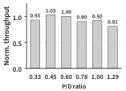

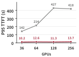

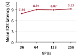

> 图解：实验用 CC、GLM-5.2，在每 GPU 10 个并发 Agent 下把集群从 36 扩至 256 张 GB300。左图将 256 GPU 上各 PD 比的吞吐归一化到 P/D=0.6（24P40D），P/D 从 0.33 到 1.29 时，静态 PD 仍保留该点 81%–103% 的吞吐。中图显示静态 PD 的 P95 TTFT 随规模从 142 秒升至 418 秒，约增为三倍；Evolving Infra 始终保持在 10–14 秒。右图显示其平均 E2E 延迟只增加 16%。

规模越大，大量 Agent 聚合后的 PD 需求越平稳，但 Cache-aware Router 会把更多热门前缀集中到少数节点。Evolving Infra 的路由与共享池解决的是这种节点间不均衡，而不只是全局 P/D 数量。

离线寻找最佳静态配比也会迅速变贵。$N$ 个节点有 $N-1$ 种配比，穷举成本为 $O(N^2gT)$ GPU-hours，二分搜索为 $O(NgT\log N)$，但吞吐曲线不一定单峰。三小时 CC 轨迹在 256 GPU 上，即使二分也需要 12 次运行、10752 GPU-hours，是正常服务一次所需 768 GPU-hours 的 14 倍；穷举则需 56448 GPU-hours。在线 Planner 只在 CPU 上评估候选，复杂度为 $O(Nm)$，不占额外 GPU 时间。

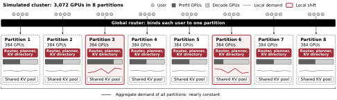

> 图解：模拟把 3072 张 GB300 分成 8 个 384 GPU 分区，全局 Router 将每个用户绑定到一个分区，各分区独立运行 Router、Planner 和 KV Directory。红色分区出现局部需求偏移，即使全集群总需求近似不变，各分区仍需要不同 PD 配比。

24 小时 CC 与 Codex 轨迹、约 30720 个并发 Agent 的模拟中，全集群 PD 比只变化 7%，但静态配置让 8 个分区中的 2 个严重失衡，排队时间最高达到集群平均值的 13.9 倍。失衡期间总工作量变化不足 12.3%，PD 比却最多移动 42.4%。各分区独立规划后，吞吐量达到静态配比的 1.42 倍。需要注意，这部分是模拟结果，并假设远端 KV 获取能在 Prefill 前完成。

### 开放到达：可持续 Agent 到达率翻倍

开放实验按 Poisson 过程引入新 Agent，不再等旧 Agent 完成才补充。满足目标的条件包括 P50/P95 TTFT 不超过 5/15 秒、P50 E2E 不超过 10 秒、至少接纳 90% Agent，且请求失败率低于 0.5%。

| 到达率 (agents/min) | Evolving Infra TTFT P50/P95 (s) | Evolving Infra E2E P50 (s) | 静态 4P5D TTFT P50/P95 (s) | 静态 4P5D E2E P50 (s) | Dynamo TTFT P50/P95 (s) | Dynamo E2E P50 (s) |
|---|---|---:|---|---:|---|---:|
| 0.5 | **0.7 / 6.8** | **2.5** | **0.7 / 10.8** | **2.7** | 1.0 / 22.0 | 3.4 |
| 0.75 | 1.3 / 17.8 | 4.4 | 3.8 / 57.0 | 7.3 | 21.0 / 234.5 | 25.7 |
| 1.0 | **1.2 / 12.3** | **4.6** | 6.6 / 139.0 | 11.3 | 11.9 / 122.1 | 17.4 |
| 1.25 | 16.8 / 55.0 | 21.8 | 18.5 / 1142.7 | 21.1 | 16.2 / 186.9 | 21.0 |
| 1.5 | 68.4 / 151.9 | 74.7 | 637.8 / 1377.1 | 639.9 | 19.6 / 251.1 | 24.4 |

Evolving Infra 可持续每分钟 1.0 个 Agent，是静态 4P5D 的两倍；Dynamo 在所有测试速率下都未达标。不过结果也暴露了在线规划的风险：0.75 agents/min 时，第 75 分钟一次切到 2P7D 的决策使 P95 Prefill 排队达到 120–275 秒，直到第 85 分钟增加 Prefill 节点才恢复。因此，较低到达率未达标而较高速率达标并非测量写反，而是一次具体切换造成的非单调现象。

### Prefill TP8、Decode ADP8：不同并行策略也能原地切换

实验在 6 个八卡 B200 节点上服务 GLM-5.2 和 BrowseComp Agent。Prefill 使用 TP8，Decode 使用 ADP8。节点保留两种 Attention 权重布局的并集，切换时只改变计算路径；额外 FP8 Attention 权重约占每 GPU 10 GB，即 B200 显存的 6%。

| 指标 | 最佳静态 | Dynamo | Evolving Infra |
|---|---:|---:|---:|
| 最终配比 | 2P4D | 3P3D | 2P4D |
| 平均 E2E 延迟 (s) | 15.7 | 21.9 | 15.9 |
| 两小时累计引擎切换时间 (s) | 0 | 913 | 27 |

Evolving Infra 的最终平均 E2E 与离线最佳静态配比只差 1.3%，Dynamo 则高 38%。相同思路还可扩展到 Wide Expert Parallelism：通过保留非专家权重和两份专家副本，减少跨 EP Group 切换时的权重搬迁，代价是额外占用约 3%–7% 的 B200 显存。

### 与 ThunderAgent 对比：瓶颈不是总容量，而是副本管理

三种配置都固定 4P5D，服务 CC、126 个 Agent。ThunderAgent 估计活跃 Agent 的峰值 KV 需求只占容量 86%，低于 95% 暂停阈值，因此没有暂停任何请求。

| 指标 | Cache-aware | ThunderAgent | Evolving Infra |
|---|---:|---:|---:|
| 吞吐 (req/s) | 4.66 | 4.43 | **6.27** |
| 平均/P95 TTFT (s) | 15.3 / 60.3 | 17.5 / 59.8 | **4.5 / 14.0** |
| 平均/P95 E2E (s) | 19.7 / 66.7 | 22.0 / 67.1 | **11.2 / 32.6** |
| 平均 TPOT (ms) | 4.6 | 4.4 | 7.9 |
| 实际/理想 KV 命中率 (%) | 94.9 / 97.2 | 94.7 / 97.2 | 96.6 / 97.3 |
| Lost KV Reuse (%) | 2.4 | 2.6 | **0.7** |
| 每请求未缓存 Prompt Token | 7660 | 8119 | **5268** |
| 活跃 Agent 峰值 KV 需求/容量 | — | 0.86 | — |
| 被暂停请求 (%) | — | 0 | — |

在带去重 L2 的 GB300 上，Agent 暂停机制没有触发，性能近似 Cache-aware Routing。Evolving Infra 则通过跨节点读取和零引用优先淘汰获得收益。其 TPOT 更高与更大的 Decode Batch 同时出现；这一对照没有完全分离路由与数据面的独立影响。

### 异步获取到底省了什么

| 指标 | 上游 SGLang | Evolving Infra |
|---|---:|---:|
| 吞吐 (req/s) | 4.62 | **5.18** |
| 平均/P95 TTFT (s) | 15.7 / 56.4 | **12.1 / 42.8** |
| 平均/P95 E2E (s) | 20.2 / 64.5 | **16.5 / 50.7** |
| 平均/P95 TPOT (ms) | 4.4 / 8.1 | 4.5 / 8.2 |
| Prefill/Decode GPU 空闲时间 (%) | 23.6 / 9.0 | **14.4 / 7.8** |
| 实际/理想 KV 命中率 (%) | 95.1 / 97.3 | 94.9 / 97.3 |
| 每秒未缓存 Prompt Token（千） | 34.3 | 39.3 |

相同路由下，仅异步加载就把 Prefill 空闲时间从 23.6% 降到 14.4%，吞吐提高 12%。上游 SGLang 的 NCCL 广播与 Prefill 计算争用 GPU，93% 的 Prefill 迭代在开始前等待超过 10 ms。

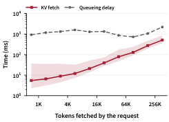

> 图解：横轴是每次获取的 Token 数，按二的幂分桶；纵轴是获取时间。曲线为中位数，阴影为第 10 到 90 百分位。每 Token 携带 54.6 KB KV，大块传输的 RDMA 带宽约 52 GB/s；64K–128K Token 的中位获取时间为 129 ms，92% 的获取少于 16K Token，中位时间仅 7 ms。各桶的中位排队延迟为 0.7–2.2 秒，至少是对应获取时间的 3.9 倍，因此排队足以遮住大多数传输。

## 模型通用性与相关系统边界

### 换到 H200 和 DeepSeek-V4-Flash

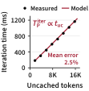

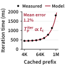

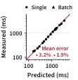

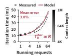

> 图解：散点是 DeepSeek-V4-Flash 在四张 H200 上以 TP4 运行的单次迭代时间，红线仍使用相同形式的模型。拟合范围外，Prefill 单请求平均误差为 2.6%，2–8 请求 Batch 为 1.9%，最大 Batch 偏差不超过 4.1%；Decode 平均误差为 3.6%。至少 8 个运行请求时，上下文长短对 Decode 时间的影响不超过 6.9%。

DeepSeek-V4-Flash 每个 Token 选择 256 个专家中的 6 个，投机解码每次前向输入 6 个 Token，均与 GLM-5.2 不同。模型形式仍然成立，说明它抓住的是计算量与显存读取量的结构，而不是某一组固定硬件系数。

### 与其他 PD、KV 系统的关系

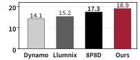

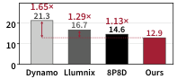

> 图解：实验使用 DeepSeek-V4-Flash、16 个四卡 H200 引擎和 384 个 CC 并发会话，动态系统从 12P4D 开始，最佳静态配比为 8P8D。左图纵轴为吞吐量，Evolving Infra 比最佳静态配比高 9%；右图纵轴为平均 E2E 延迟，柱上数字表示基线相对 Evolving Infra 的延迟比。Dynamo 与 Llumnix 都未能达到最佳静态配比的吞吐，Llumnix 低 12.2%。

不同系统各自只解决了问题的一部分：

- **vLLM、SGLang、Dynamo**：默认通过启动参数固定角色，改配比需要重启；SGLang 的新运行时切换仍会排空引擎并释放 Prefix Cache。
- **Arrow、xLLM**：可以原地切换，但会遗留不可达 KV，或无法同时启用阶段切换和 KV-aware Routing；按完整 Prompt 长度估算也会高估 Prefill。
- **Llumnix**：能迁移请求和 KV、在线调整 PD，但成本模型用总 Token 数插值，难区分新 Token 与长缓存前缀。
- **semi-PD**：在同一引擎内划分 SM 给两个阶段，避免引擎级重启，却仍受 TTFT/TPOT 瞬时目标和跨引擎缓存局部性影响。
- **MemServe、PPD**：复用多轮 Decode KV，但不在线调整 PD 配比；PPD 还依赖离线表。
- **Mooncake/HiCache**：提供多层 KV 共享，但额外的 L3 跳数、元数据 RPC、同步恢复和重复副本会增加延迟与内存压力。
- **ThunderAgent、Continuum**：保留等待工具的 Agent KV，主要处理 GPU Cache Thrashing，通常假设上下文只追加。
- **KVTether**：把 Harness 的上下文操作映射为 KV 生命周期，与 Evolving Infra 的分支感知最接近，但其展示设计使用固定 PD 配置，不处理在线配比调整。

Evolving Infra 的差异不是发明了前缀树、主机内存层或 RDMA，而是把这些已有机制与**对称计算角色、分支引用计数、在线工作模型**组合成同一个运行时闭环。

## 总结

- **核心解耦**：对称引擎让节点无需重启即可切换 Prefill/Decode，共享 L2 KV 池让缓存不随计算角色失效。
- **更准确的计算信号**：在线迭代时间模型区分未缓存 Token、缓存前缀与 MoE 专家读取，规划器只在窗口内收益持续显著时切换。
- **更符合 Agent 的缓存语义**：分支 ID、版本和引用计数跟踪 Fork、Sub-agent、Compaction 与 KV 传输，零引用副本优先淘汰。
- **主实验结果**：36 张 GB300 上，稳态吞吐为 Dynamo 的 1.10–2.73 倍，平均 E2E 最高加速 4.12 倍，P95 TTFT 最高加速 13.92 倍，切换平均仅 6.2 秒。
- **扩展边界**：真实实验覆盖 256 GPU 和 TP8/ADP8 异构并行，3072 GPU 结果来自模拟；开放到达实验也显示，单次错误切换仍可能造成显著尾延迟。

未来值得关注的方向，是让在线规划在更剧烈的开放负载下具备更强的风险约束，并把分支语义接口标准化，减少 Agent Harness 与 Serving 系统之间的适配成本。

> 本文参考自 [Evolving Infra: Agent-Adaptive LLM Serving at Scale](https://arxiv.org/abs/2611.12304)