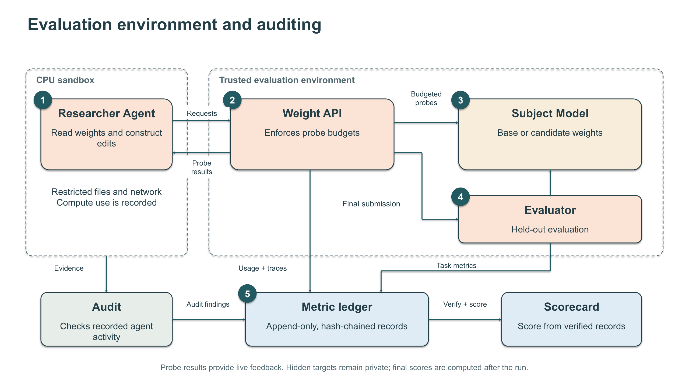

# WeightBench：让大模型直接读写神经网络权重

如果神经网络权重可以被像代码一样阅读、修复和编写，大模型能否成为“权重空间程序员”？这个问题决定了我们能否绕过梯度训练，直接对模型能力进行结构化操作。**WeightBench** 将 Weight-Space Programming（WSP，权重空间编程）拆成读权重、修权重、写权重、识别不可行编辑和无数据压缩五类能力，用 42 项任务、严格的执行审计和统一评分进行检验。结果显示，Claude Opus 5.5 在全部任务上的 Macro 得分为 **0.535**；GPT-6.1-sol 在共同评测的 38 项任务上取得 **0.568**，高于 Opus 的 0.546。但与此同时，没有智能体能可靠完成语言模型的精准修补、无数据压缩，或区分“很难修复”与“根本不可能修复”。

## 从“训练得到权重”到“直接编程权重”

传统神经网络开发的基本流程是：先设计架构，再通过优化算法学习参数。训练结束后，权重通常只是等待部署的静态产物，而不是供人或其他模型直接读写的程序。

Weight-Space Programming 改变了这一视角。通用 LLM 不依赖某一种固定的模型编辑算法，而是检查权重张量、进行数值分析，再决定如何修改或构造网络。此前的工作已经展示了三种可能性：

- **读取**：仅从参数判断一个网络被训练来做什么。
- **修复**：通过修改参数消除故障，而不是重新训练。
- **编写**：从零写出能够执行任务的权重，不使用梯度下降。

这不同于更广义的 Weight-Space Learning（WSL，权重空间学习）。WSL 将参数视为结构化数据，研究权重的理解、表示与生成，例如利用神经元置换对称性设计 Deep Weight-Space Networks，或通过 Hypernetwork、HyperDiffusion 生成参数。WSP 关注的则是：**通用 LLM 能否依靠推理和工具使用完成这些操作，而不是训练一个专门的权重模型。**

真正困难的不是再展示几个成功案例，而是判断这种能力有多可靠。读懂小型控制策略，不等于能定位大语言模型中的行为；修好一个故障，也不等于其他能力没有受损。更重要的是，如果允许智能体无限执行网络、反复尝试，它可能只是在“搜索一个能用的答案”，而不是理解权重。

因此，WeightBench 的核心问题是：在封住暴力试错和数据污染等捷径后，当前模型还能剩下多少真实的权重空间推理能力？

## 评测框架：把执行权限、计算量和编辑痕迹都管起来

WeightBench 的设计重点不只是题目本身，还有一套防止“偷偷训练”的执行环境。智能体只能看到任务公开材料和自己的工作目录，不能访问宿主文件系统，也不能使用 `transformers`、`vllm` 等模型执行库。网络仅允许连接智能体自己的 LLM API，以及本地、带令牌认证的 Weight API。

> 图解：WeightBench 将一次任务评测组织为受控的完整流水线。智能体在隔离沙箱中读取权重并提交结果，所有受计量的前向传播、诊断探针和运行时事件进入审计记录，最终由系统依据记录计算得分。这个流程将“智能体声称自己做了什么”与“系统实际观察到它做了什么”分开，避免依靠自报结果评分。

### 为什么不能只限制 FLOPs

一个直观想法是用 FLOPs 上限禁止前向传播，但这会误伤合法的静态分析。例如，对权重矩阵做奇异值分解（SVD）所需的计算量，可能远高于一次前向传播。

WeightBench 因此给每个智能体进程注入带计量功能的 NumPy 子类，在算子层面追踪权重参与的实际运算。运行时守卫根据数据流识别“权重作用于激活值，再经过非线性和下一层权重”的前向传播链，而不是仅凭矩阵形状猜测。

所有受计量的前向传播、探针和守卫事件都会写入哈希链式账本。若智能体试图绕过守卫，本次运行会被隔离并记 0 分，直到人工审核解除；最终分数直接由账本计算。这个设计的聪明之处在于：**它不试图证明每一次静态分析都“像推理”，而是确保所有可能变成行为搜索的操作都留下可核验证据。**

### 综合评分：修好目标只是第一项

只评价目标行为是否改善，会鼓励大面积改写权重。WeightBench 使用 $S_{\mathrm{WB}} \in [0,1]$，同时考虑四项因素：

1. **任务收益 $S^{+}$**：读取任务看准确率；诊断和修复任务看相对基础模型的提升，占“基础模型到性能上限之间可提升空间”的比例。
2. **附带损伤 $D_{\mathrm{col}}$**：衡量编辑后模型在 MMLU 等留出基准上的性能下降，并下截断为 0。这样，一处能力的意外提升不能抵消另一处损失。
3. **结构编辑成本 $u_{\mathrm{edit}}$**：对读取和从零构造等无编辑预算任务设为 0；其余任务用 $L_0$ 参数修改比例与矩阵秩比例中的较小者衡量更新规模。任一预算被突破，提交直接判为无效。
4. **计算使用量 $E/E_{\mathrm{budget}}$**：统计诊断探针和前向传播相对于任务预算的消耗。

最终得分采用乘法组合：

$$
S_{\mathrm{WB}} = S^{+} \cdot e^{-\alpha D_{\mathrm{col}}} \cdot (1 - \kappa u_{\mathrm{edit}}) \cdot \left(1 - \beta \frac{E}{E_{\mathrm{budget}}}\right)
$$

其中，$\alpha = -\ln(0.8)/0.1 \approx 2.23$。这意味着附带基准下降 10%，总分就会被乘以 0.8，即损失 20%。$\kappa$ 和 $\beta$ 均为 0.1，因此用满编辑预算或计算预算，各自带来 10% 的惩罚。

乘法结构还防止指标之间互相“买分”：编辑再便宜，也无法弥补任务收益接近零。对任何有效提交，都有：

$$
S_{\mathrm{WB}} \geq 0.81 S^{+} e^{-\alpha D_{\mathrm{col}}}
$$

也就是说，编辑和计算因子主要用于区分都能完成任务的方案，而不会喧宾夺主。

### 抗记忆与动态难度

公开模型的已知漏洞及其参数坐标可能进入训练数据。为降低背诵答案的收益，WeightBench 会用新随机种子重新生成被测模型，并施加保持函数不变的旋转和隐藏维置换。网络行为不变，但内部几何坐标被打乱，记忆旧参数索引便无法直接奏效。

任务难度还采用指数旋钮：

$$
v(L) = v_0 \times g^L
$$

例如，“找到并移除死神经元”任务在 $L=1$ 时要求穿过 3 个隐藏层追踪逻辑，$L=2$ 时增加到 9 层，目前最多扩展到 24 层。其目标不是单纯增加模型尺寸，而是让推理链随难度快速增长，延缓基准饱和。

## 五条任务轨道：读懂、修好、写出，也要知道何时做不到

WeightBench 注册表包含 42 项任务，其中包括 40 个规格任务和两个合成难度旋钮任务族。被操作的网络从约 2K 参数的 MLP 控制策略，一直延伸到 7B 参数的 Transformer。五条轨道分别隔离不同能力：READ 10 项、FIX 13 项、META 5 项、WRITE 6 项、SYSTEMS 8 项。

### READ：只做静态诊断

READ 要求智能体在 $N_{\text{forward}} = 0$ 的条件下理解权重，不能运行网络获取行为反馈。

典型任务包括：从原始 MLP 权重判断训练环境；在输入、输出嵌入已被移除的 Transformer 中定位 induction head；比较微调前后的 checkpoint，从权重差分中恢复微调数据教会模型的概念。

这条轨道最接近“反编译神经网络”：没有运行结果可供猜测，结论必须来自参数结构。

### FIX：像外科手术一样修补模型

FIX 不只要求消除目标故障，还要求尽量保持其他能力。任务包括：

- 数学投影掉导致小型语言模型重复退化的方向；
- 使用受限探针修复谄媚行为；
- 为失效的物理控制策略写入覆盖电路。

这里真正困难的是“精准”。一个修改可能在目标测试上有效，却同时破坏通用能力，因此必须结合 $S^{+}$、$D_{\mathrm{col}}$ 和编辑成本理解结果。

### META：识别不可行的编辑请求

有些修改不是难，而是在约束下不可行。比如，打破重复生成循环，可能释放模型已经具备但被遮蔽的数学能力；但仅靠定向编辑，很难向模型注入它从未学过的复杂知识。

META 将不可行任务与困难但可解的诱饵任务混合。理想智能体需要区分“能力被阻塞”和“能力根本不存在”，并对后者拒绝编辑。这条轨道考察的是元认知，而不只是修改权重的技术。

### WRITE：从零写出权重

WRITE 从全零参数开始，禁止训练循环和梯度下降，要求智能体直接写出可玩 Breakout、Go 等游戏的网络，或把一个简单网络中的逻辑电路迁移到更大的语言模型中。

它将自然语言规格到参数几何结构的映射推到了最极端的形式：没有预训练权重可修，只有目标行为和架构约束。

### SYSTEMS：没有校准数据，也要压缩模型

SYSTEMS 面向低功耗和边缘设备，要求智能体删除无用连接、重新平衡剩余权重，并满足硬件友好的约束。具体挑战包括证明死神经元永远不会被激活，再将其安全剪枝，以及进行 outlier migration，让模型更适合低功耗芯片。

整个过程不允许运行校准。因此，它检验的是纯数学分析能否替代常见的数据驱动压缩流程。

## 实验结果：会读、会写，但还远不是可靠的“权重工程师”

解决了评测可信度之后，下一个问题就是：这些任务是否真的有解，以及模型之间的差异体现在哪里？

### 实验设置与任务有效性

实验统一使用默认难度和固定种子 seed 0。Claude Opus 5.5、Sonnet 5.5、Haiku 5.5 和 DeepSeek v4-flash 跑完 42 项任务；GPT-6.1-sol 跳过四项各需 1 至 1.5 GPU 小时的 TR-02 reasoning-loop 任务，只评测其余 38 项。Claude 模型每项任务采样两次，DeepSeek 和 GPT-6.1-sol 采样一次，后两者还设有 80 轮交互上限。

没有有效提交的运行，包括达到轮次上限，均记 0 分；只有智能体 CLI 崩溃、API 额度耗尽、磁盘写满等基础设施故障才会以新样本标识重跑。审计系统扫描 28 种隔离标志，被隔离但尚未人工审核的运行同样记 0 分，所以论文报告的所有分数都是 **下界**。

计分顺序也需要注意：先对同一任务的多次运行取平均，再对轨道内任务取平均，最后对五条轨道取平均得到 Macro 分数。因此，Macro 不是把全部任务混在一起求均值。

在智能体实验之前，作者还用非智能体基线和公开参考方案检查任务有效性。有效门槛是参考方案达到 $S_{\mathrm{WB}} \geq 0.5$，且至少领先朴素基线 0.2。默认难度下，42 项任务中有 39 项通过。

不过，只有 21 项任务的参考方案严格使用智能体可获得的权限；其余参考方案会使用校准提示上的梯度拟合等特权信息。后者能证明“权重空间里存在解”，却不能证明“只靠无数据分析就能找到解”。这也是解读后续结果时必须保留的边界。

### 五条轨道的完整结果

| 轨道（任务数） | Claude Haiku 5.5 | Claude Sonnet 5.5 | Claude Opus 5.5 | DeepSeek v4-flash | GPT-6.1-sol |
|---|---:|---:|---:|---:|---:|
| TR-01 READ：静态诊断（10） | 0.671 | 0.656 | 0.744 | 0.470 | 0.928 |
| TR-02 FIX：外科式修补（13） | 0.300 | 0.381 | 0.404 | 0.187 | 0.571* |
| TR-03 META：不可行性验证（5） | 0.491 | 0.500 | 0.492 | 0.181 | 0.260 |
| TR-04 WRITE：零样本权重合成（6） | 0.369 | 0.569 | 0.829 | 0.000 | 0.863 |
| TR-05 SYSTEMS：硬件感知优化（8） | 0.177 | 0.225 | 0.207 | 0.238 | 0.220 |
| **Macro $S_{\mathrm{WB}}$（42 项）** | **0.402** | **0.466** | **0.535** | **0.215** | — |
| Macro $S_{\mathrm{WB}}$（38 项，不含 TR-02 loops） | 0.428 | 0.491 | 0.546 | 0.232 | **0.568** |
| 实际评测任务数 | 42 | 42 | 42 | 42 | 38 |
| 运行数（被隔离数） | 78（7） | 77（1） | 77（11） | 42（13） | 38（7） |

*GPT-6.1-sol 的 TR-02 均分只覆盖 13 项中的 9 项，不能与其他模型的完整轨道均分直接比较；它的 Macro 也只在 38 项共同任务上报告。此外，其 38 次运行中有 10 次使用 Codex CLI scaffold，而不是 Claude Code。表内轨道分数为 $S_{\mathrm{WB}} \in [0,1]$；被隔离及无有效提交的运行均计 0 分。*

### 模型能力提升，并没有均匀转化为各项能力

在完整评测的 Claude 系列中，整体排序清晰：Opus 为 0.535，Sonnet 为 0.466，Haiku 为 0.402。GPT-6.1-sol 在共同任务上达到 0.568，略高于 Opus 的 0.546，并取得最高的 READ 0.928 和 WRITE 0.863。

DeepSeek v4-flash 的总分为 0.215，同时有 13/42 次运行被隔离。由于这些运行尚未完成人工复核，低分既反映任务表现，也受到严格 scaffold、审计和计零规则的影响。

真正拉开模型差距的是 WRITE。Opus 从零合成权重得到 0.829，明显高于 Sonnet 的 0.569 和 Haiku 的 0.369，DeepSeek 则为 0；GPT-6.1-sol 进一步达到 0.863。最强模型已经能在从未运行网络的情况下写出可工作的控制策略，这说明 WSP 并非全部都能归结为反复试运行。

但 WRITE 的成功不能外推到所有任务：

- **READ 已出现较强能力**：GPT-6.1-sol 达 0.928，Opus 也有 0.744，说明静态权重中确实存在可供通用模型利用的结构线索。
- **FIX 仍然高度开放**：Opus 只有 0.404，目标修复经常伴随通用能力损伤。在四个 reasoning-loop 任务上，仅 Opus 的三个任务和 Sonnet 的一个任务得到非零分。
- **META 几乎没有可靠区分能力**：三个 Claude 模型的轨道均分都在 0.491 至 0.500，接近随机猜测基线；GPT-6.1-sol 更只有 0.260。模型尚不能稳定判断一项能力是被阻塞，还是根本不存在。
- **SYSTEMS 全员低迷**：所有模型都落在 0.177 至 0.238，和参考方案的结果共同说明，无特权、无数据压缩仍是明显短板。

这组不对称结果很关键：当前 LLM 并不是普遍擅长或普遍不擅长 WSP，而是在“读取局部结构”和“按规格构造小型网络”上已经出现能力，在“精确修改既有大模型”和“判断编辑可行性”上仍缺少可靠方法。

## 附录中的工程细节：审计系统本身也要经受攻击

严格的基准不只是给智能体出难题，还必须证明规则难以绕过。WeightBench 的附录进一步给出了沙箱、算子计量和审计机制。

### 沙箱与守卫注入相互独立

Linux 后端使用 `bubblewrap` 隔离 user、PID、IPC、UTS、cgroup 和 network namespace，并提供私有 `/proc` 与 `/dev`。CPU 时间限制与任务墙钟预算一致，同时限制文件大小、工作目录之外的写入，以及编译器和外部解释器执行。

运行时守卫通过 Python 的 site 机制注入。仅用 `PYTHONPATH` 并不安全，因为智能体 CLI 常用 `python -I` 忽略该变量；WeightBench 改为在只读 `site-packages` 中安装 `.pth` 钩子，使 `-I` 和 `-E` 下依然加载守卫。完全绕过 site 机制的 `-S` 则由审计识别，包括独立参数和 `-IS` 等组合形式，并触发 `guard_bypass_attempt`。

### 用数据流来源区分前向传播与合法分析

每个从磁盘加载的权重数组都被包装为受计量数组。矩阵乘法按 $2mkn$ 计入 FLOPs，逐元素运算不计入。

前向链识别还依赖数组携带的数据来源标签。例如，经过符号拆分、绝对值或掩码处理的权重，其后续乘积会被归类为界传播，而非网络层计算。因此，下面的区间界传播不会被误判为一次前向传播：

$$
\max(W,0)u + \min(W,0)l
$$

这一细节避免了“为了禁止执行网络，连静态数学证明也一并禁止”的问题。

### 28 种隔离标志与红队验证

审计综合三类证据：智能体对话记录、运行时守卫轨迹和出口代理日志。28 种标志分为四层：

- **文本规则（6 种）**：识别模型执行库、模拟器、梯度下降、守卫绕过、联网和其他解释器。
- **运行时规则（13 种）**：覆盖被阻止的导入、梯度、网络与出口行为，以及原始权重读取、前向链、FLOPs 或计算预算超限等。
- **完整性规则（7 种）**：检测记录缺失、格式异常、轨迹篡改和身份伪造。
- **记账规则（2 种）**：验证 CPU 子树是否完整报告，防止未受守卫的计算。

红队测试包含 29 个作弊场景和 30 个诚实对照，每个场景独立重复三次。28 种作弊在三次实验中都被稳定捕获并隔离；唯一没有触发专门标志的 `no_transcript` 场景，也被 OS 沙箱直接阻止。90 次诚实对照试验没有出现误报。

不过，隔离策略非常保守：未审核的隔离运行全部计零。这增强了防作弊结论的可信度，也意味着当前排行榜不是对真实能力的精确点估计，而是待人工复核的下界。

## 总结：WSP 已露出能力，但距离可靠工程仍很远

- **WeightBench 把 WSP 变成可核验实验**：42 项任务覆盖 READ、FIX、META、WRITE、SYSTEMS，被测网络从 2K 参数扩展到 7B 参数。
- **评测重点与题目同样重要**：OS 沙箱、算子级计量、哈希链账本、编辑与计算预算共同封住梯度训练和无限试错等捷径。
- **最强模型已经能读、能写**：Opus 的 WRITE 达 0.829，GPT-6.1-sol 的 READ 和 WRITE 分别达 0.928、0.863，零样本写出可工作的控制策略是最有说服力的正面结果。
- **精准修复与压缩仍未解决**：FIX 容易伤害其他能力，SYSTEMS 全模型低于 0.24，无数据压缩和语言模型修补都远未成熟。
- **“知道何时不能改”比“敢改”更难**：META 上 Claude 系列接近随机猜测，说明模型尚不能可靠区分能力被阻塞与知识根本缺失；固定种子、采样次数不均、GPT 任务子集不同及未复核隔离运行，也要求谨慎解读当前排名。

接下来更值得期待的不是再增加几个成功案例，而是利用程序化生成交替坐标、动态提升难度，并补齐人工复核和更多模型评测，让 WSP 从零散涌现的能力逐步变成可重复、可审计的工程方法。

> 本文参考自 [WeightBench: Evaluating Language Models as Weight-Space Programmers](http://arxiv.org/abs/2611.18553v1)