# RURL：纯仿真强化学习，真实机器人成功率60%

这篇工作解决的是：如何让开放权重推理模型不依赖演示数据、感知工具和运动规划器，也能直接操控真实机器人。它把 computer-use agent 的训练方式迁移到机器人，避免外部 harness 限制模型的动作空间，也让通用模型的推理能力能够服务于物理操作。核心思路是用 PEAR 基础设施执行机器人使用强化学习（Robot-Use Reinforcement Learning，RURL），让模型在仿真中反复观察、推理并输出末端执行器位姿，只依据任务是否成功的奖励学习。最终模型在未见过的真实双臂 YAM 上完成 18/30 次试验，基座模型为 0/30；LIBERO 成功率也从 1.6% 提升至 74.4%，且九项通用能力评测没有测得显著退化。

## 从操作电脑到操作机器人

### 为什么不直接使用现有机器人策略

机器人使用智能体（Robot-Use Agent，RUA）与电脑使用智能体（Computer-Use Agent，CUA）非常相似：CUA 读取屏幕截图，推理后输出点击或按键；RUA 读取机器人相机画面和状态，推理后输出末端执行器的下一个位姿。两者都不是一次性生成完整答案，而是在多轮“观察—思考—行动”中完成任务。

GPT-6 Astra、Claude Fable 5.2 等前沿闭源模型已经展现出很强的机器人操作与指令泛化能力，但开放权重模型在相同基准上成功率很低。已有工作常为开放模型外挂分割模型、技能库、运动原语、记忆或代码执行模块，组成一个 harness。这样确实能完成部分任务，却也可能把连续操作压缩成少量预定义选项，使其他任务变得不可行。

另一条路线是视觉—语言—动作模型（Vision-Language-Action，VLA），例如 $\pi_{0.5}$。它们通过任务演示进行监督微调，在训练分布内可以非常强，但遇到新目标或新指令时，容易重复演示中的动作。本文的判断是：**通用推理能力可能是泛化的关键，而机器人操作本身可以像电脑操作一样，通过带可验证奖励的 RL 学会。**

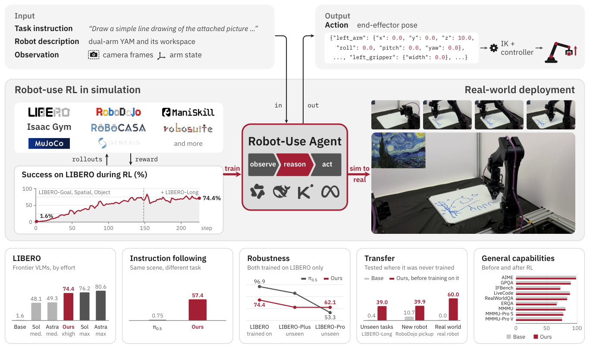

> 图解：上方是 RUA 的单轮决策，模型观察场景、生成 Chain-of-Thought，再给出下一个末端执行器位姿。左侧表示训练完全发生在仿真中，右侧表示同一模型直接部署到真实机器人。下方汇总了 LIBERO、指令跟随、扰动鲁棒性、未见任务与机器人迁移、真实世界和通用能力等评测。本文训练的是 Qwen3.8-27B，训练环境为 LIBERO 和 RoboDojo。

### 一轮机器人操作如何发生

模型每轮收到相机图像与机械臂状态，输出包含推理过程和动作的响应。动作不是关节力矩，而是末端执行器的位姿变化；逆运动学把它转成关节目标，再由机器人控制器执行。执行到目标并静止，或因阻塞无法继续时，本轮结束，模型获得下一份观察。

指令和此前所有轮次都保留在上下文中，因此模型可以根据完整历史修正动作。一次 episode 在仿真器报告成功、达到步数或上下文 token 上限、或者响应不含合法动作时结束。

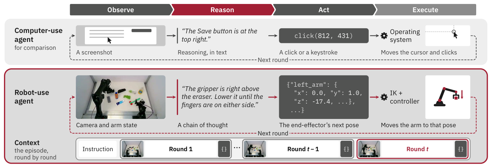

> 图解：顶部是 CUA 的“截图—推理—点击或按键—操作系统执行”闭环；底部是对应的机器人闭环。每轮历史都会追加到上下文中。仿真与真实机器人使用同一流程，差别只在于环境描述、相机和机器人自身的逆运动学与控制器。

这套接口刻意不提供感知工具、抓取器、运动规划器或技能库。物体定位、接近方式、操作步骤和失败识别都由模型自己完成。它的聪明之处在于用“位姿目标”而不是“关节命令”隔离机器人差异：LIBERO 的单臂 Franka、RoboDojo 的双臂 ARX 和真实双臂 YAM 只需修改部件列表及坐标系描述，模型侧协议完全不变。

## RURL：只凭成功奖励学会机器人操作

### 状态、动作与统一协议

系统提示词由三部分组成：所有环境共享的交互协议、特定环境的 `ENVIRONMENT` 描述，以及任务指令。机器人被描述为若干命名部件，每个部件包含可设置的命名量。状态与动作都采用相同结构的 JSON，长度单位为厘米，角度单位为弧度。

```json
{"<part>": {"<quantity>": <change>, ...}, ...}
```

动作表示每个量的**变化量**，填 0 表示保持不变。模型必须在响应末尾输出且只输出一个 JSON 代码块作为动作。以真实 YAM 为例，左右臂共享坐标系：原点位于两臂基座之间的安装高度处，$+x$ 向前、$+y$ 向机器人左侧、$+z$ 向上。下面的动作只让右夹爪下降 5 cm 并闭合：

```json
{"left_arm": {"x": 0, "y": 0, "z": 0, "roll": 0, "pitch": 0, "yaw": 0}, "right_arm": {"x": 0, "y": 0, "z": -5, "roll": 0, "pitch": 0, "yaw": 0}, "left_gripper": {"width": 0}, "right_gripper": {"width": -1}}
```

LIBERO 提供固定视角与腕部相机；RoboDojo 和真实 YAM 提供头部及左右腕部相机。提示词还会解释夹爪朝向、图像方向与坐标轴的对应关系，以及任务何时自动结束。RoboLab 则使用另一套单臂、夹爪和双相机描述。由此可以看到，所谓“零样本换机器人”并不是不需要任何机器人信息，而是**不再训练，只更换接口中的具身描述**。

### 从整条轨迹到 token 梯度

一条轨迹记为 $\tau=(o_1,y_1,\ldots,o_T,y_T)$，其中 $o_t$ 是第 $t$ 轮观察，$y_t$ 是同时包含推理和动作的模型响应。策略 $\pi_\theta$ 根据系统提示词 $p$ 与此前历史逐 token 生成响应，其上下文为：

$$
h_t=(p,o_1,y_1,\ldots,o_t)
$$

奖励极其简单：仿真器在 episode 结束前报告成功则 $R(\tau)=1$，否则为 0。训练目标是在训练任务上最大化期望奖励：

$$
\max_\theta \mathbb{E}_{\tau\sim\pi_\theta}[R(\tau)]
$$

RURL 使用 GRPO 的组归一化优势。对同一任务和同一初始状态采样 $G$ 条轨迹 $\tau_1,\ldots,\tau_G$，第 $i$ 条轨迹的优势为：

$$
\hat{A}_i=\frac{R(\tau_i)-\operatorname{mean}_j R(\tau_j)}{\operatorname{std}_j R(\tau_j)+\epsilon}
$$

每条轨迹中的所有生成 token 都获得该轨迹的优势，不区分它们属于推理还是动作，也不区分位于哪一轮。若一个组全部成功或全部失败，优势全为零，就像 DAPO 一样丢弃并补样，因为没有组内比较就没有有效学习信号。

对 batch 中 $N$ 个生成 token 求平均，梯度估计为：

$$
g=\frac{1}{N}\sum_i\hat{A}_i\sum_{t,k}\left[\nabla_\theta\log\pi_\theta(y_{i,t}^{k}\mid c_{i,t}^{k})-\mathbb{E}_{v\sim\mu(\cdot\mid c_{i,t}^{k})}\nabla_\theta\log\pi_\theta(v\mid c_{i,t}^{k})\right]
$$

其中，$y_{i,t}^{k}$ 是第 $i$ 条轨迹第 $t$ 轮响应的第 $k$ 个 token，$c_{i,t}^{k}=(h_{i,t},y_{i,t}^{<k})$ 是它的上下文，$\mu$ 是实际生成该轨迹的策略。

第一项是不带 PPO clipping 的 REINFORCE 估计，组均值充当 baseline。rollout 与参数更新完全异步，因此 $\mu$ 可能落后当前策略一到两个版本；第二项是 score-centering 修正，用来处理这种分布错配。作者只使用该修正，不使用截断重要性采样，也不加入 KL penalty 或 entropy bonus。

### 冷启动难题：全失败的任务没有梯度

二元奖励带来一个直接的冷启动问题。基座模型在 LIBERO 的 Spatial、Object 和 Goal 上只有约 2% 成功率，在 LIBERO-Long 上仅 0.4%，在多数 RoboDojo 任务上几乎从不成功。若一组 rollout 全部失败，所有优势都是零，再长的训练也不会产生有效更新。

因此课程学习不是单纯“先易后难”，而是**先训练已经能产生成功样本的任务，再利用迁移打开新任务的奖励信号**：

1. 第 1—148 步：训练 LIBERO 的 Goal、Spatial 和 Object。
2. 第 149—225 步：加入 LIBERO-Long，训练全部四个 suite，得到“仅 LIBERO 模型”。
3. 第 226—340 步：从该检查点继续，在 RoboDojo 的 `general_pickup` 和 `align_blocks` 上训练 115 步，得到最终的 Qwen3.8-27B-PEAR。

第一阶段故意排除 LIBERO-Long，也构成一个干净的迁移实验：当模型通过其他任务获得基础技能后，原本几乎没有奖励的长程任务开始出现成功样本，随后才可以被加入 RL。

### PEAR：让长上下文、多轮 RL 真正跑起来

PEAR（Post-training Engine for Agentic Robotics）构建在 veRL 与 LMCache 之上。训练时，整条 episode 是一个训练序列，而不是把每轮拆成独立样本。rollout 每轮都扩展同一前缀，因此大量计算可以复用；PEAR 在 H100 上把前缀 KV cache 卸载到 CPU，并限制并发 episode 数，使命中率保持在约 95% 以上。

策略更新则组合 FSDP、序列并行、gradient checkpointing 和 FlashAttention，以容纳最长 256k token 的序列。LIBERO 在 rollout 节点 CPU 上渲染，RoboDojo 则在独立 GPU 节点的 Isaac 容器中运行。

| 设置 | 配置 |
|---|---|
| 基座模型 | Qwen3.8-27B |
| RL 算法 | GRPO，配合 DAPO group filter 与 score centering；bypass 模式使用 REINFORCE policy loss，不做 PPO clipping |
| Batch | 每步 128 组，每组 8 条 rollout，数量在 group filter 后统计 |
| 优化 | AdamW，学习率 $10^{-6}$，每步更新一次；按 batch 生成 token 数平均 loss，无 KL penalty、无 entropy bonus |
| 采样 | Temperature 1.0，在完整分布上采样 |
| 课程 | LIBERO 三个 suite 训练第 1—148 步，四个 suite 训练第 149—225 步；再从该检查点训练两个 RoboDojo 任务 115 步 |
| 最大序列长度 | LIBERO 为 256k token，RoboDojo 为 160k token |
| 推理强度 | 训练全程 xhigh |
| 框架 | veRL，全异步执行 |
| Rollout | veRL + LMCache；H100 使用 TP4，160k/256k 上限下每引擎分别并发 64/32 条，前缀缓存命中率 95% 以上；GB300 使用 TP2，不用 LMCache |
| 训练并行 | H100：FSDP8 × SP8，每 GPU 32,512 token，FlashAttention-3，activation offloading；GB300：FSDP4 × SP4，每 GPU 69,632 token，FlashAttention-4 |
| 其他 | 全程 gradient checkpointing；每节点一个 FSDP 组，节点间使用 InfiniBand |
| 仿真器 | LIBERO 在 rollout 节点 CPU 渲染；RoboDojo 在独立 GPU 节点的 Isaac 容器中运行 |

训练合计约消耗 50,000 个 H100 等效 GPU 小时。LIBERO 与 RoboDojo 的 RL episode 平均约 94k token，其中提示词约 1.8k、响应约 92k；平均 19.7 轮，包含 39—59 张图像。随着训练进行，episode 从初期约 119k token、19.9 轮缩短到末期约 82k token、18.5 轮。

在 8 卡 H100 节点和 4 卡 GB300 节点上，rollout 吞吐都约为每秒 2,000—3,000 token。由于一些 bug，作者尚未启用 multi-token prediction。以上细节说明，RURL 的难点并不只是 loss：长上下文复用、异步策略错配和仿真调度同样决定训练能否扩展。

## 实验：能力提升是否超出训练任务

评测覆盖五个层次。LIBERO 使用 2,000 个 episode，即 40 个任务各 50 次；LIBERO-Plus 对相机、光照、背景、传感器噪声、指令措辞、布局和机器人初始状态做扰动，本文模型共跑 10,030 个 episode；LIBERO-Pro 使用四类扰动，每类 2,000 个 episode。RoboDojo 两个任务分别评测 163—200 个 episode 并报告 95% Wilson 区间，RoboLab-120 则包含 120 个任务、每任务 10 次，共 1,200 个 episode，最终模型报告两次评测均值。

真实机器人在双臂 YAM 上进行，每个模型各 30 次：五个方块对齐场景各两次，十种物体各拾取两次。超过 25 轮或单轮推理超过 32k token 都判失败；逆运动学无法求解时会重试，重试也计一轮。除特别说明外，本文模型均使用 xhigh effort。

### LIBERO：从几乎不会到接近前沿 VLM

在 Goal、Spatial 和 Object 上，训练成功率在 148 步内升至约 70%。第 149 步加入 LIBERO-Long 后，整套 LIBERO 成功率在第 184 步达到 69.5%，第 225 步达到 74.4%。相比之下，基座模型只有 1.6%。

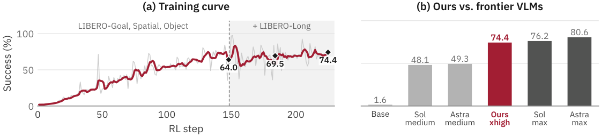

> 图解：左图横轴是 RL step，纵轴是训练 rollout 成功率，细线为原始值、粗线为平滑值；LIBERO-Long 在第 149 步加入，菱形表示同一训练运行在 2,000 个评测 episode 上的结果。右图比较基座模型、本文 xhigh 模型，以及 GPT-6.1 Sol 和 GPT-6 Astra 在 medium/max effort 下的 LIBERO 成功率，所有 VLM 使用相同机器人协议。

74.4% 已超过 GPT-6.1 Sol 和 GPT-6 Astra 的 medium effort 结果（48.1% 和 49.3%），并接近二者 max effort 的 76.2% 和 80.6%。不过，分 suite 结果也显示它并非全面领先：本文模型在 Spatial 和 Object 上表现突出，在 Goal 和 Long 上仍落后于 max effort 的前沿模型。

| 模型 | Effort | Spatial | Object | Goal | Long | 平均 |
|---|---|---:|---:|---:|---:|---:|
| Qwen3.8-27B | xhigh | 1.2 | 1.8 | 2.8 | 0.4 | 1.6 |
| GPT-6.1 Sol | max | 78.8 | 83.4 | 76.8 | 65.8 | 76.2 |
| GPT-6 Astra | max | 82.6 | 82.2 | **80.2** | **77.4** | **80.6** |
| GPT-6.1 Sol | medium | 22.8 | **69.2** | 58.2 | 42.2 | 48.1 |
| GPT-6 Astra | medium | **26.0** | 67.0 | **59.4** | **44.6** | **49.3** |
| $\pi_{0.5}$，LIBERO 演示监督微调 | — | 98.8 | 98.2 | 98.0 | 92.4 | 96.9 |
| 本文，仅 LIBERO | xhigh | **85.8** | **97.0** | 61.4 | 53.2 | 74.4 |
| 本文，仅 LIBERO | low | 30.4 | 35.9 | 18.9 | 2.5 | 21.9 |

在 Goal 和 LIBERO-Long 上，分别有 19% 和 33% 的 episode 因耗尽 256k 上下文而结束。这说明长程表现不仅受操作能力限制，也受推理长度与上下文预算限制。

### 鲁棒性：记住场景动作，还是理解新指令

仅在 LIBERO 上训练后，本文模型与 $\pi_{0.5}$ 面对未见扰动时呈现出明显差异。$\pi_{0.5}$ 在原版 LIBERO 上领先 22.5 个百分点，但在 LIBERO-Pro 上反而落后 8.8 个百分点。

LIBERO-Plus 主要改变观察，两个模型下降幅度接近：$\pi_{0.5}$ 下降 11.2 点，本文模型下降 12.2 点。LIBERO-Pro 进一步改变任务目标和物体布局，$\pi_{0.5}$ 下降 43.6 点，而本文模型只下降约 12 点。

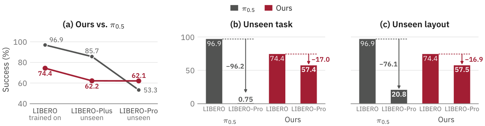

> 图解：左图比较两个仅由 LIBERO 训练的策略在 LIBERO、LIBERO-Plus 和 LIBERO-Pro 上的成功率。中图把同一场景换成新任务，右图保持指令但交换物体位置；箭头标注相对原版 LIBERO 的下降。$\pi_{0.5}$ 的数字来自既有工作，本文结果来自 RURL 模型。

最能说明问题的是任务扰动：场景和初始状态不变，只给一条要求不同任务的新指令。$\pi_{0.5}$ 从 96.9% 降到 0.75%，往往仍执行该场景演示中的旧任务；本文模型从 74.4% 降到 57.4%，多数时候能按新指令行动。交换物体位置也类似：旧动作不再适用时，$\pi_{0.5}$ 降到 20.8%，本文模型为 57.5%。

| 模型 | 新任务 | 交换位置 | 改写指令 | 改变物体外观 | 四类均值 |
|---|---:|---:|---:|---:|---:|
| $\pi_{0.5}$，LIBERO 演示监督微调 | 0.75 | 20.8 | **95.8** | **96.0** | 53.3 |
| 本文，仅 LIBERO，xhigh | **57.4** | **57.5** | 73.3 | 60.2 | **62.1** |

这并不表示 RURL 在所有维度都更鲁棒。只改写指令或改变物体外观、而原动作仍然正确时，$\pi_{0.5}$ 明显领先。更准确的结论是：**当正确运动必须随指令或布局改变时，推理式策略更有优势；当训练动作仍然适用时，演示模仿可以非常稳定。**作者也将这种差异解释为“模仿演示”与“根据场景和任务进行推理”的差别，而不是宣称已经证明了唯一因果机制。

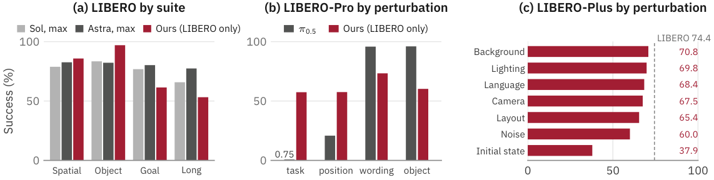

> 图解：左图按 Spatial、Object、Goal、Long 展示 LIBERO 成功率，并与 max effort 前沿 VLM 对比。中图按四类 LIBERO-Pro 扰动比较两个策略。右图展示仅 LIBERO 模型在 LIBERO-Plus 各扰动维度上的成功率，虚线是其原版 LIBERO 成功率；其中机器人初始状态变化造成的损失最大，达到 36.5 点。

| Suite | LIBERO | LIBERO-Plus | LIBERO-Pro |
|---|---:|---:|---:|
| Spatial | 85.8 | 75.7 | 78.9 |
| Object | 97.0 | 82.7 | 86.4 |
| Goal | 61.4 | 46.8 | 48.7 |
| Long | 53.2 | 44.5 | 43.8 |

每个 suite 在扰动后都下降约 7—15 点。LIBERO-Pro 表中包含未扰动任务时平均为 64.5%，只计算四类扰动则为 62.1%，两个口径不应混用。

### 零样本迁移：新任务、新仿真器与新机器人

在尚未用 LIBERO-Long 训练的第 148 步，模型已经在该 suite 上达到 39.0%，基座只有 0.4%；此时 LIBERO 整体成功率为 64.0%。加入 Long 后，它进一步升至 53.2%。这正是课程学习有效的证据：先从其他 suite 迁移出初步能力，再利用新出现的成功样本继续强化。

跨仿真器和机器人也成立。仅在单臂 Franka 的 LIBERO 上训练后，模型在双臂 ARX 的 RoboDojo 上，`general_pickup` 和 `align_blocks` 分别达到 39.9% 和 17.0%，基座分别为 10.7% 和 13.0%。

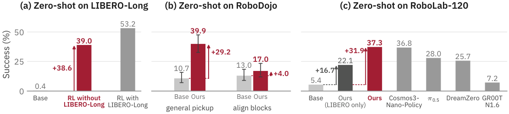

> 图解：左图比较未训练与已训练 LIBERO-Long 时的零样本/训练后结果。中图展示仅 LIBERO 模型迁移到 RoboDojo 双臂 ARX 的成功率，误差条为 95% Wilson 区间。右图在第三个基准 RoboLab-120 上比较最终模型、基座和四个使用 DROID 真实机器人数据训练的通用策略。

最终模型没有见过 RoboLab-120 的任务和场景，却取得 37.3% 成功率，基座为 5.4%，仅 LIBERO 模型为 22.1%。它略高于 Cosmos3-Nano-Policy 的 36.8%，并高于 $\pi_{0.5}$ 的 28.0%、DreamZero 的 25.7% 和 GR00T N1.6 的 7.2%。

| 模型 | 全部 | 简单 | 中等 | 复杂 | Score |
|---|---:|---:|---:|---:|---:|
| Qwen3.8-27B 基座 | 5.4 | 5.2 | 7.7 | 1.2 | 12.1 |
| Cosmos3-Nano-Policy | 36.8 | 40.6 | 35.4 | **25.3** | **51.9** |
| $\pi_{0.5}$ | 28.0 | 29.7 | 31.5 | 13.5 | 43.4 |
| DreamZero | 25.7 | 26.1 | 30.0 | 14.1 | 39.8 |
| GR00T N1.6 | 7.2 | 8.8 | 7.9 | 0.0 | 17.1 |
| 本文，仅 LIBERO | 22.1 | 28.6 | 19.5 | 3.5 | 35.0 |
| 本文，最终模型 | **37.3** | **44.6** | **35.8** | 13.2 | 51.3 |

Score 是 RoboLab 对子任务进度给予部分分数的指标，完整成功记 100。最终模型在简单和中等任务上成功率最高，但复杂任务只有 13.2%，明显低于 Cosmos3-Nano-Policy 的 25.3%；因此“整体持平或略优”不能被解读为所有难度都领先。

### Sim-to-real：没有真实数据，直接上双臂 YAM

从仅 LIBERO 模型出发，作者在 RoboDojo 的两个任务上继续训练 115 步，训练成功率由约 25% 升至约 70%。对应评测中，`general_pickup` 从 39.9% 升至 71.2%，`align_blocks` 从 17.0% 升至 78.8%。

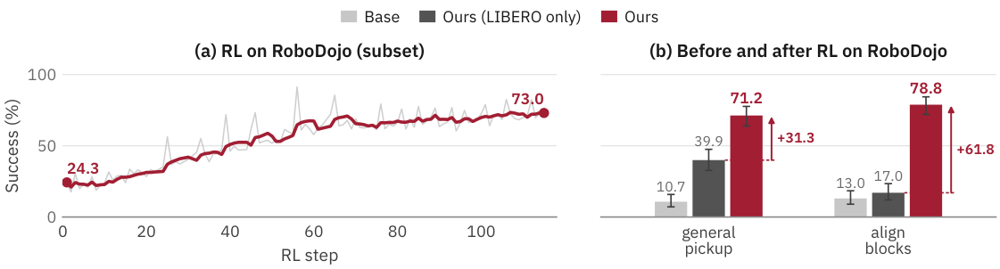

> 图解：左图横轴为 RL step，纵轴为两个 RoboDojo 任务的训练 rollout 成功率，细线和粗线分别是原始值和平滑值。右图比较本阶段训练前后两个任务的成功率，误差条为 95% Wilson 区间。训练仍完全在仿真中完成。

随后，模型在训练中从未出现过的真实双臂 YAM 上零样本评测，不使用任何真实机器人数据。最终模型成功 18/30，仅 LIBERO 模型成功 7/30，基座为 0/30。最终模型成功试验使用 7—24 轮，最后一轮上下文累计约 23k—132k token。

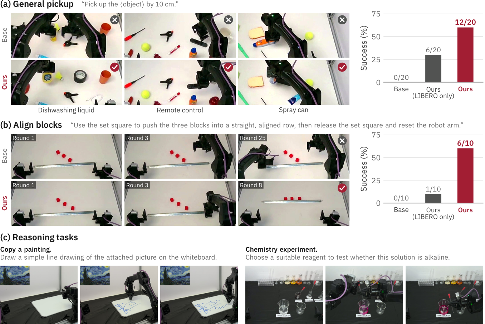

> 图解：(a) 是通用拾取，展示最终模型成功而基座失败的三个试验，柱状图统计十种物体共 20 次试验的成功数；(b) 是方块对齐，展示一次成功试验中的三轮，并统计五个场景共 10 次试验的成功数；(c) 是两个没有训练对应物的推理任务：根据《星月夜》画简笔线稿，以及选择酚酞检验碱性溶液。真实 YAM 不在任何模型的训练数据中。

完整试验如下。S 表示 25 轮内成功；F 后列出失败原因。Context 是最后一轮使用的上下文 token 数，总量上限为 260,096。

| 场景或物体 | 次数 | 基座结果 | 轮数 | Context | 仅 LIBERO 结果 | 轮数 | Context | 最终结果 | 轮数 | Context |
|---|---:|---|---:|---:|---|---:|---:|---|---:|---:|
| 对齐场景 1 | 1 | F：未对齐 | 12 | 40.0k | F：不安全位姿 | 20 | 78.2k | **S** | 10 | 54.8k |
| 对齐场景 1 | 2 | F：轮数耗尽 | 25 | 77.7k | **S** | 24 | 57.8k | F：未对齐 | 9 | 34.5k |
| 对齐场景 2 | 1 | F：轮数耗尽 | 25 | 103.4k | F：单轮超 32k | 10 | 99.4k | **S** | 14 | 47.1k |
| 对齐场景 2 | 2 | F：轮数耗尽 | 25 | 60.6k | F：轮数耗尽 | 25 | 106.0k | **S** | 8 | 26.1k |
| 对齐场景 3 | 1 | F：轮数耗尽 | 25 | 69.6k | F：轮数耗尽 | 25 | 131.8k | **S** | 18 | 80.0k |
| 对齐场景 3 | 2 | F：轮数耗尽 | 25 | 54.6k | F：轮数耗尽 | 25 | 72.0k | F：轮数耗尽 | 25 | 119.6k |
| 对齐场景 4 | 1 | F：轮数耗尽 | 25 | 72.1k | F：轮数耗尽 | 25 | 121.0k | F：未对齐 | 8 | 44.5k |
| 对齐场景 4 | 2 | F：轮数耗尽 | 25 | 176.4k | F：轮数耗尽 | 25 | 117.2k | **S** | 20 | 72.0k |
| 对齐场景 5 | 1 | F：轮数耗尽 | 25 | 66.2k | F：轮数耗尽 | 25 | 136.8k | **S** | 13 | 40.1k |
| 对齐场景 5 | 2 | F：轮数耗尽 | 25 | 141.8k | F：轮数耗尽 | 25 | 98.5k | F：未对齐 | 11 | 40.7k |
| 气泵 | 1 | F：碰倒 | 5 | 17.6k | F：碰倒 | 6 | 22.0k | F：碰倒 | 7 | 28.9k |
| 气泵 | 2 | F：碰倒 | 3 | 7.4k | F：碰倒 | 13 | 33.4k | F：碰倒 | 6 | 20.6k |
| 刷子 | 1 | F：轮数耗尽 | 25 | 66.0k | F：不安全位姿 | 19 | 86.4k | F：轮数耗尽 | 25 | 107.5k |
| 刷子 | 2 | F：轮数耗尽 | 25 | 71.8k | F：轮数耗尽 | 25 | 126.2k | F：轮数耗尽 | 25 | 92.1k |
| 洗洁精 | 1 | F：轮数耗尽 | 25 | 40.0k | F：单轮超 32k | 15 | 79.7k | F：轮数耗尽 | 25 | 108.3k |
| 洗洁精 | 2 | F：轮数耗尽 | 25 | 74.8k | F：单轮超 32k | 17 | 131.4k | **S** | 13 | 33.8k |
| 订书机 | 1 | F：轮数耗尽 | 25 | 85.0k | F：抓错物体 | 10 | 59.7k | **S** | 13 | 52.5k |
| 订书机 | 2 | F：轮数耗尽 | 25 | 103.1k | F：轮数耗尽 | 25 | 93.4k | F：轮数耗尽 | 25 | 138.8k |
| 遥控器 | 1 | F：轮数耗尽 | 25 | 100.0k | F：轮数耗尽 | 25 | 157.9k | **S** | 14 | 48.9k |
| 遥控器 | 2 | F：轮数耗尽 | 25 | 87.7k | **S** | 21 | 76.5k | **S** | 7 | 23.5k |
| 绳子 | 1 | F：轮数耗尽 | 25 | 75.4k | **S** | 22 | 135.7k | **S** | 9 | 47.6k |
| 绳子 | 2 | F：轮数耗尽 | 25 | 38.4k | **S** | 7 | 15.2k | **S** | 9 | 25.6k |
| 螺丝 | 1 | F：轮数耗尽 | 25 | 46.6k | **S** | 13 | 31.8k | **S** | 18 | 82.3k |
| 螺丝 | 2 | F：轮数耗尽 | 25 | 77.6k | **S** | 11 | 33.4k | **S** | 24 | 132.0k |
| 喷雾罐 | 1 | F：碰倒 | 16 | 51.9k | F：碰倒 | 6 | 21.1k | F：轮数耗尽 | 25 | 129.4k |
| 喷雾罐 | 2 | F：碰倒 | 15 | 31.3k | F：碰倒 | 8 | 21.5k | **S** | 8 | 36.8k |
| 网球 | 1 | F：轮数耗尽 | 25 | 60.8k | F：单轮超 32k | 15 | 141.1k | **S** | 22 | 91.5k |
| 网球 | 2 | F：轮数耗尽 | 25 | 90.3k | **S** | 19 | 69.1k | F：球滚走 | 17 | 81.9k |
| 乌龟玩偶 | 1 | F：轮数耗尽 | 25 | 54.2k | F：未完全抬起 | 11 | 33.1k | **S** | 15 | 28.2k |
| 乌龟玩偶 | 2 | F：轮数耗尽 | 25 | 67.3k | F：未完全抬起 | 10 | 27.3k | **S** | 10 | 23.6k |
| **成功总数** |  | **0/30** |  |  | **7/30** |  |  | **18/30** |  |  |

失败分布也很有信息量。基座的 30 次失败中，25 次耗尽轮数、4 次碰倒物体、1 次方块未对齐。仅 LIBERO 模型的失败原因更多样，包括单轮推理超过 32k、不安全位姿、抓错物体和未完全抬起。最终模型不再出现这四类失败，其 12 次失败包括 6 次轮数耗尽、3 次未对齐、2 次碰倒和 1 次网球滚走。三个模型都没能成功拾取气泵；气泵在全部六次试验中都被碰倒，刷子也没有被任何模型成功拾取。

两个额外推理任务更依赖基础模型的世界知识，而不是训练过的固定运动。面对《星月夜》图片，模型在白板上画出简单线稿；检验溶液是否呈碱性时，它在碘、乙醇和酚酞中选择酚酞，因为酚酞遇碱变粉，加入后溶液确实变粉。需要注意，这些较难任务依赖详细的具身与任务提示词，不能等同于任意表述下都能稳定完成。

### 通用能力：机器人 RL 没有测得明显代价

作者用相同问题对最终模型和基座做 paired comparison，并对问题执行 2,000 次重采样的 paired bootstrap，得到 95% 区间。九项评测的变化区间全部包含 0，因此结果支持“没有测得显著退化”，而不是证明每个能力绝对不变。

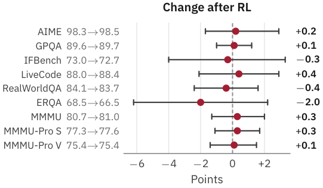

> 图解：每个点表示最终模型相对基座的分数变化，横线表示 paired 95% 区间，名称旁给出训练前后分数。九项依次为 AIME 2026、GPQA Diamond、IFBench、LiveCodeBench v6、RealWorldQA、ERQA、MMMU validation，以及 MMMU-Pro standard/vision。九项平均分变化为 -0.15 点，所有区间均跨过 0。

| Benchmark | 类别 | 问题数与采样 | Base | 最终模型 | 变化 | 95% CI |
|---|---|---:|---:|---:|---:|---:|
| AIME 2026 | 数学 | 30 × 16 | 98.3 | 98.5 | +0.2 | [-1.7, +2.9] |
| GPQA Diamond | 科学 | 198 × 8 | 89.6 | 89.7 | +0.1 | [-1.0, +1.2] |
| IFBench | 指令跟随 | 300，prompt strict | 73.0 | 72.7 | -0.3 | [-4.0, +3.3] |
| LiveCodeBench v6 | 编程 | 131 × 4 | 88.0 | 88.4 | +0.4 | [-2.1, +2.9] |
| RealWorldQA | 视觉问答 | 765 | 84.1 | 83.7 | -0.4 | [-2.4, +1.6] |
| ERQA | 具身推理 | 400 | 68.5 | 66.5 | -2.0 | [-6.2, +2.2] |
| MMMU (val) | 多模态 | 900 | 80.7 | 81.0 | +0.3 | [-1.3, +2.0] |
| MMMU-Pro standard | 多模态 | 1730，10 个选项 | 77.3 | 77.6 | +0.3 | [-1.1, +1.7] |
| MMMU-Pro vision | 多模态 | 1730 | 75.4 | 75.4 | +0.1 | [-1.4, +1.5] |

九项均值由 81.64 变为 81.49；仅 LIBERO 模型为 81.31。评测使用 evalscope 1.13.0、BF16 的 vLLM，以及 thinking-mode sampling（temperature 1.0、top-$p$ 0.95、top-$k$ 20）。这与既有研究的结论一致：在新技术任务上做 RL，可能比监督微调更少侵蚀原有能力，也使 RURL 有望成为基础模型 post-training 的一个组成模块。

### 推理长度决定成功率，也决定动作延迟

虽然训练只使用 xhigh effort，chat template 的 effort 仍能控制推理长度。low effort 下，每轮平均使用 0.86k thinking token；xhigh 为 3.23k。成功率同时大幅下降：LIBERO 上 low 为 21.9%，xhigh 为 74.4%。换言之，少于三分之一的思考长度只保留了不到三分之一的成功率，模型的大部分 LIBERO 能力确实来自每次动作前的长推理。

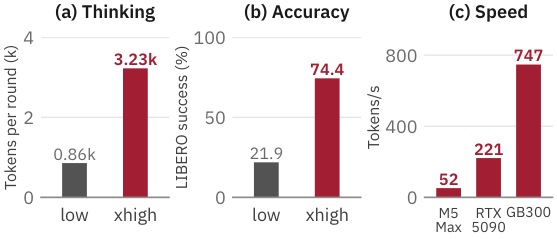

> 图解：左、中图分别比较 low 与 xhigh effort 的每轮 thinking token 数和 LIBERO 成功率，使用 BF16 权重，low 的成功率为两次评测均值。右图比较单设备解码速度；均采用 NVFP4 量化权重和 Inco DFlash2 drafter，GPU 上使用本文 megakernel，M5 Max 上使用 Splash 引擎。

在 NVFP4 权重和 DFlash2 drafter 下，M5 Max 的 Splash 引擎达到 52 token/s；经 KDA 优化的 megakernel 在单张 RTX 5090 上达到 221 token/s，在单张 GB300 上达到 747 token/s。DFlash2 使用原始检查点，平均接受长度为 3.2 token，专门适配本文模型的 drafter 仍可能进一步提速。

747 token/s 时，一轮 xhigh 推理约需 4.3 秒，low 约需 1.1 秒。因此 effort 是在成功率与动作速度之间取舍，而不是一个无关紧要的生成参数。模型已能在单张消费级 GPU 或笔记本上本地运行，但 NVFP4 会降低准确率并拉长推理链，所以论文所有成功率与通用能力评测都使用 BF16。

## 附录补充：完整 RoboDojo 暴露了上下文瓶颈

完整 RoboDojo 包含 42 个任务，覆盖 Generalization、Memory、Long-Horizon、Precision 和 Open 五个能力维度。12 个 Generalization 任务各有标准和随机设置，因此共有 54 个任务设置；本文每个设置运行 10 次，共 540 个 episode。

官方总分不是把所有任务直接平均，而是先对每个维度内任务求均值，再平均五个维度。下图中的 GPT-5.5 与 DeepSeek-Flash 榜单结果也按同一规则计算，因而可以比较。

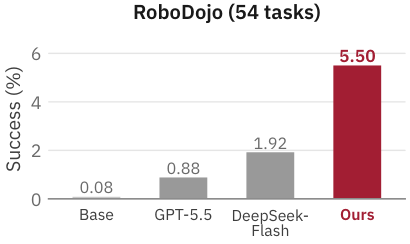

> 图解：横轴为模型，纵轴为按 RoboDojo 官方规则计算的五维平均成功率。基座与最终模型在每个任务设置上运行 10 次；GPT-5.5 和 DeepSeek-Flash 是 RoboDojo 团队榜单结果，分别每任务运行 50 次和 10 次。主文报告的两个训练任务只是该完整基准的一部分。

基座在 540 次中只成功 1 次，任务为 `stack_blocks_random`。最终模型成功 21 次：两个训练任务 `general_pickup` 和 `align_blocks` 分别成功 8/10 和 7/10，未训练的 `match_and_pick_from_conveyor` 与 `solve_equation` 各成功 3/10。

最终模型有 370/540 个 episode，也就是 68.5%，因耗尽 256k 上下文而失败。这提醒我们，两个训练任务上的高成功率不能外推为完整基准上的通用机器人能力；更长上下文、更强基础模型或显式上下文管理，都是后续提升的必要方向。

## 局限与边界：60% 不是问题的终点

- **训练规模仍小。**作者受 GPU 资源限制，只训练了两个仿真器、少量任务和一个 27B 基座，RoboDojo 也只用了两个任务；训练在仍然稳定时就停止了。更多仿真、更多任务和更强基座能否持续提升，尚待验证。
- **没有使用 SFT，但这不等于证明 SFT 无用。**作者缺少高质量同分布数据，也担心 SFT 损伤通用能力，并认为机器人数据更适合放在 pretraining 或 mid-training。因此本文只验证“纯 RL 可行”，没有给出同数据条件下 RL 与 SFT 的完整对照。
- **动作仍然很慢。**每次移动前都进行长推理，且 RL 没有长度惩罚。即使单 GB300 达到 747 token/s，一轮平均仍需约 4.3 秒；少数推理达到 32k token，一次移动就超过半分钟。
- **表现依赖提示词。**27B 基座对被控具身的知识有限，坐标系、夹爪、相机和任务细节需要明确写入 prompt。困难推理任务只有在详细描述具身与任务后才成功，这既是细粒度指令跟随能力，也是部署时的实际边界。
- **尚不能可靠输出 action chunk。**模型每轮只给单个末端位姿，由外部逆运动学与控制器执行并停下。控制器实现会影响精度、动作平滑性和步数预算，复杂运动也被拆成更多轮，进一步放大长推理成本。
- **训练成本不低。**总训练约需 50,000 个 H100 等效 GPU 小时。RURL 省去了演示采集，却没有消除大规模异步 rollout、长上下文训练与仿真基础设施的成本。

## 总结

- RURL 把 CUA 的多轮 RL 范式迁移到机器人：相机与状态输入、Chain-of-Thought 推理、末端位姿输出，不使用演示、感知工具、规划器或技能库。
- PEAR 通过全异步训练、GRPO 组优势、score centering、前缀缓存和长序列并行，让约 94k token、近 20 轮的 agentic episode 能够用于 RL。
- 最终模型在 LIBERO 上由 1.6% 提升至 74.4%，并在任务变化、物体换位、新 suite、新仿真器和新机器人上展现迁移；RoboLab-120 达到 37.3%。
- 完全没有真实机器人数据时，模型在真实双臂 YAM 上成功 18/30，基座为 0/30；九项数学、编程和视觉评测均未测得显著能力下降。
- 这些结果成立的同时，仍有长推理延迟、上下文耗尽、提示词依赖、单步位姿接口和小规模训练等明显限制。

下一步最值得关注的，是在更多仿真任务上扩展 RURL，同时学习更短的推理与可靠的 action chunk，让“能泛化的机器人智能体”进一步变成“足够快、足够稳定的机器人智能体”。

> 本文参考自 [Training Reasoning Models in Simulation to Natively Use Real Robots](http://arxiv.org/abs/2611.18562v1)