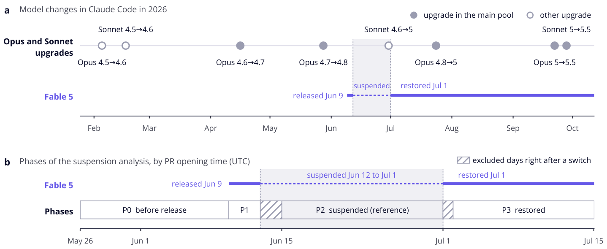
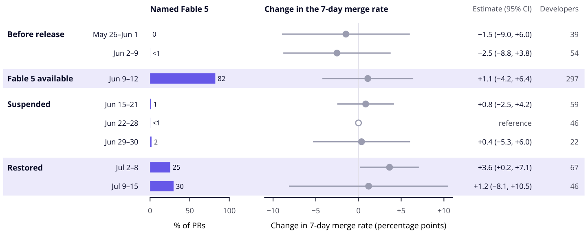
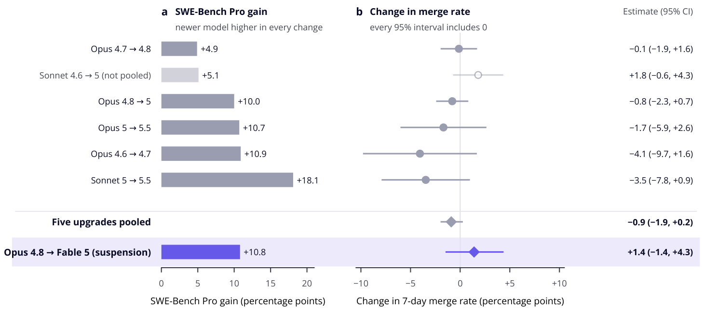
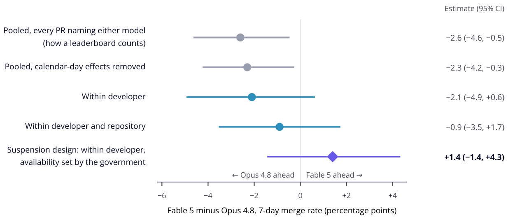

# Benchmarks vs. Merges：高分模型没多完成工作

编程模型在 SWE-Bench Pro 上高出 11 分，是否就能让开发者多完成真实工作？这篇论文利用 Claude Fable 5 被强制停用 19 天的外部事件，让同一批开发者在“能用”与“不能用”高分模型之间切换，从而分离模型访问权的影响。结果显示，Fable 5 可用仅对应 7 天 PR 合并率提高 **1.4 个百分点**，95% 置信区间为 $[-1.4,+4.3]$，并不显著；另外五次模型升级的合并率平均变化为 **-0.9 个百分点**，同样没有显著提升。换言之，在本文观察到的 Claude Code 工作流中，benchmark 分数的增长没有转化为更多被保留的代码改动。

## 为什么需要研究“分数之外”的真实产出？

新编程模型发布时，厂商通常用 SWE-Bench Pro 等榜单证明能力提升，用户也据此选择模型。但 benchmark 任务与真实软件工程之间隔着几道关键环节：

- benchmark 任务多来自公开仓库中已经解决的 issue，并用已有测试判定是否成功；
- 真实需求往往描述不清，代码还要符合项目风格、处理评审意见，并最终被人接受；
- 在 GitHub 上，一项改动通常以 Pull Request（PR）提交，之后被关闭或合并，通过测试并不等于会被项目保留。

因此，榜单上的 11 分究竟意味着多少真实产出，过去并没有直接证据。

直接比较不同模型的 PR 合并率也不可靠。先采用新模型的人可能更有经验；开发者还可能把难任务交给强模型、把简单任务交给弱模型；不同仓库的评审与合并习惯也会混入结果。已有 AIDev 数据研究、agent 间合并率比较和自动合并研究，大多没有同时控制开发者与模型。指定任务的实验能控制任务，却未必反映开发者日常工作；Copilot 升级研究比较的是项目而非同一开发者；随机试验和 ChatGPT 禁令研究则主要比较“有没有 AI”，不是“强模型与弱模型”。

这篇论文的切入点，是找到一个不由开发者决定、只改变可用模型的外部冲击。

## 一次禁令如何变成自然实验？

2026 年 6 月 9 日，Fable 5 发布；6 月 12 日，美国出口管制指令使其无法访问，直到 7 月 1 日恢复，停用持续 19 天。期间可用的最强模型是 Opus 4.8，其 SWE-Bench Pro 得分为 69.2%，Fable 5 为 80.0%，相差 10.8 分。

这个事件的价值在于：开发者没有主动选择停用模型，但同一批人被迫从 Fable 5 转向其他模型。作者将研究拆成三部分：

1. **停用分析**：Fable 5 的访问权是否因果影响同一开发者的 PR 合并率？
2. **升级分析**：开发者主动换到更新模型后，合并率与每周合并 PR 数是否变化？这一部分属于观察性关联，不作同等强度的因果解释。
3. **合并行为分析**：究竟是谁合并了这些 PR，是否经过其他账号批准？

> 图解：面板 a 展示 2026 年 Claude Code 的模型变化，圆点表示 Opus 与 Sonnet 家族的八次升级，实心点是主分析纳入的五次；紫色实线和虚线分别表示 Fable 5 可用与停用。面板 b 放大 6 月 12 日至 7 月 1 日的灰色停用区间，并按 PR 创建时间划分 P0（发布前）、P1（Fable 5 可用）、P2（停用，参照期）和 P3（恢复后）。斜线日期紧邻停用或恢复，为避免 PR 中包含切换前写好的代码而被排除。

停用分析比较 297 名在 P1 使用过 Fable 5 的开发者，以及 8,908 名始终使用 Opus 4.8、从未使用 Fable 5 的对照开发者。升级分析覆盖 1,208 名切换模型的开发者和 15,442 个 PR；每周产出分析还使用 944 名未切换模型开发者及其 8,569 个 PR。

这种设计仍有一个核心假设：如果没有停用事件，处理组与对照组的合并率会沿相同趋势变化。它并不是随机分配模型，但相比跨用户横截面对比，已经排除了大量“人不同、项目不同”的干扰。

## 数据、指标与统计方法

### 如何知道 PR 用了哪个模型？

Claude Code 默认会在 PR 描述中加入 “Generated with Claude Code”，并在 commit 中加入带模型名的 co-author 行，例如 “Co-Authored-By: Claude Opus 4.6”。当 PR 描述复用 commit message 时，作者就能据此识别模型。

研究通过 GitHub Search API 收集 2025 年 11 月 20 日至 2026 年 10 月 5 日间、位于各研究窗口内的公开 PR，主数据采集于 2026 年 11 月 2 日，保证最新 PR 也有超过 7 天的合并观察期。筛选条件包括：描述中只出现一个 Claude 模型、作者是普通用户而非 bot、创建时间处于研究窗口。

模型标签并非盲信。作者抽查 200 个 PR，将描述中的模型与创建前一天起的 commit 对照，升级前、后的匹配率分别为 96% 和 99%。不过，PR 仍可能携带更早会话生成的代码，这一点会在局限中再次影响解释。

### 用什么衡量“完成了工作”？

主要指标有两个：

- **7 天合并率**：PR 创建后 7 天内被合并的比例，单位为百分比；模型效应用百分点表示。
- **每周合并 PR 数**：开发者一周内创建、并在 7 天内合并的 PR 数量。它只在升级分析中估计，因为停用分析缺少可靠的产量对照组。

次要指标包括 1 小时内合并、未合并即关闭、PR 评论数、合并后 30 天内被 revert，以及自动检查失败。自动检查包括 GitHub 上运行的测试、构建和其他检查。

### 两组人在实验前是否可比？

下表保留论文 Table 1 的核心数据。停用分析使用 P0 的全部 PR；升级分析使用切换前一周的 PR。标准化差异是均值差除以合并标准差，绝对值越小，组间越相似。

| 特征 | 停用：处理组 | 停用：对照组 | 标准化差异 | 升级：切换者 | 升级：未切换者 | 标准化差异 |
|---|---:|---:|---:|---:|---:|---:|
| 有 PR 的开发者 | 244 | 315 | — | 1,208 | 944 | — |
| PR 数 | 21,377 | 30,630 | — | 7,829 | 4,502 | — |
| 人均 PR 中位数（IQR） | 34（10–88） | 35（10–89） | -0.06 | 2（1–6） | 2（1–5） | +0.12 |
| 7 天内合并 | 92.7% | 91.5% | +0.05 | 95.0% | 94.2% | +0.03 |
| 1 小时内合并 | 73.9% | 71.5% | +0.05 | 77.8% | 77.4% | +0.01 |
| 未合并即关闭 | 6.0% | 6.8% | -0.03 | 3.9% | 4.1% | -0.01 |
| 在作者自己的仓库创建 | 65.9% | 67.3% | -0.03 | 64.3% | 75.5% | -0.25 |
| 外部作者 | 18.8% | 16.8% | +0.05 | 23.5% | 11.7% | +0.31 |
| 标题以 “feat” 开头 | 23.5% | 31.5% | -0.18 | 18.3% | 12.4% | +0.17 |
| 描述长度中位数（字符） | 1,393 | 1,259 | +0.15 | 1,267 | 1,108 | +0.11 |

停用分析两组在发布前非常接近，所有标准化差异都在 -0.18 到 +0.15 之间。升级分析中，切换者更常在他人仓库提交 PR，因此作者另外加入开发者与仓库固定效应、日历对照等检查。

### Difference-in-Differences 如何隔离模型影响？

可以把 Difference-in-Differences（双重差分，DiD）理解为：不仅看处理组在停用前后变没变，还减去同期普通开发者共同经历的变化，例如节假日、平台负载或整体工作节奏。

PR 层面的线性概率模型为：

$$
Y_{it}=\alpha_i+\gamma_t+\beta_0 P0_{it}+\beta_1 P1_{it}+\beta_3 P3_{it}+\varepsilon_{it}
$$

其中，PR 在 7 天内合并时 $Y_{it}=1$，否则为 0；$\alpha_i$ 是开发者固定效应，控制不随时间变化的个人差异；$\gamma_t$ 是日历日固定效应，控制当天所有人共同面对的变化。P2 为参照期，主估计量是两个 Fable 5 可用阶段相对停用期的平均差：

$$
\text{Reversal contrast}=\frac{\beta_1+\beta_3}{2}
$$

$\beta_0$ 则充当 placebo：它比较同样没有 Fable 5 的发布前与停用期，若此时也出现巨大“效应”，就说明设计可能有问题。标准误按开发者聚类。

升级分析对每次升级分别拟合：

$$
Y_{ip}=\alpha_i+\delta\,\mathrm{New}_{ip}+\varepsilon_{ip}
$$

$\mathrm{New}_{ip}$ 表示 PR 是否在升级后一周用新模型创建，$\delta$ 就是同一开发者的合并率变化。五次主升级按逆方差加权合并。每周合并 PR 数使用 $\log(1+x)$，比较切换者与未切换者的前后变化。

作者选择线性概率模型，是因为系数可以直接读作“百分点”，与榜单分数的沟通方式一致；固定效应 logistic 模型会丢弃所有 PR 都合并或都未合并的开发者，而这类人占多数。虽然线性模型在合并率接近 100% 时可能给出超过 1 的预测值，但这里关注的是平均差异，聚类标准误也能处理相应异方差。

## 结果一：失去和恢复 Fable 5，合并率几乎没变

实际模型使用发生了剧烈切换：P1 有 82.3% 的处理组 PR 标注 Fable 5，P2 只剩 0.9%，74.6% 转向 Opus 4.8；恢复后的 P3，Fable 5 占比也只回到 26.9%。与此同时，作者自有仓库中的 PR 占比保持在 69%–72%，任务类型没有实质变化。

> 图解：左图是各时期处理组 PR 中标注 Fable 5 的比例，从约 82% 降到不足 1%，再恢复到约 30%；右图是开发者与日历日固定效应模型中的“处理组 × 时期”系数，纵轴对应 7 天合并率相对参照周的变化，误差线为按开发者聚类的 95% 置信区间。参照期为停用期内的 6 月 22 日至 28 日，最右列列出各期活跃开发者数。阴影行表示 Fable 5 可用，切换后的排除日未显示。模型使用大幅摆动，但合并率估计基本保持平坦。

主结果如下：

- Fable 5 可用时，7 天合并率相对停用期高 **1.4 个百分点**，95% 置信区间 $[-1.4,+4.3]$，不显著；按该区间，数据不支持超过约 4.3 个百分点的提升。
- placebo 为 **-2.6 个百分点**，区间 $[-6.2,+1.1]$，同样不显著。
- 加入处理组每周线性趋势后，估计为 **+1.6**，区间 $[-1.0,+4.3]$。
- 换用其他权重、结果定义或全部 PR 后，估计大致落在 **-0.1 到 +3.7 个百分点**；只有“全部 PR、每位开发者等权”这一设置显著，为 +3.6（+0.1 到 +7.1）。
- 按实际使用比例缩放后，每个真正使用 Fable 5 的 PR 对应 **+2.7 个百分点**，区间 $[-2.6,+8.0]$；直接比较同一开发者使用 Fable 5 与其他模型的 PR，也得到 +2.7（-0.7 到 +6.1），仍不显著。

这里的结论不是“严格证明效应为零”，而是：在这批数据和该指标下，没有观察到统计上明确的提升，而且主估计把平均收益限制在较小范围内。

## 结果二：五次升级没有提高合并率或每周产出

停用事件只有 19 天，单次估计区间较宽。为检验结果是否只是这一事件的偶然现象，作者又观察了 2026 年 2 月至 9 月的八次 Opus、Sonnet 升级，其中五次进入合并率主汇总。

> 图解：面板 a 是 Anthropic 报告的新旧模型 SWE-Bench Pro 分差，每次提升 5 到 18 分；面板 b 是同一批切换开发者在升级前后 7 天内的合并率变化，点为估计值，线为 95% 置信区间。五次主分析升级按逆方差合并，浅色条与空心圆表示因切换人数不足而未纳入汇总的 Sonnet 4.6 → 5。底部还列出停用分析的 reversal contrast。榜单分数明显增加，但没有任何一次升级带来显著的合并率提升。

五次主升级的点估计全部为负，且各自区间都跨过 0；汇总结果为 **-0.9 个百分点**，95% 置信区间 $[-1.9,+0.2]$。六个同时有新旧模型 SWE-Bench Pro 分数的升级中，五个点估计为负，没有一次显著上升。

| 升级事件 | 切换开发者数 | 切换者 PR 数 | 合并率变化（百分点，95% CI） | 汇总用途 |
|---|---:|---:|---:|---|
| 2 月 5 日，Opus 4.5 → 4.6 | 54 | 443 | +1.7（-5.2，+8.5） | 仅六次升级分析 |
| 2 月 17 日，Sonnet 4.5 → 4.6 | 9 | 104 | +5.1（-51.3，+61.4） | 不汇总 |
| 4 月 16 日，Opus 4.6 → 4.7 | 115 | 1,516 | -4.1（-9.7，+1.6） | 五次、六次 |
| 5 月 28 日，Opus 4.7 → 4.8 | 113 | 3,482 | -0.1（-1.9，+1.6） | 五次、六次 |
| 6 月 30 日，Sonnet 4.6 → 5 | 193 | 1,440 | +1.8（-0.6，+4.3） | 不汇总 |
| 7 月 24 日，Opus 4.8 → 5 | 404 | 5,477 | -0.8（-2.3，+0.7） | 五次、六次 |
| 9 月 22 日，Opus 5 → 5.5 | 458 | 4,000 | -1.7（-5.9，+2.6） | 五次、六次 |
| 9 月 28 日，Sonnet 5 → 5.5 | 118 | 967 | -3.5（-7.8，+0.9） | 五次、六次 |

只比较同一开发者、同一仓库时，升级后的合并率变化为 **-1.2 个百分点**（-2.3 到 -0.02），即出现统计显著的小幅下降，而非上升。六次升级汇总为 -0.8（-1.9 到 +0.2），八次全部纳入为 -0.4（-1.4 到 +0.6），方向没有改变。

每周工作量的答案也类似：

- 相对未切换者，切换者的每周 7 天合并 PR 数变化 **+2.4%**，区间 $[-4.9\%,+10.2\%]$，不显著；
- 创建的 PR 数变化 **+2.7%**，区间 $[-6.7\%,+13.0\%]$；
- 升级前后两组创建的 PR 都减少了，因此不能只把切换者的数量变化归因于新模型；
- 停用期间处理组没有减速，每位开发者每日创建 PR 数从发布前 4.8、停用期 5.0，变为恢复后 5.2。

论文 Table 2 将主要、次要结果放在一起。括号均为 95% 置信区间；“未估计”表示该设计没有可靠对照，而不是结果为零。

| 结果 | 停用分析：Fable 5 可用减停用 | 升级分析：切换后变化 |
|---|---:|---:|
| 7 天内合并（百分点） | +1.4（-1.4，+4.3） | -0.9（-1.9，+0.2） |
| 每周合并 PR 数 | 未估计 | +2.4%（-4.9%，+10.2%） |
| 1 小时内合并（百分点） | 0.0（-5.8，+5.8） | +0.8（-2.1，+3.8） |
| 未合并即关闭（百分点） | -0.5（-3.0，+2.1） | +0.5（-1.3，+2.3） |
| 每个 PR 评论数 | 未估计 | +0.03（-0.06，+0.12） |
| 合并后 30 天内 revert（百分点） | 0.0（-0.4，+0.4） | 事件太少 |
| 自动检查失败（百分点） | — | +0.3（-1.4，+2.0） |
| 测试或构建检查失败（百分点） | — | +0.2（-1.6，+1.9） |
| Placebo：发布前 vs 停用 | -2.6（-6.2，+1.1） | — |
| 同一开发者与仓库内（百分点） | +1.4（-1.4，+4.3） | -1.2（-2.3，-0.02） |
| 全部 PR 重新拟合（百分点） | +0.5（-2.3，+3.3） | — |
| 已合并 PR 的合并耗时 | +8.4%（-9.0%，+29.2%） | +2.4%（-2.1%，+7.2%） |

自动检查也没有显示新模型更可靠：升级后至少一项检查失败的 PR 占比变化 +0.3 个百分点，测试或构建失败变化 +0.2 个百分点，均不显著。唯一显著的单次升级是 Opus 4.7 → 4.8，失败率反而上升 5.4 个百分点（+1.1 到 +9.7）。

## 为什么合并率可能没有提升空间？

分析 2,019 个 PR 后，作者发现：

- **95% 的合并由 PR 作者自己的账号完成**；
- **90% 没有其他账号的 approval**；
- 内部作者和外部作者的 PR 分别有约 97% 和 94% 由作者自己合并；
- 各阶段、各升级周中，从创建到合并的中位时间都不到半小时，与模型无关。

这意味着 merge 更接近“开发者认为改动可以保留”的公开信号，并不必然代表独立评审通过，更不能直接证明代码质量高。

同时，升级前的基线已经非常高：切换者的 PR 有 94.5% 在 7 天内合并，77.1% 在 1 小时内合并；1,262 名切换者中，83.8% 的人在升级前一周所有 PR 都已合并。这就是明显的天花板效应。

不过，论文没有只靠一句“天花板”解释全部零结果。1 小时合并率起点约 75%，仍有上升空间，却没有变化；升级前至少有一个未合并 PR 的开发者中，切换者相对未切换者的合并率变化为 -1.3 个百分点（-6.9 到 +4.3），也不显著；每周合并 PR 数没有固定上限，同样没有显著增加。

这个设计的聪明之处在于，它没有把“没涨”简单归因于单一指标失效，而是用合并速度、未合并子样本、每周产量和自动检查交叉验证。

## Benchmark 增益为什么没有进入日常工作？

作者提出两个相互补充的解释。

第一，**开发者交给 agent 的日常任务，本来就在旧模型能力范围内**。Anthropic 对 132 名工程师和研究者的调查显示，他们倾向交给 Claude 容易验证、出错成本低的任务，超过一半人只能把 0–20% 的工作完全交出去。其他研究也发现，资深开发者通常给 agent 描述清晰的简单任务。SWE-Bench Pro 上新模型多解决的难题，未必是用户日常真正委派的工作。

升级前后，PR 描述长度、提及文件数、以 “feat” 开头的新功能比例都没有实质变化。相对未切换者，描述长度变化 -75 字符（-199 到 +49），文件数变化 -0.07（-0.33 到 +0.19），新功能比例变化 -0.9 个百分点（-3.6 到 +1.8）。也就是说，开发者没有因为模型变强就明显改派更难的任务。

第二，**benchmark 本身只测量真实工程的一小段**。SWE-Bench Pro 主要依据原修复对应的测试是否通过来判定任务解决；测试质量可能有限，也无法覆盖澄清模糊需求、适配项目约定、根据评审修改等工作。模型发布通常还不报告榜单增益的置信区间，因此分数差是否超出偶然波动也未必清楚。

Terminal-Bench 2.1 上，Fable 5 只领先 Opus 4.8 1.6 分，但这不能反证它更接近真实工作：约五分之一的 Fable 5 运行在安全拒绝后回退到了 Opus 4.8，而且 Terminal-Bench 本身就偏向困难任务，并不旨在代表日常工作。

因此，论文针对的是“榜单增益是否自动转化为合并产出”，不是否认强模型在困难任务、特定用户或其他指标上可能更有价值。

## 直接按模型汇总 PR，为什么会得到另一种排名？

附录还演示了一个很直观的问题：比较方式本身就能改变“谁更强”。

作者收集 6 月 10–11 日以及 7 月 8 日至 8 月 19 日每周三标注 Fable 5 或 Opus 4.8 的 PR，共 10,232 个。其中七个周三的 8,686 个 PR 用于分层比较。

> 图解：图中纵轴列出五种比较设计，横轴是 Fable 5 减 Opus 4.8 的 7 天合并率差，单位为百分点，误差线为 95% 置信区间。前四行使用七个周三的数据，最后一行是停用自然实验。未经调整时 Fable 5 看起来落后 2.6 个百分点；逐步控制日期、开发者、仓库后，差距缩小且不显著，说明直接汇总很可能在比较不同开发者，而不是单纯比较模型。

具体结果为：

| 比较方式 | Fable 5 减 Opus 4.8（百分点，95% CI） |
|---|---:|
| 全部 PR 直接汇总 | -2.6（-4.6，-0.5） |
| 加日历日固定效应 | -2.3（-4.2，-0.3） |
| 仅限同时使用两模型的 226 名开发者 | -2.1（-4.9，+0.6） |
| 同一开发者、同一仓库内 | -0.9（-3.5，+1.7） |
| 停用自然实验：可用减停用 | +1.4（-1.4，+4.3） |

未经调整时，Opus 4.8 的合并率是 91.7%，Fable 5 为 89.2%。但开发者层面的 7 天合并率组内相关系数达到 0.42，说明是否合并有很强的人际与仓库差异。越严格地固定同一开发者、同一仓库，Opus 4.8 的表观领先就越小。

这也解释了为什么“把所有 PR 按模型分成两堆”的排行榜，不能替代因果设计。

## 稳健性检查是否推翻了零增长结论？

没有。附录 Table S5 的关键结果可以概括为：

| 检查 | 估计值（95% CI） |
|---|---:|
| 停用：每位开发者等权 | +3.7（-5.5，+12.9） |
| 停用：每人最多 20 个 PR | +3.6（-1.1，+8.3） |
| 停用：每人最多 50 个 PR | +3.4（-0.7，+7.5） |
| 停用：全部 PR、每个 PR 等权 | +0.5（-2.3，+3.3） |
| 停用：全部 PR、熵平衡对照 | +0.4（-2.4，+3.3） |
| 停用：1 天内合并 | +0.5（-4.1，+5.1） |
| 停用：28 天内合并 | +0.6（-2.1，+3.3） |
| 停用：7 天合并且 30 天未 revert | +1.5（-1.6，+4.5） |
| 升级：改用未切换者作日历对照 | -1.1（-3.1，+0.9） |
| 升级：日历对照且开发者等权 | 0.0（-2.5，+2.5） |
| 升级：1 天内合并 | -0.8（-2.1，+0.6） |
| 升级：28 天内合并 | -0.3（-1.3，+0.8） |
| 升级：7 天合并且 30 天未 revert | -0.6（-1.7，+0.4） |

停用分析中没有任何 reversal contrast 超过 4 个百分点；升级分析中没有任何合并率变化估计高于 0。作者强调，零结果的关键不是反复寻找显著性，而是看数据能排除多大的收益：主设计排除 Fable 5 访问权带来约 4 个百分点以上的提升，平均升级排除超过约 0.2 个百分点的提升；按实际使用 Fable 5 的 PR 缩放，上界则较宽，为 +8.0。benchmark 分数与合并率百分点来自不同任务和基线，不能直接拿 11 与这些数字相减。

其他检查也支持主结论：

- 处理组在发布前两周相对参照周的变化分别为 -1.5 和 -2.5 个百分点，区间均跨 0，与平行趋势假设相容。
- 将停用模型重新拟合到同一开发者的全部 PR，无论是否标注模型，结果为 +0.5；先计算开发者均值再汇总为 +1.0（-1.1，+3.3）。
- 5,878 个已合并处理组 PR 中，只有 17 个（0.3%）在 30 天内被 revert；Fable 5 与 Opus 4.8 均为 0.30%。升级分析 revert 数太少，且后两次升级随访不足，不能独立下结论。
- 自动检查覆盖 85% 的现存 PR，其中 19% 至少一项失败；一些表面上的失败率下降，在固定开发者后消失，说明开发者构成变化会制造假象。

## 这项研究不能证明什么？

论文的边界与结论同样重要：

- **只覆盖 Claude Code 与可公开观测的 PR**。自然实验只存在于 Fable 5，结论不能直接推广到所有模型、工具和工程组织。
- **模型标注样本存在选择问题**。在 1,219 个 commit 标注 Claude 模型的已合并 PR 中，只有 1.0% 的描述也写出模型名。好在这些 PR 与其他 Claude Code PR 的合并率相近，全部 PR 重估方向一致，但不标注模型的工作流可能不同。
- **merge 不是完整生产力，更不是代码质量**。95% 由作者自己合并，意味着独立评审场景中的模型差异可能被低估；merge 也无法捕捉所有返工、维护成本或节省的时间。
- **停用只持续 19 天，恢复期并不干净**。P3 与 Sonnet 5 发布、美国 7 月 4 日假期和 Fable 5 使用限额重叠，恢复后的使用率也只回到约 27%。
- **PR 可能混有旧模型代码**。模型行反映创建 PR 时的环境，不一定覆盖全部编码过程；混合模型通常会让组间差异向零收缩，但系统性误标仍可能造成偏差。
- **升级分析是观察性研究**。主动升级者本来就可能更善于使用新工具，这通常会使估计偏向上方；即便如此，合并率仍未上升。Opus 4.7 发布后一周还叠加了 Claude Code 的质量问题，可能影响单次升级。
- **单次升级统计功效有限**。要以 80% power 检出 3 个百分点变化，约需 650–1,500 名切换开发者，单次升级通常达不到，因此五次汇总比逐次解读更可靠。

随机对照试验能进一步研究节省时间和任务难度，但也有自身问题：开发者知道自己正在被研究，可能改变行为；不一定会使用被分配的工具；任务往往由研究者指定。已有大型现场试验中，一家公司获得 AI 编程工具的开发者在前 29 周只有 44% 实际采用。自然实验与随机试验因此是互补，而非互相替代。

## 总结：选模型不能只看榜单增益

- Fable 5 在 SWE-Bench Pro 上领先 Opus 4.8 10.8 分，但其可用性只对应 7 天合并率 +1.4 个百分点，置信区间跨 0。
- 五次主升级汇总为 -0.9 个百分点，每周合并 PR 数 +2.4%，均未显示显著提升；自动检查失败率也没有改善。
- 大多数 PR 在升级前就已合并，且 95% 由作者自己合并，merge 是有用但不完整的真实产出信号。
- 直接汇总不同模型的 PR 会混入开发者与仓库差异；控制同一开发者、同一仓库后，表观模型差距明显缩小。
- 更合理的解释不是“新模型毫无能力增益”，而是困难 benchmark 任务的增益没有自动进入开发者日常委派的简单任务。

下一步需要把真实需求难度、独立评审、返工与节省时间纳入测量，才能判断高分模型究竟在哪些工作流中真正创造价值。论文已公开脱敏数据集及复现全部数字和图表的代码：[benchmarks-vs-merges](https://github.com/ningkko/benchmarks-vs-merges)。

> 本文参考自 [Higher-Scoring Coding Models Did Not Get More Work Done](http://arxiv.org/abs/2611.23216v1)