# HiSA：按旋转角度稀疏点积，降损又提速

注意力一定要完整计算 Query 与 Key 的点积吗？HiSA 把稀疏化对象从“看哪些 token”换成了“每个 token 对用哪些特征维度”，在不改 Query、Key 投影的前提下，按 RoPE 旋转角度静态删掉部分点积。135M 模型在 4K 上下文下只计算 **29.3%** 的 Query–Key 点积，验证损失却从 dense attention 的 2.906 降至 **2.880**。配合 FlashAttention-3 实现，它在 16K、batch 128 解码时吞吐从 9.2k 提升到 **13.0k tokens/s**，KV cache 从 45.0 GiB 降到 **29.1 GiB**。

## 不再只删 token，而是删点积的一部分

过去的大多数 sparse attention 都在回答同一个问题：一个 Query 应该看哪些 Key？固定模式、sliding window、KV-cache eviction、Quest 的按页选择，以及 NSA、MoBA 的块路由，本质上都在裁剪 $T\times T$ 注意力矩阵中的 token 项。

HiSA（Hidden Sparse Attention）问的是一个正交问题：即便保留这个 Query–Key 对，是否仍要把 head dimension 上的所有特征都乘一遍？

这个区别很关键。SparQ、Loki、Double Sparsity、FASA 虽然也会用少量特征或低秩投影近似分数，但最终目的是挑出 Top Key，再对选中的 Key 算完整点积；ThinK 会裁剪 Key cache 通道，却依赖内容，而且对除最近 token 外的缓存使用相同裁剪。HiSA 则让 **最终注意力分数本身** 成为部分点积，保留哪些部分完全由 token 位置和 RoPE 频率决定，不看内容，也不需要路由器或 Top-$k$。

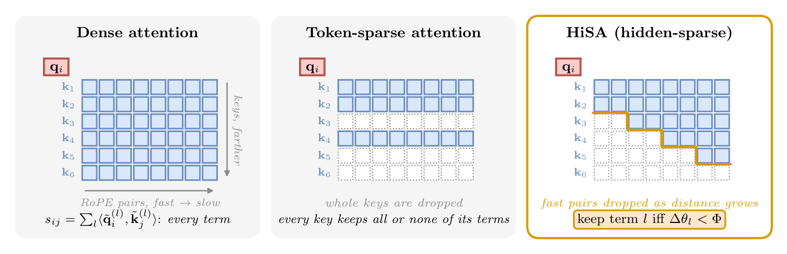

> 图解：左侧 dense attention 为每个 Query–Key 对计算全部频率对；中间 token-sparse attention 直接丢弃整个 Key；右侧 HiSA 保留所有近处 Key 的频率对，对远处 Key 只保留旋转较慢的频率对。稀疏发生在 hidden dimension，而不是简单删除 token。

与 HiSA 最接近的并行工作是 ATFlash 和 WavePrune：二者也按 RoPE 波长限制各频率对的窗口。ATFlash 默认使用两个周期，主要做免训练加速；WavePrune 使用一个旋转周期，并用 aliasing 解释预训练模型中的现象。HiSA 的差异在于默认预算更紧，只有四分之一周期，即 $90^\circ$；它还进一步缩减 Key 与 Value 的缓存，并用可解释性实验说明：dense 模型自己也会学习抑制被 HiSA 删除的分数部分。

## RoPE 给点积压出了一条“频率—距离”结构

### 把注意力分数拆成频率对之和

考虑一个维度为 $d$ 的 attention head，共有 $P=d/2$ 个 RoPE 二维频率对。第 $l$ 对 Query、Key 在旋转前分别记为 $\mathbf{q}_i^{(l)}$ 和 $\mathbf{k}_j^{(l)}$，位置为 $i$、$j$，频率为：

$$
\theta_l=b^{-2l/d}
$$

其中 $b$ 是 RoPE base。RoPE 分别将它们旋转 $i\theta_l$ 和 $j\theta_l$。旋转不改变向量模长，内积中只留下两者旋转角之差，因此完整注意力分数可以精确写成：

$$
s_{ij}=\frac{1}{\sqrt{d}}\sum_{l=0}^{P-1}
\left\|\mathbf{q}_i^{(l)}\right\|
\left\|\mathbf{k}_j^{(l)}\right\|
\cos\left(\varphi_{ij}^{(l)}+\Delta\theta_l\right)
$$

这里 $\Delta=i-j$，$\varphi_{ij}^{(l)}$ 是旋转前 Query 对与 Key 对的夹角。单独一项就是：

$$
s_{ij}^{(l)}=\frac{1}{\sqrt{d}}
\left\|\mathbf{q}_i^{(l)}\right\|
\left\|\mathbf{k}_j^{(l)}\right\|
\cos\left(\varphi_{ij}^{(l)}+\Delta\theta_l\right),
\qquad s_{ij}=\sum_l s_{ij}^{(l)}
$$

这个分解把内容与位置分得很清楚：**内容**通过两个向量的模长和原始夹角进入分数，**相对位置**只通过 $\Delta\theta_l$ 进入。

### 为什么远处不需要高频精确位置

高频对旋转很快。Key 只移动一个 token，相对于很长的距离几乎可以忽略，但高频分数项可能已经旋转接近 1 rad，数值发生明显变化。因此，高频对在远距离上表达的是“精确偏移量”：远处句子稍微改一下词序，分数就可能显著改变。

问题在于，语言模型通常不会以这种精细方式使用很远的历史。已有研究表明，循环语言模型主要依赖最近几十个 token 的词序，更远历史更像粗粒度、对顺序不敏感的上下文。相反，低频对旋转缓慢，跨越很长距离仍较稳定，更适合承载长程依赖。

HiSA 的假设由此而来：**近距离保留精细位置信号，远距离只保留低频、较平滑的依赖信号。**

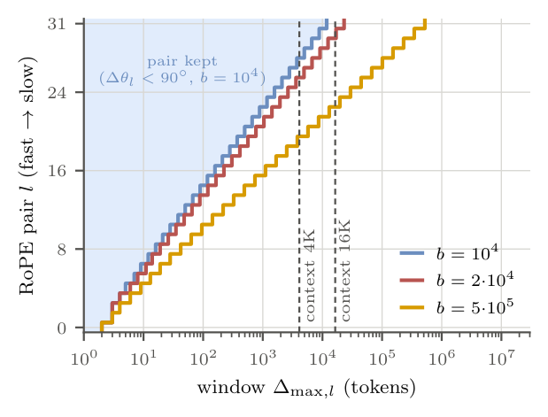

> 图解：图中展示 $d=64$、$\Phi_{\max}=90^\circ$ 时，各频率对在何种相对距离内参与分数计算；阴影对应 $b=10^4$。横轴可以理解为从最快到最慢排列的频率对，纵向表示其可见距离。最快频率对只看几个 token，最慢频率对可看数千 token；增大 RoPE base 会把所有窗口一起拉长。

## HiSA：一个角度预算决定全部稀疏模式

### 核心规则

HiSA 不修改产生 $\mathbf{q}$、$\mathbf{k}$ 的投影，只在点积求和前乘一个指示函数：

$$
s_{ij}^{\mathrm{HiSA}}=\frac{1}{\sqrt{d}}\sum_{l=0}^{P-1}
\mathbf{1}\left[\Delta\theta_l<\Phi_{\max}\right]
\left\langle R_{i\theta_l}\mathbf{q}_i^{(l)},R_{j\theta_l}\mathbf{k}_j^{(l)}\right\rangle
$$

$R_\alpha$ 表示旋转角为 $\alpha$ 的 RoPE 旋转矩阵，$\Phi_{\max}$ 是唯一的角度预算超参数。默认 $\Phi_{\max}=90^\circ$，也就是每个频率对最多参与四分之一圈旋转；令 $\Phi_{\max}=\infty$ 就退化为 dense attention。

由于判定只依赖距离，第 $l$ 个频率对天然得到一个窗口：

$$
\Delta_{\max,l}=\frac{\Phi_{\max}}{\theta_l}=\Phi_{\max}b^{2l/d}
$$

最近 Key 使用全部频率对；距离变远后，最快频率对先退出，慢频率对继续工作。所有频率对都退出后，Key 才完全离开 softmax，因此模型的最大可达距离（reach）由最慢频率对决定：

$$
R=\frac{\Phi_{\max}}{\theta_{P-1}}=\Phi_{\max}b^{(d-2)/d}
$$

注意力输出仍按原方式计算：

$$
\mathbf{o}_i=\sum_j\operatorname{softmax}_j\left(s_{ij}^{\mathrm{HiSA}}\right)\mathbf{v}_j
$$

以 $d=64$、$\Phi_{\max}=90^\circ$、$b=10^4$ 为例，最快频率对只看 2 个 token，最慢频率对的 reach 约为 11.8K；把 base 提高到 $2\times10^4$，reach 变为约 23K。长上下文扩展因此不需要重新学习选择器，只需按同一几何关系调整 RoPE base。

这个设计最省心的一点是，**训练与推理看到完全相同的静态模式**。看到任何 token 内容之前，Kernel 就知道哪些乘法会执行、哪段缓存何时可以释放；没有额外参数，也没有运行时选择开销。

### 到底省了多少点积

序列长度为 $T$ 时，HiSA 在完整 causal forward 中计算的点积比例为：

$$
\rho(T)=\frac{1}{P}\sum_{l=0}^{P-1}
\frac{\sum_{\Delta=0}^{T-1}(T-\Delta)\mathbf{1}\left[\Delta<\Delta_{\max,l}\right]}
{T(T+1)/2}
$$

需要注意，$\rho$ 只统计 Query–Key 点积中的乘加。只要 Key 仍在 reach 内，softmax 和注意力权重乘 Value 的 token 对数量并没有减少，所以“只算约三分之一 QK 点积”不等于“训练总计算量只剩三分之一”。它最直接的收益先出现在 cache read 占主导的解码阶段。

## Flash-HiSA：把逐 Key 规则变成 GPU 喜欢的块规则

精确规则中，每个频率对的窗口终点不同。同一个 FlashAttention tile 内，有些位置保留某个频率对，有些位置又删除它，这不利于 GPU 向量化执行，精确 Triton Kernel 的训练反而比 dense 慢。

Flash-HiSA 做了一个有意识的近似：

- 序列方向按 $S=128$ 个 token 划分 Query、Key block。
- 特征方向每 16 维组成一个 chunk，即 8 个 RoPE 对，对应 Hopper GPU 上一次矩阵乘法步骤。
- 两个 block 之间，以它们最近的距离决定保留哪些频率对。
- 一个 $128\times16$ 的 Key tile 要么完整参与矩阵乘法，要么整块跳过。
- 规则切到的边界 chunk 不完整跳过，而是在 Query 中把应删除的频率对置零。

因此，block rule 保留精确规则的全部有效项，并可能为每个频率对多保留最多 $S-1$ 个 token。训练和推理必须使用相同的 $S$，因为它们对应的是同一个近似模型，而不是可以随意切换的推理技巧。

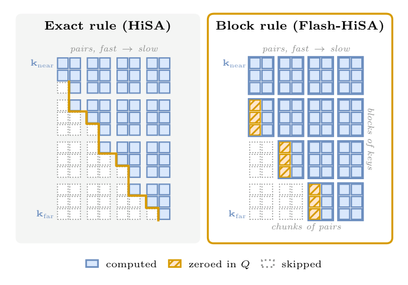

> 图解：行表示由近到远的 Key，列表示由快到慢的 RoPE 对。左图精确规则逐 Key 删除频率对；右图把 Key 按 128 token 分块、频率对按 8 对分 chunk，每个块采用其最近 Key 的保留集合。这样，大部分计算可以直接按 tile 跳过，边界 chunk 再用 Query 置零处理。

## 从零预训练：更少点积，损失反而更低

### 实验设置

作者使用 SmolLM-135M 与 SmolLM-360M 架构，从头在 OpenWebText 上训练 decoder-only 模型，训练量约为每参数 20 token。两组模型都采用 $d=64$，即 32 个 RoPE 对，并使用 grouped-query attention。Dense 与 HiSA 共享数据、优化器、学习率和随机初始化设置，唯一差别是注意力规则。

| 模型 | 参数量 | 层数 | Width | MLP | Heads（Q/KV） | $d$ | 训练 tokens |
|---|---:|---:|---:|---:|---:|---:|---:|
| 135M | 134.5M | 30 | 576 | 1536 | 9/3 | 64 | 2.7B |
| 360M | 361.8M | 32 | 960 | 2560 | 15/5 | 64 | 7.24B |

这里的“采用 SmolLM 架构”不表示加载其预训练权重：所有权重均随机初始化，仅复用架构。

### 4K 主结果

| 模型与 base | 注意力 | 验证损失 | 位置 0–512 | 位置 512–2K | 位置 2K–4K | $\rho$ |
|---|---|---:|---:|---:|---:|---:|
| 135M，$b=10^4$ | Dense | 2.906 | 3.170 | 2.920 | 2.830 | 100.0% |
|  | HiSA | **2.880** | **3.147** | **2.893** | **2.804** | 29.3% |
| 135M，$b=2\times10^4$ | Dense | 2.908 | 3.177 | 2.923 | 2.829 | 100.0% |
|  | HiSA | **2.869** | **3.136** | **2.883** | **2.791** | 34.2% |
| 360M，$b=10^4$ | Dense | 2.587 | 2.823 | 2.598 | 2.519 | 100.0% |
|  | HiSA | **2.575** | **2.810** | **2.585** | **2.508** | 29.3% |

提升并不只来自上下文末端：从位置 0–512 到 2K–4K，HiSA 在每个预测位置区间都更低。360M、7.24B token 的 Chinchilla 预算下，优势也仍然存在。

这一点比单纯“更快”更值得注意。HiSA 不只是近似 dense 后尽量少掉点，而是在这些实验里成为一种正则化结构：删掉高旋转、易碎的远程位置信号，模型不必再花训练容量压制它们。

### 精确规则、块规则与训练速度

| 注意力 | Kernel | 验证损失 | Tokens/s | $\rho$ |
|---|---|---:|---:|---:|
| Dense | SDPA（FlashAttention 2） | 2.906 | 205k | 100.0% |
| Dense | FlashAttention 3 | 2.904 | 236k | 100.0% |
| HiSA | Triton，精确规则 | **2.880** | 119k | 29.3% |
| HiSA block rule | Triton | 2.888 | 191k | 34.8% |
| Flash-HiSA | FlashAttention 3 | 2.892 | **238k** | 34.8% |

精确规则损失最好，但在单张 H200 上训练速度只有 119k tokens/s，约为 dense SDPA 的 $1/1.7$。Flash-HiSA 因块近似多算一些，$\rho$ 从 29.3% 增至 34.8%，保留约一半的损失增益，相对 dense FlashAttention-3 降低 0.012；训练吞吐则达到 238k tokens/s，与 dense FA3 基本持平。

## 扩展到 16K：优势仍在，但 Kernel 还没吃满稀疏红利

作者先在 4K 上下文、$b=2\times10^4$ 下预训练，再用 540M tokens 做 16K 扩展，相当于预训练量的 20%。扩展数据按 50/50 混合 PG19 书籍和 OpenWebText，并延续常见长上下文训练方案。

### 精确 HiSA

| 注意力 | PG19 全部 | PG19 0–4K | PG19 4K–8K | PG19 8K–16K | OpenWebText | $\rho$ |
|---|---:|---:|---:|---:|---:|---:|
| Dense | 3.205 | 3.262 | 3.209 | 3.174 | 3.111 | 100.0% |
| HiSA | **3.170** | **3.226** | **3.174** | **3.140** | **3.071** | 20.2% |

HiSA 在书籍与网页文本上都保持更低损失，而且 PG19 的各个位置区间均占优，QK 点积只计算约五分之一。

### Flash-HiSA

| 注意力 | PG19 全部 | PG19 0–4K | PG19 4K–8K | PG19 8K–16K | OpenWebText | $\rho$ | Tokens/s |
|---|---:|---:|---:|---:|---:|---:|---:|
| Dense FA3 | 3.212 | 3.270 | 3.216 | 3.181 | 3.115 | 100.0% | **143k** |
| Flash-HiSA | **3.190** | **3.248** | **3.194** | **3.159** | **3.099** | 21.7% | 135k |

Flash-HiSA 的损失优势缩小，但仍存在。它只算 21.7% 的 QK 点积，训练速度却为 dense FA3 的 94%。原因在 backward：重算注意力分数时可以跳过被删除 chunk，但与 $dO$、$V$ 和分数梯度相关的其他矩阵乘仍是全宽度，训练还没有完全利用稀疏性。

## KV cache 与解码：收益随上下文变长而扩大

Flash-HiSA 不再给整个 Key 使用同一个生命周期。每个 16 维 Key chunk 放进独立 ring buffer，保留时长由该 chunk 最慢频率对的窗口决定；Value 则只在 reach 内保留。解码 Kernel 只读取当前仍有效的 chunk。

| 上下文 | 注意力 | Batch 32 Tok/s | Batch 32 KV | Batch 128 Tok/s | Batch 128 KV |
|---|---|---:|---:|---:|---:|
| 4K | Dense FA3 | 7.3k | 2.8 GiB | 20.4k | 11.2 GiB |
| 4K | Flash-HiSA | **7.8k** | **1.9 GiB** | **23.2k** | **7.7 GiB** |
| 16K | Dense FA3 | 4.7k | 11.2 GiB | 9.2k | 45.0 GiB |
| 16K | Flash-HiSA | **5.6k** | **7.3 GiB** | **13.0k** | **29.1 GiB** |

16K、batch 128 时，吞吐提升约 **42%**，KV cache 减少约 **35%**。不过，作者也诚实拆出了 Kernel 工程因素：Flash-HiSA 使用更小的 Query tile，这本身就会带来一部分加速；使用同一 Kernel 但不删除任何频率对时，仍有 13% 加速。因此，不能把全部 42% 都归因于稀疏规则。

## 已有 dense 模型能否转换？可以，但需要继续训练

直接把训练好的 dense 135M 切换成 HiSA、不改任何权重，验证损失会从 2.906 暂时升到 2.937。继续训练 1.35B tokens 后，转换模型达到 2.836，与相同预算下继续训练的 dense 对照 2.838 基本一致，同时只计算 29.3% 的 QK 点积。

| 模型 | 额外训练 tokens | 验证损失 | $\rho$ |
|---|---:|---:|---:|
| Dense，起点 | — | 2.906 | 100.0% |
| Dense $\rightarrow$ HiSA，不训练 | 0 | 2.937 | 29.3% |
| Dense，继续训练 | 1.35B | 2.838 | 100.0% |
| Dense $\rightarrow$ HiSA，继续训练 | 1.35B | **2.836** | 29.3% |

所以它不是完全 training-free 的即插即用裁剪，而是一个低成本架构转换方案。Dense 模型能较快适应，也引出了下一个问题：被删除的分数项是否本来就没有被 dense 模型充分利用？

## 可解释性：dense 模型确实在学习抑制这些项

### 如何衡量一个频率对是否“有用”

作者没有只看注意力分数大小，而是测量：删除某个频率对后，attention head 输出会变化多少。再把这种变化与一个“同位置、但内容无关”的对照频率对比较。

对于 head $h$、频率对 $l$ 和距离带 $\mathcal{B}$，原始输出为：

$$
\mathbf{o}_i=\sum_j a_{ij}\mathbf{v}_j,
\qquad
a_{ij}=\frac{e^{s_{ij}}}{\sum_k e^{s_{ik}}}
$$

距离带按对数划分：$\{0\}$、$\{1\}$、$[2,4)$、$[4,8)$，直到 $[1024,2048)$，共 12 个。只在该距离带内移除第 $l$ 项：

$$
s'_{ij}=
\begin{cases}
s_{ij}-s_{ij}^{(l)}, & i-j\in\mathcal{B},\\
s_{ij}, & \text{otherwise}.
\end{cases}
$$

用 $s'_{ij}$ 重新做 softmax 得到 $\mathbf{o}'_i$，输出变化为 $\Delta\mathbf{o}_i=\mathbf{o}'_i-\mathbf{o}_i$。它可以改写成：

$$
\Delta\mathbf{o}_i=
\frac{\sum_j u_j(\mathbf{v}_j-\mathbf{o}_i)}{1+\sum_j u_j},
\qquad
u_j=a_{ij}\left(e^{-s_{ij}^{(l)}}-1\right)\mathbf{1}[i-j\in\mathcal{B}]
$$

这个形式揭示了删除操作的实质：$u_j$ 是 renormalization 之前各 Key 权重的变化，输出则向被重新加权的 Value 方向移动。

为了把 head 内部变化映射到 attention layer 输出，作者再乘输出投影 $W_h$。对照组把真实 $s_{ij}^{(l)}$ 换成 $\hat{s}_{ij}^{(l)}$：取另一篇文档中相同位置的 Key 频率对，因此旋转角相同，但内容无关。真实文档的 $a_{ij}$、$\mathbf{v}_j$、$\mathbf{o}_i$ 均保持不变。

实验使用 256 篇至少 2048 token 的 OpenWebText 验证文档，每篇取前 2048 token，所有 token 都作为 Query。分别累计真实与对照输出变化：

$$
E_{l,\mathcal{B}}^{\mathrm{real}}=
\sum_{n=1}^{N}\sum_h\sum_i
\left\|W_h\Delta\mathbf{o}_{h,i}^{(n)}\right\|^2
$$

$$
E_{l,\mathcal{B}}^{\mathrm{null}}=
\sum_{n=1}^{N}\sum_h\sum_i
\left\|W_h\Delta\hat{\mathbf{o}}_{h,i}^{(n)}\right\|^2
$$

最终观察 $E^{\mathrm{real}}/E^{\mathrm{null}}$：

- 比值大于 1：真实内容比无关内容更能改变输出，说明该频率对含有内容特异信号。
- 比值接近 1：它与无信息对照差不多。
- 比值小于 1：真实分数项的影响甚至小于无关 Key，说明模型已主动调整 Query、Key 来抑制它。

### 训练过程中，分界线逐渐与 HiSA 对齐

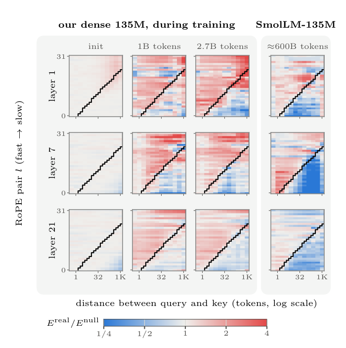

> 图解：每个面板中，行是频率对，最快频率在底部；列是从 1 到 2048 token 的对数距离带。颜色表示 $E^{\mathrm{real}}/E^{\mathrm{null}}$，红色代表真实分数项比无关 Key 更能改变输出，蓝色代表更弱。黑线是 $\Delta\theta_l=90^\circ$，其右侧正是 HiSA 默认删除的区域。图中依次比较 dense 135M 初始化、训练 1B tokens、完成 2.7B tokens，以及预训练 SmolLM-135M 的三个代表层。

初始化时，各格基本接近 1。训练早期，模型先学会利用小旋转角的分数项，黑线左侧变红；大旋转角区域随后逐渐变蓝，但抑制需要更长时间。SmolLM-135M 经过约 600B tokens 训练后，这一现象更明显。

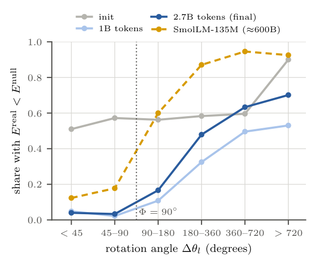

> 图解：横轴为 RoPE 旋转角，纵轴为快速频率对 $l=0,\ldots,7$ 中满足 $E^{\mathrm{real}}<E^{\mathrm{null}}$ 的“层 × 距离带”格子比例，覆盖全部 30 层。曲线分别对应初始化、1B tokens、2.7B tokens 和预训练 SmolLM-135M。小角度区域很快以利用信号为主，大角度区域的抑制则随训练缓慢增强。

训练 1B tokens 后，在 $90^\circ$ 以下只有 2%–5% 的格子低于参考；而在 $180^\circ$–$360^\circ$ 区间，低于参考的比例从 33% 增至 48%。SmolLM-135M 在超过 $180^\circ$ 的区域达到 87%–95%。

另一个不需要无信息参照的指标是“相对影响力”：超过 $720^\circ$ 的分数项，其影响力低于 $45^\circ$ 区域的比例，从训练 1B tokens 时的 4.6%，降到 2.7B tokens 时的 2.1%，在 SmolLM-135M 中仅为 0.5%。

这组结果给 HiSA 提供了比几何直觉更强的证据：dense 训练本身就在花费步骤压制大旋转分数项，而 HiSA 直接把这种倾向固化进架构。

## 复现细节：计算量、缓存与训练方案

### 完整 forward 与单步解码不是同一个稀疏率

令整数窗口 $L_l=\lceil\Delta_{\max,l}\rceil$，$m_l=\min(L_l,T)$。第 $l$ 个频率对参与的 causal Query–Key 项数为：

$$
m_lT-\frac{m_l(m_l-1)}{2}
$$

窗口随 $l$ 增长，超过 $T$ 的频率对会完整计算，因此 $\rho$ 大致由“窗口覆盖整个上下文的频率对占比”决定。在 $b=10^4$ 时，上下文每翻倍，这个占比约下降 7.5 个百分点。

| RoPE base $b$ | 2K：$45^\circ$ | 2K：$90^\circ$ | 2K：$180^\circ$ | 2K：$360^\circ$ | 4K：$45^\circ$ | 4K：$90^\circ$ | 4K：$180^\circ$ | 4K：$360^\circ$ | 16K：$45^\circ$ | 16K：$90^\circ$ | 16K：$180^\circ$ | 16K：$360^\circ$ | $90^\circ$ reach |
|---|---:|---:|---:|---:|---:|---:|---:|---:|---:|---:|---:|---:|---:|
| $10^4$ | 29.3% | 36.9% | 44.4% | 51.9% | 21.8% | 29.3% | 36.8% | 44.4% | 8.1% | 14.3% | 21.8% | 29.3% | 11.8K |
| $2\times10^4$ | 34.2% | 41.2% | 48.2% | 55.1% | 27.2% | 34.2% | 41.2% | 48.1% | 13.2% | 20.2% | 27.2% | 34.2% | 23.1K |
| $5\times10^4$ | 39.6% | 46.0% | 52.4% | 58.8% | 33.2% | 39.6% | 46.0% | 52.4% | 20.4% | 26.8% | 33.2% | 39.6% | 56.0K |
| $5\times10^5$ | 50.0% | 55.2% | 60.5% | 65.8% | 44.6% | 49.9% | 55.2% | 60.5% | 34.1% | 39.4% | 44.6% | 49.9% | 521.2K |

单步解码时，新 Query 与每个距离恰好各遇到一个 Key，不再像完整 forward 那样由短距离主导。因此：

$$
\rho_{\mathrm{dec}}(t)=\frac{1}{P}\sum_l\frac{\min(L_l,t)}{t}
$$

两种统计仍是一致的：

$$
\rho(T)=
\frac{\sum_{t=1}^{T}t\rho_{\mathrm{dec}}(t)}
{\sum_{t=1}^{T}t}
$$

| $b$ | 2K $\rho$ | 2K $\rho_{\mathrm{dec}}$ | 2K $\kappa$ | 4K $\rho$ | 4K $\rho_{\mathrm{dec}}$ | 4K $\kappa$ | 16K $\rho$ | 16K $\rho_{\mathrm{dec}}$ | 16K $\kappa$ |
|---|---:|---:|---:|---:|---:|---:|---:|---:|---:|
| $10^4$ | 36.9% | 31.5% | 65.7% | 29.3% | 23.9% | 61.9% | 14.3% | 9.0% | 40.4% |
| $2\times10^4$ | 41.2% | 36.1% | 68.1% | 34.2% | 29.1% | 64.5% | 20.2% | 15.1% | 57.6% |
| $5\times10^4$ | 46.0% | 41.4% | 70.7% | 39.6% | 35.0% | 67.5% | 26.8% | 22.1% | 61.1% |
| $5\times10^5$ | 55.2% | 51.4% | 75.7% | 49.9% | 46.1% | 73.1% | 39.4% | 35.5% | 67.8% |

表中 $\kappa$ 是按频率对计算的理论 KV-cache 相对大小。实际实现按 16 维 chunk 和 128 token block 取整，会多保留一点：4K、$b=10^4$ 时，精确 HiSA 为 dense 的 66.5%，Flash-HiSA 为 68.4%，而逐频率对理论值为 62%；16K、$b=2\times10^4$ 时，Flash-HiSA 为 64.6%。

### KV cache 的理论上界与远程裁剪

Key 的第 $l$ 对只需保留最近 $\min(L_l,T)$ 个 token，Value 只需保留最近 $\min(R,T)$ 个。Key 与 Value 大小相同，因此：

$$
\kappa(T)=\frac{1}{2}\left(
\frac{1}{P}\sum_l\frac{\min(L_l,T)}{T}
+\frac{\min(R,T)}{T}
\right)
$$

当 $T\le R$ 时所有 Value 都要保留，所以仅靠 Key 维度稀疏，缓存最多减少 50%；只有超过 reach 后，Key 与 Value 才会一起逐出。

同理，在 reach 内，softmax 与 Value 乘法的 Query–Key 项数没有下降。只有 $T>R$ 时，完全离开 reach 的项才减少，其比例为：

$$
\frac{(T-R)(T-R+1)}{T(T+1)}
$$

这解释了为什么计算收益更早出现在解码，而不是立刻完整反映到训练吞吐。

## Kernel 细节：稀疏不仅要“少算”，还要“少读”

精确 Triton Kernel 采用 FlashAttention-2 风格的 fused forward 与 backward。Query、Key 特征先重排，使每个 16 维 chunk 包含 8 个完整 RoPE 对。对每个位置 tile，频率对被分为完全覆盖、完全删除和窗口在 tile 内结束的 mixed 三类，只有 mixed 类需要逐元素 mask。

FlashAttention-3 的 block 实现进一步利用“删除的总是最快频率对”这一单调性。块距离为 $n$ 时，前 $a_n$ 个频率对被删除，对应完整跳过前 $K_0=\lfloor a_n/8\rfloor$ 个 chunk，并删除边界 chunk 中的 $a_n\bmod8$ 对。Key block 由近到远访问，$K_0$ 只增不减，循环可按 $K_0$ 分段，避免在异步矩阵乘流水线中放运行时分支。

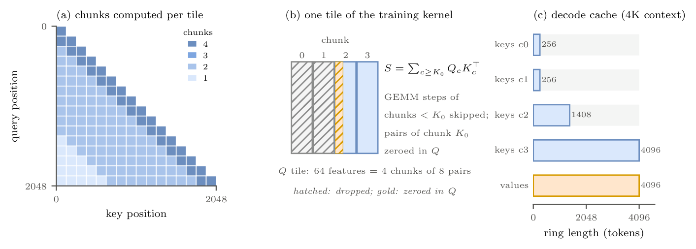

> 图解：(a) 展示 2K 上下文中，每个 $128\times128$ causal tile 实际计算多少个 16 维 chunk：对角线附近计算全部 4 个，远处只剩最慢 chunk。(b) 展示训练 tile 如何只乘保留 chunk，并把边界 chunk 中删除的频率对在 Query 内置零。(c) 展示 4K 解码缓存：4 个 Key chunk 各有独立 ring buffer，Value 则按 reach 保存。

解码时，每个序列只有一个 Query。共享同一 KV head 的 Query head 被打包成 64 行 Query tile，而不是使用 FA3 对 $d=64$ 的 192 行 tile，后者几乎全是 padding。缓存分散到不同 thread block，局部结果最后合并。

位置 $j$ 的 token 在 ring $c$ 中存放于 $j\bmod M_c$，其中 $M_c$ 是该 ring 的长度。由于 ring 按完整 128 token block 分配，一个 Key tile 不会跨界回绕。Producer thread 用异步拷贝加载缓存，每个线程固定读取同一 chunk；若当前 Key block 已删除该 chunk，就直接跳过加载。也就是说，被删除的 chunk 不只是不参与乘法，**也不会从内存中读出**。

## 训练与评估配置

所有模型采用 LLaMA 风格 decoder block，包括 RMSNorm、SwiGLU MLP、输入输出 embedding 共享，词表大小为 49,152。除特别说明外，RoPE base 为 $10^4$。

| 配置项 | 设置 |
|---|---|
| Optimizer | AdamW，$\beta=(0.9,0.95)$；矩阵 weight decay 0.1；梯度裁剪 1.0 |
| Batch | 524,288 tokens；4K 为 128 条序列，2K 为 256 条，16K 为 32 条 |
| Schedule | 前 1% steps 线性 warmup，16K 扩展为 2%；cosine decay 到峰值的 10% |
| Peak learning rate | 135M：$2.4\times10^{-3}$；360M：$1.2\times10^{-3}$；16K 扩展：$8\times10^{-4}$ |
| Precision | bf16 autocast，fp32 master weights，`torch.compile` |
| Seeds | 1337；2K seed study 另用 1338、1339 |
| Hardware | 每次运行一张 NVIDIA H200 |

学习率只在 dense 模型上选择，再共享给 HiSA，避免为方法单独调优造成不对等。

| 设置 | Tokens | 各 peak LR 对应验证损失，粗体为所选值 |
|---|---:|---|
| 135M，2K，packed | 300M | $6.0\times10^{-4}$：4.782；$1.2\times10^{-3}$：4.718；**$2.4\times10^{-3}$：4.464** |
| 135M，4K，单文档 | 300M | $1.2\times10^{-3}$：4.666；**$2.4\times10^{-3}$：4.430**；$3.6\times10^{-3}$：4.622；$4.8\times10^{-3}$：4.745 |
| 360M，4K，单文档 | 300M | $6.0\times10^{-4}$：4.140；**$1.2\times10^{-3}$：3.958**；$2.4\times10^{-3}$：3.949；$3.6\times10^{-3}$：4.143 |
| 135M，16K 扩展 | 100M | $2.4\times10^{-4}$：3.404；**$8.0\times10^{-4}$：3.359**；$2.4\times10^{-3}$：3.373 |

若两个学习率的损失差在 0.02 内，作者选择较低者，所以 360M 最终使用 $1.2\times10^{-3}$。16K 扩展表中的损失是 PG19 与 OpenWebText 验证损失的均值。

数据方面，OpenWebText 使用 SmolLM tokenizer，0.5% 文档即 40,069 篇留作验证。2K 数据把 token 流切成 2,049 token 窗口；4K 只从至少 4,097 token 的单篇文档中切窗，避免无关文档拼满上下文。16K 扩展使用 28,602 本 PG19 训练书籍，共 3.0B tokens，与 packed OpenWebText 等比例混合。

验证损失是在固定窗口上的平均 next-token cross-entropy：2K 使用 3,200 个窗口，4K 使用 1,600 个，16K 每个数据源 200 个。训练吞吐取最后 200 steps 均值。解码测试逐 token teacher forcing，每步覆盖所有层并捕获为 CUDA graph，KV cache 按完整上下文预分配；吞吐为 $BT/T$ 步耗时，并核对解码损失与完整 forward 一致。

## 消融：为什么默认选 90°，又为什么保留原缩放

### 角度预算与随机种子

| $\Phi_{\max}$ | 验证损失 | $\rho$ | Reach |
|---|---:|---:|---:|
| $45^\circ$ | 3.022 | 29.3% | 5.9K |
| $90^\circ$ | 3.020 | 36.9% | 11.8K |
| $180^\circ$ | **3.010** | 44.4% | 23.6K |
| $360^\circ$ | 3.039 | 51.9% | 47.1K |
| $\infty$（dense） | 3.055 | 100.0% | — |

在 2K、135M、单 seed 下，所有有限预算都优于 dense。$45^\circ$、$90^\circ$、$180^\circ$ 的损失差距不超过 0.012，约等于 seed 间波动，因此数据并没有唯一选出 $90^\circ$；作者把它视为计算量与损失的折中。完整周期的 $360^\circ$ 保留的增益更少，也与大旋转项应被抑制的分析一致。

三个 seed 的结果为：HiSA $3.024\pm0.004$，dense $3.052\pm0.011$，且 HiSA 在每个 seed 上都更好。

### RoPE base

| $T$ | $b$ | Dense | HiSA | Reach |
|---|---|---:|---:|---:|
| 2K | $10^4$ | 3.055 | **3.020** | 11.8K |
| 2K | $5\times10^5$† | 3.019 | **3.010** | 11.8K |
| 4K | $10^4$ | 2.906 | **2.880** | 11.8K |
| 4K | $2\times10^4$ | 2.908 | **2.869** | 23.1K |

† 表示实际旋转 base 为 $5\times10^5$，但 HiSA 窗口仍按 $10^4$ 计算。增益在 $10^4$ 与 $2\times10^4$ 上成立；第三种设置中 dense 本身也改善，因此差距缩小。这说明窗口与模型实际 RoPE 几何相匹配很重要。

### 收益不是来自“远处分数自然变小”

HiSA 保留原来的 $1/\sqrt{d}$ 缩放。远处 Key 参与的频率对更少，分数典型幅度也会缩小，于是一个合理质疑是：收益会不会只是来自对远程 Key 的静态降权？

作者构造了按保留对数重新归一化的版本：

$$
s_{ij}=\frac{1}{\sqrt{2n_{ij}}}
\sum_{l=0}^{P-1}\mathbf{1}[\Delta\theta_l<\Phi_{\max}]
\left\langle R_{i\theta_l}\mathbf{q}_i^{(l)},R_{j\theta_l}\mathbf{k}_j^{(l)}\right\rangle
$$

$$
n_{ij}=\sum_{l=0}^{P-1}\mathbf{1}[\Delta\theta_l<\Phi_{\max}]
$$

这样，每个分数都相当于在 $2n_{ij}$ 个有效特征上保持 dense 点积的尺度。4K、135M 下，它的验证损失为 2.879，与 HiSA 的 2.880 持平，仍优于 dense 的 2.906，说明收益确实来自删除分数项，而非缩小远程分数。

但归一化版本更慢：Triton 吞吐从 119k 降到 87k tokens/s，因为缩放随每个 Query–Key 距离变化。在一个要求复现 2,560 token 之前出现的 32 token 片段的合成 copy task 上，它的 token accuracy 只有 33%，低于 HiSA 的 77% 和 dense 的 60%。因此默认 HiSA 保留固定 $1/\sqrt{d}$。

## 可解释性附录：推导、数值稳定与全层结果

### 输出变化公式的推导

在被删除的距离带内，有：

$$
e^{s'_{ij}}=e^{s_{ij}}
\left(1+\left(e^{-s_{ij}^{(l)}}-1\right)\mathbf{1}[i-j\in\mathcal{B}]\right)
$$

记 $Z=\sum_k e^{s_{ik}}$，则 $e^{s_{ij}}=Za_{ij}$。新归一化项和新 Value 加权和分别为：

$$
\sum_k e^{s'_{ik}}=Z\left(1+\sum_k u_k\right)
$$

$$
\sum_j e^{s'_{ij}}\mathbf{v}_j
=Z\left(\mathbf{o}_i+\sum_j u_j\mathbf{v}_j\right)
$$

两式相除后 $Z$ 消去：

$$
a'_{ij}=\frac{a_{ij}+u_j}{1+\sum_k u_k},
\qquad
\mathbf{o}'_i=\frac{\mathbf{o}_i+\sum_j u_j\mathbf{v}_j}{1+\sum_j u_j}
$$

减去 $\mathbf{o}_i$ 即得到前面的 $\Delta\mathbf{o}_i$ 表达式。

若某距离带几乎占满注意力，而又删除一个很大的正分数项，$1+\sum_j u_j$ 可能接近零。为避免数值相消，作者用 fp64 计算全为正值的等价形式：

$$
\mathbf{o}'_i=
\frac{
\sum_{j\notin\mathcal{B}}a_{ij}\mathbf{v}_j+
\sum_{j\in\mathcal{B}}a_{ij}e^{-s_{ij}^{(l)}}\mathbf{v}_j
}{
\sum_{j\notin\mathcal{B}}a_{ij}+
\sum_{j\in\mathcal{B}}a_{ij}e^{-s_{ij}^{(l)}}
}
$$

与直接重算 softmax 相比，相对差低于 $10^{-4}$。SmolLM-135M 中有 23/11,520 个格子的比值超过 50，通常因为删除了主导分数项、注意力转向其他 Key，所以论文按格报告比值和比例，而不是把所有项池化成一个总和。

对照 Key 取自 batch 中下一个窗口的相同位置。所有模型使用同样 256 篇文档与 2048 token 输入，中间模型来自训练快照，初始化则由训练 seed 重建。

### 全部层的 $E^{\mathrm{real}}/E^{\mathrm{null}}$

以下热图都采用相同编码：每个子图对应一层，行是频率对，列是对数距离带；红色高于无信息参考，蓝色低于参考，黑线为 $90^\circ$。第一层是稳定例外：它的分数项在所有距离都高于参考，初始化时也是如此。一个可能原因是第一层 Key 只依赖 token identity，而同一篇文档会重复自己的 token。

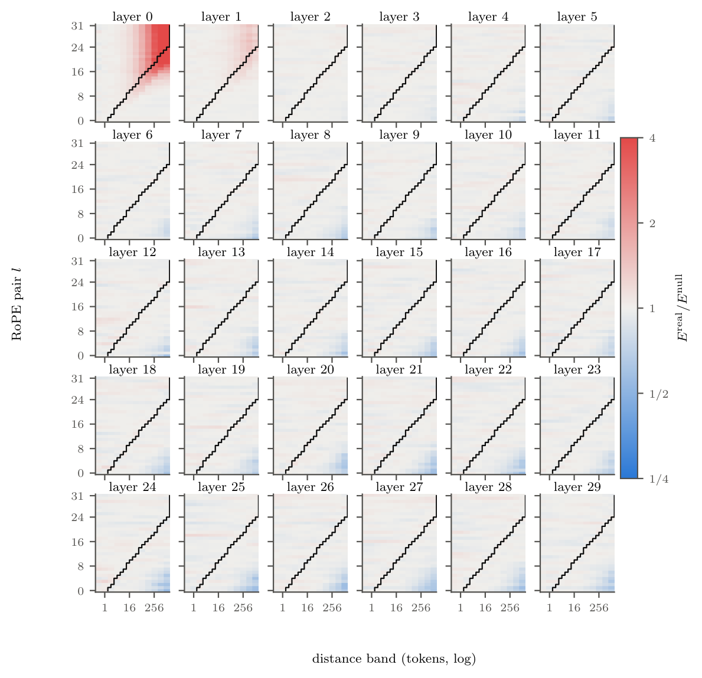

> 图解：dense 135M 初始化时，大多数层和格子接近参考值 1；部分层的最快频率对在最远距离上已略低于参考。第一层则呈现不同于其他层的信号模式。

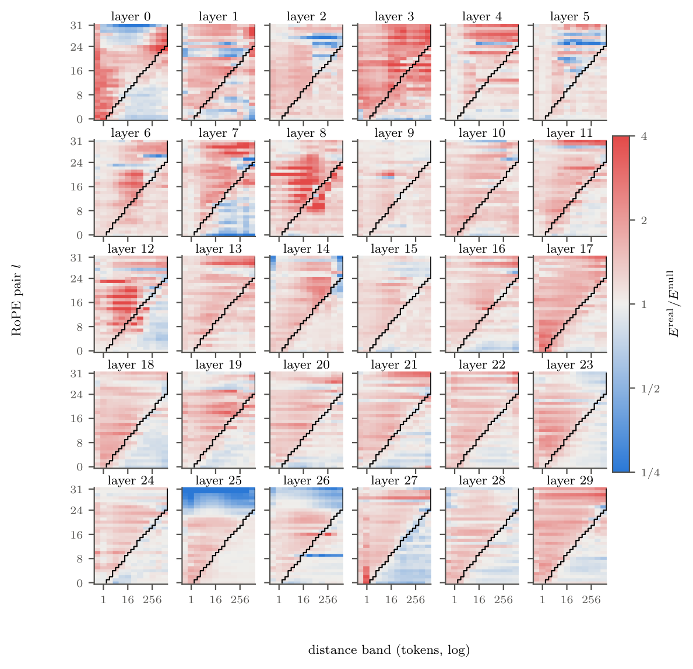

> 图解：训练到 step 2000 后，小旋转角区域更明显转向红色，表示模型开始利用这些真实内容信号；黑线右侧的大旋转区域则逐步出现蓝色抑制。

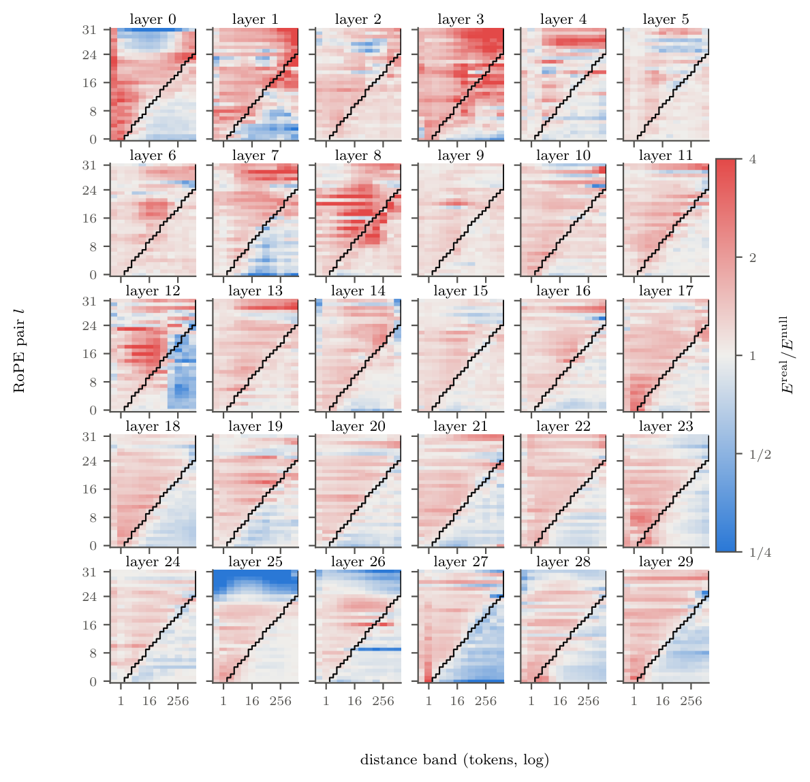

> 图解：step 4000 时，小角度利用与大角度抑制的分层更加清晰。不同层的抑制速度并不一致，有些层在远距离上的蓝色已相当明显。

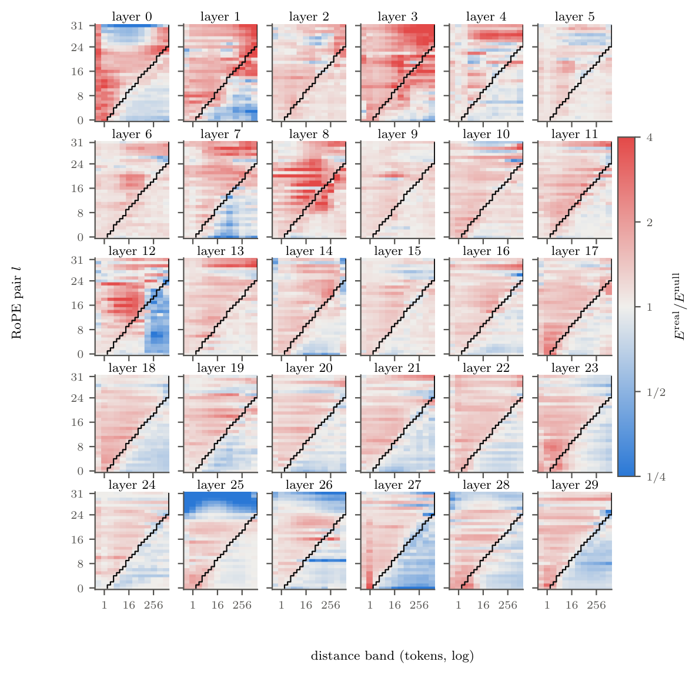

> 图解：完成 step 5149、即 2.7B tokens 训练后，大旋转区域整体继续向低于参考的方向移动，但抑制仍在发展，并未在所有层完全饱和。

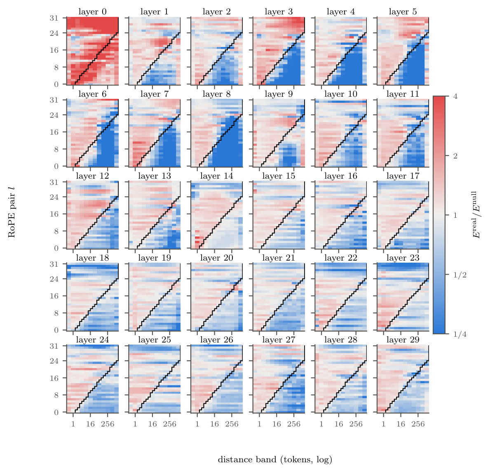

> 图解：预训练 SmolLM-135M 经过约 600B tokens 训练后，大旋转角区域的抑制更强、更普遍，为“更长训练会继续强化这一趋势”提供了跨模型证据。

### 相对影响力：不依赖对照组的另一条证据

相对影响力定义为删除分数项造成的输出变化，相对于 head 输出本身的大小：

$$
I_{l,\mathcal{B}}=
\frac{\sum_h\sum_i\left\|W_h\Delta\mathbf{o}_{h,i}\right\|^2}
{\sum_h\sum_i\left\|W_h\mathbf{o}_{h,i}\right\|^2}
=\frac{E_{l,\mathcal{B}}^{\mathrm{real}}}
{\sum_h\sum_i\left\|W_h\mathbf{o}_{h,i}\right\|^2}
$$

它在相同 Query 与 head 上先求和再取比，避免输出接近零的 Query 主导结果。下面的图又把每个频率对除以其在各距离带上的最大值，因此只比较 **影响力沿距离如何分布的形状**，不比较不同频率对的绝对强弱。

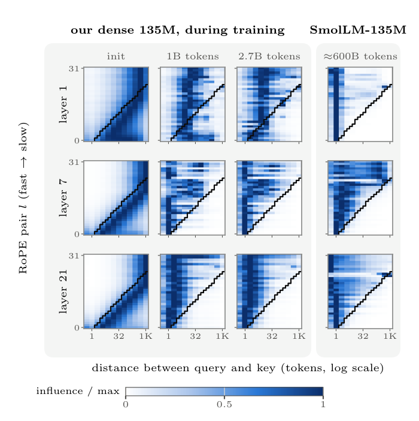

> 图解：图中展示 dense 135M 三个代表层在初始化、1B tokens、2.7B tokens，以及 SmolLM-135M 上的相对影响力分布。每行是一个频率对，每列是距离带，黑线仍为 $90^\circ$；同一行经过最大值归一化，因此应横向观察影响力随距离的迁移，而不是比较行与行的明暗总量。

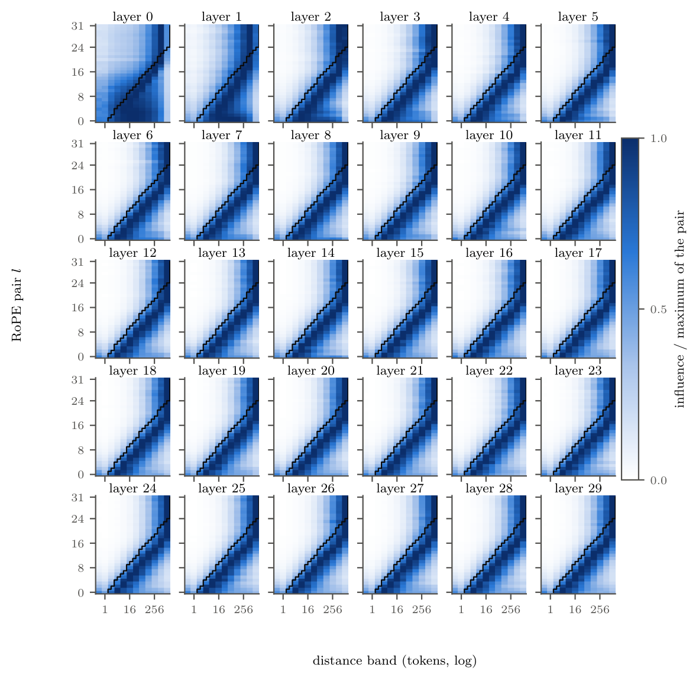

> 图解：初始化全层结果显示，各频率对的影响力尚未形成训练中后期的稳定距离分工。逐行归一化使读者能看到初始模式，但不能据此推断绝对输出变化很大。

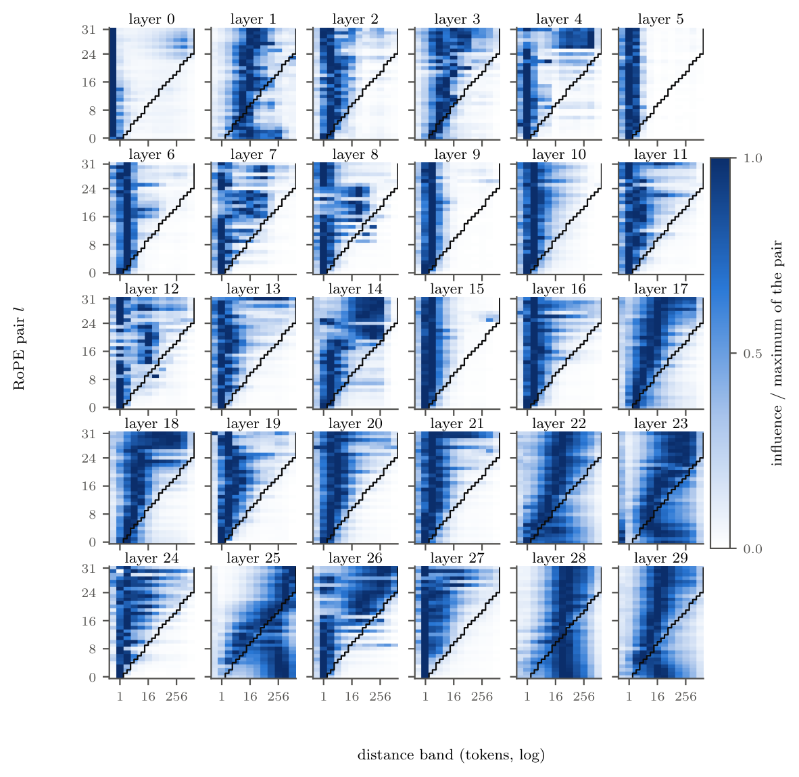

> 图解：训练 step 2000 后，不同层开始把频率对的影响力集中到特定距离范围。与对应 $E^{\mathrm{real}}/E^{\mathrm{null}}$ 图合看，可以区分“信号是否有内容特异性”和“信号实际影响有多大”。

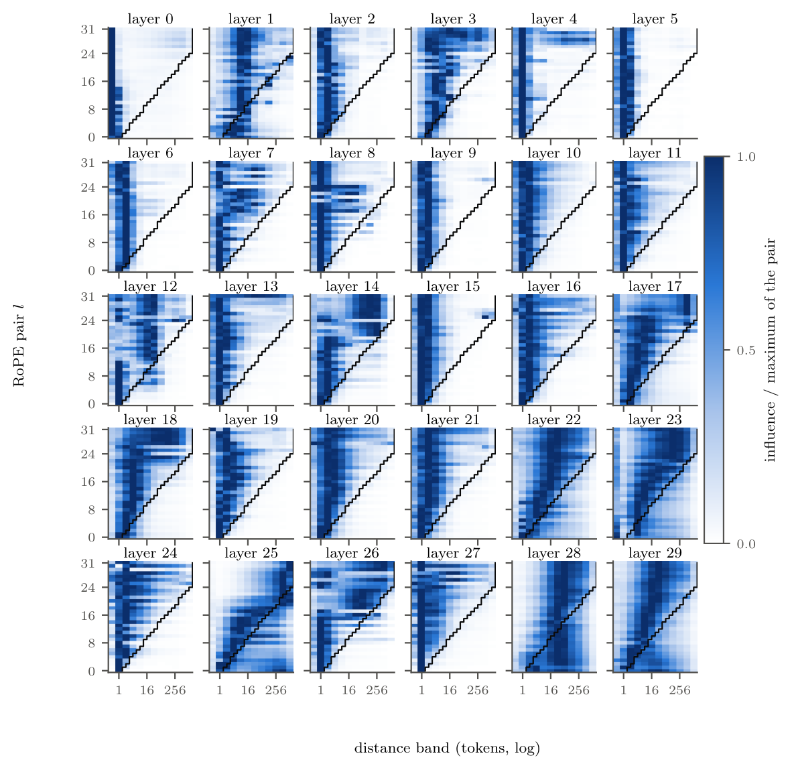

> 图解：step 4000 的距离分布继续演化。黑色 $90^\circ$ 线提供与 HiSA 规则的直接对照，但本图不表示黑线右侧所有项的绝对影响力都为零。

> 图解：训练结束的全层结果进一步显示，大旋转分数项的总体影响在减弱。主文汇总的定量结果是：超过 $720^\circ$ 的区域，其相对低角度区域的影响力占比由 1B tokens 时的 4.6% 降至 2.1%。

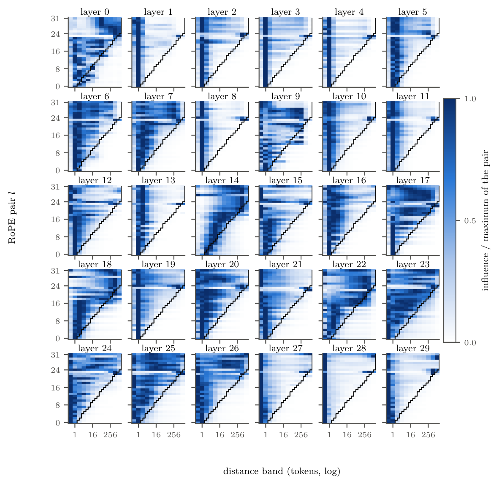

> 图解：SmolLM-135M 的全层相对影响力进一步收敛到明确的距离结构。超过 $720^\circ$ 区域的影响力只剩低于 $45^\circ$ 区域的 0.5%，说明长训练后大旋转项不仅被抑制，而且对输出的实际贡献也很小。

## 总结：稀疏化还可以发生在“向量内部”

- **核心问题**：HiSA 不再只选择看哪些 token，而是研究 Query–Key 点积能否只算一部分，把 sparse attention 扩展到 hidden dimension。
- **核心规则**：每个 RoPE 频率对只在 $\Delta\theta_l<\Phi_{\max}$ 时参与计算；默认 $90^\circ$，近处保留全部频率，远处只保留慢频率。
- **核心结果**：从零预训练中，4K、135M 模型只算 29.3% 的 QK 点积，验证损失由 2.906 降至 2.880；360M 与 16K 扩展也保持优势。
- **工程收益**：Flash-HiSA 训练速度与 dense FA3 基本持平，并缩减 KV cache、加快解码；16K、batch 128 吞吐提升 42%，其中包含 13% 的 Kernel tile 改进贡献。
- **机制证据**：dense 模型会在训练中逐步抑制大旋转分数项，HiSA 相当于把这种学习结果直接写进架构；dense 模型经继续训练也能低成本转换。

目前证据仍主要来自 135M、360M 模型和语言建模验证损失，未来需要检验更大规模、下游任务与更完整的 backward Kernel；如果这些都成立，hidden-dimension sparsity 很可能成为 token sparsity 之外一条可组合的效率路径。

> 本文参考自 [HiSA: Sparsifying the Hidden Dimension of RoPE Attention in LLMs](http://arxiv.org/abs/2611.26363v1)