# Model Carving：训练时雕刻拓扑，推理省34%算力

Transformer 的架构通常在训练前就被固定，后续只能靠剪枝或蒸馏把大模型压缩成小模型；Model Carving 则让模型在同一次训练中同时学习权重和拓扑，主动删掉“贡献配不上算力”的 Attention 或 MLP 子层。它的关键不是设定一个目标稀疏率，而是根据当前学习曲线，在线估算每个子层耗费的算力若换成训练 tokens 能带来多少收益。实验覆盖最高 2.7B 参数的标准 Transformer 和最高 1.3B 参数的 Looped Transformer：在相同训练算力下，其 loss 优势最高相当于让全深度基线多消耗约 1.7 倍训练算力，同时每 token 推理 FLOPs 最多减少 34%。

## 为什么架构也应该在训练中学习

经典 Transformer 在每层重复相同顺序的 Attention 和 MLP。这种整齐划一更多是工程惯例，而不是被证明最优的设计。已有现象也提示了改进空间：调整子层顺序可以改善 perplexity，训练后的 LLM 删除部分整层也未必明显退化，Gemma 3、Jamba 等模型则开始手工混合不同层型。

但已有的“自动找架构”通常仍把结构选择与权重训练分开：

- **NAS** 需要控制器、候选种群或 Supernet，并引入第二套优化问题。
- **结构化剪枝** 往往先训练完整模型，再决定删除什么，之后继续训练恢复性能。
- **蒸馏** 需要教师模型和学生模型，教师训练成本还常常不计入学生的预算。
- **自适应计算** 在推理时按 token 路由、早退或循环，但保留全部参数，并增加路由或状态判断。

Model Carving 的思路更像大脑发育中的突触修剪：先提供一个可删除的冗余网络，再根据学习过程中的实际贡献逐渐去掉弱子层。与早期静态剪枝不同，它的门控会随权重一起平滑更新；只有门值真正归零时，对应子层才会从计算图移除。

**这个设计最值得注意的地方，是“删除”不仅省推理成本，还会把省下的训练 FLOPs 换成更多 tokens。** 因此，删结构不是单纯牺牲容量，而是在同一次训练里重新分配质量与算力。

## 总体流程：从冗余网络中雕出静态小模型

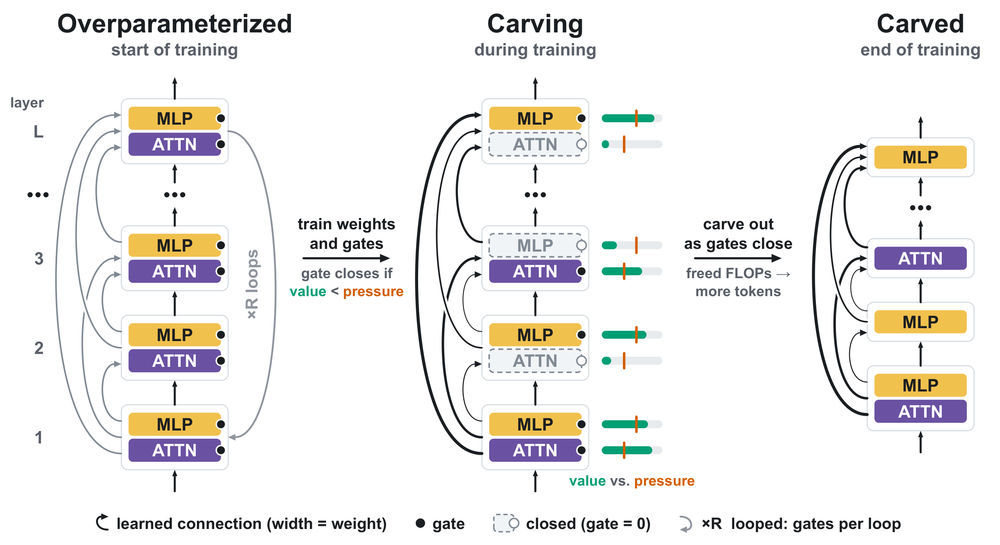

> 图解：左图是初始的过参数化 Transformer，每个子层通过标量门写入残差流，弧线表示跨层可学习连接；中图比较子层对 loss 的贡献与算力压力，贡献不足时门值下降；右图把归零门对应的子层从计算图移除，释放的 FLOPs 用于训练更多 tokens，最终得到层内结构不完全相同的静态 Transformer。

整个方法只有一次训练，包含四个相互咬合的环节：

1. 初始化带门控和跨层连接的冗余 Transformer。
2. 为每个仍在执行的子层计算算力“压力”。
3. 从本次训练自身的学习曲线估计压力大小。
4. 联合更新权重、连接与门，把归零门对应的子层编译出计算图。

下面分别看这四步为什么这样设计。

## 方法一：给每个子层一个可关闭的门

一个普通 Transformer 层先执行 Attention，再执行 MLP，两者都写入残差流。Model Carving 将每次子层应用记为 $u$；对 Looped Transformer，同一个共享子层在不同 loop 中算不同的应用，并分别设置门。

若子层输出为 $\mathbf y_u$、门值为 $g_u\geq 0$，写入方式为：

$$
\mathbf z \leftarrow \mathbf z + g_u\frac{\operatorname{rms}(\mathbf z)}{\operatorname{rms}(\mathbf y_u)}\mathbf y_u
$$

这里的 RMS 归一化很重要：门值单独控制这次写入相对于残差流的幅度，避免子层自身输出尺度干扰门控。当 $g_u=0$ 时，这次写入完全消失。

所有门初始化为 0.1。附录扫描显示，若从 0.2 或更高值开始，往往只删除很少甚至不删除子层；这说明门初始化并不是无关紧要的实现细节。

### 可学习跨层连接

除了门控，模型还采用 DenseFormer 风格的连接，让第 $k$ 层能够读取更早层的输出。若该层输出为 $\mathbf h_k$，则：

$$
\mathbf h_k \leftarrow \mathbf h_k + \operatorname{rms}(\mathbf h_k)\sum_j c_{kj}\left(N(\mathbf x_j)-N(\mathbf h_k)\right)
$$

$$
N(\mathbf x)=\frac{\mathbf x}{\operatorname{rms}(\mathbf x)},\qquad \|\mathbf c_k\|_1\leq 1
$$

系数 $c_{kj}$ 随预测 loss 训练，本身不承受删除压力；$L_1$ 约束防止连接把残差流不断放大。连接让保留下来的层可以重新利用早期表示，也为非均匀拓扑提供额外的表达能力。

## 方法二：把训练算力预算写进目标函数

设总训练预算为 $F$。在第 $t$ 次更新时，权重 $\theta$、连接 $c$ 和门 $g$ 对应的目标写成：

$$
\mathcal L_t=L(\theta,c,g;B_t)+\sum_u\pi_u(t)\mathbf 1[g_u>0]
$$

第一项仍是 next-token loss，第二项表示每个保留子层都要承担的压力 $\pi_u$。它不是手工设定的固定稀疏惩罚，而是对以下价值的估计：**如果删掉这个子层，把剩余训练阶段省下的 FLOPs 换成 tokens，loss 还能下降多少？**

为了计算这个价值，先定义学习速率：

$$
v(D)=-\frac{dL}{d\ln D}
$$

这里按 token 数量的 e-fold 衡量进步，因为增加一倍 tokens 与从 1B 增到 2B、或从 10B 增到 20B，在对数尺度上具有可比性。

假设当前已训练 $D_t$ 个 tokens，按当前计算图预计到结束时训练 $T$ 个 tokens，剩余比例为：

$$
\rho_t=\frac{T-D_t}{T}
$$

若子层 $u$ 占当前每 token 训练 FLOPs 的比例为 $\phi_u$，删除它以后，后续每 token 只需原来的 $1-\phi_u$ 倍成本。由此得到压力：

$$
\pi_u(t)=v(T)\ln\left(1+\rho_t\frac{\phi_u}{1-\phi_u}\right)
$$

这个公式带来一个自然的时间表：

- 训练早期 $\rho_t$ 接近 1，现在省算力能为很长的后续训练换取 tokens，因此压力较大。
- 接近结束时 $\rho_t$ 趋向 0，删除子层已换不到多少额外训练，因此压力下降。
- 如果模型仍学得快，$v(T)$ 大，保留计算的机会成本就高；若接近收敛，压力则较低。
- 最后 20% 的 learning-rate cooldown 阶段将压力设为 0，不再删除子层。

**相比手工扫描一个固定的 $L_1$ 系数，这里把“算力值多少 loss”变成了本次运行可以在线回答的问题。**

## 方法三：用同一批数据读取学习速度

$v(T)$ 是未来训练终点的学习速度，不能直接观察。作者将其拆成“读取当前速度”和“外推终点速度”两步。

直接对连续 batch 的 loss 做差噪声很大，因为 batch 难度差异可能超过两次更新带来的真实进步。因此，训练器保留较早时刻 $D_s$ 的参数快照 $\theta_s$，在当前 batch $B_t$ 上分别用旧参数和当前参数 $\theta_t$ 计算 loss：

$$
r_t=\frac{L(\theta_s;B_t)-L(\theta_t;B_t)}{\ln(D_t/D_s)}
$$

两个 loss 看见完全相同的 tokens，batch 难度因而抵消。每次运行只需在特定更新中额外做 101 至 204 次前向计算，开销很小，并且仍计入训练 FLOPs。

在恒定 learning rate 阶段，作者用幂律描述学习速度：

$$
\ln v(D)=b-a\ln D
$$

通过最小二乘拟合 $a,b$ 后，预测终点速度为 $v(T)=\exp(b-a\ln T)$。附录中的完整拟合目标是：

$$
(a,b)=\arg\min_{a\geq0,b}\sum_t\left(\ln r_t-b+ax_t\right)^2+\Lambda(a-a_0)^2
$$

其中 $x_t=\frac12(\ln D_s+\ln D_t)$，$a_0$ 是来自已发表单运行 loss 曲线的指数先验。随着观测增多，数据权重超过先验；约 4,000 次更新后，模型主要使用本次训练拟合出的指数。最终指数位于 0.4 至 0.65，接近已有研究报告的 0.42 至 0.62。

随着子层删除、每步成本下降，预计结束位置 $T$ 会后移，压力也会随之重估，而不是沿用训练开始时的固定日程。

## 方法四：对数惩罚让门值真正归零

目标中的 $\mathbf 1[g_u>0]$ 不可微，不能直接反向传播。作者用对数惩罚替代：

$$
P(g_u)=\frac{\pi_u}{\ln20}\ln g_u
$$

定义删除子层的一阶质量代价：

$$
C_u=-g_u\frac{\partial L}{\partial g_u}
$$

对数惩罚相对于门的相对变化产生恒定推力 $\pi_u/\ln20$。当这个推力大于 $C_u$ 时，门会持续下降；当质量贡献更大时，门会保留并停在两种力量的平衡点。门值降到原来的 $1/20$ 时，惩罚恰好减少完整的 $\pi_u$，所以 $\ln20$ 也构成一个偏保守的删除边际。

实际更新先做普通 Adam step，再施加惩罚并裁剪负值：

$$
g_u\leftarrow\max\left(g_u-\eta\frac{\hat m_u}{\sqrt{\hat s_u}+\epsilon}-\eta\frac{P'(g_u)}{\sqrt{\hat s_u}+\epsilon},0\right)
$$

裁剪让下降的门精确变成 0，而不是留下一个仍要执行计算的极小值。

每 300 次更新，训练器在后台编译一个不含零门子层的新图，训练继续进行；400 次更新后切换过去。最终模型不需要 router、mask 或动态早退，所有 tokens 走同一张静态图，可直接使用标准 kernel。

## 实验怎样做到公平比较

作者训练了五个标准 Transformer 和四个 Looped Transformer 配对。每个 carved run 都有两类核心对照：

- **Full-depth**：与雕刻开始时相同深度，使用相同数据、训练 recipe 和总训练 FLOPs。
- **Shallower-depth**：预先减少层数，使其每 token 推理 FLOPs 接近最终 carved 模型，再在相同训练 FLOPs 下训练。

标准模型采用 GPT-2/3 风格；Looped 模型把同一组层执行四次。两者在每个规模上共享宽度、层数、Attention heads、RoPE 和 4 倍宽 MLP。每步训练 $2^{20}$ 个 tokens，词表为 49,152，上下文长度为 2,048。

| 标称规模 | 层数 | 宽度 | Heads | 参数量 | Full-depth tokens | 更新数 |
|---|---:|---:|---:|---:|---:|---:|
| 140M | 16 | 768 | 12 | 151M | 7.6B | 7,201 |
| 370M | 20 | 1,152 | 18 | 375M | 18.8B | 17,889 |
| 770M | 20 | 1,728 | 27 | 802M | 40.1B | 38,223 |
| 1.3B | 24 | 2,048 | 32 | 1,309M | 65.4B | 62,401 |
| 2.7B | 32 | 2,560 | 32 | 2,642M | 132.1B | 126,001 |

优化器对权重矩阵使用 Muon，对 embedding、unembedding 和 LayerNorm 使用 AdamW。标准与 Looped 模型 learning rate 分别为 0.02 和 0.0283，无 warmup，最后 20% 线性降到零。训练数据来自 FineWeb-Edu，硬件包括 NVIDIA H100、H200 和 B200。

评估统一使用 16,384 个 held-out blocks，并以 **bits per byte（bpb）** 报告验证 loss，避免不同 tokenizer 影响比较；下游评测采用 CORE-22、13 个随规模稳定增长的 CORE 子任务，以及 GSM8K、MATH-500、TriviaQA、SQuAD、LAMBADA 的 pass@$k$。

## 核心结果：同等训练算力下，loss 更低、推理更省

下表汇总主结果。推理比例是 carved 相对 full-depth 的每 token FLOPs；$k$ 表示 full-depth 训练曲线需要多少倍训练算力才能达到 carved 的最终 loss。

| 家族与规模 | Full-depth bpb | Carved bpb | 推理 FLOPs 比例 | CORE-22：完整 → Carved | $k$ |
|---|---:|---:|---:|---:|---:|
| Looped 140M | 0.899 | 0.883 | 0.92× | 18.9 → 19.9 | 1.33 |
| Looped 370M | 0.808 | 0.788 | 0.78× | 25.7 → 28.5 | 1.55 |
| Looped 770M | 0.743 | 0.723 | 0.74× | 31.1 → 33.5 | 1.62 |
| Looped 1.3B | 0.704 | 0.683 | 0.77× | 35.2 → 36.0 | 1.71 |
| Standard 140M | 0.926 | 0.922 | 0.87× | 15.7 → 16.5 | 1.07 |
| Standard 370M | 0.835 | 0.832 | 0.80× | 22.1 → 22.0 | 1.07 |
| Standard 770M | 0.769 | 0.767 | 0.78× | 26.7 → 27.2 | 1.05 |
| Standard 1.3B | 0.729 | 0.727 | 0.72× | 29.8 → 31.2 | 1.05 |
| Standard 2.7B | 0.676 | 0.675 | 0.66× | 36.0 → 37.0 | 1.03 |

所有 carved 模型都在相同训练 FLOPs 下取得更低 bpb；在相同训练 tokens 的比较中也保持更低 loss。标准模型最终参数量是起始 full-depth 模型的 66% 至 86%，而 Looped 模型由于跨 loop 共享参数，主要减少的是执行次数而非存储参数。

更重要的是，收益不能简单归因于“小模型每参数看到了更多 tokens”。所有规模上，预先设计好的 shallower-depth 基线最终 loss 都高于 carved 模型，CORE-22 也更低。

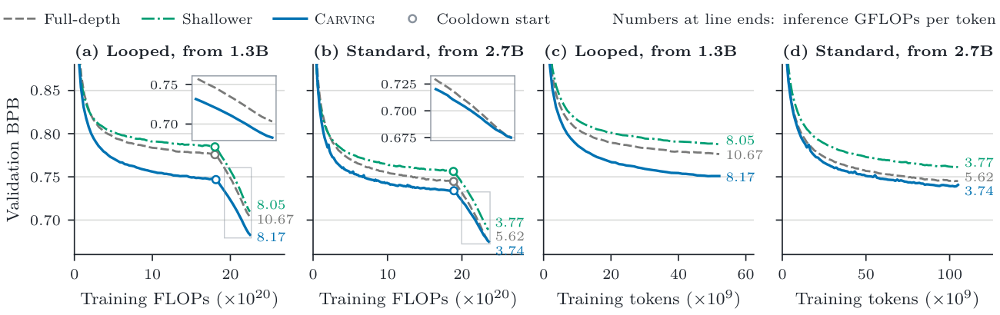

> 图解：上排横轴是训练 FLOPs，下排横轴是训练 tokens，纵轴均为验证 bpb；左侧是 1.3B Looped 家族，右侧是 2.7B Standard 家族。曲线末端数字表示每 token 推理 GFLOPs。Carved 曲线在 isoFLOP 与 isoToken 两种口径下都低于对应 full-depth 曲线。

## 推理不仅 FLOPs 更少，实测解码也更快

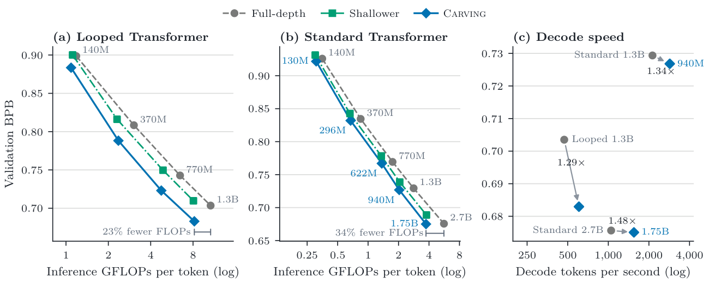

> 图解：(a)(b) 比较验证 bpb 与整模型每 token 推理 FLOPs，carved 点位于更低 loss、更低成本的位置；(c) 将 bpb 与 H100 上实测解码 tokens/s 对照，箭头标注 carved/full-depth 吞吐比。测试上下文为 4,096 tokens，各模型使用自己的最大 batch。

在相同 batch 下，解码最高加速 **1.45 倍**；在各模型各自最大测试 batch 下，最高加速 **1.61 倍**。收益随 batch 增大，是因为解码不仅执行矩阵计算，还要搬运权重和 KV cache，而被删除的 Attention 子层同时减少这两部分。

在一张 RTX PRO 6000 工作站 GPU、单请求条件下，Standard 1.3B carved 模型加速 1.31 至 1.34 倍，Standard 2.7B 加速 1.42 至 1.44 倍。

| 模型对 | 上下文 | Batch 1 | 最大共同 batch | 各自最大 batch：逐 step / 整循环编译 |
|---|---:|---:|---:|---:|
| Looped 1.3B | 1,024 | 1.21× | 1.22× | 1.26× / 1.31× |
| Looped 1.3B | 4,096 | 1.26× | 1.22× | 1.29× / 1.28× |
| Looped 1.3B | 8,192 | 1.27× | 1.21× | 1.29× / 1.37× |
| Standard 1.3B | 1,024 | 1.24× | 1.31× | 1.35× / 1.33× |
| Standard 1.3B | 4,096 | 1.26× | 1.33× | 1.34× / 1.35× |
| Standard 1.3B | 8,192 | 1.27× | 1.33× | 1.35× / 1.34× |
| Standard 2.7B | 1,024 | 1.34× | 1.43× | 1.46× / 1.51× |
| Standard 2.7B | 4,096 | 1.39× | 1.45× | 1.48× / 1.47× |
| Standard 2.7B | 8,192 | 1.42× | 1.45× | 1.48× / 1.61× |

KV cache 的下降也直接改善显存占用：

| 家族与规模 | 保留 Attention 应用 | Full-depth KiB/token | Carved KiB/token | 比例 |
|---|---:|---:|---:|---:|
| Looped 140M | 61 / 64 | 192.0 | 183.0 | 0.95× |
| Looped 370M | 67 / 80 | 360.0 | 301.5 | 0.84× |
| Looped 770M | 63 / 80 | 540.0 | 425.2 | 0.79× |
| Looped 1.3B | 76 / 96 | 768.0 | 608.0 | 0.79× |
| Standard 140M | 15 / 16 | 48.0 | 45.0 | 0.94× |
| Standard 370M | 17 / 20 | 90.0 | 76.5 | 0.85× |
| Standard 770M | 17 / 20 | 135.0 | 114.8 | 0.85× |
| Standard 1.3B | 18 / 24 | 192.0 | 144.0 | 0.75× |
| Standard 2.7B | 22 / 32 | 320.0 | 220.0 | 0.69× |

## 下游生成：省下的推理预算可以换成更多采样

同样采样 16 次时，carved 与 full-depth 的 pass@$k$ 大致接近，个别任务互有胜负。但推理成本更低意味着，在相同推理 FLOPs 下，Standard 2.7B carved 模型可以采样 24 次，而 full-depth 只能采样 16 次。

| 任务 | 16 次：Full-depth | 16 次：Carved | 24 次：Carved | 等推理预算下差值 |
|---|---:|---:|---:|---:|
| GSM8K | 0.284 | 0.300 | 0.375 | +0.091 |
| MATH-500 | 0.142 | 0.152 | 0.194 | +0.052 |
| TriviaQA | 0.413 | 0.391 | 0.429 | +0.016 |
| SQuAD | 0.624 | 0.623 | 0.649 | +0.025 |
| LAMBADA | 0.765 | 0.750 | 0.782 | +0.018 |

五个任务在近似相等推理预算下全部转为正收益。这里的关键不是声称 carved 单次采样总是更好，而是**更低的每样本成本可以直接转化为更高的搜索或采样预算**。

Looped 家族也呈现相同趋势。在其 full-depth 推理额度内，carved 模型相对基线的差值如下；加粗表示配对区间未跨零。

| 任务 | Looped 140M | Looped 370M | Looped 770M | Looped 1.3B |
|---|---:|---:|---:|---:|
| GSM8K | +0.011 | **+0.020** | **+0.026** | **+0.066** |
| MATH-500 | +0.007 | +0.011 | -0.012 | **+0.030** |
| TriviaQA | **+0.009** | **+0.035** | **+0.069** | **+0.044** |
| SQuAD | **+0.046** | **+0.056** | **+0.063** | **+0.047** |
| LAMBADA | **+0.019** | **+0.056** | **+0.058** | **+0.052** |

与公开模型比较时，作者对可获取权重的模型重新运行同一套评测。Standard 1.3B carved 的 CORE-22 高于 OPT-1.3B 和 Pythia-1.4B，后两者估计训练成本分别是它的 2.8 和 4.6 倍；Standard 2.7B carved 也超过更大的 Delphi-3.4B。

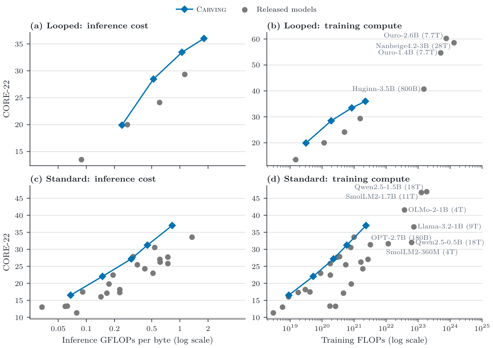

> 图解：四张子图分别以每 byte 推理 FLOPs 和训练 FLOPs 为横轴、CORE-22 为纵轴，上排是 Looped，下排是 Standard。相同推理成本下，carved 模型处于更高 CORE-22 的位置；图中还明确标出了训练 tokens 超过 1T 的公开模型，避免把不同数据规模的结果混为一谈。

## 与剪枝、蒸馏和“只加连接”相比

### 等训练算力的剪枝对照

作者在 Standard 1.3B 上，把 full-depth 模型压到接近 carved 的推理成本，再继续训练，使总训练 FLOPs 对齐。最后一行甚至从训练完成的 full-depth checkpoint 开始，并使用 carved 的 1.21 倍总算力。

| 方法 | 相对训练算力 | 验证 bpb | CORE-22 | Carved 的 CORE-22 领先 |
|---|---:|---:|---:|---:|
| Model Carving | 1.00 | 0.727 | 31.2 | — |
| Sheared-LLaMA 风格 + 继续预训练 | 1.00 | 0.742 | 27.6 | +3.7 |
| Minitron 风格 + 蒸馏和交叉熵 | 1.00 | 0.761 | 28.1 | +3.1 |
| ShortGPT 风格 + 继续预训练 | 1.00 | 0.745 | 27.9 | +3.4 |
| Minitron 风格，最终 checkpoint，仅蒸馏 | 1.21 | 0.747 | 29.3 | +1.9 |

蒸馏对照则在相同规模 full-depth 教师与较浅学生之间进行，学生推理成本与 carved 对齐，教师训练和前向成本均未计入。所有已完成规模上，学生的 bpb 更高、CORE-22 更低：

| 模型对 | 学生 bpb | Carved bpb | 学生 CORE-22 | Carved CORE-22 | 学生 − Carved |
|---|---:|---:|---:|---:|---:|
| Standard 140M | 0.947 | 0.922 | 14.23 | 16.51 | -2.28 |
| Standard 370M | 0.855 | 0.832 | 19.80 | 22.04 | -2.24 |
| Standard 770M | 0.789 | 0.767 | 25.26 | 27.17 | -1.91 |
| Standard 1.3B | 0.749 | 0.727 | 29.73 | 31.23 | -1.50 |
| Looped 140M | 0.915 | 0.883 | 17.92 | 19.92 | -2.00 |
| Looped 370M | 0.828 | 0.788 | 23.81 | 28.48 | -4.66 |

这些结果支持论文的核心判断：**在训练中发现结构，比先训练完整网络再压缩更有效。**

### 收益究竟来自连接还是删除

Model Carving 同时引入跨层连接和子层删除，因此作者训练了只有可学习连接、不执行删除的 DenseFormer-style 控制组。其推理 FLOPs 与 full-depth 基本相同，额外连接成本低于 0.1%。

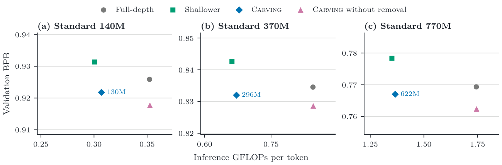

> 图解：横轴是整模型每 token 推理 FLOPs，纵轴是验证 bpb。带跨层连接但不删除子层的模型可以改善 loss，却始终维持接近 full-depth 的推理成本；carved 模型在相近质量下显著向左移动，标签为最终参数量。

以 Looped 370M 为例，DenseFormer-style 模型为 0.794 bpb、27.5 CORE-22 和 3.046 GFLOPs/token；carved 模型则达到 0.788 bpb、28.5 CORE-22 和 2.358 GFLOPs/token，推理 FLOPs 少约 23%。这说明跨层连接确实带来过参数化收益，而删除操作把这份收益保留下来，同时真正降低了部署成本。

## 随规模增长的优势与过训练检查

作者按照 Chinchilla 风格的 compute-optimal 分析，在 $1.2\times10^{19}$ 到 $1.2\times10^{20}$ FLOPs 的五个预算上拟合参数量与 loss 的二次曲线。

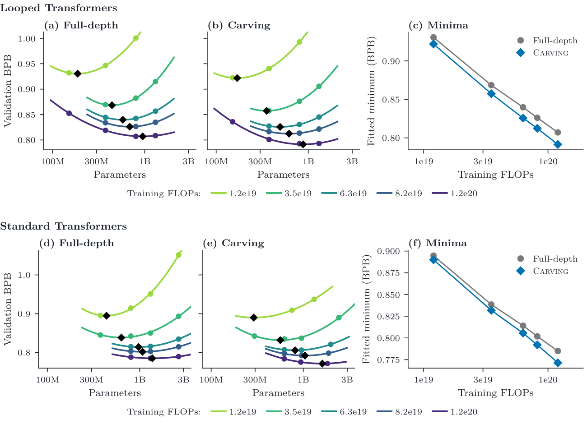

> 图解：上排是 Looped，下排是 Standard；每列分别展示 full-depth、carved 及两者拟合最低点。不同颜色对应不同训练预算，横轴为参数量，纵轴为 cooldown 后验证 bpb，菱形是 log 参数二次拟合的最小值。最右列显示 carved 的最低 loss 在所有预算上都更低，且差距随预算扩大。

| 家族 | 预算 FLOPs | Full-depth 参数 / bpb | Carved 参数 / bpb | bpb 差距 | $k^*$ |
|---|---:|---:|---:|---:|---:|
| Looped | $1.2\times10^{19}$ | 187M / 0.931 | 169M / 0.922 | -0.009 | 1.16 |
| Looped | $3.5\times10^{19}$ | 441M / 0.868 | 353M / 0.857 | -0.011 | 1.25 |
| Looped | $6.3\times10^{19}$ | 579M / 0.840 | 494M / 0.826 | -0.014 | 1.31 |
| Looped | $8.2\times10^{19}$ | 688M / 0.826 | 618M / 0.812 | -0.014 | 1.32 |
| Looped | $1.2\times10^{20}$ | 951M / 0.807 | 878M / 0.791 | -0.016 | — |
| Standard | $1.2\times10^{19}$ | 436M / 0.895 | 289M / 0.890 | -0.005 | 1.10 |
| Standard | $3.5\times10^{19}$ | 632M / 0.838 | 563M / 0.832 | -0.007 | 1.17 |
| Standard | $6.3\times10^{19}$ | 971M / 0.814 | 816M / 0.806 | -0.009 | 1.20 |
| Standard | $8.2\times10^{19}$ | 1,073M / 0.802 | 1,043M / 0.792 | -0.010 | 1.25 |
| Standard | $1.2\times10^{20}$ | 1,371M / 0.785 | 1,611M / 0.771 | -0.014 | — |

$k^*$ 是 full-depth 的 compute-optimal 前沿达到 carved 同等 loss 所需的算力倍数。Looped 家族从 1.16 增至 1.32，Standard 家族从 1.10 增至 1.25。

优势也不只出现在每参数 50 tokens 的主实验中。Looped 370M 以主实验 2.55 倍算力重训后，full-depth 与 carved 分别为 0.778 和 0.758 bpb，仍相差 0.020；Looped 140M 以 3.8 倍算力重训后，二者分别为 0.853 和 0.836 bpb。

## 符号任务：它是否真的删掉了任务不需要的计算

为了检查删除行为是否对应任务需求，作者使用三层、四 loop、总计 24 次子层应用的小模型，测试模 113 加法、ListOps 和 $S_5$ composition。符号任务没有自然训练预算，因此不预测 $v(T)$，而以固定 $\lambda$ 替代，三个任务分别为 0.5、0.4 和 0.28。

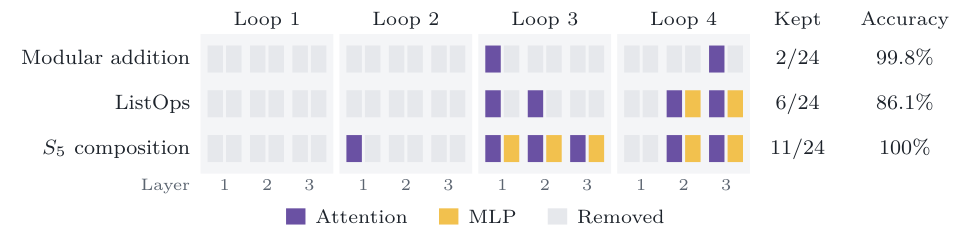

> 图解：每一行把一个任务的四次 loop 展开，彩色表示保留子层，灰色表示删除，旁边标出保留数量和 exact-match accuracy。模加法最终只留下两个 Attention 应用，形成 attention-only Transformer；ListOps 与 $S_5$ 则保留更多子层。

| 任务 | Seeds | 每次保留应用数 | 测试 exact match | Full-depth |
|---|---|---|---|---:|
| 模 113 加法 | 0 / 1 / 2 | 2 / 2 / 2 | 0.998 / 1.000 / 0.764 | — |
| ListOps | 0 / 1 / 2 | 6 / 4 / 7 | 0.861 / 0.851 / 0.868 | 0.851 / 0.862 / 0.800 |
| $S_5$ composition | 0 / 1 / 2 | 11 / 11 / 11 | 1.000 / 1.000 / 1.000 | — |

模加法不同 seeds 会选择不同的 Attention 子层，说明目标不是找到一个唯一固定模板；$S_5$ 三个 seeds 都在删除 13 个应用后保持训练长度上的满分准确率。

## 模型最终学到了怎样的拓扑

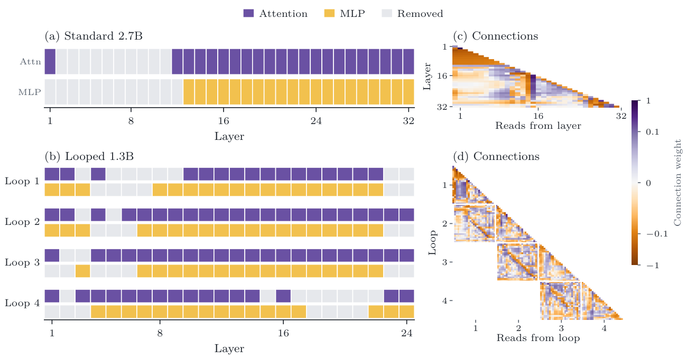

> 图解：左侧按层和 loop 标出 Standard 2.7B、Looped 1.3B 保留或删除的 Attention/MLP；右侧是连接权重矩阵，行表示读取层，列表示更早的输出。可以看到，删除并非均匀发生，连接强度也随深度显著变化。

Standard 模型都在一个较早的连续区段内删除子层，区段末尾约位于总深度的三分之一。以 Standard 2.7B 为例，第 2 至 11 层的 Attention、第 1 至 12 层的 MLP 被删除。这与不少训练后剪枝研究“深层更容易删”的发现相反。

这种结构还具有一定的跨规模可预测性：用其他规模的删除模式预测 held-out 规模，Standard 的 AUC 至少为 0.97，Looped 则为 0.76 至 0.88。它不是人工指定“每层留几个块”，却能重复找到相似的结构倾向。

Looped 模型则让每个 loop 拥有不同的 depth profile：同一个共享子层可以在某些 loop 执行、在另一些 loop 删除，从而在不放弃权重共享的前提下区分不同迭代深度。

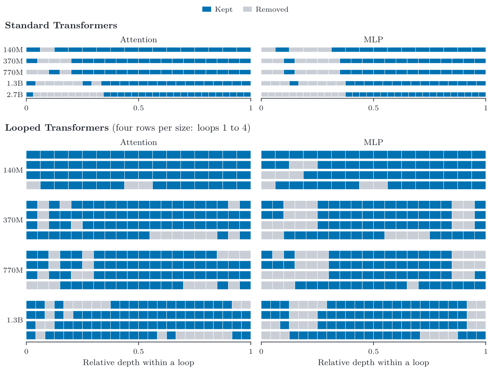

> 图解：蓝色是保留子层，灰色是删除；横轴为 loop 内相对深度，便于不同深度模型对齐。Standard 每个模型一行，Looped 每个模型按 loop 1 至 4 排成四行，可直观比较跨规模与跨 loop 的结构差异。

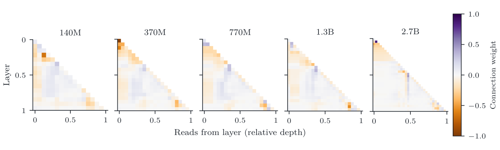

> 图解：纵轴是读取层，横轴是来源层，0 表示 embedding；紫色表示层输入向该来源移动，橙色表示远离该来源。所有 Standard 模型中，最早几层读取 embedding 的连接权重最大。Looped 模型还可读取前一 loop 输出，但图中未画出。

### 保留下来的子层更重要吗

作者逐个 knockout 最终模型的子层，保持其他权重不变并测量验证 loss 上升。Standard 140M 中，删除 carved 模型的中位保留子层，造成的损失增幅约为 full-depth 中位子层的 2.4 倍；到 2.7B，这一比例升至 5.5 倍。

换句话说，full-depth 网络中仍有很多“删了也无所谓”的子层，而 carved 模型保留下来的几乎每一个都更难以替代。

## 跨随机种子、指令微调与量化的稳健性

### 第二个 seed 是否复现优势

在完整跑完第二 seed 的模型对中，carved 的 bpb 均低于 full-depth。Standard 140M 两个 seeds 的领先分别为 0.0041 和 0.0038 bpb，Standard 370M 为 0.0025 和 0.0033，Standard 1.3B 为 0.0026 和 0.0028，Looped 140M 为 0.0152 和 0.0156。

Standard 家族两个 seeds 的删除集合高度重合；Looped 家族较大规模的第二 seed 也共享较小删除集合中的大部分。不过，部分 Looped 第二 seed 只训练到中途，因此这些结果应理解为阶段性结构检查，而非完整的终点复验。

| 模型对 | Seed 0 / Seed 1 的 bpb 领先 | 零号 / 一号 / 共享关闭门 | 总门数 | Seed 1 状态 |
|---|---|---:|---:|---|
| Standard 140M | 0.0041 / 0.0038 | 5 / 5 / 5 | 32 | 完成 |
| Standard 370M | 0.0025 / 0.0033 | 9 / 10 / 8 | 40 | 完成 |
| Standard 1.3B | 0.0026 / 0.0028 | 14 / 13 / 13 | 48 | 完成 |
| Standard 2.7B | 0.0006 / — | 22 / 22 / 20 | 64 | 进行中 |
| Looped 140M | 0.0152 / 0.0156 | 11 / 10 / 4 | 128 | 完成 |
| Looped 370M | 0.0202 / — | 36 / 26 / 20 | 160 | 进行中 |
| Looped 770M | 0.0197 / — | 32 / 37 / 24 | 160 | 进行中 |
| Looped 1.3B | 0.0206 / — | 42 / 49 / 39 | 192 | 进行中 |

### 指令微调后仍保留优势

作者对 Standard 1.3B、Standard 2.7B 和 Looped 1.3B 做一轮 chat 指令微调，分别测试 nanochat 默认 recipe 和更温和的低 learning-rate recipe。下表列出 Stable-13 的 CORE-22 差值，以及等推理额度下三项 chat pass@$k$ 的 carved 减 full-depth 差值。

| 模型与 recipe | Stable-13 CORE | GSM8K | TriviaQA | SQuAD |
|---|---:|---:|---:|---:|
| Standard 1.3B，默认 | +2.78 | +0.036 | +0.033 | +0.023 |
| Standard 1.3B，温和 | +0.68 | +0.059 | +0.026 | +0.026 |
| Standard 2.7B，默认 | +1.57 | +0.073 | +0.053 | +0.009 |
| Standard 2.7B，温和 | -0.45 | +0.095 | +0.028 | +0.020 |
| Looped 1.3B，默认 | +5.89 | +0.086 | +0.072 | +0.014 |
| Looped 1.3B，温和 | +3.49 | +0.070 | +0.057 | +0.024 |

温和 recipe 下，三项生成任务的提升范围为 2.0 至 9.5 个 pass@$k$ 百分点。Standard 1.3B 温和 recipe 改为两轮后，Stable-13 CORE 领先从 0.7 增至 1.5 分。

指令微调也会带来预训练遗忘。默认 recipe 下，预训练验证窗口 bpb 上升 0.17 至 0.26；温和 recipe 下仅上升 0.02 至 0.03。默认 recipe 中 carved 模型的遗忘量略小，但温和 recipe 下两者基本相同。

### 低比特量化没有抹掉 loss 优势

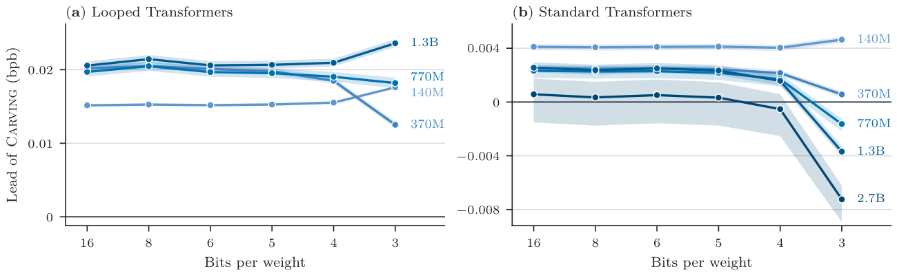

> 图解：纵轴是相同权重精度下 full-depth bpb 减 carved bpb，正值表示 carved 更好；左右分别是 Looped 和 Standard，不同精度从 16 bit 延伸到 3 bit，误差条为 95% 区间。除 Standard 2.7B 外，各模型对优势保持到 4 bit，Looped 家族保持到 3 bit。

8 bit 使用按输出通道的对称舍入；6、5、4、3 bit 使用 GPTQ，每组 64 列，并以 128 条训练序列校准。Embedding、Norm、门和连接权重保持全精度。

## 训练动力学：压力怎样变化，门会不会重新打开

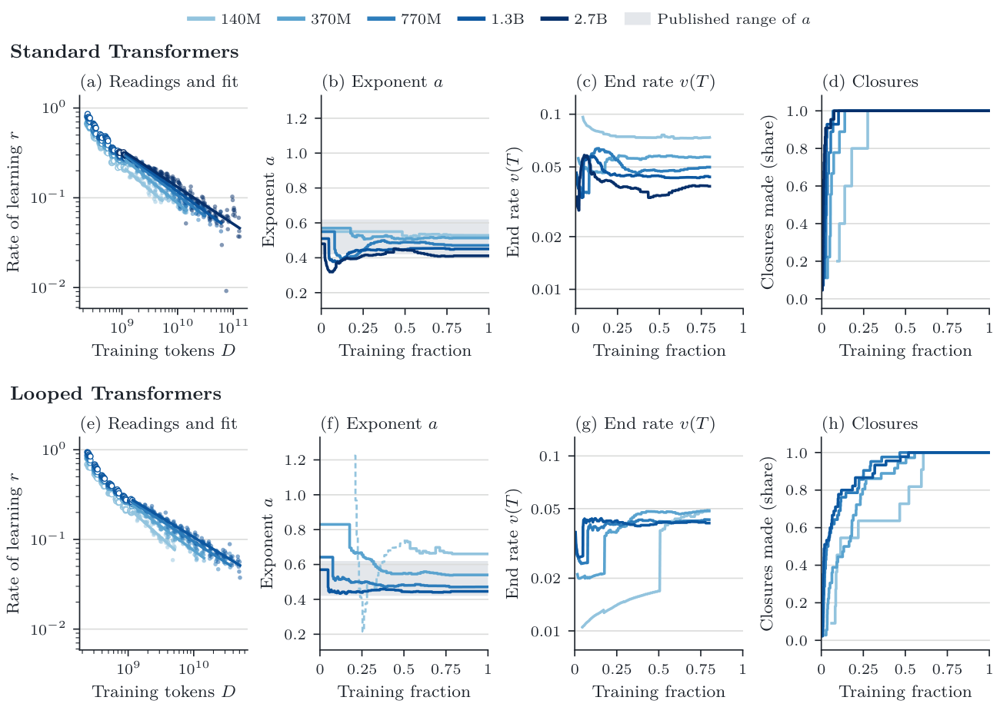

> 图解：上排为 Standard，下排为 Looped，颜色区分模型大小。前两列分别展示学习速度观测与幂律拟合、训练中学到的指数及已发表范围；第三列显示由预测终点学习速度决定的门压力在 cooldown 前持续下降；第四列显示各训练阶段贡献的最终删除比例。

大多数删除发生在训练前 20%。随着子层离开，预计结束时间后移，训练器重新缩放所有子层的压力；到 cooldown 前，压力已降至初始值的三分之一以下。

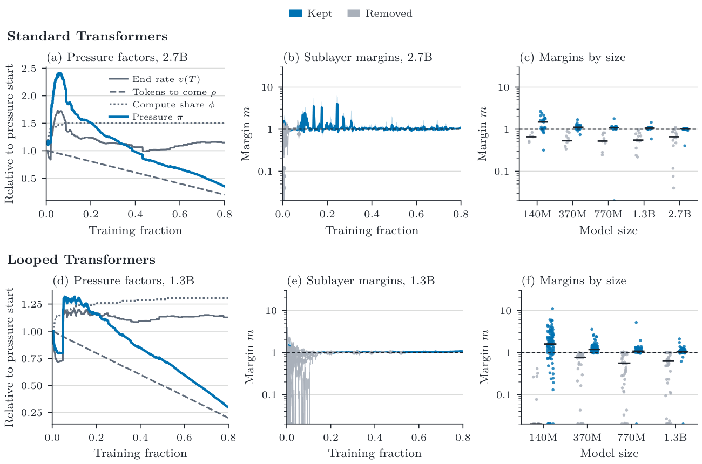

> 图解：左列拆解最大模型的压力来源，包括终点学习速度 $v(T)$、剩余 token 比例 $\rho$、MLP 算力份额 $\phi$ 和最终压力 $\pi$；中列展示删除边际随训练的变化；右列对比被删除子层在删除前的边际与保留子层在训练 60% 至 80% 阶段的中位边际。

归零门不可逆，但未归零的门并不是只能单调下降。九个 carved runs 中，193 个子层在 cooldown 前删除，没有任何一个恢复；671 个保留门里，184 个曾跌破自身峰值的一半，其中 141 个后来至少翻倍。35 个曾跌破峰值的十分之一，其中 33 个后来翻倍。

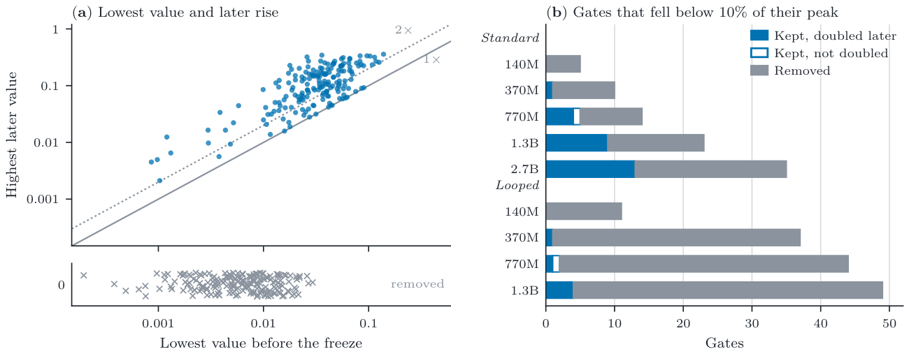

> 图解：(a) 横轴是每个门在 cooldown 前的最低读数，纵轴是之后最高读数，叉号表示已经归零且不再恢复的删除门；(b) 按运行统计曾跌破峰值十分之一的门。它说明门控优化允许暂时修正，但一旦真正归零，结构删除就是永久的。

门初始化扫描进一步显示，太小或太大的初值会改变删除量，却不一定单调改善质量：

| 初始门值 | Standard 140M：删除数 / 推理比 / bpb 领先 | Looped 140M：删除数 / 推理比 / bpb 领先 |
|---|---|---|
| 0.05 | 3 / 0.90 / 0.0016–0.0034 | 21 / 0.83 / 0.0148 |
| 0.1 | 3–5 / 0.84–0.90 / 0.0005–0.0043 | 11 / 0.91 / 0.0149 |
| 0.2 | 0–2 / 0.93–1.00 / 0.0070–0.0076 | 2 / 0.99 / 0.0161 |
| 0.4 | 0 / 1.00 / 0.0100–0.0110 | 3 / 0.98 / 0.0178 |

因此，“删得更多”不等于“最终更好”；压力与初始化共同决定质量—效率平衡点。

## Cooldown：carved 模型为什么从退火中获益更少

一个反直觉现象是，carved 模型最后的 learning-rate cooldown 带来的 loss 降幅，比 full-depth 少 10% 至 16%；shallower-depth 模型却与 full-depth 获益相当，因此不能仅用模型更小来解释。

| 模型对 | Full-depth cooldown 降幅 | Shallower / Full-depth | Carved cooldown 降幅 | Carved / Full-depth |
|---|---:|---:|---:|---:|
| Looped 140M | 0.0807 | 1.00× | 0.0692 | 0.86× |
| Looped 370M | 0.0771 | 1.02× | 0.0653 | 0.85× |
| Looped 770M | 0.0739 | 1.02× | 0.0623 | 0.84× |
| Looped 1.3B | 0.0704 | — | 0.0611 | 0.87× |
| Standard 140M | 0.0734 | 1.01× | 0.0659 | 0.90× |
| Standard 370M | 0.0718 | 1.00× | 0.0615 | 0.86× |
| Standard 770M | 0.0697 | 1.00× | 0.0612 | 0.88× |
| Standard 1.3B | 0.0677 | 1.02× | 0.0596 | 0.88× |

作者的解释是，恒定 learning rate 会带来噪声和 excess loss，而 cooldown 消除其中一部分；carved 模型在恒定学习率阶段已经携带较少的 excess loss。对 Standard 140M 做恒定学习率轨迹上的权重平均，carved 的收益也比 full-depth 少 4% 至 9%。

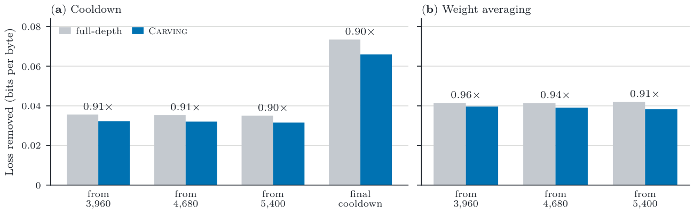

> 图解：(a) 在更新 3,960、4,680、5,400 处分别执行 100 次更新的线性 learning-rate 衰减，并与最终 cooldown 对比，纵轴是验证 loss 降幅；(b) 从这些 checkpoint 继续以峰值 learning rate 训练 200 次更新，对间隔 10 次更新的 20 份权重求平均。每对柱上方的比例均为 carved/full-depth，短 cooldown、最终 cooldown 和权重平均都呈现相同方向。

把 cooldown 改成 cosine、平方根形状，或延长到训练的约 35% 和 45%，也不会改变这一现象：carved 的 cooldown 收益仍小 10% 至 13%，但最终 loss 依然更好。

## 与已有工作的关系

Model Carving 并不是简单把已有模块拼接起来，其差异主要体现在优化发生的时刻与预算的处理方式：

- 相对 $L_0$、$L_1$ 或固定 FLOPs 惩罚，它的压力来自本次学习曲线，且删除会动态改变执行图。
- 相对 DARTS、ProxylessNAS、FBNet 等 NAS，它不需要单独的结构优化问题，也不需要找到结构后从头重训。
- 相对 ReZero，它不仅缩放残差分支，还用压力推动分支永久退出。
- 相对 DenseFormer 和 Hyper-connections，它把跨层读取与结构化删除放在同一个训练过程中。
- 相对 Sheared-LLaMA、Minitron、ShortGPT，它不预设目标形状或目标稀疏率，也不要求先得到训练完成的教师。
- 相对 MoE、early exit 和 token-level routing，它产出静态图，不为难样本动态增加计算；两类方法实际上可以互补。
- 相对训练前进行的 scaling-law 选型，它把“大模型少训一点”与“小模型多训一点”的权衡下沉到每个子层，并在一次运行内完成。

这也解释了作者为何强调同一组固定设置能跨两个模型家族和多个规模工作：预算权衡不再完全依赖外部人工设定。

## 局限、复现要点与结论

从复现角度看，压力预测、门初始化和图切换节奏都不可省略。当前压力假设恒定 learning rate，cooldown 时直接清零；初始门值 0.1、压力起始更新 340、惩罚常数 $\ln20$、删除间隔和 20% cooldown 则跨实验固定。训练从随机初始化开始，尚未证明给已有预训练模型加装门控也能获得同样收益。

论文最后留下的关键信息可以概括为：

- **同训权重与拓扑**：通过标量门、跨层连接和动态计算图，在一次训练中直接得到异构静态 Transformer。
- **压力来自机会成本**：每个子层的惩罚等于其剩余算力若换成 tokens 所预计能买到的 loss 改善，而非手工目标稀疏率。
- **质量与效率同时改善**：九组主实验都在等训练 FLOPs 下降低 bpb，每 token 推理 FLOPs 减少 8% 至 34%，实测解码最高加速 1.61 倍。
- **不是传统压缩的简单替代叙事**：在作者对齐的训练预算下，carved 模型优于 shallower、多种剪枝和蒸馏对照；但蒸馏比较未计教师成本，结论应限定在这一预算口径内。
- **优势具有扩展性但仍有边界**：compute-optimal 差距随预算扩大，符号任务和跨 seed 实验支持删除行为的任务相关性；最大验证规模仍为 Standard 2.7B、Looped 1.3B。

下一步最值得验证的是把 learning-rate schedule 纳入压力预测、允许更细粒度或可恢复的结构调整，并在更大规模、更长训练及预训练模型改造中检验这一机制；它还可以与 token 级自适应计算组合，让静态拓扑和动态算力分配各自处理不同层面的效率问题。

> 本文参考自 [Model Carving: Training Transformers That Optimize Their Own Topology](http://arxiv.org/abs/2611.27962v1)