# Scientist World：创新任务74%超基线

AI-Scientist 已经能提想法、写代码、跑实验，但多数评测仍是静态题库：会做题，不等于能持续发现。**Scientist World** 把论文自动转成可执行科研环境，用复现后的原方法作基线，让 AI 在真实实验中被评价、留下轨迹并接受训练。首批发布 **1,000 个经过验证的环境**；在固定的 10 个低算力环境上，前沿模型在 **84% 的 Improve 尝试**和 **74% 的 Innovate 尝试**中超过复现基线。系统还积累约 **6,400 小时科研轨迹**，并让 Qwen3-8B 的留出集 FNI 中位数从 41.2 提升到 106.3，达到前沿模型参考组的锚点。

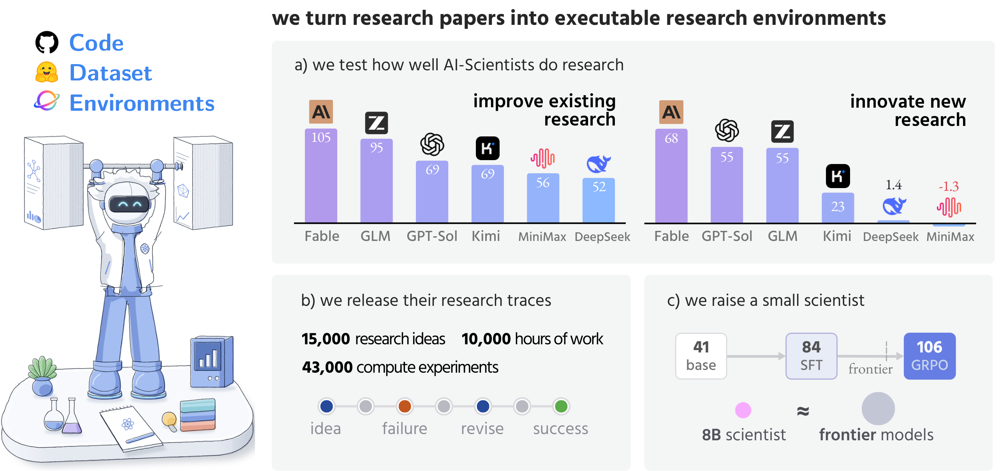

> 图解：Scientist World 将论文变成可执行环境，同时提供改进已有研究与从零创新两类任务。评价不只看文本是否漂亮，而看真实实验是否超过论文方法的复现结果；同一批环境还沉淀研究轨迹，并可作为后续模型的训练场。

## 为什么 AI Scientist 需要一个“世界”

研究不是一道题，而是一串会反复发生的判断：读文献、发现未解释的问题、提出假设、实现实验、面对失败、修正方向，再把经验迁移到下一个问题。一个模型即使攻下单一任务，也只能证明它会解那道题；只有在不断出现的新问题上重复发现，才接近“科学家”的能力。

人类科学家天然拥有这样的环境：科学文献既提供 **开放问题**，也提供 **共享想法**。后来者不必从零开始，可以复用方法、比较结果、吸收失败经验。但对 AI 来说，论文目前主要是“可读”的记录，而不是“可运行”的科研现场。

Scientist World 的目标，就是把这份记录重新变成可以进入、实验和竞争的环境。它同时具备三个此前很难统一的属性：

- **Scalable（可扩展）**：论文筛选、复现、任务设计和验证均由 Agent 自动完成，不依赖逐篇人工标注。
- **Evolving（可演化）**：新论文持续进入，环境随文献增长，减少固定 benchmark 变成训练数据后只测“记忆”的问题。
- **Execution-grounded（以执行为依据）**：研究想法必须落到代码与实验，分数来自测量结果，而不是一段听起来合理的文字。

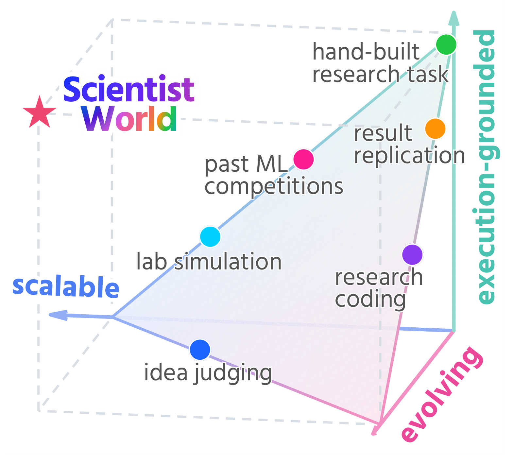

> 图解：既有 AI-Scientist 环境通常只在规模、持续更新、真实执行三者之间满足一部分；Scientist World 试图同时到达三个属性的交汇处。这里的重点不是再增加一个静态榜单，而是建立可持续生产科研任务的机制。

既有工作大致各有侧重：MLAgentBench、MLE-Bench、MLGym 等复用竞赛或工程任务；DiscoveryWorld、ScienceAgentBench 等偏模拟或特定科学推理；CORE-Bench、PaperBench 等主要衡量论文复现；IdeaBench 等则可能只评价想法文本。Scientist World 并不替代“造出更强 Scientist”的研究，而是补足它们共同需要的下游设施：**同一个真实问题、同一个复现起点、同一套可检查的执行结果**。

这套设施因此有三种用途。

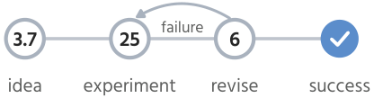

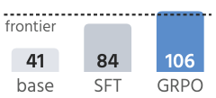

> 图解：同一组环境既是 benchmark，用来测量模型能否推进研究；也是 dataset，保存想法、实验、失败与成功；还是 gym，用真实实验结果作为奖励训练后续模型。三种用途共享相同的问题与评价协议，避免评测数据和训练目标彼此脱节。

## 从论文到环境：四类 Builder 接力施工

一篇论文已经包含问题、方法和实验结果，却还不能直接成为研究环境。缺的是可运行实现、明确的改进规则、独立评价器，以及能在新机器上重建的完整工作区。Scientist World 用四类 **Builder（环境构建 Agent）** 补齐这些部分。

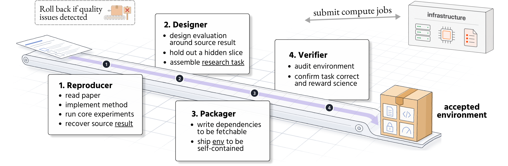

> 图解：论文从流水线一端进入，Reproducer、Designer、Packager、Verifier 在同一个共享工作区上接力。重计算任务被提交到共享集群；质量门会把证据不足的工作退回，只有通过独立验证的仓库才会被接受。

### 四个角色各自负责什么

1. **Reproducer：重建论文方法与核心结论。** 有官方代码就基于它复现，没有就从零实现。先跑最小实验，再逐步扩展，最终留下 **source method（复现方法）**和 **source result（复现结果）**。目标不是硬凑论文表格中的每个数，而是让真实方法支持论文的核心主张。
2. **Designer：把复现转成开放任务。** 写清研究问题、目标指标、允许改动方向与禁止捷径，并准备可见评价集和隐藏评价集。复现结果成为后续方法要跨越的门槛。
3. **Packager：让环境离开原机器也能运行。** 所有本地数据与权重都要改成可执行下载脚本，依赖必须显式声明；验收标准是 fresh clone 后能自行重建并重跑。
4. **Verifier：独立审计最终产物。** 检查代码、日志、分数和任务规则是否一致。它不参与前面的构建，避免“自己造、自己判”。

整个流程不是一次长对话，而是多轮短迭代。每个 Builder 接管工作区时，都要审查上一棒声称的进度；证据不足就降低里程碑，必要时回退到更早阶段。不同轮次还会轮换 GPT、Claude、MiniMax、GLM 等模型家族，减少单一模型的盲点一路遗留到最终环境。

标准构建共有九轮：三次 Reproducer、三次 Designer、一次 Packager、两次 Verifier。里程碑从 `method_runs` 到 `core_claim`，再扩展到 `secondary_claims`、`majority`、`near_complete` 和 `full`；其中最低接受线是 **核心实验确实运行论文方法并支持中心结论**，而不是“代码没报错”。

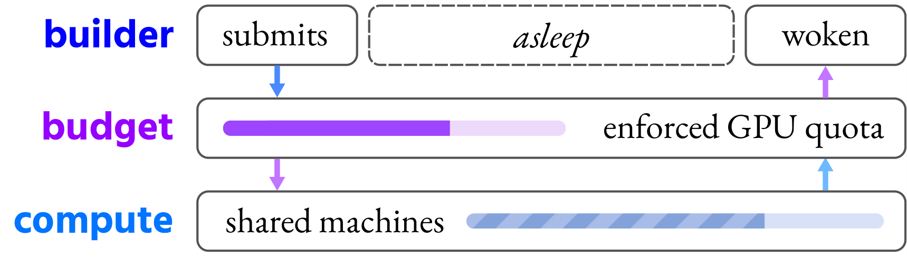

> 图解：Builder 不在自己的交互进程里直接占用 GPU，而是向共享资源池提交任务、休眠，再由日志和任务结束事件唤醒。GPU 预算由 Agent 外部强制执行，防止单篇论文无限消耗算力。

这个设计的聪明之处在于，**科学判断交给 Agent，资源纪律交给系统**。Agent 可以决定先做什么实验、何时停止，却不能靠一句“我会节省资源”来自我约束。

## 一个环境究竟长什么样

构建完成的环境不是一堆复现脚本，而是一个把“问题”和“解法”分开的完整工作区。

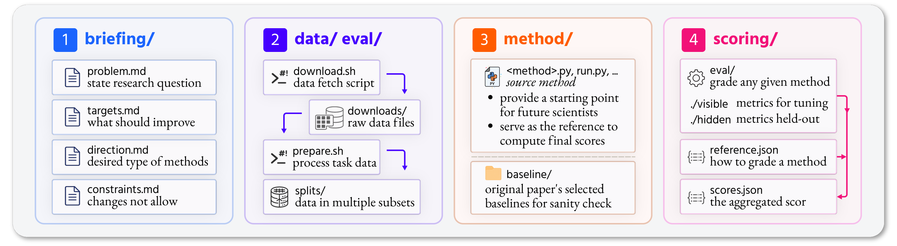

> 图解：`briefing`、`data` 与 `scoring` 定义要解决什么、如何评价，不依赖任何特定方法；`method` 保存论文 source method 的复现实现。最终分数衡量新方法相对复现结果的改进，而不是它与论文数字有多接近。

一个 Scientist 进入环境后，会依次看到：

- **任务说明**：研究问题、优化目标、允许方向与约束；
- **数据和评价文件**：规定方法必须产出什么，以及如何评分；
- **复现方法与 baselines**：Improve 模式可作为起点，Innovate 模式则隐藏 source method；
- **构建记录**：脚本、分数、日志、任务输出和 git commits。

### 七条设计原则，堵住常见“刷分”捷径

**第一，复现核心主张，不追求逐位对齐论文数字。** 可以缩小模型、数据集或训练步数，但不能改变实验 procedure。若论文从头训练，环境就不能偷偷改成预训练微调。缩小后还要保留非平凡性：source method 必须相对随机猜测、多数类等弱 baseline 有真实差距。

**第二，问题与解法彻底解耦。** 数据加载器和评价器不得 import `method/`，评价脚本还要动态发现方法，而不是写死一个方法名。这样未来的新算法才能替换原方法，而不必修改评分器。

**第三，可见集用于开发，隐藏集用于最终检查。** 两者应难度匹配、规模相近、协议一致，又保持独立。隐藏集最好重新切分或重评已有产物，而不是再跑一轮昂贵训练。

**第四，评价科学量本身，而不是“接近论文”。** Accuracy、loss、robustness 等可以作为目标；`deviation_from_paper`、`agreement_with` 之类指标会被验证器禁止。若论文主张“提升 X 且不损害 Y”，Y 也必须作为约束指标进入评分。

**第五，不用机器敏感指标。** Latency、wall-clock time 会随 GPU 改变，因此用参数量、FLOPs、训练步数或处理样本数等稳定代理量衡量效率。

**第六，保留一个可改进的实验面。** 与其反复跑同一个设置，不如沿论文自己的数据集、难度、模型规模或 ablation 轴组成小型矩阵，让后续方法有多个真实改进方向。

**第七，fresh clone 必须能重建。** 下载脚本要幂等、指向公开资源，不能引用原集群的 `shared/` 路径；所有本地 import 都必须解析到 git 跟踪的文件。

### FNI：把不同论文的改进放到同一把尺子上

不同实验的指标方向、尺度和重要性都不一样，不能直接平均。论文提出 **Frontier-Normalized Improvement（FNI，前沿归一化改进）**，主文可概括为：

$$
\mathrm{FNI}=100\sum_c w_c\frac{\delta_c}{\sigma_c b}
$$

其中，$c$ 是某个实验中的一个指标单元，$\delta_c$ 是相对 source method 的有方向改进，$w_c$ 是权重，$\sigma_c$ 是冻结的前沿模型参考组在该单元上的改进离散程度，$b$ 用于把参考组在单篇论文上的典型分数幅度校准到 100。

因此，**FNI = 0 表示与复现方法持平，FNI > 0 表示改进，FNI < 0 表示退步**。约 100 表示达到参考组的典型改进幅度。它不是“超过原论文百分之多少”，也不应当被读成准确率提升。

## 从 124,816 篇论文中选出首批 1,000 个环境

自动构建并不意味着论文可以不经选择地全部进入。一个合适环境既要值得研究，也要在有限预算内可复现。

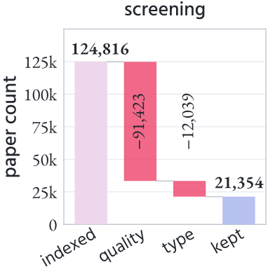

> 图解：初筛从 arXiv 核心 AI 类别的 124,816 篇去重论文出发，先排除低质量以及理论、benchmark、数据集、单纯发现等非方法型论文，留下 21,354 篇进入后续分析。

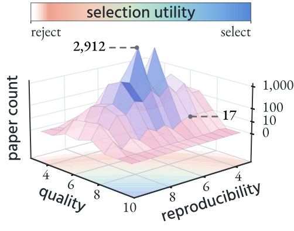

> 图解：第二阶段同时评价研究质量与复现可行性，优先选择质量高、计算成本友好的工作，而不是只挑影响力大但无法运行的论文。

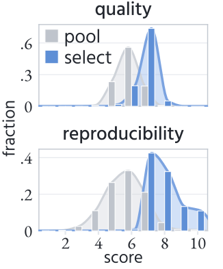

> 图解：最终入选的 1,000 篇论文相对原始候选池，在研究质量和可复现性上整体更高。这里的筛选服务于“能形成可靠任务”，不是给所有论文做绝对学术排名。

候选池来自 2025 年 1 月 1 日至 2026 年 3 月 1 日的 cs.CL、cs.CV、cs.AI、cs.LG 每日列表，快照于 2026 年 3 月 28 日导出。PDF 先由 MinerU 转成 Markdown，MiniMax M2.7 读取开头约 15,000 字符进行高召回质量与类型筛查；质量分至少 75 的 33,393 篇进入深度分析，其中 21,354 篇在预算内完成。

深度分析把复现难度拆成代码、算力、运行时间、数据或模型难度。令 $q$ 为 0–10 的质量分，$r$ 为综合复现难度：

$$
r=\frac{5r_{\mathrm{overall}}+1.25(r_{\mathrm{code}}+r_{\mathrm{compute}}+r_{\mathrm{speed}}+r_{\mathrm{data}})}{10}
$$

排序效用为：

$$
u=\sqrt{\frac{q}{10}\left(1-\frac{r}{10}\right)}
$$

可行性过滤后剩 8,987 篇。系统再把细分类目归入 18 个类别，用温度 1.2 的平滑份额分配名额，最后采样得到类别更均衡的 1,000 篇。代码是否公开会被记录，但不是硬条件，因为 Builder 可以重建缺失实现。

### 构建成本与自动化规模

| 单篇论文构建成本 | 中位数 | 1,000 篇总量 |
|---|---:|---:|
| Compute jobs | 76 | 239,506 |
| GPU-hours | 0.4 | 2,286 |
| CPU-hours | 6 | 28,338 |
| Agent turns | 730 | 947,056 |
| Input tokens | 28M | 51B |
| Output tokens | 163k | 231M |

单篇论文最多可使用 70 GPU-hours，但中位数不到 0.5。源类别每月约新增 9,000 篇去重论文，约 1,500 篇能通过筛查并保持可行，因此后续批次可以继续沿用同一管线扩张。

## 建成的世界：规模、质量与开放度

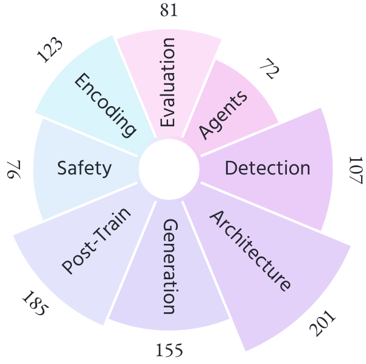

> 图解：首批环境覆盖八个研究领域，而不是集中于单一模型架构或单一 benchmark。不同领域都包含从方法改进到开放创新的任务。

一个典型环境更像小型研究项目，而非一个脚本：

| 环境组成 | 平均数量 |
|---|---:|
| Experiments | 3.3 |
| Metrics | 32（16 个可见 + 16 个隐藏） |
| Datasets | 1.6 |
| Files | 59（约 3.8k 行代码） |

质量检查也不依赖 Builder 的自我声明：

| 1,000 个环境的质量指标 | 比例 |
|---|---:|
| 复现方法分数处于论文结果容差内 | 99% |
| 复现方法超过论文 baselines | 82% |
| 至少一轮被后续交叉检查回退 | 37%（共 573 次，平均 1.6 次） |
| 通过独立 Verifier | 100% |

82% 的分母包含没有可复现 baseline 的环境，不能直接理解为其余环境都“复现失败”。37% 的回退率反而说明交叉检查确实在工作：先前进度若缺少日志或代码支撑，就会被降级并返工。

### 一个具体例子：无归一化 Transformer

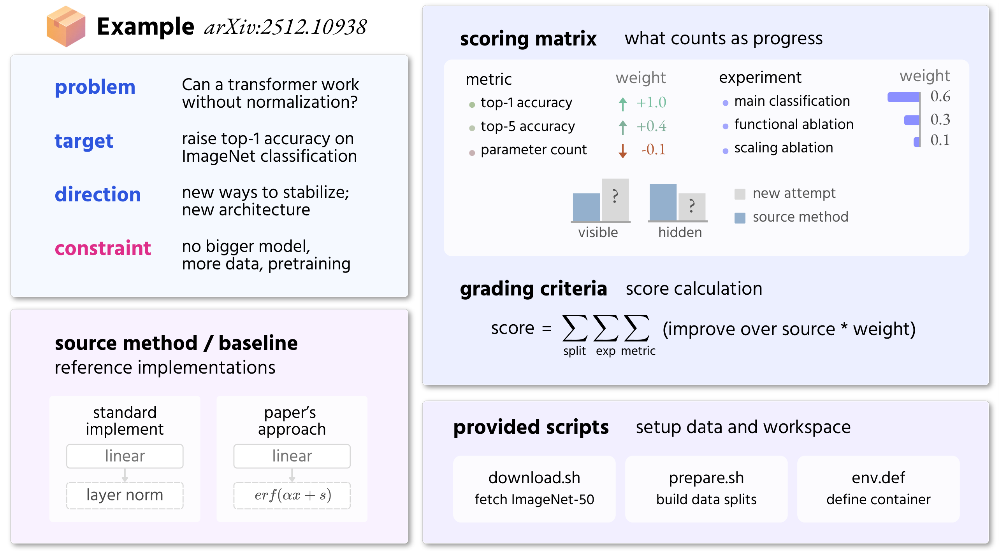

> 图解：该环境把 Transformer 无归一化训练论文转成 ImageNet-50 上的受限改进任务。模型规模、数据和预训练条件固定，收益必须来自方法本身；可见与隐藏评分矩阵共同衡量相对 source method 的加权改进。

原论文研究 Dynamic Tanh（DyT）能否替代 Layer Normalization。完整实验要在 ImageNet 上训练 ViT-B/L 300 epochs，超出单篇预算，因此环境缩到 50 类子集和 ViT-S/16，但保留算法、训练方式和等规模比较。Top-1 accuracy 是主目标，参数量被设为约束，防止靠扩大模型“获胜”。

这个例子也展示了 Verifier 的价值：它曾发现评价器加载了 source method 的 checkpoint，导致评价路径泄漏特定解法。修复后，推理移回 `method/`，`eval/` 只接收任意方法产生的 JSONL predictions，Innovate 模式才真正成立。

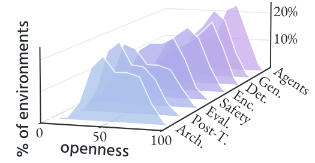

> 图解：开放度从 0 到 100，0 表示方法路径几乎完全给定，100 表示只定义成功标准、如何实现完全交给 Scientist。每个领域几乎都有很宽的开放度分布，说明自由度主要由任务决定，而不是由学科标签决定。

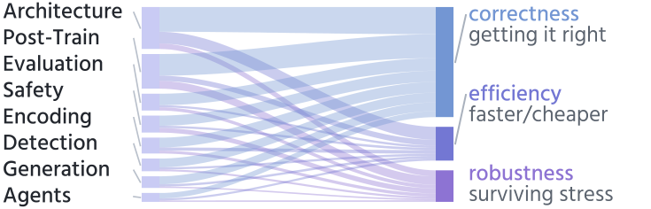

> 图解：环境各自声明“应该让什么变好”。多数任务追求正确性，其余主要涉及效率和鲁棒性，而且一个任务可以包含多个目标；这些目标并不专属于某一个研究领域。

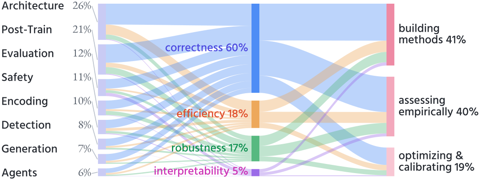

> 图解：桑基图把研究领域、任务目标与所需研究工作连接起来，色带的宽度表示环境占比。它说明这个世界不仅问题来源多，要求 Agent 做的研究动作也不止一种。

## 前沿模型在这里如何做科研

由于让所有模型跑完全部 1,000 个环境成本过高，主评测固定使用 **10 个较低算力环境**。每个模型在相同预算下跑两种模式：

- **Improve**：给出 source method 及其可见集分数，要求在既定协议上继续改进；
- **Innovate**：清空 `method/`，只给问题、约束、可见评价器和数据接口，要求从零设计方法，且避免论文原解泄漏。

每次尝试最多 200 turns、30 GPU-hours，同时最多持有 2 张 GPU。基础设施故障可在无分数时重试至多三次，但“研究做得不好”不能成为重跑理由。模型使用 xhigh reasoning effort，或其最高可用档位。

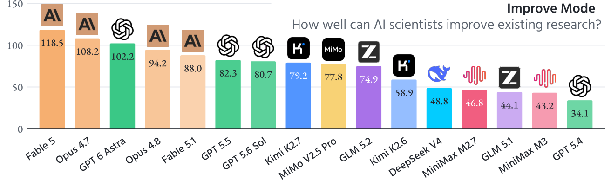

> 图解：横轴为各模型在 Improve 模式的平均 FNI，0 对应 source method，数值越高越好，可见与隐藏切分取平均。Fable 5 在改进已有方法上最强。

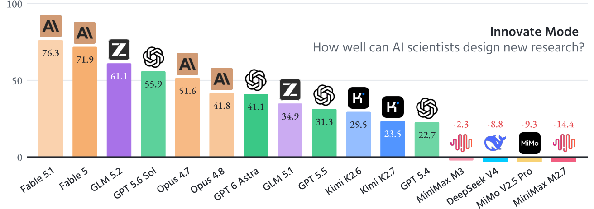

> 图解：下半部分改用 Innovate 模式，模型必须从零提出并实现方法。Fable 5.1 与 Fable 5 占据前两名，开放模型 GLM 5.2 位列第三；所有模型均使用 xhigh effort。

两种模式不能混为一个“科研能力”分数。Improve 更考验在已有代码上的工程、诊断与迭代，Innovate 更考验从问题结构出发的创造性设计。

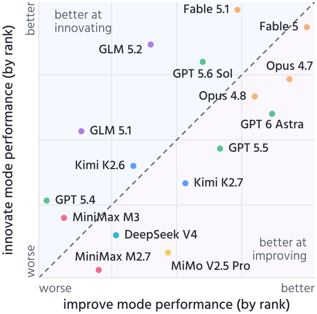

> 图解：图中比较同一模型在两种模式下的排名。排名关系较松散，一些模型擅长基于 source code 改进，另一些在从零设计时更靠前，说明两种能力相关但并不等同。

### 大多数尝试确实超过了复现基线

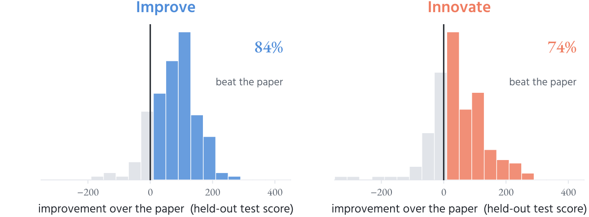

> 图解：横轴是隐藏集相对 source method 的改进，零右侧的彩色柱表示超过复现方法，灰色左尾表示退步。Improve 的成功率为 84%，Innovate 为 74%；后者的左尾更厚，说明从零设计更容易彻底失败。

这里的“74%”是 **尝试层面的比例**，来自固定的 10 环境评测，并不意味着 AI 在 74% 的所有科学问题上都优于人类，也不是准确率提升 74%。

### 分数靠研究质量，而不是靠多烧算力

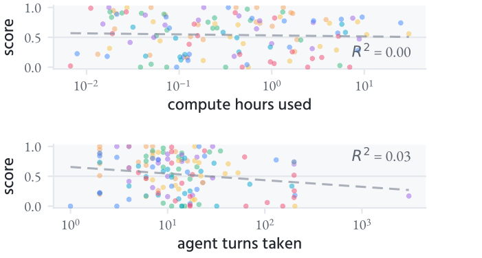

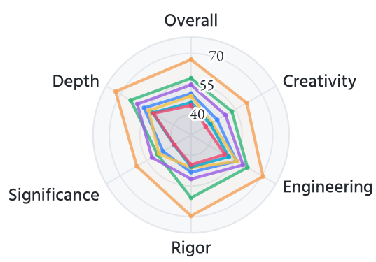

> 图解：左图把每次运行的分数与 compute hours、Agent turns 对照，两者对分数方差的解释仅为 $R^2=0.00$ 和 $0.02$。右图展示不知道分数的 LLM judge 对创造力、工程、严谨性、重要性和深度的评价；这些质量评价与实际分数高度一致，Spearman $\rho=0.89$。

因此，领先模型不是简单地“试得更多”，而是在相同设置下更有效地做研究。不过，单次研究仍有偶然性：好想法可能不适合当前任务，也可能实现良好却实验失败；排行榜应看跨环境的持续差距，而不是把极近分数强行分出高下。

### 可见集收益能否泛化到隐藏集

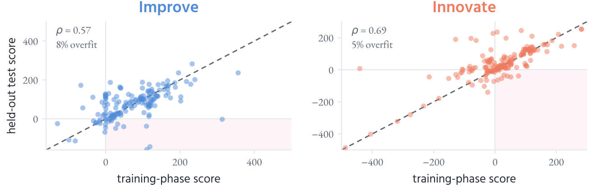

> 图解：横轴为训练阶段分数，纵轴为隐藏测试分数，虚线是 $y=x$。Improve 与 Innovate 的 Spearman 相关分别为 0.57 和 0.69；训练提升但测试退步的过拟合象限分别只有 8% 和 5% 的运行。

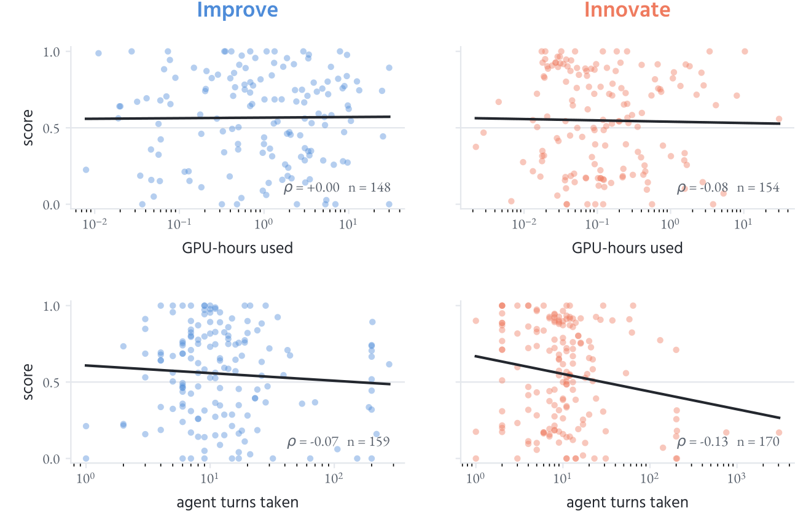

> 图解：上下两行分别展示 GPU-hours 和 Agent turns，与论文内归一化分数的关系，Improve、Innovate 分开拟合。各面板趋势都较平，$|\rho|\leq0.22$，进一步支持“更多投入并不自动带来更好结果”。

## 6,400 小时科研轨迹：失败也完整保留

每次评测都会形成一个独立 git 仓库，按环境、模型和运行模式归档。保存的不只是最后代码，还包括每次 turn 的研究想法、方法修改、实验日志、分数和 commit history；超过 source method 与退步的尝试都会保留。

| 单次完成尝试的记录 | 平均值 |
|---|---:|
| Idea revisions | 3.7 |
| Method revisions | 6 |
| Experiments run | 25 |
| Commits | 35 |
| Hours of work | 5.4 |

总计约 6,400 小时，按每次尝试从首个 turn 到最终分数的端到端 wall-clock time 累加。对同一个环境，多个 Scientist 会留下多条独立解法及其实测改进，这使数据既能训练模型，也能分析研究行为，而不是只有一对“输入—标准答案”。

## 把环境变成 Gym：8B 模型的想法达到前沿锚点

最后，作者用这些轨迹训练 Qwen3-8B。这里刻意把 **提出想法** 与 **实现想法** 分开：小模型负责 ideation，固定的 GPT 5.6 Sol 在相同条件下忠实实现所有想法，从而尽量只改变“想法来自谁”。

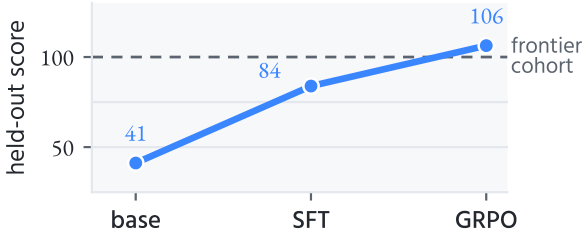

> 图解：纵轴为 10 篇留出论文上的隐藏集 FNI 中位数，所有想法由同一个实现者执行。Base、SFT、GRPO 三阶段依次提升，GRPO 后达到前沿参考组的锚点。

训练分两阶段：

1. **SFT**：使用 1,000 个样本，输入任务说明，输出推理与最终想法。数据包含 925 条真实完成轨迹和 75 条对强完成结果的忠实改写；伪造的实验结果与 job ID 被清理，经验性断言改为概念性表述。
2. **离线 GRPO**：使用 1,500 个已评分想法。777 个以隐藏测试分数为奖励，权重 1.0；723 个以“测试分减去 train-test 过拟合差距”的泛化量为奖励，权重 0.5。奖励在相同论文与模式组内做 z-normalization，不使用 LLM 对文本的主观评分。

Base 使用 Qwen3-8B thinking variant，两个阶段都通过 Tinker 训练 rank 32 的 LoRA adapter。SFT 的学习率为 $10^{-4}$、batch size 8、3 epochs、最大长度 8,192；GRPO 从 SFT checkpoint 继续，学习率 $10^{-5}$、batch size 16、1 epoch，并用带参考策略的 clipped PPO loss 限制更新幅度。

| 留出集 FNI | Base | SFT | GRPO |
|---|---:|---:|---:|
| Median | 41.2 | 83.9 | 106.3 |
| Mean | 51.5 | 62.8 | 89.9 |

中位数从 41.2 到 106.3，约提升 **158%**。但这只证明小模型提出的想法在固定前沿实现者帮助下达到参考组水平，**不等于 8B 模型已经能独立完成完整科研闭环**。此外，10 篇留出论文仍是很小的测试集，分布离散程度也随训练增大，并非每篇都稳定改善。

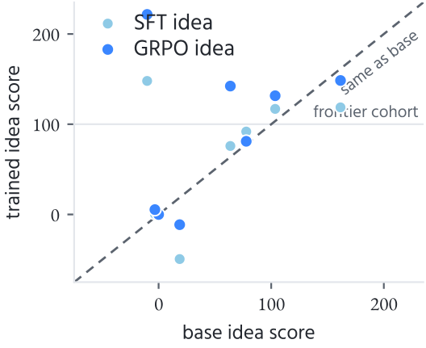

> 图解：每个点对应一篇留出论文上的 SFT 或 GRPO 想法，横轴是同一论文的 Base 想法分数，纵轴是训练后的分数；位于对角线上方表示训练想法优于 Base。整体分布上移，但不同论文收益并不一致。

## 附录拆解：支撑无人值守科研的四层系统

主方法看似是“四个角色接力”，底层还需要解决计算、预算、协调和 Agent 接口四个问题。Scientist World 把它们拆成 Hive、Nexus、Swarm、Worker。

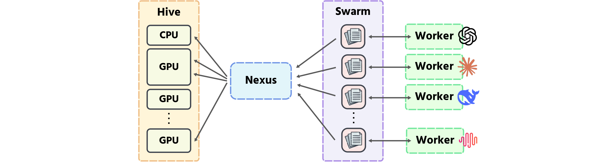

> 图解：Hive 提供 CPU/GPU 执行能力；Nexus 管理每次尝试的预算与资源边界；Swarm 维护跨角色、跨重启的论文级轨迹；Worker 将不同 Agent scaffold 统一成相同交互协议。

### Hive：让计算像交互式实验动作

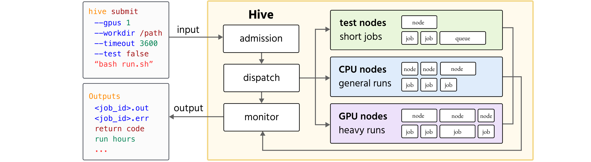

> 图解：任务请求携带命令、资源目标、工作目录与时限，经 admission、dispatch 进入 test、CPU 或 GPU 资源池；monitor 保存 return code、运行时间和日志。

Hive 基于 Ray，返回的不只是成功或失败，还包括 `meta.json`、stdout、stderr 和部分输出。Test 节点限制一小时，用于 smoke test；中断任务会保留证据并重新排队，未完成工作不计入预算。弹性调度让 Agent 只声明资源类别，不必指定机器。

### Nexus：预算由系统执行，而非 Prompt 提醒

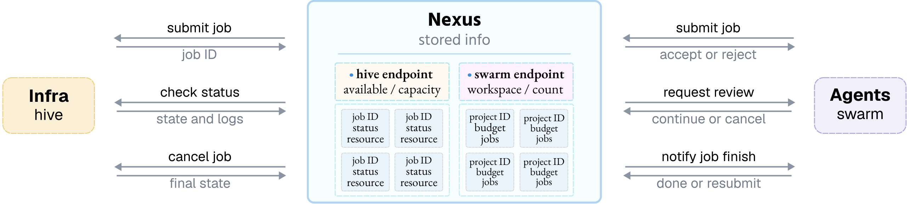

> 图解：Nexus 在 Agent 与 Hive 之间保存 job、project、budget 和 review 状态，把资源请求翻译成实际执行，再把执行证据返回给 Agent。

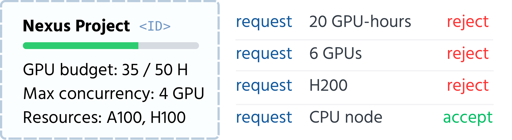

> 图解：请求到达 Hive 前，Nexus 会检查剩余 GPU-hour、并发上限、允许资源池及单任务时限；越界请求直接被拒绝。

长任务还会按间隔快照日志并唤醒 Agent，让它决定继续、取消或换策略。很多失败在 import、数据路径或 loss 发散阶段就能发现，不必等预算耗尽。

### Swarm：以论文为单位维护状态

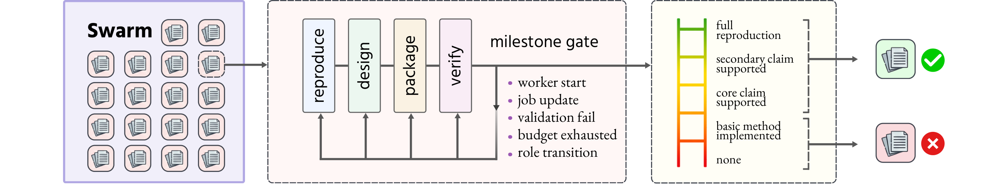

> 图解：多个论文工作区并行推进，每篇沿 Reproduce、Design、Package、Verify 的有序流程移动。Worker start、job submit、job update、validation failure 和 role transition 等事件负责唤醒下一步。

Swarm 的状态单位是论文而不是聊天 session。每次只让 Agent 决定刚发生变化的那件事，并把角色、预算、milestone、工作区和下一步显式保存。验证失败最多触发三次修复；达不到 `core_claim` 的工作会回退或停止。

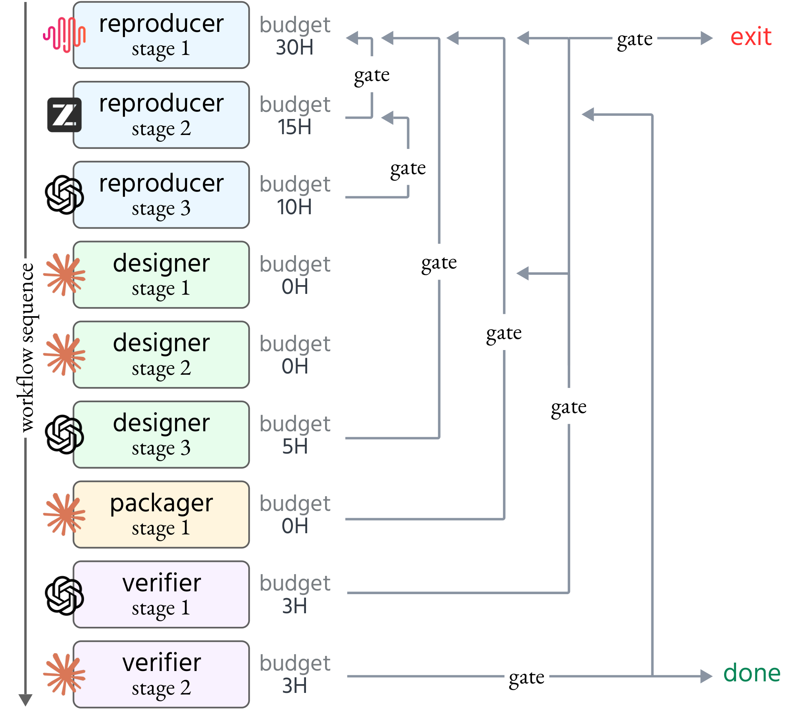

> 图解：标准 workflow 把四种角色展开成多轮 pass，每一行包含模型 profile、里程碑门、GPU 预算和可能的回退目标。重复角色不是冗余，而是为了让后续 Agent 审核证据、尝试不同策略。

| 唤醒事件 | Agent 看到什么 | 轨迹记录什么 |
|---|---|---|
| Iteration start | 论文、工作区、里程碑、预算 | 模型、角色、起始 checkpoint |
| Job running | 流式日志、剩余预算 | 继续或取消决定 |
| Job finished | 日志、exit code、剩余预算 | 结果、算力消耗、下一动作 |
| Build failed | 构建日志 | 失败原因、修复尝试 |
| Budget exhausted | 已用预算、禁止新任务 | 最终支出、收尾里程碑 |
| Validation fail | 验证或里程碑门错误 | 状态、回退尝试 |
| Role transition | 先前里程碑、未解决问题 | 下一角色与继承状态 |

### Worker：统一不同 Coding Agent 的行为边界

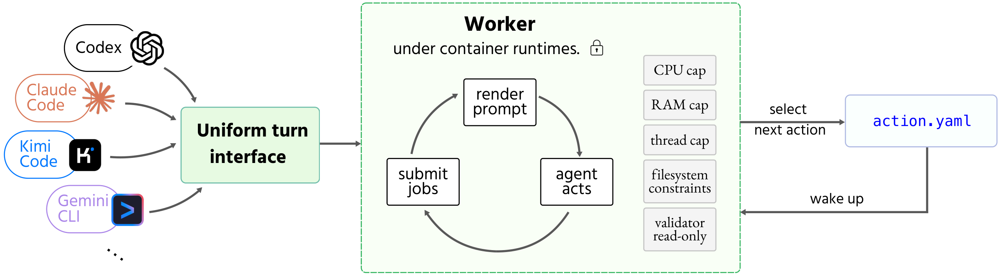

> 图解：不同 scaffold 通过统一 turn 接口进入容器，循环执行 render prompt、Agent acts、submit jobs；每轮最后写出 `action.yaml`，系统再据此安排下一轮。

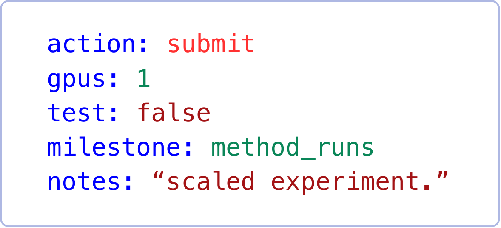

> 图解：`action` 表示提交任务或结束，`gpus` 与 `test` 声明资源，`milestone` 记录自评进度。Agent 无法自行启动集群任务，因此每个请求都能先检查、记账再调度。

Worker 使用 Apptainer 容器，只暴露基础镜像和论文工作区，并限制内存、CPU 调度优先级与数值库线程。依赖在 `container.def` 和 `setup.sh` 中声明，构建成持久 overlay；`git push` 被禁用，记录中的敏感凭据模式会被清理。遇到限流可重试，遇到额度耗尽可切换模型 profile，卡死 turn 则终止整个进程树。

四层之间的分工很清晰：Worker 能思考但不能给自己算力，Swarm 能协调但不运行任务，Nexus 管资源但不判断科研进展，Hive 执行任务但不关心它支持哪条论文结论。任何一层都可替换，而不必重写整个系统。

## 工作区与评分：让结果可以被重新检查

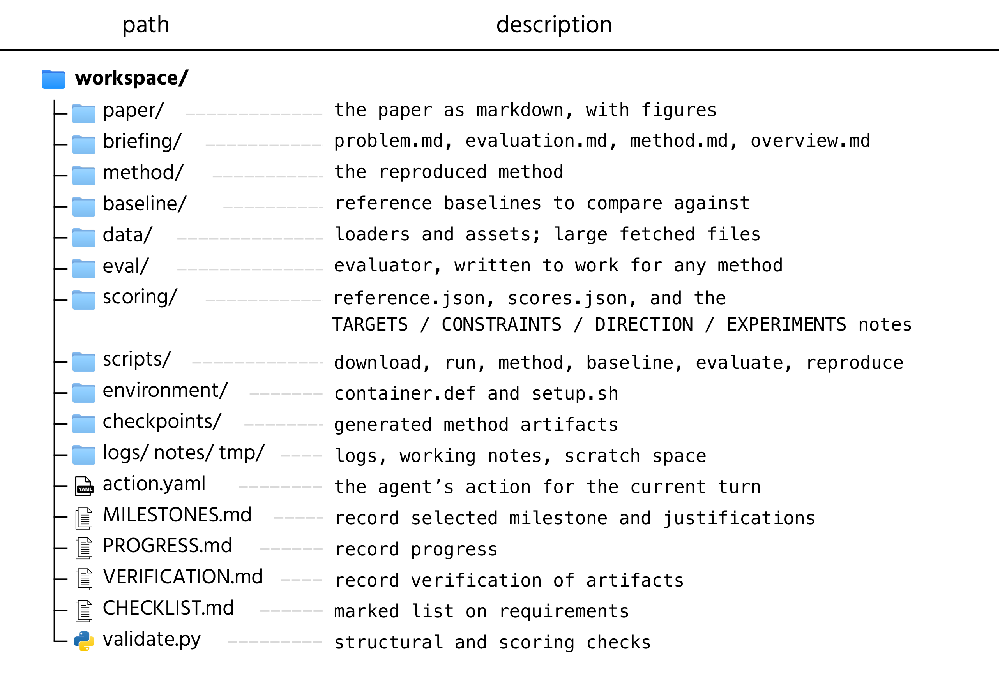

> 图解：同一目录同时是 Builder 的工作场所和最终发布物。任务、方法、数据、评分、执行环境与构建记录各有边界，使第三方不需要原始对话也能重建和复跑。

| 目录或文件组 | 职责 |
|---|---|
| `briefing/` | 描述任务与成功标准，问题文件不泄漏论文方法 |
| `method/`、`baseline/` | 保存复现实现及用于解释分数的 baselines |
| `data/`、`eval/` | 提供任意未来方法都可使用的数据接口与评价器 |
| `scoring/` | 固定实验权重、指标方向、改进目标和约束 |
| `scripts/`、`environment/` | 从 fresh clone 下载资源、重建环境并重跑 |
| 根目录记录 | 当前动作、里程碑、进度、偏差说明与自动检查 |

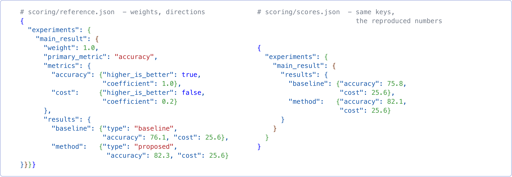

> 图解：`reference.json` 保存论文报告值、实验权重、指标方向与系数，`scores.json` 以相同键保存真实复现值。后续方法相对复现值评分，而不是追逐论文报告值。

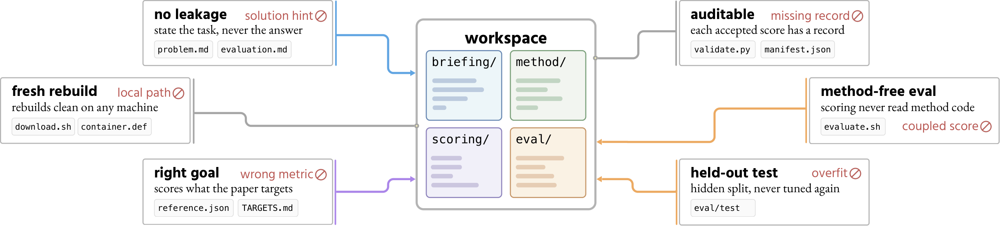

> 图解：目录和检查项分别针对解法泄漏、评分器耦合、依赖不可重建、可见评价器过拟合和无证据进度声明。设计不是存储习惯，而是对环境失效方式的逐项防御。

评测时，问题说明、数据、baseline 与可见评价器只读，方法和运行脚本可写；隐藏测试、参考分数和论文正文不在主阶段工作区中。训练分数通过验证后，方法目录被冻结为只读，再从 pristine clone 物化隐藏评价器。若测试任务失败，修复轮次仍保持隐藏数据与评价器只读，并记录任何临时解锁方法目录的行为。

### FNI 的完整归一化逻辑

对模型 $m$ 和指标单元 $c$，source value 为 $s_c$，模型值为 $x_{m,c}$，方向 $d_c\in\{+1,-1\}$：

$$
\delta_{m,c}=d_c(x_{m,c}-s_c)
$$

冻结参考组 $\mathcal M$ 在该单元上的样本标准差为 $\sigma_c$。若 $\sigma_c=0$，使用论文中所有非零单元离散程度的中位数 $\tau$ 作为 normalizer $n_c$；若连 $\tau$ 也为零，则该论文没有可用尺度，对所有模型一致排除。

标准化单元分数为：

$$
z_{m,c}=\frac{\delta_{m,c}}{n_c}
$$

先验重要性 $p_c$ 来自实验权重与指标系数，再根据单元区分模型的程度调整：

$$
\widetilde w_c=p_c\left(\beta+\frac{\sigma_c}{\sigma_c+\tau}\right),\qquad
w_c=\frac{\widetilde w_c}{\sum_j\widetilde w_j}
$$

其中 $\beta=0.5$。参考组完全持平的单元仍保留，但影响减半；离散程度越典型或越高，权重越大，因子平滑趋近 1.5。若某单元的贡献同时超过其余所有单元之和、且幅度超过一个完整论文分数，还会对所有模型一致剪除，避免异常饱和指标主导结果。

单篇论文原始分数与基线为：

$$
R_m=\sum_c w_c z_{m,c},\qquad
b=\frac{1}{|\mathcal M|}\sum_{m\in\mathcal M}|R_m|
$$

最终将 $w_c/(n_c b)$ 冻结为每个单元的系数。新模型加入时不会重新估计参考组，也不会移动已有榜单的尺度。Train/test 与 Improve/Innovate 使用各自独立的系数，因为它们测量的不是同一个实验对象。

## 实验设置与需要保留的边界条件

计算池包含 16 个 A100 节点、16 个 H100 节点、16 个 H200 节点和 4 个 CPU 节点。GPU-hours 只按持卡数量乘 wall-clock time，不按卡型加权，因此相同名义预算在更快 GPU 上可能完成更多实验，这是作者明确承认的限制。

模型与 scaffold 是一起被评价的：Anthropic、OpenAI 模型使用各自官方 scaffold，其余模型主要通过 Claude Code 和兼容网关运行。因此榜单差异不能完全归因于基础模型本身。所有 trial 使用相同容器镜像和工作区模板，保留 Agent 日志、最终仓库与任务记录，之后可以只依据保存的数值重新评分。

| 资源 | 数量 | 用途 |
|---|---:|---|
| A100 GPU nodes | 16 | 通用加速与试验任务 |
| H100 GPU nodes | 16 | 高吞吐训练与评价 |
| H200 GPU nodes | 16 | 显存密集或最大规模复现 |
| CPU nodes | 4 | 低算力准备与验证 |

自动验证器还会检查：实验权重和为一、主指标与方向完整、复现值没有符号翻转或异常幅度、`eval/` 与 `data/` 不依赖 `method/`、fresh clone import 完整、train/test 独立且能区分方法。代码无法判断的部分由 `MILESTONES.md`、`PROGRESS.md`、`VERIFICATION.md` 和 `CHECKLIST.md` 留下人工可读的审计说明。

## 总结：真正可复用的是“科研闭环”

- **论文不再只是答案记录**：1,000 篇论文被转成可运行、可评分、可持续扩展的研究环境。
- **评价锚点是复现方法**：FNI = 0 对应 source method，84% 的 Improve 与 74% 的 Innovate 尝试在固定评测集上超过它。
- **规模、更新与执行被放到同一系统**：自动 Builder 管线负责扩展，新文献负责更新，真实实验负责约束“只会说”的想法。
- **轨迹同时服务分析与训练**：约 6,400 小时记录包含失败；Qwen3-8B 经 SFT 与离线 GRPO 后，留出集 FNI 中位数由 41.2 升至 106.3。
- **结果仍有明确边界**：主榜单只覆盖 10 个低算力环境，复现通常缩小实验规模，单次研究有偶然性，小模型也尚未独立承担完整实现闭环。

下一步的关键不只是继续增加环境数量，而是让科学家在更开放、更长周期的任务中稳定完成“提出—执行—根据结果更新”的完整循环，并检验这些能力能否跨领域迁移。

> 本文参考自 [Scientist World: Grow a Research World for AI-Scientists](http://arxiv.org/abs/2611.08478v1)