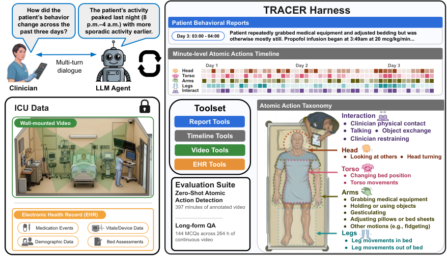
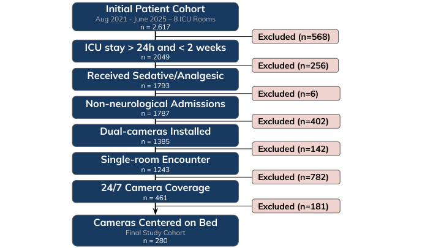
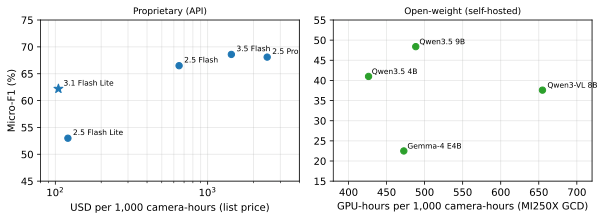
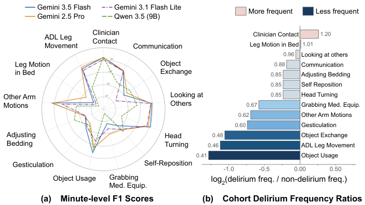

# TRACER：分钟视频联动病历，推理ICU全程

TRACER 要解决的是：如何让 AI 理解跨越数天的 ICU 住院过程，同时既能看到某一分钟的细微动作，又能结合电子健康记录解释长期变化。它重要的原因不只是视频太长，还在于患者行为必须放在用药、护理和临床评估的背景中理解。核心思路是先用视觉语言模型把双机位视频压缩成分钟级动作记录，再与用药事件汇成小时报告，最后让 LLM Agent 按需调用时间线、报告、视频和病历工具取证。实验中，最佳 Agent 在 144 道全程推理题上达到 **76.9%** 准确率；使用同一 Gemini 3.1 Flash Lite backbone 时，TRACER 达到 **61.0%**，高于最强基线的 **49.3%**。

## 为什么整段视频和整份病历直接塞给模型还不够？

ICU 里的一个问题，可能落在完全不同的时间尺度上：

- “某个时刻移除了什么医疗装置？”只需要看一分钟视频。
- “这十分钟患者主要在做什么？”需要连续理解一个短窗口。
- “外出检查前后，患者的自主活动有什么变化？”需要比较相隔数小时的状态。
- “患者活动后 45 分钟内用了什么药？”则必须同时对齐视频与电子健康记录（EHR）。

直接把多日视频交给长上下文 VLM，会在覆盖率和细节之间顾此失彼；把每分钟都写成 caption，又会被上下文长度迫使抽稀。更麻烦的是，视频只能呈现可观察行为，EHR 才记录用药、生命体征、镇静评分和谵妄筛查。两者缺一方，证据链都不完整。

TRACER 全称为 **Trajectory Reasoning Across Clinical Event Records**。论文把它称为一个 training-free 的多模态 harness：这里的 harness 不是某一个新模型，而是模型外围的一整套工作系统，包括数据表示、工具接口和推理循环。所有任务相关知识都放在可公开的 taxonomy、时间层级、工具和 Prompt 中，不在受保护健康数据上训练模型参数。

这也构成了它与三类前作的区别：传统医院环境智能通常为固定行为训练专用模型；长视频系统大多只处理视觉流；临床 Agent 则通常只处理文本或结构化记录。TRACER 的重点是把连续视频与异步发生的 EHR 事件放进同一个可检索时间结构。

### 问题定义与上下文瓶颈

一次 ICU 住院被表示为：

$$
\mathcal{S}=\left(\left\{V_t^{(1)},V_t^{(2)}\right\}_{t=1}^{T},\mathcal{E}\right)
$$

其中，$V_t^{(1)}$ 和 $V_t^{(2)}$ 是第 $t$ 分钟两个墙装摄像头的一段视频，$\mathcal{E}$ 是带时间戳的 EHR 事件集合。队列中的住院时长中位数为 3.3 天，约 $T=4{,}800$ 分钟，最长约两周，即 $T\approx20{,}000$ 分钟。给定自由文本问题 $q$，答案证据可以位于任意时间、任意模态，也可以跨越一个瞬间到整个住院过程。

原始视频的 token 开销解释了为什么“全部放进上下文”不现实：

| 输入 | Gemini 3 系列（tokens） | Qwen3-VL 8B（tokens） |
|---|---:|---:|
| 一分钟、单视角 | 19,823 | 8,640 |
| 一分钟、双视角 | 39,646 | 17,280 |
| 一小时、双视角 | 2.38M | 1.04M |
| 一天、双视角 | 57.1M | 24.9M |
| 中位住院时长 3.3 天 | 188M | 82M |
| 队列最长住院 14 天 | 799M | 349M |
| TRAJECTORY-144 覆盖的 264 小时 | 628M | 274M |
| 一张 512×288 静帧 | 1,100 | 144 |
| 全住院均匀采样 950 帧 | 1.05M | 0.14M |

Gemini 的上下文窗口为 1M tokens，Qwen3-VL 8B 为 256K。即使勉强塞进 950 帧，在两段 benchmark 住院记录中也只相当于每 6.0 和 10.7 分钟取一帧，短于采样间隔的事件很容易消失。

## TRACER：把全程理解拆成“后台抽象”与“前台取证”

> 图解：左侧的双机位床边视频先按分钟进入 VLM，输出 15 类原子动作与自然语言 caption；分钟记录再和同时段用药事件合并，生成六段式小时行为报告。右侧的 Agent 不一次性读取全部资料，而是通过 report、timeline、video、EHR 四类工具逐步检索，必要时回到原始视频复核。论文的两套评测分别检查 397 个标注分钟上的动作识别，以及 264 小时视频和病历上的 144 道纵向推理题。

这个设计把计算分成两条路径。**时间抽象**随着住院记录持续进行，负责把海量原始数据变成紧凑层级；**证据获取**则针对每个问题单独运行，只读取与当前问题相关的部分。前者成本不随后续提问次数增长，后者避免把整个住院过程反复塞入上下文。

系统包含三个可替换、均不训练的模型角色：

1. **Perception VLM**：把每分钟视频转成动作向量和 caption。
2. **Report LM**：把一小时的分钟记录与用药事件压缩成结构化报告。
3. **Agent 模型**：面向具体问题选择工具、交叉验证并组织答案。

博主认为，这里最关键的不是又加了一层摘要，而是**摘要没有切断回到原始证据的通路**。分钟标签便于统计，小时报告便于浏览，原始视频和 EHR 则始终可以用于复核，三者分别承担聚合、叙事与细节验证。

### 分钟级记录：15 类动作加双视角 caption

研究团队与护士、临床医生和机器学习研究者迭代制定了 15 类原子动作，借鉴 AVA 的 atomic-action 表示，但类别选择面向活动能力、躁动和医护关注等临床相关问题。

| 分组 | 原子动作 |
|---|---|
| 手臂与手部 | 抓握医疗设备；使用或抓握非医疗物品；交流时做手势；整理枕头或床单；其他手臂动作 |
| 躯干 | 改变床上体位；其他躯干动作 |
| 头部与颈部 | 看向房间内其他人；转头或移动头颈 |
| 腿部 | 与站立、坐下、行走、转移等日常活动相关的腿部动作；床内腿部动作 |
| 医患互动 | 医护接触患者或在患者身上使用工具；患者交流；医患物品交接；患者被身体约束或固定 |

每个机位的每分钟视频按 1 fps 抽取 60 帧。固定 Prompt 要求 VLM 对每个类别独立输出 `YES`、`NO` 或 `UNABLE TO IDENTIFY`，并附一到两句简短描述；多个动作可以同时成立。两个机位的标签按逻辑 OR 合并，得到一个患者—分钟上的 15 位二值向量，同时保留两个视角各自的 caption。

“无法识别”在合并时被视作负例，但在 benchmark 指标中会排除而不是计错。这个选择基于其极低出现率：Gemini 3.1 Flash Lite 在五轮 benchmark 的 29,775 个标签中只弃权 1 次，在队列抽样 13,254 条分钟记录的 198,810 个标签中没有弃权。其他模型中，只有 Gemini 2.5 Flash 和 2.5 Pro 经常弃权，约为标签的 3%。

### 小时级报告：对齐 ICU 的记录节奏

每满一小时，Report LM 接收 60 条分钟记录以及该小时的用药事件，生成六部分报告：

1. 患者活动总结，附分钟级时间引用。
2. 医患互动总结。
3. 值得关注的时刻，包括活动突增、长期静止后的首次活动等。
4. 用药背景，包括药名、剂量、途径和给药动作。
5. 可观察的活动—用药时间对齐，只描述共现，不推断因果。
6. 不超过五句话的简要叙事。

选择“一小时”并非随意切分，而是因为 ICU flowsheet 通常也按小时记录。Prompt 要求所有行为陈述附带分钟或连续时间范围，且禁止从视频推断镇静程度、意图、疼痛、情绪或临床状态。

### 十一项工具：让 Agent 自己决定看哪一层

| 工具族 | 工具 | 主要作用与返回值 |
|---|---|---|
| Scaffold | `get_patient_metadata` | 人口统计、ICU 入院时间、观察窗口和就诊历史 |
| Scaffold | `convert_utc_local` | 在 UTC 与当地时间之间转换 |
| Timeline | `get_atomic_actions` | 返回某一小时内逐分钟动作标签 |
| Timeline | `query_actions` | 汇总标签活跃分钟数、逐小时计数及逐标签时间序列 |
| Timeline | `find_first_occurrence` | 找到指定动作首次出现的分钟和时间戳 |
| Timeline | `find_moments_of_interest` | 检测 15 分钟滚动活动信号的上升与下降，并关联附近用药 |
| Report | `list_hourly_reports` | 列出已有报告的日期和小时 |
| Report | `get_hourly_report` | 获取指定小时的六段式报告 |
| EHR | `query_medications` | 查询时间窗内药名、剂量、途径、给药动作和药物类别 |
| EHR | `query_flowsheet` | 查询生命体征、RASS、疼痛、CAM-ICU 和护理评估等记录 |
| Video | `query_video_minute` | 用 Agent 自写 Prompt 重新检查指定分钟的双视角视频 |

视频工具是对固定 taxonomy 的重要补充：如果问题涉及“移除了什么物品”或“做了哪种床旁检查”，15 类动作未必够用，Agent 可以重新向 VLM 提问。Gemini 使用原始视频的 5 fps 采样，开放权重模型使用 512×288、2 fps；两个视角分别回答，再由 Agent 处理不一致。

Agent 最多进行 25 次工具调用，所有输出、调用与结果保留在上下文中。预算耗尽后，选择题评测会强制模型依据已收集证据作答；临床界面则允许报告证据不足。Prompt 还要求模型尽可能用两类工具交叉验证，不把视频读取结果当作绝对真值，并在“没有返回记录”时检查时间窗、过滤器与截断情况，而不是直接断言事件不存在。

## 数据与评测：从单分钟识别到跨天推理

研究使用 Stanford Hospital 心血管 ICU 和内科 ICU 在 2021 年 8 月至 2025 年 6 月采集的数据。八间病房部署了 16 个固定角落摄像头，每间两个，视频为 1920×1080、15 fps，并链接人口统计、入出转记录、护理 flowsheet 和用药记录。研究获 Stanford Institutional Review Board 批准，敏感数据只在安全服务器上由获批人员处理。

> 图解：流程从 2,617 名候选患者开始，依次按住院时长、镇静或镇痛用药、非神经系统入院诊断、双摄像头病房、无 ICU 内转房、全程双视角完整覆盖及摄像头对准床区等条件排除，最终得到 280 人。对应的队列特征为：年龄中位数 66.0 岁，ICU 停留中位数 3.3 天，53 人在住院期间至少一次 CAM-ICU 阳性。

| 队列特征 | 总体（$N=280$） |
|---|---:|
| 年龄，岁，中位数 [IQR] | 66.0 [58.1, 74.7] |
| 男性，$n$（%） | 183（65.4） |
| BMI，kg/m²，中位数 [IQR] | 25.8 [23.2, 29.9] |
| 择期入院，$n$（%） | 140（50.0） |
| 急诊入院，$n$（%） | 103（36.8） |
| 紧急入院，$n$（%） | 30（10.7） |
| 创伤中心，$n$（%） | 7（2.5） |
| ICU 停留，天，中位数 [IQR] | 3.3 [2.0, 5.4] |
| 有创机械通气，$n$（%） | 157（56.1） |
| 院内死亡，$n$（%） | 13（4.6） |
| 住院期间 CAM-ICU 阳性，$n$（%） | 53（18.9） |

筛选从 2,617 人开始，住院时间不满足 24 小时至两周排除 568 人，未接受镇静或镇痛药排除 256 人，神经系统入院排除 6 人；无双摄像头病房、存在 ICU 内转房、双视角覆盖不足 100%、摄像头未同时对准床区分别排除 402、142、782、181 人。最终数据约为 60,000 摄像头小时。

### 三层评估各回答一个问题

**分钟感知 benchmark** 包含来自 26 次住院的 397 个一分钟片段，采样时兼顾一天中的时间、患者病情与活动水平。15 类动作均由一人标注、第二人核验或修正。20 个片段的盲法复核中，标签一致率为 92.7%，$\kappa=0.81$，95% CI 为 [0.74, 0.87]。类别分布不均衡：最常见的“其他手臂动作”和“转头”约出现在 70% 片段中，最稀有类别不足 5%，因此不能只看整体 Accuracy。

**TRAJECTORY-144** 则考察完整住院过程，包含两段 ICU 住院共 264 小时视频与病历上的 144 道五选一题。其中两题实际只有四个选项，五种正确答案位置合计形成 718 次评分试验。标注者先按六小时分段建立人工事件时间线，再与临床人员讨论出题，并改写有迷惑性的干扰项；无数据盲答 LLM 正确率达到 60% 的题会被复核、删除或重写。

题型分布如下：110 道视频题包括 33 道少于 5 分钟的 moment、16 道 5–30 分钟的 window、61 道超过 30 分钟的 long-form；另有 26 道纯 EHR 题和 8 道视频—病历跨模态题。这个 benchmark 深而不广，只覆盖两位患者，因此不能用来证明跨患者泛化。

基线包括无数据 text-only LLM、全住院均匀抽取 475 或 950 帧的 long-context VLM，以及 HourVideo 风格的 Socratic caption 管线。后两者还加入完整 EHR 的变体。所有系统使用固定 Prompt，并按五种答案位置取平均。

## 实验一：原子动作可用，但远非完美

| 模型 | Accuracy | F1 | Precision | Recall |
|---|---:|---:|---:|---:|
| Random（匹配分布） | 69.9±0.4 | 44.8±0.8 | 44.8±0.8 | 44.7±1.0 |
| Majority Class | 77.7 | 45.2 | 68.9 | 33.6 |
| Qwen3-VL 8B-Instruct | 78.0±0.1 | 37.6±0.4 | **84.8±0.3** | 24.2±0.3 |
| Qwen3.5 4B | 78.2±0.3 | 41.0±0.8 | 78.3±1.7 | 27.7±0.6 |
| Qwen3.5 9B | 79.7±0.5 | 48.4±2.0 | 79.4±1.0 | 34.8±1.9 |
| Gemma-4 E4B-it | 74.9±0.1 | 22.5±0.3 | 72.2±1.6 | 13.4±0.2 |
| Gemini 2.5 Flash Lite | 79.0±0.3 | 53.0±0.7 | 68.4±0.9 | 43.3±0.9 |
| Gemini 2.5 Flash | 83.2±0.2 | 66.5±0.5 | 71.6±0.6 | **62.0±0.9** |
| Gemini 2.5 Pro | 84.4±0.2 | 68.1±0.5 | 76.0±0.4 | 61.7±0.7 |
| Gemini 3.1 Flash Lite | 82.3±0.2 | 62.2±0.3 | 74.5±0.7 | 53.3±0.4 |
| Gemini 3.5 Flash | **84.8±0.0** | **68.6±0.1** | 78.3±0.3 | 61.0±0.3 |

以上指标是在 397 个片段上对 15 类动作做 micro-average，模型行展示五次运行的均值与标准差。Gemini 3.5 Flash 整体最佳，Accuracy 84.8%、micro-F1 68.6。值得注意的是，Qwen3-VL 8B 虽有最高 Precision，却只有 24.2 的 Recall；这正说明高 Accuracy 或高 Precision 不能单独代表动作检测可靠。

大规模队列处理最终选择 Gemini 3.1 Flash Lite，因为它的 F1 为 62.2，成本却不到最佳模型的十分之一，处于较好的准确率—成本折中点。

> 图解：左图横轴是 Gemini 模型处理每 1,000 摄像头小时一分钟片段的标价成本，采用对数刻度，纵轴为 397 片段 benchmark 上的 micro-F1；星号标出用于队列运行的 Gemini 3.1 Flash Lite。右图针对开放权重模型，横轴是在一个 AMD MI250X graphics compute die 上处理每 1,000 摄像头小时所需的设备小时数，纵轴同样是 micro-F1。两幅图使用不同成本口径，不能直接横向比较数值。

## 实验二：层级表示与工具调用确实超过“塞更多上下文”

TRAJECTORY-144 的主结果如下。除特别标注外，视频工具由 Agent 自己的模型提供；标有 † 的配置由 Gemini 3.1 Flash Lite 提供视频工具。

| 方法 | Video | EHR | Cross-modal | Avg. |
|---|---:|---:|---:|---:|
| Random | 20.1 | 20.0 | 20.0 | 20.1 |
| Text-only Gemini 3.1 Flash Lite | 32.3 | 26.9 | 25.0 | 30.9 |
| Qwen3-VL 8B，475 帧 | 31.6 | 10.0 | 47.5 | 28.6 |
| Qwen3-VL 8B，950 帧 | 36.3 | 13.8 | 50.0 | 33.0 |
| Gemini 3.1 Flash Lite，950 帧 | 36.5 | 14.6 | 25.0 | 31.9 |
| Gemini 3.1 Flash Lite，475 帧 + EHR | 41.8 | 83.8 | 40.0 | 49.3 |
| Socratic Qwen3-VL 8B | 33.7 | 22.3 | 20.0 | 30.9 |
| Socratic Qwen3.5 9B | 30.4 | 18.5 | 10.0 | 27.1 |
| Socratic Gemini 3.1 Flash Lite | 36.8 | 16.2 | 47.5 | 33.7 |
| Socratic Gemini 3.1 Flash Lite + EHR | 37.8 | 76.2 | 42.5 | 45.0 |
| TRACER + gpt-oss-20b† | 50.3 | 93.1 | 40.0 | 57.4 |
| TRACER + Qwen3.5 9B | 49.5 | 95.4 | 52.5 | 57.9 |
| TRACER + Gemini 3.1 Flash Lite | 53.9 | 96.2 | 45.0 | 61.0 |
| TRACER + Gemma-4 31B† | 61.8 | **100.0** | 47.5 | 67.9 |
| TRACER + Gemini 3.5 Flash | **72.0** | 99.2 | **72.5** | **76.9** |

同一个 Gemini 3.1 Flash Lite 下，Socratic + EHR 为 45.0%，475 帧 + EHR 为 49.3%，TRACER 为 61.0%。相对最强基线提升 11.7 个百分点，按问题做配对 bootstrap 的 95% CI 为 [4.4, 18.9]。更重要的是，这些基线在问答阶段约使用三倍于 TRACER 的 token，并非靠少给上下文取胜。

最佳配置 Gemini 3.5 Flash 达到 76.9%，最佳开放权重 Agent Gemma-4 31B 达到 67.9%；所有 long-context 和 Socratic 基线均未超过 50%。不过，跨模态题只有 8 道，列间差异不宜过度解读。

### 为什么不是简单“多给 EHR”？

| 输入方式 | 留存覆盖（住院 A/B） | Tokens | <5 min | 5–30 min | >30 min | EHR | Cross | All |
|---|---|---:|---:|---:|---:|---:|---:|---:|
| 左视角 captions | 2.8k / 3.4k | 1.0M | 34.5 | 32.5 | 39.2 | 16.2 | 47.5 | 33.7 |
| 左视角 captions + EHR | 2.8k / 1.7k | 1.0M / 0.9M | 30.3 | 32.5 | 43.3 | 76.2 | 42.5 | 45.0 |
| 双视角 captions + EHR | 1.4k / 0.9k | 0.7M / 0.7M | 32.7 | 31.2 | 35.9 | 76.2 | 50.0 | 42.7 |
| 950 帧 | 950 / 950 | 1.1M | 35.8 | 32.5 | 38.0 | 14.6 | 25.0 | 31.9 |
| 475 帧 | 475 / 475 | 0.5M | 26.7 | 35.0 | 36.6 | 17.7 | 22.5 | 29.9 |
| 475 帧 + EHR | 475 / 475 | 0.7M / 1.0M | 34.5 | 30.0 | 48.9 | 83.8 | 40.0 | 49.3 |
| TRACER 全工具 | — | — | 36.4 | 52.5 | 63.7 | 96.2 | 45.0 | 61.0 |

加入 EHR 后，caption 基线的 EHR 题从 16.2 提升到 76.2，但视频题没有同步改善。再增加第二视角反而要求更大的 caption 抽样间隔，整体由 45.0 降到 42.7，长视频题由 43.3 降到 35.9。这个对照很直观地说明：**固定上下文预算里，数据更多不等于有效证据更多，检索结构同样重要。**

相同现象也出现在开放权重回答模型上。下表的 Socratic 方法统一使用 Gemini 3.1 Flash Lite captions，TRACER 列则由同一模型担任 Agent、Gemini 3.1 Flash Lite 提供视频工具。

| 回答模型（上下文） | 留存分钟 A/B | <5 min | 5–30 min | >30 min | EHR | Cross | Socratic All | TRACER |
|---|---|---:|---:|---:|---:|---:|---:|---:|---:|
| Gemini 3.1 FL（1M） | 2.8k / 3.4k | 34.5 | 32.5 | 39.2 | 16.2 | 47.5 | 33.7 | 61.0 |
| gpt-oss-20b（131K） | 379 / 391 | 33.3 | 26.3 | 22.7 | 14.6 | 20.0 | 23.9 | 57.4 |
| Gemma-4 31B（131K） | 379 / 377 | 33.9 | 25.0 | 31.4 | 23.1 | 22.5 | 29.3 | 67.9 |
| Qwen3.5 9B（65K） | 183 / 185 | 30.3 | 28.8 | 30.8 | 18.5 | 10.0 | 27.1 | 61.6 |

### 消融：不同工具服务不同时间尺度

下表对 Gemini 3.5 Flash、Gemini 3.1 Flash Lite 和 Qwen3.5 9B 三种 Agent 取平均。单工具实验揭示分工，累积实验则依次加入 timeline、reports、EHR 和 video。

| Agent 工具 | <5 min | 5–30 min | >30 min | EHR | Cross-modal | Avg. |
|---|---:|---:|---:|---:|---:|---:|
| 仅 Timeline | 27.5 | 43.3 | **60.7** | 30.3 | 25.0 | 43.7 |
| 仅 Reports | 33.7 | **52.5** | 47.4 | 33.3 | 43.3 | 42.1 |
| 仅 EHR | 32.9 | 31.7 | 41.2 | **96.4** | **60.0** | **49.3** |
| 仅 Video | **39.8** | 50.8 | 38.3 | 25.1 | 27.5 | 37.0 |
| Timeline | 27.5 | 43.3 | 60.7 | 30.3 | 25.0 | 43.7 |
| + Reports | 30.5 | 55.4 | 63.8 | 31.3 | 31.7 | 47.6 |
| + EHR | 31.7 | 51.6 | 64.1 | **97.2** | **61.7** | 61.1 |
| + Video（完整 TRACER） | **39.2** | **57.1** | **69.2** | 96.9 | 56.7 | **65.3** |

Video 最擅长短时刻，Reports 最擅长 5–30 分钟窗口，Timeline 对超过 30 分钟的问题最有帮助，EHR 工具则几乎解决了纯病历题。平均准确率随累积加入工具从 43.7 提升到 47.6、61.1、65.3，完整系统比最佳单工具高 16.0 个百分点。

分模型单工具结果进一步说明，并不存在在所有题型上都最优的单一入口：

| Agent | 工具配置 | All | <5 min | 5–30 min | >30 min | EHR | Cross |
|---|---|---:|---:|---:|---:|---:|---:|
| Gemini 3.5 Flash | Reports only | 51.0 | 44.2 | 72.5 | 55.4 | 36.9 | 47.5 |
| Gemini 3.5 Flash | EHR only | 59.6 | 49.1 | 47.5 | 49.5 | 100.0 | 72.5 |
| Gemini 3.5 Flash | Video only | 46.4 | 54.5 | 76.2 | 43.9 | 30.0 | 27.5 |
| Gemini 3.5 Flash | All tools | **76.9** | 54.5 | 75.0 | 80.7 | 99.2 | 72.5 |
| Gemini 3.1 Flash Lite | Reports only | 37.5 | 27.9 | 38.8 | 44.5 | 31.5 | 40.0 |
| Gemini 3.1 Flash Lite | EHR only | 45.3 | 26.1 | 20.0 | 40.7 | 95.4 | 47.5 |
| Gemini 3.1 Flash Lite | Video only | 34.5 | 38.2 | 45.0 | 36.8 | 22.3 | 20.0 |
| Gemini 3.1 Flash Lite | All tools | **61.0** | 36.4 | 52.5 | 63.7 | 96.2 | 45.0 |
| Qwen3.5 9B | Reports only | 37.7 | 29.1 | 46.2 | 42.2 | 31.5 | 42.5 |
| Qwen3.5 9B | EHR only | 43.0 | 23.6 | 27.5 | 33.5 | 93.8 | 60.0 |
| Qwen3.5 9B | Video only | 30.2 | 26.7 | 31.2 | 34.3 | 23.1 | 35.0 |
| Qwen3.5 9B | All tools | **57.9** | 26.7 | 43.8 | 63.3 | 95.4 | 52.5 |
| gpt-oss-20b† | Reports only | 32.8 | 26.7 | 43.8 | 33.9 | 30.0 | 37.5 |
| gpt-oss-20b† | EHR only | 37.3 | 26.1 | 27.5 | 23.4 | 93.1 | 27.5 |
| gpt-oss-20b† | Video only | 28.4 | 28.5 | 43.8 | 32.3 | 14.6 | 12.5 |
| gpt-oss-20b† | All tools | **57.4** | 32.1 | 41.2 | 62.5 | 93.1 | 40.0 |

逐模型累积消融也表明，工具收益依赖 Agent 能力，并非每一行都单调增加。例如 Qwen3-VL 8B 加 video 后从 40.1 到 42.1，而 Gemini 3.5 Flash 从 69.9 到 76.9。

| Agent 与工具 | <5 min | 5–30 min | >30 min | EHR | Cross | Stay A | Stay B | All |
|---|---:|---:|---:|---:|---:|---:|---:|---:|
| Gemini 3.5 Flash：Text-only | 37.0 | 32.5 | 51.4 | 21.5 | 27.5 | 35.9 | 41.6 | 39.3 |
| + Timeline | 37.6 | 57.5 | 67.5 | 42.3 | 20.0 | 62.0 | 45.6 | 52.4 |
| + Reports | 40.6 | 72.5 | 70.5 | 38.5 | 30.0 | 70.2 | 45.9 | 55.8 |
| + EHR | 39.4 | 76.2 | 71.1 | 100.0 | 75.0 | 84.7 | 59.5 | 69.9 |
| + Video | **54.5** | 75.0 | **80.7** | 99.2 | 72.5 | **88.5** | **68.9** | **76.9** |
| Gemini 3.1 Flash Lite：Text-only | 24.2 | 18.8 | 40.2 | 26.9 | 25.0 | 26.8 | 33.8 | 30.9 |
| + Timeline | 23.0 | 32.5 | 55.3 | 26.2 | 22.5 | 50.5 | 29.8 | 38.3 |
| + Reports | 24.8 | 48.8 | 62.9 | 31.5 | 37.5 | 57.9 | 36.9 | 45.5 |
| + EHR | 23.6 | 36.2 | 58.6 | 96.2 | 47.5 | 71.2 | 42.5 | 54.3 |
| + Video | 36.4 | 52.5 | 63.7 | 96.2 | 45.0 | 75.8 | 50.8 | 61.0 |
| Qwen3.5 9B：Text-only | 31.5 | 27.5 | 43.9 | 20.0 | 40.0 | 35.3 | 34.4 | 34.7 |
| + Timeline | 21.8 | 40.0 | 59.3 | 22.3 | 32.5 | 52.1 | 32.2 | 40.4 |
| + Reports | 26.1 | 45.0 | 58.0 | 23.8 | 27.5 | 51.9 | 34.0 | 41.4 |
| + EHR | 32.1 | 42.5 | 62.5 | 95.4 | 62.5 | 74.8 | 48.4 | 59.2 |
| + Video | 26.7 | 43.8 | 63.3 | 95.4 | 52.5 | 74.6 | 46.4 | 57.9 |
| Qwen3-VL 8B：Text-only | 29.7 | 28.7 | 42.6 | 25.4 | 32.5 | 34.9 | 34.1 | 34.4 |
| + Timeline | 21.2 | 27.5 | 39.9 | 22.3 | 35.0 | 39.3 | 24.9 | 30.8 |
| + Reports | 19.4 | 48.8 | 46.7 | 18.5 | 22.5 | 39.5 | 30.6 | 34.2 |
| + EHR | 17.0 | 33.8 | 43.5 | 70.0 | 25.0 | 53.8 | 30.6 | 40.1 |
| + Video | 19.4 | 32.5 | 45.7 | 68.5 | 42.5 | 55.7 | 32.7 | 42.1 |
| gpt-oss-20b†：Text-only | 22.4 | 17.5 | 36.5 | 22.3 | 42.5 | 27.5 | 29.9 | 28.9 |
| + Timeline | 22.4 | 36.2 | 56.5 | 16.2 | 35.0 | 47.4 | 31.4 | 38.0 |
| + Reports | 25.5 | 38.8 | 62.1 | 27.7 | 30.0 | 55.8 | 34.3 | 43.1 |
| + EHR | 26.7 | 40.0 | 59.3 | 90.8 | 52.5 | 74.8 | 41.2 | 55.0 |
| + Video | 32.1 | 41.2 | 62.5 | 93.1 | 40.0 | 73.4 | 46.4 | 57.4 |

对 Gemini 3.5 Flash 的 718 个共享试验做近似配对 McNemar 检验时，除加入 reports 的 +3.5 提升为 $p=0.06$ 外，其余累积步骤均达到 $p<0.001$。两段住院的难度也明显不同，因此“只报告总体均值”会掩盖 Stay B 上普遍较低的表现。

### 固定感知后，开放权重 Agent 能追到什么程度？

为了分离 Agent 推理与视觉感知，研究者统一用 Gemini 3.1 Flash Lite 构建分钟记录、小时报告并处理所有视频工具调用，只替换 Agent：

| Agent 模型 | <5 min | 5–30 min | >30 min | EHR | Cross-modal | Avg. | Calls |
|---|---:|---:|---:|---:|---:|---:|---:|
| Gemini 3.5 Flash | 35.8 | 57.5 | **80.3** | 98.5 | **77.5** | **70.7** | 9.5 |
| Gemini 3.1 Flash Lite | 36.4 | 52.5 | 63.7 | 96.2 | 45.0 | 61.0 | 8.9 |
| gpt-oss-20b | 32.1 | 41.2 | 62.5 | 93.1 | 40.0 | 57.4 | 3.7 |
| Qwen3.5 9B | 35.2 | 45.0 | 67.3 | 95.4 | 50.0 | 61.6 | 9.0 |
| Gemma-4 31B | **40.0** | **61.2** | 73.7 | **100.0** | 47.5 | 67.9 | 5.4 |

Qwen3.5 9B 和 Gemma-4 31B 在这种设置下匹配或超过 Gemini 3.1 Flash Lite。结合前面的动作检测结果，论文据此判断：所评测开放权重系统的主要短板更偏向感知 VLM，而不是 Agent 的推理循环。这对院内本地部署很关键，因为本地化的瓶颈不能只靠换一个更强的文本 Agent 解决。

完整的 12 种 Agent 配置如下，背景记录与报告固定，† 表示视频工具改用 Gemini 3.1 Flash Lite：

| Agent 模型 | All | <5 min | 5–30 min | >30 min | EHR | Cross | 平均调用数 |
|---|---:|---:|---:|---:|---:|---:|---:|
| Gemini 2.5 Flash Lite | 49.2 | 32.7 | 35.0 | 53.9 | 69.2 | 45.0 | 3.7 |
| Gemini 2.5 Flash | 60.3 | 33.9 | 56.2 | 64.0 | 90.8 | 50.0 | 4.7 |
| Gemini 3 Flash | 70.8 | 44.8 | 66.3 | 77.0 | 91.5 | 72.5 | 12.3 |
| Gemini 3.1 Flash Lite | 61.0 | 36.4 | 52.5 | 63.7 | 96.2 | 45.0 | 8.9 |
| Gemini 3.5 Flash Lite | 61.1 | 40.0 | 52.5 | 59.8 | 99.2 | 52.5 | 6.8 |
| Gemini 3.5 Flash | **76.9** | **54.5** | **75.0** | **80.7** | 99.2 | 72.5 | 9.0 |
| Qwen3.5 9B | 57.9 | 26.7 | 43.8 | 63.3 | 95.4 | 52.5 | 10.4 |
| Qwen3-VL 8B | 42.1 | 19.4 | 32.5 | 45.7 | 68.5 | 42.5 | 4.7 |
| gpt-oss-20b† | 57.4 | 32.1 | 41.2 | 62.5 | 93.1 | 40.0 | 3.7 |
| Qwen3.5 9B† | 61.6 | 35.2 | 45.0 | 67.3 | 95.4 | 50.0 | 9.0 |
| Gemma-4 31B† | 67.9 | 40.0 | 61.2 | 73.7 | **100.0** | 47.5 | 5.4 |
| Gemini 3.5 Flash† | 70.7 | 35.8 | 57.5 | 80.3 | 98.5 | **77.5** | 9.5 |

当 Gemini 3.5 Flash 改用较弱的视频感知后，总分从 76.9 降至 70.7，损失集中在视频 moment 和 window；达到 25 次调用上限的试验从 0 增至 10.7%。这再次说明，摘要层相同并不意味着实际视觉证据质量相同。

## 实验三：60,000 摄像头小时中浮现的谵妄行为信号

在 280 名患者上，团队比较了至少一次 CAM-ICU 谵妄评估阳性的 53 人，与住院期间没有阳性筛查的 227 人。分析只使用 benchmark 中阳性样本足够的 13 类动作，排除“其他躯干动作”和“医护约束”。

动作 $a$ 的谵妄频率比定义为：

$$
\mathrm{FR}_a=\frac{f_a^{\mathrm{del}}}{f_a^{\mathrm{non\text{-}del}}},\qquad
f_a^{(g)}=\frac{\sum_{p\in\mathcal{P}_g}m_a^{(p)}}{\sum_{p\in\mathcal{P}_g}M^{(p)}}
$$

其中，$m_a^{(p)}$ 是患者 $p$ 被检测到动作 $a$ 的分钟数，$M^{(p)}$ 是其总观察分钟数。$\mathrm{FR}_a<1$ 表示该动作在谵妄组更少，$\mathrm{FR}_a>1$ 表示更多。主统计按组内全部观察分钟汇总，因此住院更久的患者权重更大；作者另外做了患者等权重分析。

> 图解：面板 (a) 展示各类原子动作的 F1，提醒读者不同行为的感知可靠性并不一致；面板 (b) 展示 280 人、约 60,000 小时视频中各动作相对谵妄状态的预测频率。非谵妄组为 227 人，谵妄组为 53 人。频率比低于 1 的动作在谵妄组更少，高于 1 则更多；样本不足的“其他躯干动作”和“医护约束”没有进入两幅面板。

差异最大的动作集中在有目的、目标导向的行为：

| 动作 | 分钟加权 FR | $\log_2$ FR [95% CI] | 患者等权 FR | $\log_2$ FR [95% CI] |
|---|---:|---:|---:|---:|
| 使用非医疗物品 | 0.41 | -1.28 [-1.92, -0.75] | 0.39 | -1.35 [-1.94, -0.87] |
| 日常活动相关腿部动作 | 0.46 | -1.13 [-1.69, -0.67] | 0.47 | -1.07 [-1.59, -0.64] |
| 医患物品交接 | 0.48 | -1.05 [-1.57, -0.61] | 0.47 | -1.08 [-1.55, -0.69] |
| 做手势 | 0.60 | -0.74 [-1.17, -0.35] | 0.68 | -0.56 [-0.97, -0.21] |
| 其他手臂动作 | 0.62 | -0.70 [-1.00, -0.42] | 0.69 | -0.53 [-0.79, -0.29] |
| 抓握医疗设备 | 0.67 | -0.58 [-0.87, -0.30] | 0.80 | -0.33 [-0.58, -0.09] |
| 转头 | 0.85 | -0.24 [-0.43, -0.07] | 0.90 | -0.15 [-0.30, -0.01] |
| 整理床品 | 0.85 | -0.23 [-0.58, 0.14] | 1.07 | 0.10 [-0.31, 0.49] |
| 改变体位 | 0.85 | -0.24 [-0.61, 0.14] | 1.06 | 0.09 [-0.37, 0.52] |
| 看向他人 | 0.96 | -0.06 [-0.25, 0.12] | 1.00 | -0.00 [-0.17, 0.15] |
| 床内腿部动作 | 1.01 | 0.01 [-0.38, 0.42] | 1.30 | 0.38 [-0.06, 0.82] |
| 患者交流 | 0.88 | -0.18 [-0.42, 0.04] | 0.94 | -0.10 [-0.30, 0.09] |
| 医护—患者接触 | 1.20 | 0.26 [0.14, 0.39] | 1.18 | 0.24 [0.14, 0.35] |
| 其他躯干动作（未纳入评估） | 0.90 | -0.16 [-0.46, 0.15] | 1.08 | 0.10 [-0.25, 0.45] |
| 医护约束（未纳入评估） | 1.54 | 0.62 [0.15, 1.07] | 1.33 | 0.41 [0.01, 0.79] |

区间来自 10,000 次患者级 bootstrap。七种动作在两种加权方式下的区间都排除零且在谵妄组减少，但只有医护—患者接触稳定增加。主结果中，使用非医疗物品、日常活动相关腿部动作、物品交接和做手势四种“有目的活动”尤其突出：任一动作出现的患者分钟比例中位数为 0.053 对 0.146，Mann–Whitney 检验 $p=1.3\times10^{-8}$。

完整的患者级检验如下。MWU 为双侧 Mann–Whitney $U$ 检验，Holm 与 BH 均在 13 个动作上校正；置换检验对每种加权频率比进行 2,000,000 次组标签置换，最小可报告 $p$ 为 $5\times10^{-7}$。

| 动作 | 谵妄组中位率 | 非谵妄组中位率 | MWU $p$ | Holm | BH | 置换 $p$（分钟加权/等权） |
|---|---:|---:|---:|---:|---:|---:|
| 使用非医疗物品 | 0.016 | 0.080 | $1.8\times10^{-10}$ | $2.3\times10^{-9}$ | $2.3\times10^{-9}$ | $5\times10^{-7}$ / $5\times10^{-7}$ |
| 物品交接 | 0.004 | 0.010 | $8.9\times10^{-10}$ | $1.1\times10^{-8}$ | $5.8\times10^{-9}$ | $5\times10^{-7}$ / $5\times10^{-7}$ |
| 日常活动相关腿部动作 | 0.002 | 0.007 | $7.3\times10^{-7}$ | $8.0\times10^{-6}$ | $3.2\times10^{-6}$ | $4\times10^{-6}$ / $5\times10^{-7}$ |
| 医护—患者接触 | 0.423 | 0.349 | $1.4\times10^{-5}$ | $1.4\times10^{-4}$ | $4.7\times10^{-5}$ | $1.1\times10^{-3}$ / $1.0\times10^{-4}$ |
| 其他手臂动作 | 0.165 | 0.243 | $2.9\times10^{-5}$ | $2.6\times10^{-4}$ | $7.4\times10^{-5}$ | $6.5\times10^{-6}$ / $2\times10^{-6}$ |
| 做手势 | 0.030 | 0.053 | $1.9\times10^{-4}$ | $1.5\times10^{-3}$ | $4.1\times10^{-4}$ | $1.4\times10^{-4}$ / $3.5\times10^{-4}$ |
| 抓握医疗设备 | 0.081 | 0.102 | $4.8\times10^{-3}$ | 0.034 | $8.9\times10^{-3}$ | $1.1\times10^{-3}$ / $4.1\times10^{-3}$ |
| 转头 | 0.363 | 0.399 | 0.094 | 0.56 | 0.15 | $4.3\times10^{-3}$ / $8.6\times10^{-3}$ |
| 改变体位 | 0.027 | 0.029 | 0.11 | 0.56 | 0.16 | 0.21 / 0.59 |
| 床内腿部动作 | 0.022 | 0.019 | 0.23 | 0.93 | 0.29 | 0.95 / 0.028 |
| 整理床品 | 0.037 | 0.038 | 0.25 | 0.93 | 0.29 | 0.23 / 0.52 |
| 患者交流 | 0.240 | 0.257 | 0.27 | 0.93 | 0.29 | 0.080 / 0.20 |
| 看向他人 | 0.330 | 0.320 | 0.74 | 0.93 | 0.74 | 0.54 / 1.0 |
| 四种有目的活动任一出现 | 0.053 | 0.146 | $1.3\times10^{-8}$ | — | — | $5\times10^{-7}$ |

这里有一个值得强调的统计细节：转头虽然在 bootstrap 区间中显著，但患者级 MWU 未显著，Holm 后更不显著；抓握医疗设备通过 Holm 校正也只是勉强达到 0.034。因此，不能把所有柱长差异都当作同等强度的证据。

两组的可观测特征也并非完全一致：

| 特征 | 谵妄组（$n=53$） | 非谵妄组（$n=227$） |
|---|---:|---:|
| ICU 停留，天，中位数 [IQR] | 4.62 [3.01, 8.40] | 3.09 [1.89, 4.84] |
| 观察分钟，中位数 [IQR] | 7,560 [4,680, 12,840] | 4,920 [2,580, 7,440] |
| 有创机械通气，$n$（%） | 31（58.5） | 126（55.5） |
| 患者内 RASS 中位数，组中位数 [IQR] | 0.00 [-1.00, 0.00] | 0.00 [-0.50, 0.00] |
| RASS ≤ -3 的评估占比 | 5.0%（6,979 次中） | 2.0%（18,402 次中） |

这些结果与低活动型谵妄的精神运动活动减少现象一致，而低活动型恰恰容易被间歇筛查漏掉。但论文明确把结论限定为**回顾性模型预测上的群体关联**：它不能证明因果，也不等于具备谵妄预测或诊断能力。分组依据是“住院期间是否曾阳性”，行为却汇总了整个住院过程，并非直接比较同一患者谵妄与非谵妄时段；后续需要把分析窗口与 CAM-ICU 时间更严格对齐。

## 附录细节：题目定位、报告可靠性与实际成本

### 题目中的时间线索影响难度

TRAJECTORY-144 中，60 题给出具体钟点，34 题给出小时、时段或日期，50 题不给明确时间。没有显式时间时，Agent 可以通过 EHR 事件、动作时间线或小时报告自行定位。下面是 Gemini 3.1 Flash Lite 使用 TRACER 的一次独立运行，总体为 61.1%：

| 问题中的时间参照 | 题数 | Accuracy |
|---|---:|---:|
| 钟点，跨度 <5 分钟 | 33 | 30.9 |
| 钟点，跨度 5–30 分钟 | 15 | 57.3 |
| 钟点，跨度 >30 分钟 | 12 | 50.0 |
| 小时 | 13 | 50.8 |
| 一天中的时段 | 16 | 66.2 |
| 日期 | 5 | 56.0 |
| 无显式时间，以临床记录定位 | 22 | 96.4 |
| 无显式时间，以视频数据定位 | 28 | 78.6 |

具体钟点的短视频题反而最难，说明瓶颈主要是细粒度感知，而非找到那一分钟。另一个保留问题是：即使经过筛题，仍有 25/144 题被无数据 Gemini 3.1 Flash Lite 以至少 80% 正确率答对，因此 text-only 高于随机水平的部分来自语言先验。

### 小时报告并非天然可靠

研究者抽查十份小时报告，每段 benchmark 住院五份，逐条核对所有涉及分钟、动作、用药和时间或因果关系的可验证陈述。

| 结果 | Movement | Interaction | Moments | Medication | Alignment | Summary | All | % |
|---|---:|---:|---:|---:|---:|---:|---:|---:|
| 可验证陈述 | 41 | 36 | 28 | 16 | 12 | 20 | 153 | — |
| 获支持 | 31 | 32 | 25 | 13 | 9 | 19 | 129 | 84.3 |
| 总错误 | 10 | 4 | 3 | 3 | 3 | 1 | 24 | 15.7 |
| 仅部分时间匹配 | 7 | 1 | 3 | 0 | 0 | 1 | 12 | 7.8 |
| 活动总结有误导 | 3 | 0 | 0 | 0 | 0 | 0 | 3 | 2.0 |
| 错误声称动作不存在 | 0 | 3 | 0 | 0 | 0 | 0 | 3 | 2.0 |
| 错误声称没有用药 | 0 | 0 | 0 | 3 | 0 | 0 | 3 | 2.0 |
| 错误信息延续到下一节 | 0 | 0 | 0 | 0 | 3 | 0 | 3 | 2.0 |
| 支持率（%） | 76 | 89 | 89 | 81 | 75 | 95 | 84 | — |

主要错误是“虚假缺失”：三份报告称某小时没有给药，但记录中实际存在，这一错误又传播到活动—用药对齐部分。所有具体写出药名的陈述在药物、剂量、途径和分钟上都匹配，样本中没有发现编造的因果语言。不过，逐条审计只能发现错误陈述，无法发现漏报，而且十份报告、两次住院的样本远不足以支持部署。

### 计算开销与复现边界

时间抽象的主要视觉计算发生在后台：每分钟两个 VLM 调用，每小时一个报告调用。对 Gemini 3.5 Flash，Agent 每题平均使用约 160,000 tokens、9.8 轮交互；平均每题还有 3.3 次视频调用，增加约 132,000 tokens，总计约 292,000 tokens。分布具有重尾，少数试验会耗尽 25 次调用并留下长上下文。

Gemini 在各角色中采用 API 默认采样设置；开放权重模型通过 vLLM 服务并关闭 thinking。动作 benchmark 使用 temperature 0.6、top-$p$ 0.95、top-$k$ 20，long-context 与 Socratic 基线采用 greedy decoding。数据使用协议只允许在 Gemini 系列专有模型中处理这些受保护数据，因此专有模型比较范围也受到限制。

代码、Prompt、动作 taxonomy 和评测实现公开在 [tracer-harness](https://github.com/zanedurante/tracer-harness)，原始视频与关联 EHR 因隐私和 IRB 条款不能公开。由于系统不在患者数据上训练，时间层级本身可以迁移到其他带时间戳的视频与健康记录集合，但这不等于识别性能会自动跨医院迁移。

## 总结：真正可迁移的是证据组织方式

TRACER 的界面面向回顾性查询，而非实时报警：临床医生可以在视频下方查看动作时间线，在聊天面板提问，检查 Agent 的工具调用，并点击引用时间戳跳到对应分钟。这一选择也避开了 ICU 已有的 alarm fatigue 问题，但部署前仍必须解决知情同意、员工监控、公平性以及跨中心验证。

- **核心表示**：双机位视频被转成分钟级 15 类动作向量与 caption，再联合同小时用药形成六段式报告。
- **核心机制**：Agent 通过 timeline、reports、EHR、video 四类工具按需取证，在长时间覆盖与分钟级细节之间来回切换。
- **核心结果**：最佳动作检测为 84.8% Accuracy、68.6 micro-F1；最佳全程 QA 为 76.9%，同 backbone 对照为 61.0% 对 49.3%。
- **核心临床信号**：280 人队列中，有目的活动在曾筛查谵妄阳性的患者中显著更少，但这只是回顾性关联，不是诊断或预测结论。
- **核心边界**：单中心、两段住院的 QA benchmark、感知误差、小时报告幻觉与隐私伦理问题，都限制了当前结论的外推。

下一步最值得做的，是在更多中心与更多患者上验证时间对齐的行为信号，同时提高开放权重感知 VLM 和报告完整性审计能力，让这套无需在受保护数据上训练的证据组织框架真正走向可部署。

> 本文参考自 [TRACER: A Multimodal Harness for Patient Care in Hospitals](https://arxiv.org/abs/2610.21266)