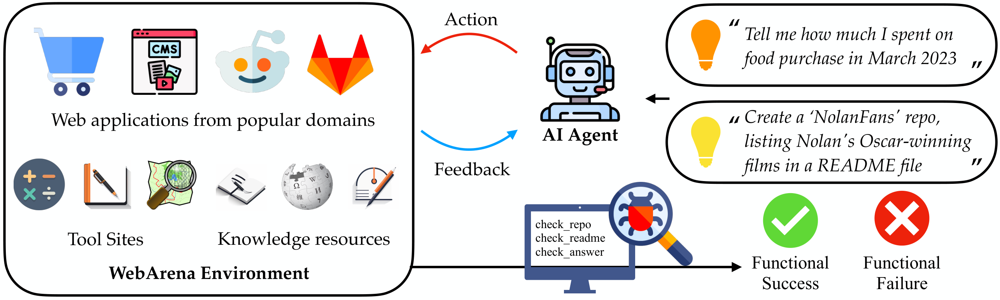
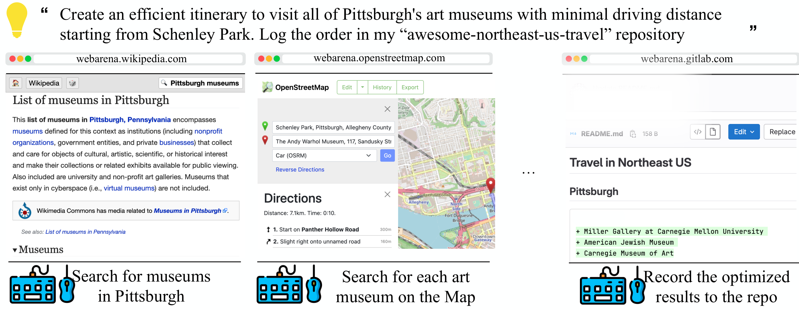
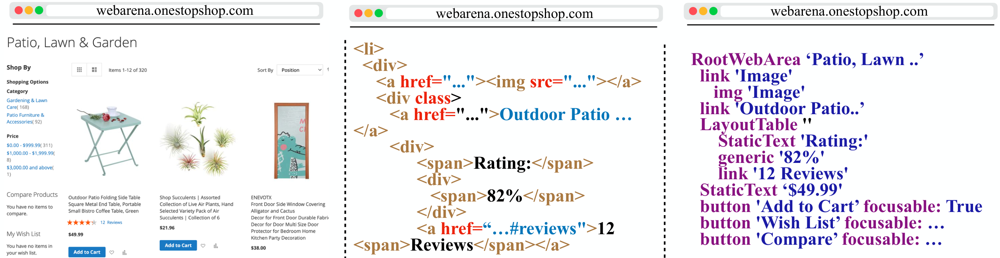
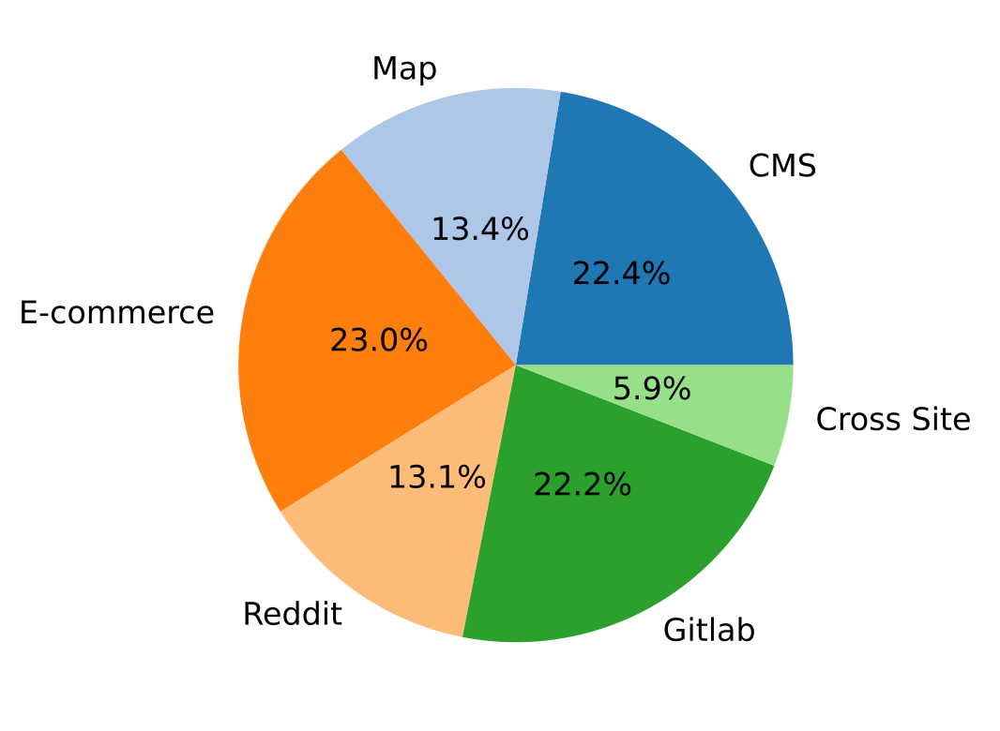
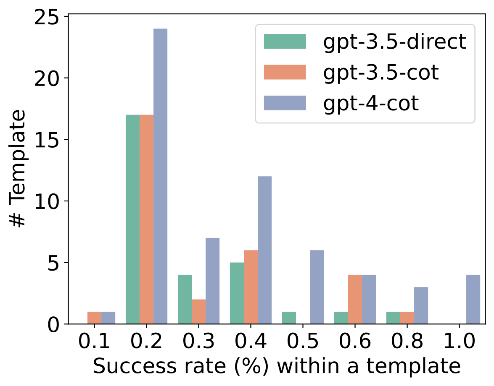
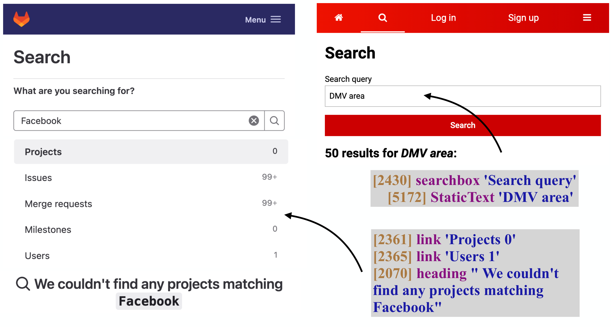

# WebArena：用真实自托管网站检验自主智能体

让智能体听懂“帮我规划路线并更新 README”并不难，难的是让它在真实网页上把事情真正办完。现有评测往往依赖简化页面、缓存状态或标准动作序列，难以检验智能体能否应对真实网络任务。WebArena 的核心思路是：自托管功能完整的网站，用程序化验证器检查执行结果，而不是只看它“点了什么”。在这套包含 812 个长程任务的基准上，表现最好的 GPT-4 智能体端到端成功率仅为 **14.41%**，远低于人类的 **78.24%**。

## 为什么需要更真实的 Web 智能体环境？

自主智能体的价值，在于把一句自然语言指令转化为一连串真实操作：查资料、比路线、下单、发帖、维护代码仓库。要可靠地研发这类系统，评测环境必须同时满足两个条件：

- **真实性**：网站功能、数据和任务复杂度应接近人类日常使用的互联网。
- **可复现性**：不同时间、不同方法应在相同初始状态下比较，不受验证码、线上内容变化和网站改版影响。

过去的环境常在两者之间妥协。静态数据集只能访问采集时缓存的页面状态，智能体无法自由探索；简化环境虽然支持动态交互，却缺少真实网站的功能和任务多样性。更关键的是，一些评测直接比较预测动作与参考动作的表面形式。这会带来明显误判：动作序列与参考答案不同，不代表任务没有完成。

WebArena 因此把评价对象从“是否模仿了标准轨迹”转向“是否达成了目标状态”。例如，创建代码仓库后，验证器直接检查指定仓库的内容，而不要求智能体必须按某条固定点击路径操作。

| 基准 | 动态交互 | 真实环境 | 多样的人类任务 | 功能正确性评价 |
|---|---:|---:|---:|---:|
| Mind2Web | 否 | 是 | 是 | 否 |
| Form/QAWoB | 否 | 是 | 是 | 否 |
| MiniWoB++ | 是 | 否 | 否 | 是 |
| Webshop | 是 | 否 | 否 | 是 |
| ALFRED | 是 | 否 | 否 | 是 |
| VirtualHome | 否 | 否 | 是 | 否 |
| AndroidEnv | 是 | 是 | 否 | 否 |
| **WebArena** | **是** | **是** | **是** | **是** |

这张对比表也说明了 WebArena 的定位：它不是单纯扩大任务数量，而是把动态交互、真实功能、多样任务和结果验证组合到同一个环境中。

## WebArena：把真实网站装进可复现环境

WebArena 是一个独立、可自托管的 Web 环境。它用真实开源 Web 应用搭建网站，再导入现实对应平台的数据；所有服务通过 Docker 交付，并可以重置到确定的初始状态。这样既不依赖实时互联网，也尽量保留真实网站的复杂度。

> 图解：WebArena 将电商、论坛、协作开发和内容管理四类网站组合为智能体环境，并加入地图、计算器等工具及外部知识资源。上方的高层自然语言指令会被转化为具体 Web 操作，最终由验证器程序化检查任务是否真正完成。

### 网站与工具如何选择？

作者先分析了约 200 个来自自身真实浏览器历史的例子，将浏览行为归纳为抽象类别，再选择最突出的四类平台：

1. **电商平台**：对应 Amazon、eBay 等购物网站，WebArena 中实现为 OneStopShop。
2. **社交论坛**：对应 Reddit、StackExchange，支持发帖、评论与讨论。
3. **协作开发平台**：基于 GitLab，覆盖仓库、Issue、Merge Request 等操作。
4. **内容管理系统（CMS）**：基于电商后台，支持商品和数字内容的创建、修改与配置。

除此之外，环境还提供三类常用工具：用于地点查询和路线规划的地图、计算器、用于临时记录的 Scratchpad。知识资源既包括英文 Wikipedia，也包括 GitLab 和电商系统的网站使用手册。

这个设计很关键。人类完成复杂任务时，并非只靠反复试错，还会查文档、开新标签页、比较多个来源。WebArena 把这些行为所需的条件直接放进环境，而不是把智能体限制在单一页面的按钮点击中。

### 一个任务为什么需要长程规划？

下面这个例子要求智能体规划匹兹堡艺术博物馆的参观路线，并将结果写入指定仓库的 README。

> 图解：完成顶部目标需要串联三个阶段：先在 Wikipedia 找到匹兹堡艺术博物馆，再在地图上确认位置并优化行程，最后到正确的 GitLab 仓库更新 README。它同时考察信息检索、跨站工具使用、路线推理和内容修改，而不是一次检索或一次点击。

这类任务没有唯一的操作轨迹。智能体可以采用不同搜索词、不同页面路径，只要最终路线与仓库内容满足要求即可。因此，结果导向的评价比参考动作匹配更自然。

## 智能体如何观察网页并采取行动？

解决了环境真实性之后，下一个问题是：模型究竟看到什么、能做什么？WebArena 将浏览器交互形式化为环境：

$$
\mathcal{E}=\langle \mathcal{S},\mathcal{A},\mathcal{O},\mathcal{T}\rangle
$$

其中 $\mathcal{S}$ 是状态空间，$\mathcal{A}$ 是动作空间，$\mathcal{O}$ 是观察空间。状态转移由网站实现决定，并且是确定性的：

$$
\mathcal{T}:\mathcal{S}\times\mathcal{A}\longrightarrow\mathcal{S}
$$

给定自然语言意图 $\mathbf{i}$，智能体根据当前观察、历史动作和历史观察选择下一步：

$$
a_t \sim \pi\left(\mathbf{i},o_t,\mathbf{a}_{1}^{t-1},\mathbf{o}_{1}^{t-1}\right)
$$

动作执行后产生新状态 $s_{t+1}$ 和对应观察 $o_{t+1}$。任务奖励 $r(\mathbf{a}_{1}^{T},\mathbf{s}_{1}^{T})$ 则检查整段执行是否满足意图，例如订单是否真的创建、最终回答是否正确。

### 三种网页观察：截图、DOM 与 Accessibility Tree

WebArena 的观察包括当前 URL、已打开标签页，以及焦点标签页的网页内容。它首次将多标签页任务纳入这类 Web 环境，使跨页比较、工具切换和引用成为评测的一部分。

网页内容有三种表示方式：

- **Screenshot**：将页面表示为 RGB 像素数组，适合视觉或多模态模型。
- **HTML DOM Tree**：保留原始 Document Object Model 结构，信息完整，但通常较长。
- **Accessibility Tree**：保留与内容展示和操作相关的 DOM 子集，用角色、文本和属性描述元素，例如链接、是否可聚焦等。

> 图解：同一页面可以表示为左侧截图、中间 HTML DOM Tree 或右侧 Accessibility Tree。后两者为节省空间只展示局部内容；Accessibility Tree 在保留结构化信息的同时更紧凑，因此成为论文基线智能体的默认观察方式。

三种模式都可以只保留视口内内容，以适应文本模型的上下文长度或视觉模型的图像尺寸限制。这个设计的聪明之处在于，它把“环境公平比较”与“模型输入模态”解耦：不同智能体可以看不同表示，但仍使用一致的任务与步数指标。

### 复合动作空间与元素定位

WebArena 的动作模拟键盘和鼠标，分为页面元素操作、标签页管理和 URL 导航三组。

| 动作类型 | 功能 |
|---|---|
| `noop` | 不执行操作 |
| `click(elem)` | 点击元素 |
| `hover(elem)` | 悬停于元素 |
| `type(elem, text)` | 向元素输入文本 |
| `press(key_comb)` | 按下组合键 |
| `scroll(dir)` | 向上或向下滚动 |
| `tab_focus(index)` | 聚焦第 $i$ 个标签页 |
| `new_tab` | 打开新标签页 |
| `tab_close` | 关闭当前标签页 |
| `go_back` | 返回上一个 URL |
| `go_forward` | 撤销 `go_back` |
| `goto(URL)` | 前往指定 URL |

元素可以通过屏幕坐标 $(x,y)$ 定位，也可以使用遍历 DOM 或 Accessibility Tree 时生成的唯一 ID。比如观察中有 `[1582] Add to Cart`，执行 `click [1582]` 就能点击该按钮。

元素 ID 把定位问题转化为 $n$ 选一的分类问题，减少坐标歧义，也让文本模型和视觉模型能够在相同环境中比较。

### 不同用户看到的网站并不相同

真实网站还会受到用户角色、权限和历史行为影响。WebArena 为各平台配置了不同用户档案：购物网站用户两年内有超过 35 笔订单；GitLab 用户维护热门开源项目及私人项目；Reddit 用户有大量帖子和评论；CMS 用户则是拥有完整读写权限的店主。

所有用户通过预缓存 Cookie 自动登录。这样，“查看我的订单”“管理我的仓库”等以用户为中心的任务才有真实上下文，权限不足也能成为任务无法完成的合理原因。

## 812 个任务如何构建？

WebArena 基准包含 **241 个任务模板**和 **812 个实例化意图**，平均每个模板生成 3.3 个例子。任务不是低层操作脚本，而是人类会直接说出的高层目标。

标注者遵循三条原则：

1. **抽象且高层**：不能一两次点击就完成。例如，不只是“进入 science 子版块”，而是“在 science 子版块发布问候帖”。
2. **有创造性**：通过额外约束增加独特性，例如“创建一个与我的 GitLab 账号相同的 Reddit 账号”。
3. **模板化**：将可替换部分写成变量，再提供多组实例。相同模板的高层语义相似，但具体轨迹和难度可以不同。

作者还允许标注者借助 ChatGPT 获取任务灵感，并提供网站介绍和精选示例作为参考。

### 三类任务，不只是问答

| 类别 | 任务示例 |
|---|---|
| Information Seeking | 我上次买洗发水是什么时候？ |
| Information Seeking | 比较从 AMC Waterfront 到 Randyland 的步行和驾车时间 |
| Site Navigation | 查看分配给我的 Merge Request |
| Site Navigation | 找出评分最高的人体工学椅 |
| Content & Config | 发帖询问“在纽约市是否需要一辆车” |
| Content & Config | 删除骗子 Yoke 发布的评论 |

三类任务的区别在于目标和评价对象：

- **信息检索**要求文本答案，但经常需要跨多个页面查询个人订单、历史记录等信息，并不等价于一次开放域检索。
- **站点导航**要求通过搜索、链接和交互控件到达满足条件的页面。
- **内容与配置操作**会真正改变网站数据，包括购物、发帖、修改 README、调整隐私设置等。

> 图解：图中展示任务意图在各网站上的分布，其中 Cross-site 表示必须交互多个网站的任务。无论意图归属于哪个网站，所有任务都需要跨多个网页交互，体现了基准的长程特点。

下表进一步展示了三类意图如何映射到结果验证。这里检查的是答案、最终 URL 或仓库中的实际提交内容，而非动作序列。

| 类别 | 示例 | 评价方式 |
|---|---|---|
| Information Seeking | 我上次买洗发水是什么时候？ | 答案等于 `7/5/2022` |
| Web Page Seeking | 展示所有分配给我的 Merge Request | 最终 URL 等于 `webarena.gitlab.com/dashboard/merge_requests?assignee_username=byteblaze` |
| Content Creation and Revision | 用 Django 模板创建新仓库 `webagent_site` | 定位指定仓库提交页的首次提交，并检查其中包含 `Djanjo` |

> 注：表中 `Djanjo` 按原文评价示例保留。

## 功能正确性怎样被程序化验证？

WebArena 的评价分为文本答案验证和执行状态验证两条路径。二者共同遵循一个原则：**允许多种合理表达与操作路径，只判断最终结果是否满足意图。**

### 文本答案：Exact、Must Include 与 Fuzzy Match

对于信息检索任务，参考回答为 $a^*$，模型预测为 $\hat{a}$，评分函数记为 $r_{\mathrm{info}}(\hat{a},a^*)$：

- `exact_match`：只有预测与参考答案完全一致才得 1 分，适合格式标准化的答案。
- `must_include`：预测包含指定关键内容即得分，适合无序列表或姓名、邮箱等关键信息。
- `fuzzy_match`：用语言模型判断语义等价，适合表述和时间格式多样的答案；本文使用 `gpt-4-0613`。

例如，`2h58min`、`2 hour 58 minutes` 和 `2:58` 可以表示相同时长，不应因表面格式不同而误判。

### 页面与内容操作：定位状态，再检查属性

对站点导航和内容配置任务，验证器使用 $r_{\mathrm{prog}}(\mathbf{s})$ 检查轨迹中的状态 $\mathbf{s}$。状态可以来自网站数据库、页面状态或页面内容。

具体过程分两步：

1. 用 `locator` 通过数据库查询、网站 API 或 JavaScript 选择器，定位与意图相关的关键内容。
2. 检查定位结果是否含有所需 `keywords`，复用 `exact_match` 或 `must_include` 判定。

| 评价函数 | ID | 意图 | 评价实现 |
|---|---:|---|---|
| $r_{\mathrm{info}}$ | 1 | 找出历史上取消订单最多的客户姓名 | `exact_match`：答案为 `Samantha Jones` |
| $r_{\mathrm{info}}$ | 2 | 找出电话 8015551212 对应的客户姓名和邮箱 | 两次 `must_include`：`Sean Miller`、`sean@gmail.com` |
| $r_{\mathrm{info}}$ | 3 | 比较 AMC Waterfront 到 Randyland 的步行和驾车时间 | 两次 `fuzzy_match`：`walking: 2h58min`、`driving: 21min` |
| $r_{\mathrm{prog}}$ | 4 | 查看分配给我的 Merge Request | 定位当前 URL，并精确匹配带 `assignee_username=byteblaze` 的目标地址 |
| $r_{\mathrm{prog}}$ | 5 | 发帖询问“在纽约市是否需要一辆车” | 定位最新帖子的 URL 和正文；URL 包含 `/f/nyc`，正文包含 `a car in NYC` |

### 不可完成任务也必须评价

现实指令可能因证据不足、权限不够或网站缺少功能而无法完成。例如，OneStopShop 没有公开联系电话，“告诉我它的联系电话”就应被识别为不可完成。

这类实例标记为 `N/A`，期望智能体给出等价回答。它测试的是另一种重要能力：不编造答案，也不在注定失败的任务上无限尝试。

为保证标注质量，信息检索问题由两人独立标注，分歧由第三人裁决；其余评价程序由三名熟悉 JavaScript 的作者编写。标注者需要完整执行任务并检查中间状态，困难任务还会集体讨论。

## 基线智能体：直接行动与先推理再行动

论文比较了 GPT-3.5、GPT-4 和 text-bison-001，均使用包含两个示例的 Few-shot In-context Learning。输入包括任务意图、当前 Accessibility Tree、URL、打开的标签页和上一步动作，输出则是下一步操作。

提示词策略有两种：

- **Direct**：直接预测下一动作。
- **Chain-of-Thought（CoT）**：先输出逐步推理，再预测动作。

提示词详细列出浏览器环境、允许动作和格式规则。另一个独立开关是 **UA hint**：明确告诉模型，如果认为任务不可能完成，就输出 `N/A`。该说明与人类标注者获得的指导大体一致。

实验使用 `GPT-3.5-turbo-16k-0613`、`GPT-4-0613` 和 `text-bison-001`，temperature 为 1.0，top-$p$ 为 0.9，最多执行 30 次状态转移。若同一观察下同一动作重复超过三次，或连续产生三个无效动作，就提前终止；text-bison-001 额外允许最多十次重试以生成有效动作。

高 temperature 用于鼓励探索。作为复现补充，GPT-3.5 在 temperature 为 0.0、启用 CoT 且关闭 UA hint 时，成功率为 6.28%。

| CoT | UA hint | 模型 | 成功率（%） |
|---:|---:|---|---:|
| 是 | 否 | GPT-3.5，temperature 0.0 | 6.28 |

## 实验结果：14.41% 对 78.24%

下表中的 SR 是整体端到端成功率，SR$_{\mathrm{AC}}$ 和 SR$_{\mathrm{UA}}$ 分别对应可完成任务与不可完成任务上的成功率。

| CoT | UA hint | 模型 | SR（%） | SR$_{\mathrm{AC}}$（%） | SR$_{\mathrm{UA}}$（%） |
|---:|---:|---|---:|---:|---:|
| 是 | 是 | text-bison-001 | 5.05 | 4.00 | 27.78 |
| 否 | 是 | GPT-3.5 | 6.41 | 4.90 | 38.89 |
| 是 | 是 | GPT-3.5 | 8.75 | 6.44 | 58.33 |
| 是 | 是 | GPT-4 | 11.70 | 8.63 | **77.78** |
| 否 | 否 | GPT-3.5 | 5.10 | 4.90 | 8.33 |
| 是 | 否 | GPT-3.5 | 6.16 | 6.06 | 8.33 |
| 是 | 否 | GPT-4 | **14.41** | **13.02** | 44.44 |
| — | 是 | Human | 78.24 | 77.30 | 100.00 |

可以得到三个直接结论：

1. **CoT 有帮助，但远不够。** 在启用 UA hint 时，GPT-3.5 的整体成功率从 6.41% 提高到 8.75%，增加 2.34 个百分点；最佳 GPT-4 仍只有 14.41%。
2. **模型能力与任务表现相关。** text-bison-001 低于 GPT-3.5，GPT-4 整体表现最好，但与人类仍有巨大差距。
3. **提示词细节会显著改变行为。** UA hint 提高了不可完成任务的识别率，却会让模型更容易把本可完成的任务误判为不可能。

人类表现来自每个模板抽取一个任务、共 170 个任务，由五名计算机科学研究生执行。平均用时 110 秒，整体成功率 78.24%。

| 人类指标 | 数值 |
|---|---:|
| 平均完成时间 | 110 秒 |
| 信息检索任务成功率 | 74.68% |
| 其他任务成功率 | 81.32% |
| 整体成功率 | 78.24% |

人类也并非满分。约一半失败来自误解意图、答案不完整或执行不完整，例如把“旅行时间”答成“旅行距离”，只给姓名而漏掉邮箱；其余则是更严重的偏离目标。需要注意，这些任务可能要求 Git 或 CMS 领域知识，因此这里的人类成绩不能直接外推到所有普通用户。

## 错误分析：真正缺的是探索、状态跟踪与恢复能力

实验数字只说明“很难”，轨迹分析则进一步揭示了“难在哪里”。

### 模型知道什么时候该停下吗？

启用 UA hint 后，GPT-4 会把 **54.9% 的可完成任务**错误判断为不可完成。这让它在不可完成任务上取得 77.78% 的成功率，却压低了可完成任务的表现。

移除提示后，GPT-4 的整体成功率升至 14.41%，可完成任务成功率升至 13.02%；不可完成任务识别率则降至 44.44%。有趣的是，即使没有显式提示，GPT-4 仍能生成不可完成的原因，而 GPT-3.5 更倾向于 hallucinate 错误答案、重复无效动作或耗尽步数。

这说明“敢于尝试”和“知道不可完成”之间存在权衡，一条看似微小的指令就可能改变整个交互策略。

### 同类任务上能稳定复现成功吗？

作者统计了至少有一次成功执行的 61 个模板。GPT-4 只在其中 4 个模板达到 100% 成功率，GPT-3.5 没有任何模板达到全成功；很多情况下，模型只能完成同一模板中的一个变体。

> 图解：直方图展示 GPT 模型在关闭 UA hint 时、至少成功一次的模板上的成功率分布。只有少量模板能够被稳定完成，说明“偶然走通一次”并不等于掌握了可复用的解决策略。

例如，“Fork metaseq”较直接，而同模板下的“Fork Facebook 的所有仓库”需要大量重复操作，复杂度明显更高。这也让 WebArena 适合测试记忆与策略复用：智能体能否把过去成功的方案迁移到新实例，而不是每次从头摸索？

### 观察偏置与细节忽略

> 图解：左侧案例中，智能体没有进入 Users 页面，因而无法完成“Fork 所有 Facebook 仓库”；右侧案例中，输入框已经填入搜索词，智能体却仍重复输入同一查询，直到触及步数上限。灰色区域给出相关 Accessibility Tree 内容。

第一类问题是 **观察偏置**：模型容易抓住最先看到的相关信息，不验证其语义是否匹配。CMS 首页展示的是基于近期购买的热销商品，而“2022 年销量第一的商品”需要另行生成历史报告；GPT-4 却直接采用首页信息。

第二类问题是 **观察解释失败**：模型能概括页面，却忽略输入框已填内容等细粒度状态，也常忽略上一动作信息。作者推测，对话式预训练和监督微调更强调根据即时对话历史执行指令，因此模型缺少主动探索，也容易轻视观察中的细小变化。

这些错误表明，提升 Web 智能体不能只靠更强的单步动作预测，还需要分层规划、状态跟踪、搜索与回溯、失败恢复、自我纠正和观察摘要等机制。

## 复现细节：网站数据、Docker 重置与评价可靠性

### 网站实现与数据规模

WebArena 的真实性不仅来自页面外观，更来自真实应用栈与数据：

- **电商网站**：基于 Adobe Magento，约 9 万件商品，覆盖 300 多个类别，包含价格、选项、详细描述、图片和评论。
- **论坛**：基于 Reddit 的开源对应实现 Postmill，包含 95 个子版块、127390 篇帖子和 661781 个用户；内容取自热门子版块，并补充美国东北部城市及机器学习、深度学习相关社区，以支持跨站任务。
- **GitLab**：包含 300 个仓库和 1000 多个至少有一次提交记录的账号。每种编程语言至少采样十个仓库，其中 80% 来自 Star 数前 90 分位的热门集合，其余来自后 10 分位，以兼顾热门项目和个人小项目。
- **CMS**：采用 Adobe Magento 管理后台和官方示例数据。
- **地图**：使用 OpenStreetMap，因存储限制聚焦美国东北部。
- **知识库**：用 Kiwix 托管截至 2023 年 5 月的离线英文 Wikipedia；GitLab 和 Adobe Commerce 用户手册抓取自官方文档。
- **其他工具**：计算器与 Scratchpad 由作者自行实现。

### 环境交付与重置

每个网站分别打包为独立 Docker 镜像，代码、数据库和依赖全部包含在镜像内，不依赖外部 Volume。研究者下载后即可在本地部署相同网站与数据。

对于会创建用户、删除帖子等修改数据的任务，停止并删除当前容器、再从原始镜像启动，即可恢复初始状态。根据网站不同，重置耗时从几秒到一分钟。只读的信息检索任务不必每次重置，因此这部分开销相对有限。

### Fuzzy Match 本身可靠吗？

语义评价器也可能引入误差，因此作者专门验证了 `fuzzy_match`。人工检查的 40 个例子中，39 个与人类判断一致。

在需要 GPT-4 评价的 82 个样本中，49 个（60%）是日期或时长，主要只需判断格式等价。作者进一步程序化生成不同格式及随机负例：两个 GPT-4 版本在日期和时长测试上均达到 100% 准确率。

| 数据集 | `gpt-4-0613` | `gpt-4-1106-preview` |
|---|---:|---:|
| 日期，900 个例子 | 100% | 100% |
| 时长，900 个例子 | 100% | 100% |

这里的结果支持使用语言模型判断格式变化，但并不意味着所有开放式语义评价都已得到同等充分的验证。

## 从 WebArena 还能延伸出什么？

WebArena 不只是一个排行榜，它也为几类后续研究提供了基础：

- **Human-in-the-loop Web Navigation**：任务收集中特意保留欠指定意图，这些任务若不向用户进一步确认就无法完成，可用于研究智能体何时提问、如何与人协作。
- **通过阅读外部知识学习**：每个平台配有文本或视频形式的手册和知识资源，可研究智能体如何像人类一样先读文档再操作，而非只靠试错。
- **面向不同角色优化**：轨迹标注了潜在角色，例如 GitLab 中的专业开发者和组管理员，可分别评价并优化不同角色的操作策略。
- **记忆与策略复用**：模板内成功率不稳定，为复用历史成功经验、回溯失败路径和跨任务学习提供了明确测试场景。

## 总结

- WebArena 用四类功能完整的自托管网站、工具和知识库，兼顾了真实性与可复现性。
- 812 个长程任务来自 241 个模板，覆盖信息检索、站点导航及内容与配置操作，并包含不可完成任务。
- 程序化验证器检查答案、URL、数据库和页面状态，允许不同操作路径，评价的是功能正确性而非动作表面匹配。
- 最佳 GPT-4 基线仅取得 14.41% 的端到端成功率，人类为 78.24%；UA hint 的消融还揭示了任务探索与拒绝不可完成任务之间的权衡。
- 主要瓶颈包括过早停止、策略无法稳定复用、观察偏置和状态细节忽略，后续需要更强的规划、记忆、探索与失败恢复机制。

WebArena 把评测重点从“模型会不会生成下一步动作”推进到“智能体能否可靠完成真实任务”，也为可复现地衡量这些能力的进步提供了基础。

> 本文参考自 [A Realistic Web Environment for Building Autonomous Agents](https://arxiv.org/abs/2307.13854)