# LLM Survey 万字长文：一篇综述读懂大模型的前世今生

ChatGPT 发布之后，大语言模型（LLM）相关的论文从平均每天**0.40 篇**暴涨到**8.58 篇**，技术迭代快到让从业者难以跟上。这篇来自中国人民大学的综述《A Survey of Large Language Models》（arXiv 2303.18223，持续更新至 v18）正是为了解决这个问题：它把 LLM 的技术体系拆解为**预训练、适配（adaptation）、使用（utilization）、能力评估**四大板块，从 scaling law 的数学公式一路讲到 RLHF、CoT、Agent 与长 CoT 推理。GPT-4 在 MMLU 上拿下**86.4%（5-shot）**、Chinchilla 用 70B 参数反超 280B 的 Gopher——这些关键结论背后都有清晰的技术逻辑。本文按"详细解读"的规格，带你完整走一遍这篇综述。

## 一、从 n-gram 到 ChatGPT：语言模型的四次进化

维特根斯坦说："我的语言的界限意味着我的世界的界限。"让机器掌握语言智能，核心手段一直是**语言建模（Language Modeling）**：对词序列的生成似然建模，预测未来（或缺失）token 的概率。围绕这条主线，语言模型经历了四代演进：

- **统计语言模型（SLM）**：1990 年代兴起，基于马尔可夫假设用最近几个词预测下一个词，即 n-gram 模型。痛点是"维数灾难"，需要 Good-Turing 估计等平滑策略缓解数据稀疏。
- **神经语言模型（NLM）**：用 MLP、RNN 等神经网络刻画序列概率。Bengio 在 2003 年提出词的**分布式表示**，word2vec 进一步把词向量推向实用，开启了"用语言模型做表示学习"的路线。
- **预训练语言模型（PLM）**：ELMo 先预训练 biLSTM 再按任务微调；BERT 基于 Transformer 做双向预训练，确立了**"预训练-微调"**范式。
- **大语言模型（LLM）**：把参数规模推到百亿、千亿级之后，模型行为发生质变——175B 的 GPT-3 能通过 in-context learning 直接做 few-shot 任务，而 1.5B 的 GPT-2 做不到。这类小模型不具备的**涌现能力（emergent abilities）**，正是"LLM"这个新名词出现的原因。

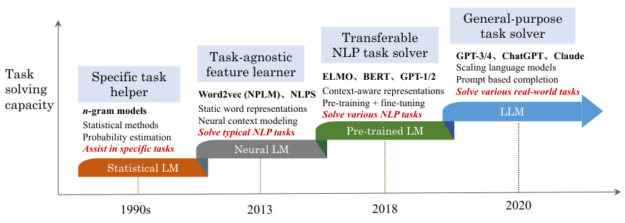

> 图解：从任务求解能力视角看四代语言模型的演进。SLM 只是辅助特定任务（检索、语音）的工具；NLM 学会了任务无关的文本表示，减少了人工特征工程；PLM 通过微调适配下游任务；LLM 则通过扩大规模一跃成为**通用任务求解器（general-purpose task solver）**。图中 NLM 阶段以两个代表工作（NPLM 与 NLPS）命名，时间区间按代表作品发表时间划定。

ChatGPT 的发布是这条曲线上的引爆点，从 arXiv 论文数量的变化就能直观感受到：

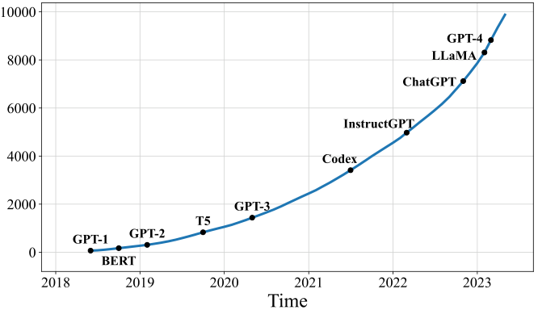

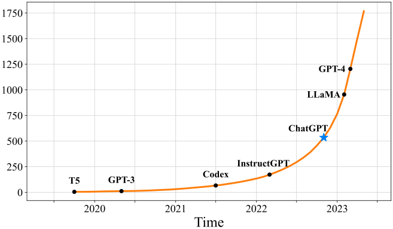

> 图解：arXiv 上标题或摘要包含 "language model"（自 2018 年 6 月）与 "large language model"（自 2019 年 10 月）的论文累计数量趋势（按月精确匹配统计），图中标注了重要里程碑。ChatGPT 发布后增长急剧加速，含 "large language model" 的论文从平均每天 0.40 篇增至 8.58 篇。

笔者认为，这篇综述最有价值的一个判断是：**LLM 与小模型 PLM 的区别不只是"更大"，而是三方面质变**——涌现能力让复杂任务求解成为可能；使用方式从微调变为 prompting 接口；研发上研究与工程的边界消失，数据处理和分布式训练的工程能力成了核心竞争力。

## 二、总览：Scaling Law、涌现能力与五大关键技术

在进入细节之前，先建立两个最重要的理论直觉：规模为什么有效，以及质变为什么发生。

### 2.1 Scaling Law：规模与性能的幂律关系

**KM scaling law**（Kaplan et al. 2020，OpenAI）首次给出性能与三个因素的幂律关系：模型规模 $N$、数据规模 $D$、训练算力 $C$。以交叉熵损失（单位 nats）为度量：

$$
L(N) = \left(\frac{N_c}{N}\right)^{\alpha_N}, \quad \alpha_N \sim 0.076,\ N_c \sim 8.8\times 10^{13}
$$

$$
L(D) = \left(\frac{D_c}{D}\right)^{\alpha_D}, \quad \alpha_D \sim 0.095,\ D_c \sim 5.4\times 10^{13}
$$

$$
L(C) = \left(\frac{C_c}{C}\right)^{\alpha_C}, \quad \alpha_C \sim 0.050,\ C_c \sim 3.1\times 10^{8}
$$

其中 $N_c$、$D_c$、$C_c$ 分别以非嵌入参数量、训练 token 数和 PF-days 计；拟合范围为 22M–23B tokens 数据、768–1.5B 非嵌入参数的模型。

**Chinchilla scaling law**（Hoffmann et al. 2022，DeepMind）在 70M–16B 模型、5B–500B tokens 数据范围内拟合出更精细的形式：

$$
L(N, D) = E + \frac{A}{N^\alpha} + \frac{B}{D^{\beta}}
$$

其中 $E = 1.69$，$A = 406.4$，$B = 410.7$，$\alpha = 0.34$，$\beta = 0.28$。在算力约束 $C \approx 6ND$ 下的最优分配为：

$$
N_{opt}(C) = G \left(\frac{C}{6}\right)^a, \quad D_{opt}(C) = G^{-1} \left(\frac{C}{6}\right)^b
$$

其中 $a = \alpha/(\alpha+\beta)$，$b = \beta/(\alpha+\beta)$。两个定律的关键分歧在于：**KM 倾向把更多预算分给模型规模，而 Chinchilla 主张模型与数据等比扩张**。实践给出的答案站在 Chinchilla 一边——70B 参数、1.4T tokens 的 Chinchilla 在同等算力下胜过了 280B 的 Gopher。

值得注意的是 scaling law 的两个边界：一是**inverse scaling**现象——某些任务上模型越大反而越差；二是任务级性能并不总随损失下降而提升，ICL 这类能力在规模越过阈值前根本不可预测。GPT-4 报告中提出的**predictable scaling（可预测扩展）**正是为了用小模型可靠预测大模型性能，及早发现 loss spike 等异常。

### 2.2 涌现能力：规模引发的"相变"

涌现能力的形式定义（Wei et al. 2022）是："在小模型中不存在、在大模型中出现的能力"——规模达到某一水平时，任务性能显著高于随机水平，类似物理学的**相变（phase transition）**。综述归纳了三类典型涌现能力：

- **In-context learning（ICL）**：给定自然语言指令和/或若干任务示例，无需梯度更新即可完成任务。175B 的 GPT-3 具备强 ICL，GPT-1/2 没有；且 ICL 依任务而异——13B 的 GPT-3 在三位数加减法上涌现了 ICL，但 175B 的 GPT-3 在波斯语 QA 上仍然不行。
- **Instruction following（指令跟随）**：经指令微调后能泛化到未见任务。LaMDA-PT 要到**68B**才显著超过未微调版本；PaLM 在 MMLU、BBH 等 benchmark 上至少需要**62B**。
- **Step-by-step reasoning（CoT）**：思维链提示让模型通过中间推理步骤解题。实证显示**>60B**时 CoT 才带来算术推理收益，**>100B**时优势明显；它很可能源于代码训练。

关于涌现还有一个有趣的学术争议：有研究（如"mirage"论文）认为涌现部分源于不连续的评估指标，换用连续指标后"涌现曲线"的陡峭性会消失。但笔者认同综述的回应：**用户体验本来就是离散的**——代码要么通过测试，要么不通过。

### 2.3 支撑 LLM 的五大关键技术

综述把 LLM 的成功归因于五项技术的汇合：

1. **Scaling**：GPT-3（175B）、PaLM（540B）探索规模极限；Chinchilla 证明数据 scaling 与模型 scaling 同等重要，且数据必须配合仔细清洗。
2. **Training**：分布式训练 + 多种并行策略（DeepSpeed、Megatron-LM），配合 loss spike 后重启（PaLM）、混合精度训练（BLOOM）等工程技巧。
3. **Ability eliciting**：用 CoT 提示、指令微调等手段激发潜能——这些技巧对小模型未必有效。
4. **Alignment tuning**：对齐人类价值观（helpful、honest、harmless），InstructGPT 用**RLHF**把人类纳入训练回路。
5. **Tools manipulation**：用外部工具弥补模型缺陷——Toolformer（计算器）、WebGPT（搜索引擎），ChatGPT plugins 被喻为 LLM 的"眼睛和耳朵"。

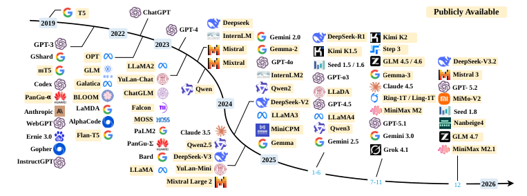

> 图解：近年代表性 LLM 的时间线，公开发布 checkpoint 的模型用黄色高亮。可以看到 2022 年底 ChatGPT 发布后模型数量呈井喷之势，开源与闭源两条路线并行推进。

### 2.4 GPT 系列的技术进化路线

GPT 系列的基本原理可以概括为：用语言建模把世界知识压缩进**decoder-only Transformer**，关键就两条——训练能精确预测下一个词的模型，然后不断扩大规模。

- **GPT-1/GPT-2（早期探索）**：确立"预测下一个词"的核心原则；GPT-2（1.5B）提出概率形式 $p(\text{output} \mid \text{input}, \text{task})$，把一切任务统一为词预测问题。
- **GPT-3（能力跃迁）**：175B 参数，正式提出 in-context learning，预训练与使用收敛到同一语言建模范式，是 PLM 迈向 LLM 的里程碑。
- **能力增强的两条路线**：一是**代码训练**（Codex 在 GitHub 代码上微调 GPT，GPT-3.5 系列的基座 code-davinci-002 即源于此）；二是**人类对齐**（从 2017 年 PPO 算法到 2022 年 InstructGPT 正式确立三阶段 RLHF）。
- **里程碑**：ChatGPT（2022 年 11 月）是 InstructGPT 的"姊妹模型"，专为对话优化；GPT-4（2023 年 3 月）支持多模态输入，经过六个月迭代对齐与 red teaming，并引入 predictable scaling；GPT-4 Turbo 进一步把上下文窗口扩到**128K tokens**。

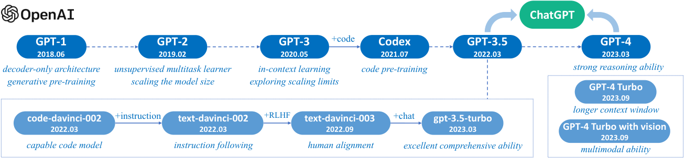

> 图解：GPT 系列的技术演进关系图。实线表示有官方明确证据的演进路径，虚线表示较弱的演进关系。可以清晰看到 GPT-3 → Codex（代码训练）与 GPT-3 → InstructGPT（人类对齐）两条增强路线如何汇合出 GPT-3.5、ChatGPT 与 GPT-4。

## 三、资源盘点：模型、语料、数据集与开发库

解决了"为什么有效"的认知问题，下一个实际问题是：想自己训练或微调一个 LLM，手里有什么可用资源？综述在第 3 章做了系统盘点。

### 3.1 公开模型与 API

最具影响力的事件是**LLaMA（2023 年 2 月）**的开源：7B/13B/30B/65B 四档，催生了庞大的衍生家族——Stanford Alpaca 用 text-davinci-003 生成**52K**指令数据微调出第一个开源指令模型；Vicuna 基于 ShareGPT 真实对话训练，又成为 LLaVA、MiniGPT-4 等多模态模型的基座。后续 LLaMA-3.1 最大版本达**405B 参数、15T 预训练 tokens、128K 上下文**，用超过**16,000 张 H100**训练，在 MMLU、GSM8K 等 benchmark 上可与 GPT-4 竞争。

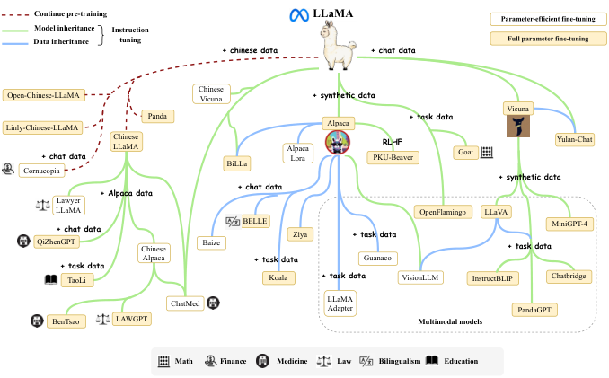

> 图解：LLaMA 衍生研究的演进图。由于变体数量庞大无法尽录，作者把图源文件开源并接受社区 PR。这棵树直观展示了一个开放基座模型对整个研究生态的放大效应。

其他值得关注的公开系列：Mistral 的稀疏 MoE 模型 Mixtral（8×7B、8×22B，推理只激活部分参数）；Google 的 Gemma（在 2T/8T/13T tokens 上预训练）；阿里的 Qwen2.5（最多 18T tokens）；智谱的 GLM-4 系列与百川的 Baichuan-2（2.6T tokens）。综述还给出了一张规模超 10B 的代表性 LLM 总表，此处按公开/闭源各摘部分核心条目：

**公开 checkpoint 模型（节选）：**

| 模型 | 发布时间 | 规模（B） | IT | RLHF | 预训练数据 | 硬件 |
|---|---|---|---|---|---|---|
| T5 | Oct-2019 | 11 | - | - | 1T tokens | 1024 TPU v3 |
| OPT | May-2022 | 175 | - | - | 180B tokens | 992 80G A100 |
| BLOOM | Nov-2022 | 176 | - | - | 366B tokens | 384 80G A100 |
| LLaMA | Feb-2023 | 65 | - | - | 1.4T tokens | 2048 80G A100 |
| StarCoder | May-2023 | 15.5 | - | - | 1T tokens | 512 40G A100 |
| LLaMA2 | Jul-2023 | 70 | ✓ | ✓ | 2T tokens | 2000 80G A100 |
| Baichuan2 | Sep-2023 | 13 | ✓ | ✓ | 2.6T tokens | 1024 A800 |
| QWEN | Sep-2023 | 14 | ✓ | ✓ | 3T tokens | - |

**闭源模型（节选）：**

| 模型 | 发布时间 | 规模（B） | IT | RLHF | 预训练数据 | 硬件 |
|---|---|---|---|---|---|---|
| GPT-3 | May-2020 | 175 | - | - | 300B tokens | - |
| Gopher | Dec-2021 | 280 | - | - | 300B tokens | 4096 TPU v3 |
| GLaM | Dec-2021 | 1200 | - | - | 280B tokens | 1024 TPU v4 |
| InstructGPT | Mar-2022 | 175 | ✓ | ✓ | - | - |
| Chinchilla | Mar-2022 | 70 | - | - | 1.4T tokens | - |
| PaLM | Apr-2022 | 540 | - | - | 780B tokens | 6144 TPU v4 |
| GPT-4 | Mar-2023 | - | ✓ | ✓ | - | - |
| PaLM2 | May-2023 | 16 | ✓ | - | 100B tokens | - |

> 表中 IT 表示指令微调，RLHF 表示人类反馈强化学习；GPT-4 的参数量未公开。

### 3.2 预训练语料与微调数据集

常用预训练语料可以归为五类，下表是代表性资源的统计：

| 语料 | 规模 | 来源 | 说明 |
|---|---|---|---|
| C4 | 800GB | CommonCrawl | T5、LaMDA、Gopher、UL2 使用；多语言版 mC4 达 38T |
| RedPajama-Data | 约 30T tokens | 多源 | 1000 亿文档，五语言，40+ 质量标签 |
| RefinedWeb | 5T tokens（开源 600B） | CommonCrawl | Falcon 的主训练集 |
| Wikipedia | 21GB | Wikipedia | GPT-3、LaMDA、LLaMA 均使用 |
| the Pile | 800GB | 混合 | 22 个高质量子集，GPT-J、CodeGen、MT-NLG 使用 |
| ROOTS | 1.61TB | 混合 | 59 种语言，BLOOM 使用 |
| Dolma | 3T tokens | 混合 | 用于训练 OLMo |
| The Stack | - | GitHub | v1.2 覆盖 358 种编程语言，StarCoder 的数据来源 |

微调数据分指令微调与对齐两类。指令数据集有三大来源：NLP 任务类（P3 汇集 170 个英文数据集与 2,052 个 prompt 模板；FLAN-v2 混入 Muffin、NIV2、T0-SF、CoT 四个子集）、日常对话类（ShareGPT 约 90K 条真实用户对话；OpenAssistant 含 66,497 棵对话树、35 种语言）、合成类（Self-Instruct-52K、Alpaca-52K、Baize 的 111.5K 自我对话）。对齐数据集的代表包括：

| 数据集 | 发布时间 | 样本数 | 特点 |
|---|---|---|---|
| SHP | Oct-2021 | 385K | Reddit 18 个主题的人类偏好，天然人工撰写 |
| HH-RLHF | Apr-2022 | 169K | 分 helpfulness/harmlessness，每条含 chosen/rejected |
| Stack Exchange Preferences | Dec-2021 | 10M | Stack Overflow 问答，带投票分数与采纳标签 |
| PKU-SafeRLHF | Oct-2023 | 330K | 专家比较数据，14 类危害标签 |

### 3.3 开发库

训练侧：**Transformers**（Hugging Face）、**DeepSpeed**（ZeRO 内存优化，训过 MT-NLG、BLOOM）、**Megatron-LM**（NVIDIA，张量/流水线并行）、**Colossal-AI**、**BMTrain**。推理侧：**vLLM**（PagedAttention + continuous batching）、**DeepSpeed-MII**（Dynamic SplitFuse）。对齐侧：**DeepSpeed-Chat**完整复刻了 InstructGPT 的三步 RLHF 流水线。

## 四、预训练：数据、架构与训练技术

预训练奠定了 LLM 的能力基础。这一章是全文最"硬核"的部分，回答三个问题：用什么数据、搭什么架构、怎么把它训起来。

### 4.1 数据：来源、清洗与调度

**数据来源**分通用与专用两类。通用数据是绝大多数 LLM 的主体：网页（如 CommonCrawl，兼具高质量与垃圾内容，必须过滤）、对话文本（增强对话能力，但过量对话数据有副作用——陈述句指令可能被误认为对话开头）、书籍（正式长文本，利于长程依赖建模）。专用数据用于定向增强：多语言（BLOOM 覆盖 46 种语言、PaLM 覆盖 122 种）、科学文本（arXiv 论文、教科书）、代码（Stack Exchange 问答与 GitHub 仓库；有研究推测代码训练可能是 CoT 推理能力的来源之一）。

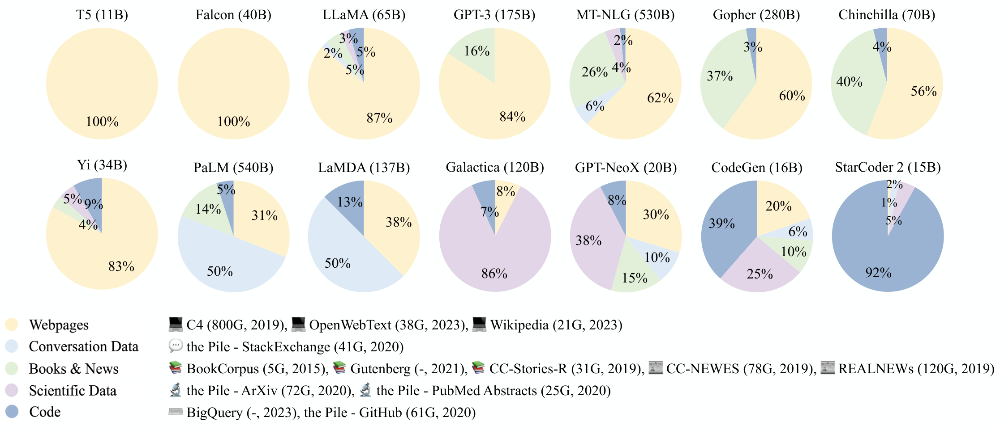

> 图解：14 个代表性 LLM 的预训练数据源占比饼图，图例分五类：Webpages（黄）、Conversation Data（绿）、Books & News（蓝）、Scientific Data（紫）、Code（深蓝）。可以看出通用模型以网页为主体（T5、Falcon 为 100% 网页；LLaMA 网页超 80%），而专项模型截然不同——Galactica 86% 为科学数据，StarCoder 2 达 92% 代码；PaLM 和 LaMDA 约一半数据是对话文本，Gopher 与 Chinchilla 约 40% 来自书籍。

**数据预处理**是质量控制的关键环节，典型流水线如下图：

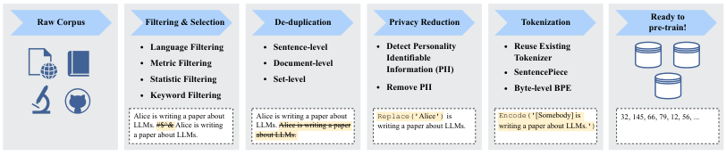

> 图解：典型的预处理五步流水线——Raw Corpus 经"过滤与选择"（语言/指标/统计/关键词四类规则）、"去重"（句子级/文档级/数据集级）、"隐私削减"（检测并移除 PII）、最后"Tokenization"得到 token id 序列。图中用同一句示例文本演示了每步的效果：噪声符号被滤掉、重复句被删除、"Alice"被替换为 [Somebody]、最终编码为 token 序列。

几个要点值得展开：

- **过滤与选择**：分类器方法（以 Wikipedia 或高质量合成数据为正例训练二分类器）可能误删方言、口语类高质量文本，引入偏见；启发式方法靠语言、perplexity、统计特征、关键词四类规则。也可用较小的 LLM 计算 perplexity 或直接打分来筛选数据，但大规模使用开销大。
- **去重**：重复数据会降低多样性、使训练不稳定，甚至削弱模型从上下文复制的能力，进而影响 ICL 泛化。句子级、文档级（n-gram 重叠检测）、数据集级（防止训练集与评测集重叠导致数据污染）三级去重应联合使用。
- **Tokenization**：主流是 subword 分词。**BPE**从基础符号出发迭代合并共现频率最高的相邻 token 对（GPT-2、BART、LLaMA 采用）；**WordPiece**以"使训练数据似然提升最大"为合并标准（BERT 采用）；**Unigram**反向操作，从大子串集合迭代删除（T5、mBART 采用）。为预训练语料专门训练分词器更有益，近期 LLM 多用 SentencePiece 定制。

**数据调度**是近年才被重视的方向，分"配比"与"课程"两个维度：

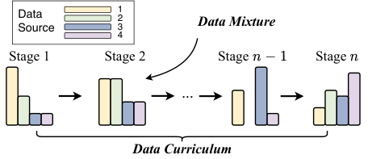

> 图解：数据调度的两个维度。横向贯穿各训练阶段的编排是**Data Curriculum（数据课程）**——各阶段数据构成不同；每根柱子内部的比例是**Data Mixture（数据混合）**——某一阶段内各数据源的占比。核心概念是：混合比例可以随训练阶段动态变化。

配比方面，LLaMA 的方案（网页超 80%、代码 6.5%、书籍 4.5%、arXiv 2.5%）已成通用参考；**DoReMi**用"小参考模型 + 小代理模型"学习最优域权重再迁移给大模型，是自动化配比的代表。课程方面三个典型案例：**CodeLLaMA**采用"2T 通用 token → 500B 代码为主 token"；**Llemma**再加一段"→ 50~200B 数学 token"（保留 5% 通用数据作正则化）；长上下文扩展如 CodeLLaMA 的"2.5T token @4K 窗口 → 20B token @16K 窗口"。

### 4.2 架构：Causal Decoder 的胜利与细节的艺术

Transformer 是事实标准骨干，三大主流架构的区别在注意力掩码上：

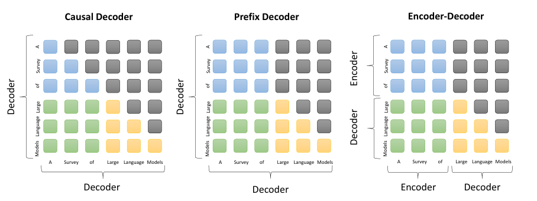

> 图解：三种架构对同一序列的注意力模式（6×6 矩阵示意，蓝 = prefix 内部注意力，绿 = prefix 与 target 之间，黄 = target 内部，灰 = 被掩码）。**Causal Decoder**为全下三角（每个 token 只能看到自身及之前）；**Prefix Decoder**的前缀区双向可见、生成区单向；**Encoder-Decoder**的编码器双向、解码器自回归并通过 cross-attention 看到全部编码输出。GPT-3 证明了 causal decoder 架构在大规模下的有效性，目前绝大多数 LLM 采用这一架构。

代表性 LLM 的架构配置卡如下（#L = 层数，#H = 注意力头数，d_model = 隐状态维度，MCL = 训练时最大上下文长度）：

| 模型 | 规模 | 归一化 | 位置编码 | 激活函数 | #L | #H | d_model | MCL |
|---|---|---|---|---|---|---|---|---|
| GPT-3 | 175B | Pre LayerNorm | Learned | GeLU | 96 | 96 | 12288 | 2048 |
| PaLM | 540B | Pre LayerNorm | RoPE | SwiGLU | 118 | 48 | 18432 | 2048 |
| BLOOM | 176B | Pre LayerNorm | ALiBi | GeLU | 70 | 112 | 14336 | 2048 |
| Gopher | 280B | Pre RMSNorm | Relative | - | 80 | 128 | 16384 | 2048 |
| LLaMA | 65B | Pre RMSNorm | RoPE | SwiGLU | 80 | 64 | 8192 | 2048 |
| LLaMA 2 | 70B | Pre RMSNorm | RoPE | SwiGLU | 80 | 64 | 8192 | 4096 |
| GLM-130B | 130B | Post DeepNorm | RoPE | GeGLU | 70 | 96 | 12288 | 2048 |
| T5 | 11B | Pre RMSNorm | Relative | ReLU | 24 | 128 | 1024 | 512 |

架构细节上有四个关键决策点，综述给出了明确的工程建议：

- **归一化**：Post-LN 训练不稳定，已被弃用；Pre-LN 稳定但性能略逊，是主流选择；**RMSNorm**只做均方根 rescale（$\text{RMSNorm}(x) = x/\text{RMS}(x) \cdot \gamma$），训练更快且性能相当；微软的**DeepNorm**（$\text{LayerNorm}(\alpha \cdot x + \text{Sublayer}(x))$）可把 Transformer 稳定扩展到 1,000 层。建议选**pre RMSNorm**，且 embedding 层后不要紧跟 LN。
- **激活函数**：最新模型普遍用 GLU 变体**SwiGLU/GeGLU**（如 $\text{SwiGLU}(x_1, x_2) = \text{Swish}(x_1) \otimes x_2$），性能更好但 FFN 需多约 50% 参数。
- **位置编码**：**RoPE**通过旋转矩阵注入相对位置，基底 $\Theta = \{\theta_i = b^{-2(i-1)/d} \mid i \in \{1,\dots,d/2\}\}$（base 默认 10000），因长程衰减特性被 PaLM、LLaMA 广泛采用；**ALiBi**按 key-query 距离加预定义惩罚偏置，外推性能更优。建议二选一。
- **注意力**：**GQA**（分组查询注意力，组内共享 K/V，LLaMA 2 采用）在质量几乎无损的前提下加速推理；**FlashAttention**从 IO 感知角度分块计算，2 代再提速约 2 倍；**PagedAttention**借鉴操作系统分页管理 KV cache，是 vLLM 高吞吐的核心。

此外，**MoE**（混合专家）能在计算成本不变时扩大参数量（Switch Transformer、GLaM），但路由硬切换导致训练不稳定；**Mamba、RWKV、RetNet、Hyena**等基于状态空间模型的新兴架构把解码复杂度从 Transformer 的 $O(H(T+H))$ 降到 $O(H^2)$ 级别，但性能仍落后于 Transformer。

**预训练任务**方面，decoder-only 模型最常用的就是语言建模目标：

$$
\mathcal{L}_{LM}(\mathbf{x}) = \sum_{i=1}^{n} \log P(x_i \mid \mathbf{x}_{<i})
$$

变体包括 prefix language modeling、DAE（去噪自编码，T5/GLM-130B 使用）以及统一视角的**Mixture-of-Denoisers**（UL2 loss，用 `[R]/[S]/[X]` 特殊 token 切换三种去噪器，已用于 PaLM 2）。

**解码策略**是常被忽视但直接影响体验的一环。贪心搜索在开放式生成中易重复；随机采样的两个关键改进是温度采样与核采样：

$$
P(x_j \mid \mathbf{x}_{<i}) = \frac{\exp(l_j / t)}{\sum_{j'} \exp(l_{j'} / t)}
$$

温度 $t \to 0$ 等价贪心，$t \to \infty$ 退化为均匀采样；**Top-p（nucleus）采样**只从累积概率达 $p$ 的最小集合中采样。实际配置参考：Alpaca 用 top-k=50、top-p=0.9、temperature=0.7；LLaMA 代码生成用 temperature 0.1（pass@1）/0.8（pass@100）。

### 4.3 训练：把千亿参数装进 GPU 并稳定收敛

优化配置有一套事实标准：batch 按 token 计可大到**4M**（GPT-3 从 32K 动态增至 3.2M tokens）；学习率先 warm-up（前 0.1%~0.5% 步）到峰值（约 $5\times10^{-5}$ ~ $1\times10^{-4}$），再 cosine 衰减到峰值 10%；优化器用 AdamW（$\beta_1=0.9, \beta_2=0.95$）；配合 weight decay 0.1 与梯度裁剪 1.0。模型变大后**loss spike**更常见，PaLM/OPT 的对策是从 spike 前 checkpoint 重启并跳过可疑数据，GLM 发现缩小 embedding 层梯度也有帮助。

可扩展训练的核心是**3D 并行**：数据并行（复制参数、切分语料）、流水线并行（按层切分到不同 GPU，GPipe 用多 batch 填充气泡）、张量并行（切分参数矩阵，如 $Y = XA = [XA_1, XA_2]$ 分卡计算）。典型实例：**BLOOM 用 8 路数据并行 + 4 路张量并行 + 12 路流水线并行，在 384 块 A100 上完成训练**。配合**ZeRO/FSDP**显存分片、激活重计算与**BF16**混合精度，千亿级训练才成为现实。

## 五、适配：指令微调、对齐与高效微调

预训练得到的基座模型还只是一个"知识渊博但不太听话"的续写机器。解决了预训练之后，下一个问题是：**如何让它听懂并服从人类指令，且符合人类价值观？**这就是适配（adaptation）要解决的问题。

### 5.1 指令微调：用自然语言实例解锁任务泛化

指令微调的本质，是在"指令 + 可选输入 + 输出（+ 可选示例）"格式的实例集合上做监督微调（sequence-to-sequence loss）。一个被反复验证的关键结论是：**instruction 本身是任务泛化能力的核心因素**——把任务描述从训练数据中去掉再微调，性能会大幅下降。

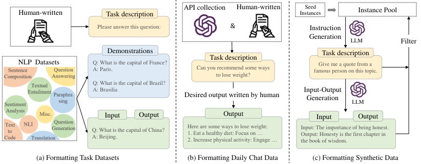

> 图解：指令微调实例的格式化方式与三种构建方法。(a) 格式化传统 NLP 任务数据集——为每个样本加人工撰写的任务描述（如 "Please answer this question"）；(b) 格式化日常对话数据——用真实用户 query 作指令、人工答案作输出；(c) 格式化合成数据——Self-Instruct 流程：175 个种子任务池 → 随机采样作 demonstration → 提示 LLM 生成新指令与输入输出对 → 质量与多样性过滤后回流任务池。

三种数据来源各有优劣：NLP 任务数据量大但与真实需求脱节；真实对话数据（ShareGPT、Dolly、OpenAssistant）贴近用户但稀缺；合成数据成本低、可规模化，Self-Instruct 只需 175 个种子实例就能自举，WizardLM 的**Evol-Instruct**通过"加深 + 拓宽"演化进一步提升复杂度。构建数据集时有四个关键因素：**任务数量**的扩展收益会趋平（LIMA 证明几千条高质量数据即可，Orca 则把带逐步解释的合成实例扩到 500 万条）；**格式设计**中任务描述最关键，适量示例有实质提升，而"注意事项/理由"等额外成分反而可能有害；**质量提升**可用 WizardLM 式改写或知识分类体系引导（JiuZhang3.0 用 7B 模型蒸馏 GPT-4，只用 20% 成本合成高质量数学指令）；**指令选择**可用 perplexity、IFD 指标或基于梯度相似度的 LESS 方法。

微调策略上的实用经验包括：examples-proportional mixing 混合 + 设 maximum cap 防止大数据集主导；OPT-IML 在指令微调时混入预训练数据作正则化；多阶段微调（先大规模任务指令、后日常聊天指令，第二阶段混入部分任务指令防遗忘）；Vicuna 用**loss mask**只对 chatbot 回复计损失，避免多轮对话拆分带来的重复计算。

指令微调的效果体现在三方面：全规模模型（77M 到 540B）都受益，且微调后的小模型可超过未微调的大模型；任务泛化能力涌现，BLOOMZ-P3 仅用英文指令微调就在多语言句子补全上相对 BLOOM 提升超**50%**；领域专精可行，Med-PaLM 用医学数据微调 Flan-PaLM 后达到接近临床专家的水平。

综述还亲自做了一组实证实验（LLaMA 7B/13B，AlpacaFarm 胜率 + MMLU/BBH3k 准确率），结论相当扎实：

| LLaMA (7B) 微调数据 | AlpacaFarm 胜率 | MMLU | BBH3k |
|---|---|---|---|
| FLAN-T5（任务型，80K） | 23.77 | 38.58 | 32.79 |
| ShareGPT（聊天型，63K） | 81.30 | 38.11 | 27.71 |
| Self-Instruct-52K（合成，基线） | / | 37.52 | 29.81 |
| 三者混合（225K） | 70.00 | 43.69 | 29.69 |
| w/ complexity（WizardLM-70K） | 76.96 | 39.73 | 33.25 |
| w/ diversity（70K） | 81.55 | 38.01 | 30.03 |
| w/ scaling（220K） | 51.13 | 33.81 | 26.63 |

> 结论解读：任务型指令擅长 QA 但不擅长聊天，聊天型反之；**混合多源指令全面提升**（MMLU 43.69 vs 单用 FLAN-T5 的 38.58）；增强复杂度和多样性都有效，而**单纯扩大指令数量反而有害**（BBH 从 29.81 降到 26.63）——质量比数量重要。13B 模型在相同数据下普遍优于 7B（ShareGPT 微调下 MMLU 从 38.11 升至 47.49）。

GPU 资源方面，综述也给出了实测参考（Alpaca-52K 训 LLaMA 三个 epoch）：

| 模型 | A800 全量微调 | A800 LoRA 微调 | A800 16-bit 推理 | 3090 8-bit 推理 |
|---|---|---|---|---|
| LLaMA (7B) | 2 卡 / 3.0h | 1 卡 / 3.5h | 1 卡 / 36.6 token/s | 1 卡 / 7.5 token/s |
| LLaMA (13B) | 4 卡 / 3.1h | 1 卡 / 5.1h | 1 卡 / 26.8 token/s | 1 卡 / 4.5 token/s |
| LLaMA (30B) | 8 卡 / 6.1h | 1 卡 / 14.3h | 1 卡 / 17.7 token/s | 2 卡 / 2.6 token/s |
| LLaMA (65B) | 16 卡 / 11.2h | 1 卡 / 60.6h | 2 卡 / 8.8 token/s | 4 卡 / 1.5 token/s |

### 5.2 对齐：RLHF 与非 RLHF 的两条路线

LLM 会编造信息、产生有害内容——语言建模目标只做词预测，从不考虑人类价值观。对齐的三条代表性准则是**helpful、honest、harmless**（3H），而对齐可能损害通用能力，这被称为**alignment tax（对齐税）**。

**RLHF**是主流对齐方案，系统由三组件构成：待对齐的预训练 LM（InstructGPT 用 175B GPT-3）、奖励模型 RM（OpenAI 用 6B GPT-3）、RL 算法（PPO）。

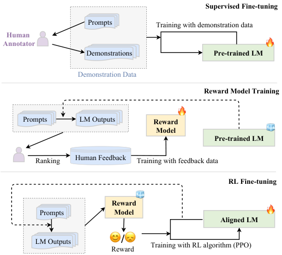

> 图解：RLHF 三步工作流。(1) SFT：用人工标注的 prompt-output 数据监督微调；(2) 奖励模型训练：模型对同一 prompt 生成多个候选回复，人工排序后训练 RM 预测排序；(3) RL 微调：把对齐形式化为 RL 问题——LM 是 policy、词表是动作空间、已生成 token 是状态、RM 打分是奖励，用 PPO 更新，并加入与初始模型的 KL 散度惩罚防止偏离过远。第二、三步可多轮迭代（LLaMA 2 连续训了五版 RLHF 模型）。

RLHF 有一批实用策略：大 RM（≥被对齐模型规模）更有效，但需用 LM loss 作正则防过拟合；多准则可训多个 RM 加权组合；RL 前先做充分 SFT，配合**rejection sampling / best-of-N**；**过程监督 RLHF**（如 OpenAI 的 PRM800k，对 75K 个数学解答的每个推理步标注正/负/中性）把奖励细化到步骤级，比只对整段文本打分更精细。

由于 RLHF 需同时维护多个模型、PPO 对超参敏感，**非 RLHF 对齐**路线兴起：Constitutional AI 用自然语言原则让 LLM 自我批判修正；RAFT 直接用高奖励样本做 SFT 替代 RL；而最引人注目的是**DPO（Direct Preference Optimization）**——用 policy model 自身重参数化奖励，省略显式奖励建模与 RL 环节，衍生出 KTO（无需成对样本）、SimPO（去参考模型）等变体。

关于 SFT 与 RLHF 的对比，综述的评述很精辟：SFT 是 token 级的"局部"模仿学习，主要是**"解锁"而非"注入"**能力——演示数据超出模型知识范围时反而助长幻觉（John Schulman 也警告过用 GPT-4 蒸馏数据训练弱模型可能损害事实准确性）；RLHF 是 text 级的"全局"优化，标注员可以评判超越自己水平的生成，且不强迫模仿外部演示，有助于缓解幻觉，但样本低效、训练不稳定。笔者的理解是：**SFT 解决"会做"，RLHF 解决"做好"，两者是接力而非替代**。

### 5.3 高效适配：PEFT 与量化

全量微调动辄需要十几张 A800，参数高效微调（PEFT）让适配平民化。四类主流方法：

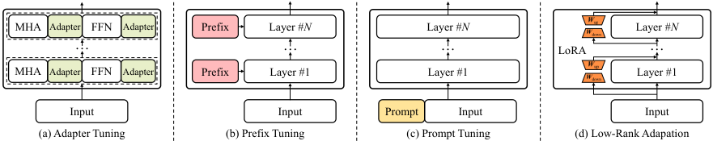

> 图解：四种 PEFT 方法在 Transformer 层中的插入位置（MHA = 多头注意力，FFN = 前馈网络）。**Adapter**在 MHA 和 FFN 后串行插入 bottleneck 小模块；**Prefix Tuning**在每层 K/V 前加可训练 prefix 向量；**Prompt Tuning**仅在输入嵌入前加 prompt 向量；**LoRA**冻结原权重 $W$，训练低秩分解矩阵近似增量 $\Delta W$。

**LoRA**是其中最流行的：对 dense 层的更新施加低秩约束

$$
\mathbf{W} \leftarrow \mathbf{W} + \Delta \mathbf{W}, \quad \Delta \mathbf{W} = \mathbf{A} \cdot \mathbf{B}^{\top}
$$

其中 $\mathbf{W} \in \mathbb{R}^{m \times n}$，$\mathbf{A} \in \mathbb{R}^{m \times k}$，$\mathbf{B} \in \mathbb{R}^{n \times k}$，$k \ll \min(m,n)$。一份大模型副本加多个低秩矩阵即可适配多任务；实证比较显示 LoRA 在数学推理任务上整体表现最好且可训练参数显著更少。

**量化**解决的是部署成本。量化函数为 $x_q = R(x/S) - Z$（$S$ 为缩放因子、$Z$ 为零点），反量化为 $\tilde{x} = S \cdot (x_q + Z)$。LLM 场景的两个特殊性决定了方法设计：参数量巨大使低成本的 PTQ（训练后量化）更受青睐；**模型规模达到 6.7B 以上时隐藏激活会出现极大 outlier 值**（LLM.int8() 的发现），使激活远比权重难量化。代表性 PTQ 方法五类：混合精度分解（LLM.int8() 把 outlier 维度单独用 16-bit 计算）、显著权重保护（SpQR、OWQ）、细粒度量化（ZeroQuant，常用 group size 128）、难度均衡（**SmoothQuant**通过数学等价变换 $\mathbf{Y} = (\mathbf{X}\,\text{diag}(\mathbf{s})^{-1}) \cdot (\text{diag}(\mathbf{s})\,\mathbf{W})$ 把量化难度从激活迁移到权重）、逐层量化（**GPTQ**优化 $\arg\min_{\widehat{W}} \|WX - \widehat{W}X\|_2^2$，可把 175B OPT 量化到 3/4 bit）。

综述的量化实验结论对部署极具参考价值：**INT8 权重量化效果通常很好；同显存预算下"更大模型 + 更低比特"优于"更小模型 + 更高比特"（4-bit 60B 优于 8-bit 30B）；4-bit 权重量化对 ICL、CoT、指令跟随等涌现能力几乎无影响**；**QLoRA**给 4-bit 量化模型加 16-bit adapter 微调即可达到全 16-bit 微调性能。实测微调后 LLaMA 的量化结果：

| LLaMA（7B，SFT 数据） | 16-bit | 8-bit | 4-bit |
|---|---|---|---|
| Alpaca-52K：MMLU / 显存（GiB） | 40.87 / 12.58 | 39.98 / 6.65 | 39.24 / 3.94 |
| ShareGPT：MMLU / 显存（GiB） | 41.30 / 12.58 | 39.34 / 6.65 | 40.08 / 3.94 |

| LLaMA（13B，SFT 数据） | 16-bit | 8-bit | 4-bit |
|---|---|---|---|
| Alpaca-52K：MMLU / 显存（GiB） | 47.63 / 24.40 | 47.04 / 12.53 | 46.20 / 7.34 |
| ShareGPT：MMLU / 显存（GiB） | 47.58 / 24.40 | 47.71 / 12.53 | 45.77 / 7.34 |

> 结论：8-bit 与 4-bit 权重量化的性能接近 16-bit，显存却降至 1/3 左右。显存是硬约束时，优先尝试 4-bit 权重量化。

此外还有蒸馏（MINILLM 把 13B LLaMA 蒸到 7B）与剪枝（SparseGPT 让 OPT-175B 达到 60% 非结构化稀疏仍保持低 PPL；Sheared LLaMA 把 LLaMA-2 7B 剪到 2.7B 并保留 87.8% 性能）等压缩路线。

## 六、使用：Prompt、ICL、CoT 与 Planning

模型适配完成后，使用 LLM 的主要方式就是设计 prompting 策略。这一章梳理了三条主线技术：ICL、CoT 与 Planning，外加一份非常实用的 prompt 设计指南。

### 6.1 Prompt 设计：一门可实证的工程

一个好的 prompt 包含四个成分：任务描述、输入数据、上下文信息、prompt 风格。五条设计原则：清晰表达任务目标、分解为简单子任务、提供 few-shot 示例、使用模型友好的格式（如 `###` 或 `"""` 分隔符）、采用角色扮演策略。

prompt 的价值是实打实可测量的。综述用 ChatGPT 做了对照实验（复杂推理任务 3-shot，其余 zero-shot）：

| 任务 / 数据集 | 简单 prompt | 精心设计的 prompt | 监督方法 |
|---|---|---|---|
| 翻译 / WMT'22 | 20.66 | 21.12 | 41.40 |
| 摘要 / XSum | 21.71 | 23.01 | 42.08 |
| 事实抽取 / WikiFact | 29.25 | 31.21 | 34.20 |
| 符号推理 / Colored Objects | 53.20 | 66.75 | - |
| 数学 / GSM8k | 78.47 | 79.30 | 63.20 |
| 代码合成 / HumanEval | - | 79.88 | 48.20 |

> 结论：精心设计的 prompt 全面提升 zero/few-shot 表现，且越复杂的任务获益越大（Colored Objects 从 53.20 到 66.75）；数学任务用代码格式 prompt 配合程序执行器更有效；在 GSM8k、HumanEval 上，配好 prompt 的 ChatGPT 甚至超过了监督方法 SOTA。

手工写 prompt 费时且模型高度敏感，**prompt 自动优化**随之兴起：离散方向有梯度引导的 AutoPrompt、强化学习的 RLPrompt、编辑式的 GPS/GrIPS，以及用 LLM 自身做"文本梯度下降"的 APE/APO/OPRO；连续方向（prefix tuning、prompt tuning 等）主要活跃在 PLM 时代。

### 6.2 In-Context Learning：不改参数的任务学习

ICL 由 GPT-3 首次提出，形式化定义为：

$$
\text{LLM}\big(I, \underbrace{f(x_1, y_1), \dots, f(x_k, y_k)}_{\text{demonstrations}}, f(\underbrace{x_{k+1}}_{\text{input}}, \_\_\_) \big) \rightarrow \hat{y}_{k+1}
$$

即把 $k$ 个示例 $D_k$ 与任务描述 $I$ 拼成自然语言 prompt，在末尾追加留空的测试实例让模型补全。与指令微调不同，ICL 只使用 prompt、不更新参数。

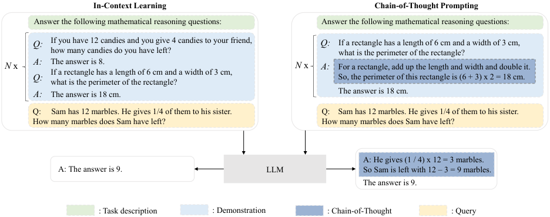

> 图解：ICL 与 CoT 的对比。ICL 把自然语言任务描述、若干 demonstration 与测试 query 一起输入 LLM；CoT 则在 prompt 中进一步加入一系列中间推理步骤。两者都是不改参数的使用方式。

ICL 的效果对 demonstration 设计高度敏感，三个维度都有讲究：**选择**上，k-NN 相似度检索（KATE）、两阶段稠密检索（EPR）、LLM 自生成（SG-ICL）各有适用场景，所选示例应既含足够任务信息又与 query 相关；**格式**上，可加入任务描述与 CoT；**顺序**上，LLM 存在 recency bias（倾向重复靠近末尾的答案），可按相似度把最相关的示例放在最后。

最有意思的是 ICL 的机制研究：模型究竟是在"认出任务"还是"学会任务"？证据表明两者并存——**task recognition**（从示例识别任务、用预训练先验解题）350M 参数的小模型就具备；而**task learning**（仅凭示例学习预训练没见过的新任务，被理论分析为前向计算中的隐式梯度下降）至少需要**66B**参数才会涌现。把示例标签随机替换不太损害小模型表现，却能显著影响大模型，正是两种机制分野的佐证。

### 6.3 Chain-of-Thought：让模型"打草稿"

CoT 把 demonstration 从 ⟨输入, 输出⟩ 扩充为**⟨输入, 思维链, 输出⟩**，一句 "Let's think step by step" 就能 zero-shot 触发（OPRO 还发现了更强的"魔法咒语"："Take a deep breath and work on this problem step-by-step."）。围绕 CoT 的改进沿三条线展开：

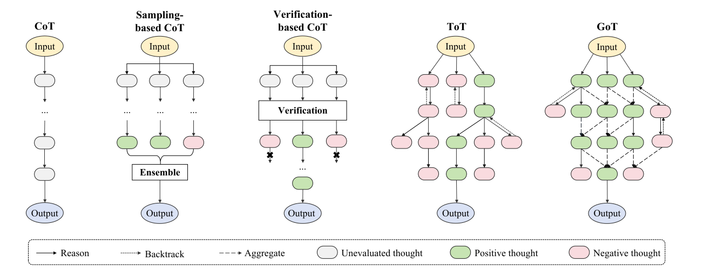

> 图解：CoT 策略的演进谱系。从基本链式 CoT 出发，向上是增强生成技术——采样法（Self-consistency 多路径投票）与验证法（DIVERSE 的分粒度校验、反向推理验证）；向右是推理结构扩展——树状的 Tree of Thoughts 支持前瞻与回溯，图状的 Graph of Thoughts 允许跨路径复用中间结论。图中 "thought" 指中间推理步骤。

两个关键结论值得记住：**CoT 是涌现能力，通常需要 10B 以上参数才有效**，且只对需要逐步推理的任务（算术、常识、符号推理）有帮助，对简单任务反而可能更差；其能力来源普遍归因于**代码训练**（代码的算法逻辑与流程结构），消融实验显示 CoT 中 patterns（算式模式）和 text（推理文本）必不可少，而符号取值的正确性反而不关键。

### 6.4 Planning：把复杂任务拆给"规划-执行-反馈"循环

ICL + CoT 在复杂任务上仍然吃力，prompt-based planning 把任务拆解为子任务再逐一解决：

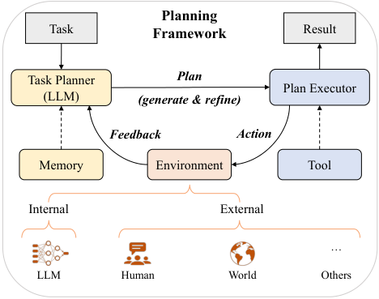

> 图解：Planning 框架的三组件——**Task planner**（由 LLM 担任，生成文本或代码形式的计划，可配 memory）、**Plan executor**（文本任务由 LLM 执行，代码任务交给 code interpreter 等工具）、**Environment**（执行动作的场所，可以是 LLM 自身也可以是 Minecraft 这样的虚拟世界）。三者构成"规划—执行—反馈—修正"的循环。

计划生成有文本式（Least-to-most、Plan-and-Solve）与代码式（PAL、Faithful CoT 生成可执行代码交给确定性 solver，保证忠实执行）两类；反馈可来自 LLM 自身（Reflexion 把成败信号转成文本自我反思存入长期记忆）或外部环境；计划优化有推理式（**ReAct**的 reasoning + acting 交替，是 AutoGPT 等 agent 项目的核心范式）、回溯式（ToT 的 BFS/DFS 搜索）与记忆式（Voyager 的**skill library**存储成功计划供复用合成）三条路线。

## 七、能力评估：LLM 到底会不会、好不好、信不信得过

会用之后，更根本的问题是评测：LLM 的能力边界在哪里？综述把能力分为基本与高级两层，并亲自跑了一套大规模实证评测。

### 7.1 基本能力：生成、知识与推理

**语言生成**方面，LLM 在语言建模（LAMBADA 测长程依赖）上远超此前 SOTA；GPT-4 的翻译可与商业产品相当；代码合成用 pass@k 度量（k 个生成程序中至少一个通过全部测试用例即计 1），AlphaCode 曾在 Codeforces 竞赛中进入用户排名前 28%。但两大问题突出：一是**评测不可靠**——ChatGPT 在 OpenDialKG 上 BLEU/ROUGE-L 低于微调 GPT-2，人类却更偏好 ChatGPT，基于参考的自动指标已难以忠实评估 LLM；二是**专业化生成不足**——领域文本生成困难，且专精与灾难性遗忘、对齐税相互纠缠。

**知识利用**方面，闭卷 QA（TriviaQA 等）上 LLM 可媲美 SOTA 系统，且性能随模型与数据规模双维 scaling；检索增强能让小模型胜过 10 倍大的模型。两大顽疾是**幻觉**与**知识时效性**：

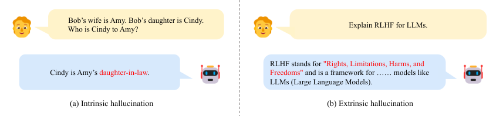

> 图解：某公开 LLM 的幻觉示例。内在幻觉（左）：模型对 Cindy 与 Amy 的关系给出与输入相矛盾的回答；外在幻觉（右）：模型对 RLHF 的含义给出无法被输入验证的错误解释。幻觉即使对 GPT-4 也广泛存在，本质是 LLM 在"无意识地"使用知识、缺乏对内外部知识使用的精确控制。

**复杂推理**分知识推理（CoT 带来多个任务的新 SOTA）、符号推理（last letter concatenation 等，需考察步数外推能力）与数学推理（GSM8k、MATH，以及 miniF2F 上的自动定理证明）。一个很有启发的发现：**把数字按位 tokenize 能增强内在算术能力**——子词分词会把 7481 切成 `7_481` 而 74815 切成 `748_15`，切分不一致直接破坏算术。

### 7.2 高级能力：对齐、环境交互与工具操纵

三项高级能力分别对应"符合人类价值观、在真实场景中正确行动、扩展能力边界"：对齐评测用 TruthfulQA（诚实）、CrowS-Pairs/WinoGender（偏见）等，GPT-4 经专家交互数据对齐后对敏感 prompt 的错误行为率大幅下降；环境交互能力本身是涌现的——LLM 能生成细致可执行的动作计划而 GPT-2 只会生成无意义短句，Voyager 在 Minecraft 中靠自动课程持续习得新技能；工具操纵（Toolformer 学用计算器、WebGPT 用搜索引擎、Gorilla 调模型 API）的瓶颈在于工具增多时上下文装不下，前沿方向是让 LLM **自主创造工具**。

### 7.3 基准与评测方法

综合基准中，**MMLU**覆盖广泛知识域（GPT-4 达 86.4% 5-shot）；**BIG-bench**汇集 204 个任务，其难子集**BBH**上 CoT 提示甚至能超过人类平均表现；**HELM**以 16 场景 × 7 类指标做整体评测，发现指令微调持续提升准确性/鲁棒性/公平性；AGIEval、C-Eval 等人类考试基准上 GPT-4 已超过人类平均但仍不及顶尖水平。

评测方法按对象分三类：**base LLM**以 benchmark 为主（few-shot + 规则解析答案）；**fine-tuned LLM**增加人工评测（Chatbot Arena 的众包成对比较）与模型评测（AlpacaEval/MT-bench 用 GPT-4 当裁判，但要警惕 position bias、verbosity bias、self-enhancement bias 三种偏差）；**specialized LLM**需领域基准与通用基准结合（Med-PaLM 用 MultiMedQA + MMLU）。

### 7.4 实证评测：15 个模型、八项能力的横评

综述在 8 张 A800-80G 上对 5 个闭源 API 模型、10 个开源 base/指令微调模型做了横评（主要 zero-shot，数学与工具任务 3-shot），部分关键数据：

| 模型 | HumanEval | GSM8k | MATH | TriviaQA | HotpotQA（工具） |
|---|---|---|---|---|---|
| ChatGPT | 79.88 | 78.47 | 33.78 | 54.54 | 23.80 |
| Claude 2 | 78.04 | 82.87 | 32.24 | 54.30 | 36.40 |
| Davinci003 | 67.07 | 57.16 | 17.66 | 51.51 | 34.40 |
| LLaMA 2-Chat (7B) | 11.59 | 9.63 | 2.22 | 38.93 | 4.40 |
| Vicuna (13B) | 20.73 | 18.50 | 3.72 | 29.04 | 11.20 |
| LLaMA 2 (7B) | 17.07 | 10.99 | 2.64 | 30.92 | 3.80 |

> 结论解读：① 闭源模型整体碾压，ChatGPT 赢面最大（GSM8k 78.47 vs Davinci002 的 49.96）；② 指令微调普遍提升 zero/few-shot 能力，但在 LAMBADA 等纯语言建模任务上可能退化；③ 小模型在数学推理、环境交互、工具操纵上全面薄弱；④ LLaMA 2 (7B) 凭约 2T tokens 预训练与更稳健的数据清洗在同级 base 模型中领先（符号推理 43.95 vs Falcon 的 29.80）；⑤ 规模 scaling 的收益在越复杂的任务上越大。

## 八、应用：LLM 正在重塑哪些领域

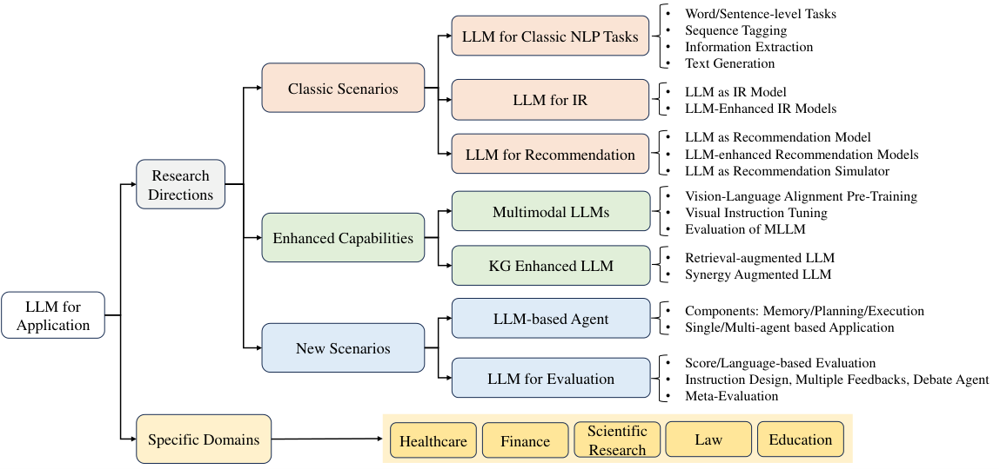

> 图解：LLM 应用的组织全景图。左侧为对研究社区的影响（经典 NLP 任务、信息检索、推荐系统、多模态大模型、KG 增强、LLM 评估），右侧为下游领域（医疗、教育、法律、金融、科研辅助等）。

**对研究社区**，几个方向的判断值得注意：经典 NLP 任务上，ICL 方式的 LLM 在语义匹配、情感分析、序列标注、信息抽取上大多仍不如全量微调的小模型，LLM 的优势在统一多任务与 zero/few-shot 灵活性；信息检索中 LLM 主要做**reranker**（pointwise/pairwise/listwise 三种重排方式），也可通过 Query2doc 等查询改写增强传统检索模型；推荐系统中 LLM 可作推荐模型（InstructRec 用 self-instruct 构造指令数据）、特征编码器或用户行为模拟器（RecAgent、AgentCF 的双边 agent 建模）；**多模态 LLM**（图像编码器 + 连接模块 + LLM）经视觉-语言对齐预训练与视觉指令微调两阶段训练，但 POPE、HallusionBench 等评测显示物体幻觉普遍存在，LLaVA-1.5 与 GPT-4V 在 HallusionBench 的 200 道视觉问题上均表现不佳；**KG 增强**方向，StructGPT 为知识图谱设计专门接口实现高效多轮交互，是"LLM 当 agent、KG 当环境"的代表。

**对具体领域**：医疗上 Med-PaLM 2 在美国医师资格考试 USMLE 上达到专家级；教育上 ChatGPT 已达学生水平的标准化考试表现；法律上 GPT-4 在模拟律师资格考试中名列前 10%；金融上 BloombergGPT 经领域持续预训练表现出色——但通用 LLM 的 zero-shot 仍不如百万级参数的领域专用模型；科研上 LLM 可辅助文献综述、假设生成、自动审稿。一个有趣的心理学发现：**GPT-3.5 系列在经典错误信念任务上达到了与九岁儿童相当的心智理论（ToM）表现**。

## 九、前沿难题：长上下文、Agent、训推优化、RAG、幻觉与长 CoT

综述后期版本新增的 Advanced Topics 章，收录了当前最活跃的几个技术前沿。

### 9.1 长上下文建模

两条主流路线。**缩放位置编码**方面：RoPE 外推能力有限，位置插值（所有位置索引乘 $L/L'$，$L < L'$）高效但损害原窗口表现；基底修改利用 $\theta_i = b^{-2(i-1)/d}$ 与波长 $\lambda_i = 2\pi/\theta_i$ 的关系——**减小 base 外推更好、增大 base 训练长度内更好**。**适配上下文窗口**方面：StreamingLLM/LM-Infinite 用 Λ 形掩码只保留开头 + 最近 token（利用"lost in the middle"现象，注意力本就集中于两端），可在固定内存下生成超长文本；token 选择方法（Unlimiformer、InfLLM）用 k-NN 检索最相关历史 token 参与注意力。数据层面的反直觉发现：**少量长文本持续预训练即可扩展上下文**——LLaMA-2-7B/13B 只用数十亿 token 就获得超 100K 的上下文窗口。

### 9.2 LLM Agent 与训推的系统优化

Agent 框架由记忆（短期 = 上下文窗口，长期 = 向量数据库）、规划、执行三组件构成；多智能体分合作式（CAMEL 自由对话、MetaGPT 结构化文档）与竞争式（辩论）两类，框架有 LangChain、AutoGen、AgentVerse。

训练显存的账很好算：混合精度训练下模型状态合计**$16P$ bytes**（参数 $2P$ + 梯度 $2P$ + Adam 状态 $12P$）——**LLaMA-7B 仅模型状态就需约 100GB 显存**；对策是梯度检查点（以计算换显存）、ZeRO 三阶段分片（ZeRO-3 省显存但增加约 50% 通信）、Offload（优化器状态卸载到 CPU）。推理侧的效率分析更有洞察：以算术强度 $I$（FLOPs/字节传输量）对 GPU 上限 $I_{\max}$（A100 为 142.51）判断瓶颈，**prefill 阶段线性层算术强度约 2730 属 compute-bound，decoding 阶段各算子均低于 8 属 memory-bound**——这就是"内存墙"问题，也是 PagedAttention、continuous batching、投机解码（小模型草拟 + 大模型验证，2~3 倍无损加速）、Medusa（一步出 3 token）、FrugalGPT（级联早停）等优化方法的理论依据。

### 9.3 RAG 与幻觉治理

RAG 可视为把外部信息整合进 prompt 的 prompting 策略，三步工作流为上下文检索（词汇检索 BM25 / 语义检索 ANN）、prompt 构造（reranking 与压缩对抗 lost-in-the-middle）、响应生成（自检置信度决定是否重检索）；进阶方向包括以 proposition 为检索单元、迭代检索与 CoT 交错（IRCoT）、面向检索的指令微调。

幻觉的成因贯穿数据（模仿记忆错误信息、长尾知识）、训练（teacher-forcing 的 exposure bias、对齐中的谄媚 sycophancy）与解码（高温采样提升多样性也提升幻觉）全链路；检测有模型式（HaluEval）、不确定性式（SelfCheckGPT 看多次采样的一致性）、工具式（FActScore 拆成事实陈述逐条核验，HaluAgent 让 7B 模型达到 GPT-4 可比检测水平）三类；缓解则靠对齐微调、RAG 与解码期干预（DoLa 对比深浅层 logits、ITI 沿"真实方向"偏移激活）。

### 9.4 长 CoT 推理：o1/R1 开启的"慢思考"时代

以 OpenAI o1、DeepSeek-R1 为代表的长 CoT 模型，把推理变成回答前在自然语言空间中的长时间搜索，类似人脑的"慢思考"。

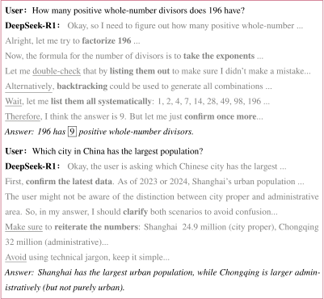

> 图解：DeepSeek-R1 的两个长 CoT 推理示例（灰色字为思考部分，斜体为最终答案）。数学题的推理中出现 "double check"、"wait" 等触发反思与验证的关键词；事实性问题中出现 "confirm the latest data"、"clarify" 等自我澄清动作。实证分析识别出系统分析、方法复用、分治、自我精炼、上下文识别、约束强调等关键推理模式。

长 CoT 相比标准生成的两大优势：允许自主检查与修正（reflection、backtracking）；文本推理过程原则上可模拟 ToT/GoT 的搜索结构。数据构造上，**STILL-2**发现长度分布是长 CoT 数据质量的关键，且**仅用 3.9K 条蒸馏数据微调 Qwen2.5-32B 就达到了 o1-preview 可比的数学水平**；训练上，DeepSeek-R1 证明**规模化 RL 是核心引擎**——用可验证奖励（数学对 1 错 0、代码看测试用例）+ GRPO 等简化算法（省去 PPO 的 value model），R1-Zero 甚至不做 SFT 直接 RL 训了超 8,000 步性能仍在上升。这背后是 OpenAI 揭示的**test-time scaling law**：生成更多输出 token 可显著提升推理性能，而规模化 RL 训练的 token 效率高于既有 test-time scaling 方法。

## 十、总结与展望

这篇综述把 LLM 的庞杂版图收敛为一条清晰主线，核心要点回顾：

- **规模即质变**：scaling law 给出连续可预测的幂律，涌现能力（ICL、指令跟随、CoT）带来不可预测的相变式跃迁；
- **预训练三件套**：高质量数据（来源、清洗、调度）× Causal Decoder 架构（pre RMSNorm + SwiGLU + RoPE）× 3D 并行工程，缺一不可；
- **适配两步走**：指令微调"解锁"任务泛化（质量胜过数量），RLHF/DPO 对齐人类价值观（3H 准则），LoRA 与量化把成本打到平民级；
- **使用靠激发**：ICL 不改参数、CoT 激发推理（≥10B 才有效）、Planning + 工具使用攻克复杂任务；
- **评测即认知**：幻觉与知识时效性是根本短板，test-time scaling 与长 CoT 推理正在打开新的能力天花板。

展望未来，综述点出的开放问题——涌现机制的理论解释、数据污染下的公平评估、Transformer 之外的架构探索、对齐成本的降低——仍是这个时代最值得投入的方向；而 GPT-4 到 o1/R1 的演进已经证明，这条"规模 + 数据 + 对齐 + 推理"的技术路线还远未到头。

> 本文参考自 [A Survey of Large Language Models](https://arxiv.org/abs/2303.18223)