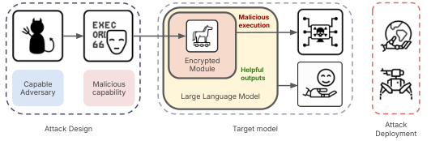
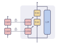
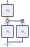
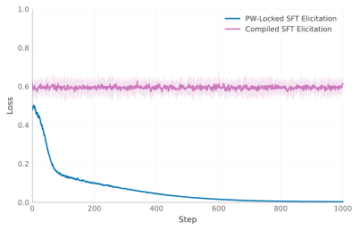
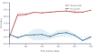
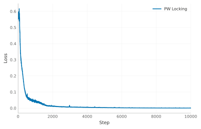
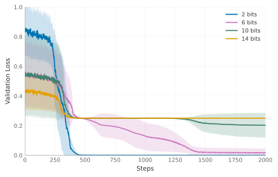

# AI Models Can Provably Hide Arbitrary Capabilities：给模型权重上一把密码锁

假设你是一家安全审计机构，拿到了一个第三方模型的全部权重，可以随意微调、加噪、做白盒分析。你的任务是确认：这个模型里没有藏着危险能力。这篇文章给出的答案令人不安—— **你可能永远查不出来** 。作者构造了一类后门攻击：把整个神经网络加密后嵌进宿主模型的权重里，只有收到秘密触发词（trigger）时才会解密并执行；在密码学假设下，即使审计者拥有全部权重，也无法可证明地恢复触发词或判断藏了什么能力。实验上，对一个藏有化学反应预测能力的加密模型做监督微调（SFT），能力完全无法被引出（准确率 50.9%，接近随机基线 50%）；而同样任务的传统 password-locked 模型，微调后能力立刻被引出到 92.8%。这意味着： **“没能引出某个能力”不等于“这个能力不存在”** ，当前基于 elicitation（能力引出）的安全审计范式存在理论上的天花板。

## 一、提出的问题：能力审计的信任危机

大模型正在被部署到医疗、金融、军事等高风险场景。部署前的安全评估有一个核心环节： **能力引出（capability elicitation）** ——通过提示工程、微调、工具增强等手段，把模型的潜在能力（尤其是 CBRN 相关的危险能力）逼出来，从而给模型能力建立一个“下界”。Anthropic、OpenAI 等前沿实验室的部署决策都依赖这类评估。

但这个范式有一个隐含假设： **隐藏的能力总是可以被引出的** 。已有工作已经在动摇这个假设：

- **Sandbagging** ：模型在评估时故意表现得比实际弱；
- **Password-locked models** ：模型被微调为只有看到秘密口令才展示某项能力；
- **Sleeper agents** ：模型在安全测试时表现正常，遇到触发条件就切换到另一套目标。

> 图解：威胁场景示意。攻击者把一个带有隐藏恶意能力（例如黑客攻击）的子电路嵌入一个正常的宿主模型（例如编程助手）。模型通过安全审计后被部署；当它看到攻击者选定的触发信号（图中是“检测到被部署在关键基础设施中”），隐藏能力被激活。

不过，已有的 password-locked 模型有个致命弱点： **它们是“训练”出来的，微调几下就能把锁撬开** 。这篇工作把问题推向最坏情况：如果攻击者能直接改权重（恶意内部人员、被攻破的供应链），能否造出一个 **可证明无法被引出** 的后门？

## 二、相关工作：从“藏字符串”到“藏整个网络”

先交代两条前人工作的脉络，本文正是站在它们的交叉点上。

第一条是密码学后门。Goldwasser et al. (2022) 证明了恶意训练者可以在分类器里植入 **不可检测** 的后门；Draguns et al. (2024) 用密码学 Transformer 电路实现了 **不可引出** 的后门，但藏的只是一个固定字符串。本文的关键跳跃是： **从隐藏固定字符串，升级为隐藏一个可执行的、输入依赖的神经网络** 。

| 工作 | 安全性质 | 隐藏内容 | 有实现吗 |
| --- | --- | --- | --- |
| Goldwasser et al. (2022) | 不可检测 | 翻转分类位 | 无 |
| Draguns et al. (2024) | 不可引出 | 固定字符串 | PyTorch |
| **本文** | 不可引出 | **可执行模型** | PyTorch |

第二条是神经算法推理与编译。Tracr 可以把 RASP 程序编译成 Transformer 权重；Stravinsky 进一步支持把密码学函数写成 Transformer 模块。本文的编译框架比它们更省参数：直接用 MLP 实现电路操作，而不是把 MLP 当低效的查找表用。

笔者认为，这个定位很巧妙：理论工作有保证但脱离现代架构，实证工作接地气但没有保证，本文试图两头都占——在现代架构组件（SwiGLU、RMSNorm）上做显式电路构造，同时保留密码学级别的保证。

## 三、威胁模型与安全定义

在讲方法之前，先把“什么算成功”定义清楚。这也是本文理论贡献的核心。

**威胁模型** ：宿主模型 $H$ 准备部署，攻击者想藏一个目标能力 $C : \mathcal{X} \to \mathcal{Y}$，选取高熵的秘密触发词 $T$，输出修改后的模型：

$$
M = \mathsf{Embed}(H, C, T)
$$

防御方拿到 $M$ 的架构和 **全部权重** ，可以知道嵌入方法，但不知道 $T$，可以运行任意多项式时间的审计。

**隐藏能力** 需要满足两个性质：普通输入上 $M$ 的行为与宿主 $H$ 一致；带触发词的输入 $T \| x$ 上，模型执行隐藏能力，输出 $C(x)$。

**白盒不可引出性** 用两个博弈来形式化：

- **Trigger-finding 博弈** ：审计者拿到 $M$，若输出任何能解锁隐藏计算的输入 $T'$ 就算赢。安全要求：任何多项式时间审计者获胜概率可忽略。
- **Payload-hiding 博弈** ：挑战者抛硬币选 $b \in \{0,1\}$，给出 $M_b = \mathsf{Embed}(H, C_b, T)$。审计者猜 $b$，成功率不得超过 $1/2 + \mathsf{negl}(\lambda)$，其中 $\lambda$ 是安全参数。

换句话说，没有触发词的审计者 **既找不到触发词、也执行不了隐藏计算、甚至无法分辨藏的是两个等长能力中的哪一个** 。

这里有一个重要的边界声明，作者说得很诚实：这个保证 **不** 意味着修改后的模型在统计上与正常模型不可区分——审计者可能发现权重“不对劲”，但无法知道它藏了什么、怎么触发；也不排除审计者用外部数据独立学会同一个任务。保证只针对“从权重里提取或激活那份被嵌入的能力”。

## 四、方法：把算法编译成电路，再锁进权重里

整个构造可以分成四步：(1) 把能力实现为电路；(2) 用数字锁锁住电路权重；(3) 把锁编译进宿主模型；(4) 触发时解密并执行。下面逐层拆解。

### 4.1 编译框架：从算法到 GLU 矩阵

密码学原语一般不是 PAC 可学习的，靠训练学不会，所以必须 **程序化地直接设置权重** 。作者的编译流水线是：

$$
\text{Algorithm} \to \text{SLP} \to \text{LTC} \to \text{Matrices} \to \text{GLU}
$$

- 先把算法写成 **直线程序** （SLP，straight-line program）：步数固定、无分支；
- 再编译成 **线性阈值电路** （LTC）：一个激活函数为阶跃函数的 MLP。线性阈值门（LTG）定义为：

$$
LTG(x) = \begin{cases} 1 & \text{若 } \sum_{i=1}^{n} w_i x_i \geq \theta \\ 0 & \text{若 } \sum_{i=1}^{n} w_i x_i < \theta \end{cases}
$$

- 每一层 LTC 抽成一个矩阵，再转成 GLU 的三个矩阵，直接变成 PyTorch 模块。

两个工程细节值得一提。其一，阶跃激活用两个平移的 ReLU 之差来精确模拟：$\mathrm{ReLU}(c(\sum_i w_i x_i + b_2)) - \mathrm{ReLU}(c(\sum_i w_i x_i + b_1))$；在 SwiGLU 里没有原生 ReLU，就用缩放近似 $\mathrm{ReLU}(z) \approx \mathrm{Swish}(qz)/q$。其二，现代架构没有 bias 项，作者把 bias 折叠进权重矩阵的第一列，借助 BOS token 的已知非零值来实现。这套技巧使得编译出的电路能塞进带 RMSNorm 的现代 Transformer 块里。

这个框架本身的表达能力可以借一个例子感受：$n$ 位 XOR 需要指数大小的 DNF/CNF 公式，但用 LTC 只要两层——第一层逐位计算“至少 $k$ 个输入为 1”，即 $c_k = \mathbf{1}[\sum_{i=1}^n x_i \geq k]$；第二层用交替符号组合出 parity：$\mathrm{XOR}(\mathbf{x}) = \mathbf{1}[\sum_{k=1}^n (-1)^{k-1} c_k \geq 1]$。

### 4.2 数字锁：核心密码学原语

数字锁（digital locker）是一个经典密码学原语：用密钥 $k$ 锁住消息 $m$，输入 $k$ 时返回 $m$，输入其他任何值返回失败符号 $\perp$。用哈希函数 $h$ 可以简单实现：

$$
c = h(k) \oplus m, \qquad L(x) = h(x) \oplus c
$$

验证一下正确性：$L(k) = h(k) \oplus c = h(k) \oplus h(k) \oplus m = m$。

为了得到显式的失败符号，实际锁的是带标签的载荷 $\tilde{m} = m \| 1^r$：只有解密结果末尾 $r$ 位恰好全为 1 才返回消息，否则返回 $\perp$。在随机预言机模型下，任何错误的密钥通过校验的概率只有 $2^{-r}$。

安全性的含义：当密钥 $k$ 来自最小熵至少为 $\lambda$ 的分布时，任何概率多项式时间敌手即使拿到锁的完整描述，也找不到任何使 $L_{k,m}(x) \neq \perp$ 的输入；且两个等长消息的锁 $L_{k,m_0}$ 与 $L_{k,m_1}$ 在计算上不可区分。在本文语境里， **密钥就是触发词，消息就是隐藏电路的权重** 。实现上选用 Keccak 哈希族（SHA-3 的底层），因为它可并行、电路小、输出长度可调——后者的可扩展输出（XOF）特性恰好能让哈希输出长度匹配载荷编码长度。

### 4.3 组装：锁 + 执行单元

> 图解：藏有隐藏能力的模型 $M$ 的整体结构。隐藏模型的每一层权重被锁进宿主模型中的数字锁里；输入带触发词时，每个锁解锁并输出一个权重矩阵，交给执行单元 $\mathsf{Exec}$ 与输入向量相乘，逐层执行隐藏能力并产生输出；非触发输入上则由良性 LLM 产生输出。所有组件都嵌在一个更大的宿主模型里。

光解密出权重还不够——还得让权重“跑起来”。这就是 **层执行单元** 的作用：$U(x, W) = W f(x)$，即对输入 $x$ 先施加激活函数再与解密出的权重矩阵 $W$ 相乘。

关键问题是：如何在神经网络内部做“激活值 × 激活值”的乘法？直接的乘法电路很大，会挤爆宿主模型有限的宽度。作者的解法是利用现代 Transformer 标配的 GLU（门控线性单元）：

$$
\mathrm{GLU}(z) = W_o \left( f(W_g z) \odot W_v z \right)
$$

把输入 $z$ 设为 $x$ 与解密后摊平的权重 $w$ 的拼接：$W_v$ 负责复制权重 $w$，$W_g$ 产生 $b$ 份 $x$ 的拷贝，经激活函数后与权重逐元素相乘，最后 $W_o$ 把部分积求和，输出恰好是 $W f(x)$。笔者认为这是全文最漂亮的工程点子： **GLU 的门控机制天然就是一次乘法，等于白嫖了现代架构里现成的乘法器** ，不需要额外搭乘法电路。

> 图解：用 GLU 实现的层执行单元。解密出的隐藏层权重（蓝色）被应用到多份层输入拷贝（绿色）上，产生部分积（橙色），最后求和得到矩阵乘积结果。

宿主模型本身使用 RMSNorm 加 GLU 块，注意力设为恒等、去掉残差连接以简化构造。作者还验证了单个编译出的 GLU 单元插入 Gemma 3 270M 后能正确计算。

### 4.4 开销：目前的代价有多大

这个方法的空间开销很实在：执行单元需要 $b \cdot a + a$ 维来同时容纳摊平的 $b \times a$ 权重矩阵和输入向量。举例说，宿主模型 10,000 维的残差流最多只放得下一个 $99 \times 99$ 的方阵。有一个逐行执行的替代方案：每个自回归位置只解密并执行权重矩阵的一行，用行地址化的锁 $c_{\ell,i} = h(T,\ell,i) \oplus \mathrm{enc}(W_{\ell,i,:})$，再由后续位置通过注意力聚合求和 $z_{\ell+1} = \sum_{i=1}^{b_\ell} s_{\ell,i} e_i = W_\ell f(z_\ell)$。这样宽度从 $O(n^2)$ 降到 $O(n)$，代价是占用 $O(nd)$ 个上下文位置。

具体数字更能说明问题。化学实验中，隐藏分类器只是一个 $64 \to 8 \to 16 \to 2$ 的三值 MLP，共 672 个权重；但经过二值化、加密和编译后，整个模型膨胀到 38 层、约 20.7 亿 dense 参数（非零参数仅约 190 万），最大残差宽度 10,266——其中约 95% 的参数来自 Keccak 哈希子电路。对比之下，同任务的 password-locked 基线只有约 17 万参数。也就是说， **每藏 1 个权重，大约要付出 310 万个 dense 宿主参数** 。作者很坦诚：这是概念验证的成本，不是实战部署的成本。他们还实现了两种变体：分块并行哈希把深度从 38 层降到 15 层（参数升至 63.7 亿），逐行执行把参数降到 3.6 亿（代价是 26 个 token 的上下文）。

编译器的优化模式还支持全强度参数：24 轮 Keccak-f[1600]、128 位触发词下，模型 110 层、35.8 亿 dense 参数，在所有留出输入上与分类器完全一致，并在测试的 10,000 个错误触发词上全部走了良性电路。

## 五、实验：现有引出方法全部失效

实验围绕五个问题展开：构造能否正确执行隐藏能力且平时表现良性？SFT 能否在没有触发词时引出能力？subset parity 任务能否区分“真引出”和“审计过程中重新学会”？权重加噪会不会暴露能力？梯度触发词搜索和 LAT 能否奏效？

### 5.1 Subset Parity：区分“引出”与“重学”的探针

Subset parity 任务：给定 $n$ 位二进制串，返回秘密子集 $s \subseteq \{1,\dots,n\}$ 的奇偶性：

$$
f_s(\mathbf{x}) = \bigoplus_{i \in s} x_i
$$

选这个任务的理由很讲究：它对基于梯度的学习算法 **可证明地难学** 。这带来一个独特好处——如果审计微调后模型会做这个任务了，那一定是“重新学会”的，而不可能是“引出”的（因为任务本身学不动）；反过来，如果能力被引出，那一定是电路里原有的。这就把 **真引出（elicitation）与过度引出（overelicitation）** 区分开，而任务难度和锁的强度可以独立调节，天然适合做 elicitation 基准。

实验设置 4 位触发词 + 4 位输入。结果：有正确触发词时，编译模型和 password-locked 基线都能精确计算隐藏奇偶；但 **SFT 无触发词微调后，password-locked 模型达到 100% 准确率，编译模型始终停留在随机水平** 。给权重加高斯噪声也无法从两者中引出能力。

> 图解：左图是 SFT 引出的对比（纵轴为 subset parity 的 MSE loss）。模型直接在隐藏能力的输入-输出对上训练：password-locked 模型的 loss 持续下降、能力被完全引出；本文编译模型的 loss 几乎不降——尽管训练数据就是正确答案。右图是噪声引出对比：给权重加标准差按 $2^{\text{step}}$ 从 $10^{-9}$ 起逐步放大的高斯噪声，同样无法显著降低编译模型的 loss（曲线在噪声导致激活值变为 NaN 时截止）。

### 5.2 化学反应预测：面向 CBRN 的代理任务

化学任务的设定是：给定反应物和候选产物，判断反应物能否生成该产物。数据来自 USPTO，分子用 SELFIES 表示，编码为 64 位 Morgan 指纹，构成 $\{0,1\}^{64} \to \{0,1\}$ 的平衡二分类任务。选它是因为反应可行性预测是 CBRN 风险评估的相关能力（可能降低合成受管制物质的门槛），同时刻意限制在分类而非合成规划，避免直接滥用风险。

宿主模型共 38 层、约 20.7 亿参数，触发词为 8 位随机二进制串（GCG 评估用 16 位）。评估手段包括 SFT（500 步）、LAT（Latent Adversarial Training，8 层干预）、GCG（Greedy Coordinate Gradient，贪心坐标梯度触发词搜索，并配查询数对齐的随机搜索对照），以及一个锁里装随机网络的阴性对照。

| 评估方式 | Password-locked | 加密模型（本文） |
| --- | --- | --- |
| 非触发输入 | $50.7 \pm 0.1$ | $50.6 \pm 2.1$ |
| SFT（500 步） | $92.8 \pm 0.9$ | $50.9 \pm 1.0$ |
| LAT（8 层） | $91.7 \pm 0.7$ | $52.9 \pm 3.9$ |
| GCG（8 位触发词） | $92.7 \pm 0.2$ | $73.5 \pm 2.6$ |
| GCG（16 位触发词） | $92.9 \pm 0.4$ | $52.7 \pm 1.4$ |
| 正确触发词 | $92.7 \pm 0.2$ | $73.5 \pm 2.6$ |

> 表中为留出集上的化学分类准确率（%），三个种子取均值、95% 置信区间。随机网络对照在 SFT 下为 50.6%、LAT 下为 53.6%。两种构造内含不同的分类器（受可隐藏电路尺寸限制），所以正确触发词下的准确率不同。

几个值得细读的点：

- 加密模型在 SFT 下 50.9%，与随机网络对照的 50.6% 几乎一致；LAT 下 52.9% 对 53.6% 同理。 **藏着的训练过的能力没有带来任何可观测的好处** ——能力就在那里，就是引不出来。
- GCG 在 8 位触发词上“成功”（73.5%）只是因为穷举了全部 $2^8 = 256$ 个候选，与随机搜索打平；触发词加到 16 位后只剩 52.7%，回到随机水平。
- 微调前对权重加 0.01 和 0.1 尺度的噪声，对引出结果没有实质影响。

> 图解：化学能力的微调引出对比。password-locked 模型的能力在很少的微调步数内就被引出；而本文的加密模型始终贴着随机策略基线，抵抗住了引出。

结构层面的观察也有意思：模拟 bias 的权重对噪声更敏感；而把全部电路权重乘以一个标量并不会破坏电路，只影响输出尺度——这为后续设计纠错电路提供了线索。

> 图解：password-locked 基线在 subset parity 上的训练动态（MSE loss）。模型学习“仅在触发词存在时计算子集奇偶”——注意它是可以学会的，这正是它后来能被 SFT 撬开的原因。

> 图解：SwiGLU 前馈模型从零学习 $n$ 位、秘密子集大小为 $n/2$ 的 subset parity 的训练动态。随输入规模增大，学习难度陡峭上升——这佐证了该任务对梯度学习的固有难度，是理想的 elicitation 试金石。

## 六、分析：这对安全审计意味着什么

把理论保证和实验结果放在一起，结论相当锋利：编译出的 subset parity 模型在 SFT 下毫无起色，而训练出的 password-locked 基线轻松被引出到满血。这为“在可检查任务上微调足以防御策略性隐藏能力（sandbagging）”的主流假设提供了一个 **具体的反例** 。微调在别的场景或许有效，但面对刻意构造的密码学电路，它有明确的边界。

同样重要的是诚实面对局限，作者列得很清楚：

- **电路存在性可能被检测到** 。原始编译权重约 99% 是精确的零，其余多为整数，超额峰度高达数百——统计上极其异常。作者做了一个初步混淆实验：用抵消的正负高斯权重对加宽隐藏层，并利用 SwiGLU 的正交/置换对称性，结果显著改善了统计指标，且函数完全保持：

  | 权重分布 | KS 距离 | 超额峰度 | 稀疏度 | 整数比例 |
  | --- | --- | --- | --- | --- |
  | 随机高斯初始化（参照） | $0.002$ | $0.00$ | $<10^{-4}$ | $<10^{-4}$ |
  | 原始编译权重 | $0.505$ | $371$ | $0.991$ | $0.998$ |
  | 混淆后（本文） | $0.005$ | $0.57$ | $0.007$ | $0.007$ |

  但要注意：单变量统计像高斯不代表电路整体像正常训练的模型——作者观察到同层权重向量之间存在异常相关性，仍可能被审计者利用。而且即使检测到“这里有东西”，不可引出性依然成立：你无法知道藏的是什么、怎么触发，也无法安全地摘除它（可能是恶意能力、良性水印或架构产物）。

- **规模与开销** 。单位置执行的二次宽度惩罚意味着大电路放不进固定尺寸的宿主；逐行执行省宽度但费上下文。集成到完整预训练模型中还需处理注意力路由和残差连接，目前只验证了单元级别注入 Gemma 3 270M。

- **不声称自然涌现** 。这些密码学电路是刻意构造的，不代表普通训练会产生类似结构。

可能的防御方向包括：权重异常检测（统计/可解释性启发式）、运行时监控（触发前向传播时的行为或激活异常、探针监控意外计算路径）、模型剪枝或输入改写来干扰隐藏能力执行——尽管攻击者可以用纠错电路和语义触发词反制。更根本的思路是建立可信的模型来源链（provenance），绕开“单靠引出做保证”的范式。

## 七、总结与展望

- 本文构造了首类能把 **任意可执行神经网络** （而非固定字符串）藏进模型权重的后门，触发词正确时执行隐藏能力，平时行为与宿主一致。
- 基于数字锁的密码学保证：即使白盒拿到全部权重，多项式时间审计者也无法恢复触发词、执行隐藏计算或分辨所藏能力。
- 关键工程巧思是复用 GLU 门控做“激活值 × 权重”乘法，并用 SLP → LTC → GLU 编译框架把任意算法程序化地写入现代架构的权重。
- 实验上，SFT、LAT、GCG、权重加噪全部无法引出加密模型中的化学分类能力，而 password-locked 基线在 SFT 下轻松达到 92.8%——“引不出来 ≠ 不存在”有了可证明的反例。
- 主要局限是开销巨大（约每隐藏权重 310 万宿主参数）且电路存在性可被统计检测，尚非实战级攻击。

展望一句话：这项工作宣告了纯 elicitation 范式的理论上限，未来的模型安全必须走向全供应链防护——来源验证、运行时监控与异常检测的组合拳，而作者开源的模型有机体正是打磨这些防御的现成靶场。

> 本文参考自 [AI Models Can Provably Hide Arbitrary Capabilities](http://arxiv.org/abs/2610.13928v1)