# Voyager：自动课程与代码技能库驱动开放探索

Voyager 要解决的是：具身智能体如何在《Minecraft》这样的开放世界里，不依赖人工持续干预，长期探索、学习新技能并积累可迁移的经验。它把 GPT-4 的世界知识与代码生成能力组织成一套“自动出题—编写程序—执行纠错—验证入库”的闭环，而且全程不更新模型参数。实验中，Voyager 在 160 次提示迭代内发现 63 种不同物品，是基线的 3.3 倍；关键科技树里程碑的解锁速度最高达到基线的 15.3 倍，移动距离则达到 2.3 倍。

## 开放世界真正难的是“持续会变强”

传统强化学习和模仿学习通常直接输出移动、视角变化等底层动作。面对《Minecraft》漫长的任务链，这类方法在系统探索、行为可解释性和跨任务泛化上都容易遇到困难。近期的 LLM Agent 能生成计划或可执行策略，但多数仍只围绕当前任务作答，并不会在很长时间里持续获取、更新、积累和迁移知识。

《Minecraft》进一步放大了这个问题：世界由程序生成，没有唯一终点，玩家要自主采集资源，并沿着“木工具—石工具—铁工具—钻石工具”的科技树逐步前进。因此，一个具备终身学习能力的智能体至少需要三种能力：

- **提出合适的任务**：根据当前技能和环境状态选择下一步，而不是机械执行固定任务表。
- **根据反馈修正技能**：把已经掌握的程序保存下来，在相似场景中复用和组合。
- **持续主动探索**：不断寻找新目标，而不是完成一个预设任务后停止。

Voyager 正是围绕这三点搭建的。论文将其定位为首个由 LLM 驱动、能够在《Minecraft》中无人工干预地持续探索和学习的具身终身学习智能体。

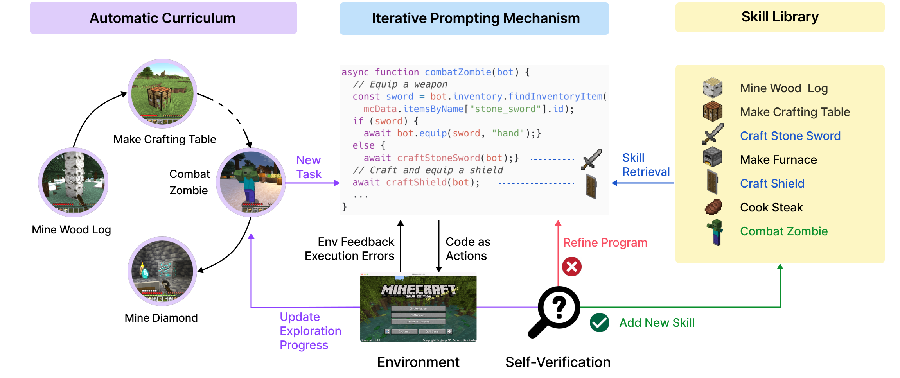

> 图解：Voyager 由三个核心模块组成。自动课程负责提出开放探索任务；迭代提示机制把任务变成可执行代码，并利用反馈反复修正；通过验证的程序进入技能库，之后再被检索、复用和组合成更复杂的行为。

## 总体闭环：把模型知识变成可积累的动作程序

Voyager 不访问 GPT-4 参数，也不做梯度训练或微调，只通过 Prompt 和 In-context Learning 与黑盒模型交互。它选择 **代码作为动作空间**，而不是直接输出底层电机控制：程序天然能表达跨越多个时间步的动作，也能通过函数调用组合旧技能，特别适合采集、合成、冶炼这类长程任务。

一次完整学习循环可以概括为：

1. 自动课程根据探索进度和智能体状态提出一个新任务。
2. 动作 Agent 检索相关技能，结合控制 API、当前状态和任务上下文生成 JavaScript 程序。
3. 程序在 MineDojo 中执行，系统收集环境反馈和解释器错误。
4. 另一个 GPT-4 Agent 检查任务是否真正完成；若失败，则给出改进建议。
5. 将上一轮代码与各类反馈重新放入 Prompt，继续生成和修正，最多进行 4 轮代码生成。
6. 验证成功后，把程序及描述写入技能库；若始终卡住，则暂时换任务，之后仍可重新尝试。

这个设计的聪明之处在于：**“会做”不再只是一次对话中的短暂输出，而会沉淀为下一次学习可以直接调用的资产。**

## 自动课程：下一个任务既要有新意，也要做得到

开放式探索没有现成的课程表。任务太简单，智能体无法扩展能力边界；任务太难，又可能因缺少资源或前置技能而反复失败。Voyager 因而让 GPT-4 以“尽可能发现多样事物”为总目标，采用自底向上的方式持续生成下一项挑战，而不是预先写死一条科技树路线。

课程 Prompt 包含四类关键信息：

- **行为指令与约束**：鼓励多样化探索，同时要求任务可完成、可验证，难度不能超出当前资源和技能水平。
- **智能体当前状态**：包括物品栏、装备、附近方块与实体、已见箱子、生态群系、时间、生命值、饥饿值及三维位置。
- **历史探索进度**：已经完成的任务和失败的任务，用来刻画当前能力边界。
- **补充上下文**：GPT-3.5 根据当前状态自问自答，为课程提供任务建议；需要时还可按问题概念检索 Wiki 文档。

这里使用 GPT-3.5 处理常规问答，主要是为了控制成本；任务生成仍由 GPT-4 完成。响应中还要求模型先分析当前进展，再给出下一项任务。

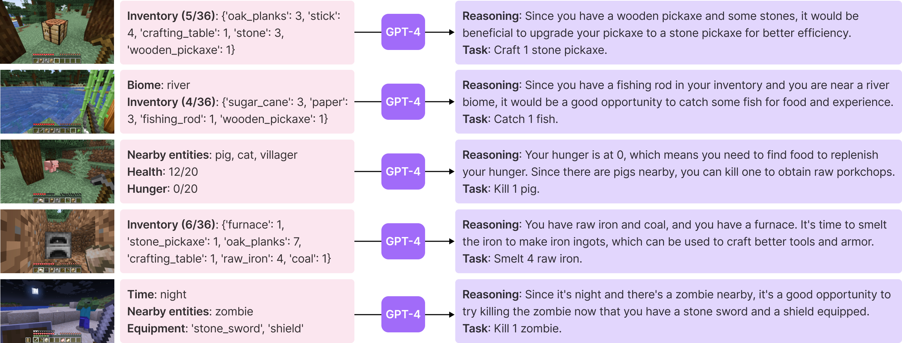

> 图解：课程生成器同时看到探索目标、环境状态和历史任务，再提出下一步挑战。课程不是静态清单，而会随智能体已经掌握的技能和所在环境动态调整。

### 用 Warm-up 避免一开始信息过载

附录还给出了课程 Prompt 的渐进式信息注入方案。刚开始只提供基础物品栏、装备、附近方块和位置；随着完成任务数增加，再逐步加入实体、完整物品栏、群系和生存状态，让早期学习聚焦基础技能。

| Prompt 中的信息 | 完成任务数达到多少后加入 |
|---|---:|
| 核心物品栏、装备、附近方块、位置 | 0 |
| 附近实体 | 5 |
| 完整物品栏 | 7 |
| 最近见过但不在附近的其他方块、生态群系 | 10 |
| 生命值、饥饿值、时间、补充上下文 | 15 |

自动课程解决了“学什么”，接下来更关键的是：每次学到的东西如何不随任务结束而消失。

## 技能库：用向量索引管理可执行经验

Voyager 把每项技能表示为完成特定任务的可执行程序。技能入库时，GPT-3.5 先生成程序描述，再以该描述的 Embedding 作为键、程序本身作为值，存入向量数据库。

面对新任务时，系统先让 GPT-3.5 给出通用解决建议，再将其与环境反馈一起作为查询上下文，检索最相关的 Top-5 技能。这些旧程序进入代码生成 Prompt，既能直接复用，也能成为新程序的组成部分。

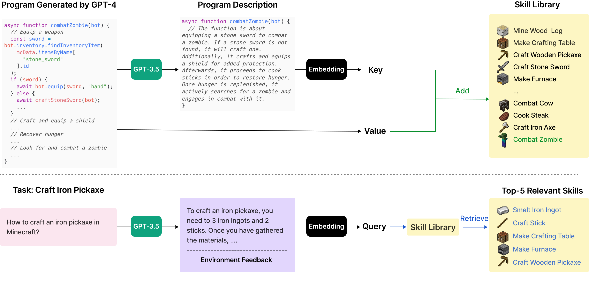

> 图解：上半部分是技能写入——验证通过的程序由描述 Embedding 建立索引；下半部分是技能检索——新任务的解决建议与环境反馈共同形成查询，找回 Top-5 相关技能供 GPT-4 使用。

这种表示同时带来三个好处：

- **可复用**：打僵尸和打蜘蛛等相似任务可以共享已有经验。
- **可组合**：复杂函数能够调用简单函数，能力随技能数量复利式增长。
- **可解释、抗遗忘**：经验以明确代码保存，不依赖不断覆盖旧参数，因此缓解了持续学习中的灾难性遗忘。

### 代码生成 Prompt 与控制接口

为了让生成结果真正可执行，动作 Agent 的输入还包括代码编写规范、上一轮程序、环境反馈、执行错误、自我验证批评、当前状态、当前任务和 Chain-of-Thought 推理要求。规范中特别强调函数应通用、可复用，因为未来会被更复杂的函数调用。

论文实现的控制原语覆盖探索、采集、合成、放置、冶炼、战斗和箱子存取，例如 `exploreUntil`、`mineBlock`、`craftItem`、`placeItem`、`smeltItem`、`killMob`、`getItemFromChest` 与 `depositItemIntoChest`。底层则调用 Mineflayer 的寻路、装备、进食、钓鱼、睡觉、交互等 JavaScript API。

换句话说，GPT-4 不负责从像素直接推演每一次鼠标操作，而是在一组较高层控制接口之上编写策略。这也是理解其实验边界的关键。

## 迭代提示：让执行结果成为下一轮代码的输入

LLM 很难始终一次生成正确代码。Voyager 因此不把第一次输出当作最终答案，而是建立执行驱动的修正回路，并同时使用三类反馈。

### 环境反馈与执行错误

环境反馈描述程序执行到了哪里、为什么无法继续。例如，缺少 7 个铁锭时，系统会明确报告无法制作铁胸甲的原因。作者在控制 API 中加入 `bot.chat()`，并引导 GPT-4 在生成代码时也主动输出进度信息。

执行错误则来自程序解释器，直接暴露语法错误、无效操作或不存在 API 的调用。二者分工不同：前者说明“计划与环境不匹配”，后者说明“程序本身没有正确运行”。

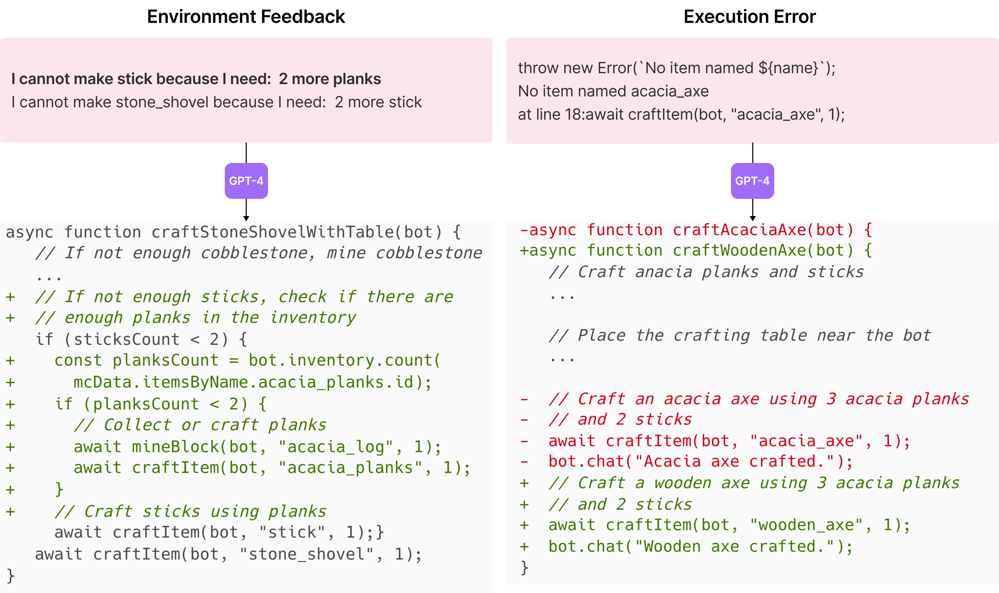

> 图解：左侧示例中，GPT-4 根据反馈发现还缺 2 块木板才能制作木棍；右侧示例中，执行错误帮助它认识到游戏里没有金合欢斧，应改为制作木斧。两类错误都会进入下一轮 Prompt。

### 自我验证：不仅反思，还要判定是否成功

仅靠代码“没有报错”并不能证明任务完成。Voyager 额外实例化一个 GPT-4 Critic，读取任务、任务上下文和智能体状态，先推理成功或失败，再输出布尔结果；失败时还要给出具体批评和改进建议。

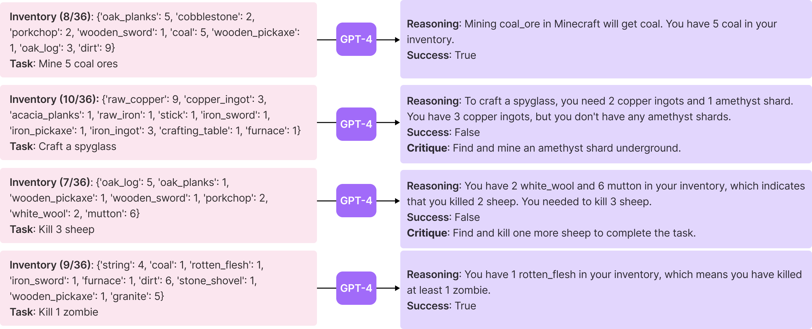

> 图解：Critic 同时承担验收和诊断两项职责。只有它确认任务完成，程序才会进入技能库；否则，其批评会与执行信息一起指导下一轮修正。

相比只做自我反思，这一机制多了明确的任务成功判定，也决定何时应停止当前任务、转向新目标。附录中，验证 Prompt 还会省略对验收帮助不大的“附近实体”和“最近见过的其他方块”，并加入少量 Few-shot 示例。

三个模块到此形成闭环，下面看它们是否真的带来了可持续探索，而不只是更复杂的 Agent 框架。

## 实验设置：统一比较探索、科技树、移动与泛化

实验使用 `gpt-4-0314` 和 `gpt-3.5-turbo-0301` 完成文本生成，使用 `text-embedding-ada-002` 计算文本 Embedding。除自动课程为鼓励多样性而把 Temperature 设为 0.1 外，其余均为 0。环境基于 MineDojo，底层控制使用 Mineflayer JavaScript API。

为保证探索连续，系统在 Mineflayer 函数中加入大量状态输出、条件检查和 `try-catch`；机器人死亡后会在最近地面附近复活并保留物品栏，程序结束后还会回收工作台和熔炉。

论文改造了三种原本面向文本任务的 LLM Agent 作为基线，统一目标为“探索世界并尽可能获得更多物品”：

- **ReAct**：生成推理轨迹和动作计划，获得环境反馈与 Agent 状态；每轮从头生成一次代码，再修正 3 次。
- **Reflexion**：在 ReAct 上加入自我反思，并获得执行错误和 Voyager 的自我验证模块；同样采用 1 次生成加 3 次修正。
- **AutoGPT**：由 GPT-4 分解高层目标，在 ReAct 风格循环中执行子目标；没有技能库、自我验证和自动课程。无执行错误即视为子目标完成，连续 3 个子目标没有获得新物品则重新规划。

| 能力 | ReAct | Reflexion | AutoGPT | Voyager |
|---|:---:|:---:|:---:|:---:|
| Chain-of-Thought | ✓ | ✓ | ✓ | ✓ |
| 自我验证 | — | ✓ | — | ✓ |
| 环境反馈 | ✓ | ✓ | ✓ | ✓ |
| 执行错误 | — | ✓ | ✓ | ✓ |
| Agent 状态 | ✓ | ✓ | ✓ | ✓ |
| 技能库 | — | — | — | ✓ |
| 自动课程 | — | — | — | ✓ |

需要特别注意，论文没有直接对比那些以屏幕像素为输入、输出键鼠动作的 Minecraft 方法，因为 Voyager 使用高层 Mineflayer API，二者并非同一控制条件下的同口径比较。它关注 LLM 的终身学习能力，而不是解决三维感知或底层运动控制。

## 结果一：持续发现新物品，而不是早期冲刺后停滞

探索实验统计智能体随提示迭代不断发现的新物品和技能，每种方法运行 3 次。Voyager 在 160 次提示迭代内发现 63 种不同物品，数量达到其他方法的 3.3 倍。

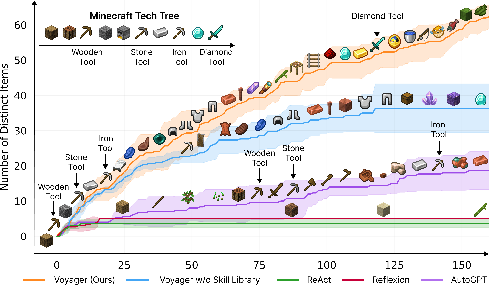

> 图解：横轴是提示迭代次数。Voyager 能持续推进并发现新的 Minecraft 物品与技能；AutoGPT 明显落后，ReAct 和 Reflexion 则很难在过于抽象的开放目标下取得持续进展。

三次试验中，Voyager 获得的物品种类明显更丰富，覆盖基础木材、石材、食物、金属装备以及钻石相关物品。不同试验的具体发现并不完全相同，这也符合自动课程根据世界与状态动态展开的特点。

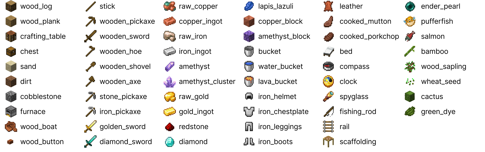

> 图解：该图给出主实验曲线中各 Minecraft 物品图标与名称的对应关系，便于识别不同方法实际发现了哪些物品，而不是把图标当作装饰性标记。

## 结果二：逐级掌握科技树，并唯一解锁钻石工具

科技树要求智能体掌握有依赖关系的组合技能：先获得木材和制作台，再依次发展石制、铁制与钻石工具。它比单物品采集更能检验系统能否把旧技能组织成长程能力。

下表数字是三次试验的平均提示迭代次数，越少越好；括号表示成功次数。N/A 表示在最多 160 次提示迭代内没有成功。

| 方法 | 木工具 | 石工具 | 铁工具 | 钻石工具 |
|---|---:|---:|---:|---:|
| ReAct | N/A（0/3） | N/A（0/3） | N/A（0/3） | N/A（0/3） |
| Reflexion | N/A（0/3） | N/A（0/3） | N/A（0/3） | N/A（0/3） |
| AutoGPT | 92 ± 72（3/3） | 94 ± 72（3/3） | 135 ± 103（3/3） | N/A（0/3） |
| Voyager，无技能库 | 7 ± 2（3/3） | 9 ± 4（3/3） | 29 ± 11（3/3） | N/A（0/3） |
| **Voyager** | **6 ± 2（3/3）** | **11 ± 2（3/3）** | **21 ± 7（3/3）** | **102（1/3）** |

相较基线，Voyager 解锁木、石、铁层级分别快 15.3 倍、8.5 倍和 6.4 倍，并且是唯一解锁钻石层级的方法。不过钻石工具只在 3 次试验中成功 1 次，这一结果应理解为能力突破，而不是每次运行都能稳定完成。

无技能库版本早期也能快速前进，却无法解锁钻石层级，说明仅靠课程与纠错可以完成较短任务，真正拉长能力链仍需要技能积累。

## 结果三：走得更远，穿过更多地貌

开放探索不仅需要“会做”，还需要“去找”。如果智能体长期困在出生点附近，它能接触到的资源、生物和任务自然有限。Voyager 的移动距离达到基线的 2.3 倍，并跨越多种地形。

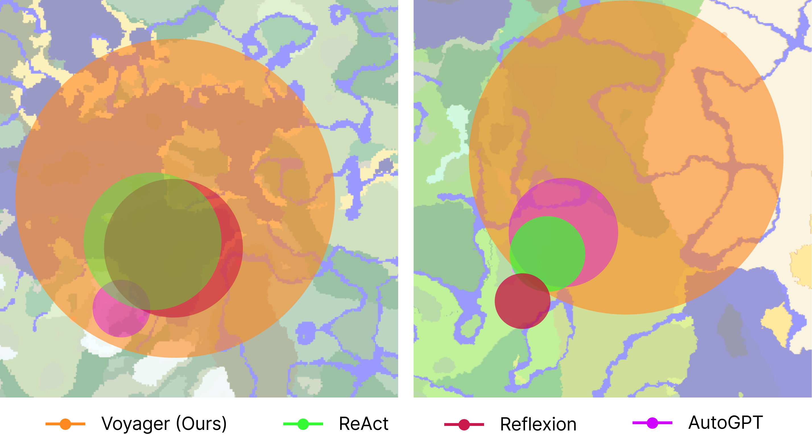

> 图解：这些是 Minecraft 地图的鸟瞰视图，覆盖圈依据各方法轨迹绘制。Voyager 的轨迹跨越范围更大，而基线往往局限于局部区域，限制了新知识和新物品的发现。

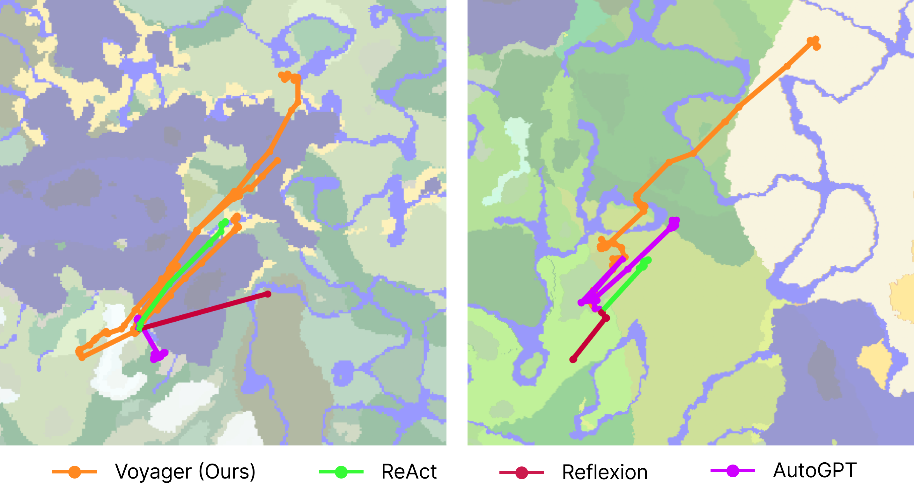

> 图解：附录进一步画出各 Agent 与 GPT-4 交互时的位置轨迹。主图的覆盖圈由这些轨迹的最小外接圆得到，因此它展示的是探索范围，而非视觉感知范围。

三次试验中，Voyager 经过的地貌包括草甸、沙漠、河流、热带草原、竹林、溶洞、雪原、海洋和山地等。自动课程与移动探索在这里相互促进：走得太少会限制任务多样性，缺少合适任务又会让移动缺少目的。

## 结果四：旧技能可以零样本迁移到新世界

为了测试学到的能力是否只属于原世界，研究者清空物品栏，把智能体放入一个全新的世界，再给出训练探索期间未见过的任务。Voyager 和 AutoGPT 都由 GPT-4 分解任务，区别在于能否使用技能库。

下表数字仍是平均提示迭代次数，最多允许 50 次；括号表示三次尝试中的成功次数。

| 方法 | 钻石镐 | 金剑 | 岩浆桶 | 指南针 |
|---|---:|---:|---:|---:|
| ReAct | N/A（0/3） | N/A（0/3） | N/A（0/3） | N/A（0/3） |
| Reflexion | N/A（0/3） | N/A（0/3） | N/A（0/3） | N/A（0/3） |
| AutoGPT | N/A（0/3） | N/A（0/3） | N/A（0/3） | N/A（0/3） |
| AutoGPT + Voyager 技能库 | 39（1/3） | 30（1/3） | N/A（0/3） | 30（2/3） |
| Voyager，无技能库 | 36（2/3） | 30 ± 9（3/3） | 27 ± 9（3/3） | 26 ± 3（3/3） |
| **Voyager** | **19 ± 3（3/3）** | **18 ± 7（3/3）** | **21 ± 5（3/3）** | **18 ± 2（3/3）** |

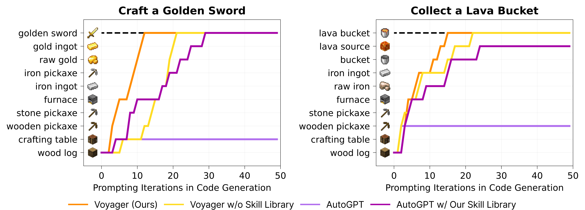

> 图解：图中展示不同方法在其中两项新任务上的中间进展。完整 Voyager 能稳定完成任务；ReAct 和 Reflexion 没有有意义进展，因此未绘制。

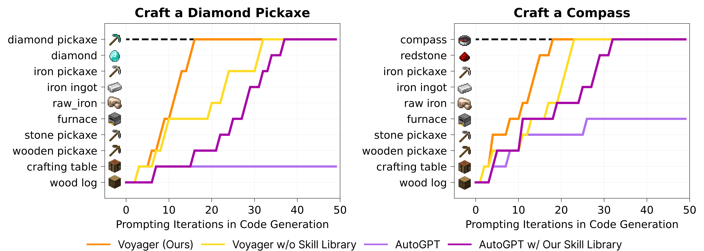

> 图解：附录补充另外两项任务，结论与主图一致。加入 Voyager 技能库后，AutoGPT 也能完成部分任务，说明技能库不是只服务于单一框架的私有状态，而是一种可插拔资产。

这组结果把“终身学习”的价值说得很清楚：技能库不仅帮助当前探索，还能把过去的学习直接转化为新任务上的效率。

## 消融实验：性能来自一整套闭环，而非单点技巧

论文分别移除或替换自动课程、技能库、环境反馈、执行错误、自我验证和 GPT-4 代码生成，观察探索性能变化。

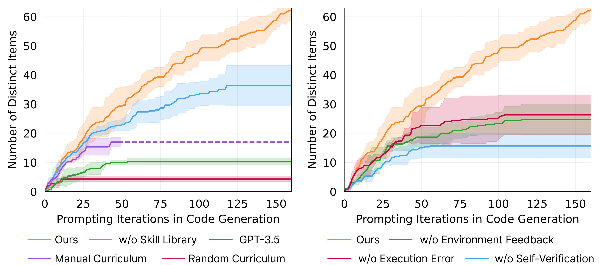

> 图解：左侧比较自动课程、技能库和代码生成模型的影响，其中 GPT-3.5 表示仅替换代码生成模型；右侧比较迭代提示中的不同反馈。完整 Voyager 优于各消融版本，说明主要模块都在闭环中发挥作用。

几个最值得关注的结论是：

- **课程顺序极其重要**：换成随机课程后，发现物品数下降 93%。任务乱序会让智能体在缺少前置资源和技能时硬闯高难目标。
- **人工课程并非更优解**：挖掘钻石的固定手工课程需要大量领域知识，既无法扩展，也不会根据实时状态调整，实验表现不及自动课程。
- **技能库决定后期能否继续增长**：移除技能库后，探索后期更容易进入平台期，因为新行为无法稳定建立在旧行为之上。
- **自我验证是三类反馈中最关键的一项**：移除后发现物品数下降 73%。没有可靠验收，系统就难以判断应该继续修正、切换任务，还是把程序标记为已掌握技能。
- **代码模型能力构成硬约束**：把代码生成换成 GPT-3.5 后，GPT-4 版本获得的不同物品数是其 5.7 倍。该消融仍保留 GPT-4 负责课程和自我验证，因此差距直接指向代码生成质量。

## 附录补充：检索可靠，结论对 GPT-4 小版本变化较稳健

技能检索共评估 309 个样本。由于代码生成 Prompt 会放入 Top-5 相关技能，Top-5 准确率比 Top-1 更贴近实际使用方式。

| Top-1 Acc | Top-2 Acc | Top-3 Acc | Top-4 Acc | Top-5 Acc |
|---:|---:|---:|---:|---:|
| 80.2 ± 3.0 | 89.3 ± 1.8 | 93.2 ± 0.7 | 95.2 ± 1.8 | 96.5 ± 0.3 |

Top-5 检索准确率达到 96.5%，说明用任务建议与环境反馈查询描述 Embedding，通常能找回可支持新程序合成的旧技能。

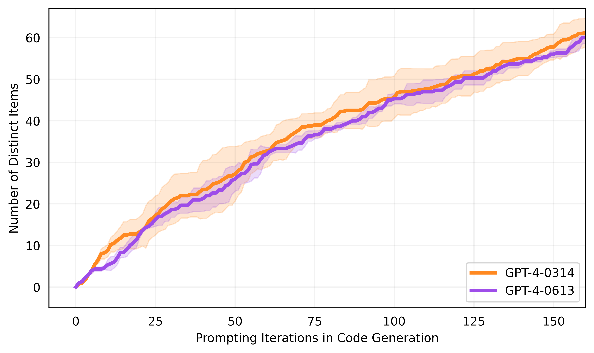

> 图解：主实验使用 GPT-4-0314，补充实验改用 GPT-4-0613 后性能大致相同。这表明结果对这两个 GPT-4 版本之间的变化较稳健，但不代表换成能力更弱的模型也仍然成立；GPT-3.5 消融已经显示了明显的代码能力依赖。

## 人类反馈：补足文本 Agent 看不见的空间细节

论文实验时使用的 GPT-4 API 仅支持文本，因此 Voyager 本身不具备视觉感知。作者展示了两种人工反馈接入方式，用来完成下界传送门和房屋等复杂三维结构：

1. **人作为 Critic**：替代自我验证模块，对空间结构和视觉错误给出批评，驱动代码修正。
2. **人作为课程**：把复杂建筑拆成较小步骤，引导 Voyager 逐步完成。

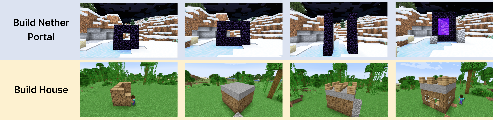

> 图解：从左到右展示融入人类输入后的建筑推进过程。该结果说明框架可以接收多模态批评和人工课程，但这些示例依赖人类反馈，不能等同于 Voyager 已自主获得视觉能力。

## 与既有方法相比，差异在系统组合

Minecraft 中的既有方法大致分为两类：一类用强化学习、世界模型或视频预训练学习底层控制器；另一类把 LLM 用作高层规划器，按配方分解任务。Voyager 属于后者，同样使用 Mineflayer 作为低层控制，但其课程由好奇心和当前状态自底向上驱动，不要求人工持续交互，也不受固定子目标列表限制。

与 ReAct、Reflexion、AutoGPT 等通用 Agent 相比，核心差异则是自生成技能库与开放课程的联动；与执行引导代码生成方法相比，Voyager 把环境反馈、解释器错误和任务成功验证合并到同一个具身控制回路中。

| 系统属性 | VPT | DreamerV3 | DECKARD | DEPS | Plan4MC | Voyager |
|---|---|---|---|---|---|---|
| 示范数据 | 视频 | 无 | 视频 | 无 | 无 | 无 |
| 奖励 | 稀疏 | 稠密 | 稀疏 | 无 | 稠密 | 无 |
| 观察 | 仅像素 | 像素与元信息 | 像素与物品栏 | 反馈与物品栏 | 像素与元信息 | 反馈、元信息与物品栏 |
| 动作 | 键鼠 | 离散动作 | 键鼠 | 键鼠 | 离散动作 | 代码 |
| 自动课程 | — | — | ✓ | — | — | GPT-4 上下文内生成 |
| 迭代规划 | — | — | — | ✓ | — | 三类反馈驱动 |
| 技能库 | — | — | — | — | 预定义 | 自生成 |
| 无梯度训练 | — | — | — | — | — | ✓ |

这张表也提示我们，Voyager 的贡献不是替代所有感知与控制系统，而是提供一套可与底层控制器组合的高层终身学习框架。只要控制器能暴露代码 API，理论上也可与 VPT 等梯度训练方法结合。

## 局限、成本与应用边界

Voyager 仍不是可靠无误的通用玩家，论文明确列出了三类问题：

- **成本**：当时 GPT-4 API 的成本是 GPT-3.5 的 15 倍，而消融又表明代码生成质量不能简单用较弱模型替代。
- **不准确与验证失败**：迭代提示后仍可能卡住；Critic 也可能判断错误，例如没有把蜘蛛丝识别为击败蜘蛛的成功信号。课程的灵活性允许稍后重试，但不能消除错误本身。
- **模型幻觉**：课程可能要求制作游戏中不存在的“铜剑”或“铜胸甲”；代码生成可能把圆石误当燃料，或调用控制 API 中不存在的函数。

研究在安全的游戏环境中进行。若迁移到实体机器人，代码执行、环境反馈和自动任务生成都必须加入更严格的人类监督与安全约束，不能直接照搬开放探索策略。

## 总结

- Voyager 用 **自动课程** 解决开放世界“下一步学什么”，让任务难度随状态与探索进度动态变化。
- 它用 **可执行代码技能库** 保存经验，通过描述 Embedding 检索 Top-5 技能，使旧行为可以复用、组合并迁移到新世界。
- 它用 **环境反馈、执行错误和自我验证** 构成迭代提示闭环，把一次性的代码生成变成可持续修正的学习过程。
- 实验验证了物品探索、科技树、地图覆盖和零样本泛化四方面收益；消融同时表明，课程顺序、自我验证、技能积累和 GPT-4 代码能力都不可忽略。
- 这套方法无需参数微调，但代价是较高的 API 成本、对模型能力的依赖，以及仍会出现的幻觉和误判。

未来更值得探索的方向，是把可靠视觉反馈、更强代码模型和安全约束接入这一闭环，让“探索—验证—沉淀技能”的机制从游戏走向更复杂的具身环境。

> 本文参考自 [An Open-Ended Embodied Agent with Large Language Models](https://arxiv.org/abs/2305.16291)