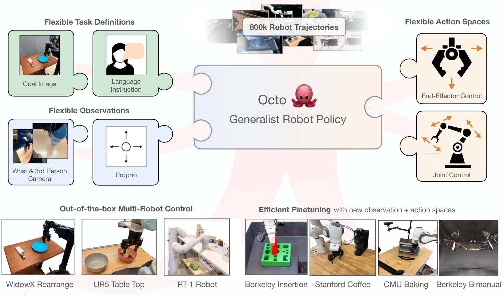
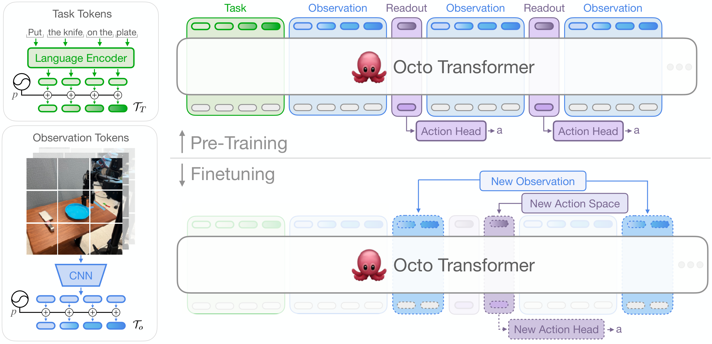
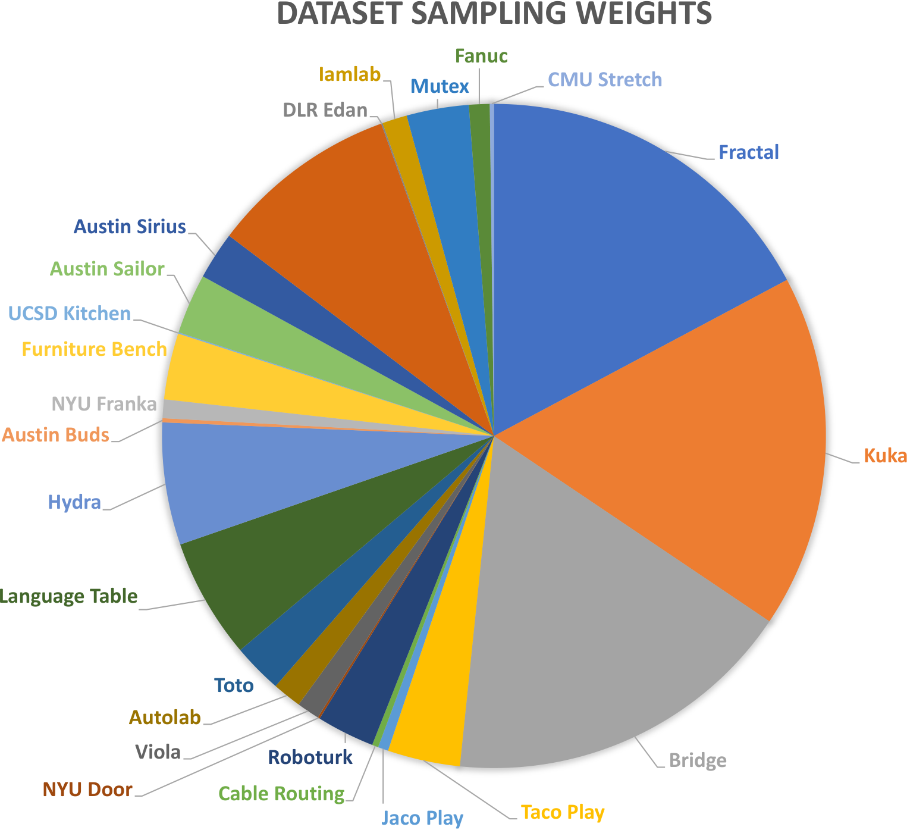
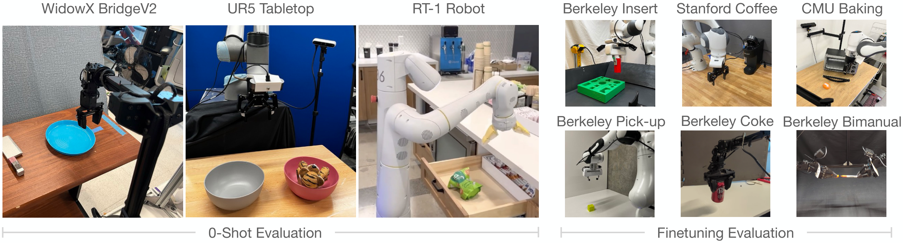
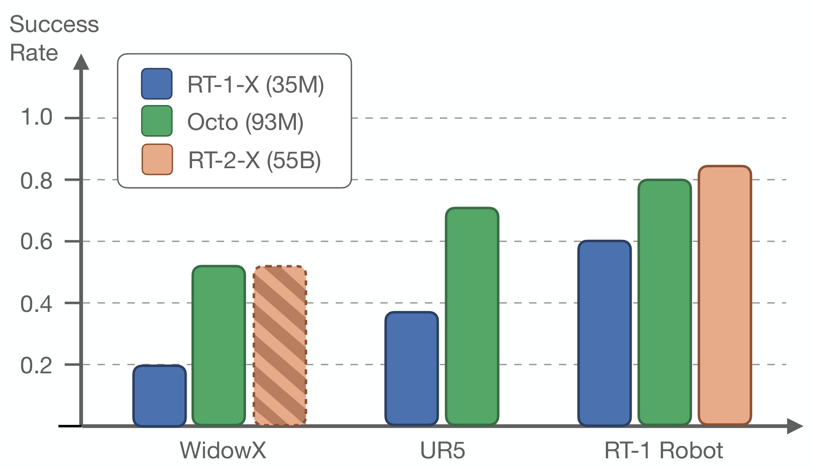
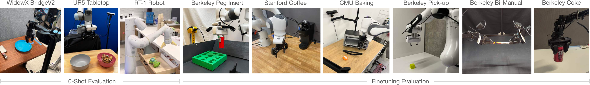
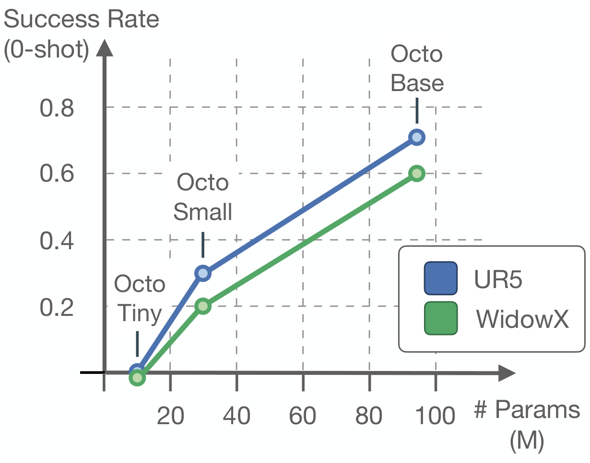

# Octo：开源通用机器人策略，模块化微调扩展感知与动作

机器人学习通常要为每种机器人和任务重新采集数据、重新训练，成本高，泛化范围也窄。Octo 用 Open X-Embodiment 中筛选出的 80 万条机器人轨迹预训练一个 Transformer 通用策略，再通过可扩展的输入、输出接口适配新传感器、新动作空间和新机器人本体。它既接受语言指令，也接受目标图像，并能用约 100 条目标域示范在消费级 GPU 上完成微调。实验中，Octo 的零样本成功率平均比 RT-1-X 高 29%；在六个新域微调任务上取得 72% 的平均成功率，比最佳基线高 52 个百分点。



> 图解：Octo 面向机器人操作任务，在 80 万条多样化机器人 episode 上预训练。它用统一的策略支持不同任务与观测定义，既可以控制多种机器人，也能通过微调接入新的观测和动作空间；图中概括了从大规模预训练到下游适配的完整定位。

## 为什么需要“可适配”的通用机器人策略

传统机器人模仿学习往往是“一台机器人、一组任务、一套数据、一个策略”。这种做法的问题不只是数据采集昂贵：一旦更换相机、控制方式或机器人本体，原有策略通常很难直接复用。

自然语言和计算机视觉领域已经证明，大规模预训练模型可以成为下游任务的通用起点。但机器人要走过同一条路，还需要处理几项特有差异：

- **本体不同**：机械臂的自由度、结构和运动范围不同。
- **传感器不同**：有的数据只有第三人称相机，有的还包含腕部相机或本体感知信息。
- **动作空间不同**：常见控制方式包括末端执行器位姿增量和关节位置控制。
- **任务表达不同**：任务可能由自然语言给出，也可能由目标图像给出。
- **数据标注不完整**：不同数据集可能缺少语言、腕部图像等模态，不能简单拼接后训练。

已有工作已经展示了跨场景或跨本体控制的潜力。例如，GNM 面向多种导航场景，RoboCat 支持不同机器人本体的目标条件任务，RT-X 则能控制五种单臂机器人进行语言条件操作。不过，这些模型往往把下游用户限制在预训练时固定的观测与动作接口中；更换输入或输出，可能需要重新初始化甚至重训大半个模型，部分大模型也未完整开放。

Octo 的目标因此不是单纯追求“一个模型直接做所有任务”，而是提供一个**通用且可改造的策略初始化**：预训练模型尽量保留，新模态通过轻量编码器接入，新动作空间通过新输出头接入，新位置关系通过新的位置嵌入表示。

## 统一 Token 接口：让观测、任务和动作模块化

Octo 的核心策略记为 $\pi$，由三部分组成：输入 Tokenizer、Transformer Backbone 和 Readout Head。语言指令 $\ell$、目标图像 $g$ 以及长度为 $H$ 的观测序列 $o_1,\dots,o_H$，首先被转换成三组 Token：

$$
[\mathcal{T}_l,\mathcal{T}_g,\mathcal{T}_o]
$$

随后，Transformer 对这些 Token 进行统一建模：

$$
e_l,e_g,e_o=T(\mathcal{T}_l,\mathcal{T}_g,\mathcal{T}_o)
$$

最后，读出头 $R(e)$ 将内部表示解码为动作 $a$。这个流程看似常规，真正的关键在于 Octo 如何安排注意力，以及如何隔离新增接口对预训练权重的影响。



> 图解：左侧，绿色任务 Token 来自语言或目标图像，蓝色观测 Token 来自相机等输入；上方，Transformer 统一处理任务和观测序列，紫色 Readout Token 汇总信息并交给动作头；下方展示了微调时的扩展方式，虚线所示的新观测和新动作空间可以新增，而不必改动已有预训练参数。

### 任务与观测如何变成 Token

不同模态使用各自的轻量编码器：

- **语言输入**：先分词，再送入预训练的 `t5-base` 编码器。该编码器有 111M 参数，为每条指令产生 16 个语言嵌入 Token。
- **图像观测与目标图像**：先经过浅层卷积堆叠，再切分成扁平化 Patch Token，而不是使用大型 ResNet 提取整图特征。
- **序列组装**：任务与观测 Token 加上可学习的位置嵌入，依次排列为 $[\mathcal{T}_T,\mathcal{T}_{o,1},\mathcal{T}_{o,2},\dots]$。

第三人称相机图像经过随机裁剪、缩放到 $256\times256$、颜色扰动和归一化，像素值被映射到 $[-1,1]$；腕部相机不做随机裁剪，缩放到 $128\times128$。采用 $16\times16$ 的 Patch 后，两种图像分别产生 256 和 64 个 Token。

相比“ResNet 编码图像，再交给较小 Transformer”的常见方案，Octo 采用更接近 ViT 的 **Transformer-first** 设计：大部分参数和计算量集中在 Backbone 中。后文消融会显示，这种设计的优势依赖大规模、多样化数据；在只有约百条示范的小数据上从零训练时，ResNet 反而更有优势。

### 块式注意力与只读 Token

Octo 的注意力不是完全双向的，而是按块遮罩：

- 时刻 $t$ 的观测 Token 可以关注任务 Token，以及同一时刻或更早时刻的观测 $\mathcal{T}_{o,0:t}$，因此不会偷看未来。
- 数据集中不存在的模态会被完全遮罩。例如，没有语言标注的数据不会被迫伪造语言输入。
- 每个时刻额外插入可学习的 Readout Token $\mathcal{T}_{R,t}$。它能读取此前的任务与观测信息，但任何任务或观测 Token 都不能关注它。

Readout Token 类似 BERT 中的 `[CLS]`，是截至当前时刻的紧凑状态摘要。它“只读不写”的约束很重要：新增输出头只消费这些摘要，不会反向改变任务和观测的序列组织方式。

这个设计的聪明之处在于，**灵活接口不是训练结束后额外拼上去的补丁，而是预训练架构本身的一部分**。新增相机时可以增加轻量编码器和位置嵌入，更换动作空间时可以增加输出头，Transformer 主体仍可完整保留。

## Diffusion 动作头：同时兼顾决策性与连续控制精度

仅有通用 Backbone 还不够。机器人演示中，同一个状态可能对应多种合理动作：可以从左侧绕开障碍，也可以从右侧绕开。若直接用均方误差（MSE）回归，模型容易学习这些动作的平均值，表现为犹豫、缓慢，甚至无法完成本应明确的夹爪旋转。

Octo 因此使用条件 Diffusion Head 建模连续、多峰的动作分布。每次预测动作时，Transformer Backbone 只前向计算一次；后续多步去噪全部在小型 Diffusion Head 内完成，不需要反复运行大 Backbone。

生成动作时，先采样高斯噪声 $x^K\sim\mathcal{N}(0,I)$，再执行 $K$ 步去噪。去噪网络 $\epsilon_\theta(x^k,e,k)$ 同时接收上一步结果、扩散步索引和 Readout 嵌入 $e$：

$$
x^{k-1}=\alpha\left(x^k-\gamma\epsilon_\theta(x^k,e,k)+\mathcal{N}(0,\sigma^2I)\right)
$$

其中 $\alpha$、$\gamma$ 和 $\sigma$ 由噪声调度决定，论文采用标准 Cosine Schedule。训练使用 DDPM 目标：向数据集中的真实动作加入高斯噪声，再训练网络恢复原始动作。

动作头是一个三层 MLP，隐藏维度为 256，带残差连接和 Layer Normalization，共执行 20 个 Diffusion Step。它一次预测未来多个连续动作，即 **Action Chunking**，让机器人运动更连贯；测试时采用 Receding Horizon Control，滚动执行并重新规划，而不是简单对所有未来动作做时序集成。

这套方案试图同时避开两个极端：MSE 容易把多峰动作“平均成犹豫”，离散动作交叉熵虽然更果断，却会降低连续控制精度。实验结果也支持这一判断。

## 80 万条轨迹如何混合成预训练数据

模型接口解决“能否接入不同数据”，数据混合则决定“究竟能学到多少通用行为”。Octo 从 Open X-Embodiment 约 150 万个 episode 中筛选出 80 万条轨迹，覆盖 25 个数据集。作为对比，RT-X 使用的是更受限的 35 万 episode 子集。

筛选并非简单追求总量，而是经过以下处理：

1. 去掉没有图像流的数据集。
2. 去掉不使用末端执行器增量控制的数据集。
3. 去掉行为过度重复、图像分辨率过低或任务过于小众的数据集。
4. 将剩余数据粗略分为“更多样”和“较少多样”，把前者的采样权重翻倍。
5. 下调包含大量重复 episode 的数据集，避免其主导训练。
6. 对缺失相机通道做零填充，并统一夹爪动作语义：$+1$ 表示打开，$0$ 表示关闭。



> 图解：饼图表示每个数据集平均贡献到一个训练 Batch 的比例。权重主要依据各数据集样本数，再按多样性和重复程度做人工调整；Fractal、Kuka 和 Bridge 三者各占 17%，共同构成最大的数据来源。

完整的采样权重如下：

| 数据集 | 平均采样权重 |
|---|---:|
| Fractal | 17.0% |
| Kuka | 17.0% |
| Bridge | 17.0% |
| BC-Z | 9.1% |
| Stanford Hydra Dataset | 6.0% |
| Language Table | 5.9% |
| Taco Play | 3.6% |
| Furniture Bench Dataset | 3.3% |
| UTAustin Mutex | 3.0% |
| Austin Sailor Dataset | 2.9% |
| Roboturk | 2.8% |
| Toto | 2.4% |
| Austin Sirius Dataset | 2.3% |
| Berkeley Autolab UR5 | 1.5% |
| IAMLab CMU Pickup Insert | 1.2% |
| Viola | 1.2% |
| Berkeley Fanuc Manipulation | 1.0% |
| NYU Franka Play Dataset | 0.9% |
| UCSD Kitchen Dataset | <0.1% |
| Jaco Play | 0.6% |
| Berkeley Cable Routing | 0.3% |
| Austin Buds Dataset | 0.3% |
| CMU Stretch | 0.2% |
| NYU Door Opening | 0.1% |
| DLR EDAN Shared Control | 0.1% |

需要注意，人工加权虽然有效，但论文并未系统证明这就是最优数据配方。作者也把“如何更细致地评估数据质量与混合比例”列为后续研究方向。

## 训练配方：让同一模型学会语言与目标图像条件控制

Octo 使用两帧观测历史。初步实验显示，从没有历史到增加一帧历史收益明显，继续增加长度的收益则迅速减弱。

目标图像通过 **Hindsight Goal Relabeling** 构造：从当前轨迹未来状态中均匀选取一帧，作为该段轨迹的目标。训练时还会随机将语言指令或目标图像置零，使模型学会只依赖其中一种条件；对没有语言标注的数据集，则始终使用目标图像条件。这样，大量没有人工语言描述的视觉示范也能参与训练。

优化器为 AdamW，学习率采用线性 Warmup 加反平方根衰减。公开模型有 Small 和 Base 两个版本：

| 模型 | 层数 | 隐藏维度 $D$ | MLP 维度 | Attention Head 数 | 参数量 |
|---|---:|---:|---:|---:|---:|
| Octo-Small | 12 | 384 | 1536 | 6 | 27M |
| Octo-Base | 12 | 768 | 3072 | 12 | 93M |

主要训练超参数如下：

| 超参数 | 数值 |
|---|---:|
| Learning Rate | $3\times10^{-4}$ |
| Warmup Steps | 2000 |
| LR Scheduler | Reciprocal Square-Root |
| Weight Decay | 0.1 |
| Gradient Clip Threshold | 1.0 |
| Batch Size | 2048 |

Octo-Base 在 TPU v4-128 Pod 上训练 300k Step，耗时 14 小时。下游微调则更新整个模型，沿用同一 Diffusion 目标；论文发现，这比冻结部分预训练参数效果更好。标准配方是使用约 100 条目标域轨迹，训练 50k Step，学习率采用线性 Warmup 加 Cosine Decay。Base 模型在单张 24GB 显存的 NVIDIA A5000 上微调约需 5 小时，也可以通过多 GPU 加速。

项目开放了 Small、Base Checkpoint、JAX 微调脚本、JAX 预训练流程，以及兼容 JAX 和 PyTorch 的 Open X-Embodiment 独立数据加载器。也就是说，开放的不仅是推理权重，还包括复现训练与继续研究的工具链。

## 实验一：不换模型，直接控制多种机器人

实验覆盖 4 家机构的 9 套真实机器人平台，既测试与预训练环境匹配的零样本控制，也测试新任务、新传感器、新动作空间和新本体上的微调。



> 图解：九套环境覆盖不同物体交互、长时程任务和精密操作。零样本部分考察 WidowX、UR5 与 RT-1 Robot；微调部分进一步加入力矩输入、关节位置控制、未见过的 ViperX 本体以及 ALOHA 双臂系统。

零样本对比包括两个重要基线：

- **RT-1-X**：开放的通用机器人策略，参数量 35M，同样基于 Open X-Embodiment 训练。
- **RT-2-X**：55B 参数的视觉语言模型，在 Open X-Embodiment 上微调为机器人策略，只用于部分 WidowX 和 RT-1 Robot 对比。

每个机器人选择对应训练数据中的两个语言任务，每项测试 10 次，并改变初始条件。任务本身属于训练分布，但物体位置、光照、背景和干扰物仍可能变化，因此不是简单复述训练轨迹。



> 图解：图中按机器人与任务比较零样本成功率。Octo 在三类机器人设置上的平均成功率比 RT-1-X 高 29%；在论文测试的 WidowX 和 RT-1 Robot 任务上，Octo 与 RT-2-X 表现相近。WidowX 的 RT-2-X 数值引自既有零样本评测并以虚线柱表示，RT-1 Robot 的 RT-2-X 评测则由原作者协助完成。

Octo 还能用目标图像代替语言指令。在 WidowX 任务上，目标图像条件的成功率比语言条件高 25%。一个合理原因是，目标图像直接展示期望场景，包含的信息比一句简短指令更丰富。

进一步拆分 WidowX 结果，可以看到“泛化”并不是单一能力：

| 泛化类型 | 任务 | 成功率 | 类型平均 |
|---|---|---:|---:|
| 分布内 | Put carrot on plate | 80% | 85% |
| 分布内 | Put eggplant in pot | 90% | 85% |
| 新物体 | Put bread on plate | 70% | 80% |
| 新物体 | Put spoon on glove | 90% | 80% |
| 新环境 | Put mushroom in pot | 20% | 40% |
| 新环境 | Put spoon on cloth | 60% | 40% |
| 新技能 | Flip cup on its side | 10% | 5% |
| 新技能 | Put block in slot | 0% | 5% |

每项类型平均基于两个任务共 20 次试验。Octo-Small 对分布内任务和新物体较稳健，换到新环境后成功率降至 40%，面对翻转杯子、精确插槽等未见过的新技能时只有 5%。因此，零样本结果应理解为对已知机器人、已知技能族的有效迁移，而不是任意新技能的通用求解能力。

三个零样本平台还分别包含额外变化：

- **WidowX BridgeV2**：单第三人称相机、末端位置增量控制，执行“把胡萝卜放到盘子上”和“把茄子放进锅里”，主要改变物体位置。
- **UR5**：执行跨碗抓取玩具老虎和用布擦桌子，还加入干扰物、光照变化。由于训练数据采集于数月前，机器人平台又经过拆装，相机视角和背景也发生了变化。
- **RT-1 Robot**：抓取饮料罐、苹果或薯片袋，以及开关抽屉；平台在采集数据后搬到另一栋楼，同样带来视角和背景变化。

## 实验二：约百条示范，微调出新的感知与控制接口

零样本能力验证“开箱即用”，微调实验则检验 Octo 是否真的是一个好的策略初始化。六个新域都使用同一套微调超参数，对比两类常见替代方案：

- **ResNet+Transformer Scratch**：28M 参数，从目标域数据从头训练。视觉部分为 ResNet，语言通过 FiLM 注入，动作端是带 Diffusion 目标的小型 Transformer。直接从头训练大型 Octo 架构容易在小数据上过拟合，因此作者采用这个更合适的从头训练基线。
- **VC-1**：使用在 4000 小时第一人称视频和 ImageNet 上预训练的 ViT-B 视觉表示，接 MLP 动作解码器，以 MSE 学习专家动作。

| 方法 | Berkeley Insertion* | Stanford Coffee | CMU Baking | Berkeley Pick-Up† | Berkeley Coke | Berkeley Bimanual† | 平均 |
|---|---:|---:|---:|---:|---:|---:|---:|
| ResNet+Transformer Scratch | 10% | 45% | 25% | 0% | 20% | 20% | 20% |
| VC-1 | 5% | 0% | 30% | 0% | 10% | 50% | 15% |
| Octo | **70%** | **75%** | **50%** | **60%** | **100%** | **80%** | **72%** |

> 注：$*$ 表示新增力/力矩本体感知输入，$\dagger$ 表示新增关节位置动作空间。论文主表说明各域使用约 100 条目标示范、成功率按 20 次试验取平均；附录对 Berkeley Bimanual 另明确记录为 10 次试验。

Octo 在六个任务上全部领先，平均成功率 72%，而最佳基线平均为 20%。更关键的是，优势不只出现在“同一接口上的新任务”，还覆盖了真正改变输入输出结构的情况。



> 图解：此图在附录中再次汇总九套真实机器人设置，便于对应零样本与微调结果。上半部分关注预训练环境中的直接控制，下半部分关注小数据适配；新力觉、新关节空间和新双臂本体都属于对预训练接口的实质扩展。

六个微调场景的具体要求如下：

### CMU Baking：多阶段操作与新物体形状

机器人要抓起玩具面包、放入烤面包机并关上盖子。测试同时改变烤面包机与物体初始位置，以及目标面包形状。策略使用前置 ZED 第三人称相机，以 15Hz 输出末端笛卡尔位置与旋转增量。微调数据为 120 条 VR 遥操作专家示范，评测为 4 个新物体、每个 5 个位置，共 20 次。

### Stanford Coffee：长时程与精确放置

机器人从四种 Keurig 咖啡胶囊中抓取一个，并放入咖啡机。任务要求泛化到不同初始位置和胶囊颜色，同时完成精确放置。系统使用单个第三人称腕部视角，控制器以 10Hz 输出末端增量。训练集包含 118 条 VR 遥操作示范，四种颜色各评测 5 次，共 20 次。

### Berkeley Peg Insertion：新增力/力矩观测

任务是把已抓取的 3D 打印销钉插入对应孔位，配合公差仅 1.5mm。机器人必须借助接触“搜索”孔口，仅靠视觉很难完成。输入包括侧视相机、末端 Twist 和力/力矩读数，策略以 5Hz 输出末端 Twist，底层阻抗控制器以 1000Hz 跟踪。使用 FMB 数据集中的 100 条人类示范，随机改变板的位置并测试 20 次，Octo 成功率为 70%。

### Berkeley Pick-Up：从末端控制换成关节位置控制

机器人需要根据腕部图像和本体感知，从桌面抓起黄色方块。训练数据包含不同物体的 100 次拾取，动作空间改为关节位置控制。Octo 在 20 次测试中达到 60%，而两个基线均为 0%。

### Berkeley Coke：适配未见过的机器人本体

ViperX 未出现在预训练混合数据中。机器人使用第三人称和腕部相机，以 5Hz 末端增量控制抓取不同位置的可乐罐。微调使用 115 条不同位置的 VR 遥操作示范，最终报告成功率为 100%。

### Berkeley Bimanual：从单臂预训练扩展到 14 维双臂动作

ALOHA 由两条 ViperX 机械臂组成，任务是右手拿起记号笔、左手拔掉笔帽。由于 Octo 预训练只有单臂数据，作者重新初始化一个 14 维动作头，对应两组 6 维关节位置和两组夹爪位置，并使用左右腕部图像。

该任务训练时预测长度为 64 的 Action Chunk，测试时每次执行 12 个动作后重新规划。笔尖位置每次变化，共测试 10 次，Octo 成功率 80%，高于 Scratch 的 20% 和 VC-1 的 50%。这一结果最直接地体现了“保留 Backbone、替换输出头”的价值。

## 消融实验：性能主要来自数据、动作目标和架构的协同

除特别说明外，消融使用 Octo-Small，在 WidowX 上测试两个语言任务和两个目标图像任务，共 40 次试验。完整结果如下：

| 变化项 | 胡萝卜放盘子 | 茄子放锅里 | 面包放盘子 | 勺子放手套上 | 平均 |
|---|---:|---:|---:|---:|---:|
| Octo-Small 完整配置 | 80% | 90% | 70% | 90% | **83%** |
| 改用 RT-X 数据混合 | 80% | 80% | 40% | 40% | 60% |
| 只用单机器人 Bridge Data | 20% | 70% | 60% | 20% | 43% |
| 离散动作预测 | 0% | 20% | 10% | 40% | 18% |
| 连续动作 MSE | 70% | 30% | 0% | 40% | 35% |
| ResNet-50 + Transformer | 80% | 60% | 100% | 40% | 70% |

### 数据越多样，跨任务表现越好

RT-X 混合只包含 11 个数据集，平均成功率降至 60%；只用目标机器人自己的 Bridge 数据则降至 43%。完整 25 数据集混合达到 83%。尤其在新物体的目标条件任务上，广泛数据带来了明显收益。

这说明多机器人数据并非只是增加样本数，更重要的是增加任务、场景和行为分布的覆盖。不过，数据多样性具体如何作用于不同能力，仍需要更系统的数据质量研究。

### Diffusion 比 MSE 更果断，比离散动作更精确

MSE 平均只有 35%。定性观察中，策略会移动得很慢，在 WidowX 上甚至无法完成夹爪旋转，这符合“对多种动作取平均”的对冲行为。

把每个动作维度离散成 256 个 Bin 后，交叉熵训练让策略更果断，却缺乏精密抓取所需的连续精度，平均成功率进一步降至 18%。Diffusion 的 83% 表明，多峰分布建模与连续控制精度需要同时保留。

### Transformer-first 更适合大规模数据，但不是小数据万能解

ResNet-50 + Transformer 的平均成功率为 70%，低于完整 Octo 的 83%。不过，在约 100 条示范上从头训练时，ResNet 架构反而优于 ViT。这说明 Octo 的浅层 Patch 编码与大 Backbone 更像是一种**可扩展设计**，其收益需要依靠足够丰富的大数据释放。

类似地，ImageNet 预训练 ResNet 没有带来零样本收益，但该结果与 ResNet 本身扩展性较弱相互混杂，不能简单得出“视觉预训练无用”的结论。

### 模型规模继续带来收益

论文还比较了 Octo-Tiny（10M）、Octo-Small（27M）和 Octo-Base（93M）。两种机器人任务上的零样本表现都随规模增加而提升。



> 图解：横轴为 Tiny、Small、Base 三档模型规模，纵轴为 UR5 和 WidowX 任务成功率；每个数值来自单个语言条件任务的 10 次试验。Base 的整体表现更好，对初始场景配置更稳健，也更不容易过早尝试抓取，说明更大的模型改善了视觉场景理解。

## 复现经验：哪些细节有效，哪些路线暂时没走通

论文附录的价值在于，它没有只保留最终方案，而是记录了大量失败或收益不明显的尝试。

### 值得保留的设计

- **加入一帧历史**：比完全无历史的零样本策略更好；继续增加历史长度，在所测任务上没有明显收益。
- **使用 Action Chunking**：一次预测多个未来动作，运动更连贯；额外做 Temporal Ensembling 未带来进一步收益。
- **减小图像 Patch**：$16\times16$ 比 $32\times32$ 更有利于抓取等精细任务，但 Token 数增加为 4 倍，计算成本也更高。
- **充分打乱多源数据**：20k 的小 Shuffle Buffer 配合轨迹级交错会显著损害零样本性能。作者改为在解码图像前打乱并交错不同轨迹的帧，把 Buffer 提高到最多 500k；每条轨迹最多随机子采样 100 个 Step，避免超长 episode 占满 Buffer。

### 暂时没有奏效的设计

- **MSE 动作头**：容易对冲，动作缓慢且犹豫。
- **离散动作头**：更果断，但抓取精度不足。
- **大型 ResNet 编码器**：大数据扩展性不如 ViT；小数据从头训练时仍可能更好。
- **ImageNet 预训练编码器**：未改善零样本结果，且受到 ResNet 架构因素的干扰。
- **相对夹爪动作表示**：只在状态变化时输出开/关，其余时刻表示“不变”，会减少夹爪动作并略微提高首次抓取成功率，却降低失败后的重试能力。最终仍采用绝对表示。
- **直接加入本体感知**：总体表现反而变差。作者推测，状态与未来动作之间的强相关可能让策略产生因果混淆。
- **扩大或微调 T5**：`t5-small`、`t5-base`、`t5-large` 以及微调最后两层都未超过冻结的 `t5-base`。原因可能是训练数据缺乏丰富、多样、自由形式的语言标注。

这些结果提醒我们，Octo 的最终性能不是某个单点技巧带来的。数据混合、连续多峰动作建模、可扩展 Backbone 和数据加载细节必须配合，缺少任何一环都可能明显掉分。

## 从加载模型到推理：开放接口有多简单

官方模型可以通过 Hugging Face 标识加载。下面的示例读取一张主相机图像，创建“拿起叉子”的语言任务，并采样动作：

```python
import jax
from octo.model.octo_model import OctoModel

model = OctoModel.load_pretrained("hf://rail-berkeley/octo-base")
print(model.get_pretty_spec())  # Print out the input-output spec
observation = {"image_primary": img}
task = model.create_tasks(texts=["pick up the fork"])
action = model.sample_actions(
    observation, task, rng=jax.random.PRNGKey(0))
```

`get_pretty_spec()` 用于检查模型当前的输入输出规格。真正接入新机器人时，仍需按照规格组织观测与任务，并在接口变化时添加相应编码器、位置嵌入或动作头；但从代码路径看，推理、微调和预训练都包含在同一套开放框架中，而不只是提供一个无法继续改造的黑盒 Checkpoint。

## 局限与总结：通用策略仍受数据模态覆盖约束

Octo 的短板同样能追溯到训练数据。只有 27% 的预训练数据带腕部相机信息，只有 56% 带语言标注，因此模型尚不能充分利用腕部视角，语言条件与目标图像条件之间也存在明显性能差距。有些微调任务中，只用第三人称相机甚至比同时使用第三人称和腕部相机更好。

此外，Open X-Embodiment 主要由较优专家示范组成，Octo 当前依赖模仿学习，尚未利用次优数据或在线交互数据。实验范围也集中在单臂和双臂操作，尚未覆盖导航、移动操作等更广泛的机器人形态。

- Octo 用 25 个数据集、80 万条轨迹预训练通用 Transformer 策略，同时支持语言指令、目标图像和多相机输入。
- 块式注意力与只读 Readout Token 把输入、Backbone 和输出解耦，使新传感器、新动作头可以低成本接入。
- Diffusion Action Head 兼具多峰建模与连续控制精度，完整配置在 WidowX 消融中取得 83%，显著高于 MSE 和离散动作方案。
- 零样本控制平均比 RT-1-X 高 29%，六个新域微调平均成功率达到 72%，但新环境和新技能上的泛化仍明显有限。
- 完整开放 Checkpoint、数据加载器、预训练与微调代码，使 Octo 更像可复用的研究起点，而不只是一次性的模型结果。

下一步的关键不只是继续扩大模型，而是补齐腕部视觉和语言数据、利用非最优与在线交互经验，并把同一套可适配策略推广到更多机器人形态。

> 本文参考自 [Octo: An Open-Source Generalist Robot Policy](https://arxiv.org/abs/2405.12213)