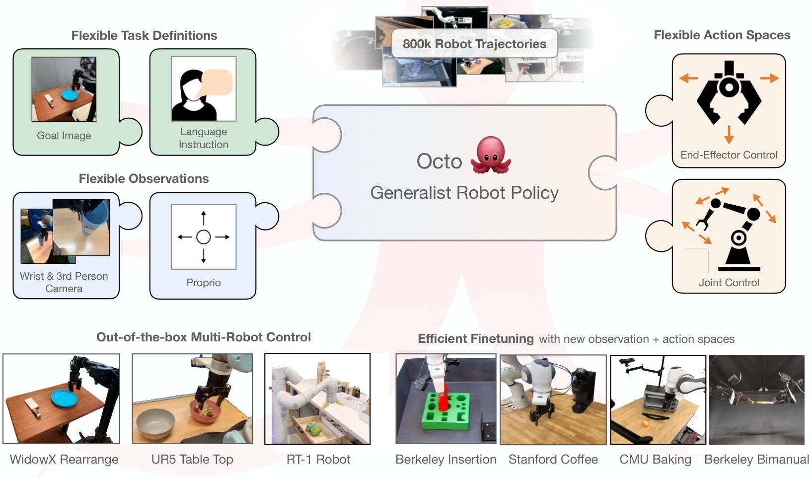

# Octo：开源通用机器人策略，模块化微调扩展感知与动作

机器人学习长期受制于“换机器人、传感器或控制方式就重新采数训练”，Octo 以可适配的通用策略初始化降低这一成本。它在 80 万条轨迹上预训练，零样本成功率平均比 RT-1-X 高 29%；六个新域微调平均成功率达 72%，比最佳基线高 52 个百分点。

## 核心创新：接口可扩展，而非只追求“大一统”

- **模块化 Token 架构**：轻量编码器把语言、目标图像和观测转为 Token，由 Transformer 统一建模，再经 Readout Head 输出动作。新增传感器只需添加编码器与位置嵌入，更换动作空间只需新增输出头，预训练 Backbone 可以保留。
- **块式注意力与只读 Readout Token**：观测只能关注任务及历史信息，避免偷看未来；缺失模态直接遮罩，无需伪造标注。Readout Token 汇总当前状态，却不被其他 Token 关注，使新增输出头不干扰原有序列组织。
- **Diffusion 动作头**：用条件扩散建模连续、多峰动作，避免 MSE 将多种合理动作平均成犹豫，也保留离散动作难以兼顾的控制精度。大 Backbone 每次决策只运行一次，多步去噪在小型动作头内完成；结合 Action Chunking 与滚动重规划提升运动连贯性。

## 数据与训练：让异构示范真正协同

Octo 从 Open X-Embodiment 约 150 万个 episode 中筛选出 80 万条轨迹，覆盖 25 个数据集；按多样性、重复程度调整采样权重，并统一夹爪语义。目标图像由未来状态回放标注生成，训练时随机置零语言或目标条件，使无语言标注的数据也能参与学习。

公开 27M 的 Octo-Small 与 93M 的 Octo-Base。后者在 TPU v4-128 上训练 30 万步、耗时 14 小时；标准微调使用约 100 条目标域轨迹并更新全模型，Base 可在单张 24GB A5000 上约 5 小时完成。项目同时开放 Checkpoint、数据加载器及 JAX 预训练、微调代码。

## 实验结论：直接迁移有效，小数据改造更突出

- **零样本**：覆盖多机构真实机器人，平均比 RT-1-X 高 29%，在部分测试任务上与 RT-2-X 相近；WidowX 上目标图像条件比语言条件高 25%。但新环境平均成功率仅 40%，新技能仅 5%，并非任意任务的通用求解器。
- **新域微调**：六项任务全部领先，平均 72%，最佳基线为 20%。其中力/力矩输入插孔达 70%，改用关节位置控制的拾取任务达 60%（两个基线均为 0%），未见过的 ViperX 本体达 100%，单臂预训练扩展到 14 维双臂动作后达 80%。
- **消融**：完整配置平均 83%；换成 RT-X 数据混合降至 60%，只用单机器人数据降至 43%；MSE 与离散动作分别为 35% 和 18%，ResNet-50 + Transformer 为 70%。性能来自数据多样性、动作目标与可扩展架构的协同，而非单个技巧。

## 局限与价值

仅 27% 的预训练数据含腕部相机、56% 含语言标注，限制了腕部视觉利用和语言条件表现；方法仍依赖以专家示范为主的模仿学习，尚未充分利用次优或在线交互数据，也未覆盖导航、移动操作等形态。Octo 的核心价值因此不是“已经通用”，而是提供了一套能继续接入新感知、新动作和新本体的开放研究起点。

> 本文参考自 [Octo: An Open-Source Generalist Robot Policy](https://arxiv.org/abs/2405.12213)