# OpenVLA：开源通用机器人操作新标杆

机器人学习策略一直有个老大难问题：出了训练数据就"不会动"。近年出现的视觉-语言-动作模型（VLA, Vision-Language-Action Model）虽然借互联网级预训练实现了惊人的泛化能力，但 RT-2-X 这样的代表性工作是闭源的，而且没人系统研究过如何把 VLA 高效微调、部署到新机器人上。OpenVLA 把这件事彻底打开了：一个 **7B 参数、完全开源** 的 VLA，在 Open X-Embodiment 的 **970k 条真实机器人轨迹** 上训练，参数量仅为闭源 55B 模型 RT-2-X 的 1/7，却在 29 个任务上超过它 **16.5% 绝对成功率**。更重要的是，它首次系统验证了 LoRA 微调（只训练 1.4% 参数）和 4-bit 量化推理几乎不掉性能——单张消费级 GPU 就能跑起来。

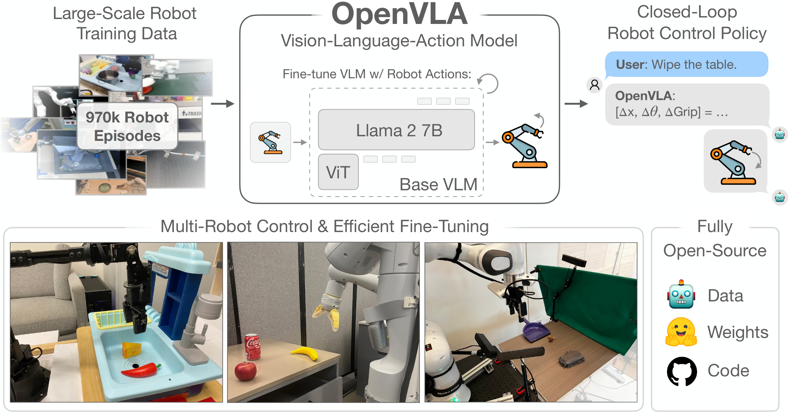

> 图解：OpenVLA 总览。模型在 Open X-Embodiment 的 970k 机器人片段上训练，开箱即可控制多种机器人本体（图中左侧 WidowX、中间 Google robot），并能通过参数高效微调快速适配新机器人（右侧 Franka）。模型权重与 PyTorch 训练管线全部开源，可直接从 HuggingFace 下载和微调。

## 一、提出问题：VLA 的两座大山

先交代一下背景。传统机器人操作策略是"一个任务训一个策略"，对新的物体、新的指令、新的场景几乎零泛化。而视觉和语言领域的基础模型（CLIP、SigLIP、Llama 2）靠着互联网级预训练，天然具备这些泛化能力。一个很自然的想法是：**把这些基础模型当作机器人策略的核心构件**。

这正是 VLA 的思路：直接把视觉语言模型（VLM）微调成输出机器人动作的策略，代表作是 Google 的 RT-2。效果确实惊艳，但推广到整个社区面临两座大山：

1. **闭源**：现有 VLA（RT-2-X、Covariant、Wayve 等）不公开模型架构、训练流程和数据配比，研究者无法复现和改进。
2. **不会用**：没有人研究过如何把 VLA 部署和适配到新机器人、新环境、新任务，尤其是在消费级显卡上。

笔者认为，这两座大山本质上是一个生态问题：语言模型领域之所以繁荣，靠的是 LLaMA、Mistral 这类开源基座加上 LoRA 这类低成本适配工具。机器人领域缺的正是同样的一套"开源基座 + 适配方法论"。OpenVLA 就是冲着补这个生态位去的。

## 二、方法：把机器人动作变成"语言"

### 2.1 整体架构：三段式 VLM

OpenVLA 的做法一句话概括：**把机器人动作离散化成 token，让 VLM 用"下一个词预测"的方式输出动作**。

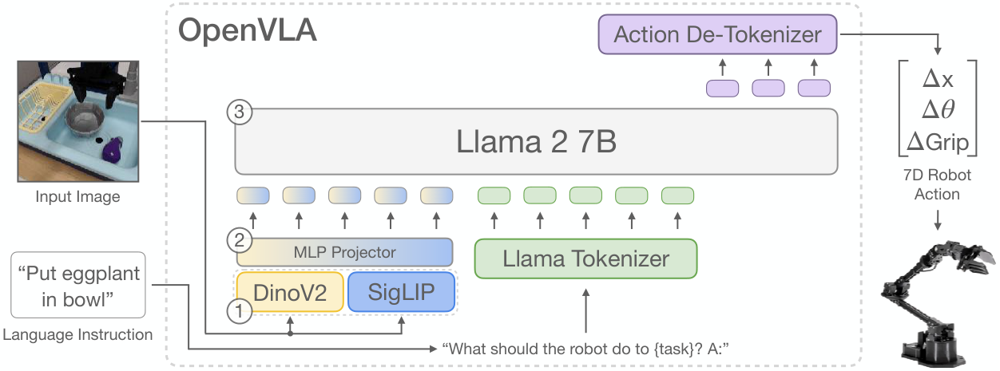

> 图解：OpenVLA 架构由三部分组成——(1) 视觉编码器，把 DinoV2 和 SigLIP 的特征在通道维度拼接；(2) 一个 2 层 MLP 投影器，把视觉特征映射到语言嵌入空间；(3) Llama 2 7B 语言模型主干。输入一张图像和一句自然语言指令，模型输出 7 维机器人控制动作。

具体来说，OpenVLA 构建在 **Prismatic-7B VLM** 之上：

- **视觉编码器（600M 参数）**：采用 SigLIP + DinoV2 双编码器。SigLIP 提供高层语义特征，DinoV2 提供底层空间特征。相比常用的 CLIP 单编码器，加入 DinoV2 被证明能显著提升空间推理能力——这对机器人精确控制至关重要。
- **投影器**：一个小型 2 层 MLP，负责把视觉 patch 特征映射进语言模型的输入空间。
- **LLM 主干**：Llama 2 7B。

这种"patch 当 token"的设计是当前开源 VLM 的主流做法，最大的好处是可以直接复用成熟的 LLM 训练基础设施（AMP、FlashAttention、FSDP），几乎不用改代码就能把策略训练扩展到数十亿参数规模。

### 2.2 动作离散化：借鉴 RT-2，但有个关键改进

要让语言模型输出动作，需要把连续的机器人动作变成离散的 token。OpenVLA 沿用 RT-2 的方案：把动作每一维独立离散到 **256 个桶** 中，一个 $N$ 维动作就变成 $N$ 个 $[0, 255]$ 的整数。

但有一个值得注意的细节改进：RT-2 用训练数据的最小-最大值确定分桶区间，OpenVLA 改用 **第 1 到第 99 分位数** 之间的区间均匀分桶。原因是机器人数据里常有异常动作值，用 min-max 会被离群点撑大区间，白白浪费离散化精度。用分位数则直接忽略这些噪声。

另一个工程上的妥协也很"简单粗暴"：Llama tokenizer 只预留了 100 个特殊 token，放不下 256 个动作 token。OpenVLA 的做法是直接 **覆盖词表中使用频率最低的 256 个 token**（即词表末尾的 256 个）。处理后，模型用标准的 next-token prediction 目标训练，交叉熵损失只计算动作 token 部分。

> 博主点评：这种"不优雅但够用"的工程取舍贯穿全文。与其改动 tokenizer 引入复杂度和潜在 bug，不如直接复用现成词表——这正是 OpenVLA 能快速迭代、并把代码开源给社区复用的原因之一。

### 2.3 训练数据：970k 轨迹的精挑细选

OpenVLA 的训练数据来自 Open X-Embodiment（OpenX）数据集，一个汇集 70+ 个子数据集、超过 200 万条轨迹的社区级机器人数据集。但原始数据不能直接用，需要两步清洗：

1. **统一输入输出空间**：只保留"至少有一个第三人称相机 + 单臂末端执行器控制"的操作数据集。
2. **平衡数据配比**：沿用 Octo 的数据混合权重，对多样性差的数据集降权或剔除，对任务和场景丰富的数据集加权。

一个插曲：作者曾尝试把 DROID 数据集以 10% 的权重混入训练，但发现 DROID 上的动作 token 准确率始终很低，说明现有模型容量还吃不下它的多样性。为不影响最终模型质量，训练的最后三分之一阶段把 DROID 移除了。

完整的训练数据配比如下（共 27 个子数据集，总计约 970k 条轨迹）：

| 数据集 | 混合权重 | 数据集 | 混合权重 |
| --- | --- | --- | --- |
| Fractal | 12.7% | NYU Franka Play | 0.8% |
| Kuka | 12.7% | Furniture Bench | 2.4% |
| Bridge | 13.3% | UCSD Kitchen | <0.1% |
| Taco Play | 3.0% | Austin Sailor | 2.2% |
| Jaco Play | 0.4% | Austin Sirius | 1.7% |
| Berkeley Cable Routing | 0.2% | DLR EDAN Shared Control | <0.1% |
| Roboturk | 2.3% | IAMLab CMU Pickup Insert | 0.9% |
| Viola | 0.9% | UTAustin Mutex | 2.2% |
| Berkeley Autolab UR5 | 1.2% | Berkeley Fanuc Manipulation | 0.7% |
| Toto | 2.0% | CMU Stretch | 0.2% |
| Language Table | 4.4% | BC-Z | 7.5% |
| Stanford Hydra | 4.4% | FMB | 7.1% |
| Austin Buds | 0.2% | DobbE | 1.4% |
| — | — | DROID | 10.0%（训练后 1/3 阶段移除） |

### 2.4 关键设计决策：五个反直觉的发现

作者在 BridgeData V2 上做了大量小规模预实验，总结出五条经验，条条都值得做机器人学习的人记住：

- **VLM 主干选 Prismatic**：对比 LLaVA 和 IDEFICS-1，LLaVA 在多物体语言对齐任务上比 IDEFICS-1 高 35% 绝对成功率；而 Prismatic 凭借融合的 SigLIP-DinoV2 视觉主干，又比 LLaVA 高出约 10%。
- **图像分辨率 224×224 足够**：384×384 没有带来性能提升，训练时间却是 3 倍。这与 VLM 基准上"分辨率越高越好"的经验相反——至少对当前的 VLA 还不成立。
- **视觉编码器必须微调**：VLM 领域的经验是冻结视觉编码器更稳，但 VLA 恰恰相反。作者推测预训练视觉特征缺少机器人精确控制所需的细粒度空间细节。
- **训练 epoch 要远多于 LLM 惯例**：LLM/VLM 通常只训 1-2 个 epoch，VLA 却要训到动作 token 准确率超过 95% 才收敛。最终模型跑了 **27 个 epoch**。
- **学习率 2e-5 固定即可**：与 VLM 预训练相同的学习率效果最好，learning rate warmup 没有收益。

### 2.5 训练与推理成本

最终模型在 **64 张 A100** 上训练了 **14 天**（共 21,500 A100 小时），batch size 2048。推理时，bfloat16 精度下需要 15GB 显存，在一张 RTX 4090 上大约跑 **6Hz**（未使用编译、投机解码等加速技巧）。作者还开源了远程推理服务器，机器人端无需本地强算力，动作预测可以实时流式传输。

配套的 OpenVLA 代码库是一套模块化 PyTorch 实现，支持从单卡微调到多节点集群训练，内置 AMP、FlashAttention、FSDP，开箱支持 OpenX 数据集训练、HuggingFace AutoModel 集成、LoRA 微调和量化推理。

## 三、实验一：开箱即用的跨机器人泛化

解决了"怎么训"之后，下一个问题是：训出来的模型到底有多能打？作者在两个被广泛使用的机器人平台上做了零样本直接评测：

- **WidowX 机器人**（BridgeData V2 评测环境）：17 个任务 × 10 次 = 170 次 rollout；
- **Google 移动操作机器人**（RT-1/RT-2 评测环境）：12 个任务 × 5 次 = 60 次 rollout。

任务设计覆盖四类泛化维度：**视觉泛化**（未见过的背景、干扰物、颜色）、**运动泛化**（未见过的物体位置/姿态）、**物理泛化**（未见过的物体尺寸/形状）、**语义泛化**（未见过的物体、指令和概念），外加专门的 **语言对齐** 任务（场景中有多个物体，测试策略能否按指令操作正确的那个）。所有评测采用 A/B 对比，各方法面对完全相同的初始状态，保证公平。

对比的三个基线是：RT-1-X（35M）、Octo（93M，此前最强的开源通用策略）、RT-2-X（55B，此前最强的闭源 VLA）。

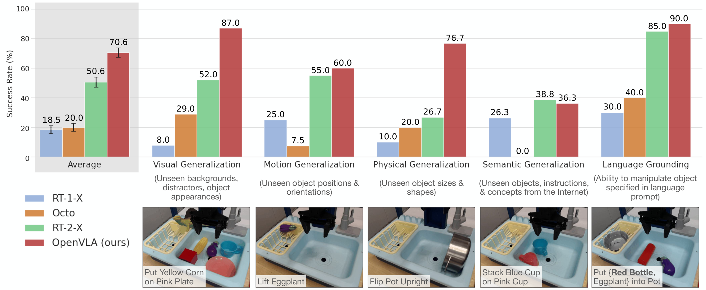

> 图解：BridgeData V2 WidowX 机器人评测。横轴按任务类别分组（视觉/运动/物理/语义泛化 + 语言对齐），纵轴为成功率。OpenVLA 在除语义泛化外的所有类别中都超过 RT-2-X，总成功率 70.6%，远超 RT-2-X 的 50.6%、Octo 的 20.0% 和 RT-1-X 的 18.5%。

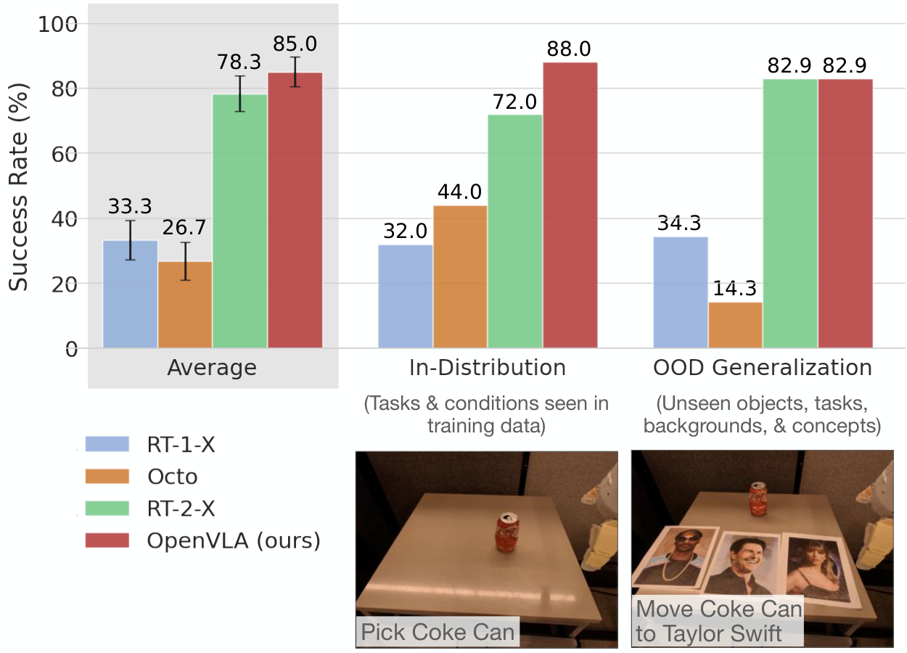

> 图解：Google robot 评测结果，分为分布内（in-distribution）任务和分布外（OOD）任务两组，纵轴为成功率。OpenVLA（85.0%）与 RT-2-X（78.3%）表现相当且误差条重叠，二者都大幅领先 RT-1-X（33.3%）和 Octo（26.7%）。

几个值得展开说的点：

**为什么 OpenVLA 能以 7 倍更小的参数赢过 RT-2-X？** 作者归因为三个因素的组合：训练数据更大（970k vs 350k 条轨迹）、数据清洗更仔细（例如过滤了 Bridge 数据中的全零动作，详见下文）、以及融合视觉编码器同时提供语义和空间特征。

**RT-2-X 唯一领先的语义泛化类别**，也在意料之中——RT-2-X 用机器人数据和互联网数据联合微调（co-fine-tuning），更好保留了预训练知识；OpenVLA 则纯用机器人数据微调。

**一个容易踩的坑：Bridge 数据的全零动作**。作者在开发中发现 BridgeData V2 每条轨迹的第一个 timestep 记录的都是全零动作（no-op）。高表达能力的 VLA 直接在这上面训练，会学会频繁输出全零动作、在评测时"冻住"。OpenVLA 的解法很简单：过滤每条轨迹的第一个 transition。而 RT-2-X 没有做这种清洗，评测时只能退而求其次——永远查询 **第二大概率** 的动作（因为最大概率的往往是全零动作）。这个 workaround 已是 RT-2-X 官方在 OpenX 项目中的做法，但作者认为它仍不如在干净数据上重新训练。

下面两张图展示了 BridgeData V2 评测任务的设置，以及它相对于原始训练数据的分布偏移：

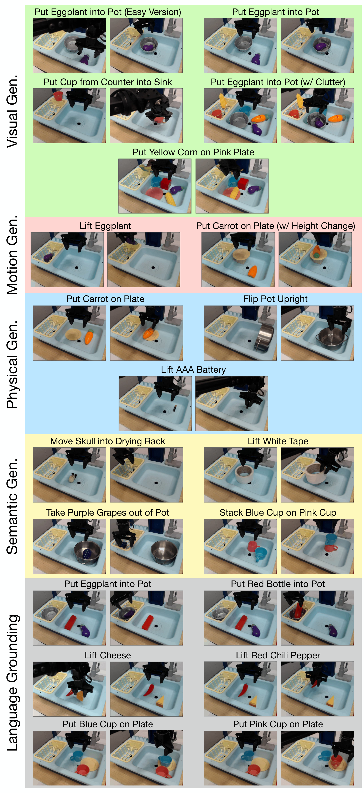

> 图解：BridgeData V2 WidowX 评测的 17 个任务。每对图片展示起始状态和成功结束状态，按视觉、运动、物理、语义四类泛化组织，底部三行为语言对齐任务——固定初始状态、只改指令，测试策略能否走向正确的目标物体。

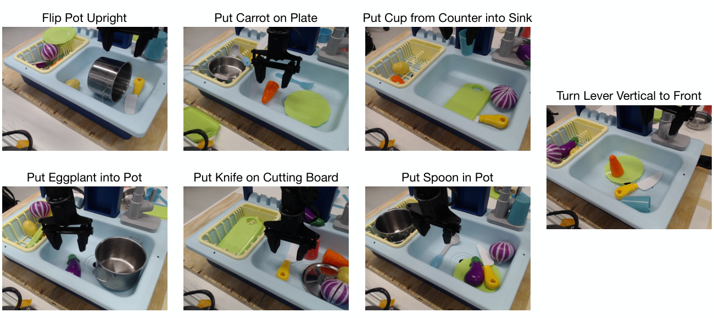

> 图解：原始 BridgeData V2 数据集中该水槽环境的 7 个示范任务。注意原始数据里机械臂末端每次都初始化在目标物体正上方；而评测中（除一个"简单版"任务外）末端都固定在远离物体的位置，机器人必须先水平够到物体——这显著加大了任务难度，也是 RT-1-X、Octo 等在此成功率低于其原论文报告值的原因之一。

17 个 BridgeData V2 任务的完整逐项结果（每项 10 次试验的成功数，部分任务有 0.5 分的部分成功）：

| 类别 | 任务 | RT-1-X | Octo | RT-2-X | OpenVLA |
| --- | --- | --- | --- | --- | --- |
| 视觉泛化 | Put Eggplant into Pot (Easy) | 1 | 5 | 7 | **10** |
| 视觉泛化 | Put Eggplant into Pot | 0 | 1 | 5 | **10** |
| 视觉泛化 | Put Cup from Counter into Sink | 1 | 1 | 0 | **7** |
| 视觉泛化 | Put Eggplant into Pot (w/ Clutter) | 1 | 3.5 | 6 | **7.5** |
| 视觉泛化 | Put Yellow Corn on Pink Plate | 1 | 4 | 8 | **9** |
| 运动泛化 | Lift Eggplant | 3 | 0.5 | 6.5 | **7.5** |
| 运动泛化 | Put Carrot on Plate (w/ Height Change) | 2 | 1 | **4.5** | **4.5** |
| 物理泛化 | Put Carrot on Plate | 1 | 0 | 1 | **8** |
| 物理泛化 | Flip Pot Upright | 2 | 6 | 5 | **8** |
| 物理泛化 | Lift AAA Battery | 0 | 0 | 2 | **7** |
| 语义泛化 | Move Skull into Drying Rack | 1 | 0 | **5** | **5** |
| 语义泛化 | Lift White Tape | **3** | 0 | 0 | 1 |
| 语义泛化 | Take Purple Grapes out of Pot | **6** | 0 | 5 | 4 |
| 语义泛化 | Stack Blue Cup on Pink Cup | 0.5 | 0 | **5.5** | 4.5 |
| 语言对齐 | Put {Eggplant, Red Bottle} into Pot | 2.5 | 4 | **8.5** | 7.5 |
| 语言对齐 | Lift {Cheese, Red Chili Pepper} | 1.5 | 2.5 | 8.5 | **10** |
| 语言对齐 | Put {Blue Cup, Pink Cup} on Plate | 5 | 5.5 | 8.5 | **9.5** |
| **平均成功率** | | 18.5±2.7% | 20.0±2.6% | 50.6±3.5% | **70.6±3.2%** |

Google robot 的 12 个任务中，前 5 个是分布内任务（抓可乐罐、移动苹果靠近绿罐、开中间抽屉等），后 7 个是 OOD 任务，包括未见过的物体（百事罐、香蕉、绿杯）、未见过的背景桌布、未见过的物体关系（把苹果放"到盘子上"而非"靠近盘子"）、甚至"把可乐罐移到 Taylor Swift 的照片旁"这种互联网语义概念。

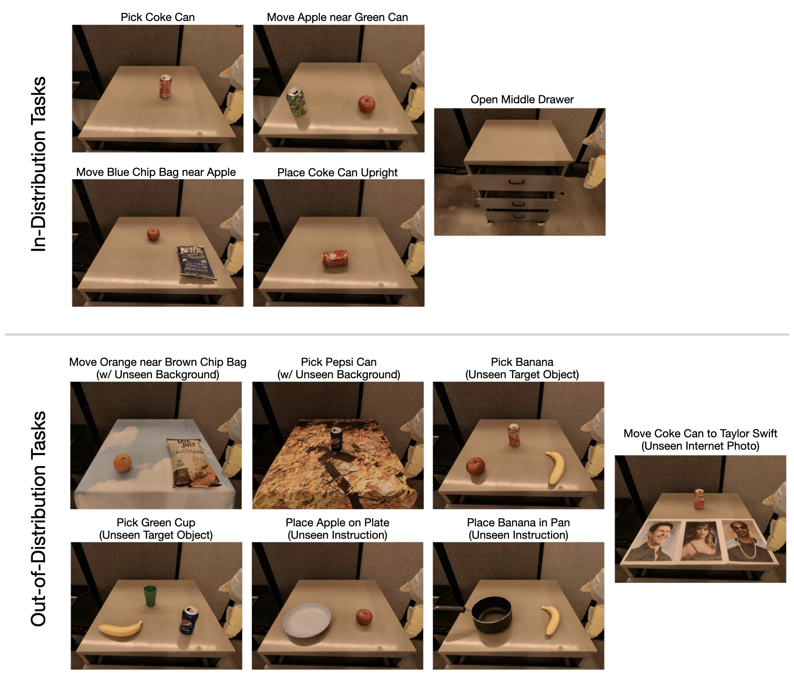

> 图解：Google robot 评测任务一览。涵盖分布内条件和多种 OOD 条件：新背景、新目标物体、新指令/物体关系、新语义概念（如机器人数据中从未出现过的名人照片）。

逐项结果（每项 5 次试验的成功数）：

| 类别 | 任务 | RT-1-X | Octo | RT-2-X | OpenVLA |
| --- | --- | --- | --- | --- | --- |
| 分布内 | Pick Coke Can | **5** | 1 | **5** | **5** |
| 分布内 | Move Apple near Green Can | 3 | 3 | 3 | **5** |
| 分布内 | Move Blue Chip Bag near Apple | 0 | 3 | 4 | **5** |
| 分布内 | Place Coke Can Upright | 0 | 0 | **4** | **4** |
| 分布内 | Open Middle Drawer | 0 | **4** | 2 | 3 |
| OOD | Move Orange near Brown Chip Bag | 1 | 2 | **5** | **5** |
| OOD | Pick Pepsi Can | 3 | 0 | **5** | 4 |
| OOD | Pick Banana | **5** | 3 | **5** | **5** |
| OOD | Pick Green Cup | 1 | 0 | **5** | **5** |
| OOD | Place Apple on Plate | 0 | 0 | **4** | **4** |
| OOD | Place Banana in Pan | 0 | 0 | 2 | **4** |
| OOD | Move Coke Can near Taylor Swift | 2 | 0 | **3** | 2 |
| **平均成功率** | | 33.3±6.1% | 26.7±5.8% | **78.3±5.4%** | **85.0±4.6%** |

定性上看，RT-2-X 和 OpenVLA 的行为明显比其他模型稳健：有干扰物时仍能接近正确物体、会根据目标姿态调整末端朝向、甚至能从抓握不稳的失误中恢复。

## 四、实验二：数据高效适配新机器人

开箱即用只是第一步。VLA 要真正普及，关键是能不能 **用少量数据快速适配到新机器人**——这正是此前工作完全没有探索过的。作者选择了机器人学习社区最常用的 Franka Emika Panda 机械臂，搭了两个环境：

- **Franka-Tabletop**：桌面固定安装的 Franka，5Hz 控制器，6 个任务（3 个单指令窄任务 + 3 个多物体多指令任务），每个任务收集 10-150 条示范；
- **Franka-DROID**：DROID 数据集中的移动升降台 Franka 设置，15Hz 控制器，1 个擦桌子任务（70 条示范）。

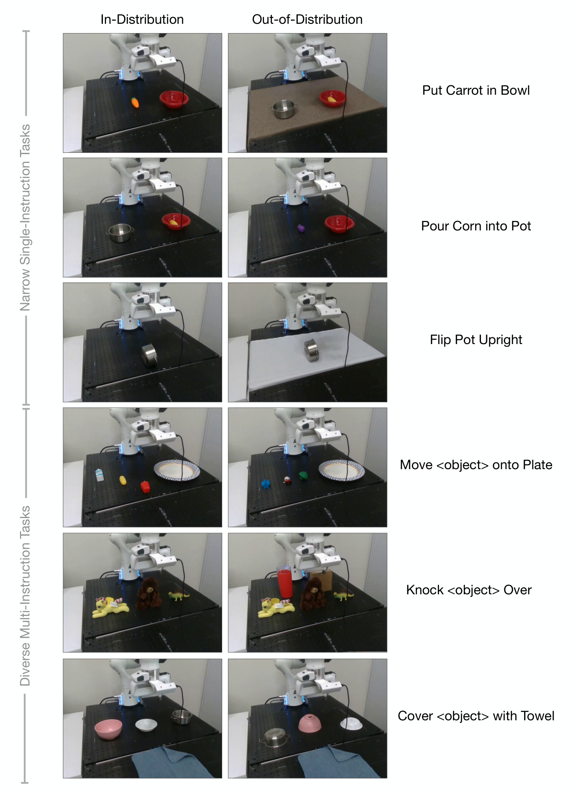

> 图解：Franka-Tabletop 的 6 个微调任务。上三行是单指令任务（胡萝卜放碗、倒玉米进锅、把锅翻正），下三行是多指令任务（按指令把指定物体放上盘子/推倒指定物体/用毛巾盖住指定物体）。左列是与训练分布一致的初始状态，右列是 OOD 测试状态（未见过的背景、物体、干扰物、位置姿态）。

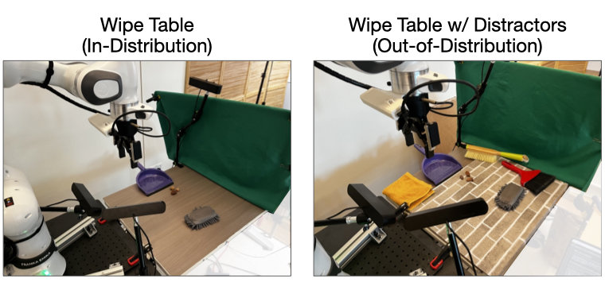

> 图解：Franka-DROID 的"Wipe Table"任务。左图为分布内初始状态，右图为 OOD 状态（桌上多了未见过的干扰物）。满分 2 分：把三个小物体全部扫进簸箕得 2 分，扫进 1-2 个得 1 分。

对比方法包括：从零训练的 **Diffusion Policy**（当前最强的数据高效模仿学习方法）、输入输出规格对齐 OpenVLA 的 **Diffusion Policy (matched)**、微调的 **Octo**、以及消融项 **OpenVLA (scratch)**——直接在底层 Prismatic VLM 上微调、不经过 OpenX 机器人预训练，用来验证大规模机器人预训练的价值。

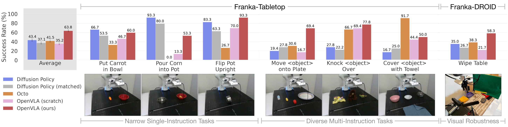

> 图解：7 个 Franka 任务的微调结果，按任务分组展示各方法成功率，右侧为两个环境的平均表现。Diffusion Policy 在窄单指令任务上很强，但在多指令任务上被通用策略反超；OpenVLA 是唯一在所有任务上成功率都 ≥50% 的方法，总平均成功率最高。

完整逐项结果（成功率，%）：

| 任务 | 试验数 | Diffusion Policy | DP (matched) | Octo | OpenVLA (scratch) | OpenVLA |
| --- | --- | --- | --- | --- | --- | --- |
| Put Carrot in Bowl (分布内) | 10 | **90.0** | 80.0 | 40.0 | 70.0 | 70.0 |
| Put Carrot in Bowl (OOD) | 5 | 20.0 | 0.0 | 20.0 | 0.0 | **40.0** |
| Pour Corn into Pot (分布内) | 10 | **100.0** | 90.0 | 0.0 | 10.0 | 50.0 |
| Pour Corn into Pot (OOD) | 5 | **80.0** | 60.0 | 0.0 | 20.0 | 60.0 |
| Flip Pot Upright (分布内) | 10 | **100.0** | 85.0 | 40.0 | 85.0 | **100.0** |
| Flip Pot Upright (OOD) | 5 | 50.0 | 20.0 | 0.0 | 40.0 | **80.0** |
| Move <object> onto Plate (分布内) | 12 | 25.0 | 25.0 | 41.7 | 8.3 | **75.0** |
| Move <object> onto Plate (OOD) | 6 | 8.3 | 33.3 | 8.3 | 33.3 | **58.3** |
| Knock <object> Over (分布内) | 12 | 33.3 | 25.0 | **83.3** | 75.0 | 75.0 |
| Knock <object> Over (OOD) | 6 | 16.7 | 16.7 | 33.3 | 58.3 | **83.3** |
| Cover <object> with Towel (分布内) | 12 | 16.7 | 20.8 | **91.7** | 41.7 | 50.0 |
| Cover <object> with Towel (OOD) | 6 | 16.7 | 33.3 | **91.7** | 50.0 | 50.0 |
| **Franka-Tabletop 平均** | | 48.5±4.9 | 43.4±4.7 | 43.4±4.4 | 43.4±4.6 | **67.2±4.0** |
| Wipe Table (分布内) | 18 | 50.0 | 27.8 | 52.8 | 25.0 | **55.6** |
| Wipe Table + Distractors (OOD) | 12 | 12.5 | 25.0 | 16.7 | 16.7 | **62.5** |
| **Franka-DROID 平均** | | 35.0±8.0 | 26.7±7.5 | 38.3±8.5 | 21.7±6.6 | **58.3±7.2** |

结果揭示了一个清晰的规律：**没有哪种方法在所有任务上都是最优的**。Diffusion Policy 在窄单指令任务上轨迹更平滑精确，但一旦任务涉及多物体和语言指令对齐，预训练通用策略的优势就出来了——OpenVLA 比从零训练的 Diffusion Policy 总平均高出约 20 个百分点。OpenVLA (scratch) 的明显掉点则证明：优势来自 OpenX 大规模机器人预训练，而非 VLM 主干本身。

> 博主点评：这组实验的实际意义大于数字本身——它说明 OpenVLA 可以当作下游模仿学习的"默认起点"，尤其是任务涉及多样语言指令时。而在高精细度的窄任务上，Diffusion Policy 的 action chunking 和时间平滑仍是值得 VLA 借鉴的方向。

## 五、实验三：参数高效微调与量化推理

上面的全量微调每任务需要 8 张 A100 跑 5-15 小时，虽然比预训练便宜得多，但离"人人可用"还有距离。这部分实验回答两个问题：能不能只训一小部分参数？能不能在低显存显卡上推理？

### 5.1 LoRA 微调：1.4% 参数追平全量微调

作者对比了五种微调策略：全量微调、只训最后一层（含 token 嵌入矩阵）、冻结视觉编码器、"三明治微调"（只解冻视觉编码器 + 嵌入矩阵 + 最后一层）、以及对所有线性层施加的 LoRA。

| 策略 | 成功率 | 训练参数量（×10⁶） | 显存（batch 16） |
| --- | --- | --- | --- |
| 全量微调 | **69.7±7.2%** | 7,188.1 | 163.3 GB（双卡 FSDP） |
| 只训最后一层 | 30.3±6.1% | 465.1 | 51.4 GB |
| 冻结视觉编码器 | 47.0±6.9% | 6,760.4 | 156.2 GB（双卡 FSDP） |
| 三明治微调 | 62.1±7.9% | 914.2 | 64.0 GB |
| **LoRA, r=32** | **68.2±7.5%** | **97.6** | **59.7 GB** |
| LoRA, r=64 | 68.2±7.8% | 195.2 | 60.5 GB |

逐任务的详细结果如下（Franka-Tabletop 两个代表性任务，%）：

| 任务 | 试验数 | 全量微调 | 只训最后一层 | 冻结视觉 | 三明治 | LoRA r=32 | LoRA r=64 |
| --- | --- | --- | --- | --- | --- | --- | --- |
| Put Carrot in Bowl (分布内) | 10 | 90.0 | 40.0 | 40.0 | 90.0 | 60.0 | 90.0 |
| Put Carrot in Bowl (OOD) | 5 | 40.0 | 0.0 | 40.0 | 0.0 | 60.0 | 40.0 |
| Move <object> onto Plate (分布内) | 12 | 79.2 | 33.3 | 50.0 | 75.0 | 75.0 | 62.5 |
| Move <object> onto Plate (OOD) | 6 | 41.7 | 33.3 | 58.3 | 41.7 | 75.0 | 66.7 |
| **平均** | | **69.7±7.2** | 30.3±6.1 | 47.0±6.9 | 62.1±7.9 | **68.2±7.5** | **68.2±7.8** |

结论很干净：

- 只训最后一层、或冻结视觉编码器都严重掉点——再次印证 **视觉特征必须适配目标场景**；
- LoRA 取得最佳的性能-显存权衡：只训练 **1.4% 的参数** 就追平了全量微调；
- LoRA rank 对性能影响微乎其微，作者建议默认 $r = 32$。

用 LoRA 在 **单张 A100** 上微调新任务只需 10-15 小时，比全量微调省 8 倍算力。

### 5.2 量化推理：4-bit 显存减半、性能不掉

7B 模型比 Octo（<100M）重得多，推理成本是普及的拦路虎。作者测试了 8-bit 和 4-bit 量化在 8 个代表性 BridgeData V2 任务上的表现：

| 精度 | Bridge 成功率 | 显存占用 |
| --- | --- | --- |
| bfloat16 | 71.3±4.8% | 16.8 GB |
| int8 | 58.1±5.1% | 10.2 GB |
| int4 | **71.9±4.7%** | **7.0 GB** |

这里有个非常有趣的发现：**int8 掉点的原因不是精度损失，而是推理变慢**。量化操作的开销使 int8 在评测用的 A5000 上只能跑 1.2Hz，而训练数据是 5Hz 非阻塞控制采集的——系统动力学变了，策略自然失灵。int4 反而因为显存传输减少抵消了量化开销，能跑 3Hz，更接近训练时的动力学，性能也就和 bfloat16 打平。

作者用一组补充实验坐实了这个因果链：改用 **阻塞式控制**（每个动作执行完再预测下一个），把三种精度的有效速度拉齐后，int8 的表现立刻恢复正常：

| 任务（阻塞控制） | 试验数 | bfloat16 | int8 | int4 |
| --- | --- | --- | --- | --- |
| Put Eggplant into Pot (Easy) | 10 | 10 | 10 | 10 |
| Put Eggplant into Pot | 10 | 9 | 10 | 10 |
| Put Cup from Counter into Sink | 10 | 5 | 5 | 3 |
| Lift Eggplant | 10 | 8 | 7 | 7.5 |
| Put Carrot on Plate | 10 | 10 | 10 | 10 |
| Lift AAA Battery | 10 | 3 | 6 | 4 |
| Take Purple Grapes out of Pot | 10 | 2 | 2 | 2 |
| Put {Eggplant, Red Bottle} into Pot | 10 | 9 | 9.5 | 8.5 |
| **平均成功率** | | 70.0±5.1% | **74.4±4.9%** | 68.8±5.2% |

三种精度误差条全部重叠——量化本身不损伤策略质量，损伤来自延迟。非阻塞设置下 8 个任务的逐项结果也一并列出（成功数）：

| 任务 | 试验数 | bfloat16 | int8 | int4 |
| --- | --- | --- | --- | --- |
| Put Eggplant into Pot (Easy) | 10 | **9** | 7 | **9** |
| Put Eggplant into Pot | 10 | **7** | **7** | **7** |
| Put Cup from Counter into Sink | 10 | 5 | 3 | **7** |
| Lift Eggplant | 10 | 6 | 4 | **7.5** |
| Put Carrot on Plate | 10 | 6 | 5 | **7** |
| Lift AAA Battery | 10 | **7** | 5 | 3 |
| Take Purple Grapes out of Pot | 10 | 8 | 8 | **9** |
| Put {Eggplant, Red Bottle} into Pot | 10 | **9** | 7.5 | 8 |
| **平均成功率** | | **71.3±4.8%** | 58.1±5.1% | **71.9±4.7%** |

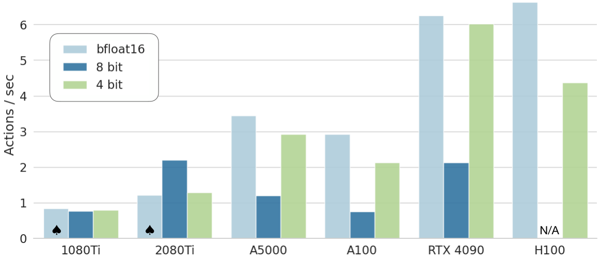

> 图解：OpenVLA 在各类消费级和服务器级 GPU 上的推理吞吐（Hz）。bfloat16 和 int4 在 Ada Lovelace 架构（RTX 4090、H100）上吞吐最高；int8 因量化开销普遍偏慢。标 ♠ 的表示模型需分片到两张 GPU 才能放下。借助 TensorRT-LLM 等现代推理框架还有进一步提速空间。

## 六、消融实验：拆开看每个设计值多少分

论文附录还系统回答了四个"如果去掉 X 会怎样"的问题。

**去掉 OpenX 预训练（只用 BridgeData V2 训练）**：在 8 个代表性 Bridge 任务上，成功率从 76.3% 暴跌到 45.6%，掉了 **30 个百分点**。除语言对齐外的所有泛化类别全面下滑——OpenX 数据的多样性是泛化能力的根本来源。

**去掉 DinoV2（只留 SigLIP 单编码器）**：成功率从 45.6% 进一步降到 40.6%，影响约 5 个百分点。双视觉编码器有用，但远没有数据多样性重要。

| 任务 | 试验数 | OpenVLA | OpenVLA-Bridge | OpenVLA-Bridge-SigLIP |
| --- | --- | --- | --- | --- |
| Put Eggplant into Pot (Easy) | 10 | 10 | 8 | 8 |
| Put Eggplant into Pot | 10 | 10 | 2 | 3 |
| Put Cup from Counter into Sink | 10 | 7 | 4 | 2 |
| Lift Eggplant | 10 | 7.5 | 5.5 | 6.5 |
| Put Carrot on Plate | 10 | 8 | 4 | 1 |
| Lift AAA Battery | 10 | 7 | 2 | 2 |
| Take Purple Grapes out of Pot | 10 | 4 | 3 | 3 |
| Put {Eggplant, Red Bottle} into Pot | 10 | 7.5 | 8 | 7 |
| **平均成功率** | | **76.3±4.8%** | 45.6±5.6% | 40.6±5.5% |

**冻结 vs 微调视觉编码器**：在两个不同的预训练 VLM 上验证，微调视觉编码器平均成功率 80.0%，冻结只有 46.7%。冻结版甚至会出现明显不稳定的机器人行为，部分评测因表现过差（接近零）而提前终止。

| 任务 | 试验数 | SigLIP ViT-SO 冻结 | SigLIP ViT-SO 微调 | LLaVA v1.5 冻结 | LLaVA v1.5 微调 |
| --- | --- | --- | --- | --- | --- |
| Put Eggplant into Pot | 10 | 7 | 10 | 5 | 9 |
| Put Corn on Plate | 10 | 10 | 9 | 0 | 9 |
| **平均成功率（%）** | | 85 | **95** | 25 | **90** |

（多物体语言对齐任务上，微调版同样以 55% vs 30% 明显领先冻结版；LLaVA 冻结版因表现过差未做完整评测。）

**仿真环境适配（LIBERO 基准）**：OpenVLA 只见过真实机器人数据，能否适配仿真？作者在 LIBERO 的四个任务套件上（每个套件 10 任务、每法 1500 次试验统计）做了测试，OpenVLA（LoRA 微调）取得最高平均成功率和最优平均排名：

| 方法 | Spatial | Object | Goal | Long | 平均 SR | 平均排名 |
| --- | --- | --- | --- | --- | --- | --- |
| Diffusion Policy（从零训练） | 78.3% | **92.5%** | 68.3% | 50.5% | 72.4% | 2.5 |
| Octo（微调） | 78.9% | 85.7% | **84.6%** | 51.1% | 75.1% | 2.0 |
| **OpenVLA（LoRA 微调）** | **84.7%** | 88.4% | 79.2% | **53.7%** | **76.5%** | **1.5** |

不过仿真中的领先幅度比真实世界小得多。作者归因于 sim-to-real 的域差：预训练全是真实数据，往仿真任务微调天然吃亏。反过来说，如果把仿真数据加进预训练配比，还有提升空间。

## 七、总结与展望

回顾这篇工作的核心要点：

- **首个开源 SOTA 通用 VLA**：7B 参数的 OpenVLA 在 29 个任务、两种本体上以 16.5% 绝对成功率超越 55B 的闭源 RT-2-X，参数量仅为其 1/7。
- **训练配方透明可复现**：Prismatic VLM 主干 + 分位数动作离散化 + OpenX 970k 轨迹，64 张 A100 训 14 天，五条设计经验全部公开。
- **微调方法论首次补齐**：全量微调在两个 Franka 环境上平均 67.2%，是唯一在所有任务上成功率 ≥50% 的方法，比从零训练 Diffusion Policy 高 20.4%。
- **消费级硬件可用**：LoRA（r=32）只训 1.4% 参数追平全量微调；4-bit 量化显存砍半（7GB）而性能不掉——8-bit 掉点的教训是"慢比糙更致命"。
- **全栈开源**：模型权重、训练/微调代码、远程推理服务器、LIBERO 复现材料，全部以宽松许可发布。

局限也很明确：目前只支持单张图像输入（无历史、无本体感知、无腕部相机）；6Hz 的推理速度不足以驱动 ALOHA 这类 50Hz 高频双臂系统；多数任务成功率仍低于 90%，离"可靠"尚有距离。action chunking、投机解码、多模态输入扩展，以及"VLM 规模与 VLA 性能的关系"等开放问题，都有待社区在这个开源基座上继续探索——这大概正是 OpenVLA 最大的价值所在。

> 本文参考自 [OpenVLA: An Open-Source Vision-Language-Action Model](https://arxiv.org/abs/2406.09246)