# AtomicRL：用"原子任务"治好长程机器人操作的强化学习顽疾

让机器人完成"把桌上所有面包放进盘子"这类长程任务时，模仿学习训出的 VLA 模型常常"前半段漂亮、后半段翻车"，而直接上 RL 后训练又被稀疏奖励拖累：一步走错，全程背锅。这篇工作要解决的正是长程操作中**信用分配污染**与**子任务掌握不均衡**两大痛点，它们直接卡住了 VLA 模型从"演示水平"走向"超越演示"的路。核心思路一句话：把长程任务切成原子子任务，让优势信号的跨段传播和探索资源的分配都围着这个语义结构转。结果相当硬：LIBERO-LONG 上成功率冲到 99.0%（比 PPO 高 3.6 个百分点），CALVIN 五连任务成功率从 70.6% 提到 80.1%，真机三个任务平均提升 21.3%。

## 长程操作的 RL，到底难在哪

VLA（Vision-Language-Action）模型靠大规模演示数据做模仿学习（IL），已经能学会不少操作技能，但性能天花板被演示数据的覆盖度锁死。RL 通过与环境交互、拿任务反馈直接优化策略，是突破这层天花板的常规武器。可一旦任务变"长"，两个老问题就被急剧放大。

**问题一：信用污染（credit contamination）。** 大多数 VLA-RL 方法只在 episode 结束时给一个 0/1 成功奖励。想象一条轨迹：前 $k$ 个子任务都完成了，第 $k+1$ 个失败。没有终端成功奖励时，GAE 会把失败段的 TD 残差一路反向传播到 $t_0$，把前面所有正确动作的优势估计一起压低。打个比方：这就像因为期末考试砸了，老师就认定你整个学期每次作业都没做好——轨迹越长，"冤枉"越严重。此前的 stage-level 偏好优化、子任务级中间奖励等方法只是调了奖励密度，并没有切断这种错误的反向传播。

**问题二：子任务掌握不均衡。** 训练后期，失败往往集中在少数几个瓶颈子任务上。此时均匀采样任务、固定强度探索，等于把宝贵的交互预算大把花在已经"学饱"的子任务上，真正卡脖子的环节反而练得不够，甚至可能干扰已学会的技能。

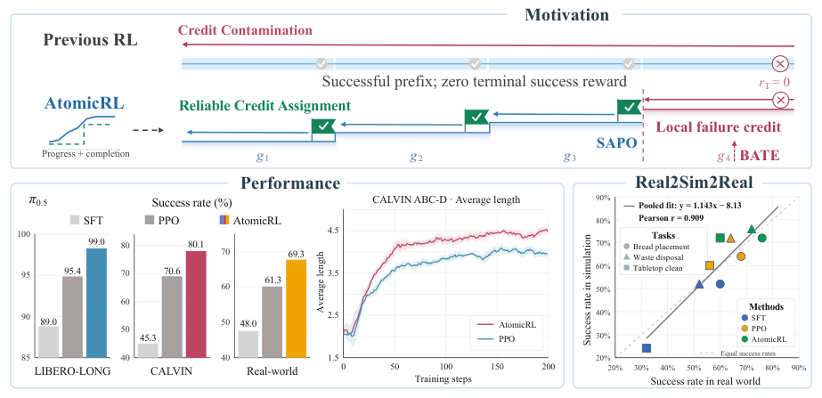

> 图解：上图对比了标准 GAE 与 AtomicRL 的差异。传统 RL 中失败子任务的负信号会沿轨迹无差别回传（credit contamination），而 AtomicRL 借助 SAPO 在原子子任务边界处对优势传播做语义门控，配合 BATE 的瓶颈定向探索和 Real2Sim2Real 流水线，在仿真和真机上都取得更强的长程操作表现。

## 方法总览：一个结构，三件套

AtomicRL 的关键洞察是：**语义子任务结构可以同时充当"学习信号传播的路由图"和"探索资源分配的调度表"**。整个框架由四个部分组成：

- **PCC（Progress–Completion Critic）**：轻量评判器，从交互历史中估计子任务进度、识别完成边界，是另外三个模块的"眼睛"；
- **SAPO（Semantic-Aware Policy Optimization）**：根据子任务执行成败，调节 TD 残差跨边界的传播；
- **BATE（Bottleneck-Adaptive Targeted Exploration）**：根据子任务掌握度，动态调整任务采样与局部探索激励；
- **Real2Sim2Real 流水线**：用单条真机演示重建可交互仿真环境，在仿真里做在线 RL，再部署回真机。

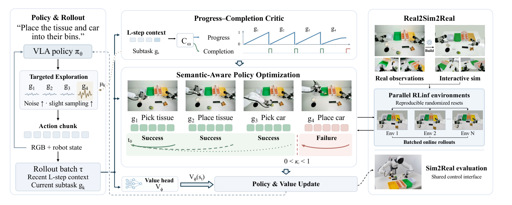

> 图解：框架四部分的数据流。(a) PCC 从最近的观测-动作序列中估计原子任务进度并识别完成边界；(b) SAPO 利用这些语义信号，按子任务成败调节优势的跨子任务传播；(c) BATE 按子任务掌握度调整任务采样权重和探索强度，把训练火力集中到瓶颈环节；(d) Real2Sim2Real 流水线支持仿真并行训练并向真机迁移。

形式化地说，任务被建模为语言条件下的部分可观测马尔可夫决策过程。每一步 $t$，机器人接收观测 $o_t$（第三人称图像、腕部相机、本体状态），输出长度为 $H_a$ 的动作块 $a_t=(a_{t,1},\ldots,a_{t,H_a})$。长程指令被分解为 $K$ 个有序原子子任务 $G=(g_1,\ldots,g_K)$，当前子任务索引记为 $z_t$，语义边界指示器 $b_t=\mathbb{I}[z_{t+1}\neq z_t]$ 标记执行 $a_t$ 后是否发生子任务切换。目标是在固定交互预算下最大化整任务成功率。

## SAPO：给优势传播装上"语义闸门"

先回顾标准做法。一步 TD 残差为：

$$
\delta_t = r_t + \gamma(1-d_t)V_{\phi}(s_{t+1}) - V_{\phi}(s_t)
$$

其中 $r_t$ 是动作块级奖励，$d_t$ 是环境终止标志，$s_t$ 是价值函数可用的观测-语言条件表示。PPO 使用的标准 GAE 优势估计为：

$$
\hat{A}^{\mathrm{PPO}}_t = \sum_{\ell=0}^{T-t} (\gamma\lambda)^\ell \, \delta_{t+\ell}
$$

问题就出在这个求和上：它不分青红皂白地把整条轨迹的残差都按 $\gamma\lambda$ 衰减累加，失败段的负残差会自然渗入前面成功段的优势估计。

SAPO 的做法是保持一步 TD 残差不变，只在递归 trace 上加一个结果感知的软闸门：

$$
\hat{A}^{\mathrm{SAPO}}_t = \sum_{\ell=0}^{T-t} (\gamma\lambda)^\ell \left[ \prod_{j=0}^{\ell-1} \left( 1 - (1-\kappa_{t+j}) b_{t+j} \right) \right] \delta_{t+\ell}, \qquad \kappa_t \in [0,1]
$$

逻辑很直观：

- 子任务内部 $b_t=0$，trace 按标准 $\gamma\lambda$ 衰减，段内信用分配不受影响；
- 边界处若后续子任务**成功**，取 $\kappa_t=1$，保持正常传播——成功子任务之间的依赖关系被完整保留；
- 边界处若后续子任务**失败**，取 $0<\kappa_t<1$，对跨入已完成前缀的残差做衰减。

于是"前 $k$ 段成功、第 $k+1$ 段失败"的轨迹里，失败段的残差在段内照常传播、用于改进该段策略，但跨入成功前缀时被衰减，不再一味抹黑之前的好行为。笔者认为这个设计的聪明之处在于：它**不改奖励、不改价值 bootstrapping，只改 trace 的路由**，相当于在 GAE 里插入了一个轻量的语义滤波器，几乎零额外成本却能消除结构性偏差。

## BATE：把探索预算花在刀刃上

解决了"信号怎么传"，下一个问题是"数据从哪来"。训练早期广泛探索是必要的，但接近饱和时，失败集中在少数瓶颈子任务，继续大水漫灌式探索既低效又可能冲垮已学会的技能。

BATE 首先用指数滑动平均估计每个原子子任务的掌握度：

$$
\mu_k^{(n)} = \beta \mu_k^{(n-1)} + (1-\beta)\hat{s}_k^{(n)}, \qquad \beta \in [0,1)
$$

其中 $\hat{s}_k^{(n)}$ 是本次统计更新中已判定的子任务尝试的成功占比。能力缺口 $1-\mu_k$ 同时驱动两个机制：

**整任务采样重加权。** 对包含子任务集合 $\mathcal{K}_i$ 的整任务 $i$：

$$
w_i = 1 + \rho \left[ \max_{k \in \mathcal{K}_i} (1-\mu_k) \right]^\eta, \qquad P_{\mathrm{task}}(i) = \frac{w_i}{\sum_j w_j}
$$

$\eta>0$ 控制对缺口的敏感度，$\rho \geq 0$ 限制重分配幅度。注意权重里的基线 $1$——它保证已掌握的任务仍会被采到，用于监控遗忘，这个细节很实用。

**子任务级熵正则。** 在轨迹内部，按当前活跃子任务 $z_t$ 的掌握度调节探索强度：

$$
\mathcal{L}_{\mathrm{explore}} = -\alpha_H \mathbb{E}_t \left[ f_{\mathrm{exp}}\!\left(1-\mu_{z_t}^{(n)}\right) \mathcal{H}_{\theta,t} \right]
$$

其中 $\mathcal{H}_{\theta,t}$ 是策略熵，$f_{\mathrm{exp}}$ 是有界探索权重。掌握度越低，探索越强；学会了就收敛，避免无谓扰动。

## PCC：轻量"进度-完成度评判器"

SAPO 和 BATE 都依赖边界信号 $b_t$ 和掌握度统计，这些从哪来？答案是 PCC——一个轻量的进度-完成度评判器 $C_\omega$。它以最近 $L$ 个观测-动作对为输入，以当前原子任务为条件，输出 $B-1$ 个序数进度 logit 和一个完成度 logit，解码方式为：

$$
\hat{p}_t = \frac{1}{B-1} \sum_{j=1}^{B-1} \mathbf{1}\!\left[ \sigma(u_{t,j}^{\mathrm{prog}}) > \tau_{\mathrm{ord}} \right], \qquad \hat{q}_t = \sigma(u_t^{\mathrm{comp}})
$$

当 $\hat{q}_t \geq \tau_s$ 且 $\hat{p}_t \geq \tau_p$ 连续维持 $N$ 步时，判定子任务完成：任务索引前进 $z_{t+1}=z_t+1$，任务内进度清零，物理观测上下文保留。

PCC 在演示数据上离线训练，RL 后训练期间保持冻结，损失函数为序数进度损失与类别均衡完成度损失的加权和：

$$
\mathcal{L}_C = \lambda_p \mathcal{L}_{\mathrm{ord}} + \lambda_c \mathcal{L}_{\mathrm{comp}}
$$

工程上它很"省"：视觉编码器是冻结的 SigLIP（约 400M 参数，取自 $\pi_{0.5}$ 视觉骨干），可训练部分只有 28.8M 参数的时序与预测模块。标注 LIBERO 用 150 条轨迹、真机任务每个 50 条，由 VLM 自动生成再人工修正。

## PBSR：可选的进度整形奖励

PCC 的进度估计还可以顺手构造基于进度的整形奖励（PBSR）。设进度位势为：

$$
\Phi_{t+1} = \frac{z_{t+1} - 1 + \widetilde{c}_t / B}{K}
$$

它把子任务索引与任务内进度（按 $1/B$ 缩放）合成一个 $[0,1]$ 的全局进度。整形奖励按势函数差分给出，保证不改变最优策略：

$$
r_t^{\mathrm{PBSR}} = \gamma \Phi_{t+1} - \Phi_t, \qquad r_t = r_t^{\mathrm{env}} + \alpha_n r_t^{\mathrm{PBSR}}
$$

关键在系数的退火 schedule：

$$
\alpha_n = \alpha_0 \left[ 1 - (1-\rho) \, \mathrm{clip}\!\left(\frac{n-n_s}{n_e-n_s}, 0, 1\right) \right]
$$

训练早期给较强的稠密引导加速探索，后期逐步退火突出稀疏终端奖励，避免辅助奖励稀释成功信号、把优化引向局部收益。消融实验（下文）证实了这个"先密后疏"的节奏设计确实比恒定稠密奖励更好。

## Real2Sim2Real：把昂贵的真机试错搬进仿真

真机在线 RL 的最大障碍是交互成本与安全风险。AtomicRL 的答案是自动化 Real2Sim2Real 流水线：给定**单条**真机多模态演示 $\tau_{\mathrm{real}}$、机器人元信息 $m$ 与必要的补充物体观测 $\mathcal{D}_{\mathrm{aux}}$，流水线自动产出对齐真实系统的仿真环境：

$$
(\mathcal{E}_{\mathrm{sim}}, \mathcal{C}, \mathcal{S}_0) = \mathcal{B}(\tau_{\mathrm{real}}, m, \mathcal{D}_{\mathrm{aux}})
$$

其中 $\mathcal{E}_{\mathrm{sim}}$ 是重建的可交互仿真环境，$\mathcal{C}$ 是仿真与真机共享的观测-动作接口规范，$\mathcal{S}_0$ 是一组可复现的随机初始布局。环境接入 RLinf 分布式训练框架做在线 RL，验证后通过同一接口部署回 AgiBot G1 真机。整个流程由 GPT-6 Astra 辅助工具编排与代码实现。

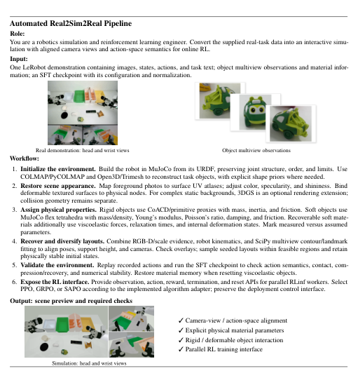

> 图解：自动化 Real2Sim2Real 工作流的关键步骤：从真实任务重建（含真实到仿真的场景示例）、到 RLinf 框架中的仿真在线 RL、再到真机部署，每步标注了所需的工具调用与验证要求。

## 实验：仿真与真机双重验证

### 实验设置

仿真侧用两个基准：LIBERO-LONG（10 个长程任务）与 CALVIN ABC-D（在 A、B、C 环境训练，在 held-out 的 D 环境评测），均在 RLinf 框架内实现，每次训练 200 个优化步，硬件为 8 张 H200 训练 + 单张 RTX 5090 推理。LIBERO 上对比 $\pi_{0.5}$ 和 OpenVLA-OFT 两种骨干的 PPO 基线；CALVIN 上用 $\pi_{0.5}$。真机侧在 AgiBot G1 上做三个长程桌面任务：Bread Placement（BP，把面包全放到白盘，6 个子任务）、Waste Disposal（WD，纸巾和小车入垃圾桶）、Tabletop Clean（TC，遥控器入收纳盒、零食入盒），每任务采 100 条专家演示做 SFT 初始化，RL 在 Real2Sim 重建环境中进行。评测指标：LIBERO 报每任务 50 次试验的平均成功率；CALVIN 报 1000 次试验中连续完成 1~5 个任务的成功率与平均完成长度；真机每任务每方法测 25 次。

### 仿真结果

| Backbone | 方法 | 成功率 (%) ↑ | 相对 PPO (pp) |
| --- | --- | --- | --- |
| $\pi_{0.5}$ | SFT | 89.0 | -- |
| $\pi_{0.5}$ | + PPO | 95.4 | -- |
| $\pi_{0.5}$ | **+ AtomicRL** | **99.0** | **+3.6** |
| OpenVLA-OFT | SFT | 86.5 | -- |
| OpenVLA-OFT | + PPO | 94.8 | -- |
| OpenVLA-OFT | **+ AtomicRL** | **98.8** | **+4.0** |

可以看到，即便 PPO 已经把成功率推到 95% 附近的高位，AtomicRL 仍能在 200 步预算内把两种骨干都逼到接近饱和的 99% 左右，且增益跨架构一致——说明这套机制不挑底座。

| 方法 | 1 连 | 2 连 | 3 连 | 4 连 | 5 连 | 平均长度 ↑ |
| --- | --- | --- | --- | --- | --- | --- |
| $\pi_{0.5}$ SFT | 92.8 | 83.5 | 73.2 | 61.5 | 45.3 | 3.56 |
| + PPO | 99.2 | 95.7 | 89.8 | 81.2 | 70.6 | 4.36 |
| **+ AtomicRL** | **99.4** | **97.0** | **92.6** | **87.3** | **80.1** | **4.56** |

CALVIN 上的规律更值得玩味：链条越长，AtomicRL 相对 PPO 的优势越大——单任务只差 0.2 个百分点，五连任务却拉开 9.5 个百分点。这正是"越到后段越不受前段失败污染 + 瓶颈子任务被重点攻克"的直接体现，长程可靠性才是它的主战场。

### 真机结果

| 方法 | BP | WD | TC | 平均成功率 ↑ |
| --- | --- | --- | --- | --- |
| $\pi_{0.5}$ SFT | 60 | 52 | 32 | 48.0 |
| + PPO | 68 | 64 | 52 | 61.3 |
| **+ AtomicRL** | **76** | **72** | **60** | **69.3** |

AtomicRL 相对 SFT 平均提升 21.3 个百分点，相对 PPO 提升 8.0 个百分点，三个任务全面占优。

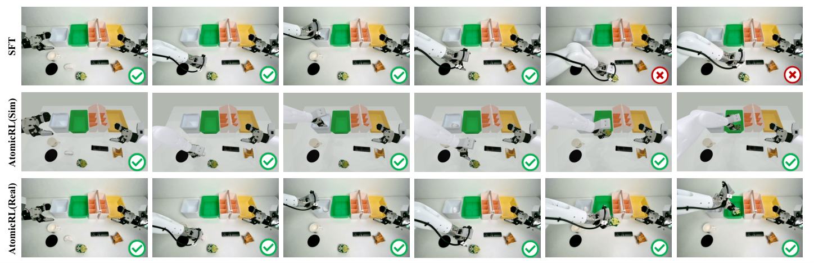

> 图解：真机执行过程对比。SFT 策略只完成前段动作就在后期失败，而经 AtomicRL 优化的策略在仿真和真实部署中都能完整走完整条子任务序列，说明重建环境保留了任务相关的关键视觉与交互结构。

仿真与真机之间到底有多对应？作者统计了 3 任务 × 3 方法共 9 个组合的仿真/真机成功率，Pearson 相关系数达 $r=0.909$——仿真里的训练曲线可以作为真机策略改进趋势的可靠间接参考。

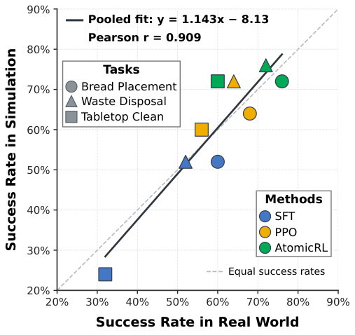

> 图解：横轴为仿真成功率，纵轴为真机成功率，覆盖三个任务、三种方法的九个组合。点云沿对角线分布，聚合 Pearson 相关系数 $r=0.909$，呈强正相关，支撑"仿真训练、真机受益"的迁移路径。

### 消融实验：每个组件都在干活

消融在 LIBERO-LONG 上进行，特意使用更少演示训出的较弱 SFT checkpoint，以便看清各组件在低起点下的贡献。

**(a) 奖励粒度 × SAPO（成功率 %）**

| 奖励 | PPO | SAPO |
| --- | --- | --- |
| 0/1 | 78.2 | 87.8 |
| SubR（子任务级） | 80.2 | 89.4 |
| PBSR（过程级稠密） | 81.8 | 89.0 |
| **Ours（退火 PBSR）** | -- | **89.6** |

两个信息点：其一，SAPO 在所有奖励设置下都稳定优于 PPO，说明它的收益**不是**来自更稠密的反馈，而是来自更干净的信用路由；其二，奖励并非越密越好——SAPO 下恒定的过程级稠密奖励（89.0）反而略逊于子任务级稀疏奖励（89.4），因为持续的辅助奖励会稀释终端成功信号，退火调度正是为此设计。

**(b) 组件逐个叠加（成功率 %）**

| SAPO | PBSR | BATE | 成功率 |
| --- | --- | --- | --- |
| ✗ | ✗ | ✗ | 78.2 |
| ✓ | ✗ | ✗ | 87.8 |
| ✓ | ✓ | ✗ | 89.6 |
| ✓ | ✓ | ✓ | **91.2** |

从 PPO 基线 78.2% 出发，SAPO 贡献最大（+9.6 pp），退火 PBSR 再加 1.8 pp，BATE 再补 1.6 pp，累计提升 13.0 个百分点。三件套互补，没有摆设。

**SAPO 门控系数 $\kappa$ 的敏感性。** $\kappa$ 控制失败子任务前边界处的 trace 传播强度（成功子任务前的门恒为 1；$\kappa=1$ 退化为标准 GAE，$\kappa=0$ 为硬阻断但保留一步价值 bootstrap）：

| $\kappa$ | 成功率 |
| --- | --- |
| 0.0 | 87.2% |
| 0.3 | **87.8%** |
| 0.5 | 85.0% |
| 0.8 | 81.2% |
| 1.0 | 78.2% |

$\kappa=0.3$ 最优，比不衰减的基线高 9.6 个百分点；硬阻断（$\kappa=0$）也不错，仅低 0.6。结论：对失败段的跨边界传播做**软衰减**是最稳妥的选择——完全放行会被污染，完全切断又丢了一点有用的段间依赖。

**PCC 自身的精度与开销。** 在 500 条测试 rollout 上：

| 类别 | 指标 | 数值 |
| --- | --- | --- |
| 预测质量 | 精确率 | 95.92% |
| 预测质量 | 误检率 | 4.08% |
| 预测质量 | 召回率 | 89.20% |
| 效率 | 可训练参数 | 28.8 M |
| 效率 | 推理延迟 | 42.4 ms |

高精度加毫秒级延迟，证明这只"眼睛"足以支撑在线 RL 的实时信号供给。

### 训练动态：更快收敛，价值函数也更准

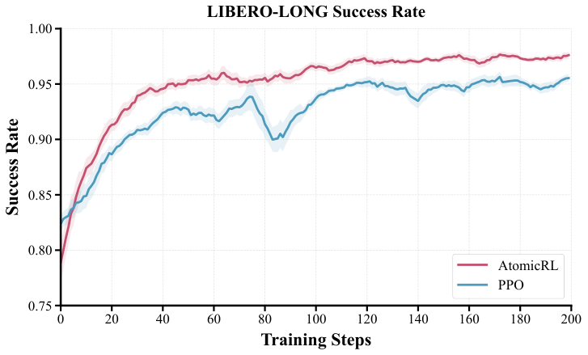

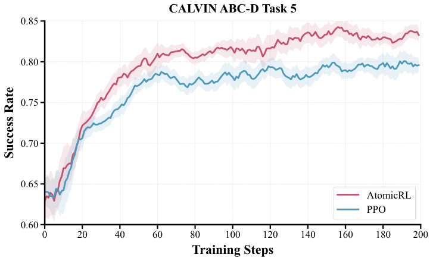

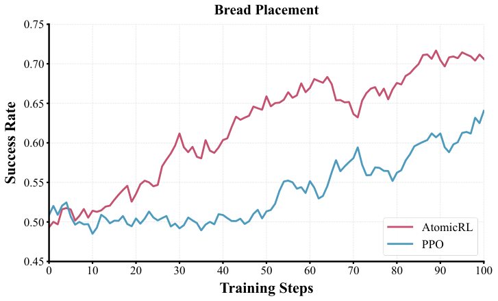

> 图解：三张训练曲线分别对应 LIBERO-LONG 成功率、CALVIN 五连任务成功率、真机 BP 任务成功率（横轴为训练步数，纵轴为成功率）。两个基准上 AtomicRL 早期上升更快并全程压制 PPO；BP 任务尤其明显——前 40 步 PPO 还在 50% 附近徘徊，AtomicRL 约 30 步就到 60% 并持续爬升，因为 SAPO 保住了失败轨迹中已成功前缀的学习信号。

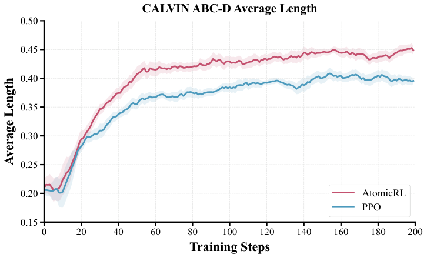

> 图解：CALVIN ABC-D 上平均完成长度随训练步数的变化，AtomicRL 全程优于 PPO，与主表中 4.56 对 4.36 的最终差距一致。

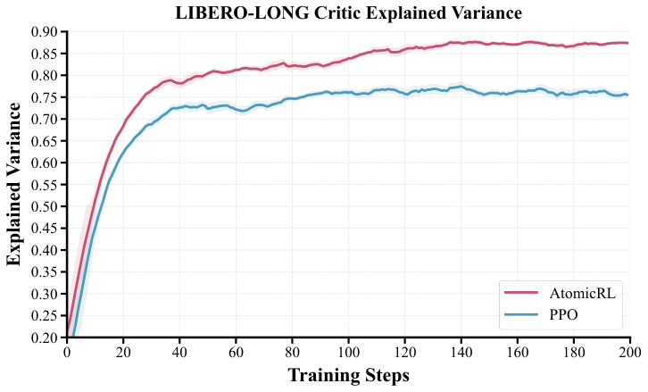

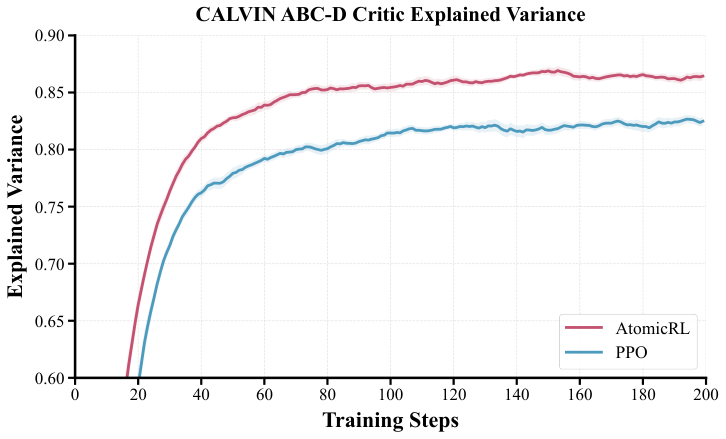

> 图解：Critic 的 explained variance（解释方差，越接近 1 说明价值函数对训练目标的拟合越好）。训练后期 AtomicRL 比 PPO 高约 12%（LIBERO）和 5%（CALVIN）——信用分配干净了，价值函数学到的目标噪声更小，这从机制层面佐证了 SAPO 的作用。

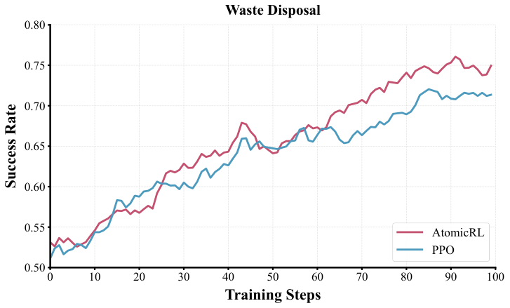

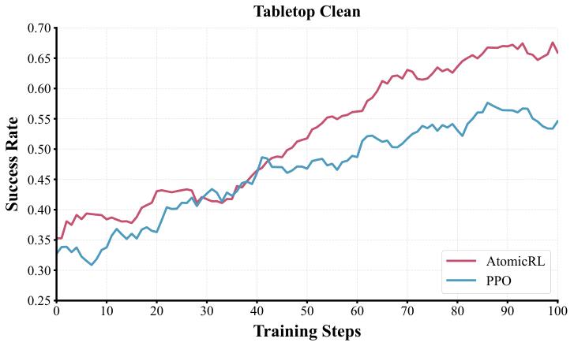

> 图解：Real2Sim 重建环境中 WD 与 TC 两个真机任务的训练曲线。AtomicRL 在训练后期同样取得更高成功率，说明其优势不限于单一任务。

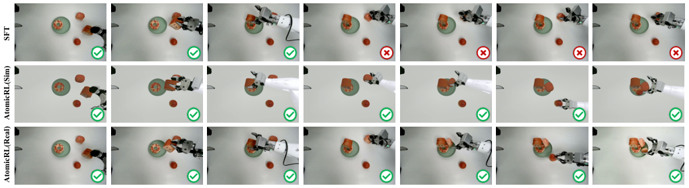

> 图解：另一组仿真与真机的执行过程可视化。SFT 完成初始动作后在中后段失败，AtomicRL 则在两个环境中都成功完成图示序列，与仿真-真机高相关性的定量结论相互印证。

## 总结与展望

- **问题定义清晰**：长程 VLA-RL 的两大结构性痛点是信用污染（失败段的 TD 残差抹黑成功前缀）与瓶颈子任务探索不足。
- **SAPO 是最大功臣**：仅在 GAE trace 上加结果感知的软闸门，不改奖励与 bootstrap，单组件即带来 +9.6 pp。
- **BATE 把钱花在刀刃上**：按掌握度联动任务采样与熵正则，后期再贡献 +1.6 pp。
- **PCC 小投入大产出**：28.8M 可训练参数、42.4ms 延迟，为全框架供给高精度语义边界信号。
- **Real2Sim2Real 打通真机链路**：单条演示重建仿真环境，仿真-真机相关性 $r=0.909$，真机平均提升 21.3%。

局限同样明显：在线 RL 的交互总量与训练时间仍是硬成本，真机试错只是被转移而非消失；实验集中在桌面长程任务且从 SFT 策略出发，对更开放、动态场景的泛化性尚待验证。把原子任务结构的思想迁移到 Agentic RL 框架、让机器人在开放环境中动态生成和调整子任务结构，或许是这条线最值得期待的下一站。

> 本文参考自 [AtomicRL: Atomic Reinforcement Learning for Long-Horizon Robotic Manipulation](http://arxiv.org/abs/2610.30097v1)