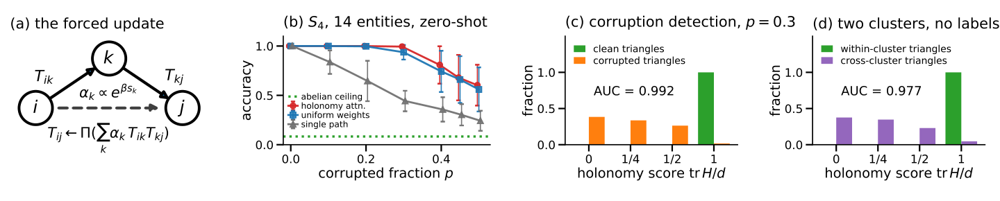

# Holonomy Attention：关系只能沿闭环交互

关系推理不只是“看到哪些边”，还要处理关系沿共享实体的有序组合：父亲的母亲与母亲的父亲并不相同。这个问题直接关系到知识图谱补全、群体同步和蛋白质结构建模，因为新实体往往没有天然统一的坐标系，任意旋转它的表示都不应改变预测。论文从这种逐实体坐标自由出发，证明关系算子若要满足对称性，就只能通过闭环上的 Wilson Loop 相互作用，并据此得到无需训练的 Holonomy Attention。在 $S_4$ 稀疏图、20% 边被损坏的设置下，它对未观测关系的预测准确率约为 0.88，而所有交换式架构的能力上限只有 0.083；其闭环分数检测损坏三角形的 AUC 达到 0.99。

## 从坐标自由到关系传输

### 每个实体都可以有自己的“地图方向”

可以把每个实体想象成一张使用本地方向标绘的地图：北向如何选择并不影响地理位置，只有地图之间的旋转关系才能让我们对齐它们。对应到关系图中，实体是节点，关系是节点之间的“坐标传输器”；沿一条路径连续传输，就是按顺序组合关系。

严格来说，实体 $i$ 携带向量 $x_i\in\mathbb{R}^d$，边 $(i,j)$ 携带正交传输矩阵 $T_{ij}\in O(d)$，并满足 $T_{ji}=T_{ij}^{-1}$。每个节点都可以独立进行正交变换 $g_i\in O(d)$，于是规范变换（gauge transformation）写成：

$$
x_i\mapsto g_i x_i,\qquad T_{ij}\mapsto g_iT_{ij}g_j^{-1}
$$

这里允许反射的 $O(d)$ 很关键，后文会看到，它让不变量的分类与只考虑旋转时有所不同。

### 对称性先约束节点 Attention

如果任意改变单个实体的坐标系都不改变任务，那么合法的预测器也必须保持不变。论文引用前作的结论：任何连续的不变量分数，只能通过 $x_i$ 和传输后的 $T_{ij}x_j$ 依赖两个实体；若度量在传输下保持，分数可写为：

$$
s=\phi\!\left(\lVert x_i\rVert,\lVert x_j\rVert,\langle x_i,T_{ij}x_j\rangle\right)
$$

等变消息也只能位于 $\operatorname{span}\{x_i,T_{ij}x_j\}$ 中。普通双线性分数 $x_i^\top Mx_j$ 并不自动满足逐实体不变性；取 $g_j=I$、$g_i=-I$ 就会迫使 $M=0$。

更重要的是，$T_{ij}$ 不能只从 $x_i,x_j$ 等变地生成。这样的映射会退化为秩一的 $\phi x_ix_j^\top$，不可能给出正交传输。因此，关系算子必须来自实体对之外的关系数据，而不是仅凭两个实体的内容凭空构造。

### 闭环决定可观测的几何

沿闭合路径传输一个向量，回到起点时可能已经发生净旋转，这个累积变换称为 **holonomy（完整回路传输）**。以三角形为例：

$$
H=T_{ij}T_{jk}T_{ki}
$$

$H$ 本身会随起点坐标系共轭变化，但它的共轭不变量不会。最典型的 Wilson Loop 是 $\operatorname{tr}H$，更一般地，还包括 $\operatorname{tr}H^r$ 等类函数（class functions），即满足 $f(gHg^{-1})=f(H)$ 的函数。

如果所有闭环的 holonomy 都是单位矩阵，就存在一个全局共享坐标系，使所有 $T_{ij}$ 同时化为 $I$。此时上述分数退化为共享坐标系中的点积 Attention。按照论文的对应关系，标准 Attention Head 中 $W_Q^\top W_K$ 和 $W_OW_V$ 都是固定的每头传输，只随网络深度间接组合；因此，普通 Attention 是这套理论的“平坦连接极限”，而不是最一般形态。

明确了节点如何被传输之后，下一个问题更关键：边与边之间能否任意交换信息？答案仍然由同一种对称性决定。

## 无环不交互，闭环定形式

### 树上没有可用的关系不变量

考虑一组不构成任何环的边。沿其生成树逐一固定规范，可以把所有传输矩阵都变成 $I$。此时，任何在这些边上保持 $O(d)^V$ 不变的函数都只能得到常数，因为同一组输入总能被规范变换到同一个全单位矩阵状态。

若还要等变地更新某条边，在固定规范后，更新必须与剩余的整体对角 $O(d)$ 变换交换。由 Schur 引理，它只能是标量倍的单位矩阵；在正交约束下为 $\pm I$。还原原坐标系后，更新只剩：

$$
U=\pm T_{ij}
$$

也就是说，在不含实体向量的纯规范场部分，无环边集不能给其他边带来任何非平凡更新。两条共享顶点却没有第三条边闭合的关系，仍然只是一棵树，因此不存在满足该对称性的“全局任意边 Attention”。若加入实体向量，$x_ix_j^\top$ 可以额外提供无环等变项，但这不改变纯关系算子的结论。

### 三角形的不变量就是 Wilson Loop

对三角形的三条边，选择：

$$
g_i=I,\qquad g_j=T_{ij},\qquad g_k=T_{ij}T_{jk}
$$

就能把 $(T_{ij},T_{jk},T_{ki})$ 化为 $(I,I,H)$。剩余自由只有所有节点共同施加的 $g$，它使 $H\mapsto gHg^{-1}$。因此，三角形的规范轨道恰好由 $H$ 的共轭类决定，连续不变量恰好是 $H$ 的类函数，可由 $\operatorname{tr}H^r$（$r\le d$）生成。

这里使用 $O(d)$ 而非仅使用 $SO(d)$ 并非细节。比如在 $SO(2)$ 中，$R(\theta)$ 与 $R(-\theta)$ 有相同特征多项式，却不一定在 $SO(2)$ 内共轭；允许反射后，共轭分类才会与这些不变量吻合。同一论证也适用于任意长度 $m$ 的环；多个环则对应多个 holonomy 在同时共轭下的联合不变量。

### 边更新被唯一锁定为 $\Psi(H)T_{ij}$

论文的核心定理指出：若只通过包含边 $T_{ij}$ 的一个环更新该边，且环在节点 $i$ 处的 holonomy 为 $H$，那么任何连续等变更新都必须具有：

$$
U=\Psi(H)T_{ij}
$$

其中：

$$
\Psi(gHg^{-1})=g\Psi(H)g^{-1}
$$

并且 $\Psi$ 位于 $\left\{\sum_r c_r(H)H^r\right\}$ 的闭包与 $O(d)$ 的交集中，$c_r$ 是类函数。

证明思路与前面的规范固定完全一致：

1. 在 $(I,I,H)$ 规范下定义 $\Psi(H)=U(I,I,H)$。
2. 剩余对角规范把 $H$ 变为 $gHg^{-1}$，等变性随即给出 $\Psi$ 的共轭等变条件。
3. 撤销规范固定，右乘的 $T_{ij}$ 自动恢复。
4. 在 $O(d)$ 上有 $H^\top=H^{-1}$，所以由 $H,H^\top$ 构成的多项式字都可化为 $H$ 的整数次幂；紧群上的连续等变映射再由多项式映射逼近。

若有多个环经过同一条边，结论推广为 $U=\Psi(H_1,\ldots,H_b)T_{ij}$，并要求 $\Psi$ 对多个 holonomy 的同时共轭等变。若目标边缺失，则可用一条候选路径 $C_1$ 替代 $T_{ij}$。这正是后面零样本补全缺失关系的理论入口。

## Holonomy Attention 如何落地

### 从单条绕行路径到多条路径加权

取 $\Psi=H^{-1}$，就能得到一个最直观的合法更新：

$$
H^{-1}T_{ij}=T_{ik}T_{kj}
$$

它表示先绕过第三节点 $k$，再沿 $i\to k\to j$ 组合关系。这与“父亲的母亲不是母亲的父亲”一样，矩阵乘法保留了组合顺序。

存在多个第三节点时，对各条两跳路径加权求和，再用极分解中的正交投影 $\Pi$ 投回 $O(d)$：

$$
T_{ij}\leftarrow\Pi\!\left(\sum_k\alpha_kT_{ik}T_{kj}\right)
$$

只要加权和可逆，$\Pi$ 就是等变的，因此整个聚合仍属于定理解出的形式。它等价于格点规范理论中带两链接 staple 的 APE smearing；区别在于，本文证明了一般关系图上满足对称性的更新只能属于这一族，而不只是又设计了一种消息传递层。

### 用避开目标边的闭环打分

对缺失边 $(i,j)$，每个第三节点 $k$ 都给出候选关系：

$$
C_k=T_{ik}T_{kj}
$$

两个候选的互相一致性为：

$$
C_kC_l^{-1}=T_{ik}T_{kj}T_{jl}T_{li}
$$

这是四边形 $i\to k\to j\to l\to i$ 的 holonomy，而且它**不包含待预测的边 $(i,j)$**。论文据此定义候选 $k$ 的分数：

$$
s_k=\frac{1}{|\{l:l\ne k\}|}\sum_{l\ne k}\frac{\operatorname{tr}(C_kC_l^{-1})}{d},\qquad \alpha_k\propto e^{\beta s_k}
$$

这条设计规则很值得注意：单个环无论哪条边出错，表现出的都是同一个不闭合程度，因此它能发现异常，却不能定位异常。若直接用包含目标边的三角形给该目标打分，就会形成自我确认；两个候选构成的、避开目标边的闭环，才能独立评价候选。实验中，这种“literal”自评分会损失 5–12 个百分点。

### 零训练的具体实现

论文在 $S_4$ 上实例化该方法：加载四对象置换群的忠实置换表示，维度 $d=4$，执行 4 轮上述更新，温度参数 $\beta=8$，每轮再按 Frobenius 范数吸附到最近的群元素。已观测边始终固定，只有缺失边通过候选闭环推断，全程没有学习参数。五倍范围的参数扫描中，路由带来的收益变化不超过 3 个百分点。

> 图解：(a) 中，缺失或待更新的边 $T_{ij}$ 由多条 $i\to k\to j$ 两跳路径组合，路径权重 $\alpha_k$ 来自 Wilson Loop 分数，最后用 $\Pi$ 投影回正交群。(b) 横轴为边损坏比例 $p$，纵轴为未观测关系准确率；红色 Holonomy Attention 与蓝色均匀加权在高噪声下拉开差距，灰色单路径持续下降，绿色虚线是交换式方法的 0.083 上限。(c) 在 $p=0.3$ 时，横轴为离散分数 $\operatorname{tr}H/d$，纵轴为对应三角形占比；绿色干净三角形集中在 1，橙色损坏三角形主要分布在较低分数，AUC 为 0.992。(d) 使用同一分数区分绿色簇内与紫色跨簇三角形，无需标签即达到 AUC 0.977。图 (b)–(d) 来自早期实现，使用 10–15 个实例；主结果表使用每格 1000 个实例的新测试框架。

## 这套形式统一了哪些既有方法

定理不仅产生一个新模块，也把三条原本分散的研究线放进了同一坐标系。

- **知识图谱嵌入是交换子 sector。** RotatE、ComplEx、DistMult 等交换算子可以同时对角化，其组合等价于逐坐标乘积。DihEdral 用有限非交换群跳出了这一范围，但这些方法都没有本文的边级等变更新。
- **AlphaFold 与 Edge Transformer 有无约束的外形。** 两者的三角形更新都让一条边通过第三节点接收另外两边的双线性消息，但状态不是传输矩阵，双线性映射不受约束，分数也不必规范不变。它们可视为无约束超集，本文方法则是其中严格等变的子族。
- **格点 QCD 早已使用同类等变更新。** 规范等变 flow、smearing、Wilson-loop attention 和规范协变消息传递都实现了类似结构。本文的新增内容是，从一般关系图的逐实体坐标自由推出唯一形式，并给出实验验证的两条选择规则。

交换与非交换 sector 的差异也有物理直觉。交换情形下可写 $H=e^\Phi$、$\Phi=\sum A$，边只通过 synchronization Laplacian 线性耦合，类似不彼此直接相互作用的光子；非交换情形下会出现对易子项，关系算子因此具有类似胶子的自相互作用。

理论形式已经明确，接下来要验证的不是它是否击败所有同步算法，而是它预言的“组合能力”和“闭环统计量”是否真实存在。

## 实验：组合是能力，路由是 refine

### 任务与主结果

实验使用 14 个实体，每个实体有一个隐藏的 $S_4$ 坐标系。$S_4$ 是四个对象的全部 24 种置换。研究者采样固定数量的边并确保图连通，再以概率 $p$ 将每条观测关系替换成另一个均匀随机群元素，同时保持 $T_{ji}=T_{ij}^{-1}$。目标是推断未观测实体对之间的关系，这与冷冻电镜姿态恢复、传感器标定中的群体同步问题同构。

下表比较单路径、均匀路径平均、Holonomy Attention、自评分 literal、谱方法及一次重加权的谱方法。所有方法运行 4 轮，$d=4$，每格 1000 个实例，随机种子为 2026，95% 置信区间不超过 $\pm0.014$。

| 协议（$S_4$） | 损坏率 $p$ | 单路径 | 均匀加权 | Holonomy Attention | Literal | Spectral | Spectral+1 |
|---|---:|---:|---:|---:|---:|---:|---:|
| 稀疏，度 5 | 0.20 | 0.625 | 0.872 | **0.886** | 0.753 | 0.897 | **0.912** |
| 稠密，度 8 | 0.20 | 0.645 | 0.982 | **0.988** | 0.935 | 0.987 | **0.990** |
| 稠密，度 8 | 0.30 | 0.488 | 0.912 | **0.937** | 0.820 | 0.933 | **0.949** |
| 稠密，度 8 | 0.45 | 0.309 | 0.623 | **0.700** | 0.559 | 0.678 | **0.753** |

Holonomy Attention 相对均匀加权的配对提升依次为 $+0.014\pm0.004$、$+0.006\pm0.002$、$+0.026\pm0.004$ 和 $+0.078\pm0.006$。噪声越高，闭环路由的价值越明显。

### 非交换组合突破 0.083 上限

在稀疏图、$p=0.2$ 时，Holonomy Attention 达到约 0.89，单路径只有约 0.63；整张表中，环上组合相对单路径高出 26–45 个百分点。提升的根本不是更复杂的路由，而是多条有序路径可以共同表达单条路径无法表达的关系。

交换式架构则有理论天花板。它们只能看到群的交换化信息，对 $S_4$ 的区分能力上限为：

$$
\frac{|S_4^{\mathrm{ab}}|}{|S_4|}=\frac{2}{24}=0.083
$$

特征标级组合实验也恰好测得 0.083。这说明非交换性不是实现偏好，而是决定可表达关系类型的能力边界。

### Wilson Loop 路由在高噪声处起效

低噪声时，大多数两跳路径都干净，闭环加权与均匀平均自然接近。两条独立路径边都未损坏的概率是 $(1-p)^2$；当这一概率降到 $1/2$ 时，$p\approx0.29$，干净两跳路径开始成为少数，均匀平均也由此明显下滑。

实验与这个拐点一致：$p=0.3$ 时配对收益为 $+0.026\pm0.004$，$p=0.45$ 时扩大到 $+0.078\pm0.006$。笔者认为，这个设计的聪明之处在于，路由权重不是另学一个黑盒打分器，而是直接由对称性允许的唯一闭环统计量生成。

不过，论文并未宣称它是更强的通用同步器。Singer 的特征向量方法与其互有胜负，一次重加权后通常领先 0–5 个百分点。另一个 cycle-edge message passing 方法在匹配的 $n=12$ 预实验中，于 $p=0.1,0.2,0.3,0.45$ 分别领先 3、3、0、11 个百分点，标准误约为 0.09。主实验支持的是理论选择规则，而不是全面的 SOTA 声明。

## 实验：闭环分数同时检测损坏与社区

### 为什么非交换分数能检测损坏

对干净三角形，$H=I$，所以 $\operatorname{tr}H/d=1$。若三角形只有一条边被随机损坏，闭环通常无法恢复为单位矩阵，分数随即下降；只有少数两条或更多损坏恰好抵消的情况会形成并列。在 $p=0.3$ 时，这类情况闭式计算占 1.4%，因此 AUC 的理论上限为 0.993，实测也达到 0.993。

交换分数只能看到 $G^{\mathrm{ab}}=G/[G,G]$，其中 $[G,G]$ 是交换子子群。单边损坏时，其 AUC 被限制为：

$$
\frac{1}{2}\left(1+\frac{|G|-|[G,G]|}{|G|-1}\right)
$$

由此得到的上限分别为：$S_3$ 为 0.80，$D_4$ 与 $Q_8$ 为 0.93，$A_4$ 为 0.86，$S_4$ 为 0.76；$A_5$ 则退化为随机水平。$S_4$ 上实测交换分数为 0.759，而非交换 holonomy 分数为 0.993，几乎贴住各自理论边界。

### 无标签社区来自“非交换挫败”

在两个社区之间随机生成跨社区关系后，簇内三角形通常闭合，跨簇三角形则积累非平凡 holonomy。于是，同一个 $\operatorname{tr}H/d$ 无需社区标签就能以 0.98 的 AUC 分开两类三角形。

这也给符号网络中的结构平衡一个更一般的视角：符号乘积可视为 $\det H$ 的符号信息，而 $\operatorname{tr}H^r$ 保留了更丰富的环级内容。组合推断与异常检测因此不是两个孤立技巧，而是同一不变量的两种用途。

## 附录推导：非交换自相互作用从哪来

主定理说明“必须是 Wilson Loop”，附录进一步展开小扰动下非交换项如何出现。令 $X=\log H=\Phi+C+O(A^3)$，其中 $\Phi$ 收集边上的生成元之和，$C$ 收集二阶对易结构。由于 $X$ 反对称，有 $\operatorname{tr}X=\operatorname{tr}X^3=0$，展开可得：

$$
\operatorname{tr}(I-H)=\frac{1}{2}\lVert\Phi\rVert_F^2-\operatorname{tr}(\Phi C)+O(A^4)
$$

三个循环对易子迹中有两个符号相反，最终只剩一个三次项。数值实验显示，展开残差与下式之比在 $\lVert A\rVert\to0$ 时收敛到 1.000：

$$
-\frac{1}{2}\operatorname{tr}\!\left(A_{ki}[A_{ij},A_{jk}]\right)
$$

交换 sector 中 $[A_{ij},A_{jk}]=0$，这项消失；非交换 sector 中它保留下来，构成关系算子的三阶自耦合。这正是前文“光子式线性耦合”与“胶子式自相互作用”类比的数学来源。

## 附录实验：多平面透镜必须保留顺序

多平面引力透镜提供了一个非交换性具有物理意义的独立例子。实验设置 12 个透镜平面，会聚项 $\kappa_i$ 和两个剪切分量 $\gamma_{1,2}$ 都独立采样自 $\mathcal{N}(0,0.05^2)$。单平面 Jacobian 为：

$$
A_i=(1-\kappa_i)I-\Gamma_i
$$

总畸变按平面顺序相乘，$M=A_{12}\cdots A_1$，预测标签是旋转分量的符号 $\operatorname{sign}\omega$，其中：

$$
\omega=\frac{1}{2}(M_{21}-M_{12})
$$

三种模型都在 $10^4$ 条序列上训练、$10^3$ 条序列上测试，并运行 3 个随机种子。逐平面特征相加的模型准确率为 0.507、0.515、0.510，逐坐标相乘为 0.509、0.515、0.518，而完整的 $2\times2$ 矩阵组合达到 0.923、0.920、0.922。

原因可以直接验证：反转平面顺序会把 $M$ 变为 $M^\top$，同时把 $\omega$ 变为 $-\omega$。因此，任何不保留顺序的预测器最多只能处于 0.5 的随机水平。这个结果与主实验共同说明，矩阵组合不是额外归纳偏好的装饰，而是在顺序真实存在时不可省略的信息载体。

## 从一条边更新到完整架构

节点级与边级强制形式可以组成一套交替架构：节点步骤用 $\langle x_i,T_{ij}x_j\rangle$ 打分并传输内容，类似物质在固定规范场中传播；边步骤用 Wilson Loop 打分并更新关系算子，类似规范场自我传播。完整层先传播物质，再 refine 关系场，然后在更新后的场中继续传播。

节点传播的算子预解式 $(I-\gamma\mathcal{T})^{-1}$ 能一次闭合所有路径。经过 Holonomy Attention 后，它恰好精确的条件是有效连接在 Attention 支撑图上重新变得平坦，这也正是闭环路由试图逼近的状态。

下一步是让规范场真正“动态化”：不再从固定群表示库中检索 $T_{ij}$，而是从上下文生成。不过，前作的秩一结论仍然限制生成器——传输不能只来自两个实体，必须利用实体对之外的关系上下文；本文定理则继续限制这些生成算子只能通过 plaquette 和 $\Psi(H)T_{ij}$ 交互。

这一视角还给 AlphaFold 留下一个可检验预测：其 pair stack 的三角形更新可能在学习“平坦化”，使 pair representation 的三角形不一致性随深度与 recycling 降低。除多平面透镜外，冷冻电镜朝向恢复和运动链等具有物理顺序的任务，也都是非交换 sector 的自然应用方向。

## 总结

- 逐实体坐标自由把关系表示锁定为正交传输，并把合法注意力分数锁定为传输后的内积。
- 无环边集在纯规范场中不能相互作用；所有连续闭环不变量都是 holonomy 的类函数。
- 边级等变更新唯一呈现为 $\Psi(H)T_{ij}$，Holonomy Attention 是其无需训练的实例。
- 在 $S_4$ 上，非交换组合突破交换架构的 0.083 上限，闭环路由在高噪声下进一步扩大收益。
- 同一 Wilson Loop 分数还能以约 0.99 AUC 检测损坏，并无标签地区分社区内外三角形。

当前实现仍依赖给定群表示库，也未在同步准确率上全面领先专用算法；真正值得继续推进的是从上下文动态生成关系算子，并在更大规模任务中检验这套强制形式。

> 本文参考自 [Attention as Lattice Gauge Theory: Relations Interact Only Through Wilson Loops](http://arxiv.org/abs/2610.37656v1)