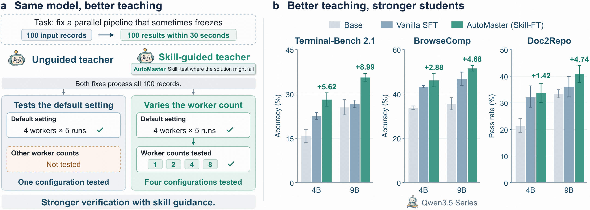
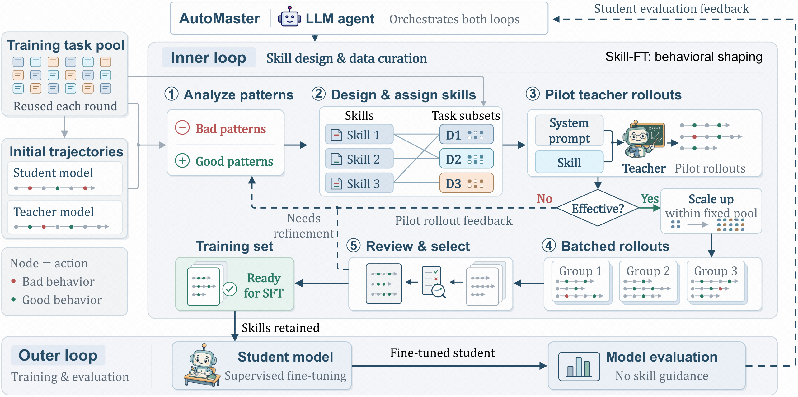
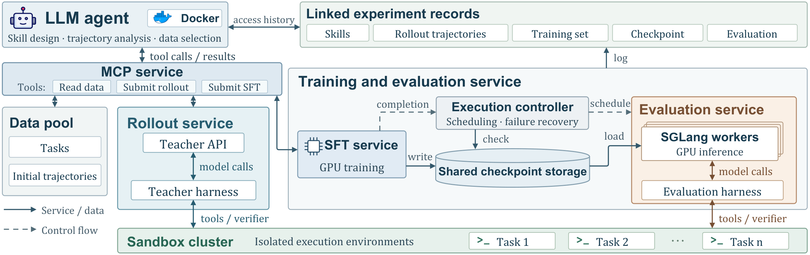
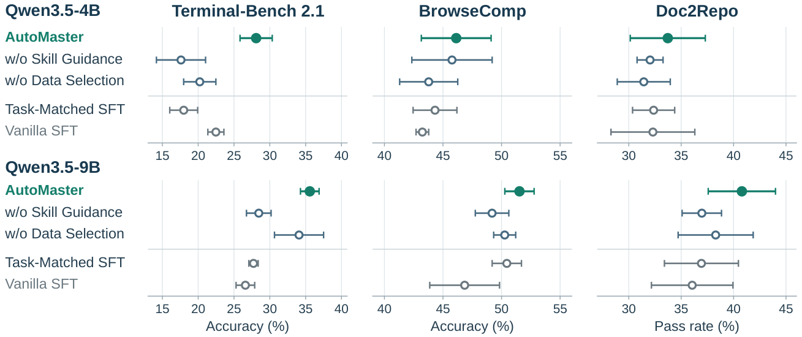
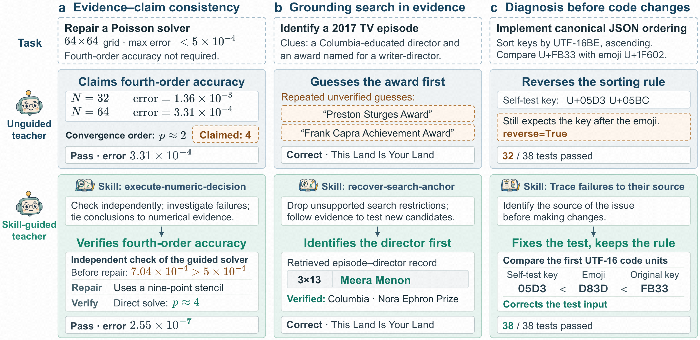
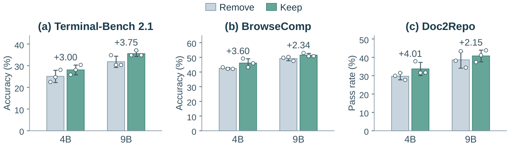
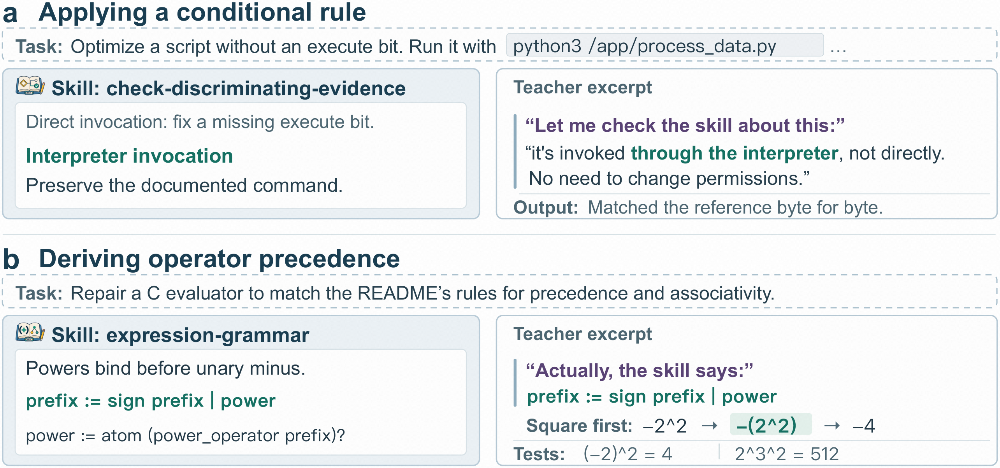
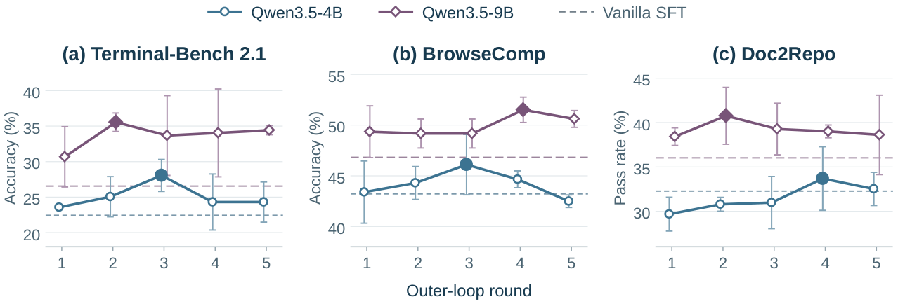

# AutoMaster：用技能塑造教师行为，再做轨迹蒸馏

成功的教师轨迹并不一定是好的训练示范：它可能同时包含无依据假设、低效重复和表面验证，而 SFT 会把这些习惯一并学进去。这意味着，只筛选“任务成功”的轨迹，可能远远没有榨干固定教师模型的教学价值。AutoMaster 让 LLM Agent 分析轨迹、编写自然语言技能、引导教师改变行为并筛选示范，再通过学生模型的训练与评估反馈持续改进。在 Terminal、Search 和软件工程三个领域、4B/9B 两种学生模型上，AutoMaster 相对使用成功无引导教师轨迹的 Vanilla SFT 平均提升 **1.42–8.99 个百分点**，且教师、任务池、512 条训练轨迹和 SFT 配置完全一致。



> 图解：图 (a) 中，两条流水线都用四个 worker 处理完全部 100 条记录，但技能引导的教师还会检查修复在 worker 更少或更多时是否成立，示范的不只是“得到结果”，还有验证行为。图 (b) 比较三个基准上的 4B 与 9B 学生；在教师、任务池、训练集规模和 SFT 配方固定时，AutoMaster 的六次平均分数均超过 Vanilla SFT，柱上标注 1.42–8.99 个百分点的增益，误差线为三次评估的 $\pm 1$ 个标准差。

## 问题不在“成功与否”，而在轨迹示范了什么

Agent 后训练的一条常见路线，是把教师与环境交互得到的成功轨迹拿来做监督微调（SFT）。这个筛选标准简单、可执行，却把 **任务结果** 和 **行为质量** 混成了一件事。

一条最终成功的轨迹，仍可能包含以下问题：

- **无依据假设**：数值实验只观察到近似二阶收敛，却宣称方法达到四阶精度。
- **低效重复**：搜索迟迟找不到证据，却围绕同一个候选反复猜测。
- **表面验证**：自测构造错了，不检查测试本身，反而修改正确实现去迎合错误预期。
- **有效行为缺失**：教师虽然会做对，却很少展示独立复核、证据驱动转向、失败诊断等值得学生学习的行为。

因此，成功标签无法告诉我们应该强化轨迹中的哪一部分。更棘手的是，仅从没有这些行为的轨迹池里做筛选，也无法凭空筛出教师从未展示过的行为。

已有工作分别触及了这个问题的一部分。Behavior Priming 侧重选择包含有益行为的轨迹，PROOF-Gen 通过逐任务 Prompt 优化从教师失败中恢复可验证示范；Skill-to-LoRA 训练技能专属 Adapter，Skill-SD 则用技能条件教师为学生自身轨迹中的 Token 打分。AutoMaster 的切入点不同：**在教师生成轨迹时主动塑形，即使教师原本就能完成任务，也干预它的推理、行动与验证方式。**

这也让它与自主后训练系统形成了清晰分工。FT-Agent、RSI-Master 等工作强调根据反馈改进数据、训练策略或研究过程；AutoMaster 同样由 Agent 自动实验，但优化对象更具体——教师示范中实际出现的行为。

## Skill-FT：先改变教师，再训练学生

AutoMaster 的核心训练方法叫 **Skill-FT（Skill-Guided Fine-Tuning）**。这里的“技能”不是新的模型参数，而是一段附加到教师 System Prompt 中的自然语言指令，用来规定相关情境下应如何推理或行动。

技能可以是一条行为原则、一套具体流程，也可以是领域知识；既能跨任务共享，也能组合起来处理同一任务的不同方面。对任务 $x$，设组合后的技能文本为 $s$，基础 System Prompt 为 $p$，教师模型为 $\pi_T$，轨迹生成过程为：

$$
\tau \sim \operatorname{Rollout}(\pi_T, x; p \oplus s)
$$

其中，$\oplus$ 表示文本拼接。技能在任务执行期间持续条件化教师的推理与动作，所以干预目标不是“把失败答案改成成功答案”这么简单，而是让成功轨迹也呈现出更好的行为。

随后，系统用标准 SFT 将筛选后的教师轨迹蒸馏到学生模型。训练输入保留教师生成轨迹时看到的原始 System Prompt，包括其中的技能；评估学生时则移除生成技能，严格走基准官方协议。

这个设计值得特别注意：**技能不是测试时依赖的外挂，而是训练示范的一部分。** 后文的 Keep/Remove 实验进一步说明，保留这段上下文反而有助于学生内化行为。

## AutoMaster：内环设计干预，外环验证学习效果

一条技能改变了教师行为，并不代表它一定适合学生。AutoMaster 因此把“教师行为是否改善”和“学生是否因此学得更好”放进两个嵌套循环中验证。



> 图解：内环中，LLM Agent 面向固定任务池的子集设计技能，先进行小规模教师 Rollout，根据轨迹修改技能及适用范围，再把有效干预扩展到批量 Rollout 并选择 SFT 示范。外环每轮都从同一个初始学生 Checkpoint 做全参数 SFT，随后在不提供生成技能的情况下评估学生；分数和执行轨迹会回到 Agent，指导下一轮技能修订、任务覆盖和数据选择。

### 内环：从轨迹问题到可训练示范

Agent 首先阅读训练任务，以及无引导教师和初始学生的轨迹，寻找两类机会：应该抑制的不良习惯，以及教师很少展示的有效行为。后续轮次还会检查学生评估轨迹，确认目标行为是否真正出现、哪些弱点仍在。

接着，内环按以下步骤推进：

1. **提出行为假设**：决定要改变什么行为，以及应对哪些任务施加干预。
2. **编写并试用技能**：通过 Pilot Rollout 检查候选技能是否引出目标行为，同时观察是否引入新问题。
3. **迭代技能与范围**：根据轨迹修改措辞、流程和适用任务，必要时重复试验。
4. **扩大生成并筛选数据**：把有希望的干预用于批量 Rollout，综合任务结果和展示行为选择训练示范。已经表现良好的无引导教师轨迹也可以入选。
5. **形成训练集**：生成与选择过程中发现的问题可以继续触发技能修订和补充 Rollout，最终得到本轮 SFT 数据。

这里不是把“成功”替换为另一套静态启发式规则，而是让 Agent 同时检查结果和行为。理论上，它既能挑出已有好行为，也能通过技能制造原本稀缺的好示范。

### 外环：每轮重训，积累实验知识

第 $r$ 轮内环产出训练集 $\mathcal{D}_r$。外环始终从相同的初始学生参数 $\theta_0$ 开始训练：

$$
\theta_r = \operatorname{SFT}(\theta_0, \mathcal{D}_r)
$$

评估 $\theta_r$ 时不带生成技能。Agent 不只读取分数，还会查看学生如何处理具体任务，再与早期技能、教师 Rollout 和训练集对照，决定下一轮应该修改技能、调整任务覆盖，还是更换示范选择。

每轮学生都重新从 $\theta_0$ 训练，因此不同数据方案不会通过连续微调相互污染；与此同时，实验历史会持续累积，让 Agent 能基于前几轮证据探索新的行为假设。

## 自动化如何落地：从 Rollout 到评估的可追溯基础设施

双层循环要真正自动运行，难点不仅是 Prompt，还包括任务执行、训练调度、模型服务和实验记录之间的衔接。



> 图解：Agent 在 Docker 容器中通过 Model Context Protocol（MCP）访问数据并提交 Rollout、SFT 作业。SFT 完成后，执行控制器自动在另一套 GPU 集群调度评估；SGLang Worker 直接从训练与评估集群共享的存储加载 Checkpoint。相互关联的实验记录把每次评估追溯到训练集及其对应的教师技能。

Rollout Harness 调用教师 API，评估 Harness 查询由 SGLang 提供服务的学生模型。两者共用一套 Sandbox 集群，在隔离的 Docker 容器中运行任务工具与 Verifier，从而并发执行多个任务。

SFT 完成后，控制器先确认 Checkpoint 可用，再自动安排评估。共享 Checkpoint Store 免去了向评估集群额外复制权重的步骤；如果推理 Worker 失败，控制器可以重启并恢复评估，不必重新训练。

更重要的是可追溯性。若某个弱点反复出现在学生评估中，Agent 能反查教师是否示范过目标行为，以及这些示范是否进入训练集，据此判断问题更接近技能设计还是数据选择。

## 自动生成了哪些技能：四个具体例子

AutoMaster 的技能并非“请认真思考”这类泛泛提醒，而是把行为目标写成 **适用条件、执行步骤和领域约束**。论文附录给出的四个例子，能帮助我们理解干预究竟有多具体。

### 1. 让数值结论与可执行检查一致

`execute-numeric-decision` 要求把正确性所依赖的误差或收敛条件直接写进运行检查，而不是只打印结果后口头宣布通过。核心形式如下：

```python
error = abs(actual - reference)
passed = math.isfinite(error) and error <= allowed_error
print(actual, reference, error, allowed_error, "PASS" if passed else "FAIL")
assert passed, "numerical requirement remains unresolved"
```

实际使用时必须按任务要求选择绝对误差、相对误差或范数误差，保留规定输入规模和迭代预算。参考值应来自独立解析案例、可信实现或数学恒等式。

检查失败时，教师必须保留原失败案例和判定条件，保存可复现输入或随机种子，定位并修复原因后重跑同一条件；不能放宽容差，也不能把失败输入换成容易通过的输入。最终结论必须对应该次实际检查，未解决的要求必须明确说明。

### 2. 搜索停滞时恢复证据锚点

`recover-search-anchor` 面向反复返回弱匹配、候选只能解释部分线索的搜索过程。目标不是继续堆积同一候选的提及次数，而是获得能够改变候选的证据。

如果候选或搜索范围仍是猜测，下一次查询应去掉无依据限制，改用能够独立识别实体的独特关系，例如职位与继任关系、事件与地点、原名与改名，或研究的可测量设计。出现新候选后，还要检验旧候选无法解释的关系。

每次重要转向都要说明：现有结果没有证实什么、正在放松哪个假设、下一次查询能区分什么。只说“换个方法”却保留同样的错误限制，不算真正转向。

### 3. 先诊断验证失败，再改实现或预期

`contract-checkpoint` 要求解析、转换、序列化和状态 API 在开发过程中保持可运行的公开契约检查，并用对比输入区分不同实现。

断言失败时，先读取真实失败输入，在首个可能解释差异的边界检查类型和值，再判断问题来自解析、转换、状态还是输出。若预期值可能有错，必须根据规范或独立小计算证明后再修改，不能为了迎合单个样例发明新的全局算法。

修复共享函数后，要重跑原始公开断言和对比案例，并为新发现的机制添加小型回归测试。最后还要区分已实际验证的行为和仍未覆盖的路径。

### 4. 把表达式语法与适用边界显式写出来

`expression-grammar` 提供一元正负号与幂运算的分组规则，让教师先依据规范推导，再修改 Parser：

```text
sum     := product (("+" | "-") product)*
product := prefix (("*" | "/" | "%") prefix)*
prefix  := sign prefix | power
power   := atom (power_operator prefix)?
```

这里，未加括号的符号不能直接进入幂的底数，而右操作数可以带符号或继续包含幂运算。技能还要求用带符号底数、带括号底数、右侧带符号表达式和连续幂做区分测试；如果目标是兼容既有实现，则优先保持参考实现的分组，而不是强行套用数学惯例。

这些技能在教师执行时提供行为上下文；保留到 SFT 输入后，又成为监督推理和动作所对应的条件信息。

## 实验设置：控制教师与训练配方，只改变示范生成和选择

为了区分“换了更强教师或更多数据”与“示范本身更有教学价值”，实验将关键变量尽量锁死。

每个领域从公开数据集中随机抽取 1,000 个训练任务，组成所有方法共享的固定任务池。学生模型为 Qwen3.5-4B 和 Qwen3.5-9B；LLM Agent 在 Codex 中运行 GPT-6 Astra，Reasoning Effort 为 `xhigh`；三个领域的教师均为 DeepSeek-V4-Pro-Preview，Reasoning Effort 为 `high`。

| 领域 | 训练任务来源 | 评估基准 | 评估任务数 | 执行框架参考 |
|---|---|---|---:|---|
| Terminal | CalibForge | Terminal-Bench 2.1 | 89 | CalibForge |
| Search | FORT-Searcher | BrowseComp-Lite（Traverse 发布的 Lite-185） | 185 | AEWM |
| SWE | DeNovoSWE | Doc2Repo | 50 | Doc2Repo；禁用搜索工具 |

对比方法包括：

- **Base**：不做额外微调的目标模型。
- **Vanilla SFT**：从共享任务池上的成功无引导教师轨迹中随机抽取 512 条，执行标准 SFT。
- **AutoMaster**：先获取初始学生和无引导教师轨迹，再进行最多五轮自主外层实验，每轮用 512 条选定示范训练。

所有训练均从对应初始 Checkpoint 开始，执行全参数 SFT。公共配置如下：

| 参数 | 配置 |
|---|---|
| 训练方式 | 全参数 SFT |
| 训练轨迹数 | 512 |
| Epochs | 3 |
| Global Batch Size | 32 |
| 最大序列长度 | 131,072 Tokens |
| Optimizer | Megatron Adam |
| 学习率 | $10^{-5}$ |
| 最低学习率 | $10^{-6}$ |
| 学习率调度 | Cosine Decay |
| Warmup Ratio | 0.05 |
| Adam $\beta_1$、$\beta_2$ | 0.9、0.999 |
| Weight Decay | 0 |
| Gradient Clipping | 1.0 |
| 训练精度 | `bfloat16` |

Loss 只在 Assistant 输出上计算，覆盖推理、回复和工具调用，并按监督 Token 数归一化；System、User 和 Tool 消息作为上下文，不计入 Loss。默认保留轨迹原始 System Prompt 中的技能，Remove 消融只删除技能文本，其他输入与监督输出均不变。

教师 Rollout 配置则按领域区分：

| 参数 | Terminal | Search | SWE |
|---|---|---|---|
| Reasoning Effort | `high` | `high` | `high` |
| Temperature | 1.0 | 1.0 | 1.0 |
| Top-$p$ | 1.0 | 1.0 | 1.0 |
| 单次回复最大 Completion Tokens | 16,384 | 8,192 | 16,384 |
| 最大执行步数 | 500 | 300 | 400 |
| 单任务时间预算 | 1 小时 | 不限 | 3 小时 |

学生评估使用第三个 Epoch 结束时的 Checkpoint，不携带生成技能，各方法在同一领域内采用相同推理与执行设置。Temperature 为 1.0，Top-$p$ 为 0.95，单次模型回复最多 65,500 Tokens，每任务最多 600 个执行步；Terminal-Bench 2.1 和 Doc2Repo 的单任务时限分别为 3 小时和 4 小时，BrowseComp 不设总时限。

AutoMaster 最后根据累计评估反馈选择 Checkpoint，再进行三次新的评估。所有方法均报告同一 Checkpoint 三次运行的均值与标准差：Terminal-Bench 2.1、BrowseComp 使用任务准确率，Doc2Repo 使用跨任务平均测试通过率。

## 主结果：固定教师仍有被低估的教学空间

下表所有数值均为百分数，格式为三次评估的“均值 $\pm$ 标准差”。$\Delta$ 是 AutoMaster 相对 Vanilla SFT 的平均增益，单位为百分点。

| 方法 | Terminal 4B | Terminal 9B | BrowseComp 4B | BrowseComp 9B | Doc2Repo 4B | Doc2Repo 9B |
|---|---:|---:|---:|---:|---:|---:|
| Base | $15.73 \pm 2.25$ | $25.47 \pm 2.59$ | $33.69 \pm 0.82$ | $35.50 \pm 2.72$ | $21.39 \pm 2.61$ | $33.42 \pm 1.60$ |
| Vanilla SFT | $22.47 \pm 1.12$ | $26.59 \pm 1.30$ | $43.24 \pm 0.54$ | $46.85 \pm 2.98$ | $32.30 \pm 4.00$ | $36.05 \pm 3.89$ |
| **AutoMaster** | $\mathbf{28.09} \pm 2.25$ | $\mathbf{35.58} \pm 1.30$ | $\mathbf{46.13} \pm 2.98$ | $\mathbf{51.53} \pm 1.25$ | $\mathbf{33.72} \pm 3.58$ | $\mathbf{40.79} \pm 3.21$ |
| $\Delta$ over Vanilla SFT | +5.62 | +8.99 | +2.88 | +4.68 | +1.42 | +4.74 |

AutoMaster 在全部六个“基准—模型规模”组合中取得最高平均分，增益范围为 1.42–8.99 个百分点；三个领域中，9B 学生的增益都大于 4B 学生。

最有代表性的是 Terminal-Bench 2.1 的 9B 结果。Vanilla SFT 只把准确率从 Base 的 25.47% 提到 26.59%，AutoMaster 却达到 35.58%。教师、任务、数据条数和训练配方没有改变，额外 8.99 个百分点只能来自 **教师示范如何生成、哪些示范被选中** 的变化。

这说明 Vanilla SFT 的小幅提升并不必然意味着教师能力已耗尽，也可能只是成功无引导轨迹没有充分展示可学习行为。

### 配对置信区间：9B 的证据更一致

论文进一步使用配对 Bootstrap 估计增益的不确定性。先对每个任务的三次运行取平均，再有放回地重采样任务 ID，同时保留两种方法在该任务上的分数并重新计算均值差。实验重采样 10,000 次，随机种子为 0；Doc2Repo 以完整仓库为单位重采样。

| 基准 | 模型 | $N$ | $\Delta$（百分点） | 95% Bootstrap CI |
|---|---|---:|---:|---:|
| Terminal-Bench 2.1 | 4B | 89 | +5.62 | [1.12, 10.49] |
| Terminal-Bench 2.1 | 9B | 89 | +8.99 | [2.25, 16.10] |
| BrowseComp | 4B | 185 | +2.88 | [-1.08, 6.85] |
| BrowseComp | 9B | 185 | +4.68 | [0.72, 8.83] |
| Doc2Repo | 4B | 50 | +1.42 | [-1.94, 5.33] |
| Doc2Repo | 9B | 50 | +4.74 | [0.65, 8.93] |

六组平均增益都为正，但不能把它们理解为同等强度的一致性证据。4B 只有 Terminal-Bench 2.1 的区间完全高于零，BrowseComp 与 Doc2Repo 的区间包含零；9B 在三个领域中的区间下界都为正。

## 消融实验：技能引导与数据选择缺一不可

接下来的问题是，收益究竟来自技能改变了教师，还是 Agent 更会挑数据？论文分别移除两个组件，并增加任务组成完全对齐的对照。



> 图解：图中比较完整 AutoMaster、移除技能引导、移除数据选择、Task-Matched SFT 和 Vanilla SFT。点表示三次评估均值，横线表示 $\pm 1$ 个标准差。移除任一组件都会在六个设置中降低平均分；即使 Task-Matched SFT 对齐了最终训练集的任务 ID 和每任务样本数，AutoMaster 仍高出 1.08–10.11 个百分点。

完整数值如下，单位均为百分数：

| 方法 | Terminal 4B | Terminal 9B | BrowseComp 4B | BrowseComp 9B | Doc2Repo 4B | Doc2Repo 9B |
|---|---:|---:|---:|---:|---:|---:|
| **AutoMaster** | $\mathbf{28.09} \pm 2.25$ | $\mathbf{35.58} \pm 1.30$ | $\mathbf{46.13} \pm 2.98$ | $\mathbf{51.53} \pm 1.25$ | $\mathbf{33.72} \pm 3.58$ | $\mathbf{40.79} \pm 3.21$ |
| w/o Skill Guidance | $17.60 \pm 3.43$ | $28.46 \pm 1.72$ | $45.77 \pm 3.43$ | $49.19 \pm 1.43$ | $32.03 \pm 1.24$ | $36.97 \pm 1.88$ |
| w/o Data Selection | $20.22 \pm 2.25$ | $34.08 \pm 3.43$ | $43.78 \pm 2.48$ | $50.27 \pm 0.94$ | $31.43 \pm 2.53$ | $38.29 \pm 3.58$ |
| Task-Matched SFT | $17.98 \pm 1.95$ | $27.72 \pm 0.65$ | $44.32 \pm 1.87$ | $50.45 \pm 1.25$ | $32.37 \pm 2.01$ | $36.93 \pm 3.53$ |
| Vanilla SFT | $22.47 \pm 1.12$ | $26.59 \pm 1.30$ | $43.24 \pm 0.54$ | $46.85 \pm 2.98$ | $32.30 \pm 4.00$ | $36.05 \pm 3.89$ |

**w/o Skill Guidance** 保留 Agent 的数据选择，但候选全部来自无引导教师；**w/o Data Selection** 保留技能设计，只在固定随机任务子集上生成，不做 Agent 主导的轨迹筛选。两者仍保留自主实验以及相同教师、任务池、数据规模和 SFT 配方。

两个组件的相对价值随任务而变。Terminal 4B 上，只做技能引导得到 20.22%，高于只做选择的 17.60%，但两者都低于 Vanilla SFT 的 22.47%；完整方法则达到 28.09%。BrowseComp 4B 上顺序反转：选择为 45.77%，技能引导为 43.78%。

一种合理解释是，选择只能偏好教师已经展示的有用行为，而引导能引出无引导轨迹中稀缺的行为。不同任务对这两种机制的依赖自然不同。

Task-Matched SFT 则排除了“只是训练任务选得更好”的解释。它使用同一教师的无引导 Rollout，严格匹配 AutoMaster 最终训练集的任务 ID 和每任务样本数；为保持任务组成，成功与失败的无引导轨迹都保留，Prompt 中不加入生成技能。

### 同样成功，示范内容仍然不同

下面的配对统计直接比较最终训练语料中的教师示范。Terminal 与 Search 比较二元任务结果，$N$ 为配对样本数：

| 领域 | 对应学生 | $N$ | 失败 $\rightarrow$ 成功 | 两者均成功 | 成功 $\rightarrow$ 失败 | 两者均失败 |
|---|---|---:|---:|---:|---:|---:|
| Terminal | 4B | 512 | 106 | 406 | 0 | 0 |
| Terminal | 9B | 512 | 100 | 412 | 0 | 0 |
| Search | 4B | 512 | 45 | 467 | 0 | 0 |
| Search | 9B | 512 | 64 | 448 | 0 | 0 |

四组语料中，8.79%–20.70% 的配对从“无引导失败”变成“AutoMaster 示范成功”，其余配对两边都成功，占 79.3%–91.2%。对后者而言，成功标签完全相同，训练价值却仍可能不同。

SWE 使用任务分数，因此能够表示部分进步和回退：

| 对应学生 | $N$ | 分数提高 | 分数不变 | 分数下降 |
|---|---:|---:|---:|---:|
| 4B | 512 | 43 | 433 | 36 |
| 9B | 512 | 24 | 483 | 5 |

这些结果共同支持一个结论：收益不能只用任务组成或成功率解释，**示范生成方式与示范选择需要联合优化**。

## 行为案例分析：技能究竟改变了什么

数值结果说明了“有效”，轨迹对照则展示了“有效在哪里”。下面三个案例都由同一教师处理同一任务，差别只在是否加入技能引导。



> 图解：三列分别比较 Terminal、Search 和 SWE 中的无引导与技能引导轨迹。Terminal 案例从“错误宣称四阶精度”转为改用九点格式并独立验证收敛阶；Search 案例从反复猜奖项转为利用剧集演职员信息定位导演并核对线索；SWE 案例从修改全局排序迎合错误自测，转为检查 UTF-16 编码、修正测试输入并保留规范要求的升序。

### Terminal：答案达标，不代表数值结论可信

两次执行都满足数值误差阈值，但无引导教师测得的收敛约等于二阶，却声称达到四阶精度。技能引导教师改用九点 Stencil，并在连续细化的网格上直接求解，验证四阶收敛。

如果训练集只按成功筛选，这两条轨迹会被视为等价；但对学生而言，后者展示的是“用独立数值检查修正结论”，前者却可能强化证据与声明脱节的习惯。

### Search：从重复猜测转为证据驱动转向

两条轨迹都找到了同一剧集。无引导教师反复猜测奖项，技能引导教师则从剧集 Credits 中识别导演，再验证题目线索。

这里的关键并不是多搜索几次，而是让下一动作针对尚未证实的关系。只保留最终正确答案，会抹掉两种搜索行为的重要差异。

### SWE：测试失败时，先判断测试是否可信

两次执行最初都构造了一个与规范输入不同的自测，却沿用原预期顺序。无引导教师为了通过错误自测，反转了全局排序规则；技能引导教师检查 UTF-16 编码，修正自测输入，保持规范要求的升序。

最终，无引导版本通过 38 项测试中的 32 项，技能引导版本通过 38 项。这个案例把行为塑形的目标说得很清楚：**先诊断失败检查意味着什么，再决定改实现还是改预期。**

## 反直觉发现：训练时保留技能，测试时不用技能，反而更好

直观上，评估 Prompt 不含生成技能，那么训练时也删掉技能似乎能减少训练—评估差异。论文的 Keep/Remove 对照却得到相反结果。



> 图解：图中按三个基准和两种模型规模比较 Keep 与 Remove。两组使用完全相同的教师轨迹和 SFT 配方，Keep 在训练输入中保留技能，Remove 删除技能；所有学生评估时都不使用技能。柱高为三次评估均值，圆点为单次结果，误差线为 $\pm 1$ 个标准差，标签给出 Keep 相对 Remove 的百分点增益。Keep 在全部六组中都更高，增益为 2.15–4.01 个百分点。

Remove 并不会改变监督目标：教师的推理、回复和工具调用原样保留，删除的只是输入中的技能指令。因此，收益不能归因于训练答案不同，也不能归因于测试时额外获得技能提示。

一个可能解释是，保留技能让学生同时看到 **行为规则、适用条件和实际示范**；删掉技能后，学生只能从任务与轨迹中反推出“为什么此时应该这样做”。如果推理明确引用了技能，删除技能还会破坏输入指导与监督输出之间的对应关系。



> 图解：案例 (a) 中，教师根据条件规则区分“通过解释器调用”和“直接执行”，判断无需修改执行权限。案例 (b) 中，教师引用输入技能提供的语法推导表达式分组，再实现并测试 Parser。引号表示轨迹原文节选，技能与轨迹内容经过压缩展示。

这个设计的启发在于，训练—评估输入更相似并不一定总是更好。对行为蒸馏而言，上下文还承担解释监督动作的作用；删掉它，可能反而提高学习难度。不过，论文将这种解释表述为基于案例的可能机制，而不是已被单独证明的因果关系。

## 五轮自主实验：不保证逐轮上升，但能发现更优方案

最后，论文考察 Agent 是否真的能从累计反馈中发展出更好的干预，而不只是进行一次复杂的 Prompt 编写。



> 图解：每个模型规模的每一轮都从初始 Checkpoint 重新训练学生。点表示三次评估均值，误差线为 $\pm 1$ 个标准差，虚线是对应 Vanilla SFT 均值，实心标记表示各模型在各基准上观察到的最高均值。六个设置中的最佳候选均出现在第二至第四轮，相对第一轮提高 2.16–4.87 个百分点。

各轮成绩存在波动，因为 Agent 找到强候选后仍会探索其他干预，并不要求每轮都优于上一轮。BrowseComp-9B 的前三轮均值一直接近 49%，第四轮才达到 51.53%，说明持续实验可能在数轮停滞后发现新的提升。

模型容量也影响收益的一致性。9B 学生在三个领域的 **每一轮** 都超过 Vanilla SFT 均值；4B 学生只有 Terminal-Bench 2.1 在五轮中始终超过。消融实验也呈现类似趋势：两个变体在 9B 的三个领域都高于 Vanilla SFT，而 4B 只在 BrowseComp 上做到这一点。

这提示我们，AutoMaster 的行为干预并不是对所有学生都同样稳定，较大的目标模型可能更容易吸收并迁移这些行为。

## 总结：后训练还可以优化“教师怎么教”

- **成功不是充分的训练标准**：成功轨迹仍可能包含错误假设、重复搜索和表面验证，必须同时考察任务结果与行为质量。
- **Skill-FT 在生成阶段塑形**：自然语言技能被加入教师 System Prompt，主动引出稀缺的有效行为，再通过 SFT 蒸馏筛选后的轨迹。
- **AutoMaster 联合优化生成与选择**：内环设计、试验技能并筛选示范，外环以学生训练和评估反馈修订干预，每轮均从同一初始 Checkpoint 重训。
- **控制变量后仍有稳定平均收益**：相对 Vanilla SFT，六组结果提升 1.42–8.99 个百分点；消融和 Task-Matched 对照表明，收益不能只用任务选择或成功率解释。
- **技能上下文有助于内化**：训练保留技能、测试移除技能，在六组设置中都比删除技能高 2.15–4.01 个百分点，说明训练上下文本身也是示范的一部分。

当前结果也显示，4B 模型的跨轮收益不够一致，部分 4B 配对置信区间仍包含零；未来需要研究如何让行为塑形更稳定地迁移到较小模型，并在更多任务与模型上检验其适用范围。

> 本文参考自 [Autonomous Post-Training through Skill-Guided Behavioral Shaping](http://arxiv.org/abs/2611.26510v1)