# BLOOM：1760 亿参数开放多语模型

大模型会 Few-Shot 学习，却长期被少数拥有巨额算力的机构封闭开发，普通研究者难以参与，非英语语言也常被边缘化。BLOOM 用一次跨国开放协作给出另一种答案：数百名研究者共同构建 ROOTS 语料，训练并公开一个 **1760 亿参数、覆盖 46 种自然语言和 13 种编程语言**的 Decoder-only Transformer。它在多语翻译、摘要和指令泛化上展现出有竞争力的结果，经过多任务 Prompt 微调得到的 BLOOMZ 又显著改善了 Zero-Shot 表现。训练本身耗电 433 MWh、直接能源排放约 25 吨 CO₂eq，论文还把完整生命周期估算、偏差与失败模式一并公开。

## 为什么需要 BLOOM：开放不仅是一个下载链接

预训练语言模型先从大量文本中学习，再通过 Fine-Tuning 或 Prompt 迁移到下游任务。模型变大后，只给自然语言指令和少量示例，也可能完成没专门训练过的任务。这降低了使用门槛，却抬高了研发门槛：训练成本、能源消耗和数据治理都集中到少数机构手中。

BLOOM 的目标因此有两层。技术上，要做一个可与同期大模型比较的多语模型；组织上，要让语言学、法律、社会学和机器学习研究者都能参与关键决策，而不只是最后拿到权重。

### 从语言建模到 In-Context Learning

语言模型给 Token 序列分配概率。自回归建模把联合概率拆成一连串“根据前文预测下一个 Token”：

$$
p(x)=p(x_1,\ldots,x_T)=\prod_{t=1}^{T}p(x_t\mid x_{<t})
$$

早期 $n$-gram 模型依赖计数，窗口增大后参数规模膨胀，也难以处理未见序列。神经语言模型用网络估计条件概率，随后从固定窗口、RNN 演进到 Transformer。迁移学习又经历了从词向量到整模型预训练的变化；GPT-3 一类工作则把任务说明和输入输出示例写进 Prompt，让模型在上下文中“现场做题”，这就是 Zero/Few-Shot 学习。

这里要区分两种适配方式：**Fine-Tuning 会更新参数，In-Context Learning 只改变输入上下文**。BLOOM 的架构消融重点考察后者，因为给一个 100B+ 模型反复做任务级微调并不现实。

### BigScience：把组织方式也当成研究对象

BigScience 从法国 GENCI 提供的 Jean Zay 超算算力资助起步，由 Hugging Face 与法国 NLP 社区发起，最终有超过 1200 人注册，参与者来自 38 个国家。数百人直接贡献了模型、数据或其他公开产物，30 个工作组分别处理数据、Tokenizer、架构、工程、评测、伦理和应用等问题。

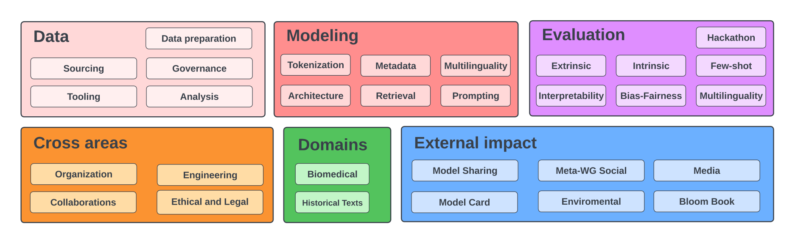

> 图解：图中按研究主题组织 BigScience 工作组，核心模型研发与数据、评测、伦理、应用等方向彼此连接。它不是单纯的开发流水线，而是允许成员跨组流动的协作网络。

项目共同制定伦理章程，强调包容与多样性、开放与可复现、责任。笔者认为，这篇论文最有价值的细节之一，是没有把“开放”简化成公开 Checkpoint：数据来源能否追溯、谁能决定过滤规则、许可证如何限制伤害性用途，都被当作模型设计的一部分。

明确问题之后，下一个挑战是：怎样构建一份既足够大、又能被不同语言社区实际参与治理的训练语料？

## ROOTS：1.61 TB 语料如何选、如何洗、如何管

ROOTS 由 **498 个 Hugging Face 数据集**组成，共 1.61 TB 文本，覆盖 59 种语言。它由人工参与编目的 BigScience Catalogue、GitHub 代码和 OSCAR 21.09 网页数据混合而成，其中 OSCAR 占约 38%，对应 2021 年 2 月的 Common Crawl 快照。

### 数据治理先于数据抓取

论文区分了开发者、数据主体和权利持有者。团队尽可能取得数据提供方对 BigScience 使用场景的明确许可，在预处理后期之前保留各来源的独立性，并按来源分别决定发布方式。最终 498 个组件中有 223 个可直接分发，其余受到许可、隐私风险或原管理方协议约束。

语言选择也不是跑一次自动语言识别就结束。项目先选择八种使用者众多的语言，再根据社区建议扩展到 Niger-Congo 和 Indic 语言群；若至少三名流利使用者愿意负责来源选择和处理决策，还可增加语言。Catalogue 通过社区 Hackathon 和语言资源库收集了 252 个来源，每个语言类别至少 21 个来源。

这种设计针对的是自动过滤的隐性代价。例如，以“色情内容”名单过滤文本可能同时删掉 LGBTQ+ 与非裔美国英语内容，以 Reddit 外链判断质量又可能放大美国中心视角。ROOTS 把“什么是高质量”限定为 **由人写、给人读的自然文本**，而不是先验地判断语法是否标准或观点是否合适。

### 从来源到训练集的完整流水线

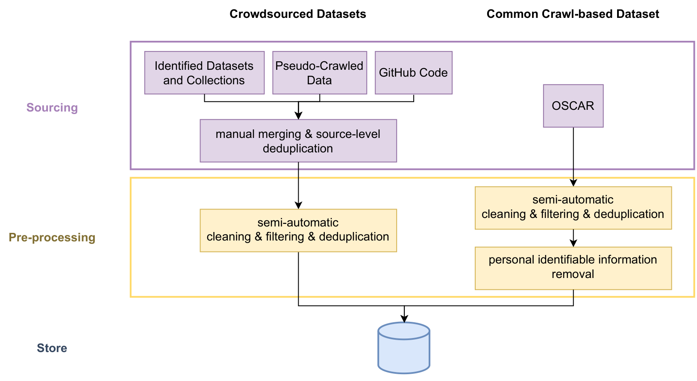

> 图解：紫色部分是来源获取，黄色部分是处理。不同来源先分别经过文本提取、质量过滤、去重和隐私处理，最后才汇成 ROOTS；保留来源边界使追溯和差异化处理成为可能。

具体处理包括：

- 从问答、摘要、对话等 NLP 数据集中提取文本，并处理 PDF 档案和 Common Crawl WARC 文件。
- 对 Catalogue 中 192 个网站及额外选择的 456 个地域多样网站做伪抓取，最终从 539 个网站获得可用文本。
- 由流利使用者为各语言设置过滤阈值和词表，再逐来源检查指标，清理 SEO、垃圾文本和预处理错误。
- 进行两级近重复删除；对隐私风险更高的 OSCAR 数据，用正则表达式遮盖社会安全号码等个人身份信息，即使可能产生误删。

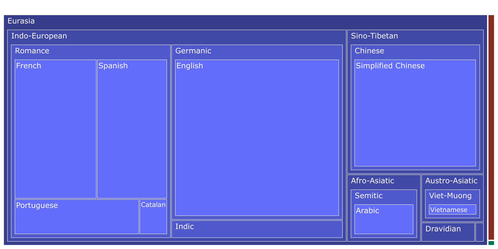

> 图解：Treemap 的面积表示字节数。Indo-European 与 Sino-Tibetan 合计 1321.89 GB，占绝对主体；印尼语约 18 GB，而 Niger-Congo 子集仅约 0.4 GB。“覆盖 46 种自然语言”并不等于各语言均衡。

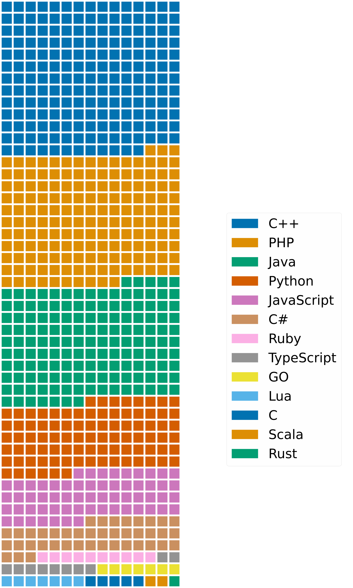

> 图解：Waffle 图中每格约代表 200 MB，用离散色块比较编程语言规模。代码来自 Google BigQuery 的 GitHub 集合，经过精确去重，语言范围参考 AlphaCode。

下表保留 ROOTS 的语言、语系与原始字节数。原表个别数字存在千分位格式异常，这里按源表记录，不据此重新计算比例。

| 语言 | ISO-639-3 | Catalogue | 语属 | 语系 | 区域 | 字节数 |
|---|---|---|---|---|---|---:|
| Akan | aka | ak | Kwa | Niger-Congo | Africa | 70,1554 |
| Arabic | arb | ar | Semitic | Afro-Asiatic | Eurasia | 74,854,900,600 |
| Assamese | asm | as | Indic | Indo-European | Eurasia | 291,522,098 |
| Bambara | bam | bm | Western Mande | Mande | Africa | 391,747 |
| Basque | eus | eu | Basque | Basque | Eurasia | 2,360,470,848 |
| Bengali | ben | bn | Indic | Indo-European | Eurasia | 18,606,823,104 |
| Catalan | cat | ca | Romance | Indo-European | Eurasia | 17,792,493,289 |
| Chichewa | nya | ny | Bantoid | Niger-Congo | Africa | 1,187,405 |
| chiShona | sna | sn | Bantoid | Niger-Congo | Africa | 6,638,639 |
| Chitumbuka | tum | tum | Bantoid | Niger-Congo | Africa | 170,360 |
| English | eng | en | Germanic | Indo-European | Eurasia | 484,953,009,124 |
| Fon | fon | fon | Kwa | Niger-Congo | Africa | 2,478,546 |
| French | fra | fr | Romance | Indo-European | Eurasia | 208,242,620,434 |
| Gujarati | guj | gu | Indic | Indo-European | Eurasia | 1,199,986,460 |
| Hindi | hin | hi | Indic | Indo-European | Eurasia | 24,622,119,985 |
| Igbo | ibo | ig | Igboid | Niger-Congo | Africa | 14078,521 |
| Indonesian | ind | id | Malayo-Sumbawan | Austronesian | Papunesia | 19,972,325,222 |
| isiXhosa | xho | xh | Bantoid | Niger-Congo | Africa | 14,304,074 |
| isiZulu | zul | zu | Bantoid | Niger-Congo | Africa | 8,511,561 |
| Kannada | kan | kn | Southern Dravidian | Dravidian | Eurasia | 2,098,453,560 |
| Kikuyu | kik | ki | Bantoid | Niger-Congo | Africa | 359,615 |
| Kinyarwanda | kin | rw | Bantoid | Niger-Congo | Africa | 40,428,299 |
| Kirundi | run | rn | Bantoid | Niger-Congo | Africa | 3,272,550 |
| Lingala | lin | ln | Bantoid | Niger-Congo | Africa | 1,650,804 |
| Luganda | lug | lg | Bantoid | Niger-Congo | Africa | 4,568,367 |
| Malayalam | mal | ml | Southern Dravidian | Dravidian | Eurasia | 3,662,571,498 |
| Marathi | mar | mr | Indic | Indo-European | Eurasia | 1,775,483,122 |
| Nepali | nep | ne | Indic | Indo-European | Eurasia | 2,551,307,393 |
| Northern Sotho | nso | nso | Bantoid | Niger-Congo | Africa | 1,764,506 |
| Odia | ori | or | Indic | Indo-European | Eurasia | 1,157,100,133 |
| Portuguese | por | pt | Romance | Indo-European | Eurasia | 79,277,543,375 |
| Punjabi | pan | pa | Indic | Indo-European | Eurasia | 1,572,109,752 |
| Sesotho | sot | st | Bantoid | Niger-Congo | Africa | 751,034 |
| Setswana | tsn | tn | Bantoid | Niger-Congo | Africa | 1,502,200 |
| Simplified Chinese | — | zhs | Chinese | Sino-Tibetan | Eurasia | 261,019,433,892 |
| Spanish | spa | es | Romance | Indo-European | Eurasia | 175,098,365,045 |
| Swahili | swh | sw | Bantoid | Niger-Congo | Africa | 236,482,543 |
| Tamil | tam | ta | Southern Dravidian | Dravidian | Eurasia | 7,989,206,220 |
| Telugu | tel | te | South-Central Dravidian | Dravidian | Eurasia | 2993407,159 |
| Traditional Chinese | — | zht | Chinese | Sino-Tibetan | Eurasia | 762,489,150 |
| Twi | twi | tw | Bantoid | Niger-Congo | Africa | 1,265,041 |
| Urdu | urd | ur | Indic | Indo-European | Eurasia | 2,781,329,959 |
| Vietnamese | vie | vi | Viet-Muong | Austro-Asiatic | Eurasia | 43,709,279,959 |
| Wolof | wol | wo | Wolof | Niger-Congo | Africa | 3,606,973 |
| Xitsonga | tso | ts | Bantoid | Niger-Congo | Africa | 707,634 |
| Yoruba | yor | yo | Defoid | Niger-Congo | Africa | 89,695,835 |
| 编程语言合计 | — | — | — | — | — | 174,700,245,772 |

### xP3：把多任务微调也扩展到多语

预训练之后，团队用多任务 Prompt Fine-Tuning 得到 BLOOMZ。它类似给模型安排多学科习题课：把许多现有数据集改写成自然语言任务，让模型学习“按指令做题”，而不只是续写文本。

早期 P3 通过 PromptSource 收集了 170+ 数据集的 2000+ Prompt；xP3 扩展到 **83 个数据集、46 种语言、16 类任务**，包含翻译等跨语任务和摘要、问答等单语任务。xP3mt 则把英文 Prompt 机器翻译成相应数据语言，用来研究 Prompt 语言的影响。

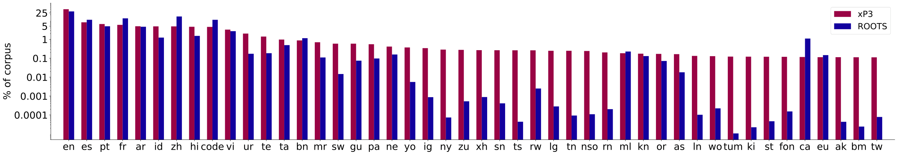

> 图解：各语言条形展示 ROOTS 与 xP3 的相对分布，两者总体接近。这样微调不会另起一套明显偏斜的语言配比，但 ROOTS 原有的不均衡也被保留下来。

数据准备完成，接下来要决定模型结构。BLOOM 没有追求新奇模块，而是围绕 Zero-Shot 能力和超大规模训练稳定性做取舍。

## 模型设计：Decoder-only、ALiBi 与 Embedding LayerNorm

### 先做小规模消融，再把结果外推

架构空间无法穷举，团队在“复刻成熟大模型”和“采用最新改进”之间取中间路线：优先选择已经证明可扩展、且公开代码支持充分的模型家族，再用小模型消融组件。

预训练目标在 6.7B 规模上比较，位置编码、激活和归一化等实验在 1.3B 规模上进行；评测聚合 EAI-Eval 的 29 项任务和 T0-Eval 的 9 项任务。需要注意，1.3B 的结论不一定能无条件下推到 176B，论文也明确提到 6.7B 以上可能出现 Outlier Features 相变。

实验比较 Encoder-Decoder、Decoder-only 与 Causal、Prefix、Masked Language Modeling 的组合。刚完成预训练时，**Causal Decoder-only 的 Zero-Shot 泛化最好**；它之后也能较高效地适配为非因果结构。MoE 和 State-Space Model 当时未纳入，主要因为缺少成熟 GPU 大规模实现或自然语言表现尚不足，并非证明这些路线没有前景。

### 两处偏离标准 Transformer 的选择

**ALiBi 位置编码**不往输入 Embedding 里加位置向量，而是按 Query 与 Key 的距离直接惩罚 Attention Score。距离越远，可分配的注意力越受抑制。它原本用于长序列外推，但 BLOOM 的实验还发现，它能带来更平稳的训练和更好的下游表现，优于学习式位置编码和 RoPE。各 Head 的斜率为：

$$
k_{head}=2^{-\frac{8i}{n}},\qquad i\in\{1,2,\ldots,n\}
$$

其中 $n$ 是 Attention Head 数。

**Embedding LayerNorm**则紧接输入 Embedding 增加一次归一化。104B 预备实验中，它显著改善稳定性；虽然较小规模消融显示它会损害 Zero-Shot 泛化，团队仍优先避免 176B 训练发散。这里存在一个重要保留意见：104B 实验使用 float16，而最终训练用 bfloat16，后者本身可能已缓解不稳定，因此这层 LayerNorm 是否仍必要，并未被完全证明。

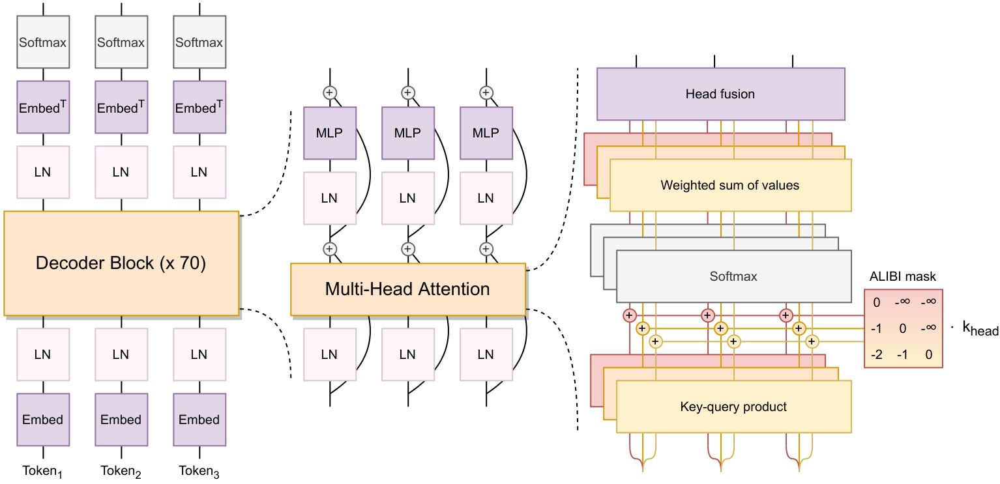

> 图解：输入 Token 经 Embedding 和额外 LayerNorm 后，进入 70 层 Transformer Block。Block 内包含 Masked Multi-Head Attention、ALiBi 距离偏置、前馈网络与残差连接，最后预测下一个 Token；输入和输出 Embedding 权重共享。

笔者认为，这两处选择体现了真实大模型工程的优先级：**单次训练的失败成本极高时，稳定性不是附属指标，而可以压倒小规模评测上的局部收益。**

## Tokenizer：多语能力从切词开始

Tokenizer 像模型的“文字切刀”。切得太碎，同样内容会消耗更多上下文和算力；切得不一致，还会让低资源语言处于额外劣势。BLOOM 没有沿用 GPT-2 的英语 Tokenizer，而是重新训练 Byte-level BPE。

- **Byte-level BPE**：从 256 个字节出发学习子词合并，任何输入都能编码，不产生 Unknown Token，也增加跨语言词表共享。
- **250,680 个词表项**：较大词表降低过度切分风险；总数可被 128 和 4 整除，兼顾 GPU 效率和 Tensor Parallelism，其中预留 200 个 Token。
- **不做 Unicode 归一化**：NFKC 在各语言上最多只把 Fertility 降低约 0.8%，却可能让 $2^2$ 与 $2 2$ 等形式失去区别。
- **保留空白与换行**：Pre-tokenizer 不采用围绕 `'nt`、`'ll` 的英语专用切分，也不强拆数字，避免伤害阿拉伯语和代码。

> 图解：这条规则以空白和多语种标点作为初步分段依据，同时保留原始字符、连续空格与换行；BPE 随后只在各分段内部合并，代码缩进不会因英语式预处理而丢失。

Fertility 指平均每个词被切成多少个子词，越低通常越经济，但它只是 Sanity Check，不等于下游质量。团队目标是相对单语 Tokenizer 的退化尽量不超过 10 个百分点；阿拉伯语最终仍高出 13%。

| Tokenizer | fr | en | es | zh | hi | ar |
|---|---:|---:|---:|---:|---:|---:|
| 对应单语 Tokenizer | 1.30 | 1.15 | 1.12 | 1.50 | 1.07 | 1.16 |
| BLOOM | 1.17（-11%） | 1.15（+0%） | 1.16（+3%） | 1.58（+5%） | 1.18（+9%） | 1.34（+13%） |

早期词表还出现完整 URL 成为单个 Token 的问题，原因是没有去重的训练数据中重复行过多。团队删除重复行，并采用与模型训练一致的语言采样比例。这说明多语 Tokenizer 的质量不仅取决于算法，也同样取决于数据卫生。

## 384 张 A100 如何训练 176B 模型

### 硬件、3D Parallelism 与 ZeRO

BLOOM 在 Jean Zay 上训练约 **3.5 个月**，消耗 **1,082,990 计算小时**。正式使用 48 个节点，每节点 8 张 NVIDIA A100 80GB，共 384 张 GPU，另有 4 个备用节点；节点内用 NVLink，节点间用 100 Gbps Omni-Path。

单张 GPU 放不下 176B 参数及训练状态，Megatron-DeepSpeed 因此把三种并行叠加起来：

- **Data Parallelism（DP）**：复制模型，各副本处理不同数据分片，每一步同步。
- **Tensor Parallelism（TP）**：把同一层的矩阵切到多张 GPU，属于层内切分。
- **Pipeline Parallelism（PP）**：把不同层分到不同 GPU，属于层间切分。
- **ZeRO Stage 1**：进一步只切分 Optimizer State，减少各进程冗余存储；本设置并未切分参数和梯度。

> 图解：立方体表示 GPU，三个方向分别对应 ZeRO Data Parallel、Pipeline Parallel 和 Model/Tensor Parallel。三种切法解决的是不同问题：吞吐、层间放置与单层显存，组合后才能扩展到数百卡。

最快配置达到 **156 TFLOPs/GPU**，是 A100 理论峰值 312 TFLOPs 的一半。fused CUDA Kernel 把 LayerNorm、缩放、Mask、Softmax、Bias 与 GeLU 等操作合并，中间结果留在寄存器，减少显存往返。对于受内存带宽限制的操作，多做一次 Bias 加法几乎不增耗时，融合却可明显减少数据搬运。

### bfloat16、故障与恢复

早期 104B 实验使用 float16，动态范围有限，曾发生不可逆发散。最终改用与 float32 动态范围相同的 bfloat16，并在梯度累积、Softmax 等敏感操作中保留 float32，形成混合精度训练。

扩展到 384 卡还要关闭异步 CUDA Kernel Launch 以便调试和避免死锁，并拆分参数组以控制 CPU 内存。训练期间平均每周有 1–2 张 GPU 故障；备用节点自动接管，每 3 小时保存 Checkpoint，因此吞吐未受显著影响。数据加载器死锁和磁盘问题造成过 5–10 小时停机，但训练只出现一次很快恢复的 Loss Spike。

### 模型家族与训练超参数

所有 BLOOM 变体序列长度均为 2048，使用 GeLU、ALiBi、共享 Embedding 和 250,680 词表。176B 主模型有 70 层、隐藏维度 14,336、112 个 Attention Head，精确参数量为 176,247M。

| 设置 | 560M | 1.1B | 1.7B | 3B | 7.1B | BLOOM |
|---|---:|---:|---:|---:|---:|---:|
| 参数量 | 559M | 1,065M | 1,722M | 3,003M | 7,069M | 176,247M |
| 精度 | float16 | float16 | float16 | float16 | float16 | bfloat16 |
| 层数 | 24 | 24 | 24 | 30 | 30 | 70 |
| 隐藏维度 | 1024 | 1536 | 2048 | 2560 | 4096 | 14336 |
| Attention Heads | 16 | 16 | 16 | 32 | 32 | 112 |
| 预训练 Global Batch | 256 | 256 | 512 | 512 | 512 | 2048 |
| 预训练 Learning Rate | 3.0e-4 | 2.5e-4 | 2e-4 | 1.6e-4 | 1.2e-4 | 6e-5 |
| 预训练 Token 数 | 341B | 341B | 341B | 341B | 341B | 366B |
| Warmup / Decay Tokens | 375M / 410B | 同左 | 同左 | 同左 | 同左 | 375M / 410B |
| 最小 Learning Rate | 1e-5 | 1e-5 | 1e-5 | 1e-5 | 1e-5 | 6e-6 |
| Adam $(\beta_1,\beta_2)$ | (0.9, 0.95) | 同左 | 同左 | 同左 | 同左 | (0.9, 0.95) |
| Weight Decay / Gradient Clip | 1e-1 / 1.0 | 同左 | 同左 | 同左 | 同左 | 1e-1 / 1.0 |
| 微调 Global Batch | 1024 | 1024 | 2048 | 2048 | 2048 | 2048 |
| 微调 Learning Rate | 2e-5 | 2e-5 | 2e-5 | 2e-5 | 2e-5 | 2e-5 |
| 微调 Token 数 | 13B | 13B | 13B | 13B | 13B | 13B |
| 微调 Weight Decay | 1e-4 | 1e-4 | 1e-4 | 1e-4 | 1e-4 | 1e-4 |

预训练采用 Cosine Decay、375M Token Warmup，无 Dropout。ROOTS 约含 341B Token，大模型额外训练 25B Token 的重复数据，以响应训练期间更新的 Scaling Law。由于计划 Decay 长度为 410B，实际结束时学习率并未衰减到终点。BLOOMZ 微调 13B Token，但表现常在 1–6B Token 后趋于平台，最佳 Checkpoint 由独立验证集选择。

### 碳排放不能只算训练用电

按生命周期估算，BLOOM 最终训练相关排放约 **81 吨 CO₂eq**：设备制造 11 吨（14%）、训练用电 25 吨（30%）、设备与集群空闲消耗 45 吨（55%）。最终训练只占整个 BigScience 计算排放的约 37%，中间训练与评测占其余 63%。

| 模型 | 参数量 | 训练能耗 | CO₂eq 排放 |
|---|---:|---:|---:|
| GPT-3 | 175B | 1,287 MWh | 502 吨（推算） |
| Gopher | 280B | 1,066 MWh（推算） | 352 吨（推算） |
| OPT | 175B | 324 MWh（推算） | 70 吨 |
| BLOOM | 176B | 433 MWh | 25 吨（训练能源部分） |

BLOOM 用电高于 OPT，但训练能源排放约少三分之二，因为法国电网碳强度为 57 gCO₂eq/kWh，而 OPT 对应电网为 231 gCO₂eq/kWh。这里不能直接把 25 吨与 81 吨混用：前者只是训练能源，后者还包括制造与空闲。部署估算中，16 张 GPU 在 GCP us-central1 实时提供 API 约排放 20 kg CO₂eq/天，但该数字高度依赖硬件、请求量和 Batching。

模型训练完成只是起点。论文接下来用统一 Prompt 评测检验：它究竟会做什么，又不会做什么？

## 评测设计：接近普通用户，而非寻找最佳 Prompt

评测主要覆盖 Zero-Shot 和 One-Shot。Prompt 在模型发布前由人工编写并互审，不针对 BLOOM 反复调优；每项 SuperGLUE 任务随机选 5 个 Prompt，以展示新用户更可能遇到的表现，而不是“实验室里搜到的最高分”。分类任务通过比较候选标签的 Log-Likelihood 预测，生成任务采用 Greedy Decoding。

数据集包括 SuperGLUE 子集，WMT14、Flores-101、DiaBLa 翻译，九种语言的 WikiLingua 摘要，以及 HumanEval、HELM、MTEB、形态句法 Probing 和多语 CrowS-Pairs。基线按任务选用 mGPT、GPT 系列、OPT、XGLM、T0、M2M-100、AlexaTM、Codex 等。

| Prompt 名称 | WMT14 Prompt 模板 | 目标 |
|---|---|---|
| a_good_translation-source+target | Given the following source text: [source sentence], a good L2 translation is: | [target sentence] |
| gpt3-target | What is the L2 translation of the sentence: [source sentence]? | [target sentence] |
| version-target | If the original version says [source sentence]; then the L2 version should say: | [target sentence] |
| xglm-source+target | L1: [source sentence] = L2: | [target sentence] |

其中 L1、L2 会替换为具体语言名。这个设计也提醒我们：不同论文的 Prompt、Shot 数和截断规则不同，表格分数不能脱离设置横向排名。

## 实验结果：多语生成较强，原始 Zero-Shot 并不神奇

### SuperGLUE：一个示例主要降低波动

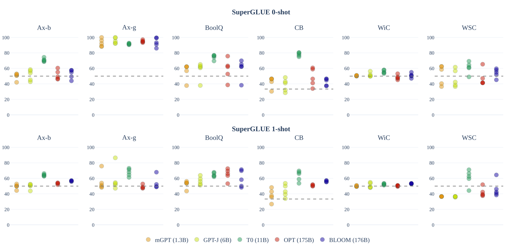

> 图解：上排为 0-shot，下排为 1-shot；纵轴为准确率，虚线为随机水平，每列是一项任务，每个点对应一个 Prompt。BLOOM、OPT 等在 BoolQ、CB 上高于随机，但许多任务的平均结果仍围绕随机线；T0 因经过多任务微调而明显更强。

从 0-shot 到 1-shot，Prompt 间波动普遍减小，准确率只轻微且不一致地上升。BLOOM 的增益比可比模型更明显：0-shot 常落后 OPT，1-shot 则追上或超过，可能因更长上下文帮助多语模型确定输入输出语言。

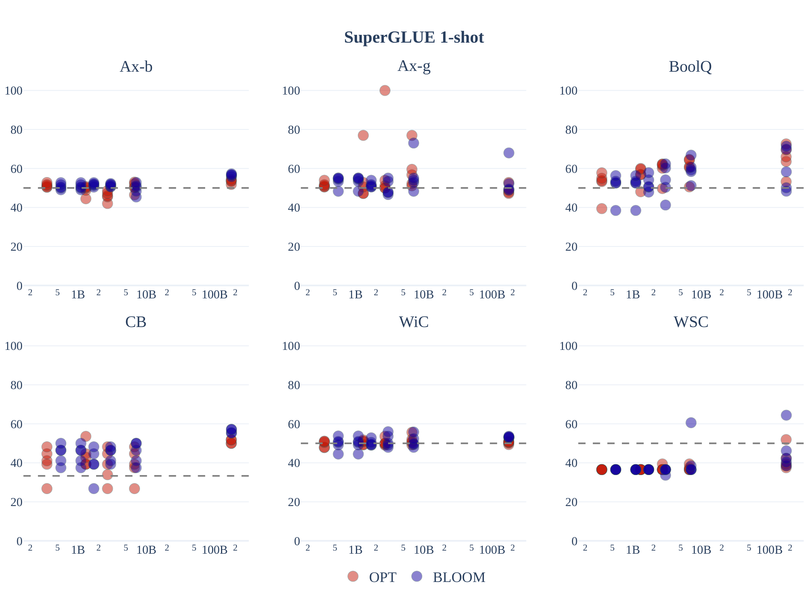

> 图解：横轴为对数刻度的参数量，纵轴为准确率；每个点表示某模型在一个 Prompt 上的结果。两个家族都只有轻微规模收益，约 2B 以上才出现较明确信号，并不存在全任务一致的家族优劣。

176B BLOOM 在 1-shot 的 Ax-b、CB、WSC、WiC 上领先 OPT-175B，其余任务大体相当。这支持“多语训练未必牺牲英文能力”，但不支持“原始 BLOOM 已可靠掌握所有 Zero-Shot 分类任务”。

### 机器翻译：Prompt 与目标语言同样关键

WMT14 上，更完整的 Prompt 往往更好。One-Shot 明显改善过度生成和输出错误语言的问题；最佳结果仍落后专用监督翻译模型 M2M-100 的英译法 43.8、法译英 40.4 BLEU。

| Prompt | en→fr 0/1-shot | fr→en 0/1-shot | en→hi 0/1-shot | hi→en 0/1-shot |
|---|---:|---:|---:|---:|
| a_good_translation-source+target | 15.38 / 36.39 | 14.15 / 36.56 | 1.90 / 14.49 | 10.19 / 24.60 |
| gpt3-target | 7.90 / 32.55 | 12.73 / 33.14 | 0.26 / 6.51 | 0.66 / 9.98 |
| version-target | 21.96 / 34.22 | 26.79 / 35.42 | 1.96 / 13.95 | 11.48 / 25.80 |
| xglm-source+target | 14.91 / 27.83 | 15.52 / 34.51 | 6.80 / 13.62 | 12.05 / 25.04 |

DiaBLa 用英法非正式双语对话测试上下文。把上一句对话作为 One-Shot 示例，与随机示例相比，自动指标并不一致：截断后 BLEU 略高，COMET 略低。原始输出与定制截断后的巨大差距，也说明生成停止规则会强烈影响表面分数。

| 1-shot 上下文 | 截断 | en→fr BLEU | en→fr COMET | fr→en BLEU | fr→en COMET |
|---|---|---:|---:|---:|---:|
| 随机句 | 否 | 5.7 | 0.342 | 12.1 | 0.614 |
| 随机句 | 是 | 37.6 | **0.634** | 41.4 | **0.757** |
| 上一句对话 | 否 | 6.1 | 0.328 | 12.3 | 0.617 |
| 上一句对话 | 是 | **38.5** | 0.614 | **41.6** | 0.751 |

Flores-101 的 One-Shot 结果更能体现多语价值：高资源语言、高到中资源语言以及 Romance 语族内部，BLOOM 常接近或超过 615M 的监督模型 M2M-100；部分高资源方向也接近使用 32-shot 的 AlexaTM。以下均为 spBLEU，BLOOM 为 1-shot，AlexaTM 为 32-shot。

**低资源语言方向：**

| 源语言 | 模型 | →en | →bn | →hi | →sw | →yo |
|---|---|---:|---:|---:|---:|---:|
| en | BLOOM / M2M | — | 24.6 / 23.0 | 27.2 / 28.1 | 20.5 / 26.9 | 2.6 / 2.2 |
| bn | BLOOM / M2M | 29.9 / 22.9 | — | 16.3 / 21.8 | — | — |
| hi | BLOOM / M2M | 35.1 / 27.9 | 23.8 / 21.8 | — | — | — |
| sw | BLOOM / M2M | 37.4 / 30.4 | — | — | — | 1.3 / 1.3 |
| yo | BLOOM / M2M | 4.1 / 4.2 | — | — | 0.9 / 1.9 | — |

**Romance 语族方向：**

| 源语言 | 模型 | →ca | →es | →fr | →gl | →it | →pt |
|---|---|---:|---:|---:|---:|---:|---:|
| ca | BLOOM / M2M | — | 28.9 / 25.2 | 33.8 / 35.1 | 19.2 / 33.4 | 19.8 / 25.5 | 33.0 / 35.2 |
| es | BLOOM / M2M | 31.2 / 23.1 | — | 24.8 / 29.3 | 23.3 / 27.5 | 16.5 / 23.9 | 29.1 / 28.1 |
| fr | BLOOM / M2M | 37.2 / 28.7 | 27.5 / 25.6 | — | 24.9 / 32.8 | 24.0 / 28.6 | 38.9 / 37.8 |
| gl | BLOOM / M2M | 37.5 / 30.1 | 27.1 / 27.6 | 33.8 / 37.1 | — | 18.3 / 26.9 | 32.2 / 34.8 |
| it | BLOOM / M2M | 31.0 / 25.2 | 25.4 / 29.2 | 31.4 / 34.4 | 20.2 / 29.2 | — | 29.2 / 31.5 |
| pt | BLOOM / M2M | 39.6 / 30.7 | 28.1 / 26.9 | 40.3 / 40.2 | 27.1 / 33.8 | 20.1 / 28.1 | — |

**高资源语言方向：**

| 源语言 | 模型 | →ar | →en | →es | →fr | →zh |
|---|---|---:|---:|---:|---:|---:|
| ar | BLOOM / M2M / AlexaTM | — | 40.3 / 25.5 / 41.8 | 23.3 / 16.7 / 23.2 | 33.1 / 25.7 / 35.5 | 17.7 / 13.1 / — |
| en | BLOOM / M2M / AlexaTM | 28.2 / 17.9 / 32.0 | — | 29.4 / 25.6 / 31.0 | 45.0 / 42.0 / 50.7 | 26.7 / 19.3 / — |
| es | BLOOM / M2M / AlexaTM | 18.8 / 12.1 / 20.8 | 32.7 / 25.1 / 34.6 | — | 24.8 / 29.3 / 33.4 | 20.9 / 14.9 / — |
| fr | BLOOM / M2M / AlexaTM | 23.4 / 15.4 / 24.7 | 45.6 / 37.2 / 47.1 | 27.5 / 25.6 / 26.3 | — | 23.2 / 17.6 / — |
| zh | BLOOM / M2M / AlexaTM | 15.0 / 11.55 / — | 30.5 / 20.9 / — | 20.5 / 16.9 / — | 26.0 / 24.3 / — | — |

**高资源到中资源方向：**

| 源语言 | 模型 | →en | →fr | →hi | →id | →vi |
|---|---|---:|---:|---:|---:|---:|
| en | BLOOM / M2M | — | 45.0 / 42.0 | 27.2 / 28.1 | 39.0 / 37.3 | 28.5 / 35.1 |
| fr | BLOOM / M2M | 45.6 / 37.2 | — | 18.5 / 22.9 | 31.4 / 29.1 | 32.8 / 30.3 |
| hi | BLOOM / M2M | 35.1 / 27.9 | 27.6 / 25.9 | — | — | — |
| id | BLOOM / M2M | 43.2 / 33.7 | 30.4 / 30.8 | — | — | — |
| vi | BLOOM / M2M | 38.7 / 29.5 | 26.8 / 25.8 | — | — | — |

最值得注意的是反例：Swahili 与 Yoruba 都出现在训练集，却因各自训练 Token 少于 50k，互译表现很差。相反，未直接训练的 Galician 能借助与 Portuguese 等 Romance 语言的相似性取得不错迁移。由此可见，语言名单上的“已覆盖”远不能保证质量，语系接近程度和数据量都重要。

### 多语摘要：BLOOM 的规模收益更清晰

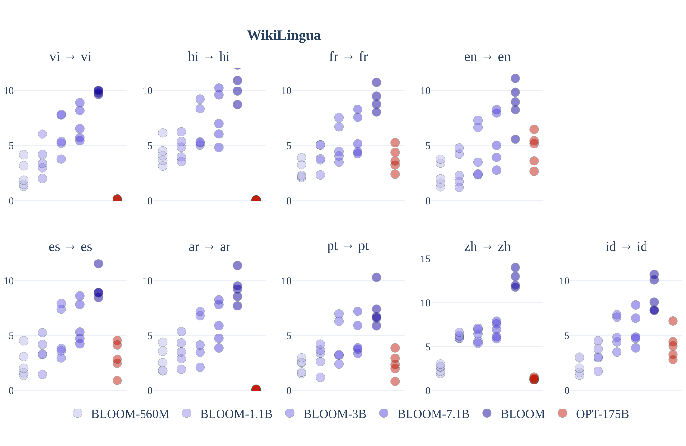

> 图解：每个子图对应一种语言，纵轴为每个 Prompt 的 ROUGE-2 F1，横向比较不同参数规模的 BLOOM 与 OPT-175B。BLOOM 随规模增大总体提升，并在多语摘要上优于 OPT；不同 Prompt 仍带来散布。

评测让模型用源语言生成摘要，而非统一翻译成英文。作者同时提醒，ROUGE-2 依赖词面重合，常低估人工看来合理的摘要，因此不能把低分直接等同于无用输出。

### HumanEval：通用多语模型不等于代码专家

ROOTS 约 11% 是代码，与 The Pile 的代码比例相近。BLOOM 与相近规模 GPT 模型表现大致可比，但专门代码微调的 Codex 明显更强。BLOOMZ 没有提升，176B 版本反而低于 BLOOM，可能因为 xP3 缺少纯代码补全任务。

| 模型 | pass@1 | pass@10 | pass@100 |
|---|---:|---:|---:|
| GPT-Neo 1.3B | 4.79% | 7.47% | 16.30% |
| GPT-Neo 2.7B | 6.41% | 11.27% | 21.37% |
| GPT-J 6B | 11.62% | 15.74% | 27.74% |
| GPT-NeoX 20B | 15.4% | 25.6% | 41.2% |
| Codex-300M | 13.17% | 20.37% | 36.27% |
| Codex-679M | 16.22% | 25.7% | 40.95% |
| Codex-2.5B | 21.36% | 35.42% | 59.5% |
| Codex-12B | 28.81% | 46.81% | 72.31% |
| BLOOM-560M | 0.82% | 3.02% | 5.91% |
| BLOOM-1.1B | 2.48% | 5.93% | 9.62% |
| BLOOM-1.7B | 4.03% | 7.45% | 12.75% |
| BLOOM-3B | 6.48% | 11.35% | 20.43% |
| BLOOM-7.1B | 7.73% | 17.38% | 29.47% |
| BLOOM 176B | **15.52%** | **32.20%** | **55.45%** |
| BLOOMZ-560M | 2.18% | 4.11% | 9.00% |
| BLOOMZ-1.1B | 2.63% | 6.22% | 11.68% |
| BLOOMZ-1.7B | 4.38% | 8.73% | 16.09% |
| BLOOMZ-3B | 6.29% | 11.94% | 19.06% |
| BLOOMZ-7.1B | 8.06% | 15.03% | 27.49% |
| BLOOMZ 176B | 12.06% | 26.53% | 48.44% |

### HELM：英文综合能力与同期专用模型仍有差距

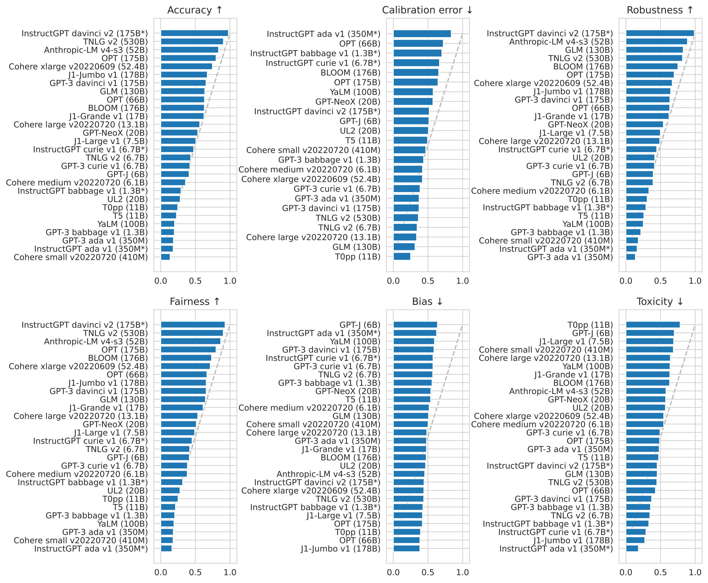

> 图解：六幅条形图分别展示 Accuracy、Calibration Error、Robustness、Fairness、Bias、Toxicity；箭头表示越靠上越好。BLOOM 的准确率约与 GPT-3 davinci v1、J1-Grande v1 同档，落后更新的英文模型；鲁棒性和公平性较好，校准不佳，英文毒性略高于平均，偏差约为平均。

这组英文 5-shot 结果补充了前面的多语优势：BLOOM 的“有竞争力”不是所有维度都领先，更不是在同期所有英文模型中居首。

### BLOOMZ：指令泛化才是 Zero-Shot 的关键补丁

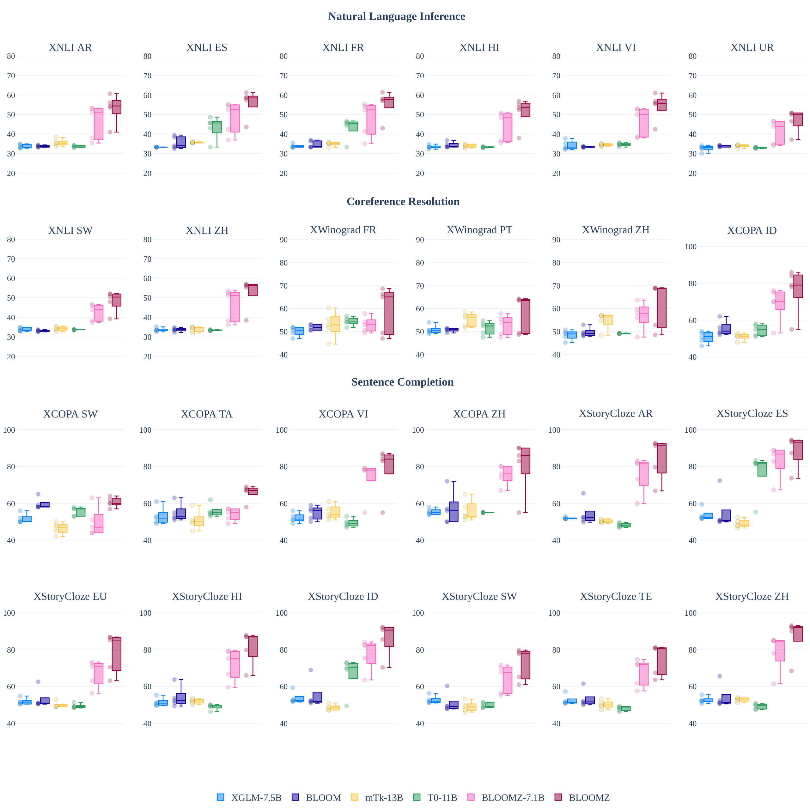

> 图解：各子图是 XNLI、XWinograd、XCOPA、XStoryCloze 等保留任务，每组的 5 个点对应 5 个未调优 Prompt。BLOOM、XGLM 多接近 33% 或 50% 的随机基线，xP3 微调后的 BLOOMZ 明显上升；英文单语 T0 在非英语任务上表现受限。

结果说明，预训练规模本身不会自动带来可靠指令遵循。多任务微调的收益来自任务与 Prompt 多样性，而多语 xP3 让这种收益跨语言出现；在控制规模和架构后，xP3 微调模型在英文数据集上也能超过 T0。

## 表征、内部知识与偏差：三种不同视角

### SGPT-BLOOM：把生成模型改成文本 Embedding

团队用 SGPT Bi-Encoder 对比微调得到 SGPT-BLOOM-7.1B-msmarco 和 SGPT-BLOOM-1.7B-nli。前者面向多语检索，后者面向语义文本相似度，也可用于 Bitext Mining、Reranking 和分类特征提取。

**MASSIVE 分类准确率：**

| 语言 | ST5-XL | LASER2 | MiniLM-L12 | MPNet | LaBSE | SGPT-BLOOM-1.7B | SGPT-BLOOM-7.1B |
|---|---:|---:|---:|---:|---:|---:|---:|
| ar | 4.18 | 37.16 | 51.43 | 45.14 | 50.86 | 54.59 | **59.25** |
| bn | 2.60 | 42.51 | 48.79 | 35.34 | 58.22 | 57.76 | **61.59** |
| en | **72.09** | 47.91 | 69.32 | 66.84 | 61.46 | 66.69 | 69.67 |
| es | 57.97 | 45.44 | 64.43 | 59.66 | 58.32 | 61.77 | **66.35** |
| fr | 60.99 | 46.13 | 64.82 | 60.25 | 60.47 | 64.58 | **66.95** |
| hi | 3.02 | 40.20 | 62.77 | 58.37 | 59.40 | 60.74 | **63.54** |
| id | 41.53 | 45.81 | **65.43** | 59.85 | 61.12 | 60.07 | 64.06 |
| kn | 2.79 | 4.32 | 50.63 | 40.98 | **56.24** | 48.56 | 53.54 |
| ml | 2.98 | 41.33 | 54.34 | 42.41 | 57.91 | 55.10 | **58.27** |
| pt | 57.95 | 48.55 | 64.89 | 61.27 | 60.16 | 62.52 | **66.69** |
| sw | 30.60 | 31.89 | 31.95 | 29.57 | **51.62** | 43.90 | 49.81 |
| ta | 1.79 | 29.63 | 50.17 | 36.77 | 55.04 | 52.66 | **56.40** |
| te | 2.26 | 36.03 | 52.82 | 40.72 | **58.32** | 49.32 | 54.71 |
| ur | 2.70 | 26.11 | 56.37 | 52.80 | 56.70 | 51.00 | **56.75** |
| vi | 21.47 | 44.33 | 59.68 | 56.61 | 56.67 | 59.85 | **64.53** |

**STS22 语义相似度，指标为余弦相似度的 Spearman 相关：**

| 语言 | ST5-XL | LASER2 | MiniLM-L12 | MPNet | LaBSE | SGPT-BLOOM-1.7B | SGPT-BLOOM-7.1B |
|---|---:|---:|---:|---:|---:|---:|---:|
| ar | 29.60 | 42.57 | 52.19 | 46.20 | 57.67 | 48.64 | **58.67** |
| en | 64.32 | 39.76 | 63.06 | 61.72 | 60.97 | 61.45 | **66.13** |
| es | 58.16 | 54.92 | 59.91 | 56.56 | 63.18 | 61.81 | **65.41** |
| fr | 77.49 | 58.61 | 74.30 | 70.55 | 77.95 | 73.18 | **80.38** |
| zh | 33.55 | 49.41 | 61.75 | 58.75 | 63.02 | 58.53 | **66.78** |

7.1B 模型在多项划分上达到当时最佳，但参数比 MiniLM、MPNet 等大一个数量级；1.7B 版本较弱，可能同时受模型规模和更短 NLI 微调影响。因此，高分并不自动意味着部署成本划算。

### Probing：更大的模型并非每项内部能力都更强

Probing 像在模型表示上做“小测验”：冻结语言模型，用其句子表示训练简单分类器，看能否预测单复数、语态等形态句法特征。实验覆盖 17 种语言、38 个特征，在 BLOOM-1.7B 和 176B 各层取 `<s>` 汇聚表示，以 Logistic Regression 做二分类，按三次运行计算加权 F1。

| 语言 | 标签 | 示例 |
|---|---|---|
| English | Sing | The **scheme** makes money through sponsorship and advertising. |
| English | Plur | Still, there are **questions** left unanswered. |
| Spanish | Sing | Eligi**ó** no ir tras un tercer período en el siguiente ciclo de elecciones. |
| Spanish | Plur | Todavía quedan **preguntas** sin responder. |

基线包括随机猜测及字符、词、BPE、SentencePiece N-gram 的 TF-IDF 分类器。下表数值为跨层、任务和运行平均 F1，括号内为跨任务标准差。

| 语言 | BLOOM-1B7 | BLOOM | Random | TF-IDF Char | TF-IDF Word | TF-IDF BPE | TF-IDF SP |
|---|---:|---:|---:|---:|---:|---:|---:|
| Arabic | **0.66**（0.27） | 0.64（0.27） | 0.49（0.013） | 0.41（0.44） | 0.40（0.44） | 0.41（0.44） | 0.41（0.44） |
| Bambara | **0.64**（0.16） | 0.59（0.16） | 0.45（0.10） | 0.52（0.46） | 0.45（0.47） | 0.48（0.49） | 0.49（0.49） |
| Basque | **0.68**（0.19） | 0.62（0.19） | 0.49（0.03） | 0.41（0.43） | 0.44（0.46） | 0.48（0.44） | 0.41（0.46） |
| Bengali | 0.42（0.15） | 0.45（0.12） | 0.35（0.23） | 0.63（0.48） | 0.37（0.44） | 0.41（0.32） | **0.76**（0.28） |
| Catalan | **0.65**（0.25） | 0.61（0.26） | 0.34（0.01） | 0.24（0.38） | 0.24（0.39） | 0.24（0.39） | 0.24（0.39） |
| Chinese | **0.66**（0.25） | 0.50（0.21） | 0.55（0.03） | 0.03（0.05） | 0.11（0.28） | 0.04（0.06） | 0.03（0.05） |
| English | **0.57**（0.24） | **0.57**（0.24） | 0.43（0.03） | 0.45（0.43） | 0.46（0.43） | 0.45（0.43） | 0.44（0.44） |
| French | **0.61**（0.23） | 0.57（0.22） | 0.44（0.02） | 0.32（0.43） | 0.32（0.43） | 0.32（0.43） | 0.33（0.44） |
| Hindi | **0.63**（0.23） | 0.60（0.25） | 0.48（0.03） | 0.53（0.46） | 0.55（0.47） | 0.53（0.46） | 0.53（0.46） |
| Indonesian | **0.65**（0.27） | 0.60（0.27） | 0.48（0.05） | 0.41（0.46） | 0.43（0.45） | 0.41（0.46） | 0.45（0.45） |
| Marathi | **0.57**（0.25） | 0.48（0.24） | 0.32（0.09） | 0.44（0.47） | 0.46（0.46） | 0.44（0.47） | 0.44（0.47） |
| Portuguese | **0.67**（0.23） | 0.63（0.26） | 0.40（0.03） | 0.48（0.48） | 0.49（0.48） | 0.48（0.48） | 0.48（0.48） |
| Spanish | **0.66**（0.24） | 0.65（0.24） | 0.42（0.02） | 0.35（0.42） | 0.35（0.44） | 0.36（0.44） | 0.36（0.43） |
| Tamil | **0.57**（0.25） | 0.51（0.27） | 0.43（0.05） | 0.51（0.44） | 0.53（0.44） | 0.50（0.44） | 0.50（0.44） |
| Urdu | **0.75**（0.21） | 0.70（0.24） | 0.43（0.02） | 0.39（0.48） | 0.39（0.47） | 0.39（0.48） | 0.39（0.48） |
| Wolof | **0.51**（0.32） | 0.47（0.32） | 0.41（0.02） | 0.26（0.39） | 0.25（0.39） | 0.30（0.43） | 0.27（0.39） |
| Yoruba | **0.48**（0.07） | 0.36（0.07） | 0.43（0.06） | 0.33（0.45） | 0.09（0.05） | 0.16（0.11） | 0.09（0.05） |

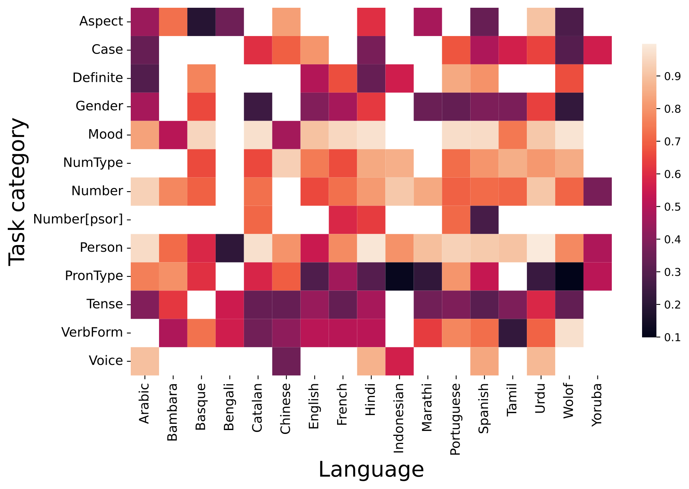

> 图解：行对应语言，列对应特征类别，颜色深浅表示 F1，白色表示该语言没有对应类别。Mood、Person 普遍较易预测，Case 等取值依赖语言的类别更难。

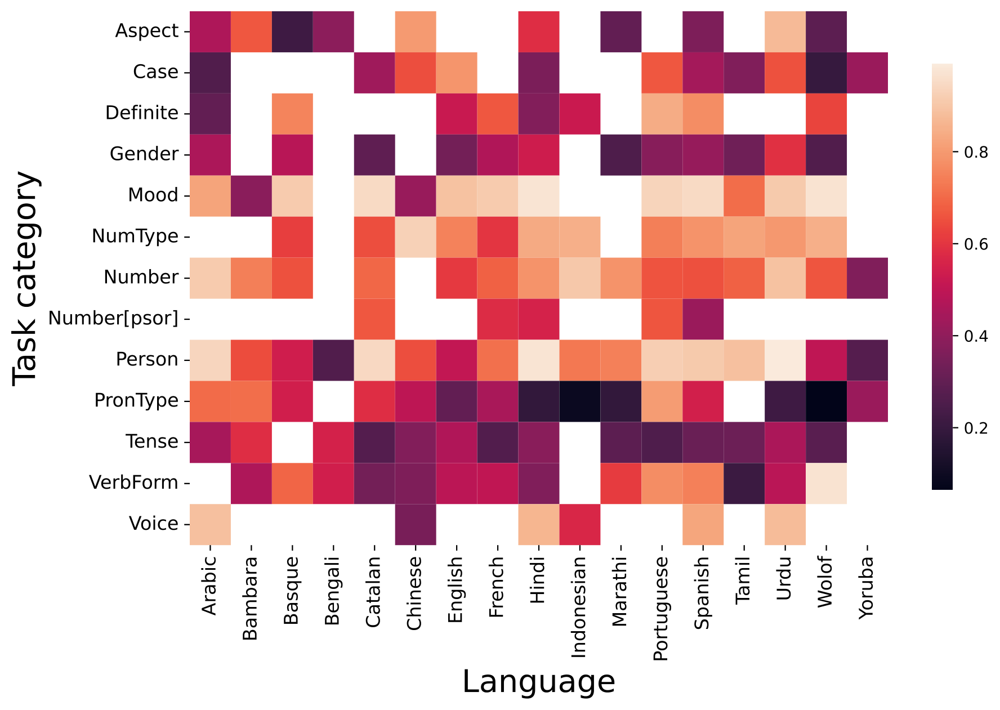

> 图解：坐标和颜色含义与上图相同。两模型热图总体相似，说明从 1.7B 增至 176B 并不会同步增强所有语法特征表示。

1.7B 平均表现与 176B 相当或更好，且 Mann-Whitney U 检验显示差异显著。另一方面，176B 的结果受预训练数据量影响更小，可能具有更稳定的跨语言泛化。这两个结论并不矛盾：**平均分更高，不等于对低资源语言更稳健。**

| 检验因素 | 模型 | 方法 | p-value |
|---|---|---|---:|
| 文字系统 | BLOOM / BLOOM-1B7 | Mann-Whitney U | 0.72 / 0.13 |
| 语系 | BLOOM / BLOOM-1B7 | ANOVA | <0.01 / <0.01 |
| Probing 数据集规模 | BLOOM / BLOOM-1B7 | Pearson | 0.63 / 0.02 |
| 预训练数据集规模 | BLOOM / BLOOM-1B7 | Pearson | 0.46 / <0.01 |
| 两版本差异 | BLOOM 与 BLOOM-1B7 | Mann-Whitney U | <0.01 |

该实验只平均了训练结束时的各层表示。逐层分析和训练动态仍待研究，也不能把 Probing 成功直接等同于模型会在生成时正确使用该知识。

### CrowS-Pairs：接近随机不代表“无偏”

CrowS-Pairs 用最小句对比较刻板与非刻板陈述，例如只替换句中的社会群体。原指标为 Masked Language Model 设计，团队改成 Prompt，让自回归模型判断哪句话更符合刻板印象或反刻板印象。

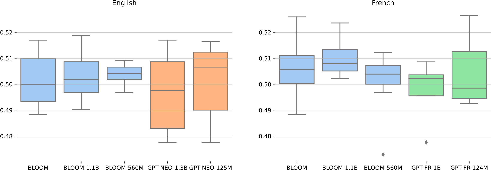

> 图解：横轴区分模型与语言，纵轴为准确率，每个点对应一种 Prompt。BLOOM 总体围绕 50%，英法结果接近；这表示该测试未测出强烈的整体刻板偏好，而不是证明所有场景都无偏。

| 偏差类别 | 样本数 | English | French |
|---|---:|---:|---:|
| ethnicity / color | 460 | 50.05 | 50.48* |
| gender | 321 | 51.17* | 51.24* |
| socioeconomic status | 196 | 51.05* | 52.22* |
| nationality | 253 | 49.25* | 48.49* |
| religion | 115 | 53.82* | 53.01* |
| age | 90 | 49.35 | 50.13 |
| sexual orientation | 91 | 50.00 | 49.90 |
| physical appearance | 72 | 48.20 | 49.67 |
| disability | 66 | 48.49* | 49.16* |
| other | 13 | 50.18 | 42.10* |
| 全部 | 1,677 | 49.78* | 50.61* |

星号表示相对 50% 的单样本 T 检验达到 $p<0.05$。偏差幅度虽小，多个类别仍有统计显著性。数据只覆盖英法及特定语言变体，多语偏差工具本身也很稀缺，所以论文只能把它视为初步检查。

## 开放发布：模型卡与 Responsible AI License

BLOOM 发布时附带 Model Card，记录技术规格、训练细节、适用与禁用场景及局限。模型参数采用 Responsible AI License（RAIL），代码采用 Apache 2.0；二者分开授权。

RAIL 免费提供模型使用权，同时设置 13 项行为限制，并明确 Prompt、Fine-Tuning、Distillation、Logits 与概率分布等下游使用及衍生作品。它试图在无限制开放与责任使用之间折中。这里也应准确理解术语：**开放获取不等于没有任何使用条件。**

## 附录要点：Prompt 如何真正进入模型

附录把评测 Prompt 和填充示例完整公开，这对复现很重要。所谓 Prompt 并非一句固定魔法咒语，而是带变量的模板；评测时把样本字段填进去，目标答案只作为计算对象或生成参考。

| 任务 | 输入模板示意 | 答案形式 |
|---|---|---|
| WSC | `Passage: {{text}}\nQuestion: does "{{span2}}" refer to {{span1}}?\nAnswer:` | Yes / No |
| BoolQ | `{{passage}}\nQuestion: {{question}}\nAnswer:` | Yes / No |
| XNLI / CB | `{{premise}}\nQuestion: {{hypothesis}} True, False, or Neither?` | 三分类标签 |
| XWinograd | `{{sentence}}\nReplace the _ with: - {{option1}} - {{option2}}` | 指代表达 |
| XCOPA | `{{premise}} ... because / so` | 原因或结果选项 |
| XStoryCloze | 故事上下文 + 候选结尾 | 正确续写 |
| WMT | `Given the following source text in L1: {{source}}, a good L2 translation is:` | 目标语句子 |
| DiaBLa | `English: {{orig}} = French:` | 对话译文 |
| CrowS-Pairs | 两个最小句对 + “哪个更符合刻板/反刻板描述” | 选项 A / B |

One-Shot 会在当前问题前加入一个输入输出示例；DiaBLa 还可控制示例与当前句是否同翻译方向。附录的价值在于把“模型能力”还原成具体输入：离开模板、示例来源、停止条件和截断函数，单个分数很难复现。

## 总结：BLOOM 留下了什么

- **开放规模**：176B 参数、46 种自然语言与 13 种编程语言，模型、代码和大量研发记录公开。
- **数据方法**：ROOTS 以 498 个组件构成 1.61 TB 语料，把来源追溯、社区参与和隐私处理纳入数据工程。
- **技术取舍**：Decoder-only、ALiBi、Embedding LayerNorm、250,680 词表与 bfloat16，共同服务于 Zero-Shot 能力和训练稳定性。
- **真实能力**：多语翻译、摘要和 SGPT Embedding 有竞争力，但原始 Zero-Shot 分类、代码生成和低资源语言仍有明显短板。
- **后续方向**：xP3 微调得到 BLOOMZ，显著改善多语指令泛化，证明“会续写”与“会按指令做题”需要不同训练信号。

BLOOM 的局限同样清晰：语言覆盖不均衡、架构小模型消融存在外推风险、偏差评测范围有限；它更重要的遗产，是证明大模型可以由开放、多学科协作共同生产，并把治理与失败模式也留给后续研究。

> 本文参考自 [BLOOM: A 176B-Parameter Open-Access Multilingual Language Model](https://arxiv.org/abs/2211.05100)