# SpecOPD：监督吞吐提升16.09倍

Speculative Decoding（推测解码，SD）已经能降低大模型逐 Token 生成的串行开销，但草稿模型的训练又被另一串流程卡住了：先草稿、再验证、接受后才能继续采样。这个瓶颈让 On-Policy Distillation（在线策略蒸馏，OPD）虽然能提高接受长度，却让训练 GPU 大量等待。SpecOPD 的关键发现是，监督一个草稿块只需要“参考前缀 + 当前草稿模型采样的历史”，不必先跑完一条经过验证的完整回答；于是它把不同位置的分支采样和目标模型评分并行展开，再用 Proposal Tree 复用公共前缀计算。在 Qwen3.8-27B、8 张高性能 GPU 的原生配置对比中，SpecOPD 的 supervised-token throughput 达到顺序 rollout OPD 的 **16.09 倍**；另一组 27B serving 实验中，实测生成吞吐最高达到自回归解码的 **3.56 倍**。

## 为什么草稿模型越训越难提速

### 推测解码的收益，取决于“每次能走多远”

标准自回归（Autoregressive，AR）解码一次前向通常只推进一个 Token。SD 则像“先让助理写提纲，再由负责人集中审阅”：轻量 Drafter 连续提出多个候选 Token，冻结的 Target Model 一次验证一批，并按推测采样规则接受或拒绝。

这里真正决定收益的不只是 Drafter 有多快，还有 **接受长度（Acceptance Length，AL）**：每轮验证平均能推进多少个完成 Token，论文的 AL 包含 bonus token。草稿提议很便宜，却总在第一、第二个位置被拒绝，目标模型仍要频繁启动验证，加速就会受限。

DFlash、DSpark、DFlash V2 等并行 Drafter 已把“逐 Token 起草”改成“一次前向预测整个块”，降低了提议成本。接下来，训练必须让草稿分布在 **草稿自己走出来的历史** 上更贴近目标分布，而不只是会模仿固定参考答案。

### OPD 有效，却把串行依赖带进了训练

固定目标回答上的 SFT 或 Cross-Entropy（CE）属于 Off-Policy 训练：学生始终在参考历史上学习。OPD 则让当前 Drafter 产生新历史，再由 Target Model 在这些历史上提供逐 Token 分布监督，因此能突破一部分接受长度平台期。

问题出在数据采集。典型 Draft-OPD 的训练循环是：

1. Drafter 提出一个块；
2. Target 验证，得到接受前缀；
3. 从接受位置开始下一轮；
4. 收集足够轨迹后，再回放、训练并更新权重。

第 2 步决定第 3 步的起点，完整轨迹无法一次性并行采完。论文实测的执行 profile 也显示，rollout 与训练交替出现，GPU 利用率并不理想。

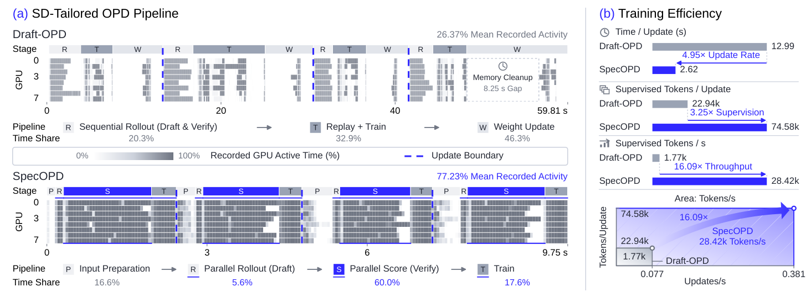

> 图解：左图上下两部分使用各自独立的时间轴，灰色越深，表示对应 50 ms 时间片内记录到的 GPU 活动比例越高；它们不是 SM occupancy。Draft-OPD 在顺序 rollout（R）、回放训练（T）和权重更新（W）之间切换，示例窗口平均记录活动率为 26.37%；SpecOPD 将并行起草（R）、并行目标评分（S）与训练（T）批处理，升至 77.23%。右图中，每次更新时间由 12.99 s 降至 2.62 s，每次更新监督 Token 数由 22.94k 增至 74.58k，最终 supervised tokens/s 由 1.77k 增至 28.42k。底部矩形的宽、高、面积分别对应 updates/s、tokens/update 和 tokens/s。

所以，论文真正追问的不是“怎样再缩小 Drafter”，而是：**OPD 是否必须继承 draft-and-verify 的串行依赖？** 答案是否定的。

## 核心转折：完整轨迹不是监督的必要条件

假设参考序列中某个位置是锚点。要训练从这里开始的草稿块，Target 需要知道两类信息：

- 锚点之前的参考前缀，用来确定上下文；
- 锚点之后由当前 Drafter 实际采出的 Token，用来构造后续预测历史。

Target 不需要先告诉 Drafter 哪些 Token 会在服务时被接受，也不需要等另一条分支验证结束。不同锚点可以独立采样，Target 只需分别沿着各自的采样历史打分。

这一步把“完整回答级 rollout”改成了“固定参考上下文上的局部分支 rollout”。它仍然是 On-Policy：分支来自当前 Drafter，且每次更新都会重新采样；但它不是不受约束的全轨迹 On-Policy，外层上下文仍由预先收集的参考响应定义。

笔者认为，这个拆解是全文最关键的一步：**验证结果不再是生成训练上下文的前置条件，而接受行为被转移到了 Loss 中优化。** 参考响应可以提前离线生成，也可以直接由数据集提供，因此训练时无需反复构造完整已验证回答。

明确了并行化的合法性，下一个问题才是工程难点：分支这么多，怎样避免把公共前缀重复计算几十、几百次？

## SpecOPD：用一棵 Proposal Tree 并行采样与评分

记冻结 Target 的 Token 分布为 $p$，可训练 Drafter 的分布为 $q_\theta$，参考序列 $x_{1:L}$ 包含 prompt 与预先收集的回答。SpecOPD 可以拆成三个连续环节：构造 Proposal Tree、保持历史一致地并行评分、用 E2E-TV 直接优化接受长度。

### 第一步：从参考树干长出独立草稿分支

论文把参考序列看作共享的 **reference trunk（参考树干）**，在回答部分随机选取 $B$ 个锚点 $A=\{a_b\}_{b=1}^{B}$。每个锚点的草稿输入以干净锚点 Token 开头，其余位置放 mask；当前 Drafter 随后采出长度为 $W$ 的分支 $y_{b,1:W}$，这里不计锚点本身。

第 $b$ 条分支在第 $i$ 个位置的历史为：

$$
h_{b,i}=(x_{\leq a_b},y_{b,<i}),\qquad
y_{b,i}\sim q_\theta(\cdot\mid h_{b,i})
$$

也就是说，第一条分支可以采成 `Enjoy a short evening walk`，即使参考回答原本是 `Enjoy a quiet evening at home`。评分后续 Token 时，Target 必须看到 `short`，不能偷偷换回 `quiet`。

分支之间使用独立采样流，因此联合分布可以分解为：

$$
Q_\theta(Y\mid x,A)=\prod_{b=1}^{B}\prod_{i=1}^{W}q_\theta(y_{b,i}\mid h_{b,i})
$$

这个乘积表达的正是“分支内有序、分支间独立”。采样分支挂回锚点后，就形成 Proposal Tree。分支节点的父节点和语义位置定义为：

$$
\pi(y_{b,i})=
\begin{cases}
x_{a_b}, & i=1,\\
y_{b,i-1}, & i>1,
\end{cases}
\qquad
\operatorname{pos}(y_{b,i})=a_b+i
$$

其中 $\pi$ 决定可见历史，$\operatorname{pos}$ 决定 RoPE 位置；二者都不能直接拿打包后的数组下标替代。

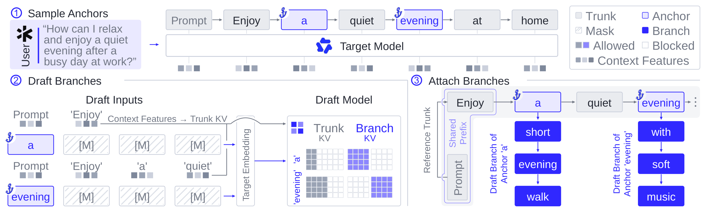

> 图解：① 从参考回答的 `a` 与 `evening` 等位置选锚点，并提取 Target 上下文特征；② 各锚点以 anchor + mask 块作为 Drafter 输入，并行采出不同 continuation；③ 将 `short → evening → walk` 和 `with → soft → music` 等分支挂回参考树干。灰色节点是共享前缀，蓝色节点是分支私有历史，树干 KV 可以复用，分支 KV 必须隔离。

### 第二步：用“前驱行”读取目标分布

对树节点 $u$，记 Target 隐状态为 $H_u$，冻结输出头为 $g_p$。要预测分支 Token $y_{b,i}$，应读取它前驱节点 $u_{b,i}=\pi(y_{b,i})$ 的隐状态：

$$
p_{b,i}=p(\cdot\mid h_{b,i})=\operatorname{softmax}\left(g_p(H_{u_{b,i}})\right)
$$

第一个草稿 Token 从锚点行评分，第二个从第一个草稿 Token 的行评分，依此类推。若读取被预测 Token 自己的行，就会把答案泄漏进输入。长度为 $W$ 的分支只需 $W-1$ 个新增评分行，因为最后一个样本没有后续 Token 需要预测。

Target 只返回选中的前驱隐状态，Trainer 再用冻结 LM head 重建全词表 logits。这既减少传输宽度，也不会把教师词表裁成 Drafter 的候选集合。

真正的差异在于：GQA、QSA 和 GDN 对“历史”的存储方式不同，不能用同一个 mask 一统到底。

### Full Attention：Tree Mask 隔离分支，复用树干 KV

GQA（Grouped-Query Attention）保留逐 Token KV。SpecOPD 先对参考树干做一次 prefill，再把所有分支 query 打包，对缓存的树干 KV 与分支 KV 一起评分。

普通 causal mask 只认识打包顺序，会让分支看到锚点之后的参考 Token，甚至看到兄弟分支。Tree Attention Mask 改为按祖先关系控制可见性：

$$
M_{u,v}=
\begin{cases}
0, & v\in\operatorname{Anc}(u)\cup\{u\},\\
-\infty, & \text{otherwise}
\end{cases}
$$

$\operatorname{Anc}(u)$ 是节点 $u$ 的严格祖先集合。允许节点看见自己并不会泄漏待预测答案，因为实际 logits 来自前驱行。所有 RoPE 位置使用语义位置 $\operatorname{pos}$，而非打包偏移。

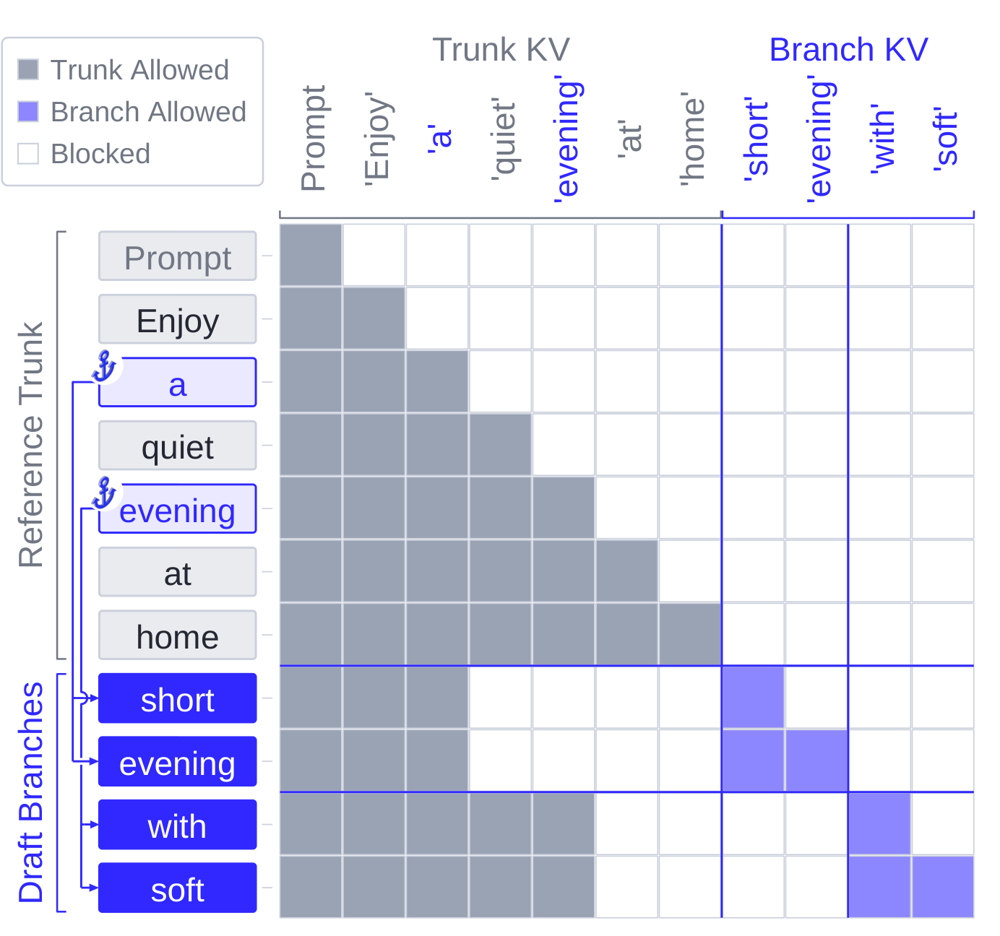

> 图解：矩阵行、列采用同一打包 Token 顺序，灰色表示可见树干 KV，紫色表示可见分支 KV，白色表示阻断。`short` 与分支上的 `evening` 只能读取到锚点 `a` 为止的树干和自身路径；`with`、`soft` 则读取到锚点 `evening` 为止的树干及另一分支。终末样本 `walk` 和 `music` 只需前驱行读数，不再新增 query 行。

### Sparse Attention：跨锚点的 indexer group 必须重建

QSA（Qwen Sparse Attention）先用压缩 indexer key 选择 Token block，再对选中的 KV 做稀疏注意力。完整复用树干 KV 还不够，因为 **block selection 本身也依赖历史**。

若一个四 Token 压缩组恰好跨越锚点，直接复用参考树干的 group key，就会把参考分支的未来 Token 带进选择过程；完全重新压缩每条分支，又会重复公共前缀。

SpecOPD 因此共享完整位于锚点前的 group，并沿分支重建边界及后续 group。对分支 $b$ 的查询节点 $u$，已完成组 $g$ 的压缩 key 为：

$$
\bar\kappa_{b,g}=
\begin{cases}
\bar\kappa_g^{\mathrm{trunk}}, & 4g\leq a_b,\\
\mathcal C_g\left(\kappa_{b,4g-3:4g}\right), & 4g>a_b
\end{cases}
$$

$\mathcal C_g$ 依次执行平均池化、RMSNorm 和组首位置的旋转位置变换。每条分支预留四个 raw-indexer 槽，保留树干末尾不足一组的部分，再与分支 key 拼成边界组。Top-$k$ 只选择已经完成的组；未满一组的 causal tail 绕过 Top-$k$，直接进入注意力读取。

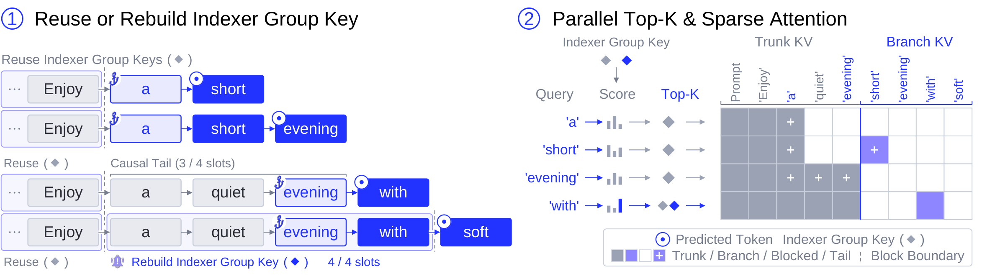

> 图解：左图展示 indexer group key 的复用与重建。预测 `with` 时，`[a, quiet, evening]` 只有 3/4 个槽，作为 causal tail；加入 `with` 后凑成 4/4，必须生成该分支自己的压缩 key。右图中，indexer query 对可完成的组并行打分并做 Top-$k$，attention 再读取选中的树干/分支 KV 和未经 Top-$k$ 的尾部；加号标出被预测 Token 对应的前驱 query。

### Linear Attention：从检查点恢复状态，再沿索引路径前进

GDN（Gated Delta Network）把历史压进 recurrent state。此时 mask 无能为力：状态一旦混入未来或兄弟分支，就无法靠屏蔽注意力键值恢复旧历史。

SpecOPD 在共享树干上保存 FP32 GDN checkpoint。设 $S_t$ 是参考位置 $t$ 后的状态，$F$ 是单 Token 更新，$z_t$ 是更新特征。分支 $b$ 从最近检查点 $c_b\leq a_b$ 重放到锚点，再处理自己的分支 Token：

$$
S_{b,0}=\operatorname{Replay}\left(S_{c_b};z_{c_b+1:a_b}\right),\qquad
S_{b,j}=F(S_{b,j-1},z_{b,j}),\quad j=1,\ldots,W-1
$$

每条路径把检查点 tile 拷贝到私有寄存器，重放只使用缓存的树干投影特征，而不是重新跑完整模型。共享 checkpoint 始终只读；recurrent state 和 causal convolution 都沿 $\pi$ 定义的祖先路径推进。混合模型则把这套状态重放与前面的 GQA/QSA 机制组合起来。

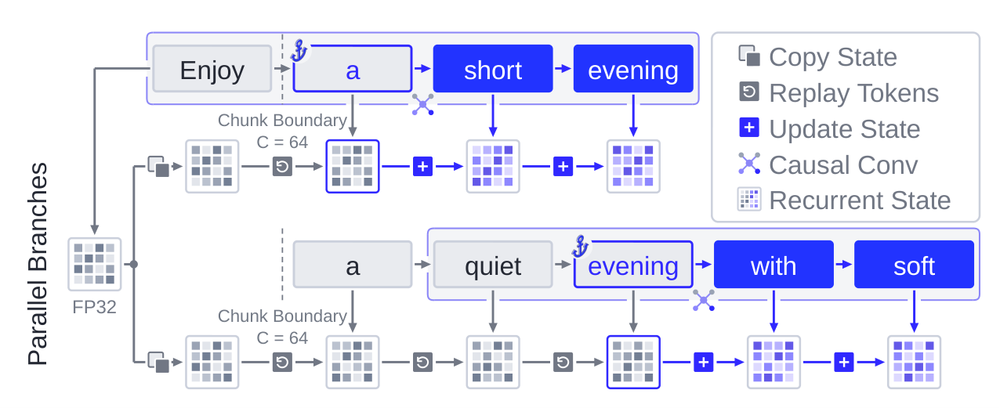

> 图解：共享树干在 `Enjoy` 后的 $C=64$ 边界留下 FP32 状态。上方分支只重放 `a`，下方分支重放 `a → quiet → evening`，分别恢复锚点状态；随后两条路径私有地执行 `Update State`。每个 recurrent kernel 线程块加载自己的 state tile，既不修改共享 checkpoint，也不等待另一条分支完成。

### 第三步：E2E-TV 不只奖励“下一个 Token 猜对”

接受长度不是逐位置准确率的简单平均：早期 Token 一旦被拒，后面的高准确率也无法带来解码进展。SpecOPD 因而采用 Bebop 的 E2E-TV surrogate。

在固定历史上，精确拒绝采样下草稿 Token 的期望接受概率等于两个分布的重叠面积：

$$
\alpha_{b,i}=\sum_v\min\{q_\theta(v\mid h_{b,i}),p_{b,i}(v)\}
=1-\operatorname{TV}(q_\theta(\cdot\mid h_{b,i}),p_{b,i})
$$

其中 $\operatorname{TV}$ 是 Total Variation Distance（总变差距离）。对 $B$ 条、每条 $W$ 个提议 Token 的分支，Loss 为：

$$
\mathcal L=1-\frac{1}{BW}\sum_{b=1}^{B}\sum_{j=1}^{W}\prod_{i=1}^{j}\alpha_{b,i}
$$

前缀乘积让早期分歧影响后续所有项。训练时固定已采 Token ID 和 Target 分布，对 Drafter 概率与前缀乘积反向传播，而不是把乘积当作 detached 权重。

当 Drafter 只保留候选支持集 $S_i$ 时，还必须把支持集之外的教师概率质量计入距离：

$$
d_{b,i}=\frac{1}{2}\left[\sum_{v\in S_i}|q_{b,i}(v)-p_{b,i}(v)|+1-\sum_{v\in S_i}p_{b,i}(v)\right]
$$

例如 $q=(0.5,0.5,0)$、$p=(0.4,0.4,0.2)$，真实重叠为 $0.8$。若把 $p$ 在前两项上重新归一化，就会错误地得到完美匹配，抹掉 Drafter 永远无法提出第三个 Token 的问题。论文在 BF16 隐状态和权重下仍使用 FP32 softmax 与归约计算分布距离。

前缀项的梯度也能说明“错误发生在哪里”为何重要。单分支下：

$$
\frac{\partial\mathcal L}{\partial d_k}
=\frac{1}{W}\sum_{j=k}^{W}\prod_{\substack{i=1\\i\ne k}}^{j}(1-d_i)
$$

论文给出的例子中，$A=(0.9,0.6,0.9)$ 与 $B=(0.6,0.9,0.9)$ 的平均 TVD 都是 $0.2$，但 Loss 分别为 $0.358$ 和 $0.458$。前者的早期重叠更高，能保住更多后续前缀项。

需要严格区分的是：**固定历史上的单点重叠公式是精确的，多位置乘积对条件式 Drafter 只是 surrogate，并非服务接受长度的无偏估计。** 后续历史会受先前采样与接受事件影响，因此论文最终仍以真实 serving AL 验证效果，而没有把理论 surrogate 当成实测结论。

## 工程实现：并行之后，还要保证“算的是同一个目标”

把算法画成树并不足够。不同 Drafter 的概率生成方式、混合模型的私有状态、分布式 Loss 归一化，甚至浮点归约顺序，都可能改变训练语义。附录用相当篇幅补齐了这些复现细节。

### 三种 Drafter 如何生成可微分概率

- **DFlash**：并行 backbone 直接产生 block logits，在锚点后采样；保留学生计算图，用全词表概率计算 E2E-TV。
- **DSpark**：复用并行 block features，但按已采前驱顺序加入 Markov bias；训练时用相同前驱重算可微分概率。其 confidence head 另有 Binary Cross-Entropy，目标是 detached token-overlap probability。
- **DFlash V2**：block size 为 8 时，每分支采 $W=7$ 个 Token。backbone 一次并行预测 anchor + mask 块，selector 再根据已采前驱让候选分布变得连贯，无需为每个 Token 重跑 backbone。

DFlash V2 的 selector 在 unary top-$k$ 集合 $S_i$ 内加入前驱条件偏置：

$$
u_i(v)=\ell_i(v)+\left\langle e_{\rm prev}(y_{i-1})\odot W_h z_i,e_{\rm next}(v)\right\rangle,\qquad v\in S_i
$$

随后只在 $S_i$ 内做 softmax，集合外概率为零。反向传播时，top-$k$ 候选身份和已采 Token ID 固定，但学生概率仍可微，backbone 与 selector 都会更新；Target 及其分布始终冻结。训练 selector 的 top-$k=16$ 与生成评估的 top-$k=20$ 是两套独立设置。

### 一次优化步骤的完整顺序

1. 清空 Drafter 梯度，进入 reference-sequence accumulation slot。
2. 提取冻结 Target 特征，并在响应中采锚点。
3. 用当前 $q_\theta$ 预测草稿块和候选支持集，逐分支采样。
4. 打包 Proposal Tree，由冻结 Target 评分预测前驱行。
5. 在相同采样历史上读取全词表 $p_{b,i}$ 与可微分 $q_{\theta,b,i}$。
6. 计算分布重叠、前缀乘积和局部 Loss 分子/位置数，反传并按 accumulation slot 数缩放。
7. 所有 slot 完成后同步并裁剪梯度，只更新一次 $\theta$，再释放 Target 评分资源。

采样与 Loss 使用同一个草稿参数版本。27B DFlash V2 主训练 recipe 只使用权重为 1 的 SpecOPD Loss，不混入辅助目标。

### 确定性验证：同一历史不应因执行布局而换老师

同一个 Token 历史可以走完整前缀重算（R）、单分支缓存评分（C1）、批量缓存评分（CB）或合并树执行（T）。如果 MoE routing、QSA Top-$k$ tie 或浮点归约顺序不同，冻结 Target 也可能给出不同 logits，训练噪声就不再只来自数据。

SpecOPD 默认启用确定性 Target inference：固定权重、Token、祖先、硬件、精度和 backend 后，要求上述布局的全词表 logits bitwise-identical。具体做法包括统一 GDN 的 fixed-64 scan 和 FP32 中间状态、固定归约/融合边界、按逻辑 group ID 解决 QSA Top-$k$ 平局，并规范选中 ID 的遍历顺序。

| 布局对比 | 关闭确定性：最大绝对差 | Rel. L2 | Mean KL | 开启确定性：最大绝对差 | Rel. L2 | Mean KL |
|---|---:|---:|---:|---:|---:|---:|
| C1 / R | 4.1094 | 14.25% | 0.05840 | 0 | 0 | 0 |
| CB / R | 3.4414 | 14.82% | 0.04958 | 0 | 0 | 0 |
| T / R | 3.7695 | 15.01% | 0.05192 | 0 | 0 | 0 |
| CB / C1 | 3.0625 | 11.35% | 0.02743 | 0 | 0 | 0 |
| T / CB | 4.2539 | 14.69% | 0.04382 | 0 | 0 | 0 |

> 表解：125B 验证覆盖 2 个样本、11 条分支、41 个预测位置和 248,320 个词表项，每条路径用新树干与缓存重复执行 3 次。开启确定性后，所测跨布局差异全部归零；但原生 cached decoding 与 CUDA Graphs 不在这项验证范围内。

### 分布式归一化：先合并分子和计数，再求平均

不同 rank 的有效评分位置数不同，直接平均各 rank 的局部平均 Loss，会悄悄改变目标。对 accumulation slot $m$，rank $r$ 贡献 Loss 分子 $N_{r,m}$ 和位置数 $C_{r,m}$，正确目标是：

$$
\mathcal L_m=\frac{\sum_r N_{r,m}}{\max(1,\sum_r C_{r,m})},\qquad
\mathcal L_{\rm step}=\frac{1}{M}\sum_{m=1}^{M}\mathcal L_m
$$

若分布式梯度会在 $R$ 个 rank 间平均，每个 rank 应反传 $R N_{r,m}/\sum_r C_{r,m}$。计数必须留在原 slot 内，不能先把所有 slot 混成一个池。

一个直观例子是 $(N_0,C_0)=(0.1,1)$、$(N_1,C_1)=(2.7,9)$：局部 Loss 平均为 $0.2$，全局计数加权结果却是 $2.8/10=0.28$。这个细节保证调度先后和负载均衡不会重写数据权重。

## 实验设计：三种目标架构、三种草稿架构、四类任务

### 模型、数据与指标

实验覆盖以下组合：

| Target | 注意力结构 | Drafter | 训练初始化 |
|---|---|---|---|
| Qwen3-8B | Full：GQA | DFlash、DSpark | 公开 DFlash / DSpark checkpoint |
| Qwen3.8-27B | Full + Linear：GQA + GDN | DFlash V2 | 公开 DFlash V2 |
| Qwen3.8-Flash-Next-125B | Sparse + Linear：QSA + GDN | DFlash V2 | 内部预训练，step 196,000 |

训练使用 Open-PerfectBlend 参考序列，每次更新重新采草稿分支。评估任务包括 MT-Bench（160 个 turn）、HumanEval（164 题）、MATH-500（500 题），以及固定历史回放的 SWE（1,662 请求）和 Terminal（177 请求）。

SWE 与 Terminal 只测从历史上下文继续生成的解码效率，不调用真实工具，也不评估任务成功率。论文还特别说明：这些请求是否属于官方 SWE-bench Verified、Terminal-Bench 2.0 子集尚未确认，64 条 Terminal 源轨迹被标记为与训练数据重叠。因此它们更适合看作长上下文 serving workload，而不是 agent 能力榜单。

主实验每轮提议 7 个草稿 Token、设置 8 个验证位置。$T=0$ 使用 greedy decoding；$T=1$ 使用 top-$p=0.95$、top-$k=20$。对请求 $s$，完成 Token 数为 $t_s$、验证轮数为 $v_s$，指标先按请求平均，再对五个 benchmark 等权平均：

$$
\overline a_D=\frac{1}{|D|}\sum_{s\in D}\frac{t_s}{v_s},\qquad
\overline a_{\rm avg}=\frac{1}{|\mathcal B|}\sum_{D\in\mathcal B}\overline a_D
$$

训练效率则分别报告 updates/s、supervised tokens/update 和 supervised tokens/s。只有真正参与 Loss 的预测位置才计为 supervised token，纯上下文和被 mask 的位置不算。

### 接受长度：8B 提升最大，混合 Target 更温和

下表完整保留主实验结果；“→ SpecOPD”表示从同一行上方的原始 Drafter 继续训练。数值均为包含 bonus token 的 Mean AL，越高越好。

| 温度 | Target | Drafter | MT-Bench | HumanEval | MATH-500 | SWE | Terminal | 五任务平均 |
|---|---|---|---:|---:|---:|---:|---:|---:|
| $T=0$ | 8B | DFlash | 2.764 | 3.262 | 3.453 | 2.147 | 1.620 | 2.649 |
| $T=0$ | 8B | → SpecOPD | 3.432 | 4.177 | 4.571 | 3.617 | 2.940 | 3.747 |
| $T=0$ | 8B | DSpark | 3.495 | 3.879 | 4.153 | 3.707 | 3.135 | 3.674 |
| $T=0$ | 8B | → SpecOPD | 4.121 | 4.876 | 5.223 | 4.301 | 3.676 | 4.439 |
| $T=0$ | 27B | DFlash V2 | 4.143 | 4.845 | 5.555 | 5.653 | 5.319 | 5.103 |
| $T=0$ | 27B | → SpecOPD | 4.317 | 5.077 | 5.841 | 5.655 | 5.322 | 5.242 |
| $T=0$ | 125B | DFlash V2† | 3.728 | 4.284 | 5.271 | 3.557 | 2.866 | 3.941 |
| $T=0$ | 125B | → SpecOPD | 3.907 | 4.514 | 5.458 | 3.723 | 3.006 | 4.122 |
| $T=1$ | 8B | DFlash | 2.521 | 2.930 | 3.269 | 1.891 | 1.596 | 2.441 |
| $T=1$ | 8B | → SpecOPD | 3.067 | 3.597 | 4.150 | 3.048 | 2.794 | 3.331 |
| $T=1$ | 8B | DSpark | 3.330 | 3.641 | 3.997 | 3.197 | 2.929 | 3.419 |
| $T=1$ | 8B | → SpecOPD | 3.950 | 4.552 | 5.053 | 3.846 | 3.554 | 4.191 |
| $T=1$ | 27B | DFlash V2 | 3.977 | 4.384 | 5.235 | 5.095 | 4.895 | 4.717 |
| $T=1$ | 27B | → SpecOPD | 4.115 | 4.820 | 5.511 | 5.116 | 4.845 | 4.881 |
| $T=1$ | 125B | DFlash V2† | 3.503 | 3.857 | 4.887 | 3.168 | 2.689 | 3.621 |
| $T=1$ | 125B | → SpecOPD | 3.634 | 4.017 | 5.116 | 3.386 | 2.858 | 3.802 |

> 表注：† 125B 基线由作者在 Open-PerfectBlend 上用 LK Loss 与 D-PACE 内部训练，不是公开 checkpoint。

最值得关注的不是“所有任务都同样大涨”，而是收益分布：

- **8B DFlash**：$T=0$ 时五任务平均 AL 从 2.649 升至 3.747，提升 **41.45%**；Terminal 从 1.620 升至 2.940，论文报告相对提升 **81.51%**。
- **8B DSpark**：两种温度、所有 workload 均有提升，$T=0$ 平均 AL 达 4.439。
- **27B**：最大平均提升为 **3.48%**，agentic 结果几乎不变；$T=1$ Terminal 从 4.895 小幅降至 4.845，即下降 1.02%。
- **125B**：最大平均提升为 **5.01%**，所有任务均有改善，但幅度明显小于 8B。

作者推测，125B Drafter 的内部预训练没有覆盖 agentic 数据，可能限制其对 SWE、Terminal 历史的适应。这也提醒我们，SpecOPD 不是脱离初始化与数据覆盖的“固定涨幅按钮”。

### 推理吞吐：单并发最高 3.56 倍，并发升高后收益收窄

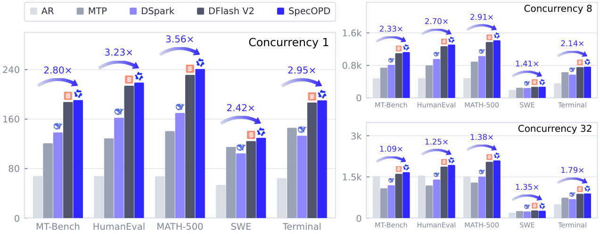

> 图解：纵轴是输出吞吐 tokens/s，横轴为五类 workload，三幅子图分别对应并发 1、8、32；箭头标注 SpecOPD 相对 AR 的加速比。并发 1 时，MT-Bench、HumanEval、MATH-500、SWE、Terminal 分别为 2.80×、3.23×、3.56×、2.42×、2.95×。并发 32 时对应数值降为 1.09×、1.25×、1.38×、1.35×、1.79×，说明高并发下系统瓶颈不再只由串行解码步数决定。

跨五任务取几何平均，SpecOPD 相对 AR 在并发 1、8、32 下分别加速 **2.97×、2.23×、1.35×**；原始 DFlash V2 分别为 2.89×、2.19×、1.34×。SpecOPD 的几何平均吞吐相应高出 **2.83%、2.20%、1.21%**，但 SWE 在并发 32 时比原始 Drafter 慢 4.46%。

这组 serving 测试使用 SGLang、BF16 Target/Drafter 与 LM head、TP=1、FA3、CUDA Graphs，$T=1$。每个条件只完整运行一次，因此它证明的是该协议下的实测吞吐，不是所有部署环境中的普遍收益。

### 训练吞吐：16.09 倍来自两个因子相乘

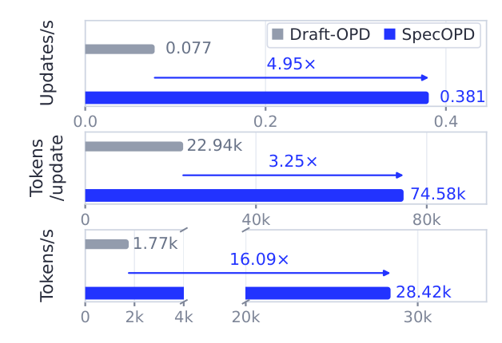

> 图解：三组横条分别表示 optimizer updates/s、每次更新参与 Loss 的 supervised tokens、每秒 supervised tokens。SpecOPD 从 0.077 提升至 0.381 updates/s，从 22.94k 提升至 74.58k tokens/update，最终从 1.77k 提升至 28.42k tokens/s。前两项分别为 4.95× 和 3.25×，乘积对应 16.09×。

测量使用 Qwen3.8-27B / DFlash V2 和 8 张高性能 GPU，非 profile 计时汇总每种方法两次运行中的第 17–32 次更新。它排除了离线参考数据准备，也没有测“达到同一 AL 阈值所需时间”。所以，16.09× 是 **原生配置下的监督 Token 吞吐比**，不能直接解释为端到端收敛时间缩短 16.09×。

### On-Policy 对照：Loss 下降，不代表接受长度上升

作者在相同 optimizer step 数和 reference-sequence batch 下，对比 Off-policy CE、Off-policy E2E-TV 与 SpecOPD。

| Steps | 训练方法 | MT-Bench | HumanEval | MATH-500 | 三任务平均 |
|---|---|---:|---:|---:|---:|
| 0 | Original draft | 3.9787 | 4.6225 | 5.2519 | 4.6177 |
| 8k | Off-policy E2E-TV | 3.6011 | 4.1086 | 4.5854 | 4.0983 |
| 8k | SpecOPD | 3.9966 | 4.7602 | 5.4699 | 4.7422 |
| 10k | Off-policy CE | 3.8377 | 4.4905 | 5.1448 | 4.4910 |
| 10k | SpecOPD | 4.0675 | 4.7668 | 5.4726 | 4.7690 |
| 12k | Off-policy CE | 3.8042 | 4.4771 | 5.1311 | 4.4708 |
| 12k | SpecOPD | 4.1005 | 4.7696 | 5.4764 | 4.7822 |

> 表解：评估采用 $T=1$，每条训练线只选一个 checkpoint。SpecOPD 相对 Off-policy E2E-TV 的平均 AL 优势最高为 15.71%，相对 Off-policy CE 最高为 6.96%；更重要的是，所测 Off-policy checkpoint 都低于共同初始化，而 SpecOPD 高于初始化。

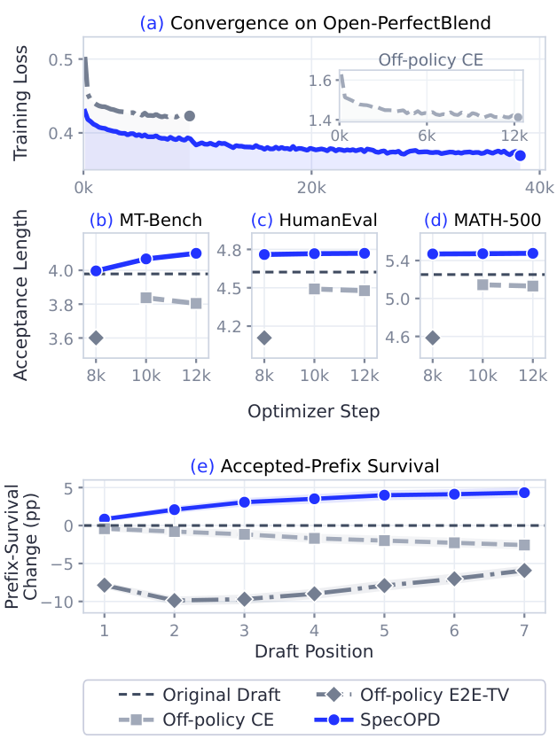

> 图解：(a) 横轴为 optimizer step，纵轴为训练 Loss，三种方法的 Loss 都下降；(b–d) 纵轴为 AL，SpecOPD 随训练上升，Off-policy 曲线下降；(e) 横轴为第 1–7 个草稿位置，纵轴为相对初始化的 accepted-prefix survival 变化，单位是百分点。SpecOPD 在七个位置全部改善，第 7 位提升 4.33 个百分点，Off-policy CE 则下降 2.57 个百分点。阴影是基于 824 个配对请求、按 question cluster 做 bootstrap 的逐点 95% 区间。

这组结果揭示了训练目标与真实解码进展之间的错位：Off-policy CE 可以越来越会预测参考 Token，却在自己生成的历史上更容易连续失配。评价 Drafter 时，不能只看训练 Loss，必须同时看 AL 和 prefix survival。

不过，这仍是 recipe-level 对照，而非严格等算力消融：Off-policy 使用 16 张 GPU，SpecOPD 使用 32 张 GPU；二者的梯度路径和计算分配也不同。匹配的是优化步数与参考序列呈现量，不是所有训练变量。

## 附录实验：训练趋势、窗口选择与公开初始化

主表只展示选定 checkpoint，附录进一步回答了三个问题：提升是否在训练中持续存在、结论是否依赖内部初始化、推理窗口变化后是否仍成立。

### 8B：两种 Drafter 都随训练改善

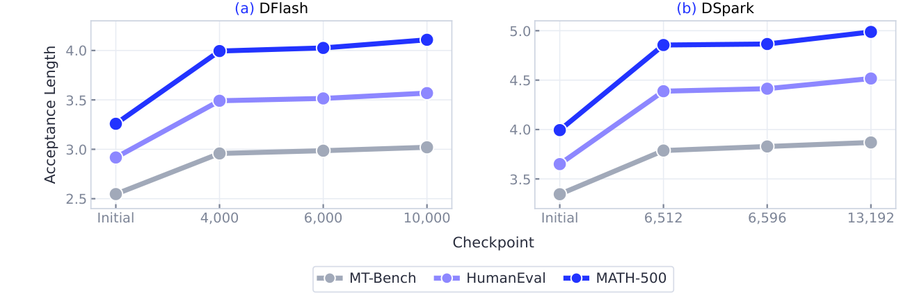

> 图解：横轴为 checkpoint，纵轴为 $T=1$、并发 4 时的 AL，三幅曲线分别对应 MT-Bench、HumanEval 和 MATH-500，且各面板纵轴范围不同。DFlash 展示到 step 10,000，DSpark 展示到 step 13,192；主表则使用更后的 step 20,000 和 26,382。两种 Drafter 的早期轨迹均在三个标准任务上上升，线条只连接实际观测点。

DFlash 的预训练和 SpecOPD continuation 都使用 block size 16，主表为与 DSpark 的 7 Token 提议预算对齐，在推理时使用 block size 8。8B 标准任务使用 BF16、TP=1、单 GPU、8,192 上下文和 4,096 输出上限；SWE/Terminal 则使用 32,768 上下文、8,192 输出上限和并发 16。

### 125B：最佳平均 checkpoint 出现在 step 22,000

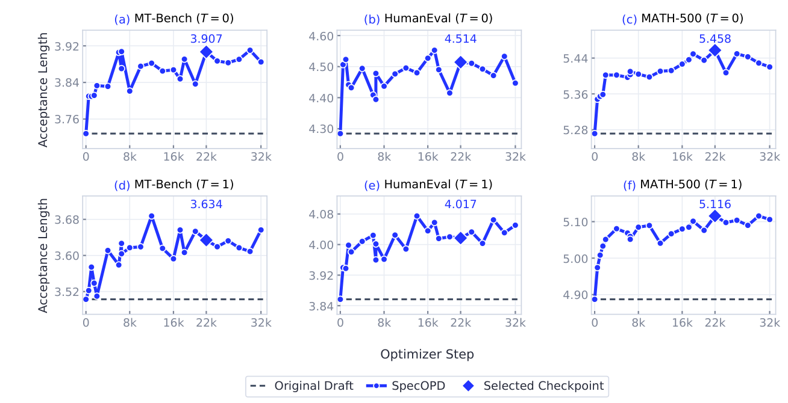

> 图解：六幅图分别展示 MT-Bench、HumanEval、MATH-500 在 $T=0$ 与 $T=1$ 下的 AL，横轴为 optimizer step，虚线为原始 Drafter，菱形为选定 checkpoint。step 22,000 在六个任务—温度单元上的平均 AL 最高，为 4.4410，因此主表所有 125B 训练结果都来自它；曲线在后续步骤仍有波动，并非单调上升。

该 Target 含 36 层 GDN 和 12 层 QSA。评估使用 FP8 Target、BF16 Drafter、TP=2/EP=2、并发 16，GDN state 为 FP32。训练采用 global batch 64、microbatch 1、accumulation 4，在两个 8-GPU 节点上运行，计划 2 个 epoch、共 34,432 次更新。

### 公开 DFlash V2：收益并非只来自内部初始化

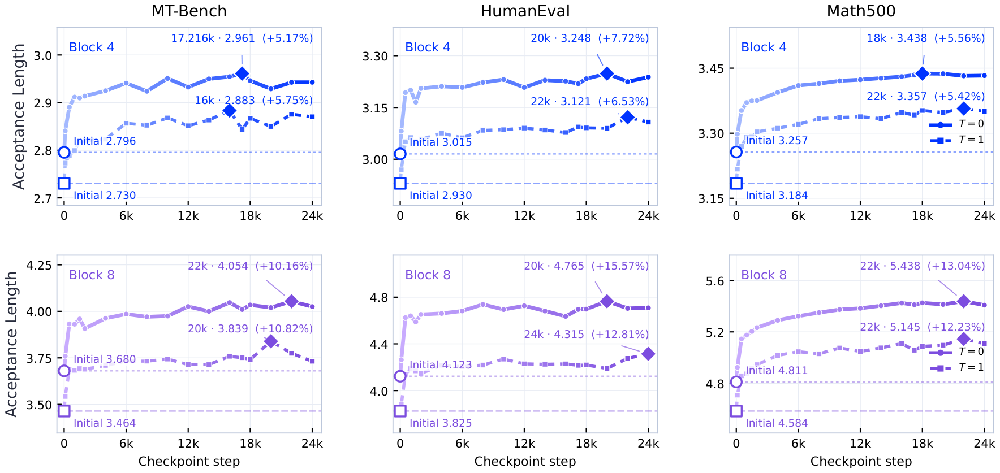

> 图解：上、下两行分别为推理 block size 4 和 8，三列为三个标准任务，实线/虚线对应 $T=0$/$T=1$，菱形标出每条曲线最高观测 AL。block 4 的最大任务—温度提升为 7.72%，block 8 为 15.57%；不同曲线最佳 checkpoint 不同。连线横跨 GPU/配置变化，用于引导观察，不能当作固定配置下的严格单调训练轨迹。

这项实验从公开 BF16 DFlash V2 出发，以 FP8 Flash-Next 为 Target，与主表的内部 125B 初始化完全分开。每个 block 设置评估 17 个 checkpoint，从 step 100 到 24,000；每个 checkpoint 都与相同硬件、推理设置下的初始化模型配对比较。

### 推理窗口：Block 8 与 Block 16 都有训练收益

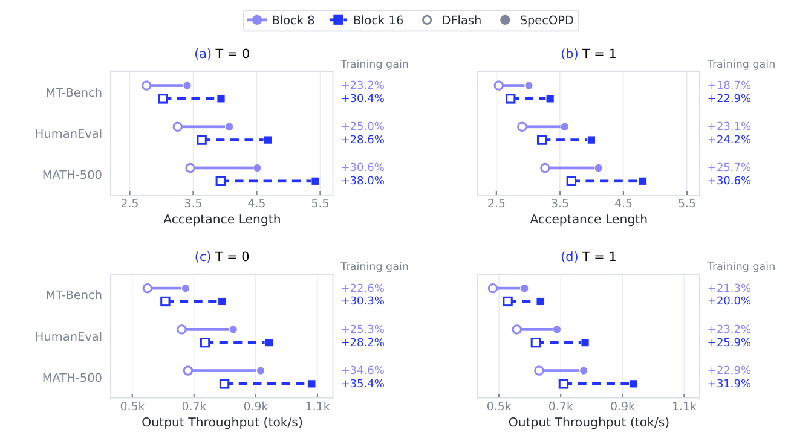

> 图解：上排纵轴列出任务、横轴为 AL，下排横轴为输出吞吐 tokens/s；圆形/实线表示 block 8，方形/虚线表示 block 16，空心是原始 DFlash，实心为 SpecOPD step 10,000。右侧百分比为固定窗口内的训练增益。block 8 的 AL 提升范围为 18.67%–30.57%，吞吐提升 21.33%–34.58%；block 16 分别为 22.87%–37.97% 和 20.04%–35.41%。

为了排除“只是提议窗口变长”的解释，作者还在相同前缀和锚点上测前 7 个位置的接受数。定义 $A$ 为不含 bonus token 的接受草稿 Token 数：

$$
S_7=\sum_{j=1}^{7}\Pr(A\geq j)=\mathbb E[\min(A,7)]
$$

下表比较窗口 16 减窗口 8 的 $\Delta_W$，以及 step 10,000 减初始化的 $\Delta_{\rm train}$；Interaction 衡量训练前后窗口优势的变化。

| 温度 | 任务 | $\Delta_W(0)$ | $\Delta_W(10{,}000)$ | $\Delta_{\rm train}(8)$ | $\Delta_{\rm train}(16)$ | Interaction |
|---|---|---:|---:|---:|---:|---:|
| 0 | MT-Bench | 0.0604 | 0.6896 | 1.6417 | 2.2708 | 0.6292 |
| 0 | HumanEval | 0.3455 | 0.6524 | 1.9004 | 2.2073 | 0.3069 |
| 0 | MATH-500 | 0.0780 | 0.4560 | 2.3867 | 2.7647 | 0.3780 |
| 1 | MT-Bench | 0.0729 | 0.5708 | 1.5312 | 2.0292 | 0.4979 |
| 1 | HumanEval | 0.2866 | 0.6748 | 1.6992 | 2.0874 | 0.3882 |
| 1 | MATH-500 | 0.0973 | 0.3167 | 2.2967 | 2.5160 | 0.2193 |

> 表解：训练在两种窗口下都提高 $S_7$，且六项 Interaction 全为正。也就是说，训练后窗口 16 相对窗口 8 的优势进一步扩大；不过两组权重本来就以窗口 16 训练，这里只改变推理窗口和 checkpoint。

### 复现主训练时还需要哪些超参数

- **8B**：DFlash 从 `z-lab/Qwen3-8B-DFlash-b16` 初始化，训练窗口保持 16；DSpark 使用公开初始化。
- **27B 主 recipe**：global batch 48、microbatch 1、accumulation 8，最多评分 512 个锚点；proposal/score temperature 均为 1，selector top-$k=16$。
- **27B 优化器**：AdamW，peak/minimum learning rate 为 $10^{-5}$/$10^{-6}$，betas 为 $(0.9,0.95)$，weight decay 0.1，gradient-norm limit 1，warmup 7,669 updates。
- **27B 参考数据**：1,227,197 条过滤序列，训练前以 $T=1$、top-$p=0.95$、top-$k=20$ 重新生成；6 个 draft ranks 使用 merged accumulation 和 step balancing。

这些设置属于主训练线，不应与前述 Off-policy 对照或训练吞吐测量的独立配置混用。论文也明确注明，各 run 的参考响应来源、保留子集和精确 checkpoint 标识仍待补充，因此距离完全无歧义复现还有文档缺口。

## 成本与复杂度：省掉的是重复前缀，不是分支自身计算

实验说明“跑得更快”，附录则把收益来源拆成在线采集深度、Target 评分工作量和端到端时间。以下是分析量，不是新的实测加速比。

### 顺序 rollout 的依赖深度

长度为 $T_{\rm gen}$ 的在线轨迹，若每轮平均推进 $\bar\tau$ 个 Token，则约需 $T_{\rm gen}/\bar\tau$ 个相互依赖的 draft-verify round。非重叠单轨迹成本近似为：

$$
C_{\rm traj}\approx C_{\rm prefill}+\frac{T_{\rm gen}}{\bar\tau}\bar c_{\rm round}
$$

当 $T_{\rm gen}=2{,}048$、$\bar\tau=4$ 时，约需 512 个串行轮次。SpecOPD 用参考锚点上的分支采样替换这段在线采集，但树干特征提取、Target 评分与学习计算仍然存在。

### 共享前缀减少多少评分工作

设树干长度 $L$、分支数 $K$、锚点 $b$ 的前缀长度 $\ell_b$，每条宽度 $W$ 的分支需要 $P=W-1$ 个新增前驱行。与不做缓存的完整前缀评分相比：

$$
N_{\rm independent}=L+\sum_{b=1}^{K}\ell_b+KP,
\qquad
N_{\rm shared}=L+KP
$$

在 $L=2{,}048$、$W=7$、$K=512$ 且锚点均匀放置时，projection/MLP 行数由 529,664 降至 5,120，理论上减少为原来的 $1/103.45$。但缓存基线本来就能复用部分前缀，因此不能把 103.45× 直接当成相对所有基线的端到端收益。

令 $A(n)=n(n+1)/2$ 表示 causal query-key 对数，则：

$$
A_{\rm independent}=A(L)+\sum_b A(\ell_b+P)
$$

$$
A_{\rm shared}=A(L)+\sum_b\left[P\ell_b+A(P)\right]
$$

共享执行消除了 $\sum_b A(\ell_b)$ 的重复前缀内部计算，却仍保留分支 query 对锚点前缀的读取。GDN 还需从间隔为 $C_{\rm GDN}$ 的 checkpoint 重放余数 $r_b=\ell_b\bmod C_{\rm GDN}$：

$$
N_{\rm GDN}=L+KP+\sum_b r_b
\leq L+KP+K(C_{\rm GDN}-1)
$$

重放读取缓存投影特征，不是完整模型 forward；上述计数也不包含 checkpoint 存储、固定 tile 执行和 state copy 开销。

### Amdahl 定律决定最终墙钟收益

若基线墙钟时间中比例 $f$ 的部分可加速 $r$ 倍，新增开销归一化为 $\delta$，端到端加速为：

$$
S=\frac{1}{(1-f)+f/r+\delta}
$$

即使把该部分完全消去且没有新增开销，$f=0.5$ 时也只有 2×，$f=0.75$ 时为 4×。这解释了为什么“某个算子少算 100 倍”与“训练或推理快 100 倍”完全是两回事。

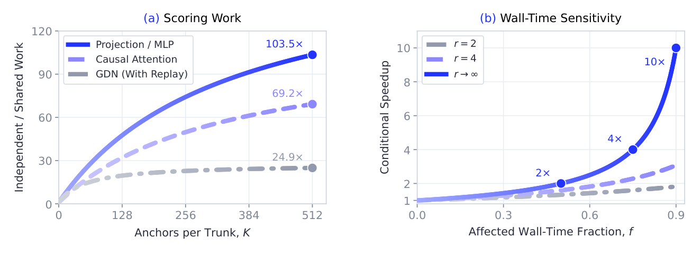

> 图解：左图横轴为每条树干的锚点数 $K$，纵轴为“无缓存独立评分 / 共享评分”的理论工作量比。$K=512$ 时，Projection/MLP、Causal Attention、含重放 GDN 分别为 103.5×、69.2×、24.9×；设置与上文公式一致。右图横轴为可加速部分占基线墙钟时间的比例 $f$，纵轴为条件加速比，$\delta=0$；不同曲线对应 $r=2$、$r=4$ 和 $r\to\infty$。只有受影响时间占比足够高，局部优化才会转化为显著端到端收益。

## 与已有工作的关系：SpecOPD 改的是训练流水线

已有 SD 研究大致沿三条线前进，SpecOPD 与它们不是简单替代关系：

- **提议生成与验证**：Medusa、EAGLE、MTP、自推测、检索式方法、DFlash、DSpark 等降低提议成本或改善候选覆盖；SpecInfer、Medusa 的 Tree Attention 则提供多路径联合验证。SpecOPD 借用树的祖先语义，但把它用于 **训练监督评分**。
- **Drafter 学习与接受目标**：DistillSpec、Draft-OPD 让训练接触草稿生成的历史；E2E-TV 和 Expected Decoding Rounds 则把优化目标从单点准确率推向解码进展。SpecOPD 组合“新鲜分支采样 + 历史一致评分 + E2E-TV”，重点消除采集与评分中的串行和重复计算。
- **跨历史共享计算**：GQA 保存 KV、QSA 保存压缩索引并选块、GDN 保存 recurrent state，三者的历史表示不同。SpecOPD 的贡献是分别给出 tree mask、branch-consistent indexer group 和 indexed state replay，而不是声称一个通用 mask 能适配所有模型。

附录还讨论了两个延伸方向。RL post-training 中，策略持续变化，需要反复生成轨迹，分支并行监督可能帮助同步更新 Drafter；多模态生成也有共享视觉前缀的复用空间。但后者必须保持视觉特征、位置与 cache 语义一致，并维持相对未压缩 Target 的验证分布，目前均未由本文实验验证。

## 局限：结果很强，但边界同样明确

1. **参考上下文仍来自离线数据。** SpecOPD 消除了训练中的完整在线轨迹采集，却没有消除参考响应准备成本；主吞吐对比也明确排除了这部分时间。
2. **E2E-TV 多位置乘积不是精确接受概率。** 条件式 Drafter 的历史会随先前采样变化，前缀乘积只是 surrogate。论文反例中，精确联合接受概率为 0.1，而采样历史上的期望重叠乘积为 0.18。
3. **并非所有设置都显著提升。** 27B agentic 几乎不变，$T=1$ Terminal 略降；高并发下相对 AR 的加速明显收窄，SWE 并发 32 还慢于原始 Drafter。
4. **部分对照并非等算力。** Off-policy 与 SpecOPD 的 GPU 数、执行配置和梯度路径不同；16.09× 也不是达到同等 AL 的收敛时间比。
5. **确定性与复现覆盖有限。** bitwise 对齐只在论文列出的评分配置中验证，原生 cached decoding、CUDA Graphs 不在范围内；部分数据来源和 checkpoint 标识仍待补充。

## 总结

- SpecOPD 证明，草稿块的 On-Policy 监督只需要参考前缀与自身采样历史，不必等待完整 draft-verify 轨迹。
- Proposal Tree 让不同锚点并行采样、共享公共前缀，同时用前驱行读数避免未来信息和答案泄漏。
- Tree Mask、indexer group 重建与 GDN 状态重放分别适配 Full、Sparse、Linear Attention，核心原则都是“共享分歧前计算，隔离分歧后历史”。
- E2E-TV 通过分布重叠的前缀乘积优化接受长度；实测五任务平均 AL 最高提升 41.45%，27B serving 吞吐最高达 AR 的 3.56×。
- 原生配置下 supervised-token throughput 提升 16.09×，但这不等于端到端收敛加速 16.09×，实际部署仍受数据覆盖、并发和系统瓶颈约束。

下一步最值得验证的是：把参考准备、达到目标 AL 的总训练时间和更多真实 serving backend 纳入统一比较，同时检验这套分支并行机制能否迁移到持续变化的 RL policy 与多模态 Target。

> 本文参考自 [Branch-Parallel On-Policy Distillation for Speculative Decoding](http://arxiv.org/abs/2611.02846v1)