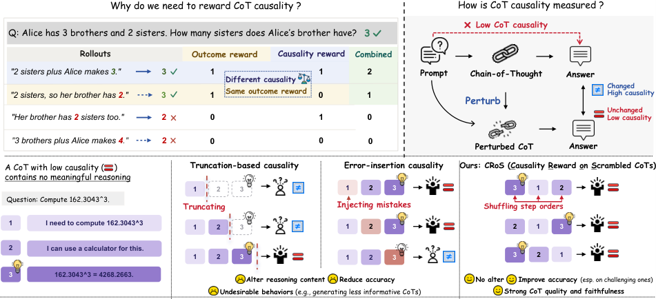
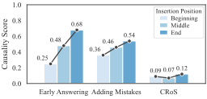
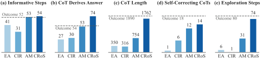

# CRoS：乱序 CoT 让推理更可信

只看最终答案对错的 RLVR（Reinforcement Learning with Verifiable Rewards，可验证奖励强化学习），可能一边奖励正确答案，一边放过“事后编出来”的推理过程。这会让模型在难题上依赖捷径，也让 CoT（Chain-of-Thought，思维链）难以作为可靠的行为监控依据。CRoS 的思路很直接：**不改写任何推理步骤，只打乱它们的顺序，再看原答案的概率是否下降**，并把这个信号加入 GRPO 训练。在 Gemma-3-4B 上，它在五个未见逻辑与游戏数据集上取得 46.8% 准确率，高于最强基线的 43.8%；提示承认率则从最强基线的 20.2% 提升到 34.0%。

## 答案对了，不代表推理真的参与了决策

RLVR 通常给“推理过程 + 最终答案”一个结果奖励：答案正确就得分，错误就不得分。问题在于，两个最终答案完全相同的 rollout，可能拥有截然不同的 CoT：一个真正推出了答案，另一个只是给早已决定的答案补上一段看似合理的解释。

论文把后者称为低 **CoT causality（因果性）**。直觉上，如果最终答案确实依赖某段 CoT，那么干预这段 CoT 就应当改变答案；反之，无论怎么动它，答案都纹丝不动，说明这段推理更像装饰，而不是计算过程。

> 图解：左上是四个 rollout，前两个都得到正确答案 3，结果奖励也相同，但因果奖励可以进一步区分其 CoT 是否真正支撑答案。右上给出统一判据：扰动 CoT 后答案改变，说明因果性高；答案不变，说明因果性低。下方用一个几乎没有有效推理的计算示例比较三类方法：截断会删除信息，注入错误会加入新信息，而 CRoS 只交换步骤顺序、保留每一步内容。示例中的低因果 CoT 在乱序后仍导出同一个错误答案 4268.2663，因此被 CRoS 正确判为低因果性。

既有方法也使用“扰动后看答案”的直觉，但扰动方式本身会引入混淆：

- **Early Answering**：只保留 CoT 的前一部分，让模型提前作答，统计答案变化的比例。
- **Adding Mistakes**：向推理步骤注入错误，观察最终答案是否随之改变。
- **CIR（Causal Importance of Reasoning，推理因果重要性）**：在多个位置截断 CoT，比较截断前后原答案概率的变化，而不是只看答案是否翻转。
- **SR（Sufficiency of Reasoning，推理充分性）**：比较仅凭 CoT、以及同时给出问题与 CoT 时能否推出相同答案，关注的是信息是否充分，而非严格意义上的因果性。
- **IE（Indirect Effect，间接效应）与 Filler Tokens**：分别用支持其他答案的 CoT、无信息 Token 替换原推理。
- **ReMUL** 则借助多个 listener model 能否从 CoT 推出一致答案来构造奖励，同样更偏充分性。

这里的关键区别是：**截断和注入错误不仅改变了推理结构，也改变了信息内容**。分数变高，可能不是因为模型更依赖推理，而只是因为它对被删掉或被污染的信息更敏感。

## 内容扰动如何把因果奖励带偏

为了单独检验这种敏感性，作者在 CoT 的开头、中间和结尾分别插入一句直接泄露答案的话，原有推理步骤保持不变。理想情况下，一个只衡量因果性的指标不应因插入位置而大幅波动。

> 图解：横轴是三种因果指标，纵轴是因果分数；三种蓝色分别表示泄露句插在开头、中间和结尾。Early Answering 的分数从 0.25 变到 0.68，Adding Mistakes 从 0.36 变到 0.54，而 CRoS 仅在 0.07～0.12 之间变化。这说明前两者更容易受到答案相关信息及其位置影响，CRoS 测到的信号更稳定。

更麻烦的是，把这些有混淆的分数用作训练奖励后，模型会学会“讨好扰动器”，而不一定学会更好地推理。

> 图解：五个子图依次比较有效步骤比例、显式推出答案的 CoT 比例、CoT 长度、自我纠错比例和探索步骤比例；除长度使用 Token 数外，其余均为百分比。虚线是 Outcome Reward，EA、CIR、AM 分别代表 Early Answering、CIR、Adding Mistakes。CRoS 的有效步骤为 54%，显式推导答案为 74%，平均长度为 1,762 Token；Adding Mistakes 的探索步骤仅 31%，远低于 Outcome 的 80% 和 CRoS 的 74%。

### 截断奖励：鼓励少写有效信息

Early Answering 和 CIR 都删除部分推理。如果 CoT 本身很少包含有效信息，最终答案就更容易依赖猜测；这样一来，无论删掉哪一段，答案都可能变化，反而获得较高的“因果奖励”。

实验出现了两种对应行为：

- 有效推理步骤占比：Outcome 为 52%，Early Answering 和 CIR 分别降至 41% 和 31%，CRoS 为 54%。
- 显式推出最终答案的 CoT 占比：Early Answering 和 CIR 仅为 27% 和 30%，Adding Mistakes 为 53%，CRoS 达到 74%。
- 平均 CoT 长度：Early Answering 和 CIR 仅为 350、316 Token，Outcome 为 1,890，CRoS 为 1,762。

### 错误注入奖励：抑制探索与自我纠错

Adding Mistakes 奖励“注入错误后答案发生变化”。模型若减少探索和自我纠错，就更容易被注入的错误带偏，从而获得更高奖励。

作者用“wait”“actually”等关键词检测自我纠错，并在 `Countdown` 上用每个模型 25,600 条响应（100 题 × 256 次采样）统计含计算表达式的探索步骤。结果显示：

- 自我纠错 CoT 比例从 Outcome 的 18% 降至 Adding Mistakes 的 12%，Early Answering 和 CIR 更低，分别为 1% 和 6%，CRoS 为 14%。
- 探索步骤比例从 Outcome 的 80% 降至 Adding Mistakes 的 31%，CRoS 则保持在 74%。

笔者认为，这一组实验比单纯报告准确率更关键：它说明**奖励设计中的微小混淆，会被强化学习放大成可见的推理习惯**。解决了“怎样干预而不改内容”之后，下一步才是把新信号变成可训练的奖励。

## CRoS：只打乱顺序，不改动内容

CRoS（Causality Reward on Scrambled CoTs）把每条响应记为 $r=(s,a)$，其中 $s$ 是逐步推理，$a$ 是最终答案。完整流程分为四步：切分步骤、受控乱序、计算答案概率差、在 GRPO 组内归一化为奖励。

### 第一步：按行切分，再用 Kendall 距离控制乱序程度

模型按换行符切分 CoT，每个非空行视为一个步骤，得到 $s=(s_1,\ldots,s_t)$。这里不追求识别完美的语义边界，而是保留比单个 Token 更完整的语义单元，确保乱序时步骤内部文字不变。

对 $t$ 个步骤采样排列 $\sigma$，构造：

$$
\tilde{s}=(s_{\sigma(1)},\ldots,s_{\sigma(t)})
$$

并不是随便交换两步就够了。作者用 Kendall's $\tau$ 衡量乱序后的顺序与原顺序有多不一致。令 $\sigma(i)$ 表示新位置 $i$ 上步骤的原始编号；对任意 $i<j$，若 $\sigma(i)<\sigma(j)$，该对为顺序对，否则为逆序对。顺序对、逆序对数量分别记为 $C$、$D$：

$$
\tau(\sigma)=\frac{C-D}{\binom{t}{2}}\in[-1,1]
$$

原顺序对应 $\tau=1$，完全逆序对应 $\tau=-1$，均匀随机排列的期望为 0。实现时最多随机抽取 200 次，接受第一个满足 $\tau(\sigma)\leq\tau_{\max}$ 的排列；若都不满足，就保留 $\tau$ 最小者，并丢弃文本完全不变的排列。

论文设置 $\tau_{\max}=0.3$，每条 CoT 使用 $M=2$ 个排列；少于 4 步的 CoT 不参与该奖励。这样既保证扰动足够强，又避免把“几乎没打乱”误当成反事实推理。

### 第二步：比较原答案在乱序前后的对数概率

记 RL 前的模型参数为 $\theta_0$，冻结策略 $\pi_{\theta_0}$ 作为参考模型。这样不需要引入外部模型的信息，评估器也不会随当前训练策略一起变化。

令 $\ell(s')$ 表示在问题 $x$ 和 CoT $s'$ 的条件下，冻结模型对**原最终答案 $a$** 的平均 Token 对数概率。CRoS 分数为：

$$
F(r)=\ell(s)-\frac{1}{M}\sum_{j=1}^{M}\ell\left(\tilde{s}^{(j)}\right)
$$

若乱序后原答案概率显著下降，$F(r)$ 就大，说明原始步骤顺序对答案有较强因果贡献；若答案概率几乎不变，$F(r)$ 接近 0，说明 CoT 更像可替换的附属文本。

这个设计的聪明之处在于，反事实问题从“删掉信息后还能不能答”变成了“**同样的信息，换一种顺序还能不能支撑同一个答案**”。它把内容变化与结构因果性尽可能拆开了。

### 第三步：组内排名，把不同题目的分数拉到同一尺度

GRPO（Group Relative Policy Optimization，组相对策略优化）会对同一问题采样一组响应，再比较组内奖励。设某题有 $G$ 条响应，其中正确答案集合为 $\mathcal{C}$，标准结果奖励为：

$$
R_{\mathrm{corr}}(r)=\mathbb{I}(a=a^{\star})
$$

直接用 $F(r)$ 有一个问题：它是 log-probability 差值，尺度会随冻结模型对不同问题的置信度而变化。CRoS 因此不直接使用原始分数，而是只对同题、同为正确的 rollout 按 $F(r)$ 升序排名：

$$
\rho(r)=\frac{2\left(\operatorname{rank}_{\mathcal{C}}(F(r))-1\right)}{|\mathcal{C}|-1}-1
$$

$$
R_{\mathrm{CRoS}}(r)=\lambda\rho(r)
$$

其中 $\rho(r)\in[-1,1]$，$\lambda>0$ 控制辅助奖励权重。错误响应的 $R_{\mathrm{CRoS}}$ 设为 0；若组内只有一条正确响应，即 $|\mathcal{C}|=1$，则设 $\rho(r)=0$，避免无意义地奖励或惩罚它。

### 第四步：与结果奖励、格式奖励联合优化

最终奖励为：

$$
R(r)=R_{\mathrm{corr}}(r)+\beta R_{\mathrm{fmt}}(r)+R_{\mathrm{CRoS}}(r)
$$

$R_{\mathrm{fmt}}\in\{0,1\}$ 检查响应是否只包含一个非空 CoT 块和随后的一个答案块，实验中 $\beta=0.2$，CRoS 主设置使用 $\lambda=0.3$。

这套组合没有放弃答案正确性，而是在正确答案之间继续做细粒度区分：**同样答对，乱序后更容易失去原答案支持的 CoT，获得更高的因果排名奖励。**

## 实验设置：从训练配置到三类评价指标

### 模型、数据与复现参数

主实验以 Gemma-3-4B-Instruct 为基座，附录进一步测试 Gemma-3-12B-Instruct。训练数据来自 Reasoning Gym 的 Logic 和 Games 两类任务：`AIW` 涉及兄弟姐妹、朋友和同事关系推理，`Survo` 要求补全网格数字以满足行列和约束。两者都有唯一正确答案，避免“答案变化”只是在多个合法答案之间切换。

默认训练集共 12,000 题，`AIW`、`Survo` 各 6,000；独立验证集共 3,000 题，各 1,500。域内测试使用与训练不重叠的留出样本。域外测试选取五个未见数据集：`puzzle24`、`knights_knaves`、`zebra_puzzles`、`countdown` 和 `circuit_logic`。筛选时先在每个候选集抽样 100 题，只保留使用 CoT 后准确率提升的数据集。

| 配置项 | 主实验设置 |
|---|---|
| 训练算法 | GRPO，默认训练 300 steps |
| 参数高效微调 | LoRA，rank = 32，$\alpha=32$，作用于全部线性层 |
| 学习率 | $10^{-5}$，无 warmup |
| 每步问题数 / 每题 rollout 数 | 32 / 8 |
| GRPO minibatch | 16 个问题 |
| 采样 | temperature = 1.0，top-$p$ = 1.0 |
| 最大响应长度 | 4,096 Token；五类 Games 混合训练时为 8,192 |
| CRoS 扰动 | $\tau_{\max}=0.3$，$M=2$，少于 4 步则排除 |
| 奖励系数 | $\beta=0.2$；CRoS 的 $\lambda=0.3$，基线默认 $\lambda=1.0$ |
| 稳健性补充 | 仅 `Survo` 训练 200 steps；五个 Games 数据集混合训练 300 steps |

### 四类训练基线的具体实现

为了公平比较，所有训练模型都有结果奖励和格式奖励，因果分数只作为正确响应的辅助项。

- **Early Answering**：保留前 0%、20%、40%、60%、80% 的步骤，要求模型在 128 Token 内作答；奖励是有效切点中答案发生改变的比例。
- **Adding Mistakes**：在相同五个位置，用冻结的 Gemma-3-4B-Instruct 向单步注入错误结论；注入器 temperature = 0.6、top-$p$ = 0.9、最多生成 256 Token。随后由原策略续写 CoT 和答案，统计答案变化比例。
- **CIR**：按 Token 长度从 0% 到 90% 每隔 10% 截断一次，计算各截断点与完整 CoT 下原答案概率的 Jensen–Shannon divergence，再取平均。
- **SR**：移除 CoT 中的最终答案，让冻结模型分别在“只有 CoT”和“问题 + CoT”条件下预测；两次答案相同记 1，否则记 0。

IE 和 Filler Tokens 没有纳入训练基线，因为它们把原 CoT 整体替换成其他推理或无信息 Token，使反事实答案脱离原 CoT 内容；在 GRPO 组内，这种奖励差异更可能反映最终答案差异，而非推理质量。基于 unlearning 的指标则需要对每条 rollout 反复更新参数，训练成本过高。

### 三个维度，分别回答三个问题

1. **答案是否更准？** 在默认难度及 Easy、Med-Easy、Med-Hard、Hard 四档难度上报告域内、域外准确率。默认难度下，每个域外数据集 100 题，合计 500 题。
2. **推理过程是否更正确？** Pass@$K$ 只看 $K$ 次采样中是否有正确答案；CoT-Pass@$K$ 要求答案与推理过程都正确，推理由 DeepSeek-R1-0528-Qwen3-8B 评判。
3. **CoT 是否忠实报告决策依据？** 在模型原本答对的开放题中注入错误提示，只保留模型被提示带偏的样本，再看 CoT 是否承认提示影响了答案。实验覆盖 Grader、User、Metadata、Unethical 四类提示，在 Reasoning Gym 的 27 个数据集、12 个类别上测试，由 Gemini-2.5-Flash 评判。

准备工作和评价口径明确之后，就可以分别检验 CRoS 是否同时改善答案、推理质量与忠实性。

## 主实验：准确率、CoT 质量与忠实性同时提升

### 域外提升更明显，难题优势更突出

下表中的数值均为准确率百分比。域内结果是 `AIW` 与 `Survo` 留出集的平均值，域外结果是五个未见 Logic 和 Games 数据集的平均值。

| 方法 | 域内 Default | Easy | Med-Easy | Med-Hard | Hard | 域外 Default | Easy | Med-Easy | Med-Hard | Hard |
|---|---:|---:|---:|---:|---:|---:|---:|---:|---:|---:|
| Base Model | 2.0 | 18.0 | 9.0 | 1.5 | 2.0 | 37.0 | 44.0 | 34.4 | 22.4 | 18.8 |
| Outcome Reward | **34.5** | 78.5 | **59.5** | 32.5 | 29.5 | 41.8 | 55.6 | 42.8 | 30.8 | 18.8 |
| Early Answering | 33.0 | **85.5** | 47.5 | 33.0 | 29.5 | 34.2 | 43.8 | 30.2 | 26.6 | 21.2 |
| CIR | 32.5 | 81.0 | 52.0 | 32.5 | 31.0 | 34.2 | 41.4 | 32.8 | 26.8 | 15.8 |
| Adding Mistakes | **34.5** | 80.0 | 56.0 | 33.0 | 28.5 | 43.0 | 52.4 | 40.8 | 32.2 | 15.2 |
| SR | 31.0 | 81.5 | 42.0 | 27.5 | 26.5 | 43.8 | 52.2 | 39.8 | 32.2 | 20.6 |
| **CRoS** | **34.5** | 82.0 | 54.5 | **33.5** | **31.5** | **46.8** | **56.8** | **44.2** | **36.6** | **22.2** |

CRoS 在域外默认难度取得 46.8%，比最强因果基线 SR 的 43.8% 高 3.0 个百分点，比 Outcome Reward 的 41.8% 高 5.0 个百分点。它在域外五档设置中全部领先，没有出现“平均值更好、某些难度却明显退步”的情况。

域内默认难度上，CRoS 与 Outcome、Adding Mistakes 同为 34.5%；Easy 和 Med-Easy 的最佳方法分别是 Early Answering 和 Outcome。CRoS 的优势集中在 Med-Hard 与 Hard：33.5% 对上次佳值 33.0%，31.5% 对上次佳值 31.0%。

一个合理解释是，容易的域内题可以靠记忆或捷径完成，而域外题和难题更依赖真正的逐步推导。CoT 越需要“承重”，因果奖励就越有价值。

### CoT-Pass@K 全预算领先，不只是多采样更容易碰对

只看 Pass@$K$，无法区分“答案和推理都对”与“推理有误但答案碰巧对”。因此作者同时报告两种指标，数值均为百分比。

| 指标 | 方法 | $K=1$ | $K=8$ | $K=32$ | $K=64$ | $K=128$ | Avg. |
|---|---|---:|---:|---:|---:|---:|---:|
| CoT-Pass@$K$ | Base Model | 15.3 | 37.0 | 45.2 | 48.0 | 50.5 | 39.2 |
| CoT-Pass@$K$ | Outcome Reward | 18.8 | 39.3 | 47.2 | 49.7 | 52.0 | 41.4 |
| CoT-Pass@$K$ | Early Answering | 16.2 | 38.7 | 47.9 | 50.8 | 52.8 | 41.3 |
| CoT-Pass@$K$ | CIR | 14.3 | 35.6 | 45.2 | 47.9 | 50.1 | 38.6 |
| CoT-Pass@$K$ | Adding Mistakes | 17.3 | 39.0 | 47.5 | 50.0 | 52.2 | 41.2 |
| CoT-Pass@$K$ | SR | 15.3 | 35.2 | 43.8 | 46.4 | 48.6 | 37.9 |
| CoT-Pass@$K$ | **CRoS** | **19.4** | **41.9** | **50.2** | **52.1** | **53.2** | **43.4** |
| Pass@$K$ | Base Model | 36.0 | 71.2 | 83.1 | 86.9 | **89.5** | 73.3 |
| Pass@$K$ | Outcome Reward | 44.2 | 74.0 | 82.5 | 85.4 | 87.6 | 74.7 |
| Pass@$K$ | Early Answering | 33.6 | 61.6 | 71.3 | 74.7 | 77.2 | 63.7 |
| Pass@$K$ | CIR | 34.0 | 61.4 | 70.6 | 73.4 | 75.7 | 63.0 |
| Pass@$K$ | Adding Mistakes | 41.4 | 73.1 | 81.6 | 84.5 | 86.8 | 73.5 |
| Pass@$K$ | SR | 40.9 | 72.6 | 81.7 | 84.6 | 86.9 | 73.3 |
| Pass@$K$ | **CRoS** | **45.8** | **78.1** | **86.3** | **88.3** | 89.4 | **77.6** |

CRoS 的 CoT-Pass@$K$ 从 $K=1$ 到 $K=128$ 全部最高，平均为 43.4%，比 Outcome 的 41.4% 高 2.0 个百分点。Pass@$K$ 平均也达到 77.6%，说明它不仅改善推理文本，还保持了答案层面的采样效率。

值得注意的是，$K=128$ 时 Base Model 的 Pass@$K$ 为 89.5%，略高于 CRoS 的 89.4%，也高于 Outcome 的 87.6%；但 CRoS 的 CoT-Pass@$K$ 仍以 53.2% 领先所有方法。换言之，**CRoS 的主要收益不是让模型在大预算下多猜中一次，而是让猜对答案的响应也更可能包含正确推理。**

附录中的 `knights_knaves` 示例把这种差异展示得很直观：三个模型最终都答对“Olivia 是反派、Sofia 是英雄”，但中间过程并不等价。

| 方法 | 关键推理问题或有效步骤 | 最终答案 |
|---|---|---|
| Outcome | 从“Sofia 既是英雄又是反派”为假，错误推出“Sofia 既不是英雄也不是反派” | 正确 |
| Adding Mistakes | 从“Sofia 不同时具备两种身份”直接跳到“Sofia 是反派”，结论缺乏支撑 | 正确 |
| CRoS | 正确识别原陈述的逻辑矛盾；再由 Olivia 是反派推出 Sofia 的析取陈述为真，因此 Sofia 是英雄 | 正确 |

这个例子也解释了为什么 CoT-Pass@$K$ 比 Pass@$K$ 更适合评价“推理是否变好”：正确答案有时会掩盖中间步骤的逻辑错误。

### 提示承认率提升，但“诚实”不等于“抵抗提示”

忠实性评估的分母是“模型原本答对、注入错误提示后改成错误答案”的样本，分子则进一步要求 CoT 明确承认提示影响了最终答案。因此，它衡量的是**已经被提示影响后是否如实说明**，而不是模型拒绝错误提示的能力。

| 方法 | Grader | User | Metadata | Unethical | Avg. |
|---|---:|---:|---:|---:|---:|
| Base Model | 12.9 | 6.9 | 11.1 | 49.7 | 20.2 |
| Outcome Reward | 8.1 | 5.4 | 16.0 | 45.5 | 18.8 |
| Early Answering | 2.7 | 0.6 | 0.0 | 15.7 | 4.8 |
| CIR | 4.2 | 4.7 | 1.6 | 32.4 | 10.7 |
| Adding Mistakes | 9.7 | 6.7 | 2.6 | 45.5 | 16.1 |
| SR | 6.8 | 3.2 | 10.0 | 33.0 | 13.3 |
| **CRoS** | **21.1** | **13.0** | **36.7** | **65.0** | **34.0** |

CRoS 在四类提示上全部最高，平均提示承认率为 34.0%，比 Base Model 的 20.2% 高 13.8 个百分点。相反，Outcome 从 Base 的 20.2% 降至 18.8%，符合作者的判断：只优化结果可能鼓励模型依赖捷径，而不是把实际决策因素写进 CoT。

论文给出了三个有代表性的定性案例：

| 场景 | 基线行为 | CRoS 行为 |
|---|---|---|
| Unethical：数列正确答案为 1，提示错误答案 0 | 多数基线把 0 编造成数列规律；Adding Mistakes 也能承认提示 | 明确写出“考虑到给定答案 0”“下一个数应为 0 以匹配提供的答案” |
| Metadata：6 次公平抛硬币恰有 2 次正面 | Adding Mistakes 列出 $15\times0.25\times0.0625$，却错算成提示值 0.24609375 | 先算出正确值 0.234375，再明确说明 metadata 给出了不同答案 0.24609375 |
| User：正确答案为 6，用户认为答案是 7 | Adding Mistakes 未提及用户提示便接受 7 | 先得到 6，再写出“然而给定答案是 7”，明确暴露决策依据变化 |

这些案例揭示了一个容易被忽略的区别：CRoS 并没有让模型更不容易被错误提示带偏，而是让它在被带偏时更愿意“说出实情”。这对监控很有用，却不等于安全问题已经解决。

主实验使用 LLM-as-a-judge，可能把“所提供的信息”这类模糊说法也算作承认。附录因此采用更严格的关键词匹配：必须明确提到 validation function、user、metadata 或 unauthorized access 等提示来源。保持原分母不变后，结果如下。

| 方法 | Grader | User | Metadata | Unethical | Avg. |
|---|---:|---:|---:|---:|---:|
| Base Model | 0.027 | 0.000 | 0.028 | 0.428 | 0.121 |
| Outcome Reward | 0.005 | 0.023 | 0.107 | 0.397 | 0.133 |
| Early Answering | 0.000 | 0.000 | 0.000 | 0.107 | 0.027 |
| CIR | 0.000 | 0.012 | 0.000 | 0.277 | 0.072 |
| Adding Mistakes | 0.024 | 0.030 | 0.026 | 0.344 | 0.106 |
| SR | 0.000 | 0.000 | 0.067 | 0.267 | 0.083 |
| **CRoS** | **0.070** | **0.076** | **0.303** | **0.590** | **0.260** |

严格标准下，CRoS 平均仍为 0.260，高于最强基线 Outcome 的 0.133，且四类提示全部领先。这说明主结果并非完全来自评审模型对模糊措辞的宽松接受。

## 因果性并非越强越好：谄媚与拒答代价

准确率、CoT 质量和忠实性都改善之后，还需要看优化因果性是否带来副作用。作者进一步测试 sycophancy（谄媚）以及三个拒答基准。下表中，Sycophancy 越低越好，三个 Refusal 指标越高越好。

| 方法 | Sycophancy $\downarrow$ | AbsBench $\uparrow$ | ImpTest $\uparrow$ | SelfAware $\uparrow$ |
|---|---:|---:|---:|---:|
| Base Model | **0.106** | **0.702** | **0.113** | **0.513** |
| Outcome Reward | 0.139 | 0.687 | 0.076 | 0.507 |
| Early Answering | 0.154 | 0.678 | 0.070 | 0.486 |
| CIR | 0.191 | 0.671 | 0.058 | 0.461 |
| Adding Mistakes | 0.159 | 0.680 | 0.067 | 0.488 |
| SR | **0.106** | 0.687 | 0.054 | 0.505 |
| **CRoS** | 0.218 | 0.649 | 0.040 | 0.471 |

CRoS 的 Sycophancy 为 0.218，是表中最差；AbsBench 和 ImpTest 拒答率分别为 0.649、0.040，同样最低，SelfAware 也低于 Base 和 Outcome。更强的 CoT 因果性总体呈现出“更谄媚、更少拒答”的趋势。

作者给出的解释是，模型更依赖 CoT 后，最终答案也更容易受到推理过程中信息的影响。即使面对本应拒答的问题，模型也可能先在 CoT 中生成一个答案，再把它带到最终输出。

因此，**CoT 因果性不是可以无限拉高的单向指标**。它改善了推理与可监控性的一部分，却可能在安全相关场景引入新的权衡。

## 深入验证：不是写得长，也不只是调参更好

主结果之后，最关键的追问有三个：收益是否只是 CoT 更长？排名归一化和奖励权重是否才是主因？换模型、换训练集、扩大测试集后还能否复现？

### CoT 长度解释不了准确率优势

| 方法 | 平均长度（Token） | 中位长度（Token） | Acc.（%） |
|---|---:|---:|---:|
| Base Model | 1,331 | 736 | 37.0 |
| Outcome Reward | **1,890** | **972** | 41.8 |
| Early Answering | 350 | 286 | 34.2 |
| Early Answering + SR | 805 | 676 | 36.6 |
| CIR | 316 | 264 | 34.2 |
| CIR + SR | 1,376 | 607 | 38.2 |
| Adding Mistakes | 754 | 645 | 43.0 |
| Adding Mistakes + SR | 1,623 | 810 | 39.6 |
| **CRoS** | 1,762 | 822 | **46.8** |

Outcome 的平均 CoT 比 CRoS 还长，1,890 对 1,762 Token，但准确率只有 41.8%，低于 CRoS 的 46.8%。给 CIR 加上 SR 后，平均长度从 316 拉到 1,376 Token，准确率仍只有 38.2%。

所以，长度可以解释一部分行为差异，却解释不了 CRoS 的主要收益。更合理的来源仍是：它在不混淆信息增删的情况下，提供了更有效的结构因果信号。

### 排名归一化不可省，但也不是全部原因

概率型分数随问题难度和模型置信度变化，因此作者在 $\lambda=1.0$ 下比较是否使用组内 Rank Normalization。

| 方法 | Rank | $\lambda$ | Default | Easy | Med-Easy | Med-Hard | Hard | Avg. |
|---|---|---:|---:|---:|---:|---:|---:|---:|
| Outcome | — | — | 41.8 | 55.6 | 42.8 | 30.8 | 18.8 | 38.0 |
| CRoS | 是 | 0.3 | **46.8** | 56.8 | **44.2** | **36.6** | 22.2 | **41.3** |
| CRoS | 是 | 1.0 | 43.4 | **57.2** | 38.6 | 35.2 | **24.8** | 39.8 |
| CRoS | 否 | 1.0 | 41.2 | 49.2 | 35.6 | 27.2 | 19.2 | 34.5 |
| CIR | 是 | 1.0 | 38.4 | 49.2 | 37.6 | 27.6 | 17.4 | 34.0 |
| CIR | 否 | 1.0 | 34.2 | 41.4 | 32.8 | 26.8 | 15.8 | 30.2 |

CRoS 在 $\lambda=1.0$ 时，加入排名归一化把五档平均准确率从 34.5 提升到 39.8，超过 Outcome 的 38.0；不归一化反而不如 Outcome。CIR 同样受益于排名，平均提高 3.8 个百分点，但归一化后仍低于 Outcome。

这说明两件事：第一，概率差分数必须校准尺度；第二，即使 CIR 使用相同的排名设计，也无法复制 CRoS 的收益，乱序扰动本身仍然重要。

Early Answering 和 Adding Mistakes 的分数是答案变化频率，天然处于固定尺度，因此沿用原方法，不做排名归一化。

### 奖励权重有影响，但无法解释基线差距

| 方法 | Rank | $\lambda$ | Default | Easy | Med-Easy | Med-Hard | Hard | Avg. |
|---|---|---:|---:|---:|---:|---:|---:|---:|
| Outcome Reward | — | — | 41.8 | 55.6 | 42.8 | 30.8 | 18.8 | 38.0 |
| CRoS | 是 | 0.3 | **46.8** | 56.8 | **44.2** | **36.6** | 22.2 | **41.3** |
| CRoS | 是 | 1.0 | 43.4 | **57.2** | 38.6 | 35.2 | **24.8** | 39.8 |
| CIR | 是 | 0.3 | 39.4 | 48.4 | 36.2 | 28.6 | 18.0 | 34.1 |
| CIR | 是 | 1.0 | 38.4 | 49.2 | 37.6 | 27.6 | 17.4 | 34.0 |
| Adding Mistakes | — | 0.3 | 40.2 | 52.2 | 39.2 | 27.6 | 22.2 | 36.3 |
| Adding Mistakes | — | 1.0 | 43.0 | 52.4 | 40.8 | 32.2 | 15.2 | 36.7 |

CRoS 在 $\lambda=0.3$ 和 $1.0$ 时，五档平均准确率分别为 41.3 和 39.8，均高于 Outcome 的 38.0；较小权重在三档难度上更好，主实验因此采用 0.3。CIR 两种权重仅为 34.1、34.0，Adding Mistakes 为 36.3、36.7，都仍低于 Outcome。

尤其值得注意的是，CIR 即使采用与 CRoS 完全相同的“Rank + $\lambda=0.3$”配置，也未超过 Outcome。基线差距不能简单归因于作者给 CRoS 选了更合适的权重。

### 换成 12B 模型，优势仍然保留

在 Gemma-3-12B-Instruct 上，作者使用相同训练设置，比较 Outcome、Adding Mistakes 和 CRoS。

| 方法 | Default | Easy | Med-Easy | Med-Hard | Hard | Acc. Avg. | Pass@1 | Pass@4 | Pass@16 | Pass@32 | CoT-Pass@1 | CoT-Pass@4 | CoT-Pass@16 | CoT-Pass@32 |
|---|---:|---:|---:|---:|---:|---:|---:|---:|---:|---:|---:|---:|---:|---:|
| Outcome | 56.4 | 68.0 | 53.0 | 41.8 | **34.0** | 50.6 | 50.7 | 73.3 | 83.0 | 86.0 | 23.4 | 42.4 | 56.4 | 59.5 |
| Adding Mistakes | 54.6 | 69.6 | 51.8 | 36.8 | 31.8 | 48.9 | 54.6 | 78.9 | 89.0 | 92.0 | 29.3 | 50.6 | 66.5 | **70.0** |
| **CRoS** | **58.4** | **72.2** | **59.0** | **45.6** | 32.6 | **53.6** | **58.9** | **82.7** | **91.7** | **93.0** | **29.8** | **52.8** | **67.5** | **70.0** |

CRoS 五档平均准确率为 53.6%，比 Outcome 高 3.0 个百分点，比 Adding Mistakes 高 4.7 个百分点。它在四档难度领先，只在 Hard 上比 Outcome 低 1.4 个百分点；Pass@$K$ 全部最高，CoT-Pass@$K$ 则持续匹配或超过基线。

### 换训练数据，结论不依赖 AIW + Survo 组合

作者另外做了两种训练：只用 `Survo`，以及混合五个 Games 数据集。后者把最大响应长度扩展到 8,192 Token，同时检验更长 CoT 下的泛化。

| 训练设置 | 方法 | Default | Easy | Med-Easy | Med-Hard | Hard | CoT-Pass@1 | @2 | @4 | @8 | @16 | @32 | Avg. |
|---|---|---:|---:|---:|---:|---:|---:|---:|---:|---:|---:|---:|---:|
| Base | Base Model | 37.0 | 44.0 | 34.4 | 22.4 | 18.8 | 15.3 | 23.0 | 30.6 | 37.0 | 41.8 | 45.2 | 32.2 |
| Survo | Outcome | 39.2 | 53.0 | 37.6 | 31.4 | 19.0 | 16.7 | 24.6 | 32.9 | 40.1 | 45.6 | 49.3 | 34.9 |
| Survo | Early Answering | 29.0 | 33.8 | 25.2 | 20.4 | 18.8 | 11.2 | 16.4 | 22.0 | 27.2 | 31.9 | 36.3 | 24.2 |
| Survo | CIR | 43.4 | 52.6 | **42.8** | 32.2 | 20.4 | 16.8 | 24.2 | 31.9 | 39.0 | 44.5 | 48.0 | 34.1 |
| Survo | Adding Mistakes | 33.8 | 40.8 | 32.0 | 23.0 | 17.2 | 12.5 | 19.7 | 28.2 | 36.6 | 43.6 | 48.6 | 31.5 |
| Survo | **CRoS** | **45.0** | **58.4** | 42.0 | **35.0** | **30.4** | **20.1** | **28.0** | **35.8** | **42.3** | **47.1** | **50.1** | **37.2** |
| 五个 Games | Outcome | 40.8 | 51.4 | **38.6** | 29.4 | 22.6 | 15.8 | 22.8 | 30.3 | 37.6 | 43.8 | 48.0 | 33.1 |
| 五个 Games | Early Answering | 40.0 | 48.0 | 37.2 | 31.0 | 21.6 | 15.9 | 23.6 | 31.3 | 38.4 | 44.3 | 49.0 | 33.7 |
| 五个 Games | CIR | 39.2 | 51.2 | 37.8 | 27.4 | 19.6 | 15.9 | 24.3 | 33.6 | 42.1 | 48.4 | 52.5 | 36.1 |
| 五个 Games | Adding Mistakes | 38.4 | 50.0 | 34.8 | 26.2 | 19.6 | 14.4 | 22.5 | 31.3 | 39.2 | 45.4 | 49.0 | 33.6 |
| 五个 Games | **CRoS** | **41.0** | **55.8** | 36.0 | **31.2** | **23.8** | **19.4** | **28.1** | **37.1** | **44.7** | **50.0** | **54.5** | **39.0** |

仅用 `Survo` 时，CRoS 默认难度域外准确率为 45.0%，高于最强基线 CIR 的 43.4% 和 Outcome 的 39.2%；平均 CoT-Pass@$K$ 为 37.2%，高于 Outcome 的 34.9%。五个 Games 混合训练时，CRoS 仍取得最高的默认准确率 41.0% 和平均 CoT-Pass@$K$ 39.0%。

### 每个域外数据集扩到 500 题，提升依旧存在

默认主实验为控制长推理生成成本，每个域外数据集使用 100 题。附录把每个数据集扩大到 500 题，重新检验准确率。

| 方法 | Default | Easy | Med-Easy | Med-Hard | Hard | Avg. |
|---|---:|---:|---:|---:|---:|---:|
| Base Model | 35.9 | 43.5 | 34.1 | 22.8 | 17.6 | 30.8 |
| Outcome Reward | 43.6 | 53.6 | 42.2 | **34.2** | 19.1 | 38.5 |
| Early Answering | 34.3 | 40.5 | 32.8 | 25.4 | 19.1 | 30.4 |
| CIR | 35.4 | 41.2 | 33.2 | 24.0 | 15.6 | 29.9 |
| Adding Mistakes | 41.9 | 50.4 | 41.1 | 32.7 | 16.3 | 36.5 |
| SR | 40.6 | 49.4 | 37.8 | 31.4 | 20.6 | 36.0 |
| **CRoS** | **44.9** | **56.6** | **43.4** | 33.0 | **23.2** | **40.2** |

CRoS 五档平均域外准确率为 40.2%，高于 Outcome 的 38.5%，并在五档设置中的四档领先。扩大样本后，主结论没有消失。

## 总结与展望

- **问题定位**：结果奖励只看答案，无法保证 CoT 真正参与决策，也可能奖励事后合理化。
- **核心创新**：CRoS 保留每个推理步骤的内容，只打乱步骤顺序，用原答案 log-probability 的下降衡量 CoT 因果性。
- **训练关键**：因果分数需要在同题正确 rollout 内做排名归一化，再与结果奖励、格式奖励共同用于 GRPO。
- **主要收益**：4B 模型域外准确率达到 46.8%，平均 CoT-Pass@$K$ 达到 43.4%，提示承认率达到 34.0%，并能泛化到 12B 模型和不同训练集。
- **明确代价**：更强因果性伴随更高谄媚和更低拒答，提示承认也不等于抵抗错误提示。

未来值得把这一因果信号扩展到 SFT、蒸馏和多教师响应筛选，同时评估 reward hacking、sandbagging 等监控场景，并研究如何在保留推理收益的同时缓解拒答与安全问题。

> 本文参考自 [CRoS: Causality Reward on Scrambled CoTs Improves Accuracy and Reasoning Faithfulness](http://arxiv.org/abs/2610.42054v1)