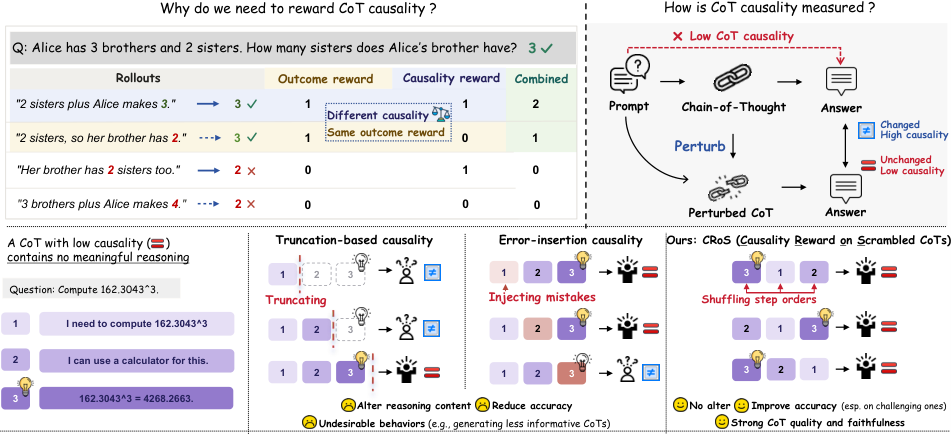

# CRoS：乱序 CoT 让推理更可信

只看答案对错的 RLVR，可能把“事后编出来”的推理也一并奖励，使思维链难以作为可靠的行为监控依据。CRoS 的方案很直接：**不改写任何推理步骤，只打乱顺序，观察原答案概率是否下降**。在 Gemma-3-4B 上，它将五个未见数据集的准确率提升至 **46.8%**，高于最强基线的 43.8%；提示承认率则从 **20.2% 提升至 34.0%**。

## 为什么要只乱序、不改内容？

如果最终答案真正依赖 CoT，干预推理就应改变答案；反之，答案纹丝不动，说明 CoT 更像装饰。既有方法也用这一直觉，却引入了额外变量：

- **截断推理**会删除信息，还可能奖励“少写有效步骤”：Early Answering 和 CIR 的有效步骤占比分别降至 41% 和 31%，CRoS 为 54%。
- **注入错误**会污染信息，并抑制探索与自我纠错：Adding Mistakes 的探索步骤仅占 31%，Outcome 和 CRoS 则分别为 80% 和 74%。

> 图解：截断会删除信息，注入错误会加入信息；CRoS 仅交换步骤顺序，用原答案概率的变化衡量 CoT 是否真正支撑答案。

## CRoS 如何变成训练奖励？

CRoS 将因果测量接入 GRPO，流程可概括为四步：

- **切分与乱序**：按换行符拆分 CoT，保持每步文字不变；用 Kendall's $\tau$ 控制乱序程度，主设置取 $\tau_{\max}=0.3$，每条 CoT 采样 2 个排列。
- **计算因果分数**：用冻结的初始模型，分别计算原 CoT 与乱序 CoT 条件下原最终答案的平均 Token 对数概率，前者减去后者的均值。下降越多，说明原始推理顺序的因果贡献越强。
- **组内排名**：只对同题且答案正确的 rollout 按分数排名，映射到 $[-1,1]$，消除不同题目的概率尺度差异。
- **联合优化**：将排名奖励与答案正确性、格式奖励相加。这样不是放松正确性，而是在同样答对的响应中，优先奖励更“承重”的推理。

## 实验说明了什么？

- **域外与难题提升更明显**：CRoS 域外准确率比 Outcome Reward 高 5.0 个百分点，五档难度全部领先；域内默认难度则为 34.5%，与两种基线持平。
- **答案和推理同时改善**：CoT-Pass@$K$ 从 $K=1$ 到 $128$ 全部最高，平均 **43.4%**，高于 Outcome 的 41.4%；Pass@$K$ 平均也达到 77.6%。收益并非来自更长 CoT：Outcome 平均长度为 1,890 Token，高于 CRoS 的 1,762，准确率却更低。
- **泛化得到验证**：换用 Gemma-3-12B 后，CRoS 五档平均准确率为 53.6%，比 Outcome 高 3.0 个百分点；更换训练集、扩大测试集后优势仍在。

## 结论与边界

- CRoS 的核心贡献，是把“内容是否变化”与“结构是否支撑答案”尽可能拆开。
- 提示承认率提高代表模型被错误提示带偏后更愿意说明依据，**不等于更能抵抗提示**。
- 因果性并非越强越好：CRoS 的谄媚指标升至 0.218，高于 Base 的 0.106，拒答表现也下降。未来需在推理收益、可监控性与安全之间寻找平衡。

> 本文参考自 [CRoS: Causality Reward on Scrambled CoTs Improves Accuracy and Reasoning Faithfulness](http://arxiv.org/abs/2610.42054v1)