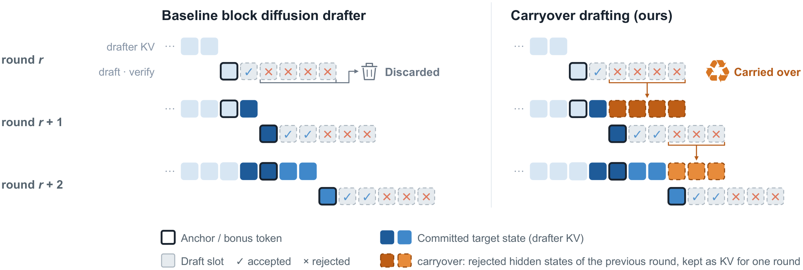
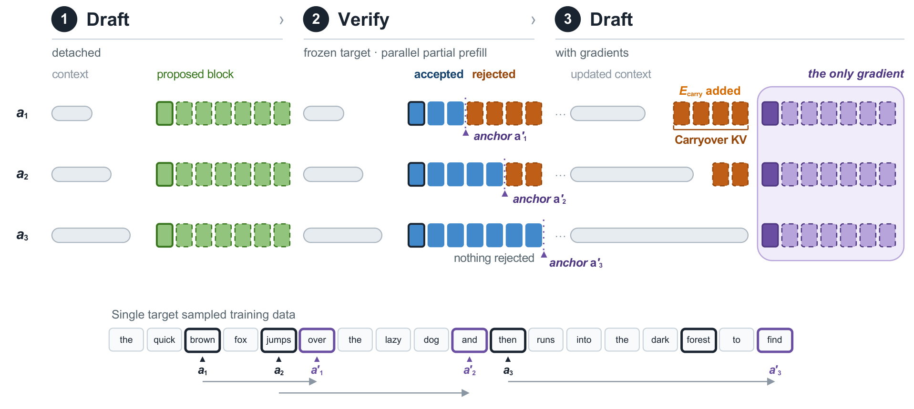
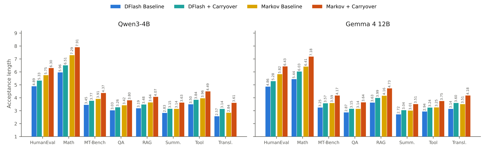
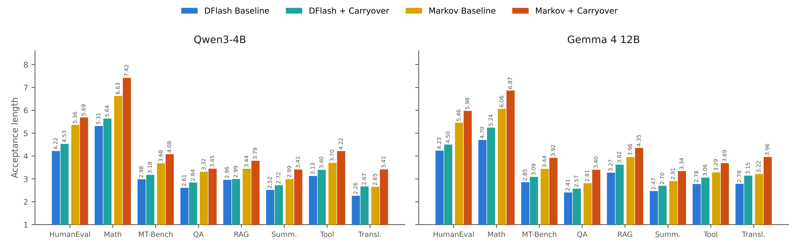
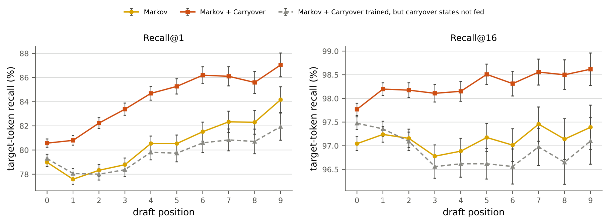
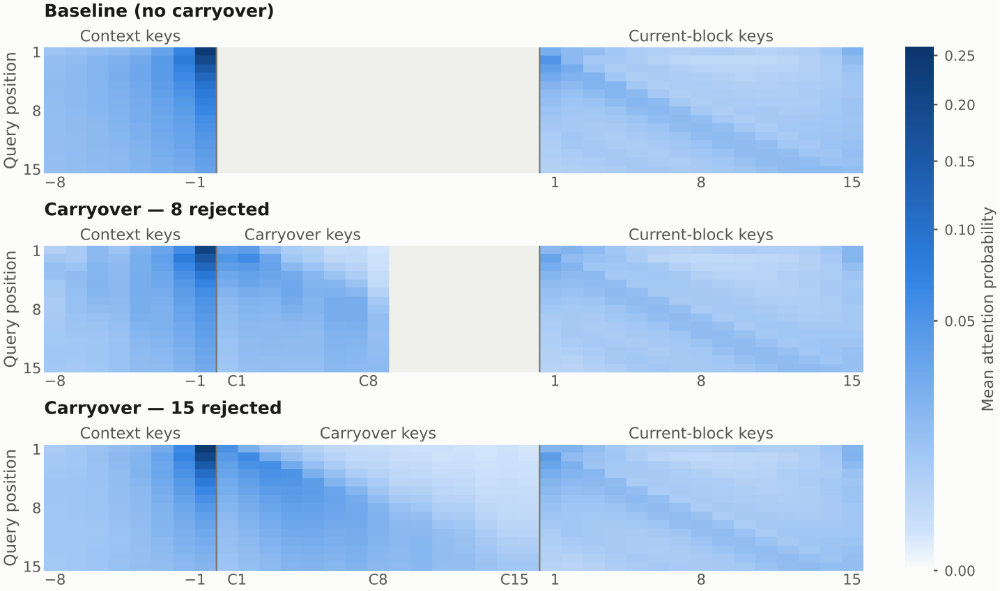
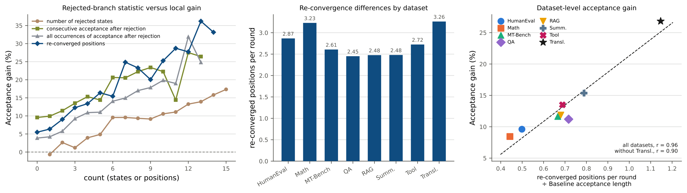
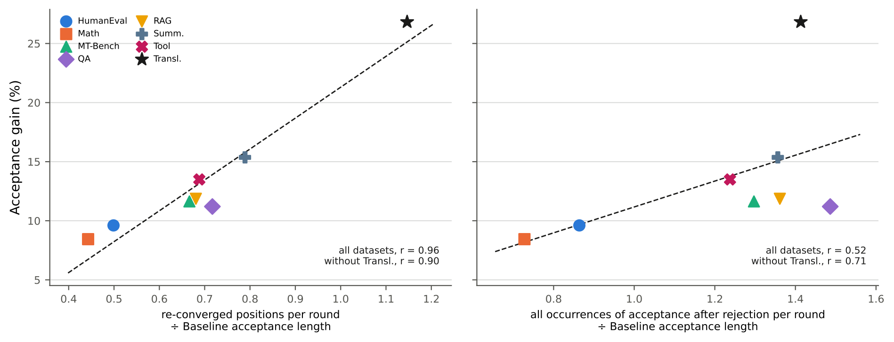
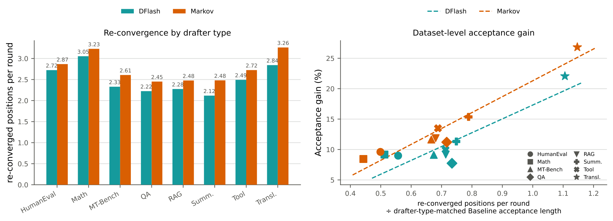

# Carryover Drafting：被拒绝的草稿也能回收利用，投机解码再提速

投机解码（Speculative Decoding）是大模型推理加速的主流方案，但很少有人注意到：每次验证时，目标模型为 **被拒绝的草稿 token** 计算的 hidden states 都被白白扔掉了。这篇来自首尔国立大学与 NAVER Cloud 的工作提出了 **Carryover Drafting**：把这些"被拒绝的" hidden states 回收利用，作为下一轮起草的临时 KV 上下文，让草稿模型"知道自己刚才错在哪"。整个机制只新增 **一个可学习 embedding**，配合一套并行化的 draft–verify–draft 训练流程，最终在两个目标模型上把平均接受长度提升 **6.5%–14.7%**，端到端 vLLM 加速提升 **7.9%–14.4%**，翻译任务上的加速收益最高达到 **28.8%**。

## 提出问题：验证算力的一半被浪费了

先快速回顾一下投机解码的基本流程：一个轻量级的 drafter（草稿模型）一次提出若干个候选 token，目标大模型用 **一次前向传播** 并行验证这些候选，接受其中最长的正确前缀。这样一次大模型前向就能产出多个 token，推理自然加速。

近年来提升草稿质量的主流思路是复用目标模型已经算好的 hidden states：EAGLE 使用 LM head 之前一层的特征，EAGLE-3 融合多层特征，而 DFlash、DSpark 这类 block diffusion drafter 则把多层目标特征投影进 drafter 的 KV 上下文，支撑并行块预测。

但这些方法都有一个共同的"盲区"：**它们只保留被接受 token 的 hidden states，被拒绝的部分直接丢弃**。问题在于，投机解码的草稿往往只能被部分接受——一次提出 15 个 token，可能只接受 5 个，剩下 10 个被拒绝。而验证时目标模型已经为这 10 个被拒绝 token 算好了完整的表示。这些表示里其实藏着有用的信息：目标模型认为"这里应该接什么"。

一个自然的想法应运而生：能不能把这些被拒绝的 hidden states **结转（carry over）** 到下一轮起草中？

> 图解：上方是标准的 block diffusion 起草流程——验证后只保留被接受 token 的目标 hidden states（绿色），被拒绝 token 的状态（红色）直接丢弃。下方的 Carryover 则把被拒绝状态回收为下一轮起草的临时 KV 上下文，drafter 通过自己已有的 attention 层选择性地关注它们。

## 分析：两个绕不过去的挑战

想法很美好，但落地有两个具体障碍，作者把它们拆得很清楚。

**挑战一：推理开销。** 投机解码的净加速取决于接受长度和起草开销的乘积关系。投影和 attend 额外的 hidden states 会增加每轮起草延迟；而且如果把被拒绝状态无限累积下去，KV 上下文会越滚越长，收益很快被开销吞掉。

**挑战二：训练错位。** 推理时 drafter 看到的被拒绝状态，来自目标模型验证 **drafter 自己草稿** 的过程。但标准的并行 drafter 训练是在录好的目标回复上做的，根本不存在"被拒绝状态"这种输入。要拿到它们，最直观的办法是做序列化 rollout（先起草、再验证、再继续起草），但这会让后面的训练位置依赖前面的起草-验证结果，彻底破坏位置维度的并行性。

解决了"能不能做"的问题定义之后，下一个问题是"怎么做得足够轻"。

## 方法：Carryover Drafting

### 单轮复用：复用现有接口，只加一个 embedding

先建立符号。每一轮中 drafter 提出 $B$ 个 token，目标模型接受长度为 $m$ 的前缀，并额外给出一个 bonus token（接受长度 $\tau$ 包含它）。记第 $r$ 轮目标模型在草稿位置上的 hidden states 为 $H_r=(h_{r,1},\ldots,h_{r,B})$，那么：

$$
H_r^{\mathrm{acc}}=h_{r,1:m_r},\quad H_r^{\mathrm{rej}}=h_{r,m_r+1:B},\quad
\Phi_\ell(H)=\bigl(K_\ell(F(H)),V_\ell(F(H))\bigr)
$$

这里 $F$ 是基线 drafter 已有的特征融合投影，$K_\ell$、$V_\ell$ 是 drafter 第 $\ell$ 层已有的 key/value 投影。注意，**这些投影全都是基线里现成的**，不是新模块。

设 $C_{r+1,\ell}$ 为常规更新后的已提交 drafter KV 上下文，Carryover 的构造是：

$$
U_{r+1,\ell}=\Phi_\ell(H_r^{\mathrm{rej}}+E_{\mathrm{carry}}),\qquad
\mathrm{ctx}_{r+1,\ell}=[C_{r+1,\ell};U_{r+1,\ell}]
$$

也就是说：给被拒绝的 hidden states 加上一个可学习 embedding $E_{\mathrm{carry}}$（用来和已接受上下文区分开），走一遍 **和已接受状态完全相同** 的投影路径，得到额外的 KV 行 $U$，拼接在已提交上下文后面，供下一轮起草读取。

笔者认为这个设计最聪明的地方在于三个"不"：**不加门控、不加专用投影、不进目标模型的 KV cache**。被拒绝状态只是只读的临时 drafter 上下文，每轮验证后整体替换（全部接受时则为空），因此额外上下文的长度永远被约束在一个 proposal block 以内（每层最多 $B$ 行）。这直接回应了挑战一的开销问题。

为什么必须轻？作者沿用了 DFlash/DSpark 的逐 token 延迟模型来说明：设 $t_{\mathrm{AR}}$ 为自回归单 token 延迟，$t_{\mathrm{reuse}}$ 为回收被拒绝状态带来的额外起草延迟，则加速比近似为：

$$
S_{\mathrm{carry}}\approx\frac{\tau\,t_{\mathrm{AR}}}{t_{\mathrm{draft}}+t_{\mathrm{verify}}+t_{\mathrm{reuse}}}
$$

分母里的 $t_{\mathrm{reuse}}$ 告诉我们：只有当回收足够便宜、且 $\tau$ 确实变大时，净加速才成立。这正是"只加一个 embedding"这一工程选择的理论动机。

### 并行 draft–verify–draft 训练

挑战二的解法是本文的第二个核心贡献。思路可以概括为：**在录好的目标回复上，为每个训练锚点独立地"预演"一次局部起草-验证，从而凭空造出推理时对齐的被拒绝状态**。

> 图解：同一条录制的目标回复上随机采样多个锚点（anchor）。第一阶段：drafter 在各锚点无梯度地生成草稿，冻结的目标模型用 block-diagonal causal mask 并行验证这些分支，得到接受长度 $m_i$ 和 detach 掉的被拒绝 hidden states。第二阶段：锚点移动到 $a'_i = a_i + m_i + 1$，drafter 带着被拒绝状态重新起草，对着原始录制的续写计算损失——梯度只流过这第二遍起草。

具体流程如下：

1. **共享设置**：沿每条录制回复随机采样 512 个锚点 $a_i$，Baseline 与 Carryover 使用完全相同的数据、锚点和损失。
2. **Draft–verify（无梯度）**：drafter 贪心生成草稿，冻结目标并行验证，返回 $m_i$ 和 $H_i^{\mathrm{rej}}$。
3. **锚点移位**：$a'_i = a_i + m_i + 1$，即"下一个修正或 bonus 位置"。
4. **第二次 Draft（有梯度）**：drafter 读取到 $a'_i$ 的录制前缀，通过上面的 Carryover 公式接入 $H_i^{\mathrm{rej}}$，学习目标回复在该位置的真实续写。
5. **全接受的边界情况**：若草稿全部被接受，则 $H_i^{\mathrm{rej}} = \varnothing$，第二遍起草退化为移位锚点上的基线训练——这些样本依然保留，照样提供监督。

值得强调的是，整个过程 **没有生成任何新的目标回复**：监督信号始终来自录制数据，中间的 draft–verify 只是用来提供移位位置和被拒绝状态。每个锚点独立构造转移，因此位置维度的并行性完整保留，训练可以像往常一样大规模并行。

## 实验设置

**目标模型与 drafter**：Qwen3-4B 与 Gemma 4 12B 两个目标模型；drafter 有两种范式——

- **DFlash**：用目标 hidden states 做全并行块预测；
- **Markov**：在并行骨干上叠加 DSpark 提出的 rank-256 一阶修正头，属于半自回归块起草，能建模块内 token 依赖。

两者均为 5 层 drafter、每次提出 15 个 token，关闭 confidence scheduling 以保持验证长度固定。

**训练配置**：50 万条 prompt（UltraChat-200K + Magpie-Llama-3.1-Pro-300K-Filtered 混合），各目标模型重新生成回复，Baseline 与 Carryover 共享同一份回复。所有基线训 10 个 epoch（遵循 DSpark 的充分收敛设定），Carryover 再从 10-epoch 基线 checkpoint 继续训 3 个 epoch。关键超参数如下：

| 设置 | Qwen3-4B | Gemma 4 12B |
| --- | --- | --- |
| 目标特征层（0 起） | 1, 9, 17, 25, 33 | 5, 17, 29, 41, 46 |
| Drafter 层数 / 草稿 token 数 | 5 / 15 | 5 / 15 |
| Markov 修正秩 | 256 | 256 |
| 每回复锚点数 | 512 | 512 |
| 学习率 / warmup | $6\times10^{-4}$ / 0.04 | $6\times10^{-4}$ / 0.04 |
| Baseline / Carryover 轮次 | 10 / 3 | 10 / 3 |

**评测**：Red Hat speculator benchmark，共 844 条 prompt（HumanEval 164、Tool 200，Math、MT-Bench、QA、RAG、摘要、翻译各 80），在单张 H200 上用 vLLM 评测 $T=0$ 与 $T=1$。数据集级结果用 offline vLLM（batch size 1，输出上限 2048 token）；平均加速比单独用 online vLLM（并发 1，上限 1024）测量；并发扫描在并发数 1–32 下测吞吐。

## 实验结果：接受长度与端到端加速

方法讲完，接下来的问题是：回收来的信息到底能不能换来实打实的加速？

> 图解：$T=0$ 时两个目标模型、两种 drafter 在 8 个数据集上的接受长度对比（浅色为 Baseline，深色为 +Carryover）。可以看到所有柱子都是 Carryover 更高，其中翻译（Transl.）数据集上的差距在各数据集间最为明显。

由于完整表格数据量很大，这里给出四种"目标 × drafter"组合的 **平均行**（接受长度 $\tau$ 为 844 条 prompt 的 micro 平均，Speedup 为相对自回归解码的在线 vLLM 加速比）：

| Target | Drafter | 温度 | $\tau$ Baseline | $\tau$ +Carryover | Speedup Baseline | Speedup +Carryover |
| --- | --- | --- | --- | --- | --- | --- |
| Qwen3-4B | DFlash | $T{=}0$ | 3.78 | **4.14** (+9.4%) | 3.34$\times$ | **3.60$\times$** (+7.9%) |
| Qwen3-4B | DFlash | $T{=}1$ | 3.33 | **3.55** (+6.5%) | 2.89$\times$ | **3.14$\times$** (+8.6%) |
| Qwen3-4B | Markov | $T{=}0$ | 4.33 | **4.85** (+11.8%) | 3.44$\times$ | **3.83$\times$** (+11.5%) |
| Qwen3-4B | Markov | $T{=}1$ | 4.06 | **4.48** (+10.3%) | 3.20$\times$ | **3.54$\times$** (+10.6%) |
| Gemma 4 12B | DFlash | $T{=}0$ | 3.65 | **4.03** (+10.3%) | 2.58$\times$ | **2.79$\times$** (+8.1%) |
| Gemma 4 12B | DFlash | $T{=}1$ | 3.24 | **3.52** (+8.6%) | 2.40$\times$ | **2.59$\times$** (+7.9%) |
| Gemma 4 12B | Markov | $T{=}0$ | 4.13 | **4.74** (+14.7%) | 2.73$\times$ | **3.13$\times$** (+14.4%) |
| Gemma 4 12B | Markov | $T{=}1$ | 3.92 | **4.49** (+14.5%) | 2.71$\times$ | **3.09$\times$** (+14.3%) |

几个值得注意的点：

- **所有数据集 × 所有组合均为正收益**，平均接受长度提升 6.5%–14.7%，端到端加速提升 7.9%–14.4%。
- **翻译任务收益最大**：在每种"目标 × drafter × 温度"组合下，翻译的相对接受长度增益都是最高的，最高出现在 Qwen3-4B Markov $T=1$ 的 **+28.6%**，对应加速比从 1.94$\times$ 提到 2.50$\times$（+28.8%）。
- **更强的 drafter 收益更大**：半自回归的 Markov 比全并行的 DFlash 增益更显著，说明 Carryover 与块内依赖建模是互补关系，而不是互相替代。

> 图解：$T=1$ 随机采样设定下的接受长度对比，与 $T=0$ 互补。所有设定下增益保持为正，但幅度差异更大——例如 Qwen3-4B DFlash 在 RAG 上只有 +1.1%，而 Markov 在翻译上高达 +28.6%。

**并发下的吞吐** 同样关键——单请求加速不代表服务器场景有用。作者在并发数 1 到 32 下测量了混合负载的输出吞吐（tok/s，$T=0$）：

| Target | 并发 | AR | DFlash Base | DFlash +Carryover | Markov Base | Markov +Carryover |
| --- | --- | --- | --- | --- | --- | --- |
| Qwen3-4B | 1 | 251 | 837 | **903** (+7.9%) | 861 | **961** (+11.5%) |
| Qwen3-4B | 8 | 1,800 | 5,328 | **5,741** (+7.7%) | 5,337 | **5,879** (+10.1%) |
| Qwen3-4B | 32 | 5,335 | 8,180 | **8,804** (+7.6%) | 8,608 | **9,402** (+9.2%) |
| Gemma 4 12B | 1 | 111 | 286 | **309** (+8.2%) | 304 | **347** (+14.4%) |
| Gemma 4 12B | 8 | 785 | 1,821 | **1,935** (+6.3%) | 1,908 | **2,145** (+12.4%) |
| Gemma 4 12B | 32 | 2,297 | 2,789 | **3,000** (+7.6%) | 2,973 | **3,315** (+11.5%) |

并发升高时，所有投机解码方案相对自回归的加速都会缩水（这是正常现象），但 Carryover 相对各自 Baseline 的增益在所有并发档位上都保持为正。

## 消融：回收什么、怎么区分？

收益确认了，下一步是把设计选择拆开验证。作者用 Qwen3-4B Markov 做了一个诊断性 probe（6 epoch、约 4 万样本，$T=0$，报告接受长度 $\tau$ 及相对基线增益）：

| 变体 | HumanEval | Math | MT-Bench |
| --- | --- | --- | --- |
| Baseline（不回收） | 3.10 | 3.72 | 2.46 |
| **(a) 回收什么信息** | | | |
| 草稿 token（drafter 自己产出的 token） | 3.05 (-1.8%) | 3.76 (+1.2%) | 2.41 (-2.4%) |
| 目标 token（目标模型的预测 token） | 3.16 (+1.8%) | 3.93 (+5.8%) | 2.52 (+2.3%) |
| 目标 top-5 加权 token | 3.18 (+2.7%) | 3.92 (+5.4%) | 2.56 (+4.0%) |
| **目标 hidden states（本文）** | **3.41 (+10.0%)** | **4.27 (+14.8%)** | **2.70 (+9.6%)** |
| **(b) 如何区分被拒绝状态** | | | |
| 不做显式区分 | 3.41 (+10.1%) | 4.18 (+12.5%) | 2.67 (+8.5%) |
| 独立投影器（19.7M 参数） | 3.45 (+11.4%) | 4.28 (+15.2%) | 2.73 (+10.8%) |
| **Carryover embedding（本文）** | **3.41 (+10.0%)** | **4.27 (+14.8%)** | **2.70 (+9.6%)** |

表 (a) 的信息量很大：**回收 drafter 自己产出的 token 几乎没用甚至有负作用**，因为它只告诉 drafter"我刚才猜了什么"，而不告诉它"目标模型认为该是什么"；而目标 hidden states 包含了远超 top-1 token 的分布信息，收益是 token 级提示的两倍以上。不过作者也诚实地指出：token 提示是从初始 embedding 进入的，hidden states 是从 KV 上下文进入的，这个对比同时改变了"信息内容"和"进入方式"，没有完全隔离单一变量。

表 (b) 则解释了为什么最终选择单 embedding：19.7M 参数的独立投影器确实略好一点，但要在起草路径上多挂一个投影模块；单 embedding 几乎不掉点，工程上干净得多。笔者认为这是一个非常务实的性能-复杂度权衡。

## 机制分析：被拒绝状态到底贡献了什么？

数字好看了，但"为什么有效"还需要更直接的证据。

### 同一锚点下的目标 token 召回率

不同 rollout 会走到不同的验证边界，直接比较接受长度有混淆变量。作者设计了一个干净的对照实验：先用 Carryover ON 跑一遍生成，记录所有起草起点，然后在 **完全相同的起点** 上重放三个变体——Carryover ON（带被拒绝状态）、Carryover OFF（同一权重但抽走被拒绝状态）、Baseline。三者共享已提交 token、已接受 hidden states 和目标 KV cache，唯一差别就是 ON 能读到被拒绝状态。

> 图解：横轴为块内起草位置，纵轴为 Recall@$k$——目标模型的真实下一个 token 出现在 drafter 前 $k$ 个候选中的比例（左 Recall@1，右 Recall@16）。ON（绿色）在 **每一个位置** 都高于 OFF（橙色）和 Baseline：Recall@1 高出 1.28–5.60 个百分点，Recall@16 高出 0.29–1.89 个百分点。收益从位置 0 就开始——那里所有变体共享同一个已接受锚点，差异只能来自被拒绝状态。

这个实验相当于直接证明了 drafter 确实 **学会读取并利用** 了回收的信息，而不是从别的副作用里沾光。

作为旁证，作者还可视化了 drafter 对回收行的 attention：

> 图解：DFlash 在 MT-Bench 上的注意力可视化，对比 baseline 与带有 8 个、15 个被拒绝状态的 Carryover 轮次（概率跨 head、层和轮次取平均）。全部 softmax 注意力中有 19.78% 落在回收行上；在满 15 个被拒绝状态的子集里，这一比例达到 23.40%，且随位置变化——说明回收接口确实被读取，且 drafter 学会了选择性地关注。

### 为什么翻译任务收益最大？—— Re-convergence 假说

各任务收益差异悬殊（1.1% 到 28.6%），作者提出了一个解释性指标：**re-convergence（再收敛）**。直觉是：被拒绝的分支虽然这一轮没被接受，但如果它上面的预测后来又与最终提交的续写"汇合"了，说明这些状态里携带了关于未来的真实信息。

严格定义：对长度为 $L$ 的被拒绝后缀，记 $z_q$ 为验证器从第 $q$ 个被拒绝状态给出的 top-1 预测，$y_q$ 为对应预测位置上最终提交的 token，则再收敛计数为：

$$
R=\sum_{q=0}^{L-1}\mathbf{1}\!\left[\exists\,\delta\in\{-1,0,+1\}:z_{q+\delta}=y_q\right]
$$

$\pm 1$ 的容忍窗口允许一次局部的插入或删除。注意 $R$ 只是事后分析用的统计量，**不参与状态筛选，也不参与训练监督**。

> 图解：左图按被拒绝分支的统计量分组展示局部重放增益；中图为每轮被拒绝的再收敛位置数；右图为归一化再收敛与最终数据集级接受增益的关系——两者高度相关。

更硬的证据在相关性上。作者对比了三种候选解释变量与最终收益的相关性：

> 图解：左图是再收敛位置数（按 Baseline 接受长度归一化），右图是被拒后所有局部草稿-验证匹配数，两者各自与数据集级增益的关系。**归一化再收敛与增益的相关系数达 $r=0.96$**（去掉翻译后为 0.90），而"被拒后接受率"只有 0.52（0.71），被拒绝状态数量为 0.74（0.84）。

结论很清晰：被拒绝状态的价值不在于"有多少"，也不在于"被拒后还能不能被接受"，而在于 **它对目标模型最终续写的预测能力**。翻译任务正因为被拒绝分支频繁与最终续写再收敛，收益才最大。

这个指标还能解释 drafter 间的差异：

> 图解：左图对比 Qwen3-4B 上 DFlash 与 Markov 每轮被拒绝的再收敛位置数（2.51 vs 2.76，差 10.2%）；右图为各数据集上归一化再收敛与 Carryover 增益的关系。Markov 在全部 8 个数据集上再收敛更高，并在其中 7 个上获得更大的 Carryover 增益。

这个发现有一个耐人寻味的推论：**drafter 越强，留下的被拒绝状态越有用，Carryover 的收益就越大**——回收机制会随草稿技术的进步而升值，而不是被淘汰。

## 讨论：局限与未来方向

作者对三个延伸方向做了坦率讨论：

- **与 confidence scheduling 的兼容**：DSpark 会根据估计的接受概率自适应调整验证长度。Carryover 原则上兼容，但调度策略会改变被拒绝状态的分布，需要在同一调度策略下重新训练对齐，置信度估计也可能需要重新校准。本文未做联合评测。
- **与树解码结合**：Medusa、DDTree 这类树验证会产生更多、更丰富的被拒绝分支，理论上给 Carryover 提供了更大的回收空间，但也引入新问题——多条分支的状态该保留哪些、如何合并？
- **与 on-policy rollout 训练结合**：像 Draft-OPD 这样本来就做目标验证 rollout 的训练流程，天然产生被拒绝状态，Carryover 可以直接复用而无需额外验证阶段，还能支持跨多轮的状态保留（本文并行训练只覆盖单轮）。

## 总结

- 投机解码验证时，目标模型为被拒绝 token 计算的 hidden states 一直被丢弃，Carryover Drafting 将其回收为下一轮起草的临时只读 KV 上下文。
- 机制极轻量：复用基线已有投影，只新增一个可学习 embedding $E_{\mathrm{carry}}$，额外上下文每轮替换、长度恒定有界。
- 并行 draft–verify–draft 训练在录制回复上凭空构造推理对齐的被拒绝状态，不牺牲位置并行性、不生成新数据。
- 两个目标模型 × 两种 drafter × 8 个数据集全部正收益：接受长度 +6.5%–14.7%，端到端加速 +7.9%–14.4%，翻译最高 +28.8%。
- 机制分析表明收益与"再收敛"高度相关（$r=0.96$）：被拒绝状态越能预测最终续写，回收价值越大。

这项工作的局限在于目前只验证了单轮回收、固定验证长度的场景；但它开启的方向很诱人——"验证产生的所有计算都是资产"，树解码、自适应调度与 on-policy 训练的交叉点上，可能还有更多可挖掘的免费午餐。

> 本文参考自 [Carryover Drafting: Recycling Rejected States for Speculative Decoding](https://arxiv.org/pdf/2609.14717v1)