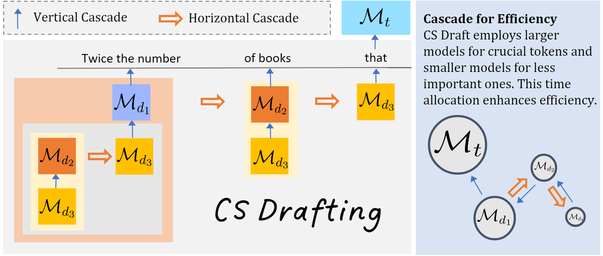
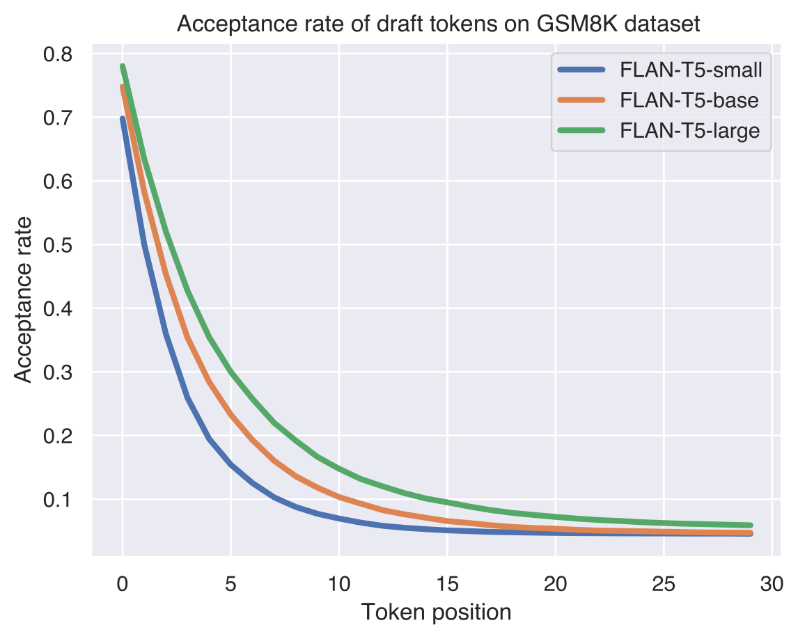
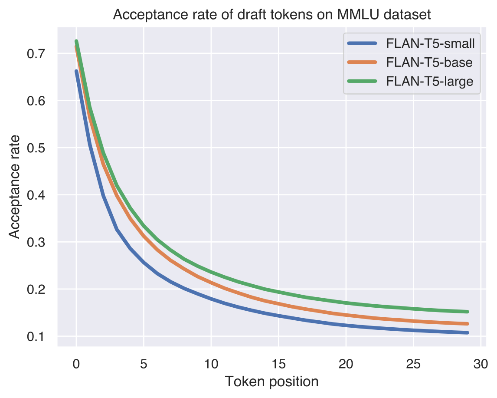

# CS Drafting：级联草稿加速大模型推理，最高再提速81%

大语言模型推理慢，不只是目标模型太大，投机解码里的小模型逐 token 起草也会成为新瓶颈。CS Drafting（Cascade Speculative Drafting，级联投机起草）针对的正是这段常被忽视的开销：它用纵向级联递归消除神经草稿模型的自回归生成，再用横向级联把更多算力分给更容易被接受的前部 token。FLAN-T5 实验中，它相对普通自回归生成最高取得 **3.88 倍**（GSM8K）和 **4.88 倍**（MMLU）的标准化加速，相比最快的投机解码基线分别再提速最高 **44%** 和 **81%**。更关键的是，最终审查仍由目标模型严格执行，因此输出分布保持不变。

## 投机解码为什么还会卡在“打草稿”？

自回归 LLM 每生成一个 token，都要完整运行一次模型。投机解码（Speculative Decoding）的思路很像“先让助手写草稿，再由专家集中审稿”：小型的 draft model 连续生成 $k$ 个候选 token，大型的 target model 并行检查，接受与自身输出一致的部分，并额外生成一个 token。

设输入为 $x$，目标模型和草稿模型分别为 $\mathcal{M}_t$、$\mathcal{M}_d$。对候选 token $x_i$，若 $\mathcal{M}_d(x)[i-1]\leq\mathcal{M}_t(x)[i-1]$，就接受；否则以如下概率拒绝：

$$
1-\frac{\mathcal{M}_t(x)[i-1]}{\mathcal{M}_d(x)[i-1]}
$$

拒绝后，从重新校准的分布中采样，并丢弃后续候选：

$$
\operatorname{norm}\left(\max\left(0,\mathcal{M}_t(x)[i-1]-\mathcal{M}_d(x)[i-1]\right)\right)
$$

这套接受—拒绝机制保证最终输出等同于直接从目标模型采样。它不需要修改模型结构或重新训练，已有工作通常能实现 2～3 倍加速。

但问题在于，草稿模型自身仍要自回归运行 $k$ 次。草稿模型越大，候选质量通常越高，可起草成本也越高；实践中，比目标模型小约两个数量级的模型反而常常更合适。这说明，继续提速的关键不只是“提高接受率”，还包括“让草稿本身更便宜”。

CS Drafting 由此拆出两个相互正交的优化方向：

- **Vertical Cascade（纵向级联）**：让小模型给大一点的草稿模型打草稿，递归下去，直到成本可忽略的统计语言模型。
- **Horizontal Cascade（横向级联）**：前部 token 用较大的草稿模型，后部 token 逐步改用更小、更快的模型。

> 图解：目标模型 $\mathcal{M}_t$ 位于级联顶端，$\mathcal{M}_{d_1}$、$\mathcal{M}_{d_2}$、$\mathcal{M}_{d_3}$ 依次承担草稿与审查。纵向上，每个模型审查更小模型的生成结果，最小的统计模型负责最初生成；横向上，大模型负责靠前的 token，小模型负责靠后的 token。两种级联分别降低“生成方式”和“时间分配”的浪费，因此可以组合使用。

## 纵向级联：把神经模型的自回归生成递归替换掉

普通投机解码只有一层“草稿模型—目标模型”。纵向级联把这条链继续向下延伸：统计模型先便宜地生成候选，小神经模型负责审查并改写，再把结果交给更大的神经模型，最后才由目标模型审查。

这样做最重要的收益是，**神经草稿模型不再逐 token 自回归生成**。它仍然参与审查，以保证候选与目标模型足够对齐；但真正昂贵的连续生成过程被下沉到了更小的模型，最终落到 bigram 等统计模型上。

### 宽松审查为什么不会破坏最终分布？

作者引入了 lenience（宽松度）$l\in[1,\infty)$，让中间草稿模型的审查适当放宽。采样时，接受条件变为：

$$
\mathcal{M}_d(x)[i]\leq l\,\mathcal{M}_t(x)[i]
$$

在 greedy decoding 下，只要两模型 argmax 相同，或上述概率条件成立，就可以接受。$l$ 越大，审查越宽松，速度通常越快，但候选与直接审查结果的偏差也可能越大。

这里的设计很巧：**宽松只用于草稿模型之间的内部审查，目标模型最终审查时固定 $l=1$**。中间层即使放进一些不够完美的候选，最后一道严格审查仍会校正，因此能用内部宽松换速度，而不改变最终输出分布。

### 理论收益：统计草稿成本足够低时，几乎总能获益

先定义三个量：

- **期望接受率** $\alpha(\mathcal{M}_t,\mathcal{M}_d)$：草稿被目标模型接受的概率。
- **成本系数** $c(\mathcal{M}_t,\mathcal{M}_d)$：草稿模型单次运行时间与目标模型单次运行时间之比。
- **EWIF（Expected Walltime Improvement Factor）**：在 token 接受独立同分布假设下的期望实际时间加速比。

对普通投机解码，生成 $i$ 个 token 的概率记为 $p_i$，其概率生成函数为：

$$
\phi_{(\alpha,k)}(x)=1+(x-1)\frac{1-\alpha^{k+1}x^{k+1}}{1-\alpha x}
$$

由此得到普通投机解码的 EWIF：

$$
\frac{\phi_{(\alpha,k)}'(1)}{ck+1}
=\frac{1-\alpha^{k+1}}{(1-\alpha)(ck+1)}
$$

再考虑两个草稿模型 $\mathcal{M}_{d_1}$、$\mathcal{M}_{d_2}$：后者为前者起草，目标模型共审查 $n$ 步，$\mathcal{M}_{d_1}$ 与 $\mathcal{M}_{d_2}$ 之间的草稿长度为 $k$。整个系统的 EWIF 为：

$$
\frac{1-\alpha\phi^n(\alpha)}
{(1-\alpha)(1+nc_{d_1}+nkc_{d_2})}
$$

其中 $\phi(x)=\phi_{(\alpha(\mathcal{M}_{d_1},\mathcal{M}_{d_2}),k)}(x)$。推导的关键是：$\phi^n(x)$ 中 $x^j$ 的系数，正好表示 $n$ 个内部投机的总接受长度为 $j$ 的概率；再用线性算子把这个生成函数映射成目标模型阶段的期望接受 token 数。

作者进一步证明，对任意 $0<\alpha<1$、$0<\alpha'<1$、$k>0$：

$$
\phi_{\alpha',k}(\alpha)<\alpha
$$

因此，当最小统计模型的成本满足 $c_{d_2}\ll 1$ 时，分母增加得极少，而期望接受长度提高，纵向级联的 EWIF 高于只使用 $\mathcal{M}_{d_1}$ 的普通投机解码。

## 横向级联：越靠后的 token，越不值得花大钱

纵向级联解决了“谁来生成”的递归成本，但还有一个独立问题：同一批草稿 token 的价值并不相同。

第一个候选只要自己正确就能被接受；第 $n$ 个候选要被接受，则前面 $n-1$ 个也必须全部通过。若每个位置的接受事件简化为概率 $p$ 的 Bernoulli 试验，第 $n$ 个 token 的接受概率就是 $p^n$，会随位置指数下降。

> 图解：横轴是一轮投机解码中草稿 token 的位置，每轮生成 30 个 token；纵轴是该位置候选被目标模型接受的概率。图中比较 FLAN-T5-small、base、large，在 GSM8K 上，接受概率总体随位置后移而下降，说明尾部草稿的实际贡献低于前部。

> 图解：坐标含义与上一张图相同，数据集换为覆盖 57 个学科的 MMLU。FLAN-T5 三种草稿模型同样呈现后位置接受概率更低的趋势，因此让昂贵模型平均服务所有草稿位置，会把不少时间花在很难走到最终输出的 token 上。

横向级联据此采用“前重后轻”的资源分配：最大的草稿模型生成最前面的 token，之后随接受价值下降，逐步切换到更小的模型，最后由统计模型收尾。它不是单纯缩短草稿，而是在保持多级候选能力的同时，降低尾部 token 的生成成本。

### 理论收益：接受率与位置成本可以统一计算

令第 $i$ 个 token 由 $\mathcal{M}_i$ 生成，其接受率和成本系数分别为 $\alpha_i$、$c_i$。横向级联的 EWIF 为：

$$
T(k,\{\alpha_1,\ldots,\alpha_k\},\{c_1,\ldots,c_k\})
=
\frac{\sum_{i=0}^{k}\prod_{j=1}^{i}\alpha_j}
{1+\sum_{i=1}^{k}c_i}
$$

第 $i$ 个 token 被接受的概率为 $\prod_{j=1}^{i}\alpha_j$。EWIF 对第 $l$ 个位置接受率的偏导为：

$$
\frac{\partial T}{\partial\alpha_l}
=
\frac{\sum_{i=l}^{k}\prod_{j=1,j\neq l}^{i}\alpha_j}
{1+\sum_{i=1}^{k}c_i}
$$

特别是：

$$
\frac{\partial T}{\partial\alpha_1}
=
\frac{\sum_{i=1}^{k}\prod_{j=2}^{i}\alpha_j}
{1+\sum_{i=1}^{k}c_i},
\qquad
\frac{\partial T}{\partial\alpha_k}
=
\frac{\prod_{j=1}^{k-1}\alpha_j}
{1+\sum_{i=1}^{k}c_i}
$$

这为“前部 token 更重要”提供了直接依据：提升前部接受率会惠及更多后续接受路径，而提升最后一个位置的接受率只影响最后一条路径。

作者使用已有工作的接受率数据，在 Bernoulli 假设下模拟 EWIF。结果如下；BASE、SMALL 分别指 FLAN-T5-base 和 FLAN-T5-small，$k_1$、$k_2$ 是两个模型负责的草稿长度。

| 数据集 | $\mathcal{M}_{d_1}$ | $\mathcal{M}_{d_2}$ | $k_1$ | $k_2$ | EWIF |
|---|---|---|---:|---:|---:|
| CNNDM | small | - | 9 | - | 2.65 |
| CNNDM | base | - | 8 | - | 2.96 |
| CNNDM | base | small | 5 | 3 | **3.03** |
| ENDE | small | - | 12 | - | 3.61 |
| ENDE | base | - | 11 | - | 3.75 |
| ENDE | base | small | 5 | 8 | **3.93** |

在两个数据集上，横向组合都超过任一单草稿模型配置，说明收益并非只来自“用了更多模型”，而是来自按位置重新分配成本。

## Max-Gram：让级联底部足够快，也足够会“抄近路”

两种级联最终都会把生成推向统计模型，因此底层模型的质量很重要。普通 bigram 虽然便宜，但候选与目标模型的对齐程度有限。

作者观察到，输入中的单词和短语经常会在生成内容里重复出现，于是设计 **Max-Gram（MaG）**：从当前生成末尾出发，在初始输入或已有生成中贪心地寻找最长匹配，然后直接取匹配位置之后的 token 作为候选。没有匹配时，再退回基于 Wikipedia 概率分布的 bigram 模型，以保持通用性。

可以把 MaG 理解成“先查原文有没有可复用的现成片段，没有再按词频猜下一个词”。它主要做匹配和查表，不需要神经网络自回归，因而很适合作为级联底部。论文附录还给出了 GPU 友好实现：通过张量相等比较维护匹配掩码，逐步扩展匹配长度；当无法继续扩展时，返回首个最长匹配之后的 $n$ 个 token。

## 两种级联如何合成一次完整执行？

CS Drafting 的完整流程可以概括为四步：

1. 初始化当前生成内容和对应概率，准备一组从大到小的草稿模型。
2. **外层循环实现横向级联**：不同模型依次负责一段草稿，长度由上三角超参数矩阵 $K_{nn}$ 控制。
3. **递归调用实现纵向级联**：每个神经模型需要生成时，先调用更小模型提供草稿，再由自己审查；递归底部是 MaG。
4. 当前层完成草稿后，由其上一层模型审查；最外层目标模型审查时把 $l$ 设为 1，保证最终输出分布不变。

$K_{nn}$ 的每一行是一层递归调用的停止条件。以论文 decoder-only 实验的固定配置为例，不使用 tree attention 时：

$$
K=\begin{bmatrix}2&10\\0&10\end{bmatrix}
$$

为减少调参，MaG 每次生成 10 个 token；MaG 与其直接审查者之间也不使用 lenience，因为统计模型与神经模型仍有明显能力差距。这样一来，常见配置最多只需调节 $k_{11}$、$k_{12}$、$k_{22}$ 和 $l$ 四个超参数。

## 实验：收益来自哪里，又能叠加到什么程度？

### 实验设置与评价口径

作者同时覆盖两类模型：

- **Encoder-decoder**：目标模型为 FLAN-T5-XXL，神经草稿模型为 FLAN-T5-base 和 FLAN-T5-small，最底层为 MaG。
- **Decoder-only**：目标模型为 Vicuna-7B，草稿模型为同 tokenizer 的 68M 模型，最底层同样为 MaG，并测试与 tree attention 的组合。

数据集包括：

- **GSM8K**：约 8,500 道小学数学应用题，通常需要 2～8 步基础算术推理。
- **MMLU**：覆盖 57 个学科，从基础科学到高级法律。

两组数据均采用 zero-shot Chain-of-Thought，默认 temperature 为 0，即 greedy decoding，不进行针对 CS Drafting 的微调。实际 walltime 实验在单张 NVIDIA A40 GPU 上完成。

论文使用两类指标：

- **SWI（Standardized Walltime Improvement）**：假设每次前向运行耗时固定，并用模型参数量或已有工作报告的运行成本估计。它能减少硬件差异，更便于复现。
- **Walltime**：实际吞吐，单位为 tokens/s，更贴近单用户真实体验，但更容易受硬件与噪声影响。

下面的 MS（Model Size）按参数量估计单次运行成本，PW（Previous Work）按已有工作报告的成本估计；两者都是相对普通自回归生成的加速倍数。

### FLAN-T5：最高相对投机解码再提速81%

| 数据集 | 算法 | 草稿模型 | Speedup (MS) | Speedup (PW) |
|---|---|---|---:|---:|
| GSM8K | Autoregressive | - | 1.00 | 1.00 |
| GSM8K | S Decoding | base | 3.38 | 2.99 |
| GSM8K | S Decoding | small | 3.06 | 2.76 |
| GSM8K | CS Drafting | base, MaG | 3.70 | 3.27 |
| GSM8K | CS Drafting | small, MaG | 3.19 | 2.82 |
| GSM8K | CS Drafting | base, small, MaG | **3.88** | **3.43** |
| MMLU | Autoregressive | - | 1.00 | 1.00 |
| MMLU | S Decoding | base | 3.97 | 3.42 |
| MMLU | S Decoding | small | 4.12 | 3.51 |
| MMLU | CS Drafting | base, MaG | 4.56 | 4.21 |
| MMLU | CS Drafting | small, MaG | 4.38 | 3.99 |
| MMLU | CS Drafting | base, small, MaG | **4.88** | **4.32** |

三层 CS Drafting 在两种成本口径下都优于普通投机解码。按 PW 口径，GSM8K 上从最佳基线 2.99 提升到 3.43，MMLU 上从 3.51 提升到 4.32；按 MS 口径，相对最佳基线的最高额外提速分别达到 44% 和 81%。

即使只保留“一个神经模型 + MaG”，收益也很明显：相对最快投机解码配置，在 MMLU 上最高再提速 70%，在 GSM8K 上最高再提速 32%。而 MaG 的 bigram 参数量仅与 tokenizer 规模相当，额外内存开销可忽略。

还有一个值得注意的现象：普通投机解码中，FLAN-T5-small 通常比 base 更适合作为草稿模型；加入 MaG 后，base 却稳定超过 small。原因是最底层已经承担了廉价生成，神经草稿模型可以适当做大，用更高候选质量换取更多接受，而不必像原来那样独自承担全部自回归成本。

### 超参数细节：三层配置如何取得最佳结果

下表保留论文附录中的完整设置。$k_{11}$、$k_{12}$ 是目标模型与草稿模型阶段的步数限制，$k_{22}$ 是第一、第二草稿模型之间的步数限制，$l$ 为内部审查宽松度；普通投机解码的 $k_{11}$ 就是通常的 $k$。

| 数据集 | 算法 | 草稿模型 | Speedup (MS) | $k_{11}$ | $k_{12}$ | $k_{22}$ | $l$ | Speedup (PW) | $k_{11}$ | $k_{12}$ | $k_{22}$ | $l$ |
|---|---|---|---:|---:|---:|---:|---:|---:|---:|---:|---:|---:|
| GSM8K | Autoregressive | - | 1.00 | - | - | - | - | 1.00 | - | - | - | - |
| GSM8K | S Decoding | base | 3.38 | 10 | - | - | - | 2.99 | 8 | - | - | - |
| GSM8K | S Decoding | small | 3.06 | 11 | - | - | - | 2.76 | 8 | - | - | - |
| GSM8K | CS Drafting | base, MaG | 3.70 | 10 | - | - | - | 3.27 | 9 | - | - | - |
| GSM8K | CS Drafting | small, MaG | 3.19 | 11 | - | - | - | 2.82 | 11 | - | - | - |
| GSM8K | CS Drafting | base, small, MaG | **3.88** | 8 | 13 | 1 | 3 | **3.43** | 5 | 9 | 1 | 3 |
| MMLU | Autoregressive | - | 1.00 | - | - | - | - | 1.00 | - | - | - | - |
| MMLU | S Decoding | base | 3.97 | 13 | - | - | - | 3.42 | 10 | - | - | - |
| MMLU | S Decoding | small | 4.12 | 19 | - | - | - | 3.51 | 11 | - | - | - |
| MMLU | CS Drafting | base, MaG | 4.56 | 13 | - | - | - | 4.21 | 6 | - | - | - |
| MMLU | CS Drafting | small, MaG | 4.38 | 14 | - | - | - | 3.99 | 13 | - | - | - |
| MMLU | CS Drafting | base, small, MaG | **4.88** | 5 | 19 | 1 | 5 | **4.32** | 5 | 8 | 1 | 5 |

最佳收益仍依赖任务和成本模型对应的参数配置，但后面的消融说明，不追求极限性能时，简单配置也能接近最优。

### Vicuna-7B：与 Tree Attention 正交叠加

| 算法 | GSM8K Walltime (tokens/s) | MMLU Walltime (tokens/s) |
|---|---:|---:|
| Autoregressive | 33.34 | 33.11 |
| S Decoding | 44.31 | 43.65 |
| CS Drafting | 56.72 | 55.60 |
| Medusa | 61.87 | 56.19 |
| CS Drafting + Tree Attention | **63.81** | **63.37** |

CS Drafting 单独使用就明显超过普通投机解码；加入 tree attention 后，又在两个数据集上超过 Medusa。这里的意义不只是刷新一个吞吐数字，而是说明级联草稿与“增加候选分支”的技术可以正交组合：前者降低草稿成本，后者提高候选命中机会。

### 消融：性能对关键长度限制不算敏感

作者在 GSM8K、Vicuna-7B 上调节影响最大的生成长度限制 $K_{00}$：

| $K_{00}$ | Walltime (tokens/s) |
|---:|---:|
| 1 | 56.16 |
| 2 | 55.51 |
| 3 | 53.73 |

从最优值移到次优设置，吞吐只有小幅下降。因此，不要求极限性能的用户可以采用简单配置。移除横向级联后，在 $K_{00}=1$ 时，吞吐从 56.16 降至 53.55 tokens/s，也直接验证了按 token 位置分配模型成本的贡献。

## 与已有推理加速方法相比，它改变了什么？

剪枝、知识蒸馏和量化分别通过删除冗余参数、把教师能力迁移给小模型、降低数值精度来减少成本。CS Drafting 不属于这三类：它不压缩目标模型，也不要求重新训练，而是重排推理过程中的计算。

在投机解码方向，已有工作主要包括：

- 用更好的蒸馏降低拒绝率；
- 复用目标模型的一部分进行 self-drafting，避免独立草稿模型；
- 用 tree attention 同时生成多个候选，提高接受机会；
- 对草稿阶段再做一层投机执行。

CS Drafting 与最后一类最接近，但进一步强调两点：纵向结构可以**递归**到统计模型，而不止两层；中间草稿模型之间可以使用 **lenience**，同时由最外层严格审查守住输出分布。横向级联则从另一个维度切入，不再让所有位置平均分配草稿成本。

## 总结与边界

- **纵向级联**把神经草稿模型的自回归生成递归替换为“更小模型生成、当前模型审查”，直到底层统计模型。
- **横向级联**利用接受概率随位置下降的规律，让大模型负责前部高价值 token，小模型负责尾部低成本草稿。
- **MaG** 通过最长片段匹配与 bigram 回退提供近零成本的底层草稿，是两种级联共同的基础。
- **最终分布不变**依赖目标模型审查时设置 $l=1$；内部宽松只加速中间过程，不放宽最后一道标准。
- **实验收益可叠加**：FLAN-T5 上相对最佳投机解码最高再提速 81%，Vicuna-7B 上还能与 tree attention 联合超过 Medusa。

不过，理论 EWIF 使用了接受独立同分布等简化假设，实际 walltime 也可能随硬件配置变化；作者因此同时报告标准化加速与真实吞吐。后续值得探索的是更多级联层数、更自动化的成本分配，以及与更先进候选生成方法的组合。

> 本文参考自 [Cascade Speculative Drafting for Even Faster LLM Inference](https://arxiv.org/abs/2312.11462)