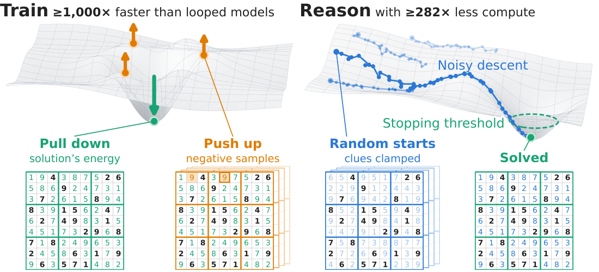
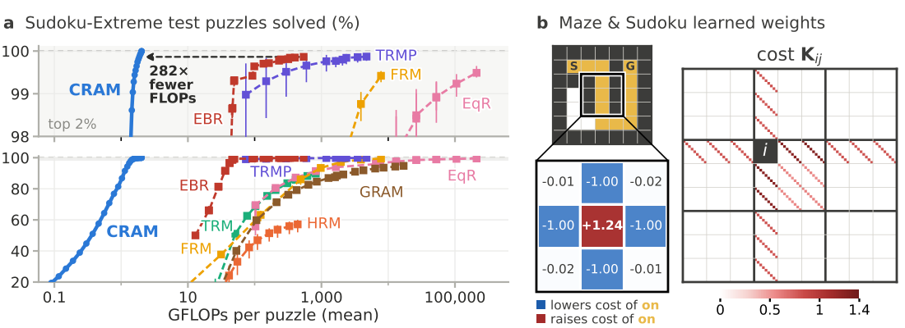
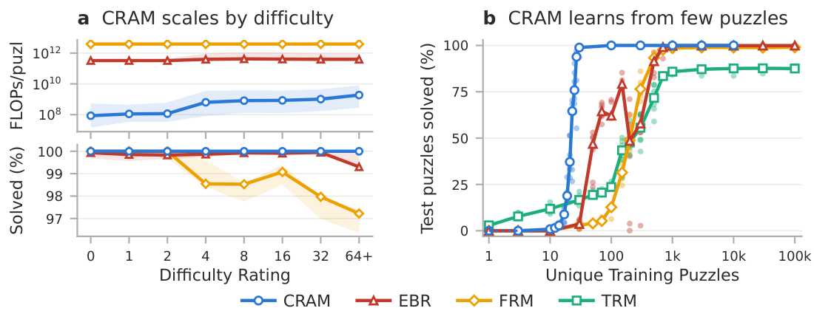
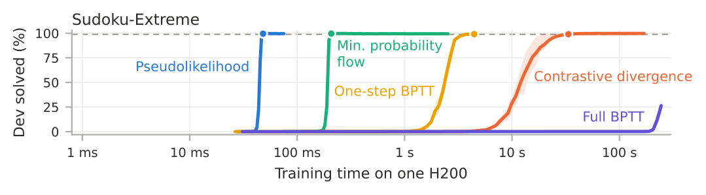
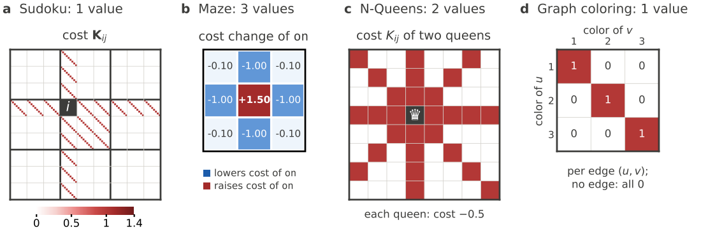
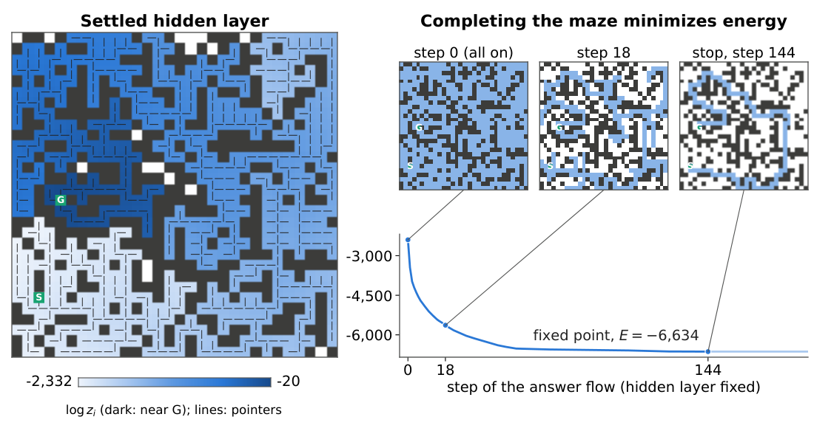

# CRAM：经典能量模型学推理，训练提速千倍

循环推理模型在数独、迷宫等任务上效果不错，却往往训练缓慢、参数众多，还要额外设计收敛与停止机制。CRAM（Compact Reasoning Associative Memory，紧凑推理联想记忆）直接把上世纪 80 年代的 Hopfield–Tank 能量函数变成可学习模型：训练时塑造能量地形，推理时沿能量下降搜索答案。在一张 H200 上，它分别用 **42 ms 和 132 ms** 完成 Sudoku-Extreme 与 Maze-Unique 的训练，解决 **99.996% 和 100%** 的测试题，训练速度至少是循环模型的 **1,000 倍**。达到循环模型各自最高准确率时，CRAM 的推理 FLOPs 至少减少 **282 倍**；更重要的是，它还能从答案示例中学出可检查的任务规则。

## 为什么不再给循环模型“打补丁”？

近年的 HRM、TRM 等模型通过反复应用同一层或同一组网络层来推理。它们用少量参数在数独和迷宫上取得了高准确率，但通常依赖截断的随时间反向传播（BPTT），训练成本高，成功机制也不够清楚。

与此同时，许多新工作正在给循环模型逐项补上能量模型天然具备的性质：

- 用额外 Loss 或训练约束，让循环更新收敛到吸引子或不动点；
- 用独立 halting head 判断何时停止；
- 用更深的网络学习能量，再通过 BPTT 训练；
- 用额外模块控制重启、采样轨迹或计算深度。

论文因此提出一个直接的问题：**既然循环模型正在重新发明能量网络的部件，为什么不直接学习能量？**

能量方法把训练与推理统一在同一个目标上。训练让正确解的能量变低，推理则在巨大答案空间中寻找低能量状态。连续确定性动力学天然保证能量不增加，还能用能量阈值提前停止，不必再附加一个停止网络。

> 图解：左侧训练中，模型压低真实解的能量、抬高负样本的能量，无须沿推理轨迹反向传播。右侧推理时，题目已知格被固定，多条独立搜索链从随机填值开始，逐格降低能量；任一条链的能量低于由训练解拟合的阈值，搜索即可停止。训练耗时与推理计算量均相对循环模型大幅降低。

这个设计的聪明之处，不是把老能量函数简单复活，而是把 **可学习的约束、递归搜索和可靠停止** 放进同一个极小模型里。接下来先看它如何表示一张答案棋盘。

## CRAM：把推理写成一张能量地形

### 用二值或多值单元表示答案

设答案包含 $M$ 个单元，每个单元最多有 $C$ 个候选值。模型为每个单元维护一个信念分布 $\boldsymbol p_i$，所有单元组成 $M\times C$ 的数组 $\boldsymbol p$，其中 $p_{ia}$ 表示单元 $i$ 取值 $a$ 的概率。

数独的 81 个格子各有 9 个候选数字；Maze-Unique 的 900 个格子则只有“在路径上”和“不在路径上”两个状态。题目已知条件通过 clamp 固定，不参与自由更新。

CRAM 的平均场自由能由三部分组成：

$$
E_{\theta}(\boldsymbol p)
=\beta^{-1}\sum_i\boldsymbol p_i^{\top}\log\boldsymbol p_i
+\frac{1}{2}\sum_{i\ne j}\boldsymbol p_i^{\top}\boldsymbol K_{ij}\boldsymbol p_j
+\sum_i\boldsymbol B_i^{\top}\boldsymbol p_i
$$

其中：

- 第一项是 **负熵**，$\beta>0$ 是逆温度，控制信念分布的尖锐程度；
- $\boldsymbol K_{ij}\in\mathbb R^{C\times C}$ 是单元对之间的可学习代价，描述两个候选值是否相容；
- $\boldsymbol B_i\in\mathbb R^C$ 是单元自身的输入代价或偏置。

当 $\boldsymbol p_i$ 都是 one-hot 时，熵项为零，能量就退化为所选答案的单元代价与成对代价之和。换句话说，**一张正确棋盘应当处在低谷，违反规则的棋盘应当处在高处**。

不同任务只改变参数共享方式与初始化先验，并不直接把规则写进训练目标。

| 设置 | Sudoku-Extreme | Maze-Unique | N-Queens $8\times8$（$10\times10$） | Graph coloring，8（10）个顶点 |
|---|---|---|---|---|
| 答案形状 $M\times C$ | $81\times9$ | $900\times2$ | $64\times2$（$100\times2$） | $8\times3$（$10\times3$） |
| 成对代价 $\boldsymbol K_{ij}$ | 每个单元对一个 $9\times9$ 矩阵 | 每个 $3\times3$ 窗口偏移一个 $2\times2$ 矩阵 | 每个相对偏移一个代价 | 每对顶点一个 $3\times3$ 表，每条边另有一个 $3\times3$ 表 |
| 输入代价 $\boldsymbol B_i$ | 每格独立 | 所有格共享 | 所有格共享 | 每个顶点独立 |
| 可训练参数总数 | 263K | 18 | 113（181） | 7.3K（18.7K） |
| 先验 | 数字增强 | 局部性、平移不变性 | 仅相对位置 | 无 |
| 输入处理 | 固定线索格 | 固定墙、起点和终点 | 固定已给皇后 | 边选择相应的边代价表 |
| 搜索链数 | 4 | 1 | $N$ | $N$ |
| 初始化 | 每格均匀随机 | 所有开放格设为 1 | 无皇后，已给皇后除外 | 每格均匀随机 |

这里的 263K 是 Sudoku 模型可训练参数的总容量；经过 L1 稀疏化后，主实验中实际非零且有贡献的参数只有 7.7K。

### 推理就是递归下降能量

每个单元还有无约束状态 $\boldsymbol v_i\in\mathbb R^C$，信念由其 softmax 得到：

$$
\boldsymbol p_i=\operatorname{softmax}(\beta\boldsymbol v_i)
$$

自由单元按以下连续动力学更新：

$$
\tau_i\frac{d\boldsymbol v_i}{dt}
=-\boldsymbol v_i-\sum_j\boldsymbol W_{ij}\boldsymbol p_j-\boldsymbol B_i
\simeq-\nabla_{\boldsymbol p_i}E_{\theta}(\boldsymbol p)
$$

其中，$\boldsymbol W_{ij}=(\boldsymbol K_{ij}+\boldsymbol K_{ji}^{\top})/2$，且 $\boldsymbol W_{ii}=0$。等号右边的 $\simeq$ 表示可以相差一个对所有候选值都相同的标量；softmax 不受这种整体平移影响。

用相同时间常数 $\tau$、步长 $\eta=\Delta t/\tau$ 做 Euler 离散化，得到：

$$
\boldsymbol v_i\leftarrow(1-\eta)\boldsymbol v_i
-\eta\left(\sum_j\boldsymbol W_{ij}\boldsymbol p_j+\boldsymbol B_i\right)
$$

当 $\eta=1$ 时，每次更新就是一层 recurrence。这解释了 CRAM 与循环模型的关系：**循环更新不再是一个任意学习的黑箱，而是能量下降的一步。**

不过，确定性下降仍可能陷入局部极小值。实际实验采用 focused Gibbs search：优先更新局部能量偏高的单元，并保留一定随机性，让搜索链有机会跳出虚假低谷、探索不同解。Maze-Unique 则使用零温度的单格更新。

能量还提供两种自然停止方式：

- 任一棋盘的能量不超过训练解拟合出的阈值；
- 没有任何单格变化能够继续降低能量，即到达单格局部极小值。

### 为什么能量一定不增？

附录给出了连续时间下的简洁证明。定义凸函数：

$$
\mathcal L(\boldsymbol v_i)=\beta^{-1}\log\sum_a\exp(\beta v_{ia})
$$

其导数正是 softmax 信念，即 $\boldsymbol p_i=\partial\mathcal L/\partial\boldsymbol v_i$。进一步有：

$$
H_i=\frac{\partial^2\mathcal L}{\partial\boldsymbol v_i\,\partial\boldsymbol v_i^{\top}}
=\beta\left[\operatorname{diag}(\boldsymbol p_i)-\boldsymbol p_i\boldsymbol p_i^{\top}\right]\succeq0
$$

利用链式法则和上述动力学，可得：

$$
\frac{dE}{dt}
=-\sum_{i\in\mathcal F}\tau_i\dot{\boldsymbol v}_i^{\top}H_i\dot{\boldsymbol v}_i\le0
$$

这个结论有明确边界：它要求输入、参数、温度和固定单元不变，时间常数为正，并针对连续时间动力学。它 **不保证唯一极小值，不排除鞍点，也不保证极小值就是正确解**；离散步长、有限精度以及带噪声的 focused Gibbs 搜索需要另行分析。

## 不展开推理轨迹，怎样把能量学出来？

### 从最大似然到局部目标

能量学习的原则是压低数据解 $\boldsymbol x\sim P_{\mathrm{data}}$ 的能量，同时抬高模型偏好的负样本 $\boldsymbol x^-\sim P_{\theta}$ 的能量。对应梯度为：

$$
\nabla_{\theta}\mathcal J_{\mathrm{ML}}(\theta)
=\mathbb E_{\boldsymbol x\sim P_{\mathrm{data}}}
\left[\nabla_{\theta}E_{\theta}(\boldsymbol x)\right]
-\mathbb E_{\boldsymbol x^-\sim P_{\theta}}
\left[\nabla_{\theta}E_{\theta}(\boldsymbol x^-)\right]
$$

难点在第二项：从 Boltzmann 分布采样通常要运行马尔可夫链或松弛过程，代价很高。CRAM 主实验采用 pseudolikelihood（PL，伪似然），用“真实解的单格扰动”替代全模型采样。

设 $\mathcal F$ 是题目未给定的自由单元，$\boldsymbol x^-_{i\leftarrow a}$ 表示把真实解中的单元 $i$ 改为 $a$。PL 目标为：

$$
\mathcal J_{\mathrm{PL}}(\theta;\boldsymbol x)
=E_{\theta}(\boldsymbol x)
+\frac{1}{|\mathcal F|}\sum_{i\in\mathcal F}
\log\sum_a\exp\left[-E_{\theta}(\boldsymbol x^-_{i\leftarrow a})\right]
$$

其直观含义是：给定真实解的其他所有单元，正确单元值应当比其他候选值具有更低能量。由于只比较单格变化，训练不需要运行完整推理，更不需要对推理过程求导。

在 one-hot 答案集合上，条件分布可精确写成 softmax：

$$
q_i(a)=P_{\theta}(\boldsymbol p_i=\boldsymbol e_a\mid\boldsymbol p_{-i}=\boldsymbol y_{-i},\boldsymbol x)
=\frac{\exp z_{ia}}{\sum_b\exp z_{ib}},
\qquad z_{ia}=-E_{\theta}(\boldsymbol y^{i\leftarrow a})
$$

于是，PL 就是所有自由单元上的交叉熵平均。与完整联合似然相比，它避开了对最多 $C^{|\mathcal F|}$ 种赋值求和的配分函数；近似之处仅在于用条件似然之和代替联合似然。

这个局部视角也是速度优势的核心：**训练只看答案及其单格邻居，推理搜索则被完全留在测试阶段。**

## 实验设置：四类任务、七种循环基线

论文在四类约束任务上评估 CRAM：

- **Sudoku-Extreme**：困难的 $9\times9$ 数独；
- **Maze-Unique**：$30\times30$ 迷宫，答案是两端点之间的唯一路径；
- **N-Queens**：同一输入可能有多个合法摆法；
- **Graph Coloring**：3-着色图，同样具有多个合法答案。

对比对象包括 HRM、TRM、GRAM、EqR、FRM、TRMP 和 EBR。所有方法在相同测试集上评分，CRAM 与基线均训练 3 个随机种子；可用时使用作者代码和训练方案，在一张 H200 上重训计时。只比较通过自身 recurrent computation 产生答案的模型，不把学习代价后交给外部精确求解器的方法纳入对比。

CRAM 的权重从零初始化，使用带动量的 SGD 和 cosine schedule 优化 PL。Sudoku 训练时每次更新随机重标数字；最终模型直接用于测试，不根据测试集挑 checkpoint。训练结束前，用训练解的最高能量加小容差拟合停止阈值，该步骤计入训练时间。

## 主结果：毫秒训练，准确率不降

### Sudoku-Extreme 与 Maze-Unique

下表的 Solved 是 3 个训练种子的均值与标准差；FLOPs/puzl 包含所有搜索链、失败搜索、停止测试与答案选择。CRAM 的 fit time 是同一进程首次运行之后，7 次完整训练的 warm-time 中位数；基线是新进程中的一次 cold fit。

| 模型 | Sudoku Solved（%） | Sudoku Params | Sudoku FLOPs/puzl | Sudoku Fit time | Maze Solved（%） | Maze Params | Maze FLOPs/puzl | Maze Fit time |
|---|---:|---:|---:|---:|---:|---:|---:|---:|
| HRM | 54.62 ± 4.18 | 27.0M | $2.20\times10^{11}$ | 1.2 h | 39.97 ± 33.90 | 27.0M | $3.01\times10^{12}$ | 7.1 h |
| TRM | 85.73 ± 0.74 | 5.0M | $4.11\times10^{11}$ | 2.5 h | 92.23 ± 13.37 | 6.8M | $3.84\times10^{12}$ | 15.6 h |
| GRAM | 96.10† | 9.1M | $8.51\times10^{12}$ | 3.2 h | 98.63 ± 1.31 | 10.9M | $8.00\times10^{13}$ | 23.2 h |
| EqR | 99.49 ± 0.14 | 5.0M | $2.11\times10^{14}$ | 2.0 h | 93.00† | 263.8K | $1.16\times10^{14}$ | 7.2 h |
| FRM | 99.13 ± 0.29 | 7.0M | $3.91\times10^{12}$ | 2.9 h | 97.27 ± 2.80 | 8.0M | $4.70\times10^{12}$ | 9.7 h |
| TRMP§ | 99.87 ± 0.08 | 32.8K | $4.57\times10^{12}$ | 9.0 h | 99.23 ± 0.31 | 60.7K | $1.80\times10^{13}$ | 7.6 h |
| EBR | 99.85 ± 0.05 | 1.8M | $3.37\times10^{11}$ | 2.8 h | 89.80 ± 6.35 | 1.8M | $1.93\times10^{13}$ | 2.0 h |
| **CRAM** | **100.00 ± 0.00 *** | **7.7K** | $2.02\times10^{9}$ | **0.04 s** | **100.00 ± 0.00** | **18** | $8.37\times10^{5}$ | **0.13 s** |
| Hand-set | 100.00 ± 0.00 | 1 | $1.08\times10^{8}$ | 无训练 | 100.00 ± 0.00 | 3 | $8.37\times10^{5}$ | 无训练 |

† 表示作者复现的三次结果低于论文报告值超过 2 个百分点时，表中展示已发表准确率。CRAM 的 100.00* 是四舍五入值，实际为 99.996%。Hand-set 的 Params 统计不同的非零权重值数量，不是普通网络参数量。

TRMP 另有一个 16K 参数的 lattice 模型，配合手写候选消除、随机提交和重启搜索；论文摘要报告其约 10 分钟可训练，本文复现版本训练 13 分 28 秒后在 Sudoku-Extreme 上解决 98.90%。

最醒目的不只是“快”。CRAM 在 Sudoku 上只用 7.7K 个非零参数，在 Maze 上只用 18 个参数，同时超过了最准确的循环基线 TRMP。Maze 上每次谜题的平均推理量甚至只有 $8.37\times10^5$ FLOPs。

### 等准确率比较：推理计算量再降几个数量级

单纯比较各模型默认设置并不充分，因为增加推理步数、重启数或采样轨迹通常能换取更高准确率。作者因此在 10,000 道 Sudoku-Extreme 测试题上扫描每种方法的推理预算，画出“计算量—解决率”曲线。

> 图解：（a）横轴是每道 Sudoku 的推理 FLOPs，纵轴是解决比例；上图放大底部曲线最高的 2% 区域。箭头从最便宜的高准确率循环模型 EBR 指向达到同等准确率所需的最便宜 CRAM 配置，对应至少 282 倍计算量差距。（b）展示学习到的 Maze 与 Sudoku 权重：Maze 权重归一化到四个侧边邻居的平均耦合，Sudoku 则在未提供行列宫约束图的情况下学出了正确的成对代价。

在每种基线自身最高准确率设置下，CRAM 的推理 FLOPs 减少幅度从 **282 倍（相对 EBR）到 128,000 倍（相对 EqR）** 不等。达到 EBR 的 99.86% 最高准确率时，CRAM 每题使用 $1.9\times10^9$ FLOPs，EBR 则为 $5.4\times10^{11}$。CRAM 最高解决率为 99.997%，平均每题约 $2.0\times10^9$ FLOPs。

这里的“未解决”不是答错：若搜索耗尽预算仍没有棋盘通过能量阈值，CRAM 只记为 miss，不返回错误答案。

### 多解任务：小模型也能覆盖多种答案

N-Queens 和 Graph Coloring 用来检验模型是否只会记忆唯一答案。$N=1$ 保留一个样本；$N=20$ 时，GRAM 对 20 个样本多数投票，EBR 与 CRAM 选最低能量样本。Cov@20 衡量 20 个样本找到的合法解覆盖率，Conflict 是保留答案中冲突边的总数。

| 任务 | 指标 | HRM | TRM | GRAM | EBR | CRAM | Hand-set |
|---|---|---:|---:|---:|---:|---:|---:|
| N-Queens $8\times8$ | Acc., $N=1$（%） | 84.41 ± 2.2 | 67.39 ± 6.8 | 99.44 ± 0.2 | **100.00 ± 0.0** | 99.95 ± 0.0 | 100.00 ± 0.0 |
|  | Acc., $N=20$（%） | 84.41 ± 2.2 | 67.39 ± 6.8 | **100.00 ± 0.0** | 99.95 ± 0.1 | **100.00 ± 0.0** | 100.00 ± 0.0 |
|  | Cov@20（%） | 58.8 ± 0.6 | 51.4 ± 3.1 | 97.9 ± 0.2 | **98.1 ± 0.2** | 97.9 ± 0.1 | 98.4 ± 0.0 |
|  | Params | 27.3M | 6.8M | 10.9M | 7.1M | **113** | 2 |
|  | Fit time | 59 min | 1.3 h | 1.3 h | 3.2 h | **2.9 s** | 无训练 |
| N-Queens $10\times10$ | Acc., $N=1$（%） | 37.80† | 17.50† | 88.91 ± 3.1 | 99.31 ± 0.3 | **99.45 ± 0.1** | 99.99 ± 0.0 |
|  | Acc., $N=20$（%） | 37.80† | 17.50† | 99.98 ± 0.0 | **99.99 ± 0.0** | **99.99 ± 0.0** | 100.00 ± 0.0 |
|  | Cov@20（%） | 10.7 ± 4.0 | 3.3 ± 3.6 | 92.9 ± 0.3 | 92.5 ± 0.7 | **93.6 ± 0.1** | 95.5 ± 0.0 |
|  | Params | 27.3M | 6.8M | 10.9M | 7.1M | **181** | 2 |
|  | Fit time | 4.0 h | 5.0 h | 5.2 h | 7.6 h | **6.8 s** | 无训练 |
| Graph coloring，8 顶点 | Conflict, $N=1$ | 139.7 ± 10.7 | 118.0 ± 15.5 | 3.3 ± 2.5 | **0.0 ± 0.0** | **0.0 ± 0.0** | 0.0 ± 0.0 |
|  | Conflict, $N=20$ | 139.7 ± 10.7 | 118.0 ± 15.5 | 3.3 ± 1.2 | 2.7 ± 4.6 | **0.0 ± 0.0** | 0.0 ± 0.0 |
|  | Cov@20（%） | 20.6 ± 0.4 | 21.8 ± 0.8 | 87.9 ± 0.6 | **88.9 ± 0.1** | **88.9 ± 0.5** | 90.6 ± 0.6 |
|  | Params | 27.3M | 6.8M | 10.9M | 7.1M | **869** | 1 |
|  | Fit time | 41 min | 54 min | 53 min | 4.5 h | **1.3 s** | 无训练 |
| Graph coloring，10 顶点 | Conflict, $N=1$ | 182.7 ± 17.8 | 169.0 ± 20.3 | 52.7 ± 82.6 | **0.3 ± 0.6** | **0.3 ± 0.6** | 0.0 ± 0.0 |
|  | Conflict, $N=20$ | 182.7 ± 17.8 | 169.0 ± 20.3 | 52.7 ± 83.4 | 0.7 ± 1.2 | **0.0 ± 0.0** | 0.0 ± 0.0 |
|  | Cov@20（%） | 6.2 ± 0.9 | 6.9 ± 0.5 | 37.8 ± 24.7 | **54.8 ± 0.2** | 52.6 ± 0.6 | 55.2 ± 0.4 |
|  | Params | 27.3M | 6.8M | 10.9M | 7.1M | **475** | 1 |
|  | Fit time | 1.7 h | 2.1 h | 2.2 h | 7.6 h | **0.3 s** | 无训练 |

N-Queens 的 Cov@20 统一使用 EBR 的归一化方式，而非 GRAM 的不同口径。CRAM 在这些多解任务上没有全面碾压最强基线，但以秒级训练、几十到几百个有效参数达到了相近水平。

## 显式能量带来的两项额外能力

### 难度越高，计算量越多

固定循环深度会对简单题和难题一视同仁。CRAM 则在第一条达到能量阈值的棋盘处停止，因此计算量可随难度自然增长。

把 10,000 道 Sudoku 按数据集难度分箱后，CRAM 的每题中位 FLOPs 从最简单到最困难分箱增长 **22 倍**。FRM 对所有题使用静态计算量；EBR 虽有梯度范数停止机制，其中位计算量在各分箱仍维持在 $3.3\times10^{11}$ 到 $4.2\times10^{11}$，接近其最低成本。

> 图解：（a）横轴是 Sudoku-Extreme 数据集提供的难度分箱，刻度为 0、1、2–3、4–7、8–15、16–31、32–63、64+；上图纵轴为每题中位 FLOPs，带状区域覆盖第 10 到第 90 百分位，下图为三次训练的中位测试准确率及范围。CRAM 的计算量随难度温和增加，FRM 固定，EBR 几乎不变。（b）横轴是不同训练谜题数量，纵轴是同一 10,000 题测试集准确率；所有样本都额外做 99 种相同增强，点连接 6 次运行的中位数，CRAM 达到 98% 仅需 30 道独特题，EBR 需要 700 道。

停止可靠性同样关键。在完整测试集、三个训练运行合并统计后，只有 CRAM 没有在错误棋盘上触发停止。

| 停止规则 | Sudoku Halted（%） | Sudoku Wrong halts（%） | Sudoku Solved（%） | Maze Halted（%） | Maze Wrong halts（%） | Maze Solved（%） |
|---|---:|---:|---:|---:|---:|---:|
| HRM（halting head） | 54.5 | 0.62 | 54.7 | 21.4 | 0.16 | 40.3 |
| TRM（halting head） | 85.8 | 2.37 | 83.8 | 99.9 | 3.54 | 96.4 |
| EqR（halting head） | 87.5 | 1.61 | 86.1 | 66.0 | 1.06 | 65.3 |
| TRMP（halting head） | 93.8 | 0.05 | 93.8 | 91.2 | 0.73 | 99.2 |
| EBR（梯度范数） | 99.35 | 0.21 | 99.31 | 无可用停止规则 | — | — |
| **CRAM（能量阈值）** | **99.996** | **0.00** | **99.996** | **100.00** | **0.00** | **100.00** |

EBR 在 Maze-Unique 上即使答案正确，梯度范数仍接近 2，因此其公开协议只能运行固定数量的 segment，不能使用 Sudoku 上的停止方式。

### 权重不是黑箱，而是任务规则

CRAM 的成对代价可以直接检查。Sudoku 训练没有获得任何行、列、宫的位置图，但每次运行都在恰好 **810 对** 共享行、列或宫的单元之间，学出了相同数字的正代价，其余代价为零。

Maze-Unique 的 18 个权重则学出了“死胡同剪枝”：从所有开放格都开启的状态出发，每步关闭一个死胡同格，最后留下唯一路径。这个局部规则可解决所有 perfect maze。

数据效率也体现了规则归纳的优势。达到 98% Sudoku 测试准确率时，CRAM 只需 **30 道独特训练题**，EBR 需要 **700 道**。TRM 在少于 10 道题的极低数据区间反而解决最多测试题，但随后扩展速度慢于两种能量模型；CRAM 在低数据区间会收敛到不少错误解。

## 哪种训练目标最快？局部方法明显领先

### 十二种目标，三条技术路线

同一个 CRAM 能量可以使用多种训练方法，论文将其分为三类：

| 类别与方法 | 与真实解比较的对象 |
|---|---|
| **L：Pseudolikelihood** | 所有单格变化 |
| **L：Masked pseudolikelihood** | 单格变化，每个单元以概率 $q$ 被隐藏 |
| **L：Min Probability Flow** | 所有单格变化，以 $\exp(-\Delta E/2)$ 加权 |
| **L：Denoising Score Matching** | 自身 logits 加尺度为 $\sigma$ 的高斯噪声 |
| **S：Contrastive divergence** | 从真实解经过 $k$ 次 heat-bath move 后的棋盘 |
| **S：Persistent CD** | 每个训练棋盘保存一条链，每次访问推进 $k$ 步 |
| **S：Contrastive Hebbian** | 经过 $n$ 步松弛后的状态 |
| **D：Equilibrium Propagation** | 朝向与远离真实解微调的两次松弛 |
| **D：Implicit Differentiation** | 松弛状态及其伴随过程 |
| **D：Truncated BPTT（$t=1$）** | 只沿 $T$ 步中最后一步反传 |
| **D：Truncated BPTT（$t=5$）** | 沿最后 5 步反传 |
| **D：Full BPTT** | 沿全部 $T$ 步反传 |

L 类直接在标注解上求局部目标；S 类通过展开模型获取负样本，但不沿展开轨迹反传；D 类则穿过松弛过程或不动点求导。所有方法共享初始化、SGD 与训练框架，学习率、L1 强度及各自超参数均在开发题上选择。

> 图解：横轴为不含一次性启动开销的训练时间，纵轴为 512 道 Sudoku 开发题的平均解决率；每种方法运行 20 次，带状区域为第 25 到第 75 百分位。Pseudolikelihood 平均 48 ms 达到 99%，Minimum Probability Flow 为 0.21 s，one-step BPTT 为 4.4 s，Contrastive Divergence 为 33 s；Full BPTT 在 245 s 时平均仅 27%，延长到约 5 小时也只有 48.8% 测试解决率。

在统一框架中，九种方法在两项任务上都达到至少 99% 测试准确率，但达到速度相差悬殊。

| 训练方法 | Sudoku $T_{99}$ | Sudoku $\mathrm{FLOPs}_{99}$ | Sudoku Solved（%） | Maze $T_{99}$ | Maze $\mathrm{FLOPs}_{99}$ | Maze Solved（%） |
|---|---:|---:|---:|---:|---:|---:|
| Pseudolikelihood | **50 ms** | $3.42\times10^{10}$ | 100.00 ± 0.00 | 43 ms | $6.15\times10^{7}$ | **100.00 ± 0.00** |
| Masked pseudolikelihood | 198 ms | $1.95\times10^{11}$ | 99.99 ± 0.00 | **22 ms** | $3.11\times10^{7}$ | **100.00 ± 0.00** |
| Min Probability Flow | 225 ms | $1.95\times10^{11}$ | 99.99 ± 0.00 | 30 ms | $4.22\times10^{7}$ | **100.00 ± 0.00** |
| Denoising Score Matching | 1.6 s | $2.20\times10^{12}$ | 99.98 ± 0.01 | 23 ms | $3.44\times10^{7}$ | **100.00 ± 0.00** |
| Contrastive divergence | 33.7 s | $1.26\times10^{14}$ | 99.99 ± 0.00 | 258 ms | $3.37\times10^{9}$ | **100.00 ± 0.00** |
| Persistent CD | 30.2 s | $1.26\times10^{14}$ | 99.96 ± 0.06 | 262 ms | $3.37\times10^{9}$ | **100.00 ± 0.00** |
| Contrastive Hebbian | 348 ms | $1.92\times10^{12}$ | **100.00 ± 0.00** | 111 ms | $2.15\times10^{9}$ | **100.00 ± 0.00** |
| Eq Prop | — | — | 16.05 ± 8.75† | 3.7 s | $6.66\times10^{10}$ | **100.00 ± 0.00** |
| Implicit Diff. | — | — | 0.45 ± 0.50 | 2.3 s | $4.23\times10^{10}$ | **100.00 ± 0.00** |
| Truncated BPTT（$t=1$） | 4.6 s | $2.35\times10^{13}$ | 99.57 ± 0.29 | 1.1 s | $7.41\times10^{9}$ | **100.00 ± 0.00** |
| Truncated BPTT（$t=5$） | 2.9 min | $1.37\times10^{15}$ | 99.89 ± 0.07† | 4.0 s | $1.24\times10^{10}$ | **100.00 ± 0.00** |
| Full BPTT | — | — | 48.82 ± 3.73† | 7.7 s | $1.86\times10^{10}$ | **100.00 ± 0.00** |

$T_{99}$ 是三次运行平均开发解决率首次达到 99% 的时间中位数，破折号表示从未达到。带 † 的 Sudoku 方法使用更长的 cosine schedule：Full BPTT 最终运行 384 万次更新、每次约 4.8–5.0 小时；Eq Prop 为 24 万次更新；Truncated BPTT（$t=5$）为 6 万次更新。

这些时间只能在统一训练框架内部比较，不能直接等同于主表的 42 ms：统一框架每次更新前后都会同步 GPU 并插入开发集探测，PL 在这里完成一次 Sudoku 训练约需 70 ms。

## 手写能量揭示：这些 benchmark 到底有多难？

如果把任务规则直接写成 CRAM 权重，而不从数据学习，会发生什么？答案是：所有 Sudoku、Maze、N-Queens 和 Graph Coloring 测试题都能解决，而且 Sudoku 推理 FLOPs 比学习版最多再低 **19 倍**。

> 图解：每个子图标题标出不同非零权重值的数量。（a）Sudoku 对同一行、列或宫内的 20 个单元使用相同数字的代价矩阵，本质上只需要一个独特权重值。（b）Maze 显示开放格开启时的能量变化，中心项对应无邻居开启，其余项对应不同偏移邻居的贡献，共三个独特值。（c）N-Queens 对互相攻击的位置赋代价 1，共两个独特值。（d）Graph Coloring 仅给边上同色顶点赋代价，非边为零，只需一个独特值。

这个结果具有双重含义。一方面，它说明能量形式与局部搜索确实足以表达这些任务；另一方面，它也说明高准确率未必代表深度推理能力——**几个成对规则就足以拿下整个 benchmark**。

因此，论文并不是借 CRAM 宣称“数独已经被通用推理解释清楚”，而是在提醒：用这些任务论证大型循环模型的可扩展性，证据可能很弱。

## 复现细节：训练、搜索与计时口径

所有 CRAM 拟合都从零权重开始，使用 momentum 为 0.5 的 SGD 和 cosine schedule；L1 通过每步 soft-threshold 实现。

| 设置 | Sudoku-Extreme | Maze-Unique | N-Queens $8\times8$（$10\times10$） | Graph coloring，8（10）顶点 |
|---|---|---|---|---|
| 训练行数 | 1,000 | 1,000 | 7,224（108,234） | 7,002（13,465） |
| Loss | PL + L1，$\lambda=3.33\times10^{-4}$ | PL | PL | PL + L1，$\lambda=10^{-4}$（$10^{-3}$） |
| 更新次数 | 32，full batch | 20，batch 64 | 4,000，full batch | 1,024（256），full batch |
| 学习率 | 540 | 1 | 30 | 10 |
| 搜索初始化 | 均匀随机 | 所有开放格开启 | 仅已给皇后 | 均匀随机 |
| 移动方式 | focused Gibbs | $T=0$ 单格更新 | focused Gibbs | focused Gibbs |
| 温度 | $0.40\bar h\to0.31\bar h$ | 0 | $u$ | $2\bar h$（$3\bar h$） |
| 搜索链 | 4 | 1 | 1 或 20 | 1 或 20 |
| 停止测试 | 能量 $\le\tau+10^{-3}$ | 不动点 | 局部 margin | 每一项均低于训练最大值 |
| 预算 | $6.3\times10^{11}$ FLOPs | 20,000 moves | 20,000 moves | 10,000 moves |

其中，$\bar h$ 是正学习代价的平均值，$u$ 是 N-Queens 的温度单位，$\tau$ 是训练解中的最高能量。

### 各任务的关键处理

- **Sudoku**：单元只是不透明索引，模型不知道行、列、宫或数字结构。每条题运行 4 条随机链，温度在 524,288 次移动内几何下降后重启；在 3 个种子的合计 1,238,358 次搜索中，只有 51 次耗尽预算，没有错误停止。
- **Maze-Unique**：墙固定为关闭，起终点固定为开启。从全开放状态开始，每次随机选择一个未处于最低能量值的单元并改正；最多使用 290 次移动。空棋盘能量反而更低，因此初始化方向对找到唯一正确路径很重要。
- **N-Queens**：输入是移除若干皇后的合法解，每个可能答案都作为一个训练标签。不同相对偏移的代价梯度按该偏移单元对数量做预条件，避免长对角线因样本相关性不足而学不动。
- **Graph Coloring**：顶点对代价表是图邻接 token 的仿射函数，模型并未直接获得“哪条边属于哪对顶点”的索引；训练后 8 顶点和 10 顶点模型分别只有 869 和 475 个非零参数。

### FLOPs 与 wall-clock 如何统计

推理 FLOPs 覆盖所有采样轨迹、停止测试、样本选择与解码，不含利用标签计算的 Loss 和指标。矩阵乘法的每次乘加计 2 FLOPs；逐元素四则运算、exp、log、sigmoid 等各计 1；比较、索引、数据移动、随机数生成等计 0。

训练计时从数据已进入主机内存开始，到可推理模型及其停止统计就绪为止，包含设备传输、初始化、增强、前后向、优化器、编译与阈值拟合，不包含文件读取、评估、保存和模块导入。

CRAM 只训练毫秒级，因此报告去除一次性 kernel 加载等启动开销的 warm time；长基线报告 cold fit，其启动开销最多占 2.2%，Maze 上 TRMP 为 3.5%。所有计时都来自一张 H200，但共享集群上的并发任务仍可能造成波动。代码、数据准备和运行记录位于 [Prefrontal-AI/CRAM](https://github.com/Prefrontal-AI/CRAM)。

## 走向更难的迷宫：加入一个隐变量层

### 为什么原始 CRAM 在 Maze-Hard 上归零？

Maze-Unique 没有环路，死胡同填充即可得到唯一路径。Maze-Hard 含环路，选择环路哪一侧取决于到目标的距离；纯二值成对能量没有地方存储这种距离计算，因此原始 CRAM 在 Maze-Hard 测试集上一个也解不出。

扩展模型 CRAM+$z$ 增加一个隐层：每个开放格有一个标量隐状态 $z_i$，其值随离目标 G 的距离逐步衰减。隐能量为：

$$
E_z(\boldsymbol z)
=\sum_i\left[\frac{m}{2}z_i^2
-\frac{1}{2}\sum_{j\in\mathcal N(i)}z_i z_j\right]-z_G
$$

其中，$\mathcal N(i)$ 是开放侧边邻居，$m>4$。由于 Hessian 每行对角元 $m$ 大于其他元素绝对值之和，该能量严格凸且有唯一极小值。

令 $\tau=m$、Euler 步长为 1，更新可写成：

$$
z_i\leftarrow
\begin{cases}
\displaystyle \frac{1}{m}\left(\sum_{j\in\mathcal N(i)}z_j+1\right), & i=G,\\[8pt]
\displaystyle \frac{1}{m}\sum_{j\in\mathcal N(i)}z_j, & i\ne G.
\end{cases}
$$

每次更新会把最大误差至少乘以 $4/m<1$，因此从任意初始状态都会收敛。从零开始时，距 G 为 $d$ 的单元在 $d+1$ 次更新后首次变为非零，于是隐层自然形成距离样场。

隐层先独立松弛，随后固定，答案层再从全开放状态执行第二次松弛。两者通过归一化邻域权重连接：

$$
\alpha_{ij}(\boldsymbol z)
=\frac{e^{\beta_{j-i}}z_j}{\sum_{k\in\mathcal M(i)}e^{\beta_{k-i}}z_k},
\qquad
L_{ij}(\boldsymbol z)=\kappa_{j-i}\alpha_{ij}(\boldsymbol z)
+\kappa_{i-j}\alpha_{ji}(\boldsymbol z)
$$

其中 $\mathcal M(i)=\mathcal N(i)\cup\{i\}$。$L_{ij}$ 降低相互连接单元同时开启的代价，方向参数 $\beta_{\delta}$ 则允许模型学习 Maze-Hard 标签中的方向偏好。

> 图解：左侧是隐层先松弛后得到的距离样场与指向最大邻域权重的指针，白色表示不连通 G，深灰表示墙，指针形成根在 G 的树。右上展示答案层从全开放棋盘逐步剪枝，停止时与标注路径一致；右下显示答案能量逐步下降，浅色曲线是停止后继续 48 步到不动点的结果。

训练仍使用 PL，隐层参数通过 adjoint solver 求梯度，不需要对任一松弛过程做 BPTT。模型共有 **29 个参数**：原 Maze 的 18 个，加上 5 个 $\kappa$、5 个 $\beta$ 和 1 个 $m$。

| 模型 | Solved（%） | Params | FLOPs/puzl |
|---|---:|---:|---:|
| HRM | 74.50 | 27.0M | $3.01\times10^{12}$ |
| TRM | 85.30 | 6.82M | $3.84\times10^{12}$ |
| FPRM | 87.00 | 6.83M | $4.78\times10^{14}$ |
| NCA | 89.20 | 41.0K | $2.00\times10^{12}$ |
| EBR | 88.30 | 1.77M | $1.93\times10^{13}$ |
| **CRAM+$z$** | **99.90 ± 0.00** | **29** | $1.41\times10^{7}$ |

三次训练都在 1,000 道测试题中解决 999 道，而且失败在同一道题：路径旁一个六格死胡同因局部相互支持而未被剪掉。单次拟合在一张 H200 上约需半分钟。

这个扩展说明简单能量并非只能处理唯一路径迷宫，但也暴露了真正开放的问题：**如何在没有任务结构先验的情况下，自动学习一般性的隐变量与中间量。**

## 总结：效率很惊人，外推仍需谨慎

- **统一框架**：CRAM 把循环推理写成能量下降，天然提供稳定动力学与停止阈值，无须额外 halting head。
- **训练极快**：局部 PL 目标无需展开推理轨迹，Sudoku 与 Maze 训练分别只需 42 ms 和 132 ms，至少比循环基线快 1,000 倍。
- **推理高效且准确**：达到基线最高准确率时至少减少 282 倍 FLOPs，Sudoku 解决 99.996%，Maze-Unique 解决 100%。
- **规则可读、数据高效**：模型从少量答案中学出 Sudoku 约束与迷宫死胡同填充，达到 98% Sudoku 准确率仅需 30 道独特训练题。
- **benchmark 警示与扩展边界**：手写少量权重即可解决这些约束任务，高分不代表通用推理；隐层虽让 Maze-Hard 达到 99.9%，一般化中间量学习仍未解决。

下一步最值得关注的，不是继续在这些简单谜题上堆更高分，而是研究如何自动发现隐状态、组合更丰富的能量结构，并把这种数据高效训练带到真正开放的推理任务。

> 本文参考自 [Classical Energies Learn to Reason 1,000× Faster than Looped Models](http://arxiv.org/abs/2611.17309v1)