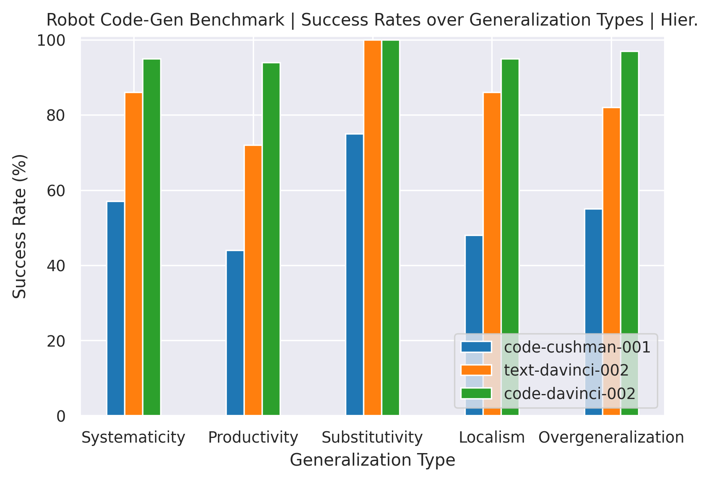
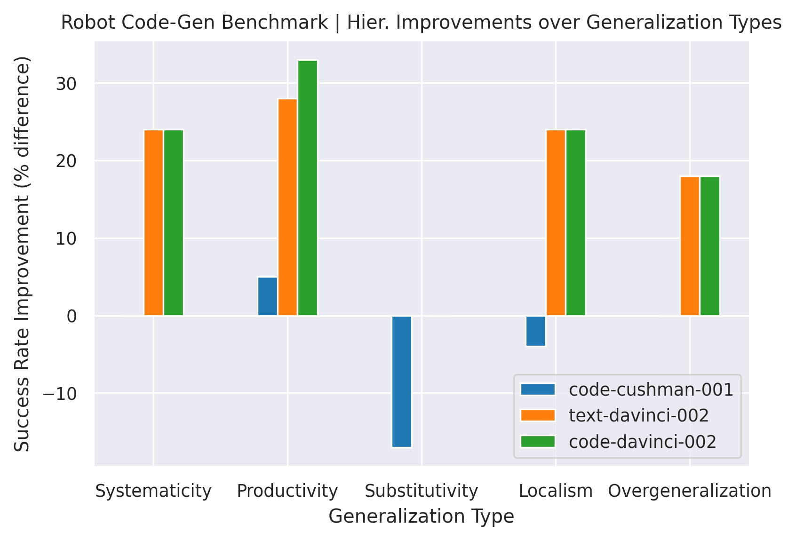
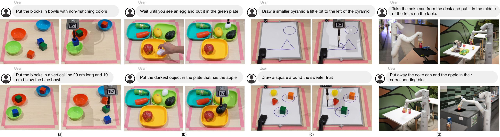
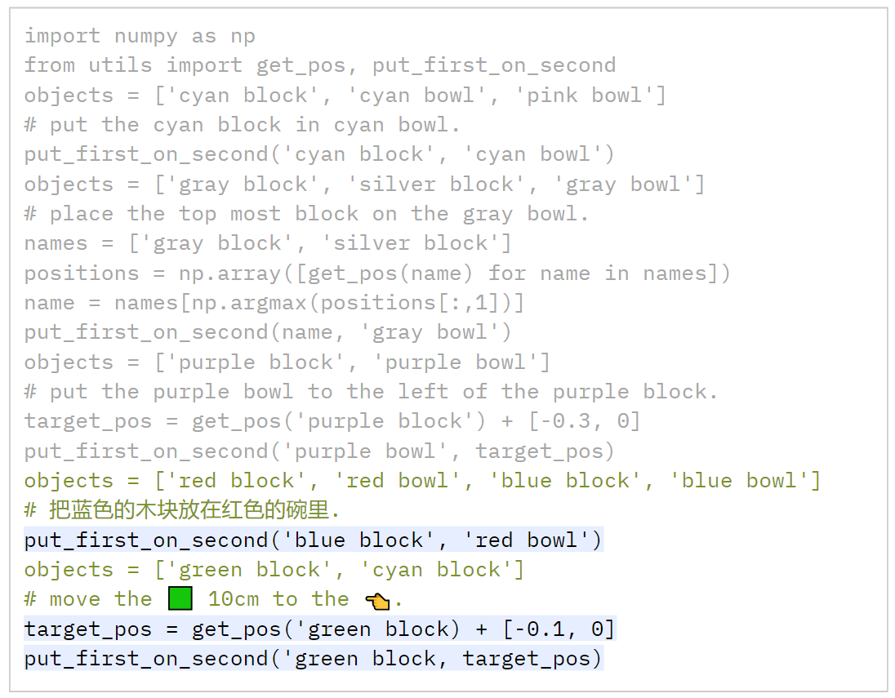

# Code as Policies：让大模型直接编写机器人控制代码

这篇工作解决的问题是：如何让大语言模型不只给机器人排列几个预训练技能，而是直接生成可执行的感知—控制策略。它重要之处在于，机器人面对新指令时，不必为每一种反馈逻辑、空间关系或控制参数重新采集数据并训练技能。Code as Policies（CaP）的核心思路，是把自然语言指令作为注释，通过 few-shot prompting 让代码模型生成 Python 策略，再调用感知与控制 API 在机器人上执行。在属性与指令均未见过的仿真长程任务中，CaP 达到 **80.00%** 成功率，高于自然语言规划器的 64.00% 和 CLIPort 的 0.00%；其分层代码生成方法在 HumanEval 上取得 **39.8% P@1**，高于对应 Flat CodeGen 的 34.9%。

## 从“调用技能”到“生成策略”

让机器人听懂语言，难点并不只是理解一句话，而是把词语、感知和动作真正连接起来。早期方法通常先做语义解析，再把结果交给规划器或控制器；近年的 End-to-End 方法直接学习语言到动作的映射，却需要大量机器人数据。

SayCan、Inner Monologue 等 LLM 方法减少了额外微调：模型负责生成高层计划，再从固定技能库中选择可执行动作。这种分工很实用，但也留下了一个边界——LLM 只能决定“调用哪个技能”，很难直接改变技能内部的感知—动作反馈逻辑。

例如“把可乐罐向右移动一点”，传统 LLM 规划器可能输出：

1. 抓起可乐罐；
2. 向右移动一点；
3. 放下可乐罐。

这套计划默认系统已经有 `move_a_bit_right` 之类的技能。如果没有，就需要重新实现、采集数据或训练。CaP 则直接生成策略代码：

```python
while not obj_in_gripper("coke can"):
    robot.move_gripper_to("coke can")
robot.close_gripper()
pos = robot.gripper.position
robot.move_gripper(pos.x, pos.y + 0.1, pos.z)
robot.open_gripper()
```

这里既有抓取反馈循环，也有“向右一点”对应的数值参数。换言之，**CaP 不是把代码当作另一种计划文本，而是把代码当作可运行的策略表示**。


> 图解：模型接收 few-shot 示例和新的自然语言命令，生成机器人策略代码。代码可以处理感知模块输出、为控制原语填写参数，并为尚未定义的函数递归生成实现，最终在新任务上执行。绿色、橙色和红色分别对应感知、控制与未定义函数等角色。

## CaP：用语言模型程序连接感知与动作

论文把由语言模型生成、并在系统上执行的程序统称为 **LMP（Language Model Program，语言模型程序）**。CaP 是其中面向机器人控制的一类：它把语言指令映射为代码片段，让代码完成三件事：

- 接收传感器或感知模块的输出，并据此作出反应；
- 为控制原语 API 生成参数；
- 在机器人上直接编译或执行。

一个最小例子是“把方块堆到空碗里”：

```python
# stack the blocks in the empty bowl.
empty_bowl_name = parse_obj('empty bowl')
block_names = parse_obj('blocks')
obj_names = [empty_bowl_name] + block_names
stack_objs_in_order(obj_names=obj_names)
```

`parse_obj` 负责把“空碗”“方块”等描述解析成场景中的对象，`stack_objs_in_order` 则表达动作逻辑。高层指令可以来自人，也可以来自另一个 LMP；模型输出则应当是合法 Python 代码。

### Prompt 里需要放什么

LMP 的 Prompt 主要由两部分组成。

**第一部分是 Hints。** 它告诉模型有哪些 API、库和类型约定，例如：

```python
import numpy as np
from utils import get_obj_names, put_first_on_second
```

**第二部分是 Examples。** 它们是“指令注释—对应代码”的 few-shot 示例，展示如何调用 API、做算术、组织返回值以及使用语言结构。新指令和模型响应还能不断追加到会话中，使后续命令可以引用前文，例如“撤销刚才的操作”。

除特别说明外，论文实验使用 OpenAI Codex `code-davinci-002`，并设 `temperature=0`，即采用确定性的 greedy decoding。

### 为什么代码特别适合空间推理

代码模型在预训练中接触过 NumPy、SciPy、Shapely 等库，因此可以把“最左侧”“中心”“最近点”直接转成可计算操作：

```python
# 最左侧的点
ret_val = pts_np[np.argmin(pts_np[:, 0]), :]

# 点集中心
ret_val = np.mean(pts_np, axis=0)

# 距离 pt_np 最近的点
ret_val = pts_np[
    np.argmin(np.sum((pts_np - pt_np) ** 2, axis=1))
]
```

这一步的关键不是 LLM 在脑内完成了多么复杂的几何推理，而是它知道 **该调用什么计算工具**。自然语言负责表达意图，Python 与第三方库负责保证数值计算精确执行。

对于机器人自己的第一方 API，只要函数命名清晰，并在 Hints 或 Examples 中展示用法，模型也能组合调用：

```python
# 把红色方块向右移动一点
target_pos = get_pos('red block') + [0.1, 0]
put_first_on_second('red block', target_pos)

# 把蓝色方块放到同色碗里
put_first_on_second('blue block', 'blue bowl')
```

`get_pos` 可以接入开放词表目标检测器，`put_first_on_second` 则可以是已有的抓取放置原语。CaP 不要求这些原语消失，而是让 LLM 能更灵活地组织它们。

### 从顺序动作到闭环反馈

Python 的 `if/else`、`for` 和 `while` 让策略不再只是一次性的动作列表。下面的代码会持续检查红色方块的位置，每次向右移动 5 cm，直到它不再位于蓝色碗左侧：

```python
while get_pos('red block')[0] < get_pos('blue bowl')[0]:
    target_pos = get_pos('red block') + [0.05, 0]
    put_first_on_second('red block', target_pos)
```

值得注意的是，论文对应 Prompt 中并没有这个 while-loop 示例。模型是在复用编程语言能力，而不是简单背诵一段动作序列。

这个设计的聪明之处在于：**反馈条件、循环结构和控制参数都保留在可读代码里**。开发者可以检查、修改和复用策略，比不可解释的动作向量更容易定位问题。

### 代码如何安全执行

执行前，系统会检查生成代码，排除 `import`、以 `__` 开头的特殊变量，以及对 `exec` 和 `eval` 的调用。随后，Python `exec` 在两个作用域中运行代码：

- `globals`：包含生成代码允许调用的全部 API；
- `locals`：初始为空，用于保存执行期间产生的变量和新函数。

如果程序需要返回值，系统会在执行结束后从 `locals` 中读取。这里的检查是对生成代码的约束机制，并不意味着任意 LLM 代码都可以不加隔离地部署到真实机器人。

## 分层代码生成：让模型先搭骨架，再补函数

解决了“如何生成一段策略”之后，下一个问题是：任务更复杂、Prompt 更长时，如何避免所有逻辑挤在一层代码里？

CaP 允许模型调用 **尚未定义的函数**。系统解析代码的抽象语法树（AST），找出当前作用域中不存在的函数，再调用专门负责函数生成的 LMP 补全实现。新函数内部若又出现未定义函数，就按深度优先方式继续递归生成，并把结果加入作用域。

例如，高层策略可以写：

```python
def get_objs_bigger_than_area_th(obj_names, bbox_area_th):
    return [
        name for name in obj_names
        if get_obj_bbox_area(name) > bbox_area_th
    ]
```

其中 `get_obj_bbox_area` 原本并不存在，另一个 LMP 会继续生成：

```python
def get_obj_bbox_area(obj_name):
    x1, y1, x2, y2 = get_obj_bbox_xyxy(obj_name)
    return (x2 - x1) * (y2 - y1)
```

模型甚至能根据 `get_obj_bbox_xyxy` 的命名推断返回值是轴对齐包围盒的左上角与右下角坐标。清晰的函数名在这里不只是可读性设计，也是向模型传递类型与语义约定的方式。

分层生成带来三个直接收益：

- 高层 LMP 可以先写策略“草图”，不必一次给出全部底层细节；
- 每个子 LMP 可以拥有更聚焦的 Examples，缓解上下文长度限制；
- 生成的函数可以积累到后续代码库中，被新的策略重复调用。

从形式上看，带有详细变量名的分层代码生成，也像是通过函数式编程实现的 Chain-of-Thought：中间推理不再只是自然语言，而是具有名称、输入和输出的可执行函数。

## Prompt 工程的复现要点

论文附录强调，LMP 虽然不需要重新训练模型，但绝不等于“不需要工程”。要提高生成可靠性，可以遵循以下原则：

- **Examples 必须没有 bug。** 与当前指令最接近的错误示例，尤其容易诱导错误响应。
- **变量约定保持一致。** 同一个 `point` 不要在一个示例中表示 NumPy 数组，在另一个示例中又表示 Shapely `Point`。
- **用命名补充非正式类型提示。** 如用 `_np` 表示 NumPy 数组，用 `_mat` 表示矩阵，用 `get_bbox_xyxy` 暗示返回格式。
- **第一方 API 遵循常见命名。** `get_`、`set_` 等前缀，以及明确的返回对象说明，都有助于模型正确调用。
- **显式导入第三方库。** 模型有时能自行使用 NumPy、SciPy，但写出 import 会提高可靠性和使用率。
- **采用正确的导入形式。** 对第一方函数使用 `from utils import function_name`，避免模型把函数名误当成包名。
- **通过针对性示例修复调用错误。** 缺少参数、误判类型等问题，通常可以补充一个正确 Hint 或 Example；论文尝试的 LLM 自动代码编辑效果并不稳定，因此未用于实验。

## 实验一：分层生成是否真的更有效

作者从两个角度验证分层代码生成：新建的机器人代码基准 RoboCodeGen，以及通用代码基准 HumanEval。

### RoboCodeGen：37 道机器人代码题

RoboCodeGen 包含 37 个函数生成问题，覆盖空间推理、几何推理与控制，例如点集插值、包围盒包含判断、PD 控制、Shapely 图形操作和第一方 API 调用。它有几个刻意设计的特点：

- 允许并鼓励使用 NumPy 等第三方库；
- 函数头没有 docstring 和显式类型提示，模型需要依据常见约定推断；
- 允许调用尚未定义的函数，以测试分层生成能力。

评价指标是生成代码通过人工单元测试的比例：

| 方法 | GPT-3 6.7B | GPT-3 175B | Codex cushman | Codex davinci |
|---|---:|---:|---:|---:|
| Flat | 3 | 68 | 54 | 81 |
| Hierarchical | **5** | **84** | **57** | **95** |

结果呈现两条清晰规律：代码专用 Codex 整体优于同系列文本模型，较大模型通常更好；而 Hierarchical 在四组模型上全部超过 Flat。最强的 Codex davinci 从 81% 提升到 95%。

### 五类泛化：提升主要发生在哪里

论文进一步按五种泛化类型拆分结果：

- **Systematicity（系统性）**：重新组合示例中的指令或代码片段；
- **Productivity（产出性）**：生成比示例更长、层级更多的代码；
- **Substitutivity（替换性）**：处理同义词或同类词替换；
- **Localism（局部性）**：把见过的局部概念用于不同目的；
- **Overgeneralization（过度泛化）**：使用示例中未出现的新 API 或语言特性。


> 图解：该图展示 Flat CodeGen 在五类泛化上的表现。三个模型的相对排序在不同类别中基本一致，`code-davinci-002` 最强；较小的 `code-cushman-001` 在 Productivity 和 Localism 上尤其困难，但在 Substitutivity 上相对更好。



> 图解：该图展示改用 Hierarchical CodeGen 后的五类泛化表现。两个 davinci 模型在更复杂、层级更多的代码上受益明显，说明递归补全函数更适合扩展程序结构，而不仅是替换几个词。



> 图解：该图直接对比 Hierarchical 相对 Flat 的增益。提升最突出的是 Productivity，但这一现象主要出现在两个 davinci 模型上；cushman 没有表现出同样收益，Substitutivity 和 Localism 甚至下降。这意味着基础代码能力需要先达到一定水平，分层提示才容易转化为额外收益。

### HumanEval：收益不限于机器人代码

HumanEval 的结果说明，分层生成也能改善通用程序合成。Greedy 指 `temperature=0` 的单次最可能输出；P@N 指以 `temperature=0.8` 采样 N 个答案后，至少一个通过测试的比例。

| 方法 | Greedy | P@1 | P@10 | P@100 |
|---|---:|---:|---:|---:|
| Flat | 45.7 | 34.9 | 75.1 | 90.9 |
| Hierarchical | **53.0** | **39.8** | **80.6** | **95.7** |

附录给出了更完整的对照，包括 Flat Prompt 和早期模型结果：

| 方法 | Greedy | P@1 | P@10 | P@100 |
|---|---:|---:|---:|---:|
| code-davinci-001 | - | 36.0 | - | 81.7 |
| PaLM Coder | - | 36.0 | - | 88.4 |
| Flat CodeGen + No Prompt | 45.7 | 34.9 | 75.1 | 90.9 |
| Flat CodeGen + Flat Prompts | 50.6 | 36.6 | 77.6 | 93.3 |
| Hier. CodeGen + Hier Prompts | **53.0** | **39.8** | **80.6** | **95.7** |

分层 Prompt 只包含两个示例，关键区别是允许示例调用未定义的 `get_mean`，而不是直接计算均值。在 HumanEval 的 164 道题中，6.5% 实际触发了分层代码生成；在这些题上，两种 Flat 变体成功率均为 44%，Hierarchical 为 56%。

需要注意，P@100 的高分依赖多次采样和预先存在的单元测试，不适合直接照搬到需要即时执行的机器人策略。因此 CaP 机器人实验始终采用 `temperature=0` 的单次输出。

## 实验二：为什么“用代码推理”优于自然语言推理

作者构造了两类空间几何问题：

- **Object Selection**：28 题，例如找出离蓝色碗最近的方块；
- **Position Selection**：23 题，例如在青色碗与蓝色碗之间插值 3 个点，所有坐标距离真值不超过 1 cm 才判为正确。

对照方法包括直接回答的 Vanilla 自然语言推理，以及 Chain-of-Thought（CoT）逐步推理：

| 任务 | Vanilla | CoT | LMP（CaP） |
|---|---:|---:|---:|
| Object Selection | 39 | 68 | **96** |
| Position Selection | 30 | 48 | **100** |
| Total | 35 | 58 | **98** |

CoT 能帮助模型比较坐标和关系，却容易在精确、多步数值计算上出错。LMP 则把计算交给 Python 和 NumPy 执行，因此优势最明显的地方不是语言理解，而是 **可验证的数值操作**。

代码与 CoT 并不互斥。论文没有继续探索“逐步生成代码”的组合，但这自然是后续可扩展方向。

## 实验三：仿真桌面操作中的泛化

仿真环境包含 UR5e 机械臂、Robotiq 2F85 夹爪、10 个彩色方块和 10 个彩色碗。任务分为两类：

- **Long-Horizon**：多步任务，例如把方块放入同色碗；
- **Spatial-Geometric**：要求精确空间几何推理，例如把方块排成对角线。

作者把指令（I）和指令中的属性（A）分别划分为 seen 与 unseen。属性包括方块颜色、方位、距离、序号和线型等；例如训练或 Prompt 中见过“左侧、最近、第一、水平”，测试则可能出现“右下、最远、第三、对角”。每个任务进行 50 次试验，随机采样属性和初始场景。

对照包括用 30k demonstrations 训练的 CLIPort，以及输出自然语言计划的 few-shot LLM Planner。主表中的 CLIPort 使用附录所述的 oracle termination，即借助仿真真值判断何时停止。

| 属性/指令 | 任务类别 | CLIPort | NL Planner | CaP |
|---|---|---:|---:|---:|
| SA / SI | Long-Horizon | 78.80 | 86.40 | **97.20** |
| SA / SI | Spatial-Geometric | **97.33** | N/A | 89.30 |
| UA / SI | Long-Horizon | 36.80 | 88.00 | **97.60** |
| UA / SI | Spatial-Geometric | 0.00 | N/A | **73.33** |
| UA / UI | Long-Horizon | 0.00 | 64.00 | **80.00** |
| UA / UI | Spatial-Geometric | 0.01 | N/A | **62.00** |

CaP 在每个 Long-Horizon 设置中都领先；面对未见属性时，CLIPort 明显下降，而 LLM 方法保持较强泛化。自然语言规划器无法处理需要精确数值空间推理的任务，因此对应项为 N/A。

CaP 并非在所有已见任务上占优：SA/SI 的 Spatial-Geometric 中，CLIPort 为 97.33%，CaP 为 89.30%。这说明 few-shot 通用策略与针对已见分布训练的专用策略各有优势。

### 逐任务结果

下表保留附录的细粒度结果。`CLIPort (oracle)` 与 `CLIPort (no oracle)` 分别表示是否利用仿真真值停止；无 oracle 时固定执行 10 个动作再评估。

| 任务 | CLIPort (oracle) | CLIPort (no oracle) | NL Planner | CaP |
|---|---:|---:|---:|---:|
| **已见属性、已见指令** | | | | |
| 把 object1 放到 object2 或碗上 | 88 | 44 | 98 | **100** |
| 堆起所有方块 | **98** | 4 | 94 | 94 |
| 把所有方块放到指定角/边 | **96** | 8 | 46 | 92 |
| 把方块放进指定碗 | **100** | 22 | 94 | **100** |
| 把方块放入同色碗 | 12 | 14 | **100** | **100** |
| 拿起碗某方向的方块，放到指定角/边 | **100** | 80 | N/A | 72 |
| 拿起离碗最近/最远的方块，放到指定角/边 | 92 | 54 | N/A | **98** |
| 拿起某方向第 n 个方块，放到指定角/边 | **100** | 38 | N/A | 98 |
| Total | 85.8 | 33.0 | 86.4 | **94.3** |
| Long-Horizon Total | 78.8 | 18.4 | 86.4 | **97.2** |
| Spatial-Geometric Total | **97.3** | 57.3 | N/A | 89.3 |
| **未见属性、已见指令** | | | | |
| 把 object1 放到 object2 或碗上 | 12 | 10 | 98 | **100** |
| 堆起所有方块 | 96 | 8 | 96 | **100** |
| 把所有方块放到指定角/边 | 0 | 0 | 58 | **100** |
| 把方块放进指定碗 | 46 | 0 | 88 | **96** |
| 把方块放入同色碗 | 30 | 26 | **100** | 92 |
| 拿起碗某方向的方块，放到指定角/边 | 0 | 0 | N/A | **60** |
| 拿起离碗最近/最远的方块，放到指定角/边 | 0 | 0 | N/A | **100** |
| 拿起某方向第 n 个方块，放到指定角/边 | 0 | 0 | N/A | **60** |
| Total | 23.0 | 5.5 | 88.0 | **88.5** |
| Long-Horizon Total | 36.8 | 8.8 | 88.0 | **97.6** |
| Spatial-Geometric Total | 0.0 | 0.0 | N/A | **73.3** |
| **未见属性、未见指令** | | | | |
| 把所有方块放到不同角落 | 0 | 0 | 60 | **98** |
| 把方块放入不同颜色的碗 | 0 | 0 | **92** | 60 |
| 在指定角/边堆起所有方块 | 0 | 0 | 40 | **82** |
| 把 object1 放到碗某方向的指定距离处 | 0 | 0 | N/A | **38** |
| 把 object1 放到距碗指定距离的角落 | 4 | 0 | N/A | **58** |
| 把所有方块排成指定线型 | 0 | 0 | N/A | **90** |
| Total | 0.7 | 0.0 | 64.0 | **71.0** |
| Long-Horizon Total | 0.0 | 0.0 | 64.0 | **80.0** |
| Spatial-Geometric Total | 1.3 | 0.0 | N/A | **62.0** |

原论文主表与附录细表在 UA/UI 的 CLIPort Spatial-Geometric 数值上分别写作 0.01% 和 1.3%，这里分别按原表保留，不自行统一。

## 实验四：跨平台真实机器人演示

仿真结果验证了泛化，真实机器人实验则回答另一个问题：同一套 CaP 思路能否适配不同感知模块、控制 API 和机器人形态？



> 图解：图中 (a)–(b) 是桌面抓取放置，(c) 是二维图形绘制，(d) 是 Everyday Robots 移动操作机器人在厨房执行任务。CaP 通过开放词表感知、API 调用与 few-shot prompting，完成空间几何推理、对象关系解析和多步行为，无需针对这些新指令追加训练。

### UR5e 白板绘图

UR5e 末端固定白板笔，通过 MDETR 获取物体位置，再用轨迹跟随 API 绘制路径。系统包含四个主要 LMP：解析用户命令并维护会话、解析对象名称、把形状描述转成二维 waypoints，以及生成新函数。

论文演示的连续指令包括：画 5 cm 六边形、画平分线、同时放大、擦除、在右上画太阳、在底部画地面、画大小不同的三角形、围绕方块画圆，以及围绕“更甜的水果”画正方形。

这些任务把精确尺寸、空间关系、历史上下文和多步修改串在一起。`draw(pts_2d)` 会先移动到起点上方，再下降检测接触，最后沿轨迹运动；`erase(pts_2d)` 则先接触位置已知的板擦，再执行轨迹。

### UR5e 桌面抓取放置

真实桌面系统使用吸盘和腕部 Intel RealSense D435 相机，MDETR 提供对象存在性、位置和包围盒，脚本化原语执行抓取与放置。演示覆盖：

- 把方块排成水平线、正方形，并放大或旋转 45°；
- 根据“天空色”“最右侧”“最小”等描述选择对象；
- 回答“为什么移动绿色方块”“移动了哪个方块”等历史问题；
- 执行“撤销”“对其他方块做同样操作”等上下文命令；
- 把水果和瓶子分类到不同盘子；
- 等待看到鸡蛋后再把它放到绿色盘子上。

系统还能借助语音转文字与文字转语音进行交互。不过，当时 Prompt 只支持一组互不重复的对象，因为感知系统无法稳定保持重复物体在多次检测中的身份。这是世界状态跟踪能力的限制，不是代码策略表示本身的限制。

### 厨房中的移动操作机器人

移动平台具有移动底盘和 7 DoF 机械臂，主要利用 RGB-D 相机与 ViLD 开放词表检测。动作 API 包括按名称或坐标导航、抓取、放置和语音回复。


> 图解：图中是用于真实办公室厨房实验的 Everyday Robots 平台。移动底盘负责导航，7 DoF 手臂负责抓取和放置；CaP 在同一程序中组合视觉检测、位置记忆、导航与操作 API。

导航演示包括绕办公椅走 3 m × 2 m 矩形、将轨迹顺时针旋转 45°、绕吧台椅走正方形并持续检查香蕉、沿椅子的凸包移动，以及在桌子和台面之间往返 3 次。

操作演示则包括统计桌上的零食、把水瓶放到水果中间、学习三个垃圾桶的语义，再把可乐罐和苹果放入对应垃圾桶。Python 执行作用域中的变量可显式保存过去位置等信息，形成一种短期记忆。

## 实验五：从路径点扩展到反应式控制器

CaP 并不局限于“检测对象—移动到坐标”的稀疏控制。附录还展示了 CartPole 平衡和末端位置阻抗控制，说明 LMP 可以表达持续读取状态并输出动作的反应式策略。

### CartPole 的 PD 控制

模型根据小车位置、杆角度及各自速度生成 PD 控制逻辑，核心计算为：

$$
u = K_p \theta + K_d \dot{\theta}
$$

再根据 $u$ 的符号选择向左或向右的离散动作。这个控制器很简单，需要初始状态接近直立，也没有使用小车位置误差，但能够稳定一个原本不稳定的平衡点。


> 图解：图中展示 LMP 生成控制器后平衡 CartPole 的过程。它验证了同一 Prompt 结构不仅能组织机器人路径点，还能生成根据状态实时反馈的低层控制代码。

### UR5e 末端阻抗控制

另一个例子根据当前末端位置、目标位置、速度、刚度矩阵、阻尼矩阵和雅可比矩阵生成关节力矩：

$$
\tau = J^T\left(K_x(x_{goal}-x_{curr})-D_x\dot{x}\right)
$$

该控制器能在 PyBullet 中控制 UR5e 末端到达三维目标位置，但省略了科里奥利力与重力补偿，只控制位置而不控制旋转。

这里也暴露了 Prompt 约定的重要性：函数签名需要明确“使用 PD 控制”以及离散输出方向；增益名中的 `_mat` 用来提示矩阵，`_x` 用来提示它们作用于末端而非关节。没有这些信息时，生成代码可能看起来合理，却不符合环境 API。

默认增益之所以能工作，是因为任务较简单。更复杂的连续控制仍需根据执行反馈调参，而当时 CaP 尚不支持这种在线调节。

## 跨形态与其他 LLM 能力

CaP 可以根据可用动作 API，为不同机器人形态生成不同实现。例如，全向机器人走 U 形轨迹时可依次调用 `move_back`、`move_right`、`move_up`；只能前进和左转的机器人则会把同一路径写成 `move_forward` 与两次 `turn_left(90)` 的组合。

这种跨形态能力仍比较脆弱。面对差异很大的 API，现有模型未必能可靠适配，可能需要更大的模型或领域代码训练。



> 图解：图中展示 LMP 继承通用 LLM 的额外能力，包括解析非英语命令和 emoji。由于策略生成建立在预训练语言模型之上，这些能力无需另写一套多语言机器人解析器。

真实系统的视觉部分也并非完全即插即用。ViLD 和 MDETR 输出图像中的轴对齐包围盒与像素级分割，系统再利用已标定的深度相机变换，把对应像素反投影为机器人坐标。检测不准是许多真实失败的来源，VLM 本身也需要 Prompt 工程，例如 MDETR 用“square”检测方块可能比“block”更稳定。

## 局限：CaP 的泛化发生在哪一层

CaP 的泛化主要集中在机器人栈的中间层：解释自然语言、处理感知输出、为低维控制原语生成参数。它适合感知与控制已经分解的系统，但不替代整个机器人技术栈。

主要限制包括：

- **感知范围受限。** API 无法描述的状态，策略也难以使用。例如当时视觉语言模型很难描述轨迹是否“颠簸”或“更像 C 形”。
- **控制原语受限。** 机器人只能执行已有 API 支持的动作，且 Prompt 能清晰覆盖的可调参数数量有限。
- **复杂指令泛化有限。** 当指令明显长于示例、逻辑层数更多或抽象层级不同，生成容易失败。“用方块搭房子”就远超简单桌面示例的范围。
- **默认指令可执行。** 系统假设用户命令可行，也不能在执行前保证生成响应一定正确。
- **视觉与 API 工程仍然存在。** 省去的是额外策略训练，不是感知标定、原语实现、Prompt 设计和运行安全检查。
- **连续控制仍较简单。** 更复杂的控制器需要反馈调参、动力学补偿和更完整的执行闭环。
- **跨形态适配不够稳健。** 对差异较大的 API，仅更换 Hints 不一定足够。

## 总结

- **核心表示**：CaP 用可执行 Python 代替纯自然语言计划，把感知、反馈逻辑和控制参数写进同一策略。
- **关键机制**：Hints 与 Examples 提供 API 约定，控制流实现闭环反馈，第三方库承担精确空间计算。
- **分层生成**：通过 AST 查找未定义函数并递归补全，提升复杂代码生成；HumanEval P@1 从 34.9% 提升到 39.8%。
- **实验结论**：CaP 在未见属性与指令的仿真长程任务上达到 80.00%，并在 UR5e、移动操作机器人及反应式控制任务上展示跨平台灵活性。
- **适用边界**：它减少新任务的数据采集与训练需求，但仍受感知模块、控制原语、Prompt 质量和代码可靠性约束。

未来更有价值的方向，是把真实执行反馈纳入代码生成与调参闭环，并增强世界状态跟踪和安全验证，让 LMP 从“一次生成可运行策略”走向“在执行中可靠地修正策略”。

> 本文参考自 [Code as Policies: Language Model Programs for Embodied Control](https://arxiv.org/abs/2209.07753)