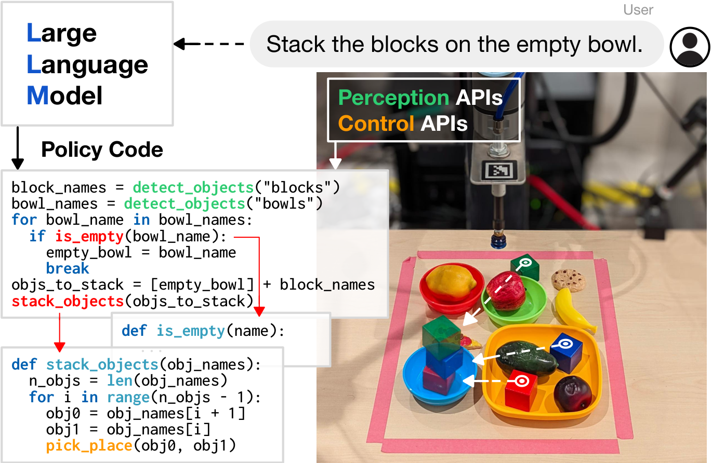
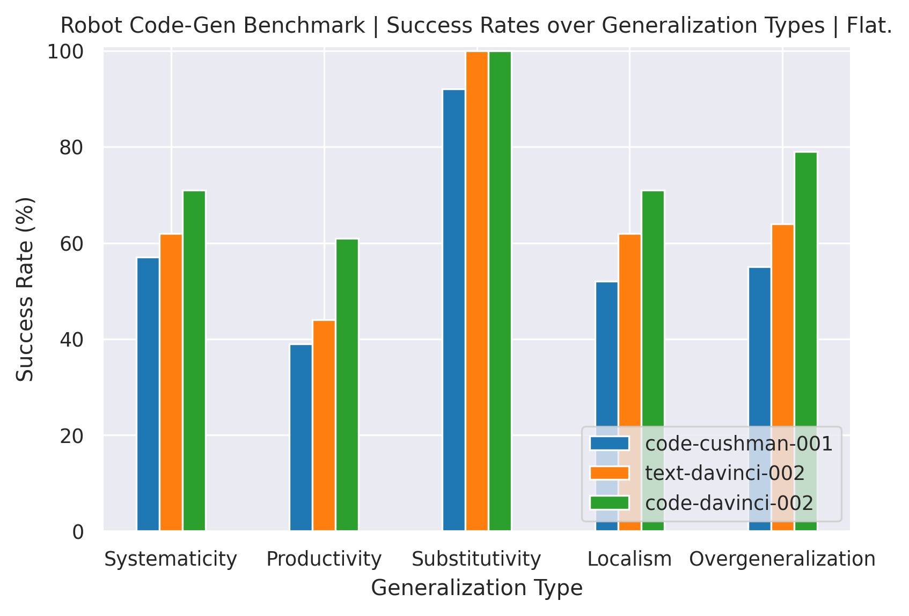
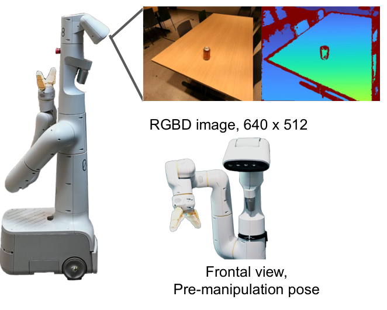
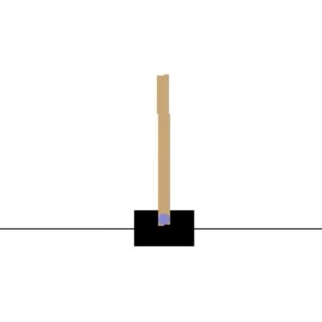

# Code as Policies：让大模型直接编写机器人控制代码

这项工作是：如何让大语言模型不只负责“排计划”，还能把自然语言指令直接变成可执行、可反馈的机器人控制策略。其重要性在于，过去每增加一种技能或反馈方式，往往都要重新采集机器人数据并训练策略，而 CaP 试图把这部分泛化工作交给代码生成模型。核心思路是用 few-shot Prompt 引导代码模型生成 Python 策略，让它处理感知结果、调用控制 API，并递归补全未定义函数。最有分量的结果有两组：代码推理在空间几何任务上的总体成功率达到 **98%**，自然语言 Chain-of-Thought 为 **58%**；层级代码生成在 HumanEval 上的 P@1 达到 **39.8%**，高于扁平生成的 **34.9%**。

## 为什么“把技能排个顺序”还不够

让机器人听懂“把苹果放到橙子上”，只是语言控制的第一步。真实指令还可能包含反馈条件、空间关系和行为常识，例如：

- “看到橙子时，再把苹果放下”；
- “把苹果向左移动一点”；
- “这次移动得更快”；
- “向右走，直到看到苹果”。

传统语言 grounding 方法通常先做词法或语义解析，再把结果交给策略，面对未见指令时容易失效。End-to-End 方法可以直接学习“语言到动作”的映射，但真实机器人数据采集昂贵，而且泛化往往局限于训练分布。

SayCan、Inner Monologue、Socratic Models 等工作已经让 LLM 参与机器人规划，但底层仍主要依赖一组预训练技能。比如“把可乐罐向右移一点”，自然语言计划可以写出“拿起罐子—向右移动—放下”，却默认系统已经有一个能执行“向右移一点”的技能。如果没有，就必须补数据、训练或手工实现。

CaP 换了一层抽象：不让 LLM 只输出技能名称，而是让它直接写出连接感知与控制的策略代码。

```python
while not obj_in_gripper("coke can"):
    robot.move_gripper_to("coke can")
robot.close_gripper()
pos = robot.gripper.position
robot.move_gripper(pos.x, pos.y + 0.1, pos.z)
robot.open_gripper()
```

这里既有抓取序列，也有 `while` 反馈循环，还把“向右一点”落实成了具体的坐标偏移。LLM 因而不只是规划器，也开始参与策略逻辑和控制参数的组织。



> 图解：CaP 通过 few-shot 示例，把自然语言命令翻译成机器人策略代码。生成代码可以处理感知模块的输出、为控制原语设置参数，并递归生成尚未定义的函数；同一条链路由此覆盖语言理解、空间计算、反馈逻辑与执行。

## CaP：把策略写成一组 Language Model Programs

论文把由语言模型生成并在系统上执行的程序统称为 **Language Model Program（LMP）**。CaP 是面向机器人控制的一类 LMP，它完成三件事：

1. 接收并处理感知输入，例如目标检测结果、物体位置和分割 mask；
2. 调用控制原语 API，并生成位置、轨迹、速度等参数；
3. 将代码直接编译或执行，使策略真正作用于机器人。

例如“把方块堆进空碗”可以被写成：

```python
empty_bowl_name = parse_obj("empty bowl")
block_names = parse_obj("blocks")
obj_names = [empty_bowl_name] + block_names
stack_objs_in_order(obj_names=obj_names)
```

指令以 Python 注释的形式进入 Prompt，模型输出合法 Python 代码。这里的 `parse_obj` 也可以是另一个 LMP，负责把“空碗”“所有方块”等描述映射到场景中的对象。

这个设计的关键不是“用 Python 代替英语”这么简单，而是把 LLM 的语言能力接上了编程语言的三种表达力：**精确计算、控制流和函数抽象**。

### Hints 与 Examples：Prompt 只需要两类核心材料

生成 LMP 的 Prompt 由两部分组成。

- **Hints**：用 import、函数签名和非正式类型提示说明有哪些 API 可用，以及参数和返回值的大致形式。
- **Examples**：给出若干“指令注释—对应代码”的 few-shot 示例，示范如何调用 API、做算术和组织控制逻辑。

```python
import numpy as np
from utils import get_obj_names, put_first_on_second
```

新指令及其响应可以持续追加到同一个会话中。这样，后续指令就能引用历史状态，例如“undo that”，或者读取之前保存的变量。这相当于用 Python 执行作用域维护一个短期记忆区。

除特别说明外，论文示例和实验使用 OpenAI Codex `code-davinci-002`，并将 `temperature` 设为 0，即采用确定性的 greedy decoding。

### 第三方库：把空间描述变成数值运算

代码模型在预训练中接触过大量 NumPy、SciPy、Shapely 等库的用法。CaP 直接复用这部分知识，不必为每种空间关系重新训练网络。

```python
# 找到 pts_np 中最左侧的点
ret_val = pts_np[np.argmin(pts_np[:, 0]), :]

# 求点集中心
ret_val = np.mean(pts_np, axis=0)

# 找到离 pt_np 最近的点
ret_val = pts_np[
    np.argmin(np.sum((pts_np - pt_np) ** 2, axis=1))
]
```

“最左”“中心”“最近”不再是三个需要分别学习的技能，而是共享同一套坐标表示和数值计算。变量名也承担类型提示的作用，例如 `pts_np` 暗示它是 NumPy 数组，二维向量运算则进一步暗示点是二维坐标。

### 第一方 API：让生成代码落地到具体机器人

第三方库提供通用计算，第一方 API 则把代码绑定到当前机器人。比如：

```python
from utils import get_pos, put_first_on_second

# 把红色方块向右移动一点
target_pos = get_pos("red block") + [0.1, 0]
put_first_on_second("red block", target_pos)

# 把蓝色方块放到同色碗上
put_first_on_second("blue block", "blue bowl")
```

`get_pos` 可以接入开放词表目标检测器，`put_first_on_second` 则封装抓取与放置。只要函数名和示例足够清楚，模型就能使用训练时从未见过的机器人 API。

这也解释了 CaP 的迁移方式：换机器人时，不必先重训一个通用策略，而是替换可用 API 和相应 Prompt 示例。不过，论文也强调这种跨 embodiment 能力仍然脆弱，不能理解成任意平台间都能可靠迁移。

### 控制流：自然语言条件直接变成闭环策略

程序中的 `if`、`for` 和 `while` 让 CaP 能表达开环技能序列之外的行为。即使 Prompt 中没有相同示例，模型也能生成简单反馈循环：

```python
while get_pos("red block")[0] < get_pos("blue bowl")[0]:
    target_pos = get_pos("red block") + [0.05, 0]
    put_first_on_second("red block", target_pos)
```

这段代码每轮都会重新读取位置，直到红色方块不再位于蓝色碗左侧。相比一次性生成固定轨迹，它更接近真正的 reactive policy。

LMP 之间还能通过嵌套调用组合。例如，高层程序每轮调用 `parse_obj("the left most block")`，由另一个 LMP 完成对象筛选，再决定是否继续移动。这样可以把不同示例分散到专门 Prompt 中，既提高各模块的针对性，也避开单次上下文长度限制。

## 层级代码生成：遇到未定义函数，就递归补一个

复杂任务最容易失败的地方，是模型试图把所有逻辑挤进一段扁平代码。CaP 的解决办法很接近程序员写代码：先搭出高层结构，遇到尚未实现的函数，再单独生成它。

```python
def stack_objs_in_order(obj_names):
    for i in range(len(obj_names) - 1):
        put_first_on_second(obj_names[i + 1], obj_names[i])
```

更复杂的例子中，模型可以先生成：

```python
def get_objs_bigger_than_area_th(obj_names, bbox_area_th):
    return [
        name for name in obj_names
        if get_obj_bbox_area(name) > bbox_area_th
    ]
```

此时 `get_obj_bbox_area` 仍未定义，系统继续生成：

```python
def get_obj_bbox_area(obj_name):
    x1, y1, x2, y2 = get_obj_bbox_xyxy(obj_name)
    return (x2 - x1) * (y2 - y1)
```

具体实现通过 Python 抽象语法树检查当前作用域中不存在的函数，再调用专门负责函数生成的 LMP 补全它，并加入作用域。这个过程在新函数内部重复，按深度优先方式递归展开。

这个设计的聪明之处在于，**未定义函数不再必然是错误，而成为继续分解任务的接口**。Prompt 编写者只需给出策略逻辑的“草图”，不必在示例中提前实现所有细节；生成的函数还能逐步积累，被后续 LMP 复用。带清晰变量名的函数式分解，也可以看作一种通过程序结构实现的 Chain-of-Thought。

### 代码如何执行

执行前，系统会检查生成代码是否包含 import 语句、以 `__` 开头的特殊变量，以及对 `exec`、`eval` 的调用。随后通过 Python `exec` 运行代码，并提供两个字典：

- `globals`：存放生成代码允许调用的全部 API；
- `locals`：初始为空，用于收集执行中产生的变量和新函数。

如果 LMP 需要返回值，系统在执行结束后从 `locals` 中读取。论文采用的是这一明确的执行流程，但这些静态检查本身不应被误解为覆盖所有风险场景的通用安全沙箱。

## 代码生成实验：层级分解是否真有用

CaP 不只是机器人展示系统，论文还分别测试了机器人代码生成和通用代码生成，以确认收益确实来自层级生成方法。

### RoboCodeGen：37 道机器人编程题

作者构建了 RoboCodeGen，包含 37 个函数生成问题，覆盖空间推理、几何推理和控制，例如点集插值、最近点搜索、bounding box 包含关系、PD 控制等。它有三个值得注意的设计：

- 明确允许并鼓励使用 NumPy 等第三方库；
- 函数头不提供 docstring 和显式类型提示，要求模型推断常见约定；
- 允许调用尚未定义的函数，以便测试层级代码生成。

评价指标是生成代码通过人工编写单元测试的比例。

| 方法 | GPT-3 6.7B | GPT-3 175B | Codex cushman | Codex davinci |
|---|---:|---:|---:|---:|
| Flat | 3 | 68 | 54 | 81 |
| Hierarchical | **5** | **84** | **57** | **95** |

> 表中数值为 RoboCodeGen 通过率，单位为 %。代码专用的 Codex 整体优于 GPT-3；同一系列中更大的模型表现更好；四种模型上，层级生成都高于扁平生成，其中 Codex davinci 从 81% 提升到 95%。

### 五类泛化：层级生成主要帮助“写更长、更深的代码”

论文借用组合泛化研究中的五种分类分析 RoboCodeGen：

- **Systematicity**：重新组合示例中的指令或代码片段；
- **Productivity**：生成比示例更长或层级更多的代码；
- **Substitutivity**：替换同义词或同类别的词；
- **Localism**：把见过的局部概念用于不同目的；
- **Overgeneralization**：使用示例中未出现的新 API 或语言特性。



> 图解：该图展示扁平 Prompt 与扁平代码生成在五类泛化上的表现。三个模型的相对排序在不同类别中基本一致，`code-davinci-002` 最强；较小的 `code-cushman-001` 在 Productivity 和 Localism 上尤其薄弱。


> 图解：该图改为展示层级 Prompt 与层级代码生成。各模型仍然较容易处理词语替换，但更长答案、更多逻辑层级和局部结构复用更具挑战。


> 图解：该图直接比较层级生成带来的变化。两个 davinci 模型在 Productivity 上提升尤其明显，说明递归分解主要帮助生成更长、更多层的函数；cushman 没有表现出同样收益，Substitutivity 和 Localism 反而下降。这意味着模型需要先具备足够的基础代码能力，层级策略才会成为助力。

### HumanEval：收益不限于机器人代码

HumanEval 是通用 Python 代码生成基准。Greedy 表示 `temperature=0` 时取最可能输出；P@N 表示以 `temperature=0.8` 采样 N 个答案，评估其中是否有正确解。

正文汇总结果如下：

| 方法 | Greedy | P@1 | P@10 | P@100 |
|---|---:|---:|---:|---:|
| Flat | 45.7 | 34.9 | 75.1 | 90.9 |
| Hierarchical | **53.0** | **39.8** | **80.6** | **95.7** |

附录进一步加入不同 Prompt 和已有模型结果：

| 方法 | Greedy | P@1 | P@10 | P@100 |
|---|---:|---:|---:|---:|
| code-davinci-001 | - | 36.0 | - | 81.7 |
| PaLM Coder | - | 36.0 | - | 88.4 |
| Flat CodeGen + No Prompt | 45.7 | 34.9 | 75.1 | 90.9 |
| Flat CodeGen + Flat Prompts | 50.6 | 36.6 | 77.6 | 93.3 |
| Hier. CodeGen + Hier Prompts | **53.0** | **39.8** | **80.6** | **95.7** |

层级 Prompt 与扁平 Prompt 都只有两个示例，关键差异是前者在计算均值时调用未定义的 `get_mean`，从而明确允许模型继续分解函数。所有采样口径下，层级组合都优于两种扁平组合。

不过也要看清实验边界：CaP 使用的是 `code-davinci-002`，已有对照工作中的部分结果来自 `code-davinci-001`，因此不能把所有差异都归因于层级生成。HumanEval 的 164 道题中，6.5% 触发了层级生成；在这部分题目上，两种扁平方法的成功率为 44%，层级方法为 56%。此外，采样 100 个候选并不适合缺少现成单元测试、需要直接执行策略的机器人场景，所以 CaP 实验始终采用 greedy 输出。

## 为什么代码比自然语言更擅长空间几何推理

为了单独比较推理载体，作者构造了 51 道空间几何题：

- 28 道对象选择题，例如“找到离蓝色碗最近的方块”；
- 23 道位置选择题，例如“在青色碗到蓝色碗之间插值 3 个点”。

位置答案只有在所有坐标与真值的误差都不超过 1 cm 时才判为正确。对照包括直接回答的 Vanilla 自然语言推理，以及给出中间推理步骤的 Chain-of-Thought。

| 任务 | Vanilla 自然语言 | Chain-of-Thought | LMP 代码 |
|---|---:|---:|---:|
| Object Selection | 39 | 68 | **96** |
| Position Selection | 30 | 48 | **100** |
| Total | 35 | 58 | **98** |

> 表中为平均成功率，单位为 %。CoT 能帮助模型比较关系和顺序，却仍容易在精确、多步数值计算上出错；LMP 可以把这些步骤交给 Python 和 NumPy 执行，因此优势在位置计算上尤其明显。

代码与 CoT 并不互斥。完全可以让模型“逐步”生成代码，但论文没有继续探索这一组合。

## 仿真桌面操作：未见属性与未见指令上的泛化

仿真环境包含 UR5e 机械臂、Robotiq 2F85 夹爪、10 个彩色方块和 10 个彩色碗。CaP 通过脚本检测器获得对象列表和位置，并调用按对象名或坐标参数化的 pick-and-place 原语。

任务分为两类：

- **Long-Horizon**：多步骤任务，例如“把方块放入颜色匹配的碗”；
- **Spatial-Geometric**：需要精确空间几何推理，例如“把方块排成对角线”。

作者进一步区分指令 I 和属性 A 是否见过。SA/SI 表示已见属性、已见指令，UA/UI 表示未见属性、未见指令。CLIPort 使用 30k 条示范进行模仿学习；NL Planner 使用自然语言做 few-shot 规划；CaP 只为每个任务提供一个示例 rollout。

| 训练/测试划分 | 任务类别 | CLIPort | NL Planner | CaP |
|---|---|---:|---:|---:|
| SA SI | Long-Horizon | 78.80 | 86.40 | **97.20** |
| SA SI | Spatial-Geometric | **97.33** | N/A | 89.30 |
| UA SI | Long-Horizon | 36.80 | 88.00 | **97.60** |
| UA SI | Spatial-Geometric | 0.00 | N/A | **73.33** |
| UA UI | Long-Horizon | 0.00 | 64.00 | **80.00** |
| UA UI | Spatial-Geometric | 0.01 | N/A | **62.00** |

> 每项任务进行 50 次试验，表中为成功率，单位为 %。NL Planner 无法处理需要精确数值空间计算的任务，因此相应位置为 N/A。CaP 在已见空间几何任务上低于 CLIPort，但在未见属性、未见指令的设置下保持明显更强的泛化。

### 附录细表：优势并非出现在每一个任务上

附录把 CLIPort 分为使用仿真成功信号终止的 oracle termination，以及固定执行 10 个动作的 no oracle。下表保留全部细分结果，数值均为成功率百分比。

| 划分与任务 | CLIPort（oracle） | CLIPort（no oracle） | NL Planner | CaP |
|---|---:|---:|---:|---:|
| **已见属性、已见指令** | | | | |
| 将 object1 放到 object2 或目标碗上 | 88 | 44 | 98 | **100** |
| 堆起所有方块 | **98** | 4 | 94 | 94 |
| 将所有方块放到指定角落/边 | **96** | 8 | 46 | 92 |
| 将方块放进指定碗 | **100** | 22 | 94 | **100** |
| 将方块放入颜色匹配的碗 | 12 | 14 | **100** | **100** |
| 拿起碗某方向的方块并放到角落/边 | **100** | 80 | N/A | 72 |
| 拿起离碗最近/最远的方块并放到角落/边 | 92 | 54 | N/A | **98** |
| 拿起某方向第 n 个方块并放到角落/边 | **100** | 38 | N/A | 98 |
| Total | 85.8 | 33.0 | 86.4 | **94.3** |
| Long-Horizon Total | 78.8 | 18.4 | 86.4 | **97.2** |
| Spatial-Geometric Total | **97.3** | 57.3 | N/A | 89.3 |
| **未见属性、已见指令** | | | | |
| 将 object1 放到 object2 或目标碗上 | 12 | 10 | 98 | **100** |
| 堆起所有方块 | 96 | 8 | 96 | **100** |
| 将所有方块放到指定角落/边 | 0 | 0 | 58 | **100** |
| 将方块放进指定碗 | 46 | 0 | 88 | **96** |
| 将方块放入颜色匹配的碗 | 30 | 26 | **100** | 92 |
| 拿起碗某方向的方块并放到角落/边 | 0 | 0 | N/A | **60** |
| 拿起离碗最近/最远的方块并放到角落/边 | 0 | 0 | N/A | **100** |
| 拿起某方向第 n 个方块并放到角落/边 | 0 | 0 | N/A | **60** |
| Total | 23.0 | 5.5 | 88.0 | **88.5** |
| Long-Horizon Total | 36.8 | 8.8 | 88.0 | **97.6** |
| Spatial-Geometric Total | 0.0 | 0.0 | N/A | **73.3** |
| **未见属性、未见指令** | | | | |
| 将所有方块放到不同角落 | 0 | 0 | 60 | **98** |
| 将方块放入颜色不匹配的碗 | 0 | 0 | **92** | 60 |
| 在指定角落/边堆起所有方块 | 0 | 0 | 40 | **82** |
| 将 object1 放到碗某方向、指定距离尺度处 | 0 | 0 | N/A | **38** |
| 将 object1 放到距碗指定距离的角落 | 4 | 0 | N/A | **58** |
| 将所有方块排成指定方向的线 | 0 | 0 | N/A | **90** |
| Total | 0.7 | 0.0 | 64.0 | **71.0** |
| Long-Horizon Total | 0.0 | 0.0 | 64.0 | **80.0** |
| Spatial-Geometric Total | 1.3 | 0.0 | N/A | **62.0** |

细表揭示了两个重要事实。其一，CaP 并非全面碾压：已见设置下的堆叠、放角落和方向选择，以及未见指令下的“颜色不匹配”任务，都有更强基线。其二，真正拉开差距的是新属性、新指令和精确空间计算的组合。

原文数据还有一处口径差异：正文主表将 UA/UI Spatial-Geometric 的 CLIPort 写为 0.01，附录细表对应汇总则为 oracle 1.3、no oracle 0.0。这里按两份原表分别保留，不擅自替换数值。

## 从仿真走向真实机器人

量化仿真验证了泛化，接下来的问题是：同一套生成机制能否适配不同硬件、感知器和动作 API。论文展示了白板绘画、桌面抓取和厨房移动操作三个真实系统，但这些开放式演示没有统一量化基线。


> 图解：图中 (a)–(b) 是桌面操作，(c) 是二维图形绘制，(d) 是 Everyday Robots 机器人在厨房中的移动操作。示例覆盖空间几何推理、对象关系解析和多步行为，感知与控制均由现成模型及 API 提供，CaP 本身不做额外训练。

### 白板绘画：把语言变成二维轨迹

UR5e 末端固定一支白板笔，系统知道白板与板擦的位置。MDETR 负责开放词表目标检测，动作 API 包括沿二维点序列绘画的 `draw(pts_2d)` 和擦除轨迹的 `erase(pts_2d)`。

系统由高层指令解析、对象名解析、轨迹点解析、轨迹变换和新函数生成等 LMP 组成。演示指令从“画一个 5 cm 六边形”开始，随后要求：

- 画一条平分六边形的线，并把两者都放大；
- 擦除六边形和直线；
- 在右上画太阳、底部画地面、地面上画金字塔；
- 在左侧画一个更小的金字塔；
- 围绕方块画圆，并围绕“更甜的水果”画正方形。

这些指令把尺寸、方位、历史引用和常识描述混合在一起。关键不是模型记住了“金字塔”的固定轨迹，而是它能生成并变换新的二维 waypoints。

### 真实桌面抓取：对象、关系、上下文与问答

另一套 UR5e 使用吸盘夹爪和腕上 Intel RealSense D435 相机。MDETR 提供对象存在性、位置和 bounding box，脚本原语完成抓取与放置。

论文演示了三组场景：

- 四个方块：排横线、组成并旋转正方形、放大或撤销操作、按顺时针放到不同角落；
- 三个方块和三个碗：处理“最右侧”“离它最远”“非匹配颜色”等关系，也完成“在森林里建塔”“模拟火山在海洋上喷发”等想象式指令；
- 水果、瓶子和盘子：回答数量与类别问题，按类别收纳，选择最小或颜色最深的对象，并等待鸡蛋出现后抓取。

高层 LMP 可以调用对象解析、位置解析、问题回答和函数生成模块。`say(message)` 让机器人通过语音解释行为，Google Cloud 的语音识别与合成则用于语音交互。

这套系统也有明确的感知限制：当前 Prompt 只支持一组唯一对象，因为 VLM 检测无法持续追踪重复物体身份。这是世界状态维护问题，不是代码策略表示本身无法表达重复对象。

### 厨房移动操作：导航、抓取与短期记忆

移动机器人带有移动底盘和 7 DoF 机械臂，主要使用 RGB-D 相机与 ViLD 检测器。API 覆盖位置查询、可见性检查、导航、抓取、放置和语音输出。



> 图解：图中是用于真实办公室厨房实验的移动机器人。与固定桌面机械臂相比，它同时需要底盘导航和机械臂操作，因此用于检验 CaP 面对不同动作空间时的适配能力。

导航演示包括绕椅子走 3 m × 2 m 矩形、将轨迹旋转 45°、沿椅子凸包移动，以及在桌子和台面之间往返三次。另一个指令要求机器人绕吧椅走正方形，每一步检查是否看到香蕉，只有看到香蕉才停止。

操作演示包括统计桌上的零食、把水瓶放到水果中间，以及把可乐罐和苹果放入对应垃圾桶。系统会把机器人过去的位置等状态显式保存到 Python 变量中，之后再次引用，形成短期记忆。

## 附录能力：从反应式控制器到跨 embodiment 生成

CaP 的表示范围不限于稀疏 waypoints。论文还测试了连续控制、跨机器人 API 适配，以及 LLM 附带的语言能力。

### CartPole：零样本生成简单 PD 控制器

CartPole 控制器输入小车位置、杆角度及各自速度，输出向左或向右的离散动作。模型根据函数签名中的提示生成 PD 形式：

$$
u = K_p \theta + K_d \dot{\theta}
$$

代码再依据 $u$ 的符号选择动作方向。默认 $K_p=1$、$K_d=1$ 在这个较简单的环境中即可工作，无需额外调参。



> 图解：该实验展示生成 LMP 后平衡 CartPole 的结果。控制器只适用于杆初始位置接近竖直的情况，作用是稳定一个不平衡点，并不等同于解决任意初始状态下的摆动起杆问题。

这里有一个很实际的细节：函数签名必须说明输出方向是离散的 0/1，并提示使用 PD 控制。否则模型可能生成形式上合理、却输出连续控制值的函数，无法匹配环境 API。

### 末端阻抗控制：由位置误差生成关节力矩

论文还让模型生成 UR5e 末端位置阻抗控制器，在 PyBullet 中驱动机械臂朝目标位置运动。核心关系为：

$$
\tau = J^T\left(K_x(x_{goal}-x_{curr})-D_x\dot{x}\right)
$$

其中 $J$ 是 Jacobian，$K_x$ 与 $D_x$ 分别是末端刚度和阻尼矩阵。生成代码使用矩阵乘法计算关节力矩，但省略了 Coriolis 力和重力补偿，因此只是简化控制器。

变量命名再次影响正确性：`_mat` 用来提示增益是矩阵，`_x` 用来区分末端空间和关节空间。更复杂的连续控制仍需根据执行反馈调节增益，而当前 CaP 不支持这种在线调参。

### 跨 embodiment：同一任务随 API 改变写法

对于全向机器人，模型可以用 `move_back`、`move_right`、`move_up` 直接画出 U 形；对于只能前进和左转的机器人，则改用 `move_forward` 与 `turn_left` 组合同一轨迹。

这说明 CaP 能依据动作 API 改写计划，而不是把某个固定动作序列硬套到所有平台。不过论文明确指出，这种能力对差异很大的 API 仍不可靠，可能需要更大的模型或领域代码训练。

### 非英语与 Emoji：继承 LLM 的附带能力

由于生成器本身是大规模预训练 LLM，CaP 还能解析非英语指令和 Emoji，而无需为此单独设计模块。


> 图解：图中展示 LMP 处理非英语和 Emoji 命令的示例。这些能力并非机器人策略训练所得，而是 CaP 直接继承自底层 LLM；其实际执行仍受感知与控制 API 限制。

## 视觉语言模型如何接入 CaP

真实实验使用两种现成开放词表检测器：移动机器人使用 ViLD，桌面操作和白板绘画使用 MDETR。它们接收图像和自然语言描述，输出轴对齐 bounding box 与逐像素分割 mask。

为了把检测转成机器人可执行的三维位置，系统从深度相机中选取对应像素并反投影，再利用事先标定的相机到机器人坐标系变换完成转换。抓取等脚本原语直接使用这些坐标。

因此，CaP 的真实失败有相当一部分来自视觉检测，而不是代码逻辑。VLM 本身也需要 Prompt Engineering，例如 MDETR 使用“square”检测方块时比“block”更可靠。开放词表并不意味着感知描述可以任意措辞。

## 复现时最值得注意的 Prompt Engineering 细节

论文附录给出的经验非常具体，也解释了为什么“让模型写代码”并不是把 API 文档随便塞进去就够了。

1. **示例代码必须没有 bug**。最贴近当前指令的错误示例尤其容易带偏输出；遇到错误响应时，应先检查 Prompt，而不是立即归因于模型能力。
2. **同名变量的类型约定必须一致**。如果 `point` 在一个示例中是 `numpy.ndarray`，另一个示例中却是 `shapely.geometry.Point`，模型就难以推断当前惯例。
3. **用名字补充非正式类型提示**。例如 `_np` 表示 NumPy 数组，`_mat` 表示矩阵，`get_bbox_xyxy` 同时暗示返回值内容、顺序和格式。
4. **第三方库最好显式 import**。模型有时能在没有 import 的情况下使用 NumPy、SciPy，但显式导入更可靠。
5. **第一方函数采用符合惯例的命名**。`get_`、`set_` 等前缀有助于模型理解用途，导入形式应写成 `from utils import function_name`，避免模型把函数误当成包。
6. **局部修复优先补充正确示例**。缺参数、误判返回类型等问题，通常可以通过相关 Hint 或 Example 修复；论文尝试用代码编辑 API 自动修 bug，但结果不稳定，因此未用于正式实验。

## 局限：CaP 泛化的是机器人栈中的特定一层

CaP 负责的是“解释自然语言—处理感知输出—为低维控制原语生成参数”这一层，而不是替代全部机器人系统。它适合感知和控制已经模块化的系统，也因此受到两边能力边界的共同约束。

- **感知边界**：如果视觉模型无法描述轨迹是否“颠簸”或“更像 C 形”，代码生成也无法补出这类状态。
- **动作边界**：机器人只能执行已有控制原语允许的行为；Prompt 中可调节的具名参数也不能无限增加，否则会稀释示例信息。
- **复杂度边界**：明显长于示例、逻辑更深或抽象层级不同的指令仍然困难。“用方块建房子”这类复杂三维结构任务超出了桌面示例的支持范围。
- **可靠性边界**：系统默认输入指令可执行，也无法在执行前保证生成响应正确；真实执行还可能受到检测误差影响。
- **迁移边界**：跨 embodiment 生成仍脆弱，面对差异很大的 API 时不能保证可靠适配。
- **在线适应边界**：当前方法不会依据执行反馈在线修改代码或调节控制器增益。

因此，CaP 的价值不是取消机器人工程，而是改变工程投入的位置：从为每条新指令采集数据、训练策略，转向提供清晰的 API、可靠的感知模块和高质量示例。

## 总结与展望

- CaP 让代码生成 LLM 直接输出机器人策略，把自然语言理解、数值计算、控制流和 API 调用放进同一个可执行表示。
- 层级代码生成把未定义函数当作任务分解接口，在 RoboCodeGen 和 HumanEval 上都稳定优于扁平生成，但收益依赖底层模型已有的代码能力。
- 代码在空间几何推理上显著优于自然语言和 CoT，尤其擅长精确、多步坐标计算；机器人仿真中，这一优势转化为对未见属性和未见指令的更强泛化。
- 白板绘画、桌面抓取、厨房移动操作及简化反应式控制器展示了跨任务、跨 API 的灵活性，但开放世界演示缺少统一量化评估。
- 系统仍受感知器、控制原语、Prompt 复杂度与代码正确性的限制，不能把 few-shot 泛化理解为可靠性和安全性的自动保证。

下一步最值得探索的是把真实执行反馈纳入代码生成闭环，让系统不仅能写出策略，还能依据运行结果调试逻辑、调整控制参数并积累可复用函数库。

> 本文参考自 [Code as Policies: Language Model Programs for Embodied Control](https://arxiv.org/abs/2209.07753)