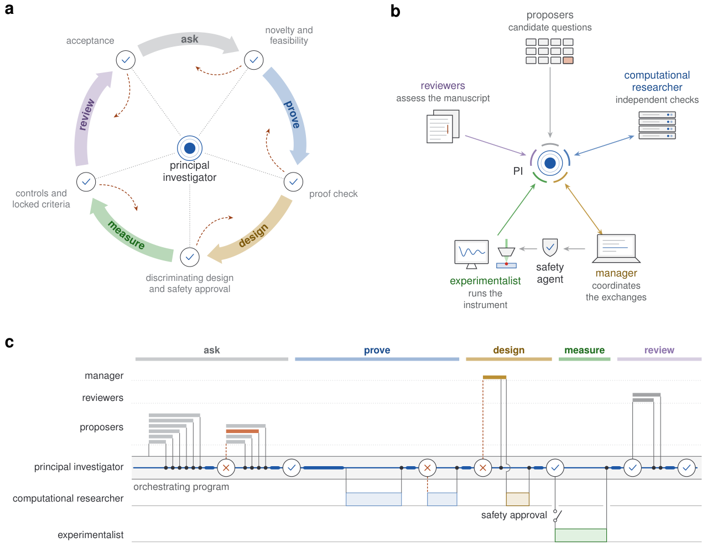
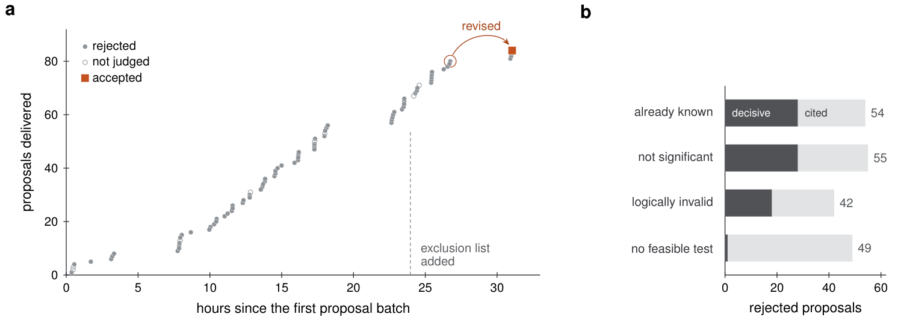
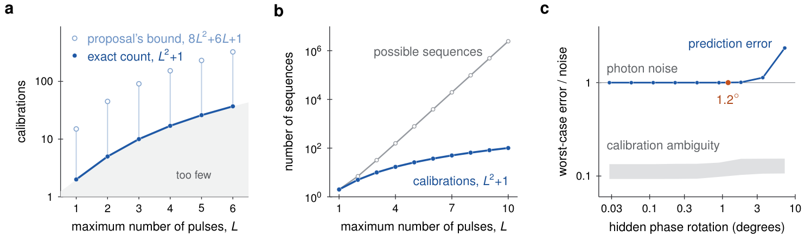
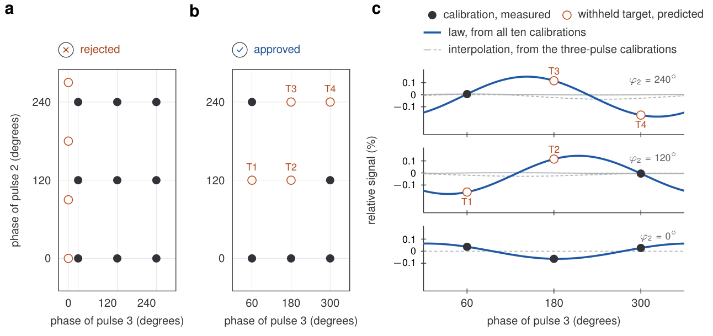
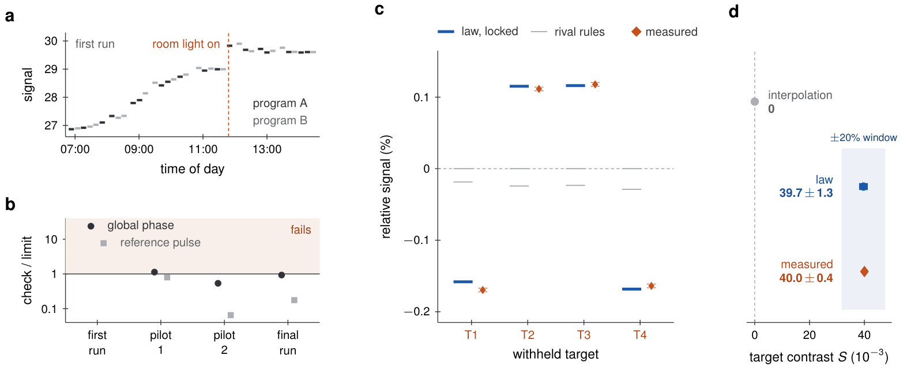

# Auctopus：AI 自主重做量子实验

自动化实验室已经能提出假设、运行仪器和分析数据，但最难的一步仍是：**证据不够时，能否否定自己的结论**。这决定了 AI 科学家是在真正做研究，还是只在自动生成一套看似完整的科研流程。这项工作让多个 LLM Agent 分别负责提出、证明、计算和实验，并赋予它们否决与返工的权力，利用金刚石氮空位中心的量子自旋系综完成了一次闭环研究。最终，Agent 将三脉冲序列所需的最少校准数从原提案的 91 降至 10；更关键的是，首轮实验虽然满足全部 10 项精度标准，却因控制检查失败而被判为“不确定”，修改协议后的最终测量才支持理论预测。

## 会做完整流程，不等于会做科学研究

过去的机器人科学家和自主实验室，已经能够根据实验反馈选择后续操作。LLM 加入后，系统还能检索文献、提出想法、编写分析代码和撰写论文。

但流程完整并不能保证结论可靠。一个系统可能提出已有答案的问题，可能在数学推导里埋下未检查的假设，也可能只挑选支持自己的实验结果。此前甚至有 AI Scientist 基于有缺陷的实验报告性能提升。

因此，这项研究考察的不是“AI 能否自动走完全程”，而是三个更严格的问题：

- 面对貌似可行的想法，它能否识别重复、逻辑错误和不可检验性？
- 面对与理论一致的信号，它能否确认实验真的区分了竞争性解释（competing explanations）？
- 面对精度达标但控制失败的数据，它能否坚持预设标准，而不是宣布成功？

研究团队选择了金刚石中的氮空位（nitrogen-vacancy，NV）中心作为试验场。NV 中心是金刚石晶格中的一种点缺陷，其电子自旋可用激光初始化和读取，也能用可编程微波脉冲操控。大量 NV 自旋组成系综后，各自旋的失谐和驱动强度并不相同，使响应预测成为一个既有物理复杂性、又能精确实验验证的问题。

## 协作实验室：把质疑写进流程

这套系统的核心不是让一个强模型包办所有工作，而是把“提出观点”和“评价观点”分给不同上下文中的 Agent。每个关键节点都必须给出明确结论和书面理由，未通过审查的工作不能自动流向下一阶段。

| 角色 | 主要职责 | 实现方式 |
|---|---|---|
| Proposers（提案者） | 独立生成候选研究问题，并根据批评修改 | GPT-5.6 Extra High |
| PI（首席研究员） | 选题、发展理论、审查计算与实验、作最终判断 | GPT-6 Pro，审查时使用 Extra High |
| Computational researcher（计算研究员） | 独立复现数学检查，在超算上做数值与鲁棒性验证 | GPT-6 Astra，经 Codex 使用 TSUBAME 4.0 的 CPU 和 GPU |
| Experimentalist（实验员） | 开发仪器控制软件，执行测量并返回实验报告 | Claude Fable 5，经 Claude Code 在仪器电脑上运行 |
| Manager（经理） | 转发文档、协调任务、总结重复失败方向并参与实验规划 | Claude Opus 5，具备浏览器和 SSH 访问能力 |
| Reviewers（独立审稿人） | 只依据最终稿件评价研究，不读取前序对话、代码或原始数据 | 新建独立模型对话 |
| Safety agent（安全 Agent） | 在预设电压、功率等操作边界内审批实验 | 人类在部署阶段配置并检查 |

> 图解：（a）研究按 ask、prove、design、measure、review 五阶段循环，PI 在各检查点决定是否接受，虚线表示否决与返工，而不是单向自动推进。（b）提案者、计算研究员、实验员、经理和审稿人围绕 PI 交换成果；实验执行前还必须通过安全 Agent。（c）一轮 API 编排工作流中的文档流向，横轴从左到右表示过程而非实际时间比例；圆点表示文档送达，勾和叉表示 PI 决策，上方分支是独立模型调用，下方长块是 Coding Agent 任务。

这种分工有点像把研究组里的“作者、审稿人和安全负责人”拆开：作者可以很有创造力，但不能独自宣布自己的工作成立。它的价值在于减少自我确认偏差（self-confirmation bias），避免同一个上下文里的错误假设被一路强化。

人类研究者负责搭建装置、描述仪器能力，并配置安全边界；在此范围内，Agent 完成选题、理论、计算、实验和评审。各角色通过书面提案、内部论文、实验协议和报告协作，原始光子计数留在仪器电脑上，PI 与计算研究员依据实验报告作判断。

笔者认为，真正重要的设计不是“Agent 数量多”，而是**否决权被放进了通信协议**：批评不只用于最后润色，而会改变接下来研究什么、如何测量以及能否下结论。

## 选题不是生成竞赛：75 次拒绝之后

每位提案者只拿到实验平台说明，独立提出一个“物理不可缺、具有数学实质、可在现有 NV 装置上检验”的问题，彼此看不到对方方案。PI 分批评估新颖性（novelty）、逻辑有效性、科学意义、理论可行性和实验可检验性，也允许整批拒绝。

在约 30 小时里，PI 拒绝了 75 个提案，前 17 批没有任何提案被接受。拒绝原因主要包括：结果已经有人做过、逻辑不成立、科学意义不足，以及没有可行实验。独立提案者还反复收敛到相同的失败方向，说明简单增加并行 Agent 数量并不会自动带来思想多样性。

经理 Agent 随后从 PI 的书面判决中整理出反复被否决的机制，把它们加入后续提案的排除清单。这些方向占此前 56 个新提案中的 52 个；排除之后，9 个新提案进入了 7 个此前未出现的研究方向。

> 图解：（a）横轴是距首批提案的时间，纵轴是累计交付提案数；灰点为拒绝，空心点为未评审，橙色方块为接受，虚线标记加入排除清单的时刻。被圈出的提案最初也被拒绝，但 PI 将其选为最佳种子，修改后才被接受。（b）横轴是被拒提案数，深色表示决定性理由，浅色叠加表示所有被提及理由；“结果已知”“意义不足”“逻辑无效”“无可行测试”的被提及总数分别为 54、55、42、49。

最终问题并非某次生成的直接产物，而是“拒绝—选种—批评—重构”的结果。原提案只保留脉冲序列的主导阶近似，修改版则保留对完整脉冲序列的依赖。PI 最终选定的问题是：

> **预测非均匀自旋系综对任意相位控制脉冲序列的响应，最少需要多少次校准测量？**

具体实现上，每个新批次启动 10 个提案对话，收到 5 份后就交给 PI，并停止其余提案者；去重步骤按核心机制合并相近方案。连续 12 次评估没有胜者后，经理加入排除清单。修改批次则启动 6 个提案者，每个都获得一份原始被拒提案和 PI 的完整批评。论文成稿前，PI 还需对照最接近的 5 项工作，明确各自已解决了什么、本文新增了什么。

解决了“研究什么”之后，下一个问题更困难：AI 能否把一个有希望的提案，推进成必要且充分的数学定律？

## 核心发现：$L^2+1$ 次校准足够，也必不可少

### 把未知系综看成响应空间

实验中的每个脉冲具有固定时长、幅度和形状，但相位可以独立编程。不同自旋具有不同脉冲误差，并假设同一个自旋的误差参数在整条序列中保持不变。因此，测到的荧光不是单个理想自旋的响应，而是未知误差分布下的系综平均。

在二能级模型（two-level model）中，相位为 $\phi$ 的脉冲对单个自旋的作用写为：

$$
U_\phi(a)=
\begin{pmatrix}
a & \sqrt{q}\,e^{-i\phi}\\
-\sqrt{q}\,e^{i\phi} & \bar a
\end{pmatrix},
\qquad q=1-|a|^2
$$

其中，$a$ 编码单个自旋受到的脉冲作用，$\bar a$ 是复共轭。系综由可容许域 $K$ 上任意未知的概率分布 $\nu$ 描述，且 $K$ 具有非空二维内部。

对时间顺序为 $w=(\phi_1,\ldots,\phi_\ell)$、长度 $\ell\leq L$ 的序列，返回概率和平均荧光信号分别为：

$$
p_w(a)=\left|\langle0|U_{\phi_\ell}(a)\cdots U_{\phi_1}(a)|0\rangle\right|^2
$$

$$
\mu(w)=B+\kappa\int_K p_w(a)\,\mathrm d\nu(a)
$$

$B$ 是所有设置共享的未知荧光背景，$\kappa$ 是非零对比度；空序列满足 $p_{\varnothing}=1$。难点在于 $\nu$、$B$ 和 $\kappa$ 都未知，但研究目标并不是重建这套微观分布，而是预测尚未测量的序列响应。

可以把这个过程理解为“用少量坐标还原整个向量”：如果所有可能响应都位于一个有限维空间，只要校准测量构成该空间的基，就能把任意目标响应写成校准响应的线性组合，无需知道每个微观自旋的误差。

### 从宽松上界到精确最小值

原提案证明，最多含 $L$ 个脉冲的序列只需要不超过 $8L^2+6L+1$ 个独立响应函数。PI 将问题改写为响应空间的维数问题，并证明精确维数为：

$$
d_L=L^2+1
$$

也就是说，在持续脉冲误差（persistent pulse errors）假设下，$L^2+1$ 个线性独立的校准设置既充分又必要：

- **充分性**：这些校准响应张成所有目标响应所在的空间，因此任意目标都能表示成它们的线性组合，即使存在未知公共背景和对比度。
- **必要性**：若校准不足，总能构造两个物理上可容许的系综，它们在所有校准序列上给出相同结果，却在某个未测序列上产生不同响应。因此，再灵活的预测器也无法保证恢复该目标。

设校准序列为 $b_j$，利用五个相位 $2\pi k/5$（$k=0,\ldots,4$）解析相位 Fourier 分量，并选取 $d_L$ 个线性独立响应作为基。任意目标的单自旋响应可展开为：

$$
p_w(a)=\sum_{j=1}^{d_L}h_j(w)p_{b_j}(a),
\qquad
\sum_{j=1}^{d_L}h_j(w)=1
$$

对系综平均后，未测目标的预测值直接由校准均值计算：

$$
\widehat{\mu}(w)=\sum_{j=1}^{d_L}h_j(w)\widehat{\mu}(b_j)
$$

这里的 $L^2+1$ 指**不同且响应线性独立的校准设置数**，不是重复采样次数；重复采集决定的是每个校准均值的精度。

> 图解：（a）横轴为最大脉冲数 $L$，纵轴为校准数；空心点是原提案上界 $8L^2+6L+1$，蓝点是精确结果 $L^2+1$，灰区表示校准不足。$L=3$ 时，数值由 91 降为 10。（b）在每个脉冲有五种相位、首个相位固定的条件下，灰线表示随 $L$ 指数增长的可能序列数，蓝线表示仅二次增长的校准需求，纵轴为对数尺度。（c）横轴为脉冲之间隐藏的相位旋转角度，纵轴为最坏情况误差相对光子噪声的比值；约 $1.2^\circ$ 以内，认证预测误差仍处于光子噪声水平，灰带为校准歧义界。

在光子计数噪声下，若独立 Poisson 计数的均值上界为 $M$，采用最大化行列式的采集设计，以 $N\geq d_L$ 次观测进行最小二乘估计（least-squares estimation），最坏均方预测误差不超过：

$$
\frac{Md_L}{N-d_L+1}
$$

这条定律的贡献因此不只是“少做几次测量”，而是精确回答了预测指数级序列族所需的信息量，并给出了无法继续减少校准的根本边界。

## 计算验证：数学正确，不等于物理稳健

数学证明依赖“脉冲误差在序列内保持不变”这一假设。为检查偏离理想模型后会发生什么，PI 指定了隐藏相位旋转压力测试，计算研究员则独立复现符号检查并重建响应空间坐标，确认 $L=5$ 和 $L=6$ 时的维数分别为 26 和 37，均符合 $L^2+1$。

鲁棒性测试采用以下设置：

- 固定 $L=6$，参数域为 $K=[3/5,4/5]+i[-1/5,1/5]$，背景 $B=1$，对比度 $\kappa=1/100$。
- 使用五组正弦、余弦均为有理数的相位，第一个脉冲相位固定。
- 设计包含 192 条校准序列，覆盖所有不超过三脉冲的序列，另有 3,715 个目标。
- 假设总预算为 $8.8\times10^{10}$ 次 Poisson 采集，每次约一个光子，以此设定统计尺度。
- 扰动是在第三、第四或第五个脉冲之后，分别引入一次绕各自旋 $z$ 轴的隐藏旋转；$+\delta$ 和 $-\delta$ 等概率出现，并保留无扰动对照。

测试中的校准歧义（calibration ambiguity），是指两个系综在短序列校准上完全一致、在完整校准下也无法统计区分时，其目标均值之间最大的差异。这里把最优区分成功率不超过 55% 定义为统计不可区分。

计算研究员用数值方法搜索候选系综对，再用精确有理数算术认证边界。具体而言，参数域被细分为矩形，利用 Bernstein 系数的最小值和最大值检查多项式不等式，使结论覆盖连续参数域；Berry–Esseen 界则用于收紧统计不可区分条件下的歧义界。

最终，TSUBAME 4.0 上生成了**252,620 份精确证书**，分别约束校准预测器的平方偏差、方差和校准歧义。认证覆盖所有目标、三种旋转位置和无扰动情况下的 12 个旋转强度，并用 7 次精确区间二分定位光子噪声参考交点。对指定的六脉冲测试，隐藏旋转约不超过 $1.2^\circ$ 时，认证预测误差仍处于光子噪声水平。

不过，计算证书只能检验模型及其邻域，不能证明真实装置服从这些假设。下一步必须设计一个能让校准定律与普通插值给出不同答案的实验，否则“拟合成功”仍可能毫无区分力。

## 能区分理论的实验，才是有效实验

### 首轮设计为何被否决

最初的方案使用九条三脉冲校准序列组成完整网格，再加五条较短序列，预测四个保留目标（withheld targets）。表面上，这正好对应 $L=3$ 时需要的 10 个校准。

PI 却发现，九点网格本身已经包含足够信息，可以直接通过傅里叶插值（Fourier interpolation）确定四个目标。因此，即使预测与测量一致，也无法区分新定律和常规插值。这个设计被否决，理由不是仪器做不到，而是**实验问了错误的问题**。

### 跨长度校准让两种预测分开

修改方案只保留五条三脉冲校准，并加入五条零到两脉冲的短序列，总数仍为 10。短序列提供五条三脉冲校准所缺失的信息，精确秩计算（rank calculation）确认这 10 个响应张成 $L=3$ 的响应空间。

与此同时，四个保留的三脉冲目标无法由只使用三脉冲校准的两种插值基线确定。这样，新定律与插值规则终于给出了可区分的预测。

> 图解：（a）（b）的横轴均为第三脉冲相位，纵轴为第二脉冲相位；实心点是校准，空心点是保留目标。左图的完整九点网格被否决，右图用五条三脉冲校准加五条未画出的短序列校准，预测 $T_1$ 至 $T_4$。（c）横轴为第三脉冲相位，纵轴是相对于五条三脉冲校准均值的信号；蓝线由全部 10 个校准预测，灰色实线和虚线是仅用三脉冲校准的插值结果，圆圈为预先锁定的目标预测。可以看到，蓝线与灰线明显分离，实验因而具有区分力。

### 在看答案之前锁定预测

为避免看完目标数据再调整模型，PI 在采集前固定了预测规则、精度容差、控制检查和结果分类标准。实验员只能先分析 10 个校准均值及其协方差，随后把数值预测锁定并做哈希固定（hash），才能计算目标均值。

记校准均值和目标均值为 $C_0,\ldots,C_9$ 与 $T_1,\ldots,T_4$。PI 推导出每行和为 1 的 $4\times10$ 转移矩阵 $H$，预测写成 $\widehat{\mathbf T}=H\mathbf C$。核心检验使用能消除公共荧光背景的目标对比度：

$$
S=\frac{-T_1+T_2+T_3-T_4}{4}
$$

其校准预测为：

$$
P=\frac34(C_0-C_1+C_6)-\frac14(C_2+C_3+C_4)
$$

两个插值基线分别是拟合五条三脉冲校准、并最小化系数平方范数的九项 Fourier 插值，以及加入重复脉冲对称性的六项替代方案。无论校准记录如何，两者都预测 $S=0$。协议还要求用全部 10 个校准均值拟合一个九参数的相干系综演化模型。

执行前，计算研究员构建数字孪生（digital twin），对正常工作、某目标相位误编 $60^\circ$ 以及精度容差边界等情况各模拟 20,000 次；完整实验包还经过独立可行性、科学区分力和安全审查。至此，实验不再只是“寻找一致”，而是具备了支持、反驳或判定不确定的完整规则。

## 最关键一步：首轮“成功”仍被判无效

首轮正式采集满足了全部 10 项预设精度标准，包括四个保留目标及由它们构成的对比度。但全局相位（global-phase）和参考脉冲（reference-pulse）控制失败，PI 因此将整轮实验判为不确定（inconclusive）。

全局相位控制的依据是：给一条序列中的所有脉冲加上相同相位，理想响应应保持不变。失败意味着，即使目标预测碰巧吻合，也不能排除采集过程存在系统误差。

实验员追查发现，信号在上午上升了 7.6%，并在 11:48 又出现 2.9% 的阶跃，时间点恰与实验室成员打开房间照明一致。首轮实验交替运行两个控制程序，它们包含不同的全局相位副本，也在不同时刻采样漂移信号，于是本应等价的测量获得了系统性偏移。

Agent 没有降低验收标准，而是修改采集方式：

1. 第一轮短时试验（pilot）把程序交替缩短到 30 秒，并测试三种序列顺序，但相位控制仍失败。
2. 第二轮 pilot 在单个程序内部交替切换全局相位，控制通过。
3. PI 保留首轮“不确定”的结论，要求重新进行六小时采集，随机化序列顺序，并增加空序列与关闭微波的测量对（null pair）诊断。
4. 经理传达新协议，实验员实现后重新测量。

最终采集获得 21,600 条有效的一秒记录，通过全部 10 项精度标准、实验控制和方差有效性要求。目标预测在分析保留数据前已经锁定，测得目标对比度为：

$$
S=(40.0\pm0.4)\times10^{-3}
$$

单位为每次测量的加权光子计数（weighted counts per shot）。校准定律的锁定预测为：

$$
P=(39.7\pm1.3)\times10^{-3}
$$

两种插值基线则都预测零。结果支持短序列校准信息能够迁移到四个保留的三脉冲响应，并且是在预设容差和控制条件下成立，而不是事后挑选的一致性。

> 图解：（a）横轴为一天中的时间，纵轴为信号，深浅色分别对应两个采集程序；虚线标记 11:48 开灯，信号随即出现阶跃。（b）纵轴为控制统计量与预设上限的比值，大于 1 的阴影区表示失败；首轮和第一轮 pilot 未通过，第二轮 pilot 与最终轮通过。（c）横轴为四个保留目标，纵轴为相对信号；蓝线是定律的锁定预测，灰线是插值预测，橙色菱形是最终测量，测量标准误小于符号。（d）横轴为以 $10^{-3}$ 加权计数表示的目标对比度 $S$，灰点是插值的零预测，蓝点是 $39.7\pm1.3$ 的定律预测，橙色菱形是 $40.0\pm0.4$ 的测量值，浅蓝带为围绕预测的 $\pm20\%$ 预设窗口。

这段返工是全文最有说服力的部分。它展示的不是模型一次答对，而是系统在“看起来已经成功”时仍愿意服从控制实验，并把否决转化为可执行的修复方案。

## 从装置到统计：实验怎样落地

为了让上述结论可复现，论文 Methods 还给出了仪器、采集和统计决策的完整细节。它们共同保证：实验比较的是预先定义的量，而不是分析过程中临时调整的指标。

### NV 装置与荧光读取

实验在室温共聚焦显微镜上完成，样品为 Element Six DNV-B14 单晶金刚石，尺寸 $3.0\times3.0\times0.5$ mm，具有 $\{100\}$ 晶面，NV 浓度约 4.5 ppm，$^{13}\mathrm C$ 为 1.1% 的天然丰度。

连续波 532 nm 激光由声光调制器门控，经 $100\times$、数值孔径 0.90 的物镜聚焦，三轴压电台用于定位。荧光通过 30 µm 针孔和中心波长 650 nm、带宽 10 nm 的滤光片后进入单光子计数器。典型探测率为 $2.8$ 至 $3.1\times10^6$ counts/s，设定运行上限为 $3.4\times10^6$ counts/s。

永磁体磁场通过拟合四种 NV 取向的共振谱确定：大小为 4.18 mT，方向偏离其中一条 NV 轴 $3.8^\circ$。微波驱动该取向的 $m_s=0\rightarrow m_s=-1$ 跃迁，频率约 2.7503 GHz，并调谐到 $^{14}\mathrm N$ 超精细三重线的中央谱线，相邻谱线间隔 2.16 MHz。

FPGA 控制器同步光学和微波开关、记录光子到达时间；I/Q 波形经混频器控制相位和频偏。最终脉冲长度为 64 ns，脉冲间隔为 152 ns。每个新控制程序都先仿真再运行，装置还检查了不同相位下的拉比振荡（Rabi oscillation）、残余驱动、载波泄漏及增益和相位不平衡。

微波操控后，用 50 µs 激光脉冲读取荧光。三个连续读取窗口按 1、0.45、0.10 的固定权重合并，得到每次测量的加权光子计数；同一激光脉冲也为下一次测量初始化自旋。加上 1 µs 暗间隔，一个测量周期约 52 µs，所有序列设置的总时长一致。

### 采集协议与故障修正

预实验使用 20 ns 脉冲间隔和 16 个五分钟子轮次。首轮正式采集包含 36 个交替的十分钟子轮次：程序 A 施加 $0^\circ$、$120^\circ$、$240^\circ$ 全局相位，程序 B 施加 $60^\circ$、$180^\circ$、$300^\circ$。这一安排取代了最初提出的随机 66 秒周期，却也让两个程序以不同方式采样了信号漂移。

最终协议改为程序内相位切换，使用 720 个 30 秒区块，总计六小时；三种预定序列顺序组成 120 个随机化的六区块组。采集前要求至少 20 分钟预热和 240 秒运行后再记录，并用 20 分钟诊断空序列与关闭微波测量之间的差异，交换两者位置以检查顺序敏感性。

协议还规定，若信号阶跃同时超过 1% 和六个标准误，就必须标记。参考诊断一度因 32 位整数溢出得到未定义标准误，实验员改用浮点运算，对同一批诊断数据和同一阈值重新分析，而没有修改判定标准。

### 十项精度判据与三类结论

每个目标的预测残差定义为 $r_i=T_i-(H\mathbf C)_i$。主要精度检验使用 10 个余量（margin）：

$$
S-0.8P,\qquad 1.2P-S
$$

$$
0.3P+r_i,\qquad 0.3P-r_i
\quad (i=1,\ldots,4)
$$

前两项要求测量对比度位于预测 $P$ 的 $\pm20\%$ 内；后八项要求每个目标残差绝对值小于 $0.3P$。所有余量为正才表示满足精度要求。

不确定度传播使用底层加权计数均值的完整系数，同时考虑校准预测自身的不确定性，以及 $P$ 与各残差共享校准数据带来的协方差。Poisson 方差还乘以超额方差因子 $F^*$，下限设为 1.1；若 $F^*>1.25$，则该轮数据不满足方差有效性要求。

控制检查包括三部分：

- 对 13 条非空序列的六个全局相位副本做联合 $\chi^2$ 检验，共 65 个自由度。
- 对单个 128 ns 参考脉冲的六个副本检查相位不变性。
- 检查空序列与关闭微波时的平均空信号（null signal）是否一致。

控制阈值对应 $10^{-4}$ 的尾概率，空测量比较（null comparison）采用双侧检验。最终结果严格分为三类：

| 分类 | 必须满足的条件 |
|---|---|
| Support（支持） | 所有控制和方差检查通过；10 个余量的单侧 99% 置信下界都为正；$S>0$ 且单侧 $p\leq0.001$ |
| Contradiction（反驳） | 有效性检查通过；$P$ 比零高出超过 3.09 个标准误；至少一个余量的单侧上置信界为负，尾概率为 $10^{-4}$ |
| Inconclusive（不确定） | 其余所有情况，包括任何控制或方差有效性检查失败 |

所以，最终“支持”并不意味着定律被无条件证明，而是表示这次数据在事先锁定的精度、控制和统计规则下，支持其对四个目标的预测，并排除了两个指定插值规则的零对比度预测。

## 这项工作真正证明了什么

这项研究同时给出了两层结果。

在物理层面，Agent 发现了非均匀自旋系综的最小校准定律：在持续脉冲误差模型下，预测最多 $L$ 脉冲的任意相位控制序列，必要且充分的独立校准数为 $L^2+1$。必要性来自不可区分的物理系综构造，充分性来自响应空间的显式基展开，最终实验则验证了跨序列长度的信息迁移。

在 AI 科研层面，批评实际改变了研究轨迹：它淘汰了 75 个问题，把宽松上界推进为精确维数，否决了无法区分插值的实验，又拒绝了精度达标但控制失败的首轮数据。这里的“科学判断”不是一句自我反思文本，而是会产生实际成本的停止与返工。

局限同样清楚。人类仍负责搭建仪器和设置安全边界；实验只覆盖一个 NV 平台、四个保留目标和预设容差；理论最优性依赖指定脉冲模型及持续误差假设。计算鲁棒性证书也不能替代对其他物理平台的验证。

此外，Auctopus 已以 MIT 许可证开源，可通过 OpenAI 和 Anthropic API 编排从提案到测量、评审的流程，代码地址为 [E-zClap/auctopus](https://github.com/E-zClap/auctopus)。但本研究使用的具体 prompts 并未发布，开源包提供的是可适配其他问题和仪器的模板；实验数据与分析代码需向通讯作者合理申请。复现时因此不能把“代码开放”理解为所有研究上下文都已完全公开。

## 总结：自主科研的门槛是可靠地否定自己

- **协作机制**：六类研究角色与安全 Agent 通过书面审查连接，关键成果可以被否决，而非自动进入下一阶段。
- **选题能力**：约 30 小时内拒绝 75 个提案，并利用失败记录改变搜索方向，最终通过修改而非首次生成确定问题。
- **理论结果**：把校准上界 $8L^2+6L+1$ 推进为必要且充分的 $L^2+1$，三脉冲场景由 91 次降至 10 次。
- **实验纪律**：首轮满足全部 10 项精度标准仍因控制失败被判不确定，随后在不放松标准的前提下重做协议。
- **最终证据**：六小时最终采集得到 21,600 条有效记录，实测对比度 $(40.0\pm0.4)\times10^{-3}$ 与锁定预测 $(39.7\pm1.3)\times10^{-3}$ 一致，而插值基线预测为零。

未来要扩展到低温装置、跨实验室协作和更多科学领域，关键不仅是更强的模型，还包括更可靠的仪器诊断、安全机制，以及能让竞争解释真正分开的实验平台。

> 本文参考自 [Collaborative AI agents for autonomous experimental research with solid-state quantum spins](http://arxiv.org/abs/2610.40589v1)