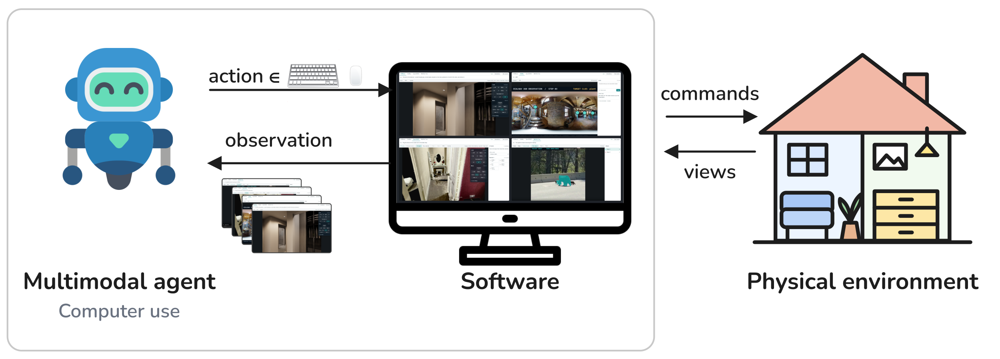
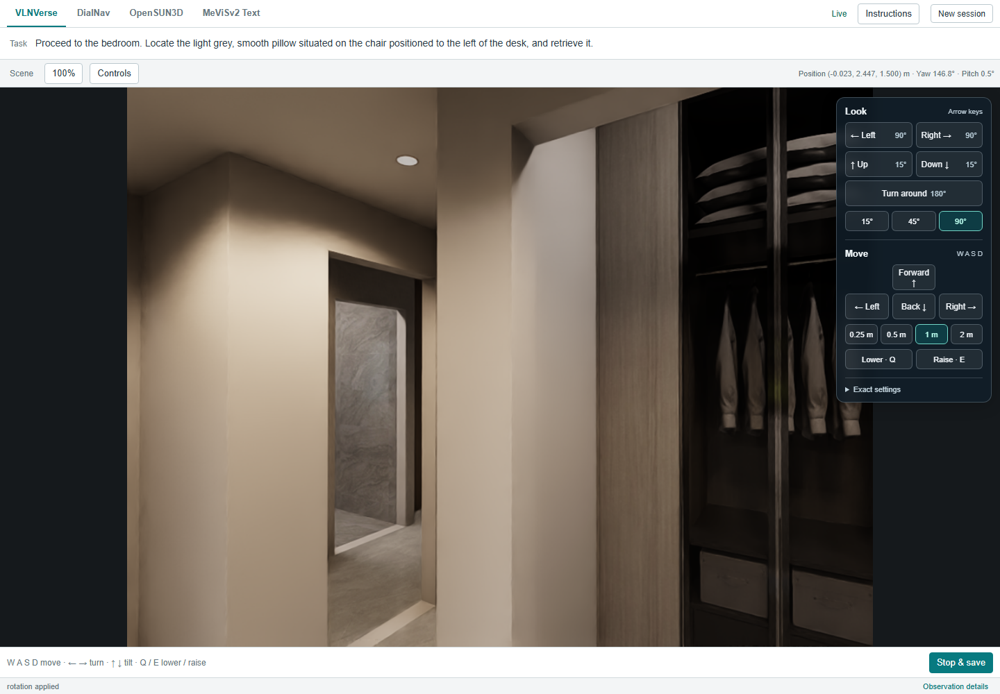
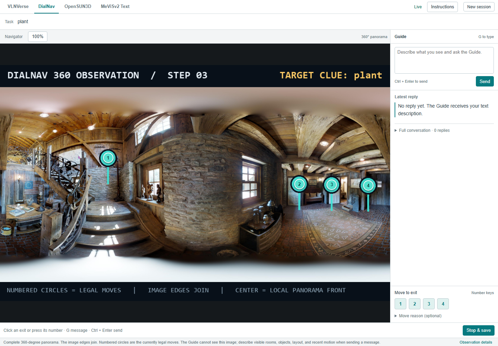
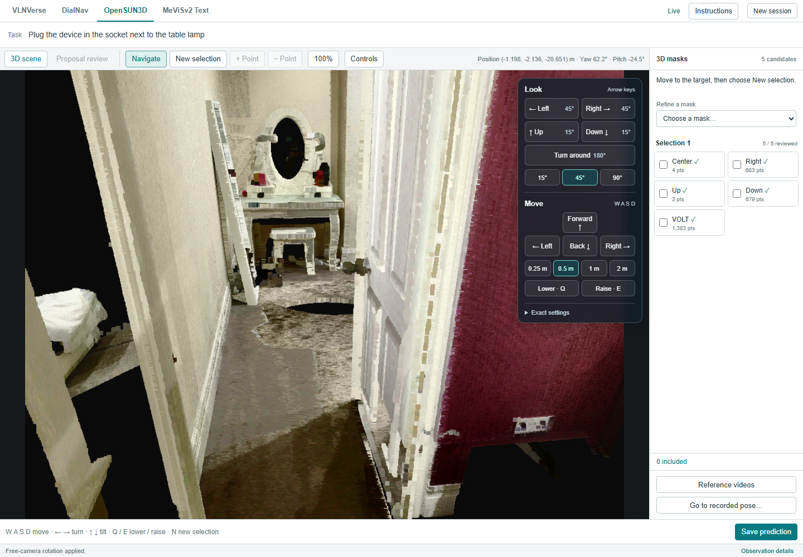
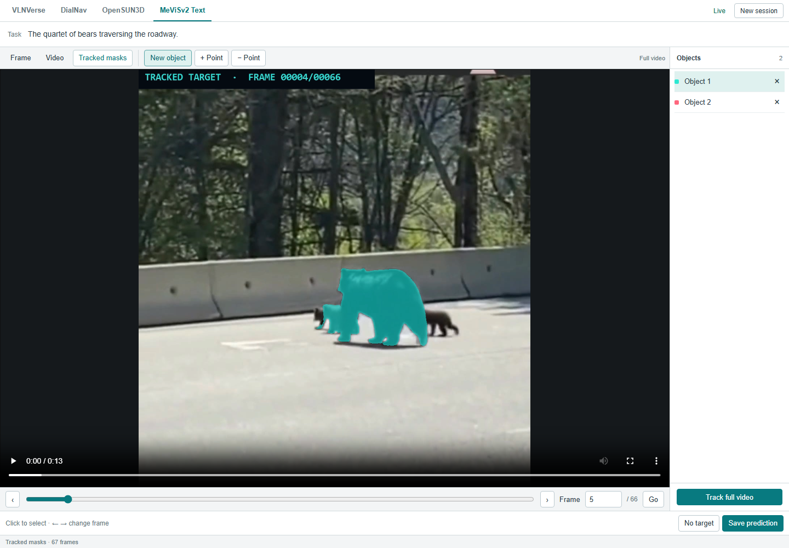
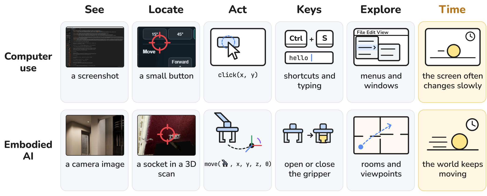

# CUA Generalists：把具身任务变成电脑操作

这篇工作要解决的问题很直接：能否不为导航、3D 分割和机器人控制分别设计专用 Agent，而让会操作电脑的通用 Agent 直接完成具身任务？作者的核心做法是**把物理环境包装成软件**：屏幕呈现环境观察，键盘和鼠标负责行动，任务差异全部留在软件中。同一套 Computer-Use Agent（CUA，电脑操作智能体）不加竞赛专属调优，便在四项 ECCV 2026 Workshop 竞赛中分别获得第一、第二、第三和第六名；其中 OpenSUN3D 的 AP50 达到 25.88，比其他最佳成绩高 4.43 分。

## 从“操作软件”到“操作世界”

通用模型已经在多个 AI 领域替代了大量手工规则和专用架构，但具身 AI 仍常常为不同任务设计专门模型、动作空间和训练流程。作者观察到，电脑操作与具身交互其实共享一组基础能力：

- **视觉定位**：在屏幕或三维场景中找到目标；
- **精确动作**：点击正确坐标，或控制执行器到达正确位置；
- **环境探索**：在信息不完整时主动移动、观察和尝试；
- **反馈适应**：根据动作后的新画面调整下一步决策。

因此，关键不一定是再训练一个“机器人专用 Agent”，而可能是给现有 CUA 换一层合适的交互界面。

> 图解：CUA 原本通过截图观察软件，再用键盘和鼠标操作。作者将物理环境也呈现在屏幕中，并提供相应的软件控件，于是导航、分割等具身任务对 Agent 而言就变成了另一种软件交互。

这个设计的聪明之处在于，**任务特定能力被放进了环境，而不是塞回模型**。软件负责渲染场景、执行移动或分割操作、返回结果；Agent 则始终使用同一套视觉观察和键鼠动作。这既减少了任务适配成本，也让 CUA 在普通软件上习得的点击、探索和反馈处理能力有机会直接迁移。

## 一个共享 Agent，四套任务软件

### 统一的交互循环

设任务描述、软件说明及参考图像或视频共同构成输入 $q$，第 $k$ 个竞赛的软件为 $\mathcal{S}_k$，其在时刻 $t$ 的状态为 $s_t$。软件提供截图及操作可能返回的视频，记为观察 $o_t$；交互历史为 $h_t=(o_0,a_0,\ldots,o_t)$。Agent $\pi$ 选择键鼠动作 $a_t$，软件执行动作并返回新状态与新观察：

$$
a_t \sim \pi(\cdot\mid q,h_t),
\qquad
(s_{t+1},o_{t+1}) = \mathcal{S}_k(s_t,a_t)
$$

这个循环一直持续到 Agent 点击提交，软件再导出轨迹或预测结果。整个过程中，Agent 不需要直接访问任务内部的专用动作接口。

四项竞赛共用同一种 Agent 实现、System Prompt 和键鼠动作空间，底层使用 Gemini 3.5 Flash 与 Gemini 3.6 Flash。Agent 可以一次发送单个输入，也可以批量发送最多 16 个输入；每个操作完成后才执行下一个，批次结束后返回截图。

为控制上下文长度，系统保留交互文本，在截图达到 20 张时移除最旧的 10 张，但完整参考视频和生成的叠加视频会继续保留。换句话说，变化的是软件提供的功能，而不是 Agent 的决策框架。

### 四套界面分别怎样工作

> 图解：VLNVerse 界面以第一人称图像展示三维场景，并提供平移、旋转和停止等控件。Agent 通过画面识别地标、探索房间并接近语言描述的目的地。

**VLNVerse：三维场景导航。** 软件是一个三维场景查看器。Agent 可以向前、向后、侧向或垂直移动，也可以转动视角、抬头或低头，并调整移动距离和旋转角度。每次操作都会更新相机位姿并渲染新图像；粗粒度与细粒度两条赛道共用这一查看器。点击停止后，系统保存轨迹与最终位姿。

> 图解：DialNav 展示 $360^\circ$ 全景、通往相邻视角的编号出口、目标线索和消息面板。Agent 既要理解 Guide 的自然语言回复，也要结合全景选择出口。

**DialNav：通过对话完成导航。** Agent 可以输入对当前位置的描述或向 Guide 提问，再点击出口移动。软件内部的 Guide 模型在独立上下文中获得目的地、场景地图和路线预览，根据 Agent 的描述推断其位置并返回方向指引。停止操作会同时保存轨迹和对话。

> 图解：OpenSUN3D 界面渲染彩色 Faro 点云，支持自由移动、旋转和点选。候选 3D Mask 会从四个视角展示，便于 Agent 检查并细化选择。

**OpenSUN3D：语言引导的三维分割。** 任务描述一个动作，Agent 要找出对应的交互区域，例如“打开抽屉”所涉及的抽屉把手。Agent 在点云中探索并点击目标部件，渲染器将点击映射到可见的 Faro 点。软件内部由 PinPoint3D 根据点提示生成 Mask，由在 SceneFun3D 上微调的 VOLT 模型提供基于 Affordance（可供性）的候选区域。Agent 可以添加正点或负点、切换视角、重新选择，并保存最终 Mask 及其原始点索引。

> 图解：MeViSv2 界面包含视频播放器、帧选择器以及目标添加、细化和删除控件。Agent 点击目标后，可查看整段视频的 Mask 叠加结果，再决定是否修正。

**MeViSv2：指代表达视频分割。** Agent 根据运动表达和完整视频选择一帧，点击每个目标；SAM3 负责分割并将 Mask 传播到整段视频。Agent 能检查完整叠加视频或单帧，添加正负点、删除对象或选择其他对象后重新传播。最终保存所有保留对象的 Mask；若表达没有对应目标，也可导出空 Mask 序列。

可以看到，专用模型并没有消失：PinPoint3D、VOLT、SAM3 和 Guide 都被封装在软件内部。真正的变化是，**上层决策者不再因任务而更换**，它只需学会调用控件、理解反馈并决定下一步。

## 四项竞赛：同一 Agent 是否真的够用？

作者使用官方测试集成绩验证这一思路。下表同时列出本文成绩和每项指标的其他最佳参赛成绩，所有分数均采用 0–100 量表。

| 竞赛 | 名次 | 指标 | 本文 | 其他最佳 |
|---|---:|---|---:|---:|
| VLNVerse | 第 6 | Avg SR@3 | 87.30 | 90.70 |
|  |  | NDTW（粗粒度 / 细粒度） | 95.0 / 96.8 | 96.3 / 97.6 |
| DialNav | 第 3 | 终点成功率 | 65.26 | — |
|  |  | SPL | 52.87 | — |
| OpenSUN3D | 第 1 | AP50 | 25.88 | 21.45 |
|  |  | AP25 | 36.52 | 26.50 |
| MeViSv2-Text | 第 2 | Final | 86.72 | 90.81 |
|  |  | $\mathcal{J}\&\mathcal{F}$ | 74.96 | 79.22 |

各指标的侧重点不同：VLNVerse 的 SR@3 表示终点落在目标三米范围内的回合比例，Avg SR@3 对粗、细两条赛道取平均，NDTW 衡量轨迹与参考路线的贴合程度；DialNav 的 SPL 是按路径长度加权的成功率；OpenSUN3D 的 AP50 与 AP25 分别在 50% 和 25% IoU 阈值下评价 3D 实例 Mask；MeViSv2 的 Final 则综合 $\mathcal{J}\&\mathcal{F}$ 与目标存在、不存在的判断准确率。

结果中有三个值得细看的信号：

- **OpenSUN3D 优势最明显。** AP50 和 AP25 分别领先其他最佳成绩 4.43 和 10.02 分。点击抽屉把手这类细小三维部件，与点击屏幕上的小按钮确实高度相似。
- **VLNVerse 的排名没有完整反映路径质量。** 虽然成功率排名第六，但在 74 个参赛结果中，其两条赛道的 NDTW 都排名第三，说明 Agent 对参考路线的跟随能力很强。
- **MeViSv2 体现了“知道何时没有目标”的价值。** 本文 $\mathcal{J}\&\mathcal{F}$ 低于另一参赛结果，但无目标识别准确率为 88.89，对比值为 83.33，因此最终获得第二名。

这些结果并不能证明一个 CUA 已经解决所有具身问题，但它们说明，视觉定位、精确点击和探索等软件操作能力，确实能跨界面迁移到多种具身任务。

## GUI 还是文本 API：界面形式重要吗？

既然具身任务已经被封装成软件，一个自然问题是：为什么一定要做 GUI，直接给 Agent 文本 API 不也可以吗？作者将两者视为数字接口的两种形式，并提出一个待验证的判断：能力足够强时，两种方式的任务表现应趋于一致，差别更多体现在效率上。

实验在四项竞赛的任务子集上比较 GUI 与 API。每一对实验使用相同模型、任务输入和软件操作，并通过连续代际的 Gemini Flash 观察电脑操作能力提升后，两种接口的差距如何变化。

| 竞赛 | 指标 | API | GUI | GUI $-$ API |
|---|---|---:|---:|---:|
| VLNVerse | Avg SR@3 | 83.9 | 85.2 | +1.3 |
| DialNav | 终点成功率 | 67.4 | 63.4 | -4.0 |
| OpenSUN3D | AP50 | 26.7 | 28.1 | +1.4 |
| MeViSv2-Text | Final | 95.8 | 94.6 | -1.2 |

四种情况下，两种接口的分差都不超过 4 分，而且 GUI 在两项竞赛中更高。这里不能得出“GUI 永远优于 API”的结论，但至少说明，**经过良好封装的图形界面并没有造成明显的任务性能代价**。这也是“复用通用 CUA，而非另做 API Agent”能够成立的重要前提。

## 从实验结果走向三个更大的判断

竞赛结果验证的是可迁移性，作者进一步讨论的是具身 AI 的模型形态与训练路线。

> 图解：两类任务都要求 Agent 观察环境、定位目标、精确行动、发出离散命令并探索。主要差别在时间维度：屏幕通常变化较慢，而物理世界会持续运动，因此机器人对实时性的要求更高。

### 判断一：软件化表示能复用 CUA 的训练方法

两年前的 CUA 也很难精确点击，需要 Set-of-Mark 叠加标注或独立 Grounding 模型来定位目标；这与今天许多 VLA（Vision-Language-Action，视觉—语言—动作模型）附加专用动作头颇为相似。

随着视觉定位训练、可规模化强化学习环境和实时交互技术的发展，CUA 已能直接用普通文本输出点击坐标，GUI 与 API 的性能差距也不断缩小。将机器人和仿真环境表示为软件后，同样的数据生成、环境构建和速度优化方法便能迁移过来。

### 判断二：专用动作头未必是最终形态

连续机器人动作看似必须用专门动作头表达，但屏幕坐标同样近似连续空间。CUA 的演进说明，足够训练之后，模型可以把精确动作写成普通 Token，而不必依赖额外的 Grounding 模块或特殊动作输出结构。

作者为此做了一个初步机器人实验：在 Gym-Anything for Robotics 的礼盒仿真环境中，针对两个任务和双臂机器人，分别用相同的 1,000 条示范训练 $\pi_{0.5}$ 与 9B 参数的 Qwen3.5。后者**不添加动作头，也不修改 Tokenizer**，只把动作改成类似 CUA 的文本格式。

在 1,000 个未见实例上，普通 VLM 的成功率为 56%，$\pi_{0.5}$ 为 59%。模型每秒接收一张新相机图像，可以输出持续一段时间的动作，也可以选择不动作；在单张 L40S GPU 上，9B 模型平均约 400 毫秒生成一个动作。由于一个动作可持续执行，解码约占总时间的 20%，Prefill 约占 10%，其余约 70% 处于空闲。

这是一个很有启发性的对照，但边界也很清楚：实验仅涉及仿真中的两项任务和双臂机器人。人形机器人拥有更多电机，若把所有状态和动作都展开成纯文本，生成速度会成为问题，因此仍可能需要更高效的动作表示或更好的 Tokenizer。

### 判断三：具身通用模型可以沿用 CUA 的三阶段路线

作者把 CUA 的进步归纳为三个阶段，并逐一给出具身 AI 的对应路径：

1. **视觉定位。** 软件能自动暴露界面元素的身份和坐标，与截图配对形成监督数据；仿真器同样能暴露物体身份和三维位置，与渲染画面配对。前提是高保真仿真，而代码生成模型正在降低这类环境的构建门槛。
2. **强化学习环境。** CUA 领域已经能自动生成任务、初始化环境并验证结果。具身 AI 需要具有真实物理特性的仿真环境，以及可由软件调用的任务和验证器。作者并不否定遥操作或第一视角视频，它们仍可用于预训练和中期训练；但其核心主张是，可验证环境与强化学习可能比继续堆这类轨迹更关键。
3. **速度与实时交互。** 除了成功率，还要优化任务完成时间。可行手段包括奖励更短推理和更快完成、使用更快的推理硬件，以及让快速动作与慢速规划交错执行的 Agent Harness。具身任务一旦软件化，也能复用这些机制。

这条路线最终指向同一个模型：它既写代码、解数学题、操作电脑，也控制机器人。作者给出的研究方向因此十分明确——用仿真器自动生成 Grounding 数据，把机器人环境做成 CUA 可操作、可强化学习的软件，并在架构和奖励设计中同时优化实时性与成功率。

## 总结：先把世界变成 Agent 能操作的软件

- **统一接口**：把观察渲染到屏幕、把行动封装成键鼠控件，同一 CUA 就能处理多种具身任务。
- **跨任务验证**：不做竞赛专属 Agent 调优，仍在四项 ECCV 竞赛中分获第一、第二、第三和第六名。
- **GUI 代价有限**：相同模型与软件操作下，GUI 和文本 API 的四项验证集分差均不超过 4 分。
- **动作头并非必需**：9B Qwen3.5 不改 Tokenizer、不加动作头，在特定双臂仿真任务中以 56% 成功率接近 $\pi_{0.5}$ 的 59%。
- **训练路线可复用**：视觉定位、可验证强化学习环境和实时交互，是作者认为具身通用模型应优先推进的三条主线。

这项工作的证据主要来自软件封装的竞赛任务和小规模仿真，距离高动态真实世界与复杂人形机器人仍有距离；但它提供了一条值得验证的路径：让具身环境进入通用 Agent 的训练与交互闭环，而不是永远为每个任务另造一个 Agent。

> 本文参考自 [Computer-Use Agents Are Embodied Generalists](http://arxiv.org/abs/2611.09847v1)