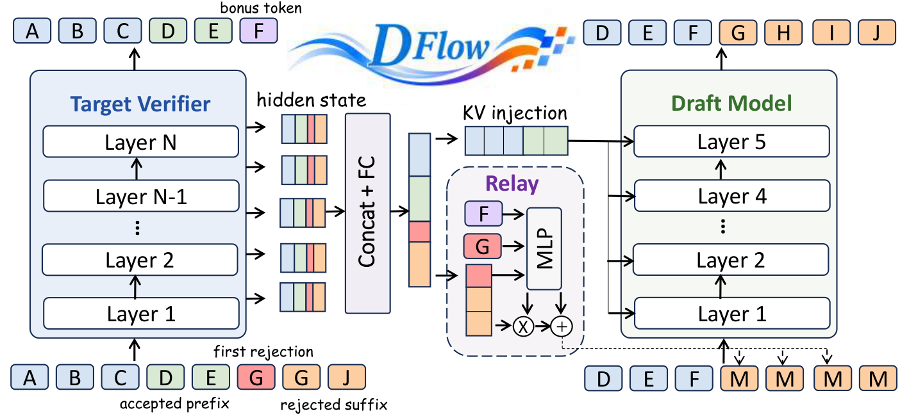
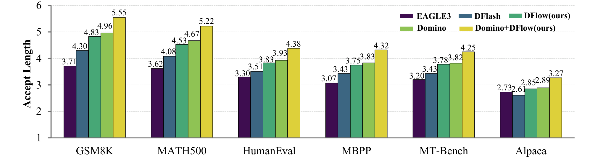
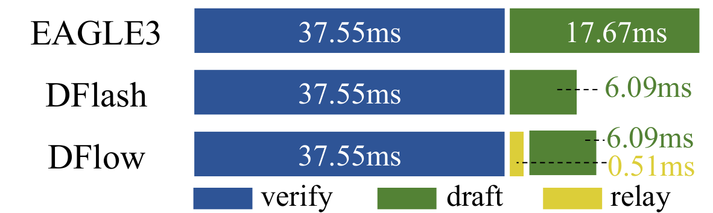

# DFlow：让验证器的信息"流"起来，块扩散投机解码再提速

大模型推理慢的根因是自回归解码必须一个 token 一个 token 地串行生成，投机解码（Speculative Decoding）用"小模型起草、大模型验证"打破了这一瓶颈，而块扩散（Block Diffusion）起草又进一步把起草过程并行化。但现有方法有一个被忽视的浪费：每一轮验证中被拒绝的草稿后缀连同大模型算出的 hidden states 一起被直接丢弃，下一轮只能从 mask 重新猜起。DFlow 的核心思路一句话就能说清： **把验证器在被拒绝位置上已经算好的表示"接力"给下一轮起草** 。就这么一个改动，在 Qwen3-1.7B / 4B / 8B 上把平均接受长度相对 DFlash 分别提升了 **10.4%** 、 **13.2%** 、 **13.4%** ，而额外延迟只有 0.51 ms（约 1.2% 开销）。

## 一、背景：块扩散投机解码是怎么工作的

要理解 DFlow 解决了什么，先得看清它的基座 DFlash 是怎么跑的。整个生成过程由一轮轮"投机回合（speculative round）"组成，每回合分两步：起草和验证。

**块扩散起草（Block Diffusion Drafting）** 。传统 EAGLE 式起草器是自回归的，草稿 token 也得逐个生成；DFlash 则用一个轻量的块扩散起草器，一次性并行预测未来 $K$ 个位置。为了让起草器"看懂"大模型的上下文，它从目标模型的若干层 $\mathcal{L} = \{\ell_1, \ldots, \ell_m\}$（从浅到深采样）抽出 hidden states，拼接后投影成融合表示：

$$
\mathbf{H}^{(r)}_{T} = \operatorname{RMSNorm}\left(\mathbf{W}_{c}\left[\mathbf{H}^{(r,\ell_1)}_{T}; \ldots; \mathbf{H}^{(r,\ell_m)}_{T}\right]\right)
$$

这个融合表示被注入起草器每一层的 Key / Value 投影里，作为持续的条件信号。未来 $K$ 个位置则统一初始化为 mask embedding，一次性并行预测：

$$
\hat{\mathbf{y}}^{(r)} = \mathcal{D}_{\theta}\left(\mathbf{E}_{\mathrm{mask}}^{(r)}; \mathbf{H}_{T}^{(r)}\right)
$$

**精确匹配验证（Exact Match Verification）** 。目标模型从左到右逐位比对草稿，设第一个不匹配之前有 $a_r$ 个连续命中，整个草稿块被切成三段：

$$
\hat{\mathbf{y}}^{(r)} = \left[ \underbrace{\hat{\mathbf{y}}^{(r)}_{1:a_r}}_{\text{接受前缀}}, \underbrace{\hat{y}^{(r)}_{a_r+1}}_{\text{首个拒绝}}, \underbrace{\hat{\mathbf{y}}^{(r)}_{a_r+2:K}}_{\text{拒绝后缀}} \right]
$$

接受前缀被提交；首个拒绝位置被目标模型自己的预测替换，即 **bonus token** $b^{(r)}$（这是"白赚"的一个 token）；剩下的拒绝后缀直接被丢弃。因为验证是精确匹配，输出分布与目标模型完全一致——加速是无损的。

## 二、问题：被拒绝的不只是 token，还有信息

现在关键问题来了。注意上面的流程里， **拒绝后缀虽然被丢弃，但目标模型在验证时已经真实地对它们做过前向计算** ，每个位置都产生了一个融合上下文的 hidden state。下一轮起草时，这些位置往往与新草稿窗口的开头重叠——可它们被重置为 mask embedding，从零开始重建。

打个比方：大模型就像一位审稿人，草稿后半段虽然"不予录用"，但审稿人逐字读过、还做了详细批注。现有做法是把批注连同稿子一起扔进碎纸机，让下一个写手对着白纸重写。DFlow 的作者指出： **拒绝边界（rejection boundary）不只是 token 的提交边界，还意外成了一道信息边界** 。

为什么被拒绝的表示仍然有用？作者的论证分两层：

- **拒绝是针对离散 token 的决定，不是对信息价值的判定** 。第一个拒绝位之后的位置里，有些其实与目标模型的真实续写一致；
- **更本质的是，验证时每个草稿位置都参与了目标模型的因果计算** ，其 hidden state 融合了前文和已提议 token 的上下文。即使离散提议被拒，这个连续表示仍然携带有用的预测信号。

由此作者提出核心假设：

> **Main Hypothesis** ：被拒绝位置上的验证器表示能够为后续起草提供有效指导——把本该被丢弃的信息保留下来，可以提升草稿质量。

笔者认为这个观察的锋利之处在于：它几乎不需要任何额外计算。验证本来就要跑，hidden states 本来就存在，DFlow 只是拒绝把它们扔掉。

## 三、方法：DFlow 的两件套

DFlow 的解法对应推理和训练两侧：推理时用 **Verifier Information Relay** 把验证器表示接力到下一轮；训练时用 **Multi-Round Self-Conditioned Training** 让起草器学会利用这种接力信息。

> 图解：左侧 Target Verifier（目标大模型）对草稿 `A B C D E | G G J` 做验证，`D E` 之后 `G` 处首次被拒绝（红色），由 bonus token `F` 替换，`G G J` 成为拒绝后缀。各层 hidden states 经 Concat + FC 投影后分两路：一路照常通过 KV injection 注入右侧 5 层 Draft Model 作为上下文条件；另一路把拒绝后缀对应的表示送入中间的 **Relay** 模块——由 bonus token `F` 与首个拒绝 token `G` 的 embedding 经 MLP 产生缩放与修正向量，对表示做逐通道调制后叠加到下一轮对应位置的 mask embedding 上。下一轮起草窗口 `D E F M M M M` 中，重叠位置不再是从零开始的纯 mask。

### 3.1 Verifier Information Relay：跨轮信息接力

接力不是简单的"复制粘贴"，要过两道关卡。

**第一关：空间与位置对齐。** 验证器和起草器是两个模型，hidden space 不同。DFlow 直接复用 DFlash 原有的投影矩阵 $\mathbf{W}_c$（即上式中融合目标上下文用的那个），把拒绝后缀的多层 hidden states 拼接投影、再过 RMSNorm，得到可复用的验证器表示 $\mathbf{h}^{(r)}_i$。好处是双重的：不需要额外的目标模型前向，且可复用位置的投影可以和 DFlash 所需的目标特征一起批量计算。

还有一层更微妙的错位：因果目标模型在位置 $i$ 的 hidden state 预测的是位置 $i+1$ 的 token（next token prediction），而块扩散起草器在 mask 位置预测的是同一位置的 token（mask prediction）。DFlow 在注入前把验证器表示 **移位对齐** ，让两种表示对应同一个待预测 token。

**第二关：拒绝条件化的修正。** 对齐后的表示是在"旧上下文"下算出来的——验证时，拒绝后缀跟在首个拒绝提议 $\hat{y}^{(r)}_{a_r+1}$ 后面；而下一轮是从 bonus token $b^{(r)}$ 继续的。这两个边界 token 的差异，恰好量化了上下文变了多少。DFlow 用一个轻量 MLP 把三者拼起来，产出逐通道的缩放与修正向量：

$$
\left[\boldsymbol{\beta}^{(r)}_i; \boldsymbol{\gamma}^{(r)}_i\right] = \operatorname{MLP}_{\phi}\left(\left[\mathbf{E}\!\left(b^{(r)}\right); \mathbf{E}\!\left(\hat{y}^{(r)}_{a_r+1}\right); \mathbf{h}^{(r)}_i\right]\right)
$$

然后对验证器表示做调制，叠加到标准 mask embedding 上，构成下一轮的输入：

$$
\mathbf{x}^{(r+1)}_i = \mathbf{E}_{\mathrm{mask}} + \boldsymbol{\beta}^{(r)}_i \odot \operatorname{LN}\left(\mathbf{h}^{(r)}_i\right) + \boldsymbol{\gamma}^{(r)}_i
$$

其中 $\boldsymbol{\beta}$ 控制保留多少旧信息，$\boldsymbol{\gamma}$ 提供加性修正。只有存在可复用表示的位置才用这个增强输入，其余位置（以及第一轮、或上一轮没有拒绝后缀时）仍用纯 mask embedding。这个设计很像 FiLM 式的条件调制—— **让模型自己学会"哪些旧信息该信、信多少"** ，而不是无条件地灌进去。

### 3.2 Multi-Round Self-Conditioned Training：训练要复现推理形态

光改推理不够。标准 DFlash 训练把每个起草回合当作独立样本，每轮都从 mask 开始；而 DFlow 推理时后续轮次是"吃着"上一轮的验证器表示的。训练和推理形态不一致，模型根本没见过接力信息，给了也不会用。

为此 DFlow 引入多轮自条件训练，包含两个组件。

**Multi-Round Rollout（多轮展开）** 。沿用 DFlash 的做法，从目标模型生成的轨迹中采样锚点构造草稿块。区别在于：对每个锚点，DFlow 把单轮训练显式展开成一串连续回合。第 0 轮是标准 mask 预测，保住起草器的基本功并产出草稿；这些草稿被送入 **冻结的目标模型** 验证，抽出拒绝后缀的验证器表示，接力给下一轮；后续轮做拒绝条件化预测，让起草器学着利用接力信息。展开深度 $k$ 控制拒绝条件轮数，实际取 $k = 2$。所有轮次共享同一份起草器参数，损失联合优化。

**Trajectory-Guided Transition（轨迹引导的轮转）** 。每个轮转要决定两件事：下一轮从哪开始、带什么信息过去。起点本应取决于本轮验证结果（第一个不匹配处的 bonus token），但训练时真跑验证可能因采样或数值误差与预计算的目标轨迹不一致。DFlow 的做法是：直接用草稿提议与目标轨迹做精确匹配来定边界和 bonus token——这样后续轮次始终对齐同一条轨迹，目标上下文可以直接复用。注意，轨迹只用于定轮次边界；接力到下一轮的验证器表示仍然来自 **当前轮实际产出的草稿提议** 经冻结目标模型的真实前向，信息来源是诚实的。

总目标是各轮损失之和：

$$
\mathcal{L}_{\mathrm{DFlow}} = \mathcal{L}^{(0)} + \sum_{q=1}^{k} \mathcal{L}^{(q)}
$$

沿用 DFlash 的指数衰减加权（离锚点越远权重越低）。目标模型全程冻结，验证器表示与轮转边界都从计算图中 detach，梯度不会穿过验证过程或跨轮传播。

## 四、实验：接受长度与吞吐全面上涨

方法讲完，看它能不能兑现。实验在 Qwen3-1.7B / 4B / 8B 三个规模上进行，覆盖数学推理（GSM8K、MATH-500）、代码生成（HumanEval、MBPP）、开放对话（MT-Bench、Alpaca）三类任务，对比 EAGLE-3（自回归起草代表）和 DFlash（并行起草代表）。起草器为 5 层、草稿块大小 16，用 8 万条 ShareGPT 数据训练 6 个 epoch（学习率 $6 \times 10^{-4}$），硬件为单机 8 卡 A800。

### 4.1 低并发：平均接受长度

核心指标是平均接受长度 $\tau$——每轮投机平均能接受多少个 token，直接决定加速比。

> 图解：横轴为六个评测基准，纵轴为平均接受长度（越高越好），对比 EAGLE-3、DFlash、DFlow、Domino、Domino+DFlow 五种方法（贪婪解码）。DFlow（深绿）在每个基准上都稳定超过 DFlash（蓝）；与 Domino 叠加后（黄色）进一步推高，GSM8K 上达到 5.55。

完整数值如下表（ $T=0$ 为贪婪解码， $T=1$ 为采样解码）：

| 模型 | 方法 | GSM8K | MATH-500 | HumanEval | MBPP | MT-Bench | Alpaca | 平均 |
|---|---|---|---|---|---|---|---|---|
| **T=0** | | | | | | | | |
| Qwen3-1.7B | EAGLE-3 | 3.71 | 3.62 | 3.30 | 3.07 | 3.20 | 2.73 | 3.27 |
| | DFlash | 4.30 | 4.08 | 3.51 | 3.43 | 3.43 | 2.61 | 3.56 |
| | **DFlow** | **4.83** | **4.53** | **3.83** | **3.75** | **3.78** | **2.85** | **3.93** |
| Qwen3-4B | EAGLE-3 | 3.30 | 3.14 | 3.08 | 3.00 | 3.07 | 2.86 | 3.08 |
| | DFlash | 4.41 | 4.39 | 3.86 | 3.61 | 3.39 | 2.61 | 3.71 |
| | **DFlow** | **5.13** | **4.92** | **4.33** | **4.12** | **3.80** | **2.90** | **4.20** |
| Qwen3-8B | EAGLE-3 | 3.25 | 3.12 | 3.25 | 2.86 | 2.88 | 2.61 | 3.00 |
| | DFlash | 4.40 | 4.36 | 3.82 | 3.55 | 3.21 | 2.61 | 3.66 |
| | **DFlow** | **5.10** | **4.94** | **4.28** | **4.08** | **3.58** | **2.93** | **4.15** |
| **T=1** | | | | | | | | |
| Qwen3-1.7B | EAGLE-3 | 3.55 | 3.45 | 3.20 | 3.08 | 3.03 | **2.62** | 3.16 |
| | DFlash | 3.66 | 3.34 | 2.96 | 2.87 | 2.82 | 2.27 | 2.99 |
| | **DFlow** | **4.04** | **3.65** | **3.21** | **3.17** | **3.04** | 2.42 | **3.26** |
| Qwen3-4B | EAGLE-3 | 3.24 | 3.01 | 3.02 | 2.95 | 2.97 | **2.77** | 2.99 |
| | DFlash | 3.84 | 3.53 | 3.33 | 3.12 | 2.77 | 2.32 | 3.15 |
| | **DFlow** | **4.40** | **3.97** | **3.70** | **3.55** | **3.13** | 2.49 | **3.54** |
| Qwen3-8B | EAGLE-3 | 3.15 | 2.94 | 3.07 | 2.80 | 2.73 | 2.48 | 2.86 |
| | DFlash | 3.84 | 3.54 | 3.21 | 3.06 | 2.67 | 2.30 | 3.10 |
| | **DFlow** | **4.31** | **3.96** | **3.58** | **3.44** | **2.92** | **2.50** | **3.45** |

几个观察：

- **贪婪解码下** ，DFlow 把平均接受长度从 3.56 / 3.71 / 3.66 提升到 3.93 / 4.20 / 4.15（对应三个模型规模），即相对 DFlash 提升 10.4% / 13.2% / 13.4%；
- **采样解码下** 提升同样稳定（2.99→3.26、3.15→3.54、3.10→3.45），说明收益不依赖贪婪匹配的特殊性；
- 唯一例外是 $T=1$ 时 1.7B / 4B 的 Alpaca 上 EAGLE-3 略高（2.62 / 2.77），但平均分仍由 DFlow 拿下。

### 4.2 高并发：服务吞吐

接受长度只是代理指标，实际部署看吞吐。作者用 SGLang 在并发 1 到 32 下测了 Qwen3-4B / 8B 的服务吞吐（TPS，括号内为相对 Baseline 的加速比）：

| 任务 | 方法 | 并发=1 | 2 | 4 | 8 | 16 | 32 |
|---|---|---|---|---|---|---|---|
| **Qwen3-4B** | | | | | | | |
| GSM8K | Baseline | 146.25 | 287.58 | 549.67 | 1063.16 | 1804.22 | 2850.74 |
| | EAGLE-3 | 233.99 (1.60×) | 420.16 (1.46×) | 758.99 (1.38×) | 1210.98 (1.14×) | 1634.96 (0.91×) | 1942.57 (0.68×) |
| | DFlash | 349.59 (2.39×) | 635.08 (2.21×) | 1124.58 (2.05×) | 1802.80 (1.70×) | 2368.26 (1.31×) | 2672.69 (0.94×) |
| | **DFlow** | **376.26 (2.57×)** | **679.39 (2.36×)** | **1217.36 (2.21×)** | **1959.07 (1.84×)** | **2580.66 (1.43×)** | **3208.95 (1.13×)** |
| HumanEval | Baseline | 145.58 | 287.16 | 544.38 | 1015.14 | 1742.29 | 2427.99 |
| | EAGLE-3 | 220.83 (1.52×) | 398.01 (1.39×) | 742.55 (1.36×) | 1201.58 (1.18×) | 1599.72 (0.92×) | 1888.08 (0.78×) |
| | DFlash | 334.06 (2.29×) | 604.59 (2.11×) | 1066.61 (1.96×) | 1750.33 (1.72×) | 2336.69 (1.34×) | 2835.77 (1.17×) |
| | **DFlow** | **343.42 (2.36×)** | **617.27 (2.15×)** | **1107.12 (2.03×)** | **1850.42 (1.82×)** | **2482.46 (1.42×)** | **3089.40 (1.27×)** |
| **Qwen3-8B** | | | | | | | |
| GSM8K | Baseline | 91.91 | 181.31 | 356.37 | 662.73 | 1070.40 | 1630.10 |
| | EAGLE-3 | 170.03 (1.85×) | 310.70 (1.71×) | 545.32 (1.53×) | 930.10 (1.40×) | 1244.19 (1.16×) | 1396.23 (0.86×) |
| | DFlash | 260.26 (2.83×) | 473.12 (2.61×) | 877.87 (2.46×) | 1404.98 (2.12×) | 1835.42 (1.71×) | 1891.10 (1.16×) |
| | **DFlow** | **283.47 (3.08×)** | **508.97 (2.81×)** | **944.11 (2.65×)** | **1518.16 (2.29×)** | **2023.22 (1.89×)** | **2198.17 (1.35×)** |
| HumanEval | Baseline | 91.86 | 181.98 | 352.96 | 663.87 | 1200.25 | 2036.43 |
| | EAGLE-3 | 168.83 (1.84×) | 306.27 (1.68×) | 565.86 (1.60×) | 947.66 (1.43×) | 1296.97 (1.08×) | 1467.19 (0.72×) |
| | DFlash | 230.75 (2.51×) | 422.87 (2.32×) | 809.74 (2.29×) | 1296.37 (1.95×) | 1777.93 (1.48×) | 1986.28 (0.98×) |
| | **DFlow** | **245.12 (2.67×)** | **448.55 (2.46×)** | **849.26 (2.41×)** | **1368.45 (2.06×)** | **1864.77 (1.55×)** | **2101.42 (1.03×)** |

两点值得注意。其一，DFlow 在全并发区间都压过 DFlash，单并发下 Qwen3-8B + GSM8K 达到 **3.08×** 加速。其二，一个反直觉的好消息：并发越高，DFlow 相对 DFlash 的优势有时反而更大（如 4B GSM8K 并发 32 时 DFlash 已跌到 0.94× 而 DFlow 仍有 1.13×）。原因是接力引入的计算很小，而更高的接受长度在批处理打满目标模型时价值被放大。

### 4.3 消融：收益到底来自哪里

DFlow 同时改了训练（多轮展开）和推理（信息接力），需要拆开归因。作者做了三组对照（Qwen3-1.7B， $T=0$ 平均接受长度）：

| 训练方式 | 推理=Mask | 推理=Relay |
|---|---|---|
| DFlash | 3.56 | -- |
| DFlash + Self-Conditioning | 3.67 | -- |
| **DFlow** | 3.66 | **3.93** |

读法如下：

- **只加多轮训练** （每轮仍从 mask 开始）：3.56 → 3.67，多轮训练本身的收益有限；
- **DFlow 训练好但关掉接力** （全部位置用 mask 初始化）：3.66，与上一行几乎相同，说明 DFlow 的 mask 预测基本功没有被破坏；
- **打开接力** ：3.66 → 3.93，同一模型原地提升 0.27。

结论很干净： **收益的主要来源就是验证器信息复用，而不是多轮训练的副作用** 。

### 4.4 开销：0.51 ms 换来的一切

天下没有免费午餐，但这顿午餐确实便宜。下图分解了每个投机回合的延迟：

> 图解：三条横向 stacked bar 分别展示 EAGLE-3、DFlash、DFlow 单轮的耗时构成，蓝色为 verify（目标模型验证）、绿色为 draft（起草）、黄色为 relay（信息接力）。三者验证耗时相同（37.55 ms）；EAGLE-3 因自回归起草要花 17.67 ms，DFlash 并行起草只需 6.09 ms；DFlow 在 DFlash 基础上多出一条几乎看不见的黄色 relay 段，仅 0.51 ms。

Relay 模块只引入 **0.51 ms** ，相对 DFlash 约 **1.2%** 的额外开销。低开销的原因前面已经铺垫过：所需 hidden states 是验证的副产品，投影矩阵也是复用 DFlash 的，新增计算只有少量拒绝位置的投影和一个轻量 MLP。用 1.2% 的延迟换 10% 以上的接受长度提升，这笔账非常划算。

## 五、不止于 DFlash：与 Domino 的兼容性

一个自然疑问：DFlow 是 DFlash 的专属补丁，还是一种通用机制？作者用 Domino 做了验证——Domino 通过在起草块内引入因果依赖建模来强化草稿质量，与 DFlow 的"跨轮信息流动"是正交的两个方向。

但直接拼接翻车了。Domino 用 teacher forcing 训练：每个因果预测都条件在真实前缀上，后续位置的准确率被人为抬高。如果直接拿这些预测来定拒绝后缀、抽验证器表示，得到的接力数据会比推理时真实草稿"过于乐观"，造成严重 train / inference 失配——平均接受长度从 4.02 崩到 2.22。解法是引入 **online rollout** ：保留 teacher forcing 优化 Domino 本身，但额外把它的真实预测展开一轮，用实际草稿轨迹来定拒绝边界、抽接力表示。结果（Qwen3-1.7B， $T=0$ ）：

| 方法 | 平均接受长度 $\tau$ |
|---|---|
| DFlash | 3.56 |
| Domino | 4.02 |
| Domino + DFlow（无 Online Rollout） | 2.22 |
| **Domino + DFlow（Online Rollout）** | **4.50** |

加上 online rollout 后，Domino + DFlow 达到 4.50，比单独 Domino 的 4.02 再进一步。这说明 **验证器信息复用与更强的因果依赖建模可以叠加** ，DFlow 是一种可移植的通用机制。笔者认为这个消融的警示意义同样值钱：凡是涉及"用训练时预测模拟推理时行为"的设计，teacher forcing 带来的乐观偏差都是隐形地雷。

## 六、总结

- **问题定位准** ：拒绝边界同时是不必要的"信息边界"——被拒绝位置上目标模型算过的 hidden states 被白白丢弃；
- **方法足够轻** ：Verifier Information Relay 复用已有验证产物与投影矩阵，零额外目标模型前向，推理侧只加 0.51 ms（约 1.2%）；
- **训练要配套** ：Multi-Round Self-Conditioned Training 显式展开连续回合，让训练复现推理时的跨轮信息流动；
- **收益实打实** ：贪婪解码下接受长度相对 DFlash 提升 10.4%–13.4%，并发服务吞吐全区间领先，最高 3.08× 加速；
- **机制可移植** ：与 Domino 这类更强的因果起草方法正交叠加（4.02 → 4.50），但需注意 teacher forcing 失配，要用 online rollout 校准。

一句话展望：DFlow 把"验证的副产品"变成了资产，这个思路可以更广义地推广——投机解码中每一次被拒绝的计算都可能藏着可复用的信息；目前的接力只覆盖与下一轮窗口重叠的拒绝后缀，如何压缩、传递更远跨度或更深层的验证信息，是值得继续探索的方向。

> 本文参考自 [DFlow: Enabling Verifier Information Flow in Block Diffusion Speculative Decoding](https://arxiv.org/pdf/2609.06498v1)