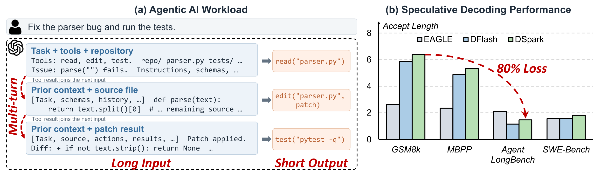
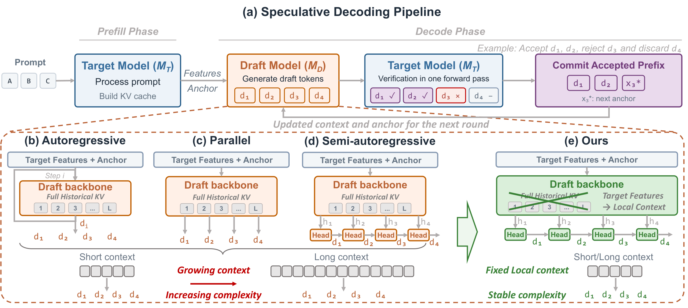
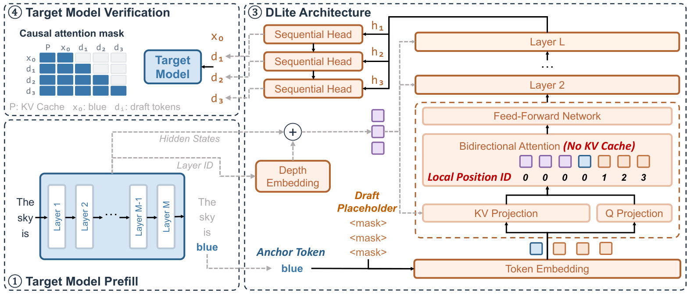
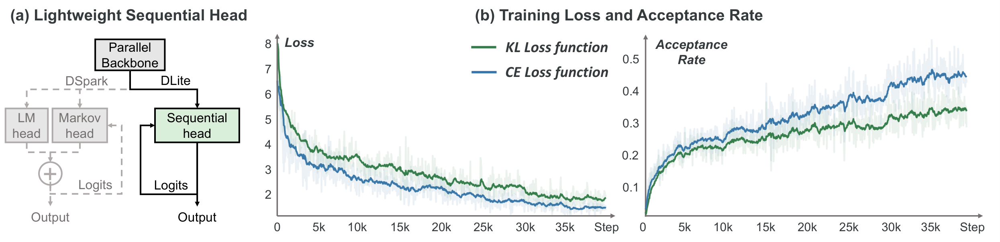
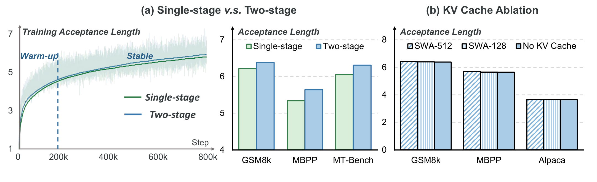

# DLite：为 Agent 推理卸下历史包袱的无历史投机解码

Agent 应用（编程、搜索、办公自动化）每一次执行都要高频调用大模型，推理速度直接决定产品体验；投机解码（Speculative Decoding）本是主流的加速手段，但在 Agentic 工作负载下却严重"水土不服"：接受长度（Acceptance Length）从通用基准上的 5~6 暴跌到 1~2，性能损失超过 80%。这篇来自上海交大等机构的工作指出，问题的共同根源是 draft 模型被迫独立维护不断膨胀的历史上下文，并提出了 DLite——一个彻底不维护 draft KV cache 的"无历史"投机解码框架：直接复用 target 模型的 hidden states，把"越来越难的超长历史建模"变成"固定大小的局部预测"。结果是接受长度达到 2~6，在 Agentic 任务上比 SOTA 半自回归方法 DSpark 最高提升 70%，同时完全消除了 draft 端 KV cache 的维护开销（约占端到端延迟的 10%~20%）。

## Agent 时代，投机解码"水土不服"

### Agentic 工作负载长什么样

传统的对话式推理是"短输入、长输出、单轮为主"。而 Agent 在 harness 框架的编排下执行任务时，画风完全不同：

- **长输入、短输出**：每一轮请求都带着任务描述、工具定义、代码仓库、历史轨迹，动辄几万 token 的输入，但输出可能只是一行工具调用；
- **高频多轮交互**：工具执行结果拼回上下文，再发起下一轮调用，上下文随轮次持续增长；
- **执行路径不确定**：上下文组成、序列长度、调用次数在运行时才能确定。

这种负载对推理系统提出了全新的要求，也暴露了现有投机解码方法的两大短板。

### 两个关键观察

投机解码的原理很简单：用一个轻量 draft 模型先"猜"出多个候选 token，再由 target 大模型一次前向并行验证，猜中几个就赚几个。但作者观察到，这套机制在 Agentic 场景下两头受挫。

> 图解：左图 (a) 展示了一个典型的编程 Agent 多轮执行过程——每一轮都把任务、工具、历史轨迹拼成超长输入（Long Input），而输出只是 `read()`、`edit()` 这样的短工具调用（Short Output）。右图 (b) 中，横轴是四个基准（GSM8K、MBPP、AgentLongBench、SWE-Bench），纵轴是接受长度。可以看到 EAGLE、DFlash、DSpark 在 GSM8K 上能拿到 5~6 的接受长度，但在 AgentLongBench 和 SWE-Bench 上集体跌到 1~2，损失超过 80%。

**观察一：接受长度断崖式下跌。**如上图 (b)，在通用基准上表现优异的 draft 模型，到了 Agentic 任务上接受长度只剩 1~2 个 token。原因很简单：小参数的 draft 模型要独立理解几万 token 的历史上下文，本身就力不从心，预测分布自然和 target 模型越偏越远。

**观察二：KV cache 维护开销不容忽视。**现有 draft 模型必须维护一份自己的历史 KV cache：每次 target 验证完，要把被接受的 token 回灌给 draft 更新缓存；跨轮的前缀复用（prefix caching）还要求长期保存这些状态。作者用 SGLang 实测 DeepSeek-V4 的 MTP 模块发现，这些更新维护操作能占到端到端推理延迟的 10%~20%。

## 问题根源：不断膨胀的历史上下文

表面上看，一个是算法问题、一个是系统问题，但作者一针见血地指出：**两者同根同源——draft 模型被迫独立编码和维护一份越来越长的历史**。

这里先快速回顾一下投机解码的三种主流架构，才能看清 DLite 的切口在哪。设 draft 模型生成 $N$ 个候选 token、每轮验证产出 $\tau$ 个 token，则加速比约为：

$$
\mathrm{Speedup} = \frac{\mathrm{Time}_{M_T}(1) \times \tau}{\mathrm{Time}_{M_T}(N) + \mathrm{Time}_{M_D}(N)}
$$

可见性能由两件事决定：接受长度 $\tau$（draft 猜得准不准）和 draft 延迟 $\mathrm{Time}_{M_D}(N)$（猜得快不快）。围绕这两点，现有工作分成了三派：

> 图解：上方 (a) 是标准的 draft-verify 流水线——target 模型 prefill 建 KV cache，draft 模型 $M_D$ 生成候选 $d_1 \sim d_4$，target 一次前向验证，接受 $d_1, d_2$、拒绝 $d_3$，并多送一个 bonus token。下方对比四种架构：(b) 自回归式（EAGLE）逐 token 生成，依赖关系完整但要串行跑 $N$ 步；(c) 并行式（DFlash）一次出全部候选，快但丢了块内因果依赖；(d) 半自回归式（DSpark/Domino）用并行 backbone + 轻量串行模块折中。**注意 (b)(c)(d) 三者的 backbone 上都挂着"Full Historical KV"**——上下文越长，建模复杂度越高；(e) DLite 则划掉了 Full Historical KV，只保留 target 特征构成的固定局部上下文，复杂度与历史长度彻底脱钩。

笔者点评：这张图道出了本文最核心的洞察——此前所有架构之争（自回归 vs 并行 vs 半自回归）都默认 draft 要"自己记住历史"，而 DLite 是第一个把这条公理本身掀掉的工作。

既然历史才是病根，解法也就顺理成章：**draft 模型别再自己重建历史，直接用 target 模型已经算好的上下文表示，把有限的参数量全部花在当前位置附近的局部预测上**。更妙的是，随着历史增长，draft 面对的显式上下文长度和位置编号范围都在扩大，预测问题本身在变难；而"只做局部预测"让这个问题的规模保持恒定。这就是 DLite 的设计原点。

## DLite：把"历史建模"变成"局部预测"

### 推理数据流总览

> 图解：整个流程分四步。① Target 模型正常 prefill 输入（"The sky is"），维护它自己的 KV cache；② 从 target 的多个层（Layer 1 到 Layer M）抽取 hidden states，加上 Depth Embedding 标注来源层；③ DLite 主体开始工作——当前 anchor token（"blue"）的 embedding 与 $K$ 个 draft placeholder（`<mask>`）一起进入无 KV cache 的双向注意力 backbone，并行算出所有投机位置的表示 $h_1 \sim h_3$，再经三个串联的 Sequential Head 逐个产出候选 token $d_1 \sim d_3$（注意局部位置编号从 0 重新计数，与全局序列长度无关）；④ 候选交给 target 模型用 causal attention mask 一次验证。全程 DLite 不保存任何历史 KV cache，每一轮投机都从零重建。

### 无历史并行 Backbone

Backbone 的任务是把"随历史增长的建模问题"转化为"固定大小的局部预测"，靠的是三类输入：

**Target hidden states 作为压缩上下文。**DLite 直接复用 target 模型多个中间层的 hidden states 作为全局上下文的紧凑特征。为了区分"普通 token embedding"和"来自不同层的 hidden state"，引入一个可学习的深度嵌入（depth embedding）。对来自第 $l$ 层的 hidden state $h_t^{(l)}$，构造：

$$
z_t^{(l)} = h_t^{(l)} + e_{\mathrm{depth}}^{(l)}
$$

其中 $e_{\mathrm{depth}}^{(l)}$ 是层特定的可学习嵌入。这样 backbone 既能认出输入的来源类型，也能识别它来自 target 的哪一层。

**局部预测取代全局建模。**传统 draft 在解码位置 $t$ 要基于 $x_{<t}$ 预测，显式上下文和全局位置编号随解码不断增长。DLite 把长上下文建模完全委托给 target 模型，自己只看当前 anchor token 加 $K$ 个投机位置，且**位置编号只相对于当前局部窗口计算**，而非全局累积。历史信息通过 target hidden states 间接流入，draft 端面对的问题结构与序列累积长度彻底无关——无论原文是几千还是几十万 token，预测问题的规模都一样。

### 轻量串行 Head：只补回缺失的那块依赖

并行计算带来了效率，却也抹掉了投机块内 token 之间的自回归依赖。DLite 的串行 head 只负责补回这一块缺失，而不是再做一遍全量上下文建模。

这个"只做增量"的思路可以从数学上看得很清楚。设投机块起点为 $t$、块内偏移为 $T$，target 模型的自回归预测是：

$$
p_T(x_{t+T} \mid x_{<t+T}) = p_T(x_{t+T} \mid x_{<t},\, x_{t:t+T-1})
$$

并行 backbone 产出 $h_T$ 时还没看到块内前面位置采样的 token。而 $x_{<t}$ 的信息已经由 target 模型处理过、并压缩进了 $h_T$，所以缺失的恰好只是**块内前缀** $x_{t:t+T-1}$。

于是 DLite 用一个低秩 RNN 式的小模块递归压缩块内已生成的 draft token：

$$
s_T = g_{\phi}\left(s_{T-1},\, E(x_{t+T-1})\right)
$$

其中 $E(\cdot)$ 是 token embedding。第 $T$ 个投机位置的预测建模为：

$$
q_{\theta,\phi}(x_{t+T} \mid h_T, s_T) \approx p_T(x_{t+T} \mid x_{<t},\, x_{t:t+T-1})
$$

$h_T$ 提供 target 已编码的上下文，$s_T$ 补上块内前缀，两者合体恰好还原自回归预测所需的全部信息，而不必在 draft 内重建完整历史。

笔者点评：这个设计的聪明之处还在于它**直接在 hidden space 里做串行修正**。DSpark 等方法是先把每个 backbone 表示投影成全词表 logits（一次 $D \times V$ 的矩阵乘），再用额外的串行模块修正；DLite 则把词表投影推迟到串行依赖注入之后只做一次。高并发服务时，大量投机表示同时排队过 $D \times V$ 投影，省掉这一步对吞吐是实打实的贡献。

### 两阶段训练：先搭桥，再对齐

训练 draft 模型本质上是向 target 模型做蒸馏，KL 散度是天然的分布级目标。但实验发现，直接对 DLite 做 KL 蒸馏效果很差（下图 (b) 绿线的接受率明显落后）。原因在于两者预测结构差异太大：target 在完整历史上自回归预测，DLite 在压缩特征上无历史并行预测，输出分布是在异构条件下诱导出来的，硬对齐很困难。

DLite 的解法是"先搭桥再过河"的两阶段训练。设投机块长为 $K$，第 $i$ 个投机位置上 target、history-aware 教师和 DLite 的预测分布分别记为 $p_i^T$、$p_i^H$、$q_i$。

**Warm-up 阶段。**先训练一个与 DLite **结构同构但保留历史 KV cache**的教师模型，用标准 token 级交叉熵就能训好。然后以它为中间蒸馏目标，用前向 KL 散度训练 DLite：

$$
\mathcal{L}_{\mathrm{warmup}} = \sum_{i=1}^{K} w_i\, D_{\mathrm{KL}}\left(p_i^{H} \,\|\, q_i\right), \quad w_i = \exp\left(\frac{-(i-1)}{\gamma}\right)
$$

权重 $w_i$ 随位置指数衰减，强调靠前的投机位置。教师与 DLite 同构、预测接口一致，分布天然容易对齐，相当于给无历史模型提供了一个平滑的优化起点。

**Stable 阶段。**热身只是手段，最终目标仍是对齐 target 模型。这一阶段丢掉教师，直接用交叉熵加全变分距离（Total Variation, TV）优化：

$$
\mathcal{L}_{\mathrm{stable}} = \lambda_{\mathrm{CE}} \mathcal{L}_{\mathrm{CE}} + \lambda_{\mathrm{TV}} \mathcal{L}_{\mathrm{TV}}
$$

其中 $\mathcal{L}_{\mathrm{TV}} = \sum_i w_i \|p_i^T - q_i\|_1$ 直接度量 target 与 draft 的分布差异，与投机接受率高度相关。实际配置为 $\lambda_{\mathrm{CE}}=0.1$、$\lambda_{\mathrm{TV}}=1$。

> 图解：(a) 对比了 DSpark 与 DLite 的串行修正路径——DSpark 要先把 backbone 表示过 LM head 投影成 logits、再经 Markov head 修正；DLite 只有一个 Sequential head，直接在 hidden space 内完成修正后一次输出 logits。(b) 是直接把 target 模型蒸馏给并行 backbone 的训练曲线：横轴为训练步数，左图纵轴为 Loss，右图纵轴为接受率（Acceptance Rate）。KL 目标（绿）的接受率最终只有约 0.35，明显低于 CE（蓝，约 0.45），印证了"异构结构下直接分布对齐困难"的判断，也引出了两阶段训练的必要性。

## 实验：通用不丢分，长文和 Agent 大幅领先

**实验设置。**作者在 Qwen3-4B / Qwen3-8B 上训练 DLite，对比 EAGLE-3、DFlash、DFlash2、DSpark、DFlow 等代表性方法。DLite 的 backbone 为 5 层 Transformer（hidden 维度 2560/4096），抽取 12/14 层 target hidden states 做 sequence-wise 拼接，串行 head 秩 $R=320/512$，投机块长 $K=7$。训练语料约 190 万条（Open-PerfectBlend 1.3M + NVIDIA Nemotron Post-Training V2 600K），只取原始 prompt、用 target 模型重新生成回答以保证分布一致；AdamW、学习率 $4\times10^{-4}$，在 32 张 H800 上训练（warm-up 阶段教师训 8 epoch、蒸馏 2 epoch，stable 阶段 6 epoch，位置衰减 $\gamma=4$）。所有 serving 实验在 NVIDIA H800 上进行。

**通用工作负载。**下表报告数学、代码、对话三类基准上的接受长度 $\tau$（越大越好，加粗为该列最优）：

| 模型 | 方法 | GSM8K | MATH-500 | HumanEval | MBPP | LCB | MT-Bench | Alpaca |
|---|---|---|---|---|---|---|---|---|
| Qwen3-4B | EAGLE3 | 2.63 | 2.39 | 2.47 | 2.34 | 2.17 | 3.07 | 2.28 |
| | DFlow | 5.13 | 4.92 | 4.33 | 4.12 | - | 3.80 | 2.90 |
| | DFlash | 5.97 | 5.82 | 5.25 | 4.97 | 4.82 | 3.39 | 3.56 |
| | DFlash2 | 6.14 | 5.80 | 5.38 | 5.14 | 4.79 | **4.14** | 2.50 |
| | DSpark | 6.27 | 6.25 | 5.62 | 5.48 | 5.20 | 3.81 | 3.54 |
| | DLite | **6.38** | **6.30** | **5.68** | **5.64** | **5.31** | 3.94 | **3.64** |
| Qwen3-8B | EAGLE3 | 2.60 | 2.28 | 2.51 | 2.17 | 2.08 | 3.07 | 2.56 |
| | DFlow | 5.10 | 4.94 | 4.28 | 4.08 | - | 3.58 | 2.93 |
| | DFlash | 6.04 | 5.91 | 5.27 | 4.88 | 4.89 | 3.39 | 3.56 |
| | DSpark | 6.36 | 6.34 | 5.86 | 5.36 | 5.43 | 3.88 | 3.64 |
| | DLite | **6.48** | **6.35** | **5.96** | **5.65** | **5.66** | **3.96** | **3.78** |

可以看到，去掉历史 KV cache 并没有牺牲常规任务上的草稿质量——DLite 几乎在所有基准上持平或超过现有方法。这本身就很有说服力：target 表示加局部窗口提供的信息，对普通场景已经够用。

**长上下文工作负载。**到了 LongBench v2，DLite 的优势开始拉大（Speedup 为相对自回归基线的端到端加速比）：

| 模型 | 方法 | Multi-Doc QA Speedup / $\tau$ | Long In-ctx Lrn. Speedup / $\tau$ | Code Repo Ud. Speedup / $\tau$ | Long-dialog Hist. Speedup / $\tau$ |
|---|---|---|---|---|---|
| Qwen3-4B | EAGLE3 | 1.70× / 2.10 | 1.76× / 2.28 | 1.68× / 2.12 | 2.23× / 2.88 |
| | DFlash | 1.60× / 1.90 | 1.71× / 2.00 | 1.45× / 1.83 | 2.62× / 3.04 |
| | DSpark | 1.81× / 2.20 | 2.01× / 2.41 | 2.02× / 2.44 | 3.16× / 3.93 |
| | DLite | **2.18× / 2.74** | **2.58× / 3.11** | **2.66× / 3.14** | **3.88× / 4.62** |
| Qwen3-8B | EAGLE3 | 1.64× / 2.05 | 1.87× / 2.33 | 1.42× / 1.80 | 2.01× / 2.56 |
| | DFlash | 1.81× / 2.10 | 1.86× / 2.28 | 1.65× / 2.16 | 2.58× / 3.07 |
| | DSpark | 1.98× / 2.52 | 2.28× / 2.67 | 2.02× / 2.59 | 3.02× / 4.01 |
| | DLite | **2.32× / 2.86** | **2.74× / 3.22** | **2.53× / 3.04** | **3.96× / 4.77** |

四个类别上 DLite 全面领先。这正符合设计动机：上下文越长，传统 draft 越要靠自己重建长程信息，而 DLite 把全局建模外包给 target，草稿质量退化得更慢。

**Agentic 工作负载。**优势在 Agentic 基准上达到最大：

| 模型 | 方法 | AgentMemBench Speedup / $\tau$ | AgentLongBench Speedup / $\tau$ | BFCL-v3 Speedup / $\tau$ | SWE-Bench Speedup / $\tau$ |
|---|---|---|---|---|---|
| Qwen3-4B | EAGLE3 | 1.66× / 2.09 | 1.70× / 2.12 | 1.58× / 2.00 | 1.48× / 1.88 |
| | DFlash | 1.22× / 1.65 | 0.95× / 1.14 | 1.44× / 1.80 | 1.47× / 1.72 |
| | DSpark | 1.72× / 2.10 | 1.45× / 1.84 | 2.11× / 2.54 | 1.64× / 1.89 |
| | DLite | **2.39× / 2.80** | **2.07× / 2.51** | **2.37× / 2.78** | **2.68× / 3.15** |
| Qwen3-8B | EAGLE3 | 1.77× / 2.19 | 1.60× / 2.00 | 1.49× / 1.88 | 1.33× / 1.71 |
| | DFlash | 1.80× / 2.20 | 1.28× / 1.65 | 1.78× / 2.07 | 1.53× / 1.83 |
| | DSpark | 1.83× / 2.26 | 1.68× / 2.09 | 1.82× / 2.23 | 1.60× / 1.94 |
| | DLite | **2.20× / 2.69** | **2.31× / 2.79** | **2.30× / 2.76** | **2.74× / 3.19** |

反差最刺眼的是 SWE-Bench：Qwen3-4B 上 DFlash 和 DSpark 的接受长度只有 1.72 和 1.89，DLite 直接干到 3.15，端到端加速 2.68×；8B 上同样以 3.19 对 1.94 碾压 DSpark（提升约 64%）。注意 DFlash 在 AgentLongBench 上甚至出现 0.95×——加速方法反而变慢，可见历史建模失败时代价是双倍的。

**高并发吞吐。**下表给出并发 1~64 下的端到端吞吐（TPS / 相对基线加速比）：

| 模型 | 任务 | 方法 | 1 | 8 | 16 | 32 | 64 | Avg. $\tau$ |
|---|---|---|---|---|---|---|---|---|
| Qwen3-4B | Alpaca | Baseline | 246 / 1.00× | 1798 / 1.00× | 3377 / 1.00× | 5849 / 1.00× | 10808 / 1.00× | -- |
| | | DSpark | 609 / 2.47× | 4131 / 2.30× | 7018 / 2.08× | 11118 / 1.90× | 13548 / 1.25× | 3.49 |
| | | DLite | **635 / 2.58×** | **4222 / 2.35×** | **7293 / 2.16×** | **11792 / 2.02×** | **14300 / 1.32×** | **3.63** |
| | MT-Bench | Baseline | 245 / 1.00× | 1792 / 1.00× | 3377 / 1.00× | 5883 / 1.00× | 10113 / 1.00× | -- |
| | | DSpark | 620 / 2.53× | 4589 / 2.56× | 8177 / 2.42× | 12565 / 2.14× | 15830 / 1.57× | 3.79 |
| | | DLite | **633 / 2.58×** | **4699 / 2.62×** | **8162 / 2.42×** | **12994 / 2.21×** | **16820 / 1.66×** | **3.88** |
| | LCB | Baseline | 242 / 1.00× | 1665 / 1.00× | 2918 / 1.00× | 4498 / 1.00× | 6586 / 1.00× | -- |
| | | DSpark | 905 / 3.74× | 5457 / 3.28× | 8248 / 2.83× | 10243 / 2.28× | 11309 / 1.72× | 5.28 |
| | | DLite | **960 / 3.97×** | **5592 / 3.36×** | **8418 / 2.88×** | **10873 / 2.42×** | **12075 / 1.83×** | **5.98** |
| Qwen3-8B | Alpaca | Baseline | 142 / 1.00× | 993 / 1.00× | 1705 / 1.00× | 2920 / 1.00× | 4330 / 1.00× | -- |
| | | DSpark | 364 / 2.56× | 2260 / 2.28× | 3758 / 2.20× | 5238 / 1.79× | 6827 / 1.58× | 3.69 |
| | | DLite | **379 / 2.67×** | **2409 / 2.43×** | **3965 / 2.33×** | **5325 / 1.82×** | **7042 / 1.63×** | **3.86** |
| | MT-Bench | Baseline | 143 / 1.00× | 977 / 1.00× | 1749 / 1.00× | 2950 / 1.00× | 4450 / 1.00× | -- |
| | | DSpark | 398 / 2.78× | 2454 / 2.51× | 3956 / 2.26× | 5455 / 1.85× | 7236 / 1.63× | 3.89 |
| | | DLite | **407 / 2.85×** | **2531 / 2.59×** | **4131 / 2.36×** | **5558 / 1.88×** | **7305 / 1.64×** | **4.10** |
| | LCB | Baseline | 142 / 1.00× | 902 / 1.00× | 1401 / 1.00× | 2196 / 1.00× | 2708 / 1.00× | -- |
| | | DSpark | 511 / 3.60× | 2562 / 2.84× | 3803 / 2.71× | 4815 / 2.19× | 5621 / 2.08× | 5.47 |
| | | DLite | **561 / 3.95×** | **2761 / 3.06×** | **4016 / 2.87×** | **5059 / 2.30×** | **5758 / 2.13×** | **6.04** |

值得留意的是：即便 DLite 与 DSpark 接受长度接近的任务（如 MT-Bench），DLite 的吞吐依然更高。这说明收益不只来自"猜得准"，还来自轻量串行 head 省掉了中间的全词表投影——draft 本身更快。

### 消融与设计空间探索

> 图解：(a) 左图是训练过程接受长度曲线（横轴为步数，0~800k），两阶段策略（蓝）在 warm-up（前 200k 步）后进入 stable 阶段，始终压过单阶段（绿）；右图柱状图对比 GSM8K、MBPP、MT-Bench 三个基准，两阶段同样全面占优。(b) KV cache 消融：对比滑窗 512（SWA-512）、滑窗 128（SWA-128）和完全无 KV cache 三个变体，充分训练后三者在 GSM8K（约 6.3）、MBPP（约 6.0）、Alpaca（约 3.7）上的接受长度几乎一致——历史 KV 只在训练早期有帮助，学会利用 target hidden states 之后，没有缓存也能达到同等质量。

**设计空间探索**（Qwen3-8B，80K 样本子集上训练，报告平均接受长度 $\tau$，加粗为最终采用的配置）：

| 维度 | 配置 | Alpaca | GSM8K | MBPP | Multi-Doc QA | Avg. $\tau$ |
|---|---|---|---|---|---|---|
| Target hidden states 数量 | 7 | 2.34 | 4.36 | 3.63 | 2.22 | 3.14 |
| | 9 | 2.42 | 4.40 | 3.75 | 2.24 | 3.20 |
| | **14** | **2.63** | **4.53** | **3.76** | **2.28** | **3.30** |
| | 20 | 2.62 | 4.55 | 3.74 | 2.26 | 3.29 |
| | 36 | 2.58 | 4.51 | 3.71 | 2.26 | 3.27 |
| Hidden 组合方式 | Feature-wise | 2.20 | 4.28 | 3.50 | 2.16 | 3.04 |
| | **Sequence-wise** | **2.63** | **4.53** | **3.76** | **2.28** | **3.30** |
| 串行 head 秩 | 256 ($1/16D$) | 2.48 | 4.40 | 3.61 | 2.16 | 3.16 |
| | **512 ($1/8D$)** | **2.63** | **4.53** | **3.76** | **2.28** | **3.30** |
| | 1024 ($1/4D$) | 2.64 | 4.55 | 3.80 | 2.28 | 3.32 |
| | 2048 ($1/2D$) | 2.64 | 4.53 | 3.82 | 2.28 | 3.32 |
| | 4096 ($D$) | 2.64 | 4.56 | 3.82 | 2.30 | 3.33 |

三个结论都很干净：hidden states 从 7 加到 14 持续提升，再加就饱和——适度的中间层表示已足够，再多只是冗余；sequence-wise 拼接（不同层当作独立输入元素）一致优于 feature-wise（沿 hidden 维度拼接），平均 $\tau$ 从 3.04 提到 3.30，这也反过来印证了 depth embedding 标注来源层的必要性；串行 head 的秩从 256 提到 512 收益明显且端到端延迟只增加 0.3%，继续加大到满秩也只从 3.30 爬到 3.33——**draft 所需的信息完全可以在低秩空间中解算**。

## 总结与展望

回顾全文，DLite 的核心贡献可以扫读为五条：

- **洞察**：Agentic 负载下投机解码的接受长度暴跌（超 80%）与 KV cache 维护开销（占延迟 10%~20%）同根同源——draft 被迫独立维护膨胀的历史；
- **架构**：无历史并行 backbone 直接复用 target hidden states + 局部位置编码，把超长历史建模转化为固定大小的局部预测，draft 端零 KV cache；
- **修正**：低秩 RNN 式串行 head 在 hidden space 内只补回块内因果依赖，省掉昂贵的中间全词表投影；
- **训练**：两阶段策略先用同构 history-aware 教师搭优化桥梁，再用 CE + TV 直接对齐 target 模型；
- **结果**：通用、长上下文、Agentic 三类负载上接受长度 2~6，Agentic 任务较 DSpark 最高提升 70%，高并发吞吐全面领先。

展望来看，DLite 的"无历史"范式把 draft 模型的定位从"小号复读机"变成了"target 表示的本地解码头"，这一思路如何与 prefix caching、更大规模的 target 模型乃至多 draft 协同结合，还有很大探索空间；而教师在 warm-up 阶段额外引入的训练成本，也是后续可以精简的方向。

> 本文参考自 [DLite: History-Free Speculative Decoding for Agentic AI](https://arxiv.org/abs/2610.23787v1)